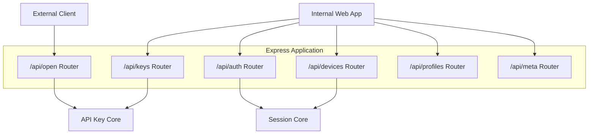
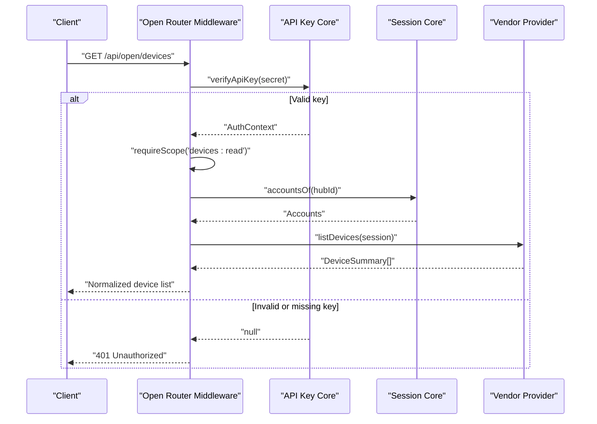
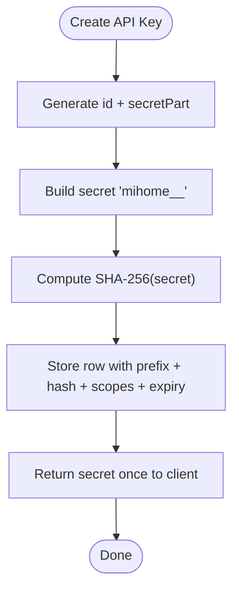
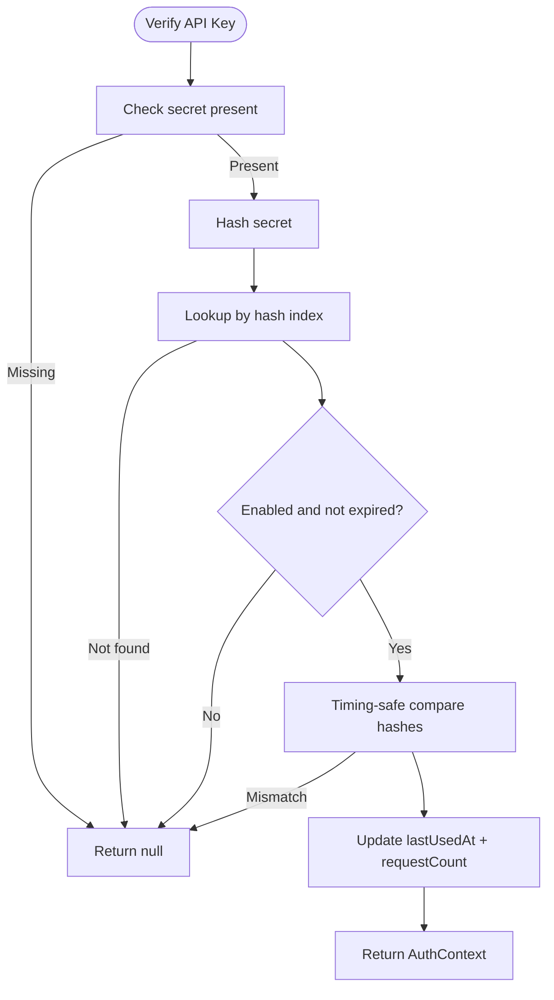
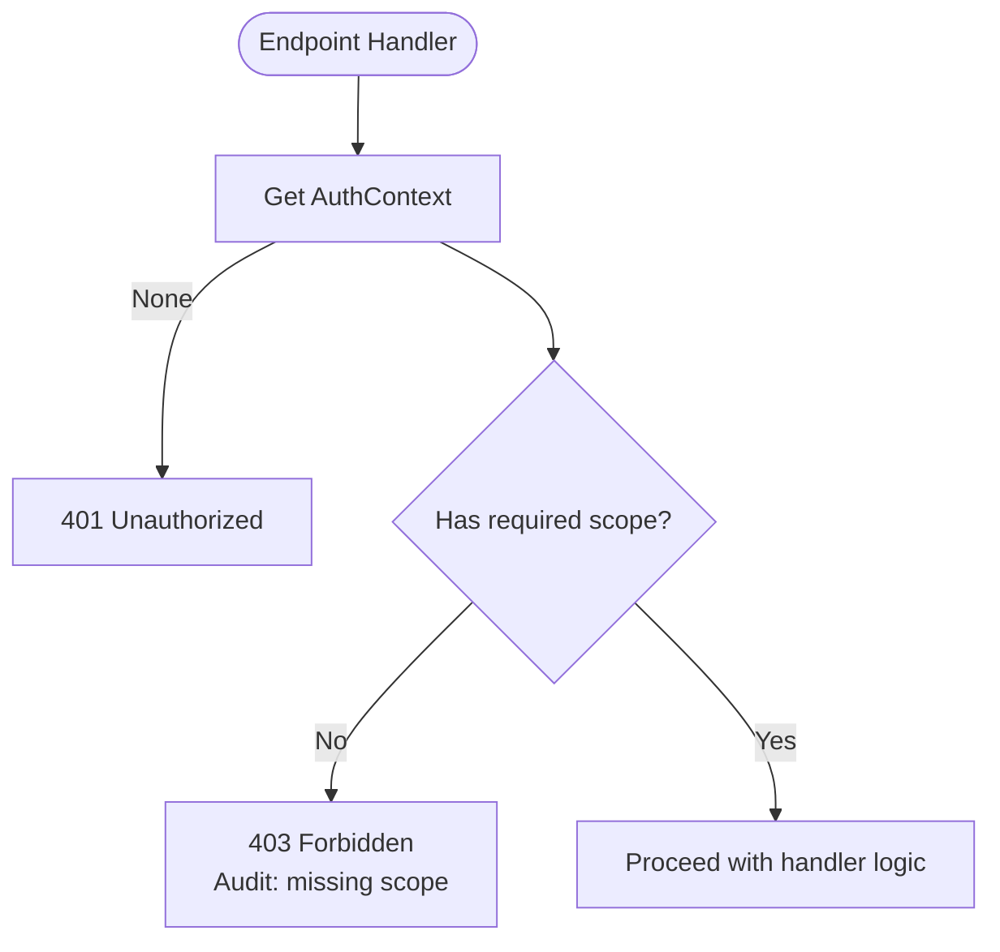
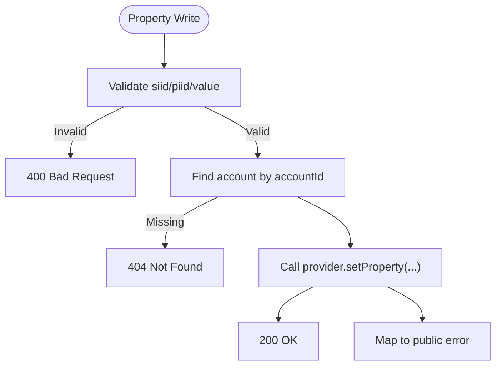
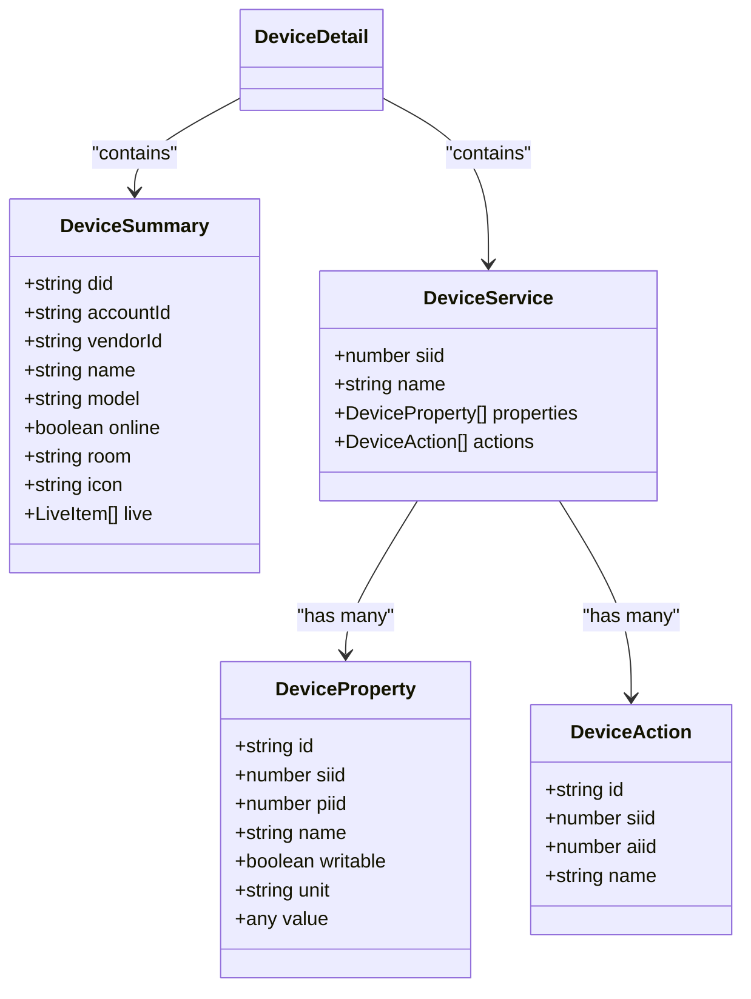
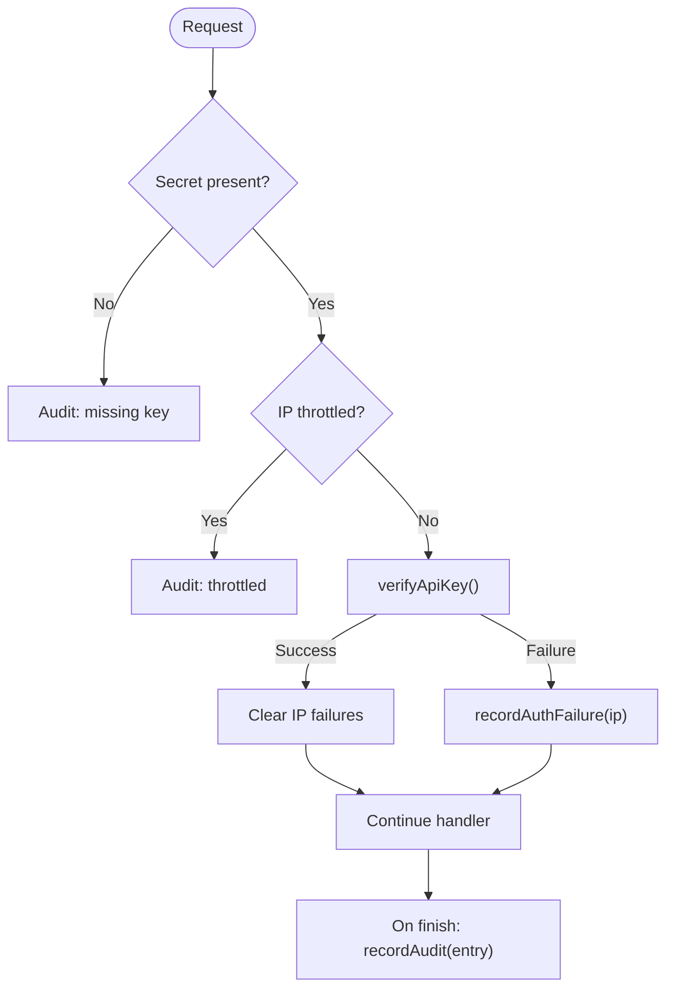
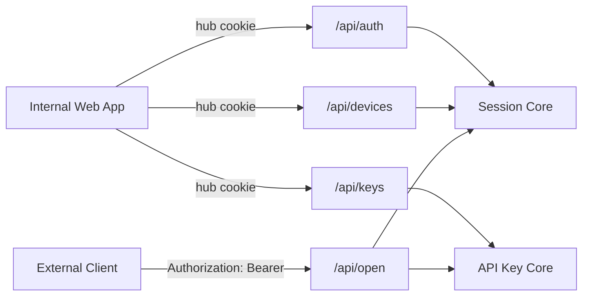
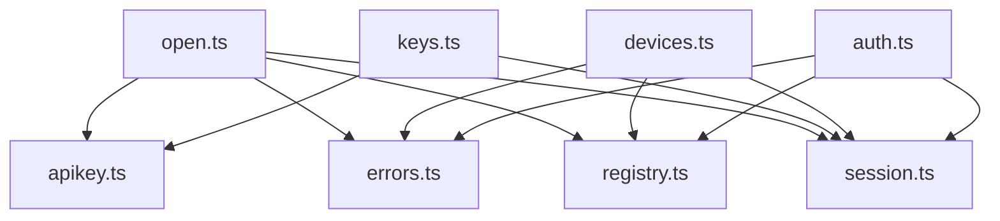

# API Gateway Architecture

<cite>
**Referenced Files in This Document**
- [README.md](file://README.md)
- [src/index.ts](file://src/index.ts)
- [src/app.ts](file://src/app.ts)
- [src/routes/auth.ts](file://src/routes/auth.ts)
- [src/routes/devices.ts](file://src/routes/devices.ts)
- [src/routes/keys.ts](file://src/routes/keys.ts)
- [src/routes/open.ts](file://src/routes/open.ts)
- [src/core/apikey.ts](file://src/core/apikey.ts)
- [src/core/errors.ts](file://src/core/errors.ts)
- [src/core/session.ts](file://src/core/session.ts)
- [src/providers/types.ts](file://src/providers/types.ts)
</cite>

## Table of Contents
1. [Introduction](#introduction)
2. [Project Structure](#project-structure)
3. [Core Components](#core-components)
4. [Architecture Overview](#architecture-overview)
5. [Detailed Component Analysis](#detailed-component-analysis)
6. [Dependency Analysis](#dependency-analysis)
7. [Performance Considerations](#performance-considerations)
8. [Troubleshooting Guide](#troubleshooting-guide)
9. [Conclusion](#conclusion)

## Introduction
This document explains the API gateway architecture that exposes platform functionality to external clients through a secure, scope-controlled public surface. The system separates internal management routes from the public `/api/open` endpoints. External clients authenticate with an API key and are granted access only to explicitly assigned scopes. Internal routes rely on a hub cookie session for administrative operations such as device control and profile management.

The gateway provides:
- A middleware pipeline for request validation, authentication, authorization, rate limiting, and audit logging.
- A scope-based permission model for API keys.
- A request/response transformation layer that normalizes vendor-specific device data into stable external contracts.
- Security measures including input validation, output sanitization, secret hashing, timing-safe comparison, and audit trails.
- Clear boundaries between internal routes and the public API surface.

## Project Structure
The application is an Express server that mounts multiple routers under `/api`. The entry point boots providers and starts the HTTP server. The router layout defines two main surfaces:
- Internal management routes: `/api/auth`, `/api/devices`, `/api/profiles`, `/api/keys`, `/api/meta`.
- Public API surface: `/api/open`.

**Diagram sources**
- [src/app.ts:13-23](file://src/app.ts#L13-L23)
- [src/routes/open.ts:17-105](file://src/routes/open.ts#L17-L105)
- [src/routes/auth.ts:19-23](file://src/routes/auth.ts#L19-L23)
- [src/routes/devices.ts:9-19](file://src/routes/devices.ts#L9-L19)
- [src/routes/keys.ts:14-24](file://src/routes/keys.ts#L14-L24)

**Section sources**
- [src/index.ts:1-13](file://src/index.ts#L1-L13)
- [src/app.ts:13-23](file://src/app.ts#L13-L23)

## Core Components
- API Key core: generates, stores, verifies, and audits API keys; enforces scopes and rate limits.
- Session core: manages hub sessions, vendor accounts, device caches, and pending authentication flows.
- Error utilities: define structured errors, detect auth failures, and sanitize error responses.
- Provider types: define the normalized contract for devices, properties, actions, live telemetry, and vendor sessions.

Key responsibilities:
- Authentication: API key verification via SHA-256 hash index and timing-safe comparison.
- Authorization: per-endpoint scope checks against the authenticated key’s scopes.
- Rate limiting: IP-based throttling for repeated invalid API key attempts.
- Audit trail: per-request logging with redacted secrets and scoped visibility.
- Data normalization: mapping provider device models to stable public response shapes.

**Section sources**
- [src/core/apikey.ts:6-48](file://src/core/apikey.ts#L6-L48)
- [src/core/session.ts:26-35](file://src/core/session.ts#L26-L35)
- [src/core/errors.ts:1-38](file://src/core/errors.ts#L1-L38)
- [src/providers/types.ts:22-84](file://src/providers/types.ts#L22-L84)

## Architecture Overview
The public API gateway is implemented by the `/api/open` router. Every request passes through a single middleware that:
- Sets cache-control headers to prevent caching of sensitive data.
- Extracts the API key from the `Authorization` header or query parameter.
- Checks IP-based rate limiting for invalid keys.
- Verifies the API key and attaches an authentication context to the request.
- Records an audit entry after the response finishes, including method, path, status, duration, IP, and failure reason when applicable.

Endpoints then enforce additional scope requirements before accessing vendor sessions and device data.

**Diagram sources**
- [src/routes/open.ts:62-105](file://src/routes/open.ts#L62-L105)
- [src/routes/open.ts:177-202](file://src/routes/open.ts#L177-L202)
- [src/core/apikey.ts:221-241](file://src/core/apikey.ts#L221-L241)
- [src/core/session.ts:178-182](file://src/core/session.ts#L178-L182)

## Detailed Component Analysis

### API Key Generation, Storage, and Verification
The API key system uses a deterministic format and stores only a SHA-256 hash of the secret. When creating a key:
- An ID and random secret part are generated.
- The full secret is returned once to the caller.
- The stored record contains the prefix (for UI identification), hashed secret, name, scopes, expiration, enabled flag, usage counters, and timestamps.
- On verification, the system hashes the incoming secret, looks it up in an index, checks enabled/expired state, and performs a timing-safe comparison.

**Diagram sources**
- [src/core/apikey.ts:152-183](file://src/core/apikey.ts#L152-L183)

Verification flow:

**Diagram sources**
- [src/core/apikey.ts:221-237](file://src/core/apikey.ts#L221-L237)

**Section sources**
- [src/core/apikey.ts:152-183](file://src/core/apikey.ts#L152-L183)
- [src/core/apikey.ts:221-241](file://src/core/apikey.ts#L221-L241)

### Scope-Based Permission System
Scopes are a fixed set of permissions:
- `devices:read`: read-only device information and properties.
- `devices:live`: read live telemetry.
- `devices:control`: write device properties and execute actions.

Each endpoint declares its required scope. If the authenticated key lacks the scope, the request fails with 403 and an audit message indicating the missing scope.

**Diagram sources**
- [src/routes/open.ts:107-119](file://src/routes/open.ts#L107-L119)
- [src/core/apikey.ts:6-9](file://src/core/apikey.ts#L6-L9)

Scope-to-endpoint mapping:
- `devices:read`: `/api/open/info`, `/api/open/accounts`, `/api/open/devices`, `/api/open/devices/:accountId/:did`, `/api/open/devices/:accountId/:did/props`.
- `devices:live`: `/api/open/live`, `/api/open/live/:did`.
- `devices:control`: `POST /api/open/devices/:accountId/:did/props`, `POST /api/open/devices/:accountId/:did/actions`.

**Section sources**
- [src/routes/open.ts:150-324](file://src/routes/open.ts#L150-L324)
- [src/core/apikey.ts:6-9](file://src/core/apikey.ts#L6-L9)

### Request Validation and Input Sanitization
Public endpoints validate inputs before calling vendor providers:
- Device property writes require `siid`, `piid`, and `value`.
- Action executions require `siid` and `aiid`.
- Account existence is checked before device operations.
- Errors are converted to public-safe responses using a sanitizer.

**Diagram sources**
- [src/routes/open.ts:247-270](file://src/routes/open.ts#L247-L270)
- [src/core/errors.ts:28-37](file://src/core/errors.ts#L28-L37)

**Section sources**
- [src/routes/open.ts:247-290](file://src/routes/open.ts#L247-L290)
- [src/core/errors.ts:1-38](file://src/core/errors.ts#L1-L38)

### Output Normalization Layer
The gateway normalizes vendor-specific device data into stable external contracts:
- Device summaries include stable identifiers, vendor metadata, online status, room, icon, and live items.
- Device details map services and properties into a consistent structure.
- Live telemetry returns a map keyed by account/device with normalized display items.

**Diagram sources**
- [src/providers/types.ts:22-70](file://src/providers/types.ts#L22-L70)
- [src/routes/open.ts:127-139](file://src/routes/open.ts#L127-L139)

**Section sources**
- [src/routes/open.ts:127-148](file://src/routes/open.ts#L127-L148)
- [src/providers/types.ts:22-70](file://src/providers/types.ts#L22-L70)

### Audit Trail and Rate Limiting
Every request to `/api/open` produces an audit entry:
- Includes timestamp, hub/key identity, method, path, status code, duration, IP, and optional failure message.
- Query parameters containing the API key are redacted.
- Unauthenticated requests are marked as unattributed and are not distributed to any hub.
- Audit entries are capped at a fixed limit and persisted asynchronously via microtask batching.

Rate limiting protects against brute-force API key guessing:
- Tracks recent invalid key attempts per IP within a time window.
- Returns 429 when too many invalid attempts occur.
- Clears the failure counter on successful authentication.

**Diagram sources**
- [src/routes/open.ts:62-105](file://src/routes/open.ts#L62-L105)
- [src/core/apikey.ts:243-255](file://src/core/apikey.ts#L243-L255)
- [src/core/apikey.ts:273-303](file://src/core/apikey.ts#L273-L303)

**Section sources**
- [src/routes/open.ts:43-56](file://src/routes/open.ts#L43-L56)
- [src/routes/open.ts:62-105](file://src/routes/open.ts#L62-L105)
- [src/core/apikey.ts:243-303](file://src/core/apikey.ts#L243-L303)

### Relationship Between Internal Routes and Public API Surface
Internal routes use a hub cookie session:
- `/api/auth` handles login flows, QR scanning, SMS, email 2FA, logout, and account status.
- `/api/devices` provides device listing, live telemetry, detail, property writes, actions, and print upload for internal web app users.
- `/api/keys` manages API keys and audit logs for administrators.

Public routes under `/api/open` expose a subset of device capabilities to external clients, strictly controlled by API key scopes.

**Diagram sources**
- [src/routes/auth.ts:19-33](file://src/routes/auth.ts#L19-L33)
- [src/routes/devices.ts:9-19](file://src/routes/devices.ts#L9-L19)
- [src/routes/keys.ts:14-24](file://src/routes/keys.ts#L14-L24)
- [src/routes/open.ts:17-105](file://src/routes/open.ts#L17-L105)

**Section sources**
- [src/routes/auth.ts:35-200](file://src/routes/auth.ts#L35-L200)
- [src/routes/devices.ts:21-178](file://src/routes/devices.ts#L21-L178)
- [src/routes/keys.ts:26-81](file://src/routes/keys.ts#L26-L81)
- [src/routes/open.ts:150-324](file://src/routes/open.ts#L150-L324)

### Versioning Strategies and Deprecation Policies
The current implementation does not include explicit URL versioning (e.g., `/v1/...`). The public surface is defined by the `/api/open` router and its endpoints. To evolve the API safely:
- Introduce a versioned base path (e.g., `/api/v1/open`) while keeping legacy routes during a transition period.
- Add deprecation headers and response fields indicating sunset dates.
- Maintain backward-compatible normalization layers so older clients continue receiving stable shapes.
- Use feature flags or capability negotiation if needed for gradual rollout.

[No sources needed since this section provides general guidance]

## Dependency Analysis
The following diagram shows how routers depend on core modules and provider abstractions.

**Diagram sources**
- [src/routes/open.ts:1-15](file://src/routes/open.ts#L1-L15)
- [src/routes/keys.ts:1-12](file://src/routes/keys.ts#L1-L12)
- [src/routes/devices.ts:1-8](file://src/routes/devices.ts#L1-L8)
- [src/routes/auth.ts:1-17](file://src/routes/auth.ts#L1-L17)

**Section sources**
- [src/routes/open.ts:1-15](file://src/routes/open.ts#L1-L15)
- [src/routes/keys.ts:1-12](file://src/routes/keys.ts#L1-L12)
- [src/routes/devices.ts:1-8](file://src/routes/devices.ts#L1-L8)
- [src/routes/auth.ts:1-17](file://src/routes/auth.ts#L1-L17)

## Performance Considerations
- JSON body parsing is limited to 64KB to reduce memory pressure.
- Audit persistence is batched via microtasks to avoid frequent disk writes.
- Device listing and live telemetry are parallelized across vendor accounts where possible.
- Cache-Control headers prevent caching of sensitive device and authentication data.
- Rate limiting uses in-memory tracking with cleanup of expired entries to bound memory growth.

[No sources needed since this section provides general guidance]

## Troubleshooting Guide
Common issues and resolutions:
- Missing API key: ensure the client sends `Authorization: Bearer <key>` or includes `apiKey` in the query string.
- Invalid or expired API key: verify the key exists, is enabled, and has not expired.
- Insufficient scope: assign the required scope (`devices:read`, `devices:live`, or `devices:control`) when creating the key.
- Rate-limited IP: wait for the cooldown window or reduce invalid key attempts.
- Property write failures: confirm required fields (`siid`, `piid`, `value`) and account validity.
- Audit visibility: audit records are scoped to the hub; unattributed failures are not shared across hubs.

Use the admin endpoints to:
- List keys and scopes.
- Create keys with specific scopes and expiration.
- Enable/disable or revoke keys.
- Read and clear audit logs.

**Section sources**
- [src/routes/open.ts:86-119](file://src/routes/open.ts#L86-L119)
- [src/routes/keys.ts:26-81](file://src/routes/keys.ts#L26-L81)
- [src/core/apikey.ts:243-303](file://src/core/apikey.ts#L243-L303)

## Conclusion
The API gateway provides a secure, auditable, and scope-controlled public surface over platform device functionality. It separates internal management from external access, enforces strict authentication and authorization, normalizes vendor data into stable contracts, and implements robust security measures including secret hashing, timing-safe comparisons, input validation, output sanitization, and comprehensive audit logging. Future evolution should adopt explicit versioning and deprecation policies to maintain compatibility while expanding capabilities.