# Architecture Overview

<cite>
**Referenced Files in This Document**
- [README.md](file://README.md)
- [package.json](file://package.json)
- [src/index.ts](file://src/index.ts)
- [src/app.ts](file://src/app.ts)
- [client/src/App.tsx](file://client/src/App.tsx)
- [src/providers/index.ts](file://src/providers/index.ts)
- [src/providers/types.ts](file://src/providers/types.ts)
- [src/core/registry.ts](file://src/core/registry.ts)
- [src/core/session.ts](file://src/core/session.ts)
- [src/routes/auth.ts](file://src/routes/auth.ts)
- [src/routes/devices.ts](file://src/routes/devices.ts)
- [src/routes/open.ts](file://src/routes/open.ts)
- [src/routes/meta.ts](file://src/routes/meta.ts)
- [src/controls/index.ts](file://src/controls/index.ts)
- [src/controls/panel.ts](file://src/controls/panel.ts)
</cite>

## Table of Contents
1. [Introduction](#introduction)
2. [Project Structure](#project-structure)
3. [Core Components](#core-components)
4. [Architecture Overview](#architecture-overview)
5. [Detailed Component Analysis](#detailed-component-analysis)
6. [Dependency Analysis](#dependency-analysis)
7. [Performance Considerations](#performance-considerations)
8. [Troubleshooting Guide](#troubleshooting-guide)
9. [Conclusion](#conclusion)

## Introduction
mihome-web is a full-stack platform that connects multiple smart-device vendor ecosystems behind a unified control panel and an external API gateway. The backend is built with Express.js, while the frontend is a React application served from the same server. The system supports Xiaomi, Midea, and Pantum integrations through a pluggable provider architecture, and exposes device information and limited control capabilities to external applications via scope-based API keys.

At its core, the platform separates three concerns:
- Vendor integration: each ecosystem is implemented as a `VendorProvider`.
- Control panel composition: vendor fields are converted into a stable, configuration-driven UI model.
- Access control: internal browser sessions manage multi-vendor logins, while external clients authenticate through scoped API keys.

The README explains the three-layer control panel design: `VendorField` abstraction, `DeviceProfile` configuration, and `DeviceDetail` rendering. It also documents the open API key mechanism, scope coverage, audit logging, rate limiting for invalid keys, and cache behavior.

**Section sources**
- [README.md:3-57](file://README.md#L3-L57)
- [README.md:59-97](file://README.md#L59-L97)

## Project Structure
The repository is organized into a Node.js backend under `src/`, a React frontend under `client/src/`, shared documentation under `docs/`, and static assets under `public/`.

Key responsibilities:
- Backend entry point boots providers and starts the Express server.
- Application router mounts route modules under `/api`.
- Providers register themselves at startup and implement vendor-specific authentication, device listing, detail retrieval, property writes, and actions.
- Controls define the panel composition pipeline.
- Core modules provide registry, session persistence, error handling, and status tracking.
- Routes expose authentication, device management, profile management, API key administration, and open endpoints.

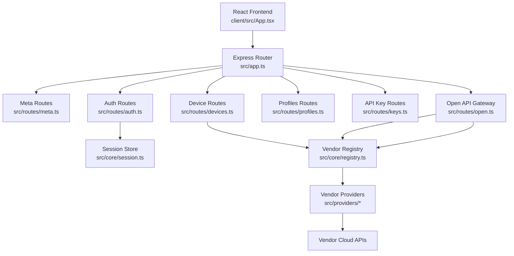

**Diagram sources**
- [src/index.ts:1-13](file://src/index.ts#L1-L13)
- [src/app.ts:13-24](file://src/app.ts#L13-L24)
- [client/src/App.tsx:31-60](file://client/src/App.tsx#L31-L60)
- [src/routes/meta.ts:5-19](file://src/routes/meta.ts#L5-L19)
- [src/routes/auth.ts:19-199](file://src/routes/auth.ts#L19-L199)
- [src/routes/devices.ts:9-177](file://src/routes/devices.ts#L9-L177)
- [src/routes/open.ts:17-323](file://src/routes/open.ts#L17-L323)
- [src/core/registry.ts:1-24](file://src/core/registry.ts#L1-L24)
- [src/core/session.ts:1-266](file://src/core/session.ts#L1-L266)

**Section sources**
- [package.json:1-24](file://package.json#L1-L24)
- [src/index.ts:1-13](file://src/index.ts#L1-L13)
- [src/app.ts:13-24](file://src/app.ts#L13-L24)
- [client/src/App.tsx:31-60](file://client/src/App.tsx#L31-L60)

## Core Components
This section summarizes the main architectural building blocks.

### Provider Pattern and Vendor Abstraction
Each vendor integration implements the `VendorProvider` interface. Providers expose:
- Metadata such as id, name, supported auth modes, and regions.
- Authentication flows including password, SMS, email two-factor, and QR code login.
- Device discovery, live status refresh, device detail retrieval, property writing, and action execution.
- Optional helpers such as captcha image retrieval and QR image retrieval.

Providers are registered centrally during bootstrap, so routes and services can resolve them by id without knowing implementation details.

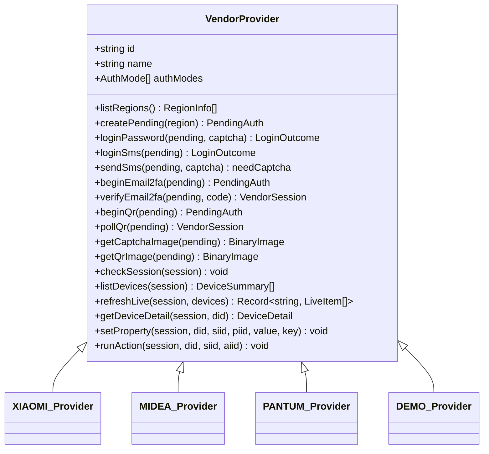

**Diagram sources**
- [src/providers/types.ts:105-143](file://src/providers/types.ts#L105-L143)
- [src/providers/index.ts:1-16](file://src/providers/index.ts#L1-L16)

**Section sources**
- [src/providers/types.ts:10-143](file://src/providers/types.ts#L10-L143)
- [src/providers/index.ts:1-16](file://src/providers/index.ts#L1-L16)
- [src/core/registry.ts:1-24](file://src/core/registry.ts#L1-L24)

### Three-Layer Control Panel System
The control panel is intentionally decoupled from vendor UI logic:
1. **VendorField**: adapters return field metadata, raw values, constraints, and identifiers.
2. **DeviceProfile and FieldRule**: JSON-driven profiles define labels, kinds, codecs, groups, ordering, and visibility rules. Profiles support layered matching by device id, model, spec type, and vendor default.
3. **DeviceDetail**: the backend composes a normalized device view with stable ids, explicit control kinds, grouped properties, and actions. The frontend renders based on kind, and write-back uses the same profile rules to encode values.

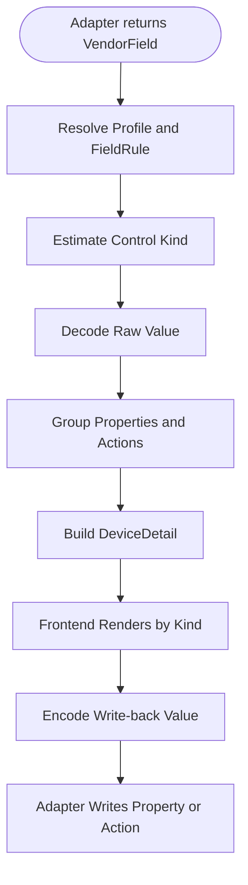

**Diagram sources**
- [src/controls/panel.ts:12-86](file://src/controls/panel.ts#L12-L86)
- [src/controls/panel.ts:98-166](file://src/controls/panel.ts#L98-L166)
- [src/controls/index.ts:21-24](file://src/controls/index.ts#L21-L24)

**Section sources**
- [README.md:3-57](file://README.md#L3-L57)
- [src/controls/index.ts:1-24](file://src/controls/index.ts#L1-L24)
- [src/controls/panel.ts:12-166](file://src/controls/panel.ts#L12-L166)

### Session Management for Multiple Vendor Accounts
The session layer manages:
- A hub representing one browser context.
- Multiple vendor accounts attached to a hub.
- Pending authentication contexts for multi-step flows.
- In-memory state persisted to disk with safe serialization for buffers, maps, and cookie jars.
- Account status tracking and optional replacement when re-authenticating the same user.

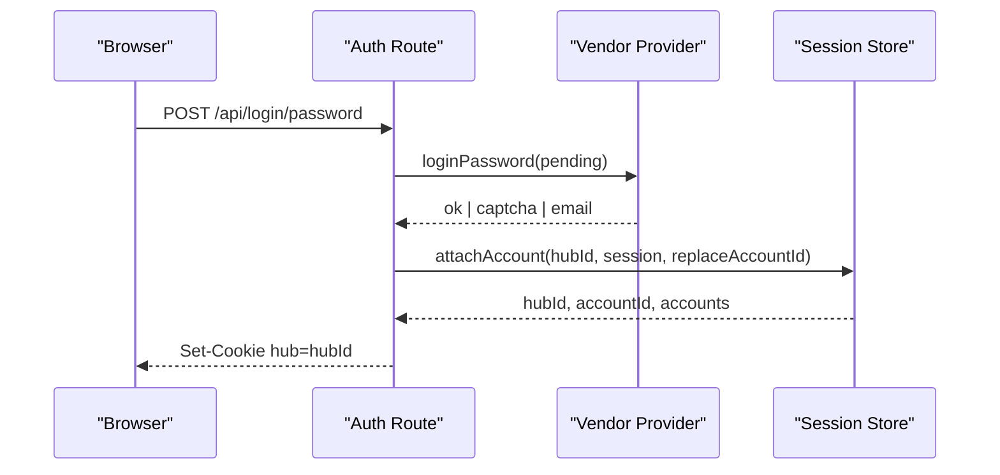

**Diagram sources**
- [src/routes/auth.ts:35-71](file://src/routes/auth.ts#L35-L71)
- [src/core/session.ts:184-210](file://src/core/session.ts#L184-L210)

**Section sources**
- [src/core/session.ts:1-266](file://src/core/session.ts#L1-L266)
- [src/routes/auth.ts:19-199](file://src/routes/auth.ts#L19-L199)

### API Gateway with Scope-Based Authorization
The open API gateway provides read-only and controlled access to device data for external applications:
- Authentication via Bearer token or query parameter.
- Rate limiting and throttling for repeated invalid keys.
- Audit logging for every request, including failed authentication attempts.
- Scope checks per endpoint: `devices:read`, `devices:live`, `devices:control`.
- Response headers prevent caching sensitive device data.

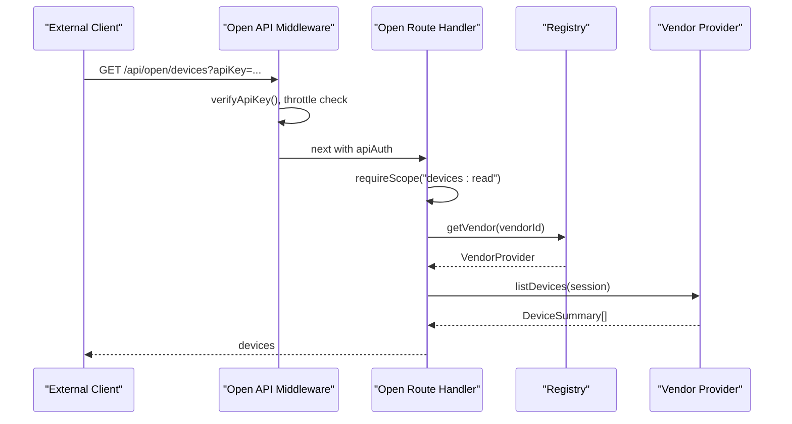

**Diagram sources**
- [src/routes/open.ts:62-105](file://src/routes/open.ts#L62-L105)
- [src/routes/open.ts:107-148](file://src/routes/open.ts#L107-L148)
- [src/routes/open.ts:177-202](file://src/routes/open.ts#L177-L202)

**Section sources**
- [src/routes/open.ts:1-324](file://src/routes/open.ts#L1-L324)
- [README.md:59-97](file://README.md#L59-L97)

## Architecture Overview
The system follows a layered architecture:
- Frontend: React app discovers vendors, loads accounts, and renders device panels.
- Backend: Express app mounts routers for meta, authentication, devices, profiles, API keys, and open endpoints.
- Providers: Pluggable vendor implementations abstracting Xiaomi, Midea, Pantum, and demo integrations.
- Controls: Configuration-driven panel builder converting vendor fields into stable UI models.
- Core: Registry, session store, errors, and status utilities.

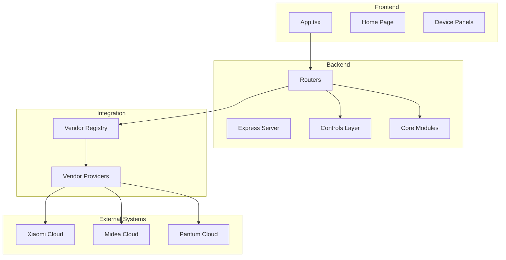

**Diagram sources**
- [client/src/App.tsx:31-60](file://client/src/App.tsx#L31-L60)
- [src/app.ts:13-24](file://src/app.ts#L13-L24)
- [src/providers/index.ts:1-16](file://src/providers/index.ts#L1-L16)
- [src/core/registry.ts:1-24](file://src/core/registry.ts#L1-L24)

## Detailed Component Analysis

### Vendor Provider Interface and Implementations
The provider interface defines a consistent contract for all vendor integrations. Implementations include:
- Xiaomi: password, QR, and related HTTP/crypto helpers.
- Midea: SMS, password, crypto, and device operations.
- Pantum: cloud integration and print functionality.
- Demo: placeholder provider for development.

Bootstrap registers these providers, making them available through the registry.

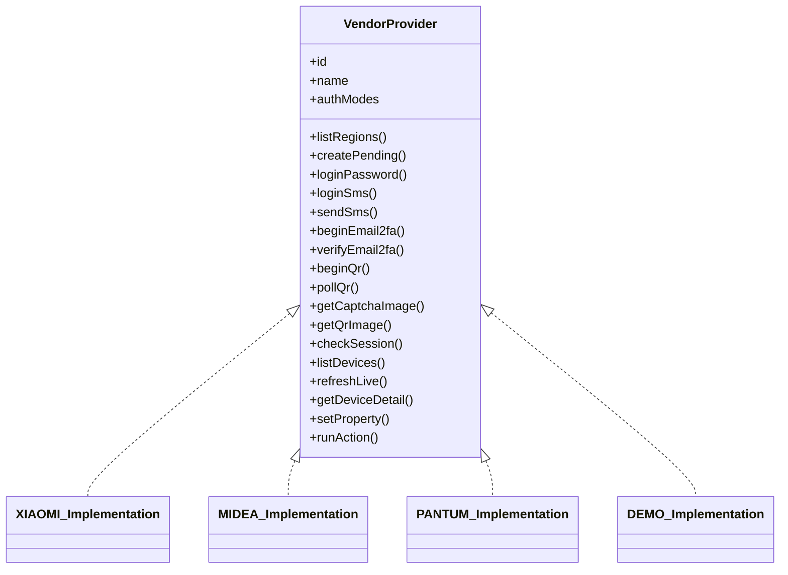

**Diagram sources**
- [src/providers/types.ts:105-143](file://src/providers/types.ts#L105-L143)
- [src/providers/index.ts:1-16](file://src/providers/index.ts#L1-L16)

**Section sources**
- [src/providers/types.ts:105-143](file://src/providers/types.ts#L105-L143)
- [src/providers/index.ts:1-16](file://src/providers/index.ts#L1-L16)

### Control Panel Pipeline
The panel pipeline converts vendor-provided fields into a structured device detail:
- Resolve profile and field rule by device identity and field name.
- Estimate control kind based on options, range, and raw value.
- Decode raw values using codec functions.
- Group properties and actions into services.
- Return a normalized `DeviceDetail` for frontend rendering.
- Encode write-back values using the same codec strategy.

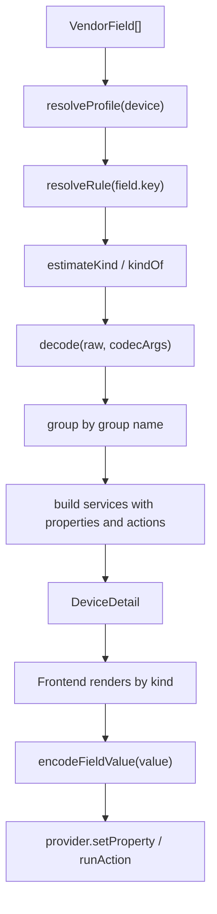

**Diagram sources**
- [src/controls/panel.ts:55-86](file://src/controls/panel.ts#L55-L86)
- [src/controls/panel.ts:102-153](file://src/controls/panel.ts#L102-L153)
- [src/controls/panel.ts:161-166](file://src/controls/panel.ts#L161-L166)

**Section sources**
- [src/controls/panel.ts:12-166](file://src/controls/panel.ts#L12-L166)
- [src/controls/index.ts:1-24](file://src/controls/index.ts#L1-L24)
- [README.md:3-57](file://README.md#L3-L57)

### Authentication Flow
Authentication routes handle multiple vendor flows:
- Password login with optional captcha.
- SMS login with optional captcha.
- Email two-factor verification.
- QR code initiation, image retrieval, and polling.
- Binding successful sessions to the current hub and setting a secure cookie.

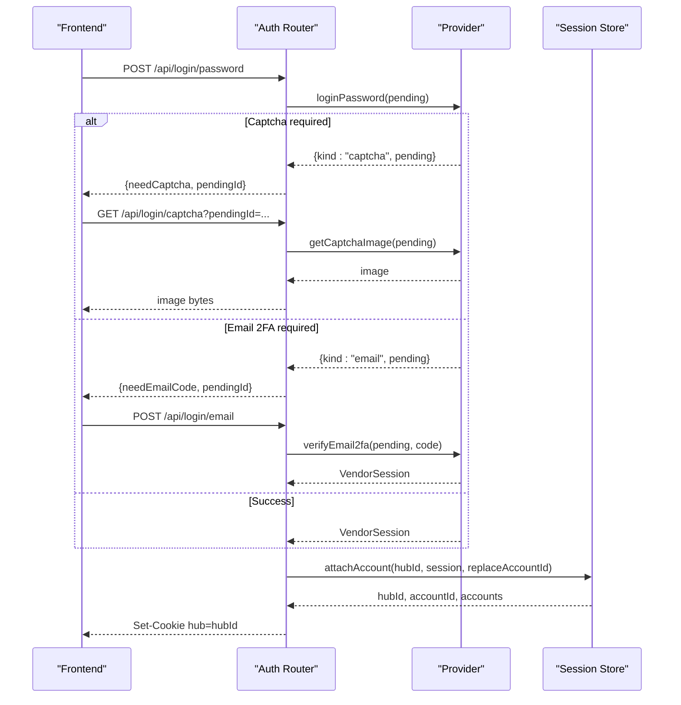

**Diagram sources**
- [src/routes/auth.ts:35-71](file://src/routes/auth.ts#L35-L71)
- [src/routes/auth.ts:93-107](file://src/routes/auth.ts#L93-L107)
- [src/routes/auth.ts:109-121](file://src/routes/auth.ts#L109-L121)
- [src/routes/auth.ts:123-173](file://src/routes/auth.ts#L123-L173)
- [src/core/session.ts:184-210](file://src/core/session.ts#L184-L210)

**Section sources**
- [src/routes/auth.ts:19-199](file://src/routes/auth.ts#L19-L199)
- [src/core/session.ts:184-210](file://src/core/session.ts#L184-L210)

### Device Operations and Print Upload
Device routes require a valid hub session and delegate to the appropriate provider:
- List devices across all accounts.
- Refresh live status.
- Read device detail.
- Write properties and execute actions.
- Upload print files for Pantum devices using multipart parsing.

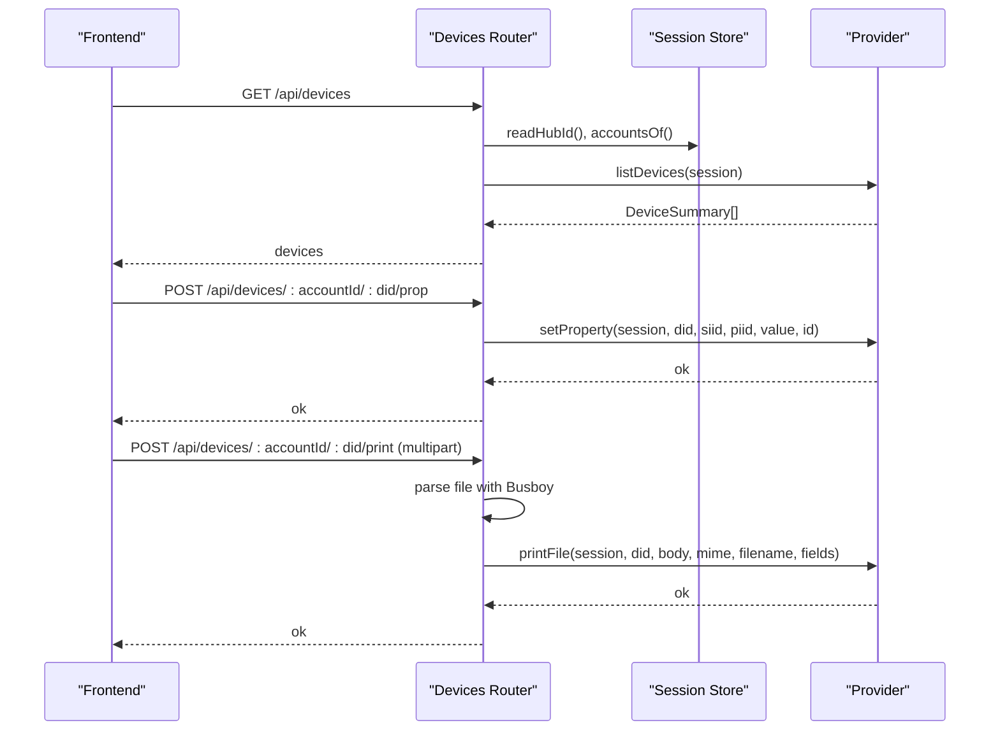

**Diagram sources**
- [src/routes/devices.ts:21-44](file://src/routes/devices.ts#L21-L44)
- [src/routes/devices.ts:64-92](file://src/routes/devices.ts#L64-L92)
- [src/routes/devices.ts:94-110](file://src/routes/devices.ts#L94-L110)
- [src/routes/devices.ts:118-162](file://src/routes/devices.ts#L118-L162)

**Section sources**
- [src/routes/devices.ts:1-178](file://src/routes/devices.ts#L1-L178)

### Open API Gateway Details
The open gateway enforces:
- Cache-control headers to avoid caching sensitive responses.
- Request auditing with redacted API keys.
- IP-based throttling for repeated invalid keys.
- Scope enforcement per endpoint.
- Device resolution from session cache or provider fallback.

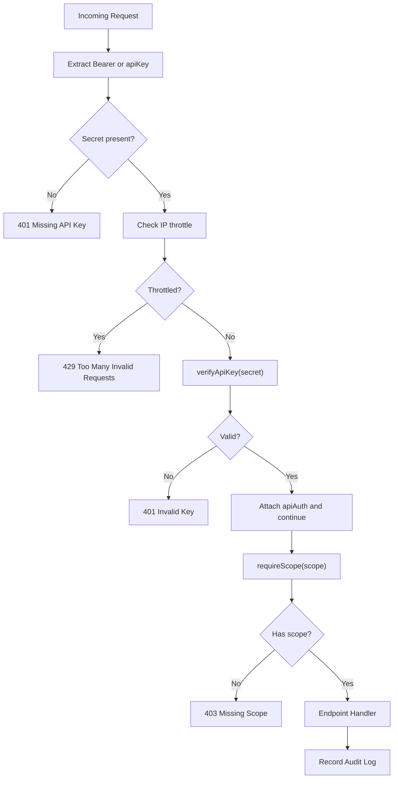

**Diagram sources**
- [src/routes/open.ts:62-105](file://src/routes/open.ts#L62-L105)
- [src/routes/open.ts:107-119](file://src/routes/open.ts#L107-L119)

**Section sources**
- [src/routes/open.ts:1-324](file://src/routes/open.ts#L1-L324)
- [README.md:59-97](file://README.md#L59-L97)

### Registry Pattern for Component Discovery
The registry stores vendor providers by id and exposes:
- Registration function used at bootstrap.
- Lookup function used by routes and services.
- Listing function used by meta routes and frontend vendor discovery.

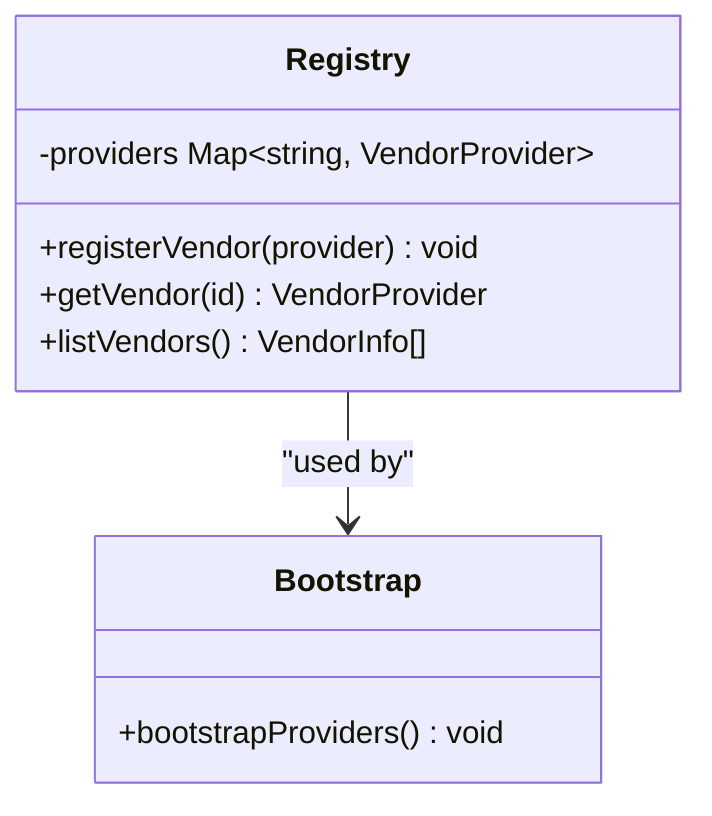

**Diagram sources**
- [src/core/registry.ts:1-24](file://src/core/registry.ts#L1-L24)
- [src/providers/index.ts:1-16](file://src/providers/index.ts#L1-L16)

**Section sources**
- [src/core/registry.ts:1-24](file://src/core/registry.ts#L1-L24)
- [src/providers/index.ts:1-16](file://src/providers/index.ts#L1-L16)

### Middleware-Based Request Processing Pipeline
Express middleware and route-level guards form the processing pipeline:
- Global JSON parsing and static file serving.
- Open API middleware for authentication, throttling, and auditing.
- Route handlers performing scope checks and delegating to providers.
- Session-based guards requiring a logged-in hub for internal device routes.

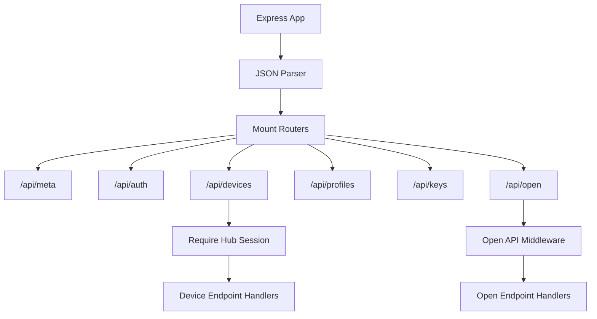

**Diagram sources**
- [src/app.ts:13-24](file://src/app.ts#L13-L24)
- [src/routes/open.ts:62-105](file://src/routes/open.ts#L62-L105)
- [src/routes/devices.ts:11-19](file://src/routes/devices.ts#L11-L19)

**Section sources**
- [src/app.ts:13-24](file://src/app.ts#L13-L24)
- [src/routes/open.ts:62-105](file://src/routes/open.ts#L62-L105)
- [src/routes/devices.ts:11-19](file://src/routes/devices.ts#L11-L19)

## Dependency Analysis
The following diagram shows how components depend on each other:

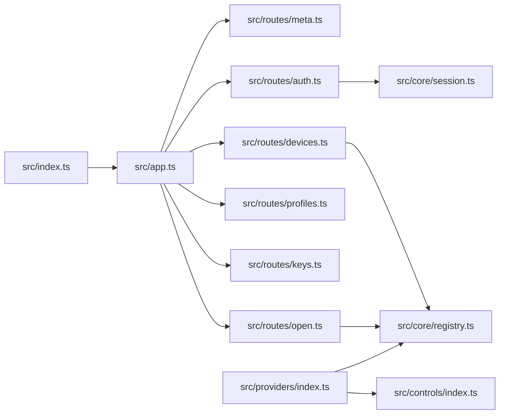

**Diagram sources**
- [src/index.ts:1-13](file://src/index.ts#L1-L13)
- [src/app.ts:13-24](file://src/app.ts#L13-L24)
- [src/routes/meta.ts:1-20](file://src/routes/meta.ts#L1-L20)
- [src/routes/auth.ts:1-199](file://src/routes/auth.ts#L1-L199)
- [src/routes/devices.ts:1-178](file://src/routes/devices.ts#L1-L178)
- [src/routes/open.ts:1-324](file://src/routes/open.ts#L1-L324)
- [src/core/session.ts:1-266](file://src/core/session.ts#L1-L266)
- [src/core/registry.ts:1-24](file://src/core/registry.ts#L1-L24)
- [src/providers/index.ts:1-16](file://src/providers/index.ts#L1-L16)
- [src/controls/index.ts:1-24](file://src/controls/index.ts#L1-L24)

**Section sources**
- [src/index.ts:1-13](file://src/index.ts#L1-L13)
- [src/app.ts:13-24](file://src/app.ts#L13-L24)
- [src/providers/index.ts:1-16](file://src/providers/index.ts#L1-L16)
- [src/controls/index.ts:1-24](file://src/controls/index.ts#L1-L24)

## Performance Considerations
- Provider calls are parallelized where possible, such as listing devices across multiple accounts.
- Open API responses disable caching to avoid leaking device data.
- Audit logs are written asynchronously and bounded to prevent unbounded growth.
- File uploads are streamed and size-limited to protect server resources.
- Session persistence uses atomic file rename to reduce corruption risk.

[No sources needed since this section provides general guidance]

## Troubleshooting Guide
Common operational issues and their indicators:
- Expired vendor sessions: account status becomes expired; device listing may return warnings.
- Missing API key: open endpoints return 401 with instructions to include bearer token.
- Insufficient scope: open endpoints return 403 indicating missing permission scope.
- Invalid key throttling: repeated failures lead to temporary rate limiting.
- Profile encoding errors: hidden fields or mismatched codecs cause validation errors during write-back.

Recommended steps:
- Re-authenticate the affected vendor account.
- Review API key scopes and enable only required permissions.
- Check audit logs for failure reasons and source IPs.
- Validate device profiles and ensure codec arguments match expected value shapes.

**Section sources**
- [src/routes/devices.ts:21-44](file://src/routes/devices.ts#L21-L44)
- [src/routes/open.ts:62-105](file://src/routes/open.ts#L62-L105)
- [src/routes/open.ts:107-119](file://src/routes/open.ts#L107-L119)
- [src/controls/panel.ts:161-166](file://src/controls/panel.ts#L161-L166)

## Conclusion
mihome-web combines a flexible provider architecture with a configuration-driven control panel and a secure API gateway. Vendors integrate through a uniform interface, while profiles decouple vendor semantics from UI rendering. Internal sessions support multi-vendor logins, and external clients consume device data safely through scoped API keys with comprehensive auditing. This design enables extensibility, maintainability, and clear separation between vendor-specific logic and platform-wide concerns.

[No sources needed since this section summarizes without analyzing specific files]