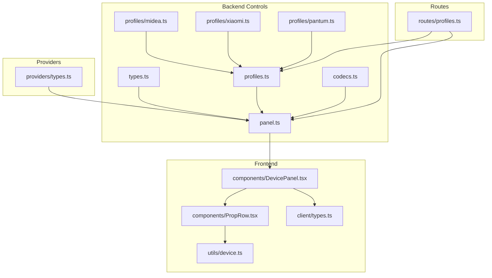
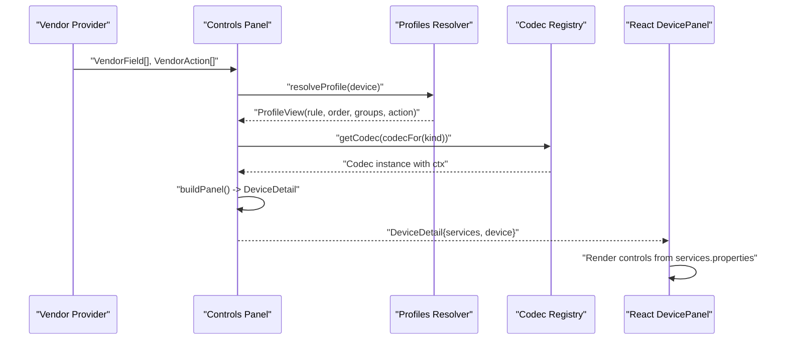
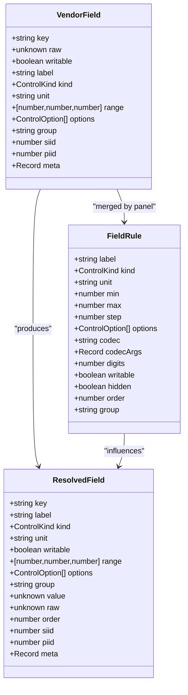
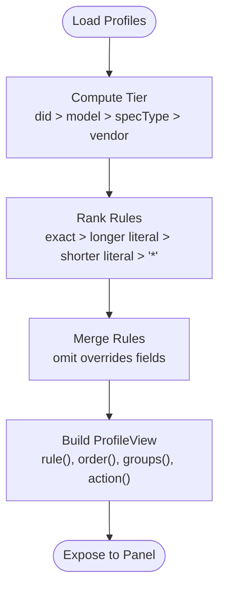
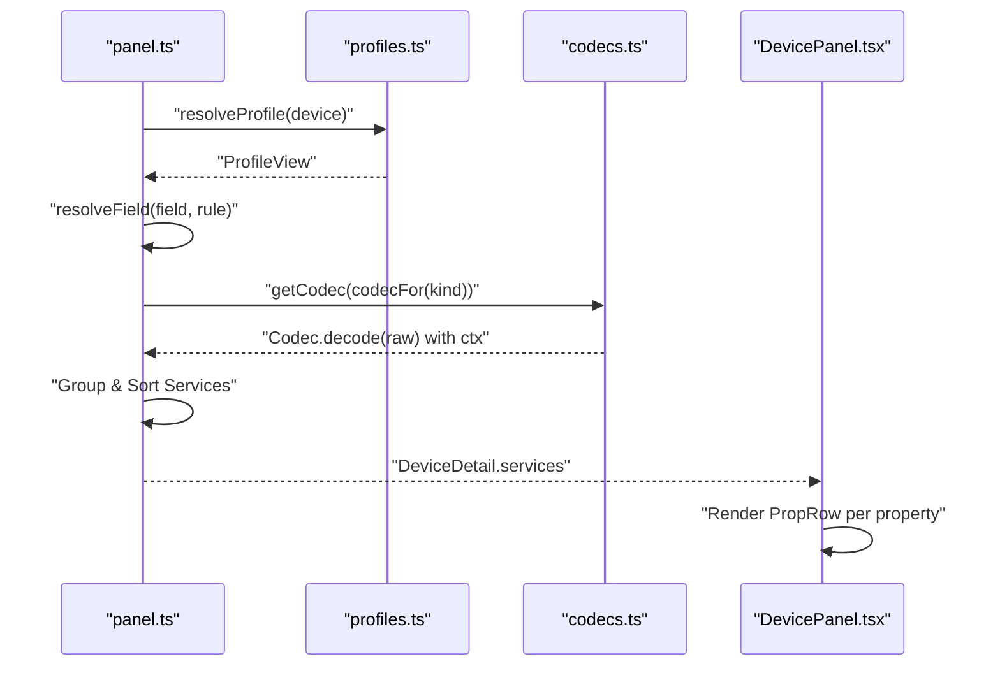
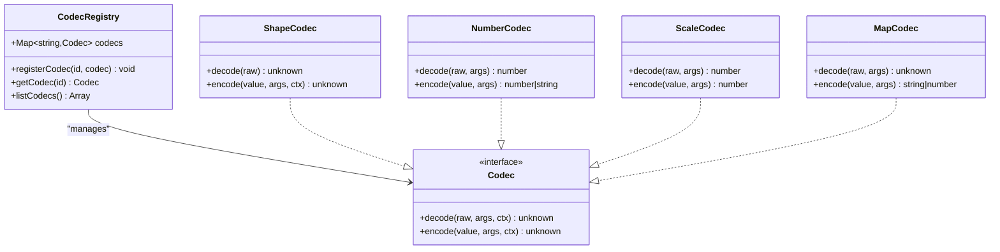
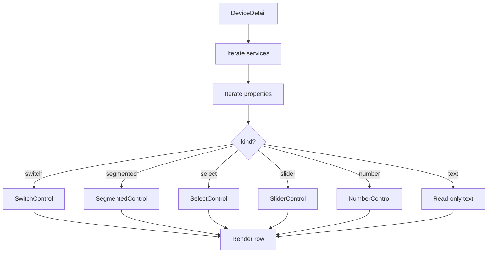
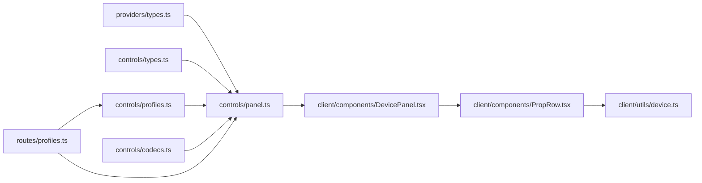

# Control Panel Architecture

<cite>
**Referenced Files in This Document**
- [types.ts](file://src/controls/types.ts)
- [panel.ts](file://src/controls/panel.ts)
- [profiles.ts](file://src/controls/profiles.ts)
- [codecs.ts](file://src/controls/codecs.ts)
- [midea.ts](file://src/controls/profiles/midea.ts)
- [xiaomi.ts](file://src/controls/profiles/xiaomi.ts)
- [pantum.ts](file://src/controls/profiles/pantum.ts)
- [DevicePanel.tsx](file://client/src/components/DevicePanel.tsx)
- [PropRow.tsx](file://client/src/components/PropRow.tsx)
- [device.ts](file://client/src/utils/device.ts)
- [types.ts](file://client/src/types.ts)
- [profiles.ts](file://src/routes/profiles.ts)
- [types.ts](file://src/providers/types.ts)
</cite>

## Update Summary
**Changes Made**
- Enhanced VendorField abstraction with improved metadata support and field resolution
- Refined profile resolution logic with sophisticated tier-based matching and ranking algorithms
- Improved codec system integration with context-aware encoding and enhanced option handling
- Updated architectural diagrams to reflect new component relationships
- Added detailed examples of enhanced profile configurations and custom codecs

## Table of Contents
1. [Introduction](#introduction)
2. [Project Structure](#project-structure)
3. [Core Components](#core-components)
4. [Architecture Overview](#architecture-overview)
5. [Detailed Component Analysis](#detailed-component-analysis)
6. [Dependency Analysis](#dependency-analysis)
7. [Performance Considerations](#performance-considerations)
8. [Troubleshooting Guide](#troubleshooting-guide)
9. [Conclusion](#conclusion)

## Introduction
This document explains the three-layer control panel architecture used to render vendor device controls consistently across different IoT ecosystems. The system separates:
- Vendor-specific raw data into a unified `VendorField` abstraction with enhanced metadata support.
- A declarative `DeviceProfile` configuration system that defines UI layout, validation, grouping, ordering, and field transformations through JSON schemas with refined resolution logic.
- A rendering engine that converts profiles into normalized frontend components with improved codec integration.

It also documents the enhanced codec system for bidirectional transformation between vendor formats and normalized values, provides examples of profile configurations, custom codecs, and integration with the React frontend. Finally, it covers performance considerations for large device profiles and caching strategies for profile loading.

## Project Structure
The repository is organized into backend control logic under `src/controls`, provider implementations under `src/providers`, routes under `src/routes`, and a React frontend under `client/src`.

**Diagram sources**
- [types.ts](file://src/controls/types.ts)
- [profiles.ts](file://src/controls/profiles.ts)
- [panel.ts](file://src/controls/panel.ts)
- [codecs.ts](file://src/controls/codecs.ts)
- [midea.ts](file://src/controls/profiles/midea.ts)
- [xiaomi.ts](file://src/controls/profiles/xiaomi.ts)
- [pantum.ts](file://src/controls/profiles/pantum.ts)
- [profiles.ts](file://src/routes/profiles.ts)
- [types.ts](file://src/providers/types.ts)
- [DevicePanel.tsx](file://client/src/components/DevicePanel.tsx)
- [PropRow.tsx](file://client/src/components/PropRow.tsx)
- [device.ts](file://client/src/utils/device.ts)
- [types.ts](file://client/src/types.ts)

**Section sources**
- [types.ts](file://src/controls/types.ts)
- [profiles.ts](file://src/controls/profiles.ts)
- [panel.ts](file://src/controls/panel.ts)
- [codecs.ts](file://src/controls/codecs.ts)
- [midea.ts](file://src/controls/profiles/midea.ts)
- [xiaomi.ts](file://src/controls/profiles/xiaomi.ts)
- [pantum.ts](file://src/controls/profiles/pantum.ts)
- [profiles.ts](file://src/routes/profiles.ts)
- [types.ts](file://src/providers/types.ts)
- [DevicePanel.tsx](file://client/src/components/DevicePanel.tsx)
- [PropRow.tsx](file://client/src/components/PropRow.tsx)
- [device.ts](file://client/src/utils/device.ts)
- [types.ts](file://client/src/types.ts)

## Core Components
This section introduces the core abstractions and responsibilities:

- **Enhanced VendorField**: The minimal fact produced by vendor adapters, including stable key, raw value, writability, optional constraints, grouping, vendor-specific metadata, and improved field resolution capabilities.
- **FieldRule**: Declarative rules describing label, control kind, unit, range, step, options, codec name and arguments, digits, writability, hidden state, order, and group with refined matching logic.
- **DeviceProfile**: Configuration object matching devices by vendor, model, spec type, or direct device ID; defining fields, omit patterns, order, groups, and actions with sophisticated tier-based precedence.
- **ResolvedField**: Unified view combining vendor field, rule, and inferred constraints for both provider and frontend consumption with enhanced metadata support.
- **Codec**: Bidirectional transform interface with decode and encode methods, plus context carrying raw value and meta for shape-preserving operations.
- **ProfileView**: Runtime view over merged profiles providing rule resolution, ordering, grouping, and action resolution with improved pattern matching.

Key relationships:
- VendorField + FieldRule -> ResolvedField via panel layer with enhanced codec integration.
- DeviceProfile -> ProfileView via profiles layer with refined resolution logic.
- Codec registry supports built-in and custom codecs with context-aware encoding.

**Section sources**
- [types.ts](file://src/controls/types.ts)
- [profiles.ts](file://src/controls/profiles.ts)
- [panel.ts](file://src/controls/panel.ts)
- [codecs.ts](file://src/controls/codecs.ts)

## Architecture Overview
The three-layer architecture cleanly separates concerns with enhanced component interactions:

1. **Vendor Layer**: Adapters produce `VendorField[]` and `VendorAction[]` per device with enriched metadata.
2. **Controls Layer**: Profiles define UI semantics and transformations; panel builds normalized `DeviceDetail` for the frontend with improved codec integration.
3. **Frontend Layer**: React components render controls based on normalized properties and actions.

**Diagram sources**
- [panel.ts](file://src/controls/panel.ts)
- [profiles.ts](file://src/controls/profiles.ts)
- [codecs.ts](file://src/controls/codecs.ts)
- [DevicePanel.tsx](file://client/src/components/DevicePanel.tsx)

## Detailed Component Analysis

### Enhanced VendorField Abstraction
`VendorField` captures the smallest meaningful piece of vendor data with enhanced metadata support:
- Stable key used for writeback mapping.
- Raw value before normalization.
- Writability flag.
- Optional label, kind, unit, range, options, group, siid/piid identifiers, and vendor-specific meta.
- Improved field resolution with better constraint inference.

This abstraction allows the controls layer to remain vendor-agnostic while preserving enough information for accurate UI inference and safe writeback with enhanced context preservation.

**Diagram sources**
- [types.ts](file://src/controls/types.ts)
- [panel.ts](file://src/controls/panel.ts)

**Section sources**
- [types.ts](file://src/controls/types.ts)
- [panel.ts](file://src/controls/panel.ts)

### Refined DeviceProfile Configuration System
`DeviceProfile` uses JSON-like structures to define with enhanced resolution logic:
- Matching criteria: vendor, model, specType, did with sophisticated tier-based precedence.
- Field rules: label, kind, unit, range, step, options, codec, digits, writability, hidden, order, group.
- Omit patterns: wildcard-based exclusion with improved ranking algorithm.
- Order: explicit field ordering with wildcard support and better pattern matching.
- Groups: named sections with display order.
- Actions: labels, visibility, and ordering.

Profiles are layered with refined precedence:
- Direct device match (highest priority).
- Model match with enhanced specificity calculation.
- Spec type match with improved pattern matching.
- Vendor default (lowest priority).

Within each tier, exact names outrank wildcards; longer literal matches outrank shorter ones; omit rules get higher priority within the same tier with sophisticated ranking algorithm.

**Diagram sources**
- [profiles.ts](file://src/controls/profiles.ts)

**Section sources**
- [profiles.ts](file://src/controls/profiles.ts)
- [midea.ts](file://src/controls/profiles/midea.ts)
- [xiaomi.ts](file://src/controls/profiles/xiaomi.ts)
- [pantum.ts](file://src/controls/profiles/pantum.ts)

### Enhanced DeviceDetail Rendering Engine
The panel layer transforms vendor fields into normalized `DeviceDetail` with improved codec integration:
- Resolve profile and merge rules with refined matching logic.
- Estimate control kind based on raw value and constraints with enhanced inference.
- Apply codec decode to normalize values with context-aware processing.
- Group fields into services and sort by group order and field order.
- Map actions into service rows with improved action resolution.

**Diagram sources**
- [panel.ts](file://src/controls/panel.ts)
- [profiles.ts](file://src/controls/profiles.ts)
- [codecs.ts](file://src/controls/codecs.ts)
- [DevicePanel.tsx](file://client/src/components/DevicePanel.tsx)

**Section sources**
- [panel.ts](file://src/controls/panel.ts)
- [DevicePanel.tsx](file://client/src/components/DevicePanel.tsx)
- [PropRow.tsx](file://client/src/components/PropRow.tsx)
- [device.ts](file://client/src/utils/device.ts)

### Enhanced Codec System for Data Transformation
The codec system provides bidirectional transforms with improved context awareness:
- Built-in codecs: identity, bool, shape, shapebool, shapenum, auto, onoff, zeroone, numbool, number, scale, offset, map, duration.
- Context-aware encoding: preserves device's original representation when writing back with enhanced shape preservation.
- Options normalization: supports array and record forms with improved coercion.
- Custom registration: extendable via registerCodec with better documentation.

**Diagram sources**
- [codecs.ts](file://src/controls/codecs.ts)

**Section sources**
- [codecs.ts](file://src/controls/codecs.ts)

### Examples of Enhanced Profile Configurations
- **Midea baseline profile**:
  - Defines labels, readout fields, control fields, wildcard patterns, and groups with enhanced specificity.
  - Uses codecs like map and duration for status codes and time fields with improved context handling.
  - Applies ranges and units for temperature and wind speed with refined constraint inference.

- **Xiaomi baseline profile**:
  - Adds units and slider preferences for brightness, color temperature, fan level, and temperature.
  - Orders common properties for light, fan, and vacuum instances with improved sorting.
  - Renames actions for vacuum operations with enhanced action resolution.

- **Pantum baseline profile**:
  - Declares readout fields and a print action with improved action handling.

These examples demonstrate how profiles configure UI behavior without changing adapter code, with enhanced pattern matching and rule resolution.

**Section sources**
- [midea.ts](file://src/controls/profiles/midea.ts)
- [xiaomi.ts](file://src/controls/profiles/xiaomi.ts)
- [pantum.ts](file://src/controls/profiles/pantum.ts)

### Enhanced Custom Field Codecs
Custom codecs can be registered using the registry API with improved context support:
- Implement decode and encode functions with context awareness.
- Use context to preserve device-specific representations during encoding with enhanced shape preservation.
- Register with a unique id and reference it in FieldRule.codec with better documentation.

Example usage pattern:
- Define a new codec for vendor-specific enum mapping with context-aware encoding.
- Reference it in a profile's field rule with codecArgs for table or pairs with improved option handling.

**Section sources**
- [codecs.ts](file://src/controls/codecs.ts)

### Integration with Frontend Component System
The frontend renders normalized properties with enhanced control selection:
- DevicePanel receives DeviceDetail and iterates services and properties.
- PropRow selects control component based on kind: switch, segmented, select, slider, number, text.
- Utilities infer units and format display values with improved value formatting.

**Diagram sources**
- [DevicePanel.tsx](file://client/src/components/DevicePanel.tsx)
- [PropRow.tsx](file://client/src/components/PropRow.tsx)
- [device.ts](file://client/src/utils/device.ts)

**Section sources**
- [DevicePanel.tsx](file://client/src/components/DevicePanel.tsx)
- [PropRow.tsx](file://client/src/components/PropRow.tsx)
- [device.ts](file://client/src/utils/device.ts)
- [types.ts](file://client/src/types.ts)

## Dependency Analysis
The dependencies flow from providers to controls to routes and frontend with enhanced component relationships:

**Diagram sources**
- [types.ts](file://src/providers/types.ts)
- [panel.ts](file://src/controls/panel.ts)
- [profiles.ts](file://src/controls/profiles.ts)
- [codecs.ts](file://src/controls/codecs.ts)
- [profiles.ts](file://src/routes/profiles.ts)
- [DevicePanel.tsx](file://client/src/components/DevicePanel.tsx)
- [PropRow.tsx](file://client/src/components/PropRow.tsx)
- [device.ts](file://client/src/utils/device.ts)

**Section sources**
- [types.ts](file://src/providers/types.ts)
- [panel.ts](file://src/controls/panel.ts)
- [profiles.ts](file://src/controls/profiles.ts)
- [codecs.ts](file://src/controls/codecs.ts)
- [profiles.ts](file://src/routes/profiles.ts)
- [DevicePanel.tsx](file://client/src/components/DevicePanel.tsx)
- [PropRow.tsx](file://client/src/components/PropRow.tsx)
- [device.ts](file://client/src/utils/device.ts)

## Performance Considerations
- **Large device profiles**:
  - Profile resolution merges multiple tiers and patterns with optimized ranking algorithm; keep wildcard patterns specific to avoid excessive matching.
  - Use omit patterns judiciously; they override fields and can reduce payload size with improved efficiency.
  - Prefer explicit order arrays for critical fields to minimize sorting overhead with enhanced sorting logic.

- **Caching strategies**:
  - Runtime cache for loaded profiles keyed by filesystem timestamp stamp avoids re-parsing unchanged files with improved cache invalidation.
  - Avoid frequent writes to profile directory during hot paths; batch updates with better cache management.
  - Invalidate cache explicitly after saving profiles with enhanced cache consistency.

- **Codec efficiency**:
  - Reuse codec instances via registry; avoid constructing codecs per field with improved codec lifecycle management.
  - Keep codec logic simple and deterministic; use args for configuration rather than closures with better performance characteristics.

- **Frontend rendering**:
  - Normalize kinds early in the backend to reduce client-side inference cost with enhanced kind inference.
  - Provide list options only when necessary; large option lists impact DOM size with improved option handling.

[No sources needed since this section provides general guidance]

## Troubleshooting Guide
Common issues and resolutions:
- **Hidden fields**:
  - If a field disappears unexpectedly, check omit patterns and rule.hidden in merged profiles with enhanced pattern matching.
  - Verify tier precedence and rank calculation for exact vs wildcard matches with improved ranking algorithm.

- **Incorrect control kind**:
  - Ensure FieldRule.kind is set appropriately or rely on automatic inference based on options, range, and value type with enhanced inference logic.
  - For non-writable fields, kind defaults to text even if other hints suggest an interactive control with improved kind determination.

- **Codec mismatch**:
  - Confirm codec name and args align with expected input/output types with better error reporting.
  - Use shape or shapebool/shapenum to preserve device-specific representations during writeback with enhanced shape preservation.

- **Profile not applied**:
  - Check vendor, model, specType, and did matching conditions with improved pattern matching.
  - Validate JSON syntax and required fields (vendor, id) with better validation.

- **Save failures**:
  - Ensure profile directory exists and is writable with improved error handling.
  - Inspect error responses from route handlers for validation errors with enhanced error reporting.

**Section sources**
- [profiles.ts](file://src/controls/profiles.ts)
- [panel.ts](file://src/controls/panel.ts)
- [codecs.ts](file://src/controls/codecs.ts)
- [profiles.ts](file://src/routes/profiles.ts)

## Conclusion
The three-layer control panel architecture cleanly separates vendor-specific data, declarative UI configuration, and frontend rendering with enhanced component interactions. VendorField abstracts raw values with improved metadata support, DeviceProfile defines UI semantics and transformations with refined resolution logic, and the panel layer produces normalized DeviceDetail for consistent React rendering with enhanced codec integration. The codec system ensures robust bidirectional transformations with context-aware encoding, while profile caching and careful pattern design maintain performance. By leveraging these enhanced abstractions, developers can add new vendors and devices with minimal code changes and rich configurability.

[No sources needed since this section summarizes without analyzing specific files]