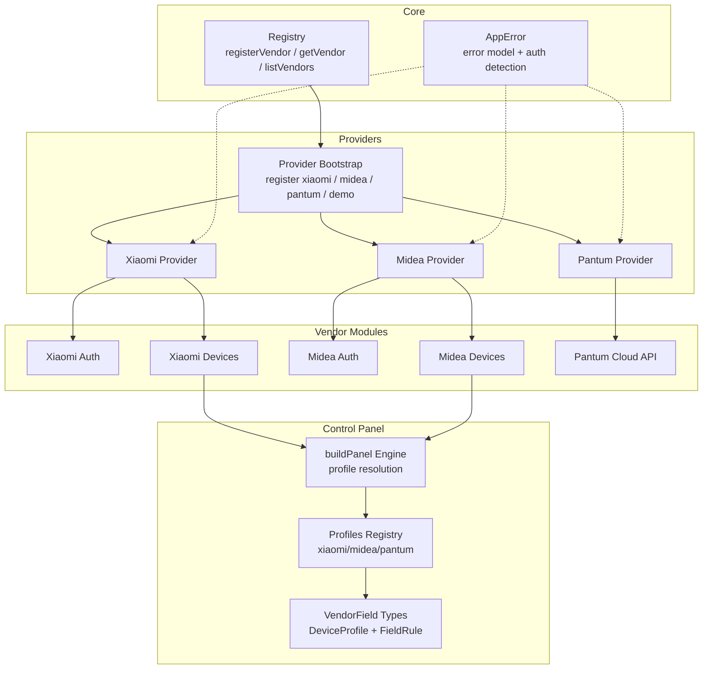
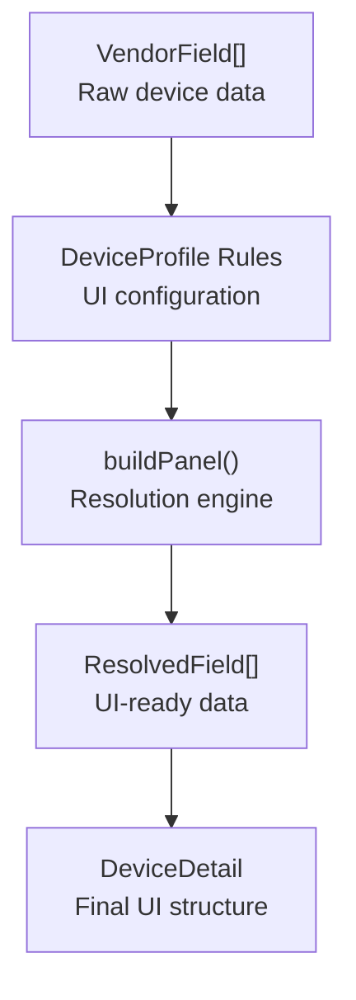
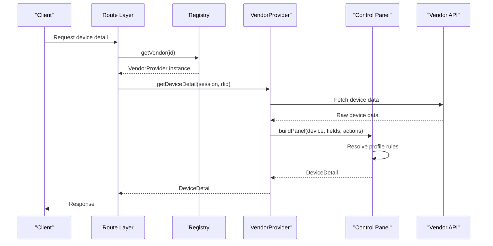
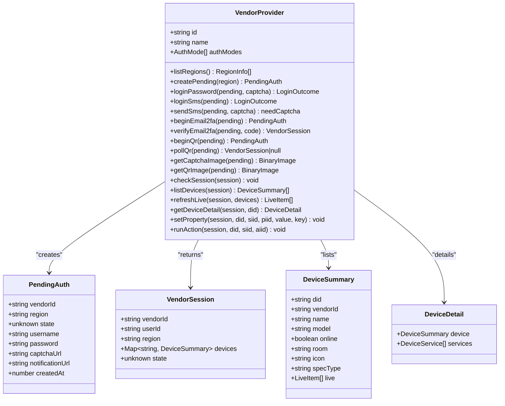
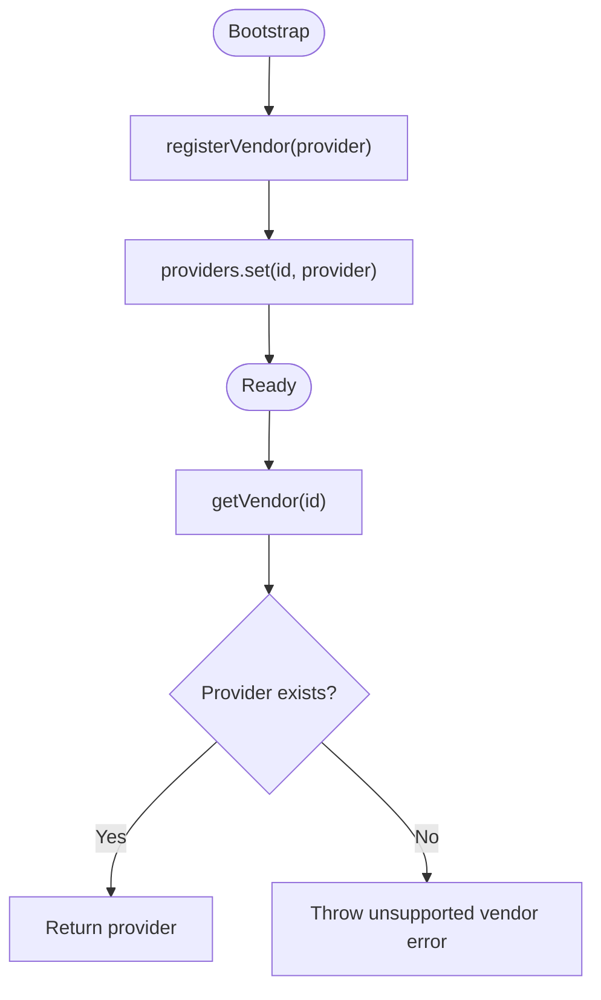
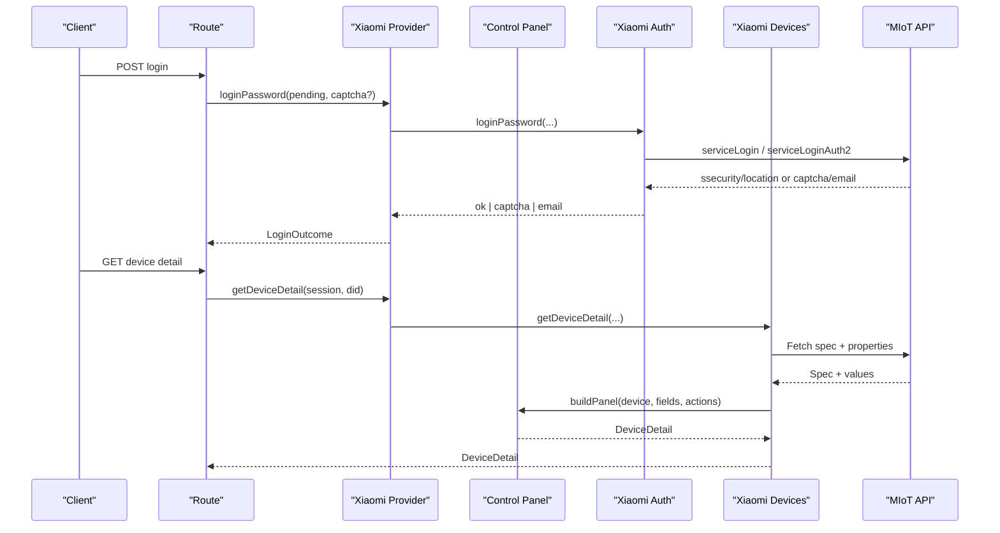
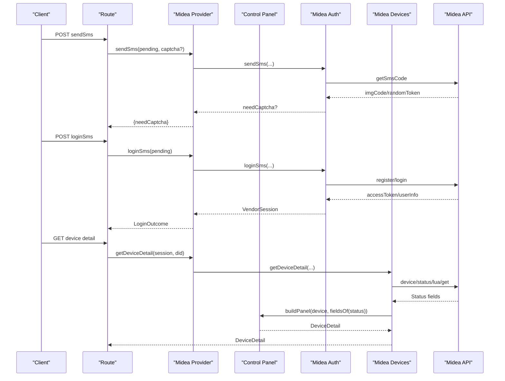
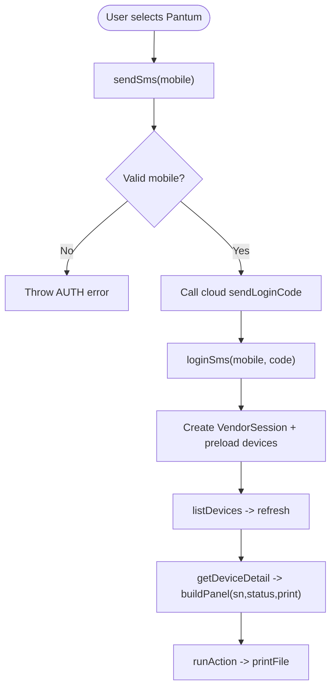
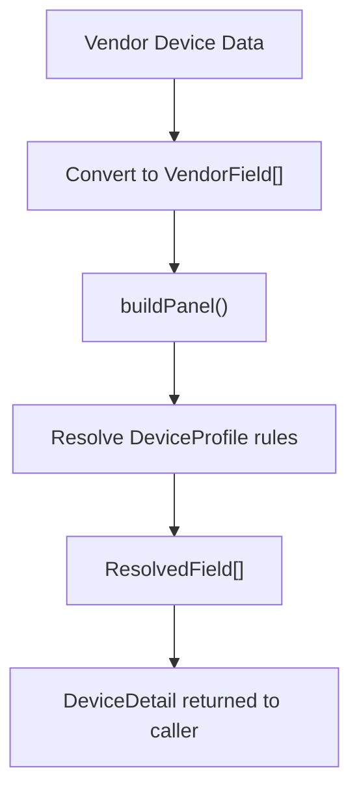
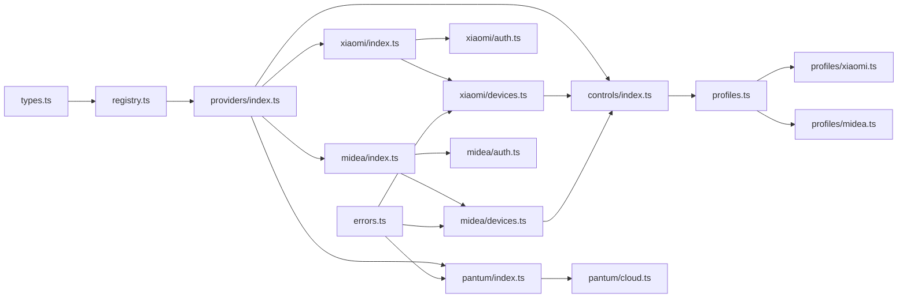

# Provider System Architecture

<cite>
**Referenced Files in This Document**
- [types.ts](file://src/providers/types.ts)
- [registry.ts](file://src/core/registry.ts)
- [index.ts](file://src/providers/index.ts)
- [xiaomi/index.ts](file://src/providers/xiaomi/index.ts)
- [xiaomi/auth.ts](file://src/providers/xiaomi/auth.ts)
- [xiaomi/devices.ts](file://src/providers/xiaomi/devices.ts)
- [midea/index.ts](file://src/providers/midea/index.ts)
- [midea/auth.ts](file://src/providers/midea/auth.ts)
- [midea/devices.ts](file://src/providers/midea/devices.ts)
- [pantum/index.ts](file://src/providers/pantum/index.ts)
- [pantum/cloud.ts](file://src/providers/pantum/cloud.ts)
- [errors.ts](file://src/core/errors.ts)
- [controls/types.ts](file://src/controls/types.ts)
- [controls/panel.ts](file://src/controls/panel.ts)
- [controls/profiles.ts](file://src/controls/profiles.ts)
- [controls/profiles/xiaomi.ts](file://src/controls/profiles/xiaomi.ts)
- [controls/profiles/midea.ts](file://src/controls/profiles/midea.ts)
- [controls/index.ts](file://src/controls/index.ts)
</cite>

## Update Summary
**Changes Made**
- Updated to reflect the new control panel architecture with VendorField abstraction pattern
- Refactored Midea and Xiaomi providers to remove vendor-specific UI logic
- Added comprehensive documentation for the three-layer control panel system
- Updated provider implementation examples to show VendorField usage patterns
- Added new sections covering profile-based configuration and control panel architecture

## Table of Contents
1. [Introduction](#introduction)
2. [Project Structure](#project-structure)
3. [Core Components](#core-components)
4. [Control Panel Architecture](#control-panel-architecture)
5. [Architecture Overview](#architecture-overview)
6. [Detailed Component Analysis](#detailed-component-analysis)
7. [Dependency Analysis](#dependency-analysis)
8. [Performance Considerations](#performance-considerations)
9. [Troubleshooting Guide](#troubleshooting-guide)
10. [Conclusion](#conclusion)
11. [Appendices](#appendices)

## Introduction
This document explains the provider system architecture that unifies multiple vendor integrations behind a single interface. The system centers on the `VendorProvider` contract, which standardizes authentication, device discovery, live status refresh, device detail inspection, property control, and action execution. A registry pattern enables dynamic registration and discovery of providers at bootstrap time.

The current implementation includes:
- Xiaomi: password and QR-based login with MIoT spec-driven device models.
- Midea: SMS and password login with Lua-style device state fields.
- Pantum: SMS-only cloud printing integration with fixed device metadata and print actions.

**Updated** The system now uses a sophisticated control panel architecture that separates vendor logic from UI presentation through a three-layer design pattern.

## Project Structure
The provider system lives under `src/providers`, with shared types and a core registry under `src/core`. Each vendor has its own folder containing authentication, device operations, and optional helpers. The new control panel architecture is implemented under `src/controls`.



**Diagram sources**
- [registry.ts:1-24](file://src/core/registry.ts#L1-L24)
- [index.ts:1-17](file://src/providers/index.ts#L1-L17)
- [controls/index.ts:1-25](file://src/controls/index.ts#L1-L25)
- [controls/panel.ts:102-154](file://src/controls/panel.ts#L102-L154)
- [controls/profiles.ts:74-124](file://src/controls/profiles.ts#L74-L124)

**Section sources**
- [index.ts:1-17](file://src/providers/index.ts#L1-L17)
- [registry.ts:1-24](file://src/core/registry.ts#L1-L24)
- [controls/index.ts:1-25](file://src/controls/index.ts#L1-L25)

## Core Components
The provider system is built around these core abstractions:

- VendorProvider: The unified contract for all vendors. It exposes:
  - Identity and capabilities: id, name, authModes, listRegions.
  - Pending authentication context creation: createPending.
  - Authentication flows: loginPassword, loginSms, sendSms, beginEmail2fa, verifyEmail2fa, beginQr, pollQr, getCaptchaImage, getQrImage.
  - Session validation: checkSession.
  - Device lifecycle: listDevices, refreshLive, getDeviceDetail, setProperty, runAction.

- PendingAuth: A transient login context carrying vendorId, region, username/password/captchaUrl/notificationUrl, and vendor-private state.

- VendorSession: A persistent session carrying vendorId, userId, region, a Map of cached devices, and vendor-private state.

- DeviceSummary and DeviceDetail: Unified device models used across vendors. DeviceSummary contains basic identity and online status; DeviceDetail wraps DeviceSummary with services, properties, and actions.

- Registry: A simple in-memory map that registers and retrieves providers by id, and lists available vendors for UI discovery.

These components ensure that routes and controllers can call provider methods without knowing vendor details.

**Section sources**
- [types.ts:1-144](file://src/providers/types.ts#L1-L144)
- [registry.ts:1-24](file://src/core/registry.ts#L1-L24)

## Control Panel Architecture

**New Section** The control panel architecture introduces a three-layer separation between vendor logic and UI presentation:

### Layer 1: VendorField Abstraction
Vendor providers now output `VendorField` objects representing raw device data with minimal UI hints:

```typescript
interface VendorField {
  key: string;           // Stable identifier (e.g., "service.property" or lua field name)
  raw: unknown;          // Unconverted device value
  writable: boolean;     // Whether the field can be written
  label?: string;        // Human-readable name
  kind?: ControlKind;    // UI hint: switch, slider, select, etc.
  unit?: string;         // Unit of measurement
  range?: [number, number, number]; // Min, max, step
  options?: ControlOption[]; // For select/segmented controls
  group?: string;        // UI grouping
  siid?: number;         // MIoT service ID
  piid?: number;         // MIoT property ID
  meta?: Record<string, unknown>; // Vendor-specific metadata
}
```

### Layer 2: DeviceProfile Configuration
Device profiles define UI behavior through configurable rules:

```typescript
interface DeviceProfile {
  id: string;
  vendor: string;
  match?: ProfileMatch;  // Match by did, model, or specType
  fields?: Record<string, FieldRule>; // Field transformation rules
  omit?: string[];       // Fields to hide
  order?: string[];      // Display order
  groups?: Record<string, GroupConfig>; // UI grouping
  actions?: Record<string, ActionConfig>; // Action configuration
}
```

### Layer 3: buildPanel Resolution
The `buildPanel` function combines vendor fields with profile rules to produce final UI-ready `DeviceDetail`:



**Diagram sources**
- [controls/types.ts:18-38](file://src/controls/types.ts#L18-L38)
- [controls/types.ts:82-95](file://src/controls/types.ts#L82-L95)
- [controls/panel.ts:102-154](file://src/controls/panel.ts#L102-L154)

**Section sources**
- [controls/types.ts:1-114](file://src/controls/types.ts#L1-L114)
- [controls/panel.ts:102-154](file://src/controls/panel.ts#L102-L154)
- [controls/profiles.ts:74-124](file://src/controls/profiles.ts#L74-L124)

## Architecture Overview
The runtime flow is:
1. Application bootstraps providers by calling bootstrapProviders.
2. Providers register themselves into the registry.
3. Routes request a provider by id via getVendor.
4. The selected provider handles authentication, device listing, live refresh, detail retrieval, property writes, and actions.
5. Errors are normalized through AppError so callers can detect auth failures and present user-friendly messages.

**Updated** Device details now go through the control panel pipeline:
1. Vendor providers fetch raw device data and convert it to VendorField arrays.
2. buildPanel resolves profile rules and transforms fields into UI-ready format.
3. Frontend receives DeviceDetail with stable IDs, explicit control types, and normalized values.



**Diagram sources**
- [registry.ts:6-13](file://src/core/registry.ts#L6-L13)
- [xiaomi/devices.ts:247-266](file://src/providers/xiaomi/devices.ts#L247-L266)
- [midea/devices.ts:149-156](file://src/providers/midea/devices.ts#L149-L156)
- [controls/panel.ts:102-154](file://src/controls/panel.ts#L102-L154)

## Detailed Component Analysis

### VendorProvider Contract
The `VendorProvider` interface defines the complete contract for vendor integrations. It separates concerns between:
- Capability discovery: id, name, authModes, listRegions.
- Authentication orchestration: pending context creation and multi-step flows.
- Session management: lightweight checkSession to validate tokens.
- Device operations: listDevices, refreshLive, getDeviceDetail, setProperty, runAction.

Key design points:
- Optional methods allow vendors to support only their supported flows (e.g., Pantum does not support password login).
- PendingAuth carries temporary credentials and vendor-specific state until a full VendorSession is created.
- DeviceSummary and DeviceDetail provide a stable shape for UI and control layers.



**Diagram sources**
- [types.ts:105-143](file://src/providers/types.ts#L105-L143)
- [types.ts:77-84](file://src/providers/types.ts#L77-L84)
- [types.ts:22-33](file://src/providers/types.ts#L22-L33)
- [types.ts:67-70](file://src/providers/types.ts#L67-L70)

**Section sources**
- [types.ts:1-144](file://src/providers/types.ts#L1-L144)

### Registry Pattern for Dynamic Registration and Discovery
The registry maintains an internal Map of providers keyed by id. It provides:
- registerVendor: adds a provider during bootstrap.
- getVendor: returns a provider or throws a vendor-not-supported error.
- listVendors: maps registered providers to VendorInfo for UI discovery.



**Diagram sources**
- [registry.ts:4-13](file://src/core/registry.ts#L4-L13)

**Section sources**
- [registry.ts:1-24](file://src/core/registry.ts#L1-L24)

### Xiaomi Provider Implementation
Xiaomi supports password and QR authentication, email 2FA, and MIoT spec-driven device models.

**Updated** The Xiaomi provider now uses the control panel architecture:

Authentication highlights:
- Password login may return immediate success, require a captcha, or trigger email 2FA.
- Email 2FA begins a ticket flow and verifies the code before completing login.
- QR login obtains a polling URL and long-polls until scanned.
- Captcha and QR images are fetched using stored cookies and UA headers.

Device operations:
- listDevices fetches home rooms and device lists, deduplicates devices, and caches them in session.devices.
- refreshLive selects top live properties from MIoT spec and reads values in chunks.
- getDeviceDetail builds VendorField arrays from MIoT spec and passes them to buildPanel.
- setProperty and runAction call MIoT endpoints and translate vendor codes into AppError.



**Diagram sources**
- [xiaomi/auth.ts:33-91](file://src/providers/xiaomi/auth.ts#L33-L91)
- [xiaomi/auth.ts:94-173](file://src/providers/xiaomi/auth.ts#L94-L173)
- [xiaomi/auth.ts:175-223](file://src/providers/xiaomi/auth.ts#L175-L223)
- [xiaomi/devices.ts:247-266](file://src/providers/xiaomi/devices.ts#L247-L266)
- [controls/panel.ts:102-154](file://src/controls/panel.ts#L102-L154)

**Section sources**
- [xiaomi/index.ts:1-30](file://src/providers/xiaomi/index.ts#L1-L30)
- [xiaomi/auth.ts:1-268](file://src/providers/xiaomi/auth.ts#L1-L268)
- [xiaomi/devices.ts:1-298](file://src/providers/xiaomi/devices.ts#L1-L298)

### Midea Provider Implementation
Midea supports SMS and password authentication, with device state modeled as Lua-like key-value pairs.

**Updated** The Midea provider now uses the control panel architecture:

Authentication highlights:
- sendSms validates phone format, optionally requires captcha, and stores captcha body/type in pending state.
- loginSms completes registration/login and extracts accessToken, userId, and sessionKey.
- loginPassword performs ID lookup then login with encrypted credentials.

Device operations:
- listDevices enumerates homes and appliances, normalizes device summaries, and caches them.
- refreshLive reads device status per device and formats up to four live chips using buildPanel.
- getDeviceDetail converts status fields to VendorField arrays and passes them to buildPanel.
- setProperty encodes field values using encodeFieldValue and sends control commands.
- runAction is not supported and throws an action error.



**Diagram sources**
- [midea/auth.ts:51-86](file://src/providers/midea/auth.ts#L51-L86)
- [midea/auth.ts:111-175](file://src/providers/midea/auth.ts#L111-L175)
- [midea/devices.ts:149-156](file://src/providers/midea/devices.ts#L149-L156)
- [controls/panel.ts:102-154](file://src/controls/panel.ts#L102-L154)

**Section sources**
- [midea/index.ts:1-27](file://src/providers/midea/index.ts#L1-L27)
- [midea/auth.ts:1-176](file://src/providers/midea/auth.ts#L1-L176)
- [midea/devices.ts:1-180](file://src/providers/midea/devices.ts#L1-L180)

### Pantum Provider Implementation
Pantum focuses on cloud printing with SMS-only login and fixed device metadata.

Authentication highlights:
- loginPassword is intentionally unsupported; users must use SMS.
- sendSms validates Chinese mobile numbers and calls the cloud verification endpoint.
- loginSms logs in by phone, creates a VendorSession, and preloads bound devices.

Device operations:
- listDevices refreshes bound devices and updates session.devices.
- refreshLive reuses listDevices and maps online/offline status into live items.
- getDeviceDetail builds a panel with serial number and cloud status, plus a print action.
- setProperty throws a property error because cloud devices are read-only.
- runAction redirects to file upload printing rather than direct property control.



**Diagram sources**
- [pantum/index.ts:52-85](file://src/providers/pantum/index.ts#L52-L85)
- [pantum/index.ts:90-110](file://src/providers/pantum/index.ts#L90-L110)
- [pantum/cloud.ts:37-57](file://src/providers/pantum/cloud.ts#L37-L57)
- [pantum/cloud.ts:109-141](file://src/providers/pantum/cloud.ts#L109-L141)

**Section sources**
- [pantum/index.ts:1-112](file://src/providers/pantum/index.ts#L1-L112)
- [pantum/cloud.ts:1-269](file://src/providers/pantum/cloud.ts#L1-L269)

### Creating a New Provider
To add a new vendor:
1. Define a provider object implementing VendorProvider.
2. Implement required methods based on vendor capabilities.
3. If the vendor supports additional flows, implement optional methods like loginSms, sendSms, beginQr, pollQr, getCaptchaImage, getQrImage.
4. Export the provider instance.
5. Register it in bootstrapProviders so routes can discover it.

**Updated** When implementing device operations:
- Convert raw device data to VendorField arrays representing field names, raw values, and writeability.
- Use buildPanel to transform VendorField arrays into DeviceDetail with UI-ready properties.
- Use encodeFieldValue for property writes to handle vendor-specific encoding.
- Create device profiles in src/controls/profiles/ to define UI behavior.

Recommended structure:
- index.ts: export the provider object wiring auth and devices modules.
- auth.ts: handle pending context creation and authentication flows.
- devices.ts: implement listDevices, refreshLive, getDeviceDetail, setProperty, runAction using control panel architecture.
- state.ts or api.ts: vendor-specific HTTP client, encryption, and token handling.

When mapping vendor device properties to unified models:
- For MIoT-style specs, derive VendorField arrays from spec services and properties.
- For Lua-style states, infer writable boolean-like fields and expose raw values as VendorField arrays.
- For cloud-only devices, expose fixed metadata and actions as VendorField arrays.

**Section sources**
- [index.ts:8-14](file://src/providers/index.ts#L8-L14)
- [types.ts:105-143](file://src/providers/types.ts#L105-L143)
- [controls/types.ts:18-38](file://src/controls/types.ts#L18-L38)

### Vendor-Specific Authentication Flows
- Xiaomi:
  - Password flow may require captcha or email 2FA.
  - Email 2FA uses a ticket flow and verifies a code before obtaining final tokens.
  - QR flow polls a long-poll URL until scanned.
- Midea:
  - SMS flow may require a captcha image embedded as base64 or URL.
  - Password flow encrypts credentials and performs ID lookup followed by login.
- Pantum:
  - SMS-only flow validates mobile format and calls cloud endpoints.
  - No password or QR support.

Common patterns:
- Use PendingAuth to carry temporary state and credentials.
- Convert vendor sessions into VendorSession with a Map of cached devices.
- Normalize errors using AppError with meaningful codes and HTTP statuses.

**Section sources**
- [xiaomi/auth.ts:33-91](file://src/providers/xiaomi/auth.ts#L33-L91)
- [xiaomi/auth.ts:94-173](file://src/providers/xiaomi/auth.ts#L94-L173)
- [midea/auth.ts:51-86](file://src/providers/midea/auth.ts#L51-L86)
- [midea/auth.ts:111-175](file://src/providers/midea/auth.ts#L111-L175)
- [pantum/index.ts:62-85](file://src/providers/pantum/index.ts#L62-L85)

### Mapping Vendor Properties to Unified Models

**Updated** The mapping process now goes through the control panel architecture:

- Xiaomi:
  - Uses MIoT spec URNs to derive stable keys like service.property.
  - Maps access modes to writable flags, value ranges, and option lists.
  - Builds VendorField arrays from spec-derived fields and actions.
  - Passes fields to buildPanel for final UI transformation.

- Midea:
  - Treats each status field as a potential control if it looks boolean-like.
  - Converts fields to VendorField arrays with appropriate metadata.
  - Uses encodeFieldValue for writing back vendor-specific formats.

- Pantum:
  - Exposes fixed fields like serial number and cloud status.
  - Provides a print action instead of property writes.



**Diagram sources**
- [xiaomi/devices.ts:131-172](file://src/providers/xiaomi/devices.ts#L131-L172)
- [midea/devices.ts:17-31](file://src/providers/midea/devices.ts#L17-L31)
- [controls/panel.ts:102-154](file://src/controls/panel.ts#L102-L154)

**Section sources**
- [xiaomi/devices.ts:131-172](file://src/providers/xiaomi/devices.ts#L131-L172)
- [midea/devices.ts:17-31](file://src/providers/midea/devices.ts#L17-L31)
- [pantum/index.ts:95-104](file://src/providers/pantum/index.ts#L95-L104)
- [controls/panel.ts:102-154](file://src/controls/panel.ts#L102-L154)

## Dependency Analysis
The provider layer depends on:
- Core registry for provider discovery.
- Control panel architecture for device detail generation.
- Vendor-specific HTTP clients, crypto utilities, and state managers.
- Error utilities for consistent error propagation and auth failure detection.

**Updated** The dependency graph now includes the control panel system:



**Diagram sources**
- [types.ts:1-144](file://src/providers/types.ts#L1-L144)
- [registry.ts:1-24](file://src/core/registry.ts#L1-L24)
- [index.ts:1-17](file://src/providers/index.ts#L1-L17)
- [controls/index.ts:1-25](file://src/controls/index.ts#L1-L25)
- [controls/profiles.ts:1-196](file://src/controls/profiles.ts#L1-L196)
- [controls/profiles/xiaomi.ts:1-41](file://src/controls/profiles/xiaomi.ts#L1-L41)
- [controls/profiles/midea.ts:1-227](file://src/controls/profiles/midea.ts#L1-L227)

**Section sources**
- [index.ts:1-17](file://src/providers/index.ts#L1-L17)
- [errors.ts:1-38](file://src/core/errors.ts#L1-L38)
- [controls/index.ts:1-25](file://src/controls/index.ts#L1-L25)

## Performance Considerations
- Batched property reads: Xiaomi chunks property reads into groups of 16 to reduce API calls.
- Spec caching: Xiaomi caches MIoT spec documents per type to avoid repeated network requests.
- Parallel live refresh: Midea reads device statuses concurrently using Promise.all.
- Deduplication: Both Xiaomi and Midea deduplicate devices by did to prevent duplicates.
- Lightweight session checks: Vendors implement minimal endpoints to validate sessions without heavy payloads.
- Profile caching: Control panel profiles are cached and reloaded when files change.

**Updated** Additional performance considerations:
- VendorField arrays are lightweight and don't include UI rendering overhead.
- buildPanel resolution is optimized with profile tiering and pattern matching.
- Profile rules are resolved once per device and cached during the request lifecycle.

Recommendations:
- Add rate limiting per vendor to respect API quotas.
- Introduce retry policies with exponential backoff for transient network errors.
- Cache device lists with TTL and invalidate on auth changes.
- Debounce rapid property writes to avoid flooding vendor APIs.
- Monitor profile resolution performance for complex device configurations.

[No sources needed since this section provides general guidance]

## Troubleshooting Guide
Common issues and strategies:
- Authentication failures:
  - Use isAuthFailure to detect expired or invalid sessions.
  - Prompt users to re-login when checkSession fails.
- Unsupported vendor:
  - getVendor throws an error if the vendor id is not registered.
- Missing credentials:
  - Vendors throw AppError when tokens or session keys are missing.
- Property write errors:
  - Xiaomi and Midea translate vendor response codes into AppError with actionable messages.
- Cloud printing errors:
  - Pantum logs detailed error responses and maps OSS/signature issues to user-facing errors.
- Control panel issues:
  - Check if device profiles are properly registered via bootstrapProfiles().
  - Verify VendorField arrays contain required fields (key, raw, writable).
  - Ensure buildPanel is called with proper device and field arrays.

**Updated** New troubleshooting areas:
- Profile resolution problems:
  - Check if profiles are loaded from correct directory (data/profiles).
  - Verify profile JSON syntax and required fields (id, vendor).
  - Debug profile matching using matchesPattern() for wildcard patterns.
- Field transformation issues:
  - Inspect ResolvedField output from buildPanel for proper UI types.
  - Verify codec transformations work correctly for vendor-specific formats.
  - Check that encodeFieldValue produces correct vendor payload formats.

Best practices:
- Always wrap vendor API calls with AppError to preserve codes and statuses.
- Surface public errors via toPublicError for consistent client-side handling.
- Log sensitive data carefully; mask tokens and secrets in error logs.
- Test control panel transformations with sample VendorField arrays.
- Validate profile configurations before deployment.

**Section sources**
- [errors.ts:1-38](file://src/core/errors.ts#L1-L38)
- [xiaomi/devices.ts:268-297](file://src/providers/xiaomi/devices.ts#L268-L297)
- [midea/devices.ts:158-179](file://src/providers/midea/devices.ts#L158-L179)
- [pantum/index.ts:105-110](file://src/providers/pantum/index.ts#L105-L110)
- [pantum/cloud.ts:143-176](file://src/providers/pantum/cloud.ts#L143-L176)
- [controls/profiles.ts:136-143](file://src/controls/profiles.ts#L136-L143)

## Conclusion
The provider system delivers a clean abstraction over diverse vendor ecosystems. By enforcing a strict VendorProvider contract and leveraging a registry for dynamic discovery, the application can support multiple vendors with consistent behavior. The new control panel architecture further enhances this by separating vendor logic from UI presentation through the VendorField abstraction pattern.

Xiaomi's MIoT spec-driven approach, Midea's Lua-style state model, and Pantum's cloud-printing focus illustrate how vendor-specific logic is encapsulated while maintaining uniform interfaces for device management and control. The three-layer control panel system (VendorField → DeviceProfile → DeviceDetail) provides flexible, configurable UI behavior without coupling it to vendor implementations.

Adopting standardized error handling, cautious caching, and rate-limiting will improve reliability and scalability. Testing should cover authentication flows, device listing, live refresh, property writes, action execution, and control panel transformations for each vendor.

**Updated** The refactoring to use the control panel architecture makes the system more maintainable and extensible, allowing UI behavior to be configured independently from vendor logic through device profiles.

[No sources needed since this section summarizes without analyzing specific files]

## Appendices

### Example: Adding a New Provider
Steps:
1. Create a folder under src/providers with index.ts, auth.ts, devices.ts, and optional helpers.
2. Implement VendorProvider methods according to vendor capabilities.
3. In device operations, convert raw data to VendorField arrays and use buildPanel for device details.
4. Export the provider instance from index.ts.
5. Register it in bootstrapProviders.
6. Create device profiles in src/controls/profiles/ to define UI behavior.
7. Test authentication, device listing, live refresh, property writes, actions, and control panel transformations.

**Updated** Example VendorField implementation:

```typescript
// For MIoT-style devices (like Xiaomi)
function fieldsFromSpec(spec): VendorField[] {
  return spec.services.flatMap(service => 
    service.properties.map(prop => ({
      key: `${service.iid}.${prop.iid}`,
      raw: null, // Will be filled with actual values
      writable: prop.access.includes('write'),
      kind: prop.format === 'bool' ? 'switch' : undefined,
      unit: UNITS[prop.unit] || '',
      range: prop['value-range'],
      options: prop['value-list']?.map(item => ({
        value: item.value,
        name: item.description || String(item.value)
      })),
      group: labelOf(service.description),
      siid: service.iid,
      piid: prop.iid
    }))
  );
}

// For Lua-style devices (like Midea)
function fieldsOf(status): VendorField[] {
  return Object.entries(status).flatMap(([key, value]) => {
    if (!['string', 'number', 'boolean'].includes(typeof value)) return [];
    const command = boolShape(value);
    return [{
      key,
      raw: value,
      writable: command,
      kind: command ? 'switch' : undefined,
      meta: { asText: typeof value === 'string' }
    }];
  });
}
```

**Section sources**
- [index.ts:8-14](file://src/providers/index.ts#L8-L14)
- [types.ts:105-143](file://src/providers/types.ts#L105-L143)
- [controls/types.ts:18-38](file://src/controls/types.ts#L18-L38)
- [xiaomi/devices.ts:131-172](file://src/providers/xiaomi/devices.ts#L131-L172)
- [midea/devices.ts:17-31](file://src/providers/midea/devices.ts#L17-L31)