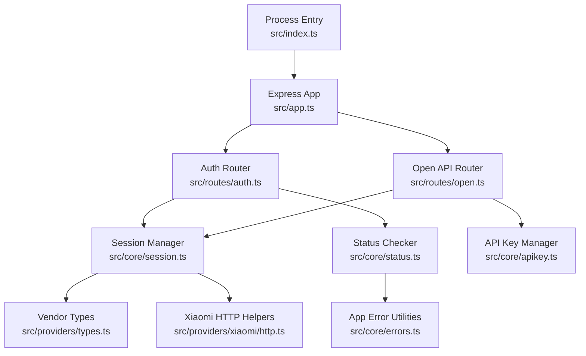
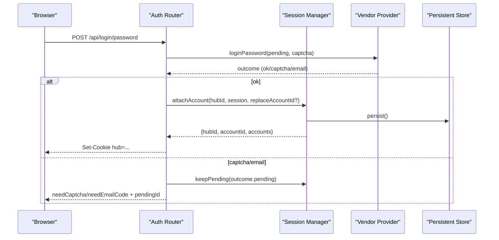
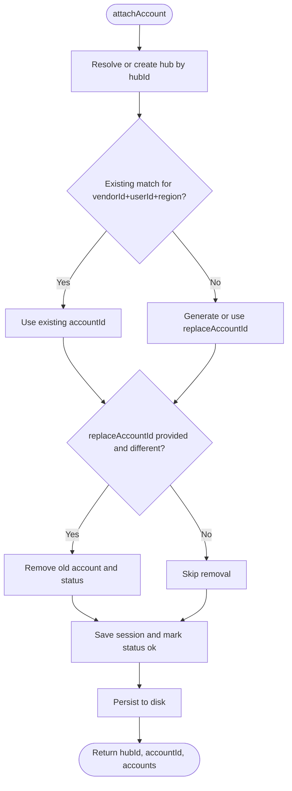
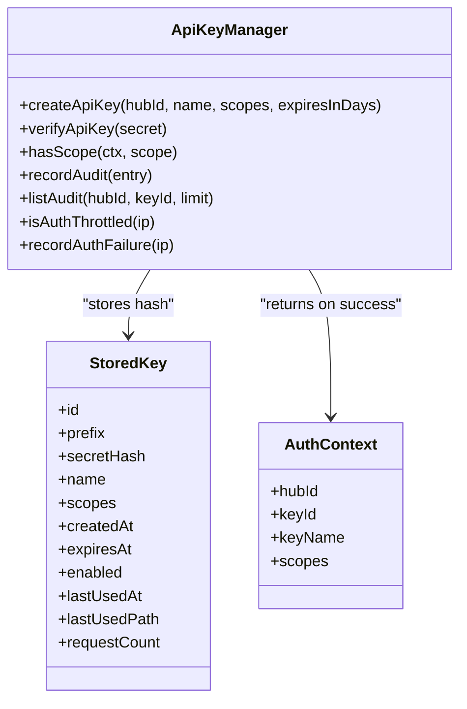
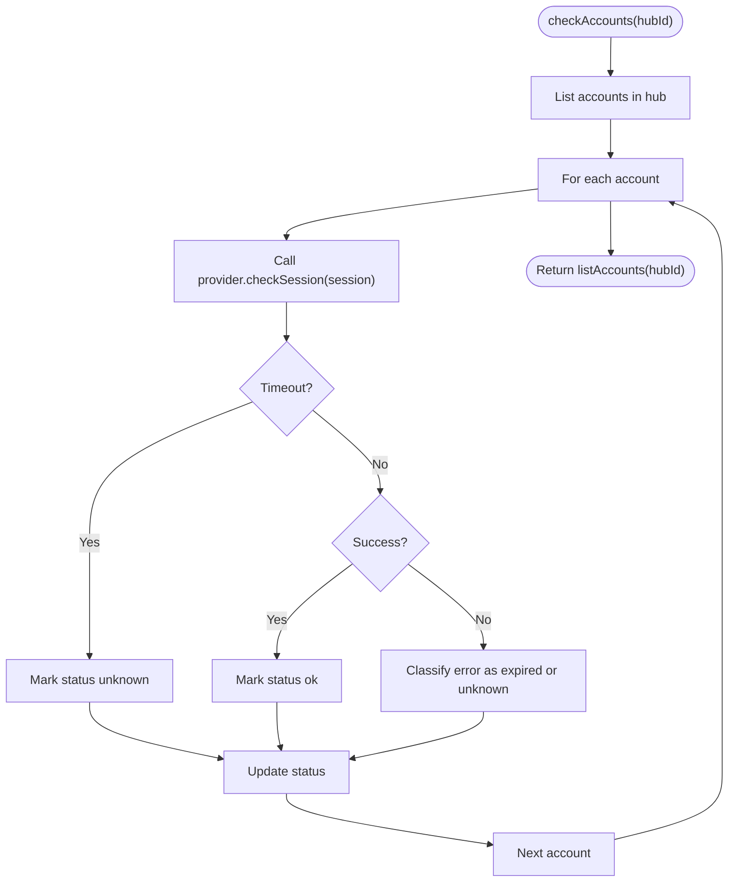
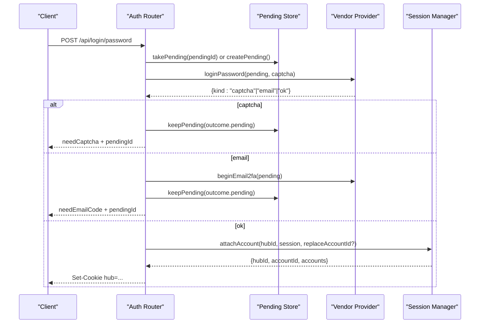
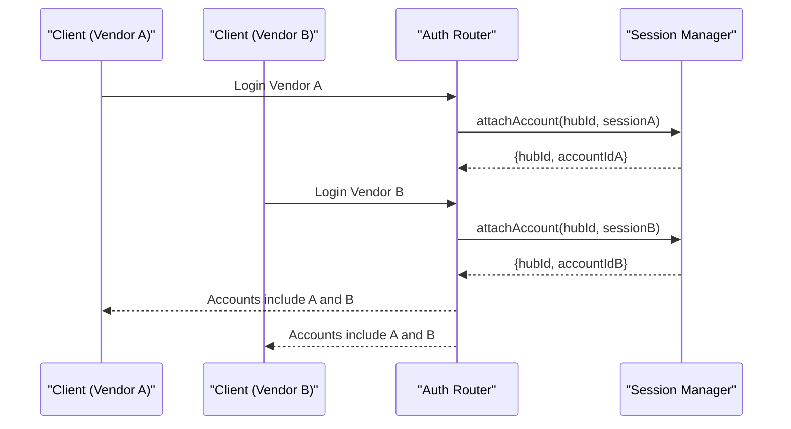
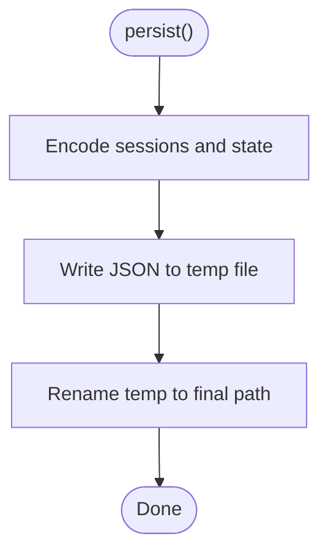
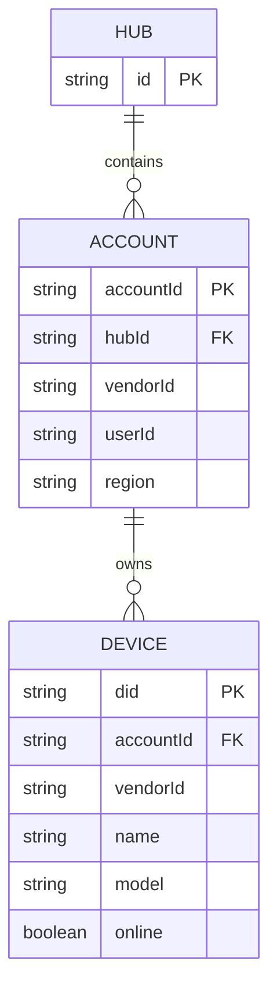
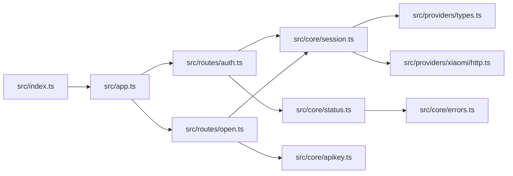

# Session Management System

<cite>
**Referenced Files in This Document**
- [session.ts](file://src/core/session.ts)
- [apikey.ts](file://src/core/apikey.ts)
- [status.ts](file://src/core/status.ts)
- [errors.ts](file://src/core/errors.ts)
- [types.ts](file://src/providers/types.ts)
- [http.ts](file://src/providers/xiaomi/http.ts)
- [auth.ts](file://src/routes/auth.ts)
- [open.ts](file://src/routes/open.ts)
- [app.ts](file://src/app.ts)
- [index.ts](file://src/index.ts)
- [README.md](file://README.md)
</cite>

## Table of Contents
1. [Introduction](#introduction)
2. [Project Structure](#project-structure)
3. [Core Components](#core-components)
4. [Architecture Overview](#architecture-overview)
5. [Detailed Component Analysis](#detailed-component-analysis)
6. [Dependency Analysis](#dependency-analysis)
7. [Performance Considerations](#performance-considerations)
8. [Troubleshooting Guide](#troubleshooting-guide)
9. [Security Considerations](#security-considerations)
10. [Conclusion](#conclusion)

## Introduction
This document explains the session management system that supports multiple concurrent vendor sessions, API-key-based external access control with scope-based authorization and audit logging, and status tracking for session health and vendor connectivity. It focuses on how user browser sessions are isolated from vendor cloud sessions, how authentication flows are orchestrated, and how persistence and cleanup work across process restarts.

The system is built around:
- A hub-based session manager that groups one or more vendor accounts per user browser session.
- An API key subsystem that exposes device information to external applications with scoped permissions and detailed audit trails.
- A status checker that probes vendor login state and marks accounts as healthy, expired, or unknown.
- Route handlers that coordinate multi-vendor authentication, QR code flows, SMS/email verification, and logout.

## Project Structure
At a high level, the application starts an Express server, mounts routers for internal UI operations and open APIs, and uses core modules for session, API key, and status management. Vendor providers implement the vendor-specific protocol details.

**Diagram sources**
- [index.ts:1-13](file://src/index.ts#L1-L13)
- [app.ts:13-24](file://src/app.ts#L13-L24)
- [auth.ts:1-200](file://src/routes/auth.ts#L1-L200)
- [open.ts:1-324](file://src/routes/open.ts#L1-L324)
- [session.ts:1-266](file://src/core/session.ts#L1-L266)
- [apikey.ts:1-304](file://src/core/apikey.ts#L1-L304)
- [status.ts:1-51](file://src/core/status.ts#L1-L51)
- [types.ts:77-143](file://src/providers/types.ts#L77-L143)
- [http.ts:1-85](file://src/providers/xiaomi/http.ts#L1-L85)
- [errors.ts:1-38](file://src/core/errors.ts#L1-L38)

**Section sources**
- [index.ts:1-13](file://src/index.ts#L1-L13)
- [app.ts:13-24](file://src/app.ts#L13-L24)
- [README.md:59-97](file://README.md#L59-L97)

## Core Components
- Session Manager: Maintains hubs (per-browser-session containers), vendor sessions, pending authentication contexts, account status, and persistent storage.
- API Key Manager: Creates, verifies, scopes, audits, and rate-limits API keys; stores only hashed secrets.
- Status Checker: Probes each account’s vendor session health and updates status views.
- Vendor Provider Contract: Defines vendor session structure, login outcomes, device models, and provider methods.
- HTTP Helpers: Cookie jar and HTTP utilities used by vendor implementations.

**Section sources**
- [session.ts:1-266](file://src/core/session.ts#L1-L266)
- [apikey.ts:1-304](file://src/core/apikey.ts#L1-L304)
- [status.ts:1-51](file://src/core/status.ts#L1-L51)
- [types.ts:77-143](file://src/providers/types.ts#L77-L143)
- [http.ts:1-85](file://src/providers/xiaomi/http.ts#L1-L85)

## Architecture Overview
The runtime architecture separates three concerns:
- User session isolation via a hub cookie that maps to a set of vendor sessions.
- External access control via API keys scoped to read/live/control capabilities.
- Vendor session lifecycle managed through provider-specific logic exposed via a common interface.

**Diagram sources**
- [auth.ts:35-71](file://src/routes/auth.ts#L35-L71)
- [session.ts:184-210](file://src/core/session.ts#L184-L210)
- [types.ts:86-103](file://src/providers/types.ts#L86-L103)

## Detailed Component Analysis

### Session Manager
The session manager orchestrates:
- Hub creation and lookup based on a browser cookie.
- Attaching vendor sessions to a hub, including replacement semantics when re-authenticating the same vendor/user/region.
- Listing and retrieving accounts within a hub.
- Pending authentication context storage with TTL.
- Account status tracking and view generation.
- Persistence of hubs and sessions to disk with safe encoding/decoding.

Key behaviors:
- Hub ID resolution reads a `hub` cookie; if missing, a new hub is created.
- Re-login replaces an existing matching account or optionally targets a specific account ID.
- Pending auth entries expire after a fixed TTL and are cleaned up on take/peek.
- Persistence writes atomically using a temp file and rename, with mode-restricted permissions.

**Diagram sources**
- [session.ts:184-210](file://src/core/session.ts#L184-L210)

**Section sources**
- [session.ts:1-266](file://src/core/session.ts#L1-L266)

### API Key System
The API key system provides:
- Creation of scoped keys with optional expiration.
- Verification using SHA-256 hashing and timing-safe comparison.
- Scope checks for read/live/control operations.
- Audit logging for every request, including failed authentications.
- Rate limiting for repeated invalid key attempts per IP.

Important design points:
- Only secret hashes are stored; plaintext is returned once at creation time.
- The secret index enables constant-time lookup by hash before secure comparison.
- Audit records are limited and flushed in microtasks to reduce disk I/O.
- Unattributed failures (missing or invalid key) are kept server-side and not distributed across hubs.

**Diagram sources**
- [apikey.ts:1-304](file://src/core/apikey.ts#L1-L304)

**Section sources**
- [apikey.ts:1-304](file://src/core/apikey.ts#L1-L304)
- [open.ts:62-119](file://src/routes/open.ts#L62-L119)
- [README.md:59-97](file://README.md#L59-L97)

### Status Tracking Mechanism
The status checker:
- Iterates all accounts in a hub.
- Calls the vendor provider’s optional `checkSession`.
- Wraps checks with a timeout.
- Classifies errors into expired vs unknown using error helpers.
- Persists status per account and returns updated account views.

**Diagram sources**
- [status.ts:34-50](file://src/core/status.ts#L34-L50)
- [errors.ts:15-26](file://src/core/errors.ts#L15-L26)

**Section sources**
- [status.ts:1-51](file://src/core/status.ts#L1-L51)
- [errors.ts:1-38](file://src/core/errors.ts#L1-L38)

### Authentication Flows
The auth router supports:
- Password login with optional captcha and email 2FA.
- SMS login flow.
- QR code login with image retrieval and polling.
- Logout with single-account or full-hub removal.
- Me endpoint returning current hub accounts.
- Accounts status endpoint triggering health checks.

**Diagram sources**
- [auth.ts:35-71](file://src/routes/auth.ts#L35-L71)
- [session.ts:184-210](file://src/core/session.ts#L184-L210)
- [types.ts:86-103](file://src/providers/types.ts#L86-L103)

**Section sources**
- [auth.ts:1-200](file://src/routes/auth.ts#L1-L200)

### Multi-Vendor Authentication Flow
Multiple vendors can be authenticated concurrently under the same hub. Each vendor session is identified by vendorId, userId, and region. When attaching a session:
- If a matching vendor/user/region already exists, it is replaced.
- Optionally, a specific accountId can be targeted for replacement.
- Other accounts remain unaffected.

**Diagram sources**
- [auth.ts:29-33](file://src/routes/auth.ts#L29-L33)
- [session.ts:184-210](file://src/core/session.ts#L184-L210)

**Section sources**
- [auth.ts:1-200](file://src/routes/auth.ts#L1-L200)
- [session.ts:184-210](file://src/core/session.ts#L184-L210)

### Session Persistence Strategy
Persistence covers:
- Hubs and their accounts, including vendorId, userId, region, devices, and encoded vendor state.
- API keys and audit logs.
- Atomic writes using temporary files and rename.
- Safe encoding of complex types like Buffer, Map, and CookieJar while excluding sensitive fields such as passwords.

**Diagram sources**
- [session.ts:72-98](file://src/core/session.ts#L72-L98)
- [apikey.ts:87-99](file://src/core/apikey.ts#L87-L99)

**Section sources**
- [session.ts:37-70](file://src/core/session.ts#L37-L70)
- [session.ts:72-129](file://src/core/session.ts#L72-L129)
- [apikey.ts:87-149](file://src/core/apikey.ts#L87-L149)

### Relationship Between User Sessions and Vendor Cloud Sessions
- User session: Represented by a hub cookie (`hub`). It isolates one browser session’s collection of vendor accounts.
- Vendor cloud session: Represented by a `VendorSession`, containing vendorId, userId, region, device cache, and provider-specific state.
- Mapping: One hub contains many vendor sessions; each vendor session belongs to exactly one hub.
- Visibility: External API keys are bound to a hub and can expose its accounts/devices according to scopes.

**Diagram sources**
- [session.ts:26-35](file://src/core/session.ts#L26-L35)
- [types.ts:77-84](file://src/providers/types.ts#L77-L84)

**Section sources**
- [session.ts:159-182](file://src/core/session.ts#L159-L182)
- [types.ts:77-84](file://src/providers/types.ts#L77-L84)

## Dependency Analysis
The following diagram shows module-level dependencies relevant to session management and external access.

**Diagram sources**
- [index.ts:1-13](file://src/index.ts#L1-L13)
- [app.ts:13-24](file://src/app.ts#L13-L24)
- [auth.ts:1-200](file://src/routes/auth.ts#L1-L200)
- [open.ts:1-324](file://src/routes/open.ts#L1-L324)
- [session.ts:1-266](file://src/core/session.ts#L1-L266)
- [apikey.ts:1-304](file://src/core/apikey.ts#L1-L304)
- [status.ts:1-51](file://src/core/status.ts#L1-L51)
- [errors.ts:1-38](file://src/core/errors.ts#L1-L38)
- [types.ts:77-143](file://src/providers/types.ts#L77-L143)
- [http.ts:1-85](file://src/providers/xiaomi/http.ts#L1-L85)

**Section sources**
- [app.ts:13-24](file://src/app.ts#L13-L24)
- [auth.ts:1-200](file://src/routes/auth.ts#L1-L200)
- [open.ts:1-324](file://src/routes/open.ts#L1-L324)
- [session.ts:1-266](file://src/core/session.ts#L1-L266)
- [apikey.ts:1-304](file://src/core/apikey.ts#L1-L304)
- [status.ts:1-51](file://src/core/status.ts#L1-L51)

## Performance Considerations
- Concurrent account checks: Status checking runs checks in parallel per account, improving throughput but requiring robust provider timeouts.
- Persistent store writes: Both session and API key stores write atomically and avoid blocking frequent audit writes by batching flushes in microtasks.
- Device caching: Vendor sessions cache device summaries to reduce repeated network calls.
- Rate limiting: Auth failure rate limiting protects against brute-force probing of API keys.

[No sources needed since this section provides general guidance]

## Troubleshooting Guide
Common issues and diagnostics:
- Expired vendor sessions: Status checker marks accounts as expired when provider check fails with auth-related errors.
- Unsupported status checks: Some vendors may not implement `checkSession`; the status checker reports unsupported errors.
- Missing or invalid API keys: Open API middleware returns 401 and records audit entries; repeated failures trigger throttling.
- Scope violations: Requests lacking required scopes return 403 with audit messages indicating missing scope.
- Persistence failures: Disk write errors are logged; data recovery relies on last successful atomic write.

Operational tips:
- Use `/api/accounts/status` to refresh and inspect account health.
- Review audit logs via API key management endpoints to trace failed requests and unauthorized access attempts.
- Clear auth failures for an IP if legitimate testing caused throttling.

**Section sources**
- [status.ts:22-31](file://src/core/status.ts#L22-L31)
- [open.ts:62-119](file://src/routes/open.ts#L62-L119)
- [apikey.ts:243-299](file://src/core/apikey.ts#L243-L299)
- [errors.ts:15-37](file://src/core/errors.ts#L15-L37)

## Security Considerations
Token storage and isolation:
- Vendor session state is persisted with sensitive fields excluded; passwords are omitted during encoding.
- API keys are stored as SHA-256 hashes; plaintext is never persisted.
- Timing-safe comparisons prevent side-channel attacks during secret verification.

Session isolation:
- Hub cookies isolate user sessions; each hub maintains independent vendor sessions.
- API keys are bound to a hub; visibility is restricted to that hub’s accounts.

Protection against vulnerabilities:
- Audit logging captures method, path, status, duration, IP, and sanitized query parameters.
- Rate limiting mitigates brute-force attempts on API keys.
- Responses from open APIs disable caching to prevent leakage of sensitive device data.

Best practices:
- Limit API key scopes to the minimum required.
- Rotate keys regularly and revoke unused ones.
- Monitor audit logs for anomalies and unauthorized access patterns.
- Ensure environment variables restrict host binding and port exposure.

**Section sources**
- [session.ts:37-49](file://src/core/session.ts#L37-L49)
- [apikey.ts:83-85](file://src/core/apikey.ts#L83-L85)
- [apikey.ts:220-237](file://src/core/apikey.ts#L220-L237)
- [open.ts:62-119](file://src/routes/open.ts#L62-L119)
- [README.md:88-97](file://README.md#L88-L97)

## Conclusion
The session management system cleanly separates user session isolation from vendor cloud session lifecycles, supports multiple concurrent vendor accounts per hub, and provides robust external access control via scoped API keys with comprehensive auditing. Status tracking ensures visibility into session health, while persistence strategies balance durability and performance. By adhering to the security practices outlined, operators can maintain safe, scalable, and observable multi-vendor integrations.

[No sources needed since this section summarizes without analyzing specific files]