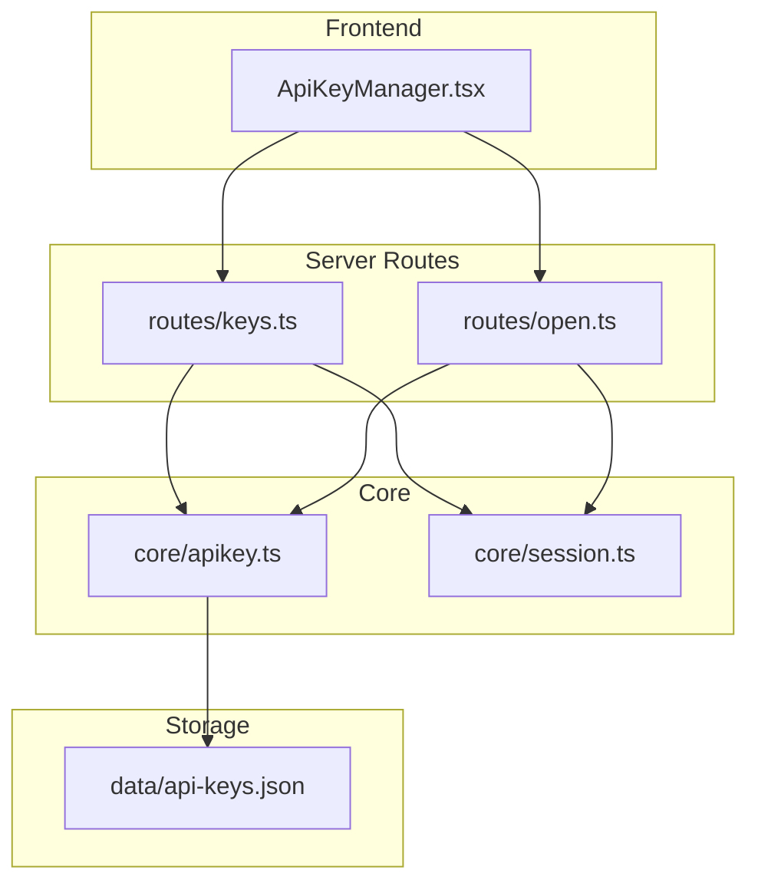
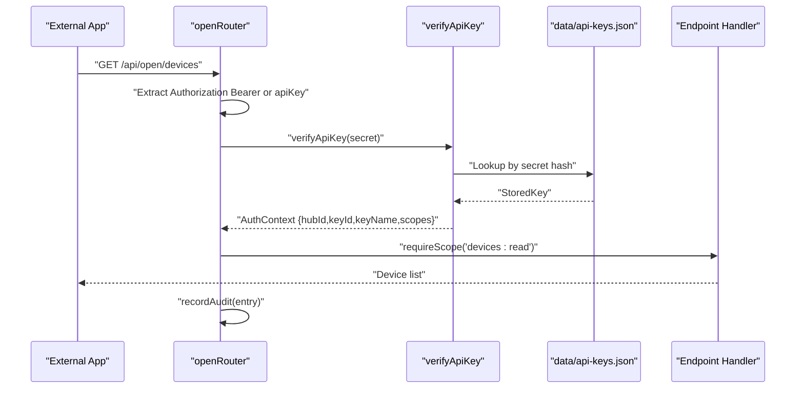
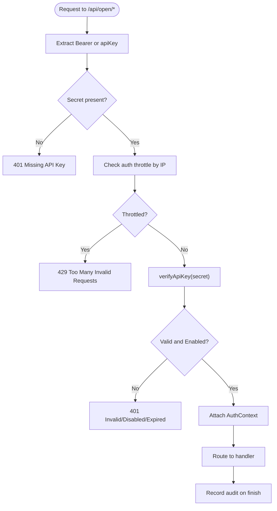
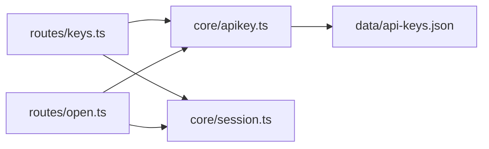
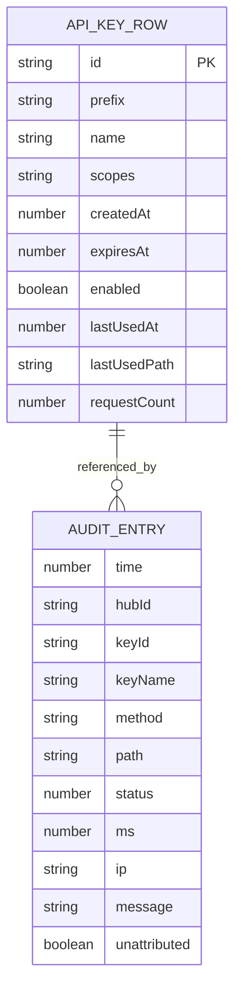

# API Key Management

<cite>
**Referenced Files in This Document**
- [README.md](file://README.md)
- [src/routes/keys.ts](file://src/routes/keys.ts)
- [src/core/apikey.ts](file://src/core/apikey.ts)
- [src/routes/open.ts](file://src/routes/open.ts)
- [client/src/components/ApiKeyManager.tsx](file://client/src/components/ApiKeyManager.tsx)
- [client/src/types.ts](file://client/src/types.ts)
- [src/core/session.ts](file://src/core/session.ts)
</cite>

## Table of Contents
1. [Introduction](#introduction)
2. [Project Structure](#project-structure)
3. [Core Components](#core-components)
4. [Architecture Overview](#architecture-overview)
5. [Detailed Component Analysis](#detailed-component-analysis)
6. [Dependency Analysis](#dependency-analysis)
7. [Performance Considerations](#performance-considerations)
8. [Troubleshooting Guide](#troubleshooting-guide)
9. [Conclusion](#conclusion)
10. [Appendices](#appendices)

## Introduction
This document provides comprehensive API documentation for the API key management system used to expose device information and control capabilities to external applications. It covers:
- Key creation, rotation, revocation, and enable/disable operations
- Key format specifications, expiration policies, and security requirements
- Scope definitions, access control matrices, and permission inheritance
- Practical lifecycle examples, automated rotation strategies, and integration patterns
- Security best practices, audit trails, and compliance considerations

The system separates two authentication paths:
- Management endpoints under `/api/keys` require an internal hub session cookie.
- Public data endpoints under `/api/open/*` accept a Bearer API Key or query parameter `apiKey`.

## Project Structure
API key management spans server routes, core key storage and verification logic, public open API routes with scope enforcement, and a frontend manager UI.

**Diagram sources**
- [client/src/components/ApiKeyManager.tsx:172-239](file://client/src/components/ApiKeyManager.tsx#L172-L239)
- [src/routes/keys.ts:14-80](file://src/routes/keys.ts#L14-L80)
- [src/routes/open.ts:17-105](file://src/routes/open.ts#L17-L105)
- [src/core/apikey.ts:151-231](file://src/core/apikey.ts#L151-L231)
- [src/core/session.ts:159-182](file://src/core/session.ts#L159-L182)

**Section sources**
- [README.md:59-97](file://README.md#L59-L97)
- [src/routes/keys.ts:14-80](file://src/routes/keys.ts#L14-L80)
- [src/routes/open.ts:17-105](file://src/routes/open.ts#L17-L105)
- [src/core/apikey.ts:151-231](file://src/core/apikey.ts#L151-L231)
- [client/src/components/ApiKeyManager.tsx:172-239](file://client/src/components/ApiKeyManager.tsx#L172-L239)

## Core Components
- API Key model and scopes:
  - Scopes: `devices:read`, `devices:live`, `devices:control`.
  - Key row fields include id, prefix, name, scopes, createdAt, expiresAt (0 means never), enabled, lastUsedAt, lastUsedPath, requestCount.
- Storage:
  - In-memory store persisted to `data/api-keys.json`.
  - Secret is stored as SHA-256 hash; only the first 8 characters of the secret are shown as prefix.
- Verification:
  - Constant-time comparison after index lookup by secret hash.
  - Checks enabled state and expiration time.
- Audit:
  - Every `/api/open` request logs method, path, status, latency, IP, and optional failure message.
  - Max 5000 entries per hub; batched persistence via microtask.
- Rate limiting:
  - Per-IP throttling on authentication failures within a 30-second window.

**Section sources**
- [src/core/apikey.ts:6-25](file://src/core/apikey.ts#L6-L25)
- [src/core/apikey.ts:73-107](file://src/core/apikey.ts#L73-L107)
- [src/core/apikey.ts:151-183](file://src/core/apikey.ts#L151-L183)
- [src/core/apikey.ts:220-237](file://src/core/apikey.ts#L220-L237)
- [src/core/apikey.ts:243-271](file://src/core/apikey.ts#L243-L271)
- [src/core/apikey.ts:273-303](file://src/core/apikey.ts#L273-L303)

## Architecture Overview
The system enforces two layers of authorization:
- Management layer (`/api/keys`) requires a valid hub session cookie.
- Public layer (`/api/open/*`) requires a valid API Key and scope checks per endpoint.

**Diagram sources**
- [src/routes/open.ts:33-105](file://src/routes/open.ts#L33-L105)
- [src/routes/open.ts:150-202](file://src/routes/open.ts#L150-L202)
- [src/core/apikey.ts:220-231](file://src/core/apikey.ts#L220-L231)

## Detailed Component Analysis

### API Key Lifecycle Endpoints
Management endpoints under `/api/keys` require a hub session cookie. They support:
- Listing keys and available scopes
- Creating keys with name, scopes, and optional expiration
- Enabling/disabling keys
- Revoking keys
- Viewing and clearing audit logs

#### GET /api/keys/scopes
- Purpose: Return available scopes.
- Authentication: Hub session cookie required.
- Response: `{ scopes: ["devices:read","devices:live","devices:control"] }`.

**Section sources**
- [src/routes/keys.ts:26-28](file://src/routes/keys.ts#L26-L28)
- [src/core/apikey.ts:6-9](file://src/core/apikey.ts#L6-L9)

#### GET /api/keys
- Purpose: List all keys for the current hub.
- Authentication: Hub session cookie required.
- Response: `{ keys: ApiKeyRow[] }`.
- Notes: Only key metadata is returned; no secrets.

**Section sources**
- [src/routes/keys.ts:30-34](file://src/routes/keys.ts#L30-L34)
- [src/core/apikey.ts:190-194](file://src/core/apikey.ts#L190-L194)

#### POST /api/keys
- Purpose: Create a new API key.
- Authentication: Hub session cookie required.
- Request body:
  - `name`: string, required.
  - `scopes`: array of strings from allowed scopes, at least one required.
  - `expiresInDays`: number, 0–3650; 0 means never expires.
- Response:
  - Status 201.
  - Body: `{ key: ApiKeyRow, secret: string }`.
- Notes:
  - Secret is returned only once.
  - Default scope set if none provided.

**Section sources**
- [src/routes/keys.ts:36-49](file://src/routes/keys.ts#L36-L49)
- [src/core/apikey.ts:151-183](file://src/core/apikey.ts#L151-L183)

#### POST /api/keys/:id/enabled
- Purpose: Toggle key enabled state.
- Authentication: Hub session cookie required.
- Request body: `{ enabled: boolean }`.
- Response: Updated key metadata.
- Error: 404 if key not found.

**Section sources**
- [src/routes/keys.ts:51-58](file://src/routes/keys.ts#L51-L58)
- [src/core/apikey.ts:201-207](file://src/core/apikey.ts#L201-L207)

#### DELETE /api/keys/:id
- Purpose: Revoke and delete a key.
- Authentication: Hub session cookie required.
- Response: `{ ok: true }`.
- Error: 404 if key not found.

**Section sources**
- [src/routes/keys.ts:60-65](file://src/routes/keys.ts#L60-L65)
- [src/core/apikey.ts:209-218](file://src/core/apikey.ts#L209-L218)

#### GET /api/keys/audit/requests
- Purpose: Retrieve audit entries for the current hub.
- Authentication: Hub session cookie required.
- Query parameters:
  - `keyId`: optional filter by key id.
  - `limit`: integer between 1 and 1000; default 100.
- Response: `{ requests: AuditEntry[] }`.

**Section sources**
- [src/routes/keys.ts:67-73](file://src/routes/keys.ts#L67-L73)
- [src/core/apikey.ts:257-266](file://src/core/apikey.ts#L257-L266)

#### POST /api/keys/audit/clear
- Purpose: Clear audit entries for the current hub.
- Authentication: Hub session cookie required.
- Response: `{ ok: true }`.

**Section sources**
- [src/routes/keys.ts:75-80](file://src/routes/keys.ts#L75-L80)
- [src/core/apikey.ts:268-271](file://src/core/apikey.ts#L268-L271)

### Public Open API Endpoints
Public endpoints under `/api/open/*` authenticate via API Key and enforce scopes.

Authentication flow:
- Extract token from `Authorization: Bearer <key>` or query parameter `apiKey`.
- Validate key using constant-time comparison after index lookup.
- Apply per-endpoint scope checks.
- Record audit entry for every request.

**Diagram sources**
- [src/routes/open.ts:33-105](file://src/routes/open.ts#L33-L105)

#### GET /api/open/info
- Purpose: Return key identity and visible accounts.
- Authentication: Any valid API Key.
- Response: `{ keyId, keyName, scopes, accounts: [{ accountId, vendorId, region }] }`.

**Section sources**
- [src/routes/open.ts:150-162](file://src/routes/open.ts#L150-L162)

#### GET /api/open/accounts
- Scope: `devices:read`.
- Response: `{ accounts: [{ accountId, vendorId, region, deviceCount }] }`.

**Section sources**
- [src/routes/open.ts:164-175](file://src/routes/open.ts#L164-L175)

#### GET /api/open/devices
- Scope: `devices:read`.
- Query: `accountId` optional to filter.
- Response: `{ devices: DeviceSummary[], warnings?: string[] }`.

**Section sources**
- [src/routes/open.ts:177-202](file://src/routes/open.ts#L177-L202)

#### GET /api/open/devices/:accountId/:did
- Scope: `devices:read`.
- Response: `{ device: DeviceSummary }`.

**Section sources**
- [src/routes/open.ts:204-220](file://src/routes/open.ts#L204-L220)

#### GET /api/open/devices/:accountId/:did/props
- Scope: `devices:read`.
- Response: `{ did, properties: [{ siid, piid, id, name, writable, unit, value }] }`.

**Section sources**
- [src/routes/open.ts:222-245](file://src/routes/open.ts#L222-L245)

#### POST /api/open/devices/:accountId/:did/props
- Scope: `devices:control`.
- Request body: `{ siid, piid, value, id? }`.
- Response: `{ ok: true }`.

**Section sources**
- [src/routes/open.ts:247-271](file://src/routes/open.ts#L247-L271)

#### POST /api/open/devices/:accountId/:did/actions
- Scope: `devices:control`.
- Request body: `{ siid, aiid }`.
- Response: `{ ok: true }`.

**Section sources**
- [src/routes/open.ts:273-290](file://src/routes/open.ts#L273-L290)

#### GET /api/open/live
- Scope: `devices:live`.
- Query: `accountId` optional; returns live readings across visible accounts.
- Response: `{ live: Record<string, unknown> }`.

#### GET /api/open/live/:did
- Scope: `devices:live`.
- Returns live readings for a specific device.

**Section sources**
- [src/routes/open.ts:292-324](file://src/routes/open.ts#L292-L324)

### Key Format Specifications and Expiration Policies
- Key format: `mihome_<id>_<48hex>`.
- The secret is generated with random bytes; only the first 8 hex characters are exposed as prefix.
- Expiration policy:
  - `expiresAt = 0` means never expires.
  - Otherwise, expiration is based on days provided during creation.
  - Expired keys are rejected by verification.

**Section sources**
- [src/core/apikey.ts:151-183](file://src/core/apikey.ts#L151-L183)
- [src/core/apikey.ts:220-231](file://src/core/apikey.ts#L220-L231)
- [README.md:96-97](file://README.md#L96-L97)

### Security Requirements
- Secrets are stored as SHA-256 hashes; plaintext is never persisted.
- Verification uses constant-time comparison to mitigate timing attacks.
- Responses from public endpoints include `Cache-Control: no-store` and vary on Authorization header.
- Audit entries redact sensitive query parameters like `apiKey`.
- Unattributed audit records (failed auth without identifiable key) are kept server-side only and not distributed to hubs.

**Section sources**
- [src/core/apikey.ts:83-85](file://src/core/apikey.ts#L83-L85)
- [src/core/apikey.ts:233-237](file://src/core/apikey.ts#L233-L237)
- [src/routes/open.ts:62-65](file://src/routes/open.ts#L62-L65)
- [src/routes/open.ts:43-52](file://src/routes/open.ts#L43-L52)
- [README.md:88-95](file://README.md#L88-L95)

### Scope Definitions and Access Control Matrix
Scopes define what a key can access:
- `devices:read`: Read-only endpoints including info, accounts, devices, device details, and properties.
- `devices:live`: Live data endpoints.
- `devices:control`: Write endpoints for properties and actions.

Access control matrix:
- `/api/open/info`: No scope required.
- `/api/open/accounts`: `devices:read`.
- `/api/open/devices*`: `devices:read`.
- `/api/open/live*`: `devices:live`.
- `/api/open/devices/:accountId/:did/props` (POST): `devices:control`.
- `/api/open/devices/:accountId/:did/actions` (POST): `devices:control`.

Permission inheritance:
- Scopes are additive; a key may have multiple scopes.
- There is no hierarchical inheritance beyond explicit inclusion.

**Section sources**
- [src/core/apikey.ts:6-9](file://src/core/apikey.ts#L6-L9)
- [src/routes/open.ts:107-119](file://src/routes/open.ts#L107-L119)
- [src/routes/open.ts:150-324](file://src/routes/open.ts#L150-L324)
- [README.md:70-78](file://README.md#L70-L78)

### Practical Examples of Key Lifecycle Management
- Create a key:
  - Call `POST /api/keys` with name, scopes, and optional expiration.
  - Save the returned secret immediately; it will not be shown again.
- Rotate a key:
  - Create a new key with appropriate scopes and expiration.
  - Update external applications to use the new key.
  - Disable the old key using `POST /api/keys/:id/enabled` with `enabled=false`.
  - After confirming stability, revoke the old key using `DELETE /api/keys/:id`.
- Revoke a key:
  - Use `DELETE /api/keys/:id`; active calls using that key will fail immediately.
- Enable/disable a key:
  - Use `POST /api/keys/:id/enabled` to temporarily disable without deleting.

**Section sources**
- [src/routes/keys.ts:36-65](file://src/routes/keys.ts#L36-L65)
- [client/src/components/ApiKeyManager.tsx:172-239](file://client/src/components/ApiKeyManager.tsx#L172-L239)

### Automated Key Rotation Strategies
Recommended strategy:
- Schedule periodic key creation with short lifetimes (e.g., 30–90 days).
- Maintain dual-key operation during transition windows.
- Monitor audit logs for errors indicating expired or disabled keys.
- Automate updates to client configurations and secret stores.
- Deprecate old keys after successful migration and revoke them.

Operational tips:
- Use `expiresInDays` to enforce automatic expiration.
- Track `lastUsedAt` and `requestCount` to identify inactive keys.
- Integrate with CI/CD pipelines to rotate keys and update environment variables.

**Section sources**
- [src/core/apikey.ts:151-183](file://src/core/apikey.ts#L151-L183)
- [src/core/apikey.ts:220-231](file://src/core/apikey.ts#L220-L231)
- [client/src/components/ApiKeyManager.tsx:332-365](file://client/src/components/ApiKeyManager.tsx#L332-L365)

### Integration Patterns for External Applications
- Authentication:
  - Include `Authorization: Bearer <API Key>` in HTTP headers.
  - Alternatively, pass `apiKey` as a query parameter.
- Common endpoints:
  - `GET /api/open/devices`
  - `GET /api/open/devices/:accountId/:did`
  - `GET /api/open/devices/:accountId/:did/props`
  - `POST /api/open/devices/:accountId/:did/props`
  - `POST /api/open/devices/:accountId/:did/actions`
  - `GET /api/open/live`
- Error handling:
  - Handle 401 for missing/invalid/expired keys.
  - Handle 403 for insufficient scopes.
  - Handle 429 for too many invalid requests.
- Caching:
  - Respect `Cache-Control: no-store` on responses.

**Section sources**
- [client/src/components/ApiKeyManager.tsx:405-416](file://client/src/components/ApiKeyManager.tsx#L405-L416)
- [src/routes/open.ts:33-37](file://src/routes/open.ts#L33-L37)
- [src/routes/open.ts:62-65](file://src/routes/open.ts#L62-L65)

### Audit Trails and Compliance Considerations
- Audit entries capture:
  - Timestamp, hubId, keyId, keyName, method, full path (with redacted apiKey), status code, latency, source IP, and optional failure message.
- Limits:
  - Up to 5000 audit entries per hub; older entries are trimmed.
  - Batched persistence reduces I/O overhead.
- Privacy:
  - Unattributed failures are retained server-side only.
  - Sensitive query parameters are redacted.
- Compliance:
  - Avoid logging secrets or sensitive payloads.
  - Restrict audit access to authorized administrators.
  - Implement retention policies aligned with organizational compliance.

**Section sources**
- [src/core/apikey.ts:50-65](file://src/core/apikey.ts#L50-L65)
- [src/core/apikey.ts:243-271](file://src/core/apikey.ts#L243-L271)
- [src/routes/open.ts:43-52](file://src/routes/open.ts#L43-L52)
- [README.md:88-95](file://README.md#L88-L95)

## Dependency Analysis

**Diagram sources**
- [src/routes/keys.ts:1-12](file://src/routes/keys.ts#L1-L12)
- [src/routes/open.ts:1-15](file://src/routes/open.ts#L1-L15)
- [src/core/apikey.ts:73-107](file://src/core/apikey.ts#L73-L107)

**Section sources**
- [src/routes/keys.ts:1-12](file://src/routes/keys.ts#L1-L12)
- [src/routes/open.ts:1-15](file://src/routes/open.ts#L1-L15)
- [src/core/apikey.ts:73-107](file://src/core/apikey.ts#L73-L107)

## Performance Considerations
- Key verification uses an index by secret hash for O(1) lookup followed by constant-time comparison.
- Audit writes are batched via microtasks to reduce disk I/O frequency.
- Audit limit prevents unbounded growth of log files.
- Public endpoints set `Cache-Control: no-store` to avoid caching sensitive data.

[No sources needed since this section provides general guidance]

## Troubleshooting Guide
Common issues and resolutions:
- 401 Missing API Key:
  - Ensure `Authorization: Bearer <key>` is included or `apiKey` query parameter is set.
- 401 Invalid/Disabled/Expired:
  - Verify key exists, is enabled, and has not expired.
  - Check audit logs for recent failures.
- 403 Insufficient Scope:
  - Confirm the key includes the required scope for the endpoint.
- 429 Too Many Invalid Requests:
  - Wait for the rate-limit window to expire; avoid rapid retries with invalid keys.
- Key not found in management endpoints:
  - Ensure you are authenticated with a valid hub session cookie.

**Section sources**
- [src/routes/open.ts:86-97](file://src/routes/open.ts#L86-L97)
- [src/routes/open.ts:107-119](file://src/routes/open.ts#L107-L119)
- [src/routes/keys.ts:16-24](file://src/routes/keys.ts#L16-L24)

## Conclusion
The API key management system provides secure, scoped access to device information and control capabilities. It emphasizes minimal exposure of secrets, robust auditing, and clear separation between management and public APIs. By following the recommended lifecycle and rotation strategies, organizations can maintain secure integrations while minimizing risk and operational overhead.

[No sources needed since this section summarizes without analyzing specific files]

## Appendices

### API Key Data Model

**Diagram sources**
- [src/core/apikey.ts:11-25](file://src/core/apikey.ts#L11-L25)
- [src/core/apikey.ts:50-65](file://src/core/apikey.ts#L50-L65)

### Frontend Types Reference
- `ApiKeyScope`: union type of allowed scopes.
- `ApiKeyRow`: key metadata displayed in UI.
- `CreatedKey`: response shape when creating a key.
- `AuditRow`: audit entry shape in UI.

**Section sources**
- [client/src/types.ts:105-136](file://client/src/types.ts#L105-L136)