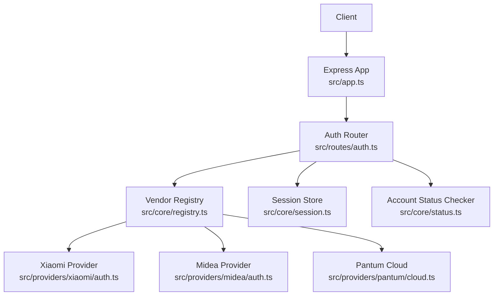
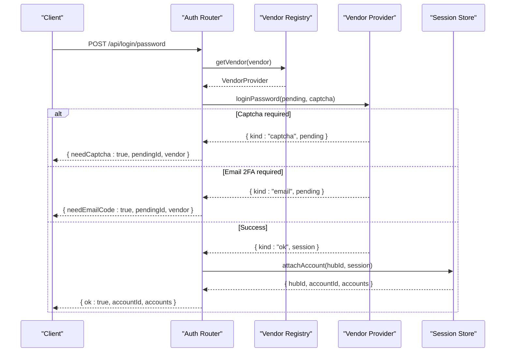
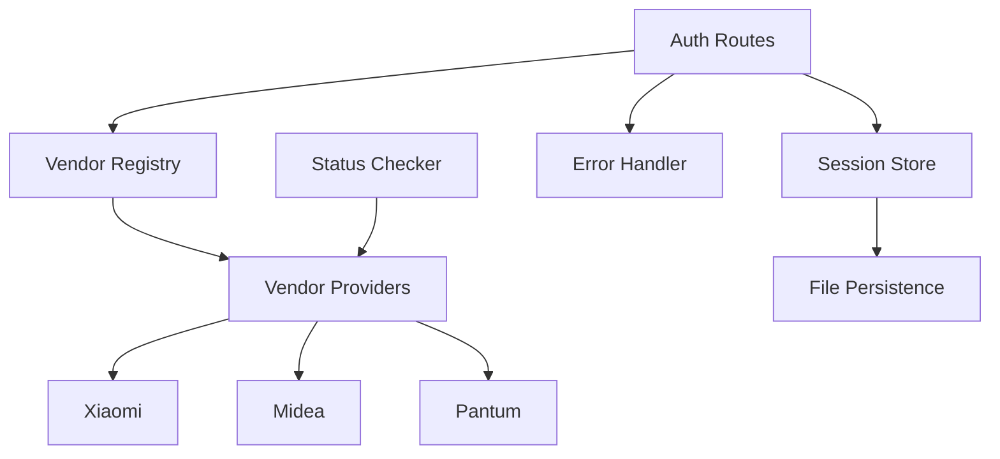

# Authentication Endpoints

<cite>
**Referenced Files in This Document**   
- [app.ts](file://src/app.ts)
- [auth.ts](file://src/routes/auth.ts)
- [session.ts](file://src/core/session.ts)
- [errors.ts](file://src/core/errors.ts)
- [registry.ts](file://src/core/registry.ts)
- [status.ts](file://src/core/status.ts)
- [types.ts](file://src/providers/types.ts)
- [xiaomi-auth.ts](file://src/providers/xiaomi/auth.ts)
- [midea-auth.ts](file://src/providers/midea/auth.ts)
- [pantum-cloud.ts](file://src/providers/pantum/cloud.ts)
</cite>

## Table of Contents
1. [Introduction](#introduction)
2. [Project Structure](#project-structure)
3. [Core Components](#core-components)
4. [Architecture Overview](#architecture-overview)
5. [Detailed Component Analysis](#detailed-component-analysis)
6. [Dependency Analysis](#dependency-analysis)
7. [Performance Considerations](#performance-considerations)
8. [Troubleshooting Guide](#troubleshooting-guide)
9. [Conclusion](#conclusion)

## Introduction
This document provides comprehensive API documentation for the authentication endpoints exposed by the service. It covers:
- Password login with optional SMS mode
- SMS verification and captcha handling
- QR code authentication flow
- Email two-factor authentication
- Account binding and hub session management
- Vendor-specific flows for Xiaomi, Midea, and Pantum
- Error responses, status codes, pending session lifecycle, and security considerations

The authentication layer is built on Express routes that delegate to vendor providers through a registry. Pending authentication contexts are stored server-side with time-to-live semantics, while successful logins create a hub cookie and persist account sessions.

## Project Structure
Authentication-related code lives primarily under `src/routes`, `src/core`, and `src/providers`. The Express application mounts the authentication router at `/api`, so all authentication endpoints start with `/api/login/*` or `/api/logout`, `/api/me`, `/api/accounts/status`.

**Diagram sources**
- [app.ts:13-23](file://src/app.ts#L13-L23)
- [auth.ts:1-19](file://src/routes/auth.ts#L1-L19)
- [registry.ts:1-24](file://src/core/registry.ts#L1-L24)
- [session.ts:1-35](file://src/core/session.ts#L1-L35)
- [status.ts:1-10](file://src/core/status.ts#L1-L10)
- [xiaomi-auth.ts:1-15](file://src/providers/xiaomi/auth.ts#L1-L15)
- [midea-auth.ts:1-16](file://src/providers/midea/auth.ts#L1-L16)
- [pantum-cloud.ts:1-35](file://src/providers/pantum/cloud.ts#L1-L35)

**Section sources**
- [app.ts:13-23](file://src/app.ts#L13-L23)
- [auth.ts:1-19](file://src/routes/auth.ts#L1-L19)

## Core Components
- **Auth Router**: Defines HTTP endpoints for login, captcha, email 2FA, QR authentication, logout, current user info, and account status checks.
- **Pending Session Manager**: Stores temporary authentication state (e.g., username, password, captcha URL, QR polling URL) with TTL expiration.
- **Hub Session Manager**: Persists authenticated accounts per hub, supports multiple accounts, replacement on re-login, and persistence to disk.
- **Vendor Registry**: Provides vendor lookup and error handling for unsupported vendors.
- **Error Utilities**: Normalizes internal errors into public JSON responses and detects authentication failures.
- **Vendor Providers**: Implement vendor-specific authentication flows, including Xiaomi password/email/QR, Midea SMS/password, and Pantum phone-based cloud login.

Key data models:
- `PendingAuth`: Temporary auth context with vendor, region, username/password, captcha/notification URLs, and timestamps.
- `VendorSession`: Authenticated session with vendorId, userId, region, device map, and vendor-private state.
- `LoginOutcome`: Unified result type indicating success, captcha requirement, or email 2FA requirement.

**Section sources**
- [auth.ts:29-33](file://src/routes/auth.ts#L29-L33)
- [session.ts:18-35](file://src/core/session.ts#L18-L35)
- [session.ts:184-210](file://src/core/session.ts#L184-L210)
- [registry.ts:10-13](file://src/core/registry.ts#L10-L13)
- [errors.ts:1-13](file://src/core/errors.ts#L1-L13)
- [types.ts:77-103](file://src/providers/types.ts#L77-L103)
- [types.ts:105-143](file://src/providers/types.ts#L105-L143)

## Architecture Overview
The authentication architecture follows a layered approach:
- HTTP endpoints accept requests and validate inputs.
- Pending sessions bridge multi-step flows (captcha, email 2FA, QR).
- Vendor providers implement vendor-specific protocols.
- Hub sessions manage persistent authenticated accounts.
- Status checking probes vendor sessions to detect expired credentials.

**Diagram sources**
- [auth.ts:35-71](file://src/routes/auth.ts#L35-L71)
- [registry.ts:10-13](file://src/core/registry.ts#L10-L13)
- [session.ts:184-210](file://src/core/session.ts#L184-L210)
- [xiaomi-auth.ts:33-92](file://src/providers/xiaomi/auth.ts#L33-L92)

## Detailed Component Analysis

### Password Login (`POST /api/login/password`)
Handles both standard password login and SMS-based login via the `method` field. Supports pending session restoration, vendor selection, and optional account binding.

Request schema:
- `username`: string, optional when using pending session
- `password`: string, optional when using pending session
- `region`: string, defaults to `"cn"`
- `captcha`: string, optional; used when captcha is required
- `pendingId`: string, optional; restores pending session
- `vendor`: string, defaults to `"xiaomi"`
- `method`: string, optional; use `"sms"` for SMS login
- `accountId`: string, optional; binds to existing account if present

Response schemas:
- Success: `{ ok: true, accountId: string, accounts: Array<AccountView> }`
- Captcha required: `{ needCaptcha: true, pendingId: string, vendor: string }`
- Email 2FA required: `{ needEmailCode: true, pendingId: string, vendor: string }`
- Error: `{ error: string, code: string | number }`

Status codes:
- `200`: Success or pending step
- `400`: Missing fields, unsupported vendor feature, or validation failure
- `404`: Pending session expired
- `502`: Vendor provider error

Security considerations:
- Passwords are cleared from pending sessions after successful login.
- Pending sessions expire after 10 minutes.
- Unsupported vendor features return structured errors with codes like `"SMS"` or `"EMAIL"`.

Vendor behavior:
- Xiaomi: May require captcha or email 2FA; supports both password and SMS modes.
- Midea: Supports SMS login and password login; SMS requires phone number validation.
- Pantum: Uses cloud-based phone login; typically integrated via SMS flow.

**Section sources**
- [auth.ts:35-71](file://src/routes/auth.ts#L35-L71)
- [session.ts:230-265](file://src/core/session.ts#L230-L265)
- [xiaomi-auth.ts:33-92](file://src/providers/xiaomi/auth.ts#L33-L92)
- [midea-auth.ts:111-175](file://src/providers/midea/auth.ts#L111-L175)

### SMS Verification (`POST /api/login/sms`)
Sends an SMS verification code to the provided phone number. Requires vendor support for SMS functionality.

Request schema:
- `username`: string, phone number
- `region`: string, defaults to `"cn"`
- `captcha`: string, optional; may be required by vendor
- `pendingId`: string, optional; restores pending session
- `vendor`: string, defaults to `"midea"`

Response schemas:
- Success: `{ ok: true, pendingId: string, vendor: string }`
- Captcha required: `{ needCaptcha: true, pendingId: string, vendor: string }`
- Error: `{ error: string, code: string | number }`

Status codes:
- `200`: Success or captcha required
- `400`: Missing phone number, unsupported vendor feature, or validation failure
- `404`: Pending session expired
- `502`: Vendor provider error

Vendor behavior:
- Midea: Validates phone number format, sends SMS via MAS protocol, may require captcha image.
- Xiaomi: Supports SMS login but typically uses password flow first.
- Pantum: Uses cloud SMS verification endpoint.

**Section sources**
- [auth.ts:73-91](file://src/routes/auth.ts#L73-L91)
- [midea-auth.ts:51-86](file://src/providers/midea/auth.ts#L51-L86)
- [pantum-cloud.ts:37-57](file://src/providers/pantum/cloud.ts#L37-L57)

### Captcha Handling (`GET /api/login/captcha`)
Retrieves the captcha image associated with a pending session.

Request parameters:
- `pendingId`: string, required; identifies the pending session

Response:
- Image binary with appropriate `Content-Type` header
- `404`: No pending session found or vendor doesn't support captcha images
- `502`: Vendor provider error

Security considerations:
- Pending sessions are checked for expiration before serving images.
- Captcha images are served directly without additional authentication.

Vendor behavior:
- Xiaomi: Fetches captcha image from vendor URL.
- Midea: Returns cached captcha image from pending session state.

**Section sources**
- [auth.ts:93-107](file://src/routes/auth.ts#L93-L107)
- [xiaomi-auth.ts:244-254](file://src/providers/xiaomi/auth.ts#L244-L254)
- [midea-auth.ts:88-92](file://src/providers/midea/auth.ts#L88-L92)

### Email 2FA Verification (`POST /api/login/email`)
Verifies an email-based two-factor authentication code and completes login.

Request schema:
- `pendingId`: string, required; identifies the pending session
- `code`: string, required; email verification code
- `accountId`: string, optional; binds to existing account

Response schemas:
- Success: `{ ok: true, accountId: string, accounts: Array<AccountView> }`
- Error: `{ error: string, code: string | number }`

Status codes:
- `200`: Success
- `400`: Pending session expired or unsupported vendor feature
- `502`: Vendor provider error

Vendor behavior:
- Xiaomi: Sends email ticket and verifies code through identity service.

**Section sources**
- [auth.ts:109-121](file://src/routes/auth.ts#L109-L121)
- [xiaomi-auth.ts:94-173](file://src/providers/xiaomi/auth.ts#L94-L173)

### QR Code Authentication
Three endpoints handle QR code authentication:

#### Start QR Flow (`POST /api/login/qr`)
Initiates QR code authentication for a vendor.

Request schema:
- `vendor`: string, defaults to `"xiaomi"`
- `region`: string, defaults to `"cn"`
- `accountId`: string, optional; binds to existing account

Response schema:
- `{ pendingId: string, vendor: string, image: string }`
- `image`: URL to fetch QR image via `/api/login/qr/image?pendingId=...`

Status codes:
- `200`: QR flow initiated
- `400`: Vendor doesn't support QR authentication
- `502`: Vendor provider error

#### Get QR Image (`GET /api/login/qr/image`)
Fetches the QR image for a pending session.

Request parameters:
- `pendingId`: string, required

Response:
- Image binary with appropriate `Content-Type` header
- `404`: No pending session or vendor doesn't support QR images
- `502`: Vendor provider error

#### Poll QR Status (`POST /api/login/qr/poll`)
Polls for QR authentication completion.

Request schema:
- `pendingId`: string, required

Response schemas:
- Pending: `{ pending: true }`
- Success: `{ ok: true, accountId: string, accounts: Array<AccountView> }`
- Error: `{ error: string, code: string | number }`

Status codes:
- `200`: Pending or success
- `400`: Pending session expired or unsupported vendor feature
- `502`: Vendor provider error

Vendor behavior:
- Xiaomi: Uses long polling to check QR authentication status.

**Section sources**
- [auth.ts:123-173](file://src/routes/auth.ts#L123-L173)
- [xiaomi-auth.ts:175-223](file://src/providers/xiaomi/auth.ts#L175-L223)

### Logout and Account Management

#### Logout (`POST /api/logout`)
Logs out a specific account or clears the entire hub session.

Request schema:
- `accountId`: string, optional; logs out specific account

Response schema:
- `{ ok: true, accounts: Array<AccountView> }`

Behavior:
- If `accountId` is provided, removes that account from the hub
- If no `accountId`, clears the entire hub session
- Sets cookie to clear hub identifier

#### Current User (`GET /api/me`)
Returns the list of accounts in the current hub.

Response schema:
- `{ accounts: Array<AccountView> }`

#### Account Status (`GET /api/accounts/status`)
Checks the authentication status of all accounts in the hub.

Response schema:
- `{ accounts: Array<AccountViewWithStatus> }`

Status codes:
- `200`: Success
- `502`: Vendor provider error during status check

**Section sources**
- [auth.ts:175-199](file://src/routes/auth.ts#L175-L199)
- [session.ts:159-172](file://src/core/session.ts#L159-L172)
- [status.ts:33-50](file://src/core/status.ts#L33-L50)

## Dependency Analysis
The authentication system has clear separation of concerns:

**Diagram sources**
- [auth.ts:1-19](file://src/routes/auth.ts#L1-L19)
- [registry.ts:1-24](file://src/core/registry.ts#L1-L24)
- [session.ts:1-35](file://src/core/session.ts#L1-L35)
- [status.ts:1-10](file://src/core/status.ts#L1-L10)

**Section sources**
- [auth.ts:1-19](file://src/routes/auth.ts#L1-L19)
- [registry.ts:1-24](file://src/core/registry.ts#L1-L24)
- [session.ts:1-35](file://src/core/session.ts#L1-L35)

## Performance Considerations
- Pending sessions have a 10-minute TTL to prevent memory leaks and stale authentication states.
- Hub sessions are persisted to disk for resilience across restarts.
- Account status checks use timeouts to prevent blocking operations.
- Vendor provider calls should be optimized to minimize network latency.
- File persistence uses atomic writes to prevent corruption.

[No sources needed since this section provides general guidance]

## Troubleshooting Guide

### Common Authentication Issues

#### Pending Session Expired
- **Symptom**: Errors like "登录已过期，请重试" or "验证已过期，请重新登录"
- **Cause**: Pending sessions expire after 10 minutes
- **Solution**: Restart the authentication flow from the beginning

#### Unsupported Vendor Feature
- **Symptom**: Errors with codes like `"SMS"`, `"EMAIL"`, or `"QR"`
- **Cause**: Vendor doesn't support the requested authentication method
- **Solution**: Use supported authentication methods for the vendor

#### Captcha Issues
- **Symptom**: Captcha images not loading or invalid captcha codes
- **Cause**: Network issues or expired captcha sessions
- **Solution**: Refresh captcha image and retry

#### Account Binding Problems
- **Symptom**: Multiple accounts or unexpected account replacements
- **Cause**: Re-login behavior replaces existing accounts with same vendor/user
- **Solution**: Use `accountId` parameter to specify which account to replace

#### Vendor-Specific Issues
- **Xiaomi**: Email 2FA may require additional steps; check notification URLs
- **Midea**: Phone number validation requires Chinese mobile format
- **Pantum**: Cloud API may have different error responses

**Section sources**
- [auth.ts:42-47](file://src/routes/auth.ts#L42-L47)
- [auth.ts:111-112](file://src/routes/auth.ts#L111-L112)
- [session.ts:238-245](file://src/core/session.ts#L238-L245)
- [xiaomi-auth.ts:121-123](file://src/providers/xiaomi/auth.ts#L121-L123)
- [midea-auth.ts:53-54](file://src/providers/midea/auth.ts#L53-L54)

## Conclusion
The authentication system provides a flexible, vendor-agnostic interface for handling multiple authentication methods including password, SMS, QR code, and email 2FA. The design emphasizes security through pending session management, proper error handling, and vendor isolation. The hub-based account management allows multiple vendor accounts to coexist while maintaining clear separation between authentication state and business logic.

For optimal integration:
- Always handle pending session expiration gracefully
- Support all vendor-specific authentication flows
- Implement proper error handling for vendor API failures
- Use account binding features for seamless multi-account experiences
- Monitor account status to detect expired credentials proactively

[No sources needed since this section summarizes without analyzing specific files]