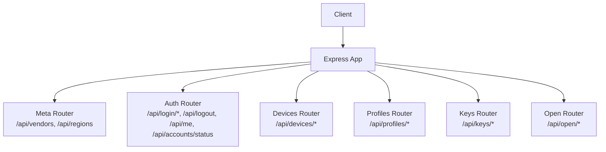
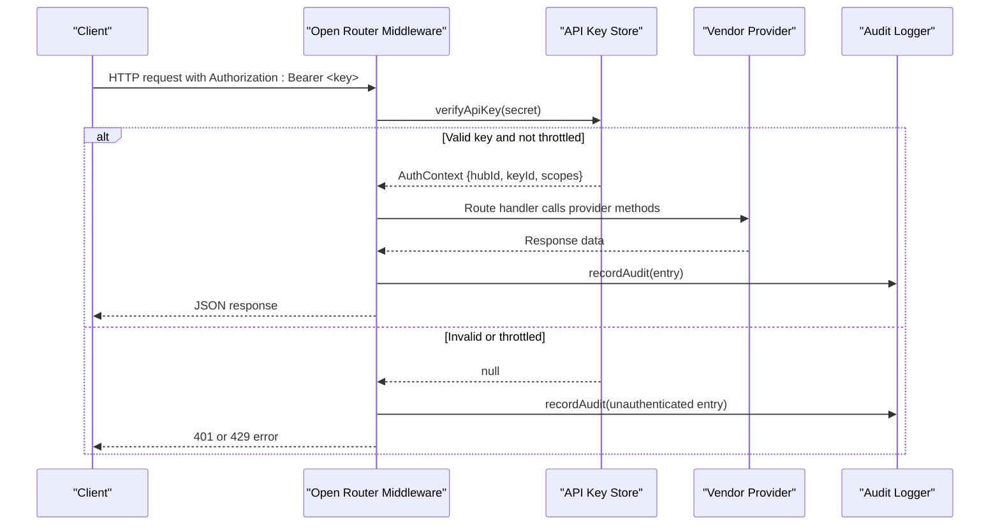
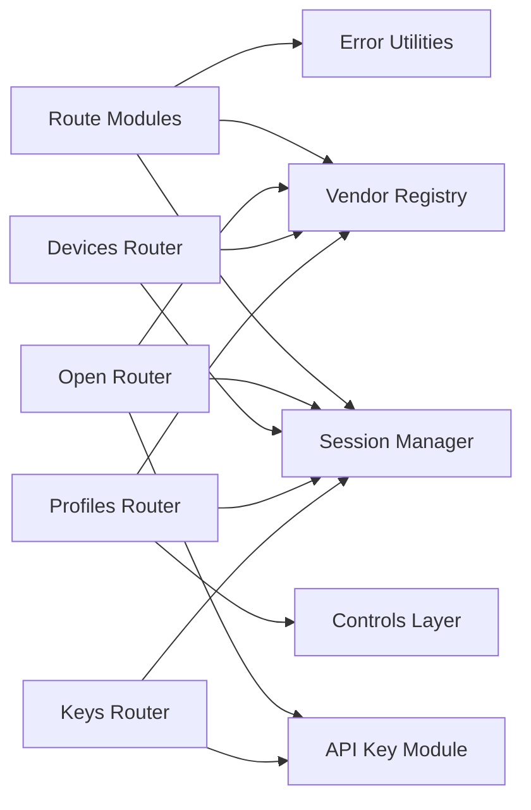

# Backend API Reference

<cite>
**Referenced Files in This Document**
- [app.ts](file://src/app.ts)
- [auth.ts](file://src/routes/auth.ts)
- [devices.ts](file://src/routes/devices.ts)
- [profiles.ts](file://src/routes/profiles.ts)
- [open.ts](file://src/routes/open.ts)
- [keys.ts](file://src/routes/keys.ts)
- [meta.ts](file://src/routes/meta.ts)
- [apikey.ts](file://src/core/apikey.ts)
- [errors.ts](file://src/core/errors.ts)
- [types.ts](file://src/providers/types.ts)
</cite>

## Table of Contents
1. [Introduction](#introduction)
2. [Project Structure](#project-structure)
3. [Core Components](#core-components)
4. [Architecture Overview](#architecture-overview)
5. [Detailed Component Analysis](#detailed-component-analysis)
6. [Dependency Analysis](#dependency-analysis)
7. [Performance Considerations](#performance-considerations)
8. [Troubleshooting Guide](#troubleshooting-guide)
9. [Conclusion](#conclusion)

## Introduction
This document provides comprehensive API documentation for the backend endpoints exposed by the application. It covers:
- Vendor authentication flows (password, SMS, QR code, email 2FA)
- Device management APIs (list devices, read properties, write values, execute actions)
- Profile management endpoints for control panel configurations
- Open API gateway with scope-based authorization, rate limiting, and audit logging
- API key management endpoints for creating, managing, and revoking external access keys

The backend is an Express application that mounts multiple routers under `/api`. Authentication uses session cookies for internal routes and Bearer tokens or query parameters for the open API gateway.

## Project Structure
The application organizes functionality by feature into route modules:
- Authentication: `/api`
- Devices: `/api/devices`
- Profiles: `/api/profiles`
- API Keys: `/api/keys`
- Open API Gateway: `/api/open`
- Metadata: `/api`

**Diagram sources**
- [app.ts:13-23](file://src/app.ts#L13-L23)
- [meta.ts:5-19](file://src/routes/meta.ts#L5-L19)
- [auth.ts:19-200](file://src/routes/auth.ts#L19-L200)
- [devices.ts:9-178](file://src/routes/devices.ts#L9-L178)
- [profiles.ts:8-88](file://src/routes/profiles.ts#L8-L88)
- [keys.ts:14-81](file://src/routes/keys.ts#L14-L81)
- [open.ts:17-324](file://src/routes/open.ts#L17-L324)

**Section sources**
- [app.ts:13-23](file://src/app.ts#L13-L23)

## Core Components
- Session-based authentication for internal routes using a hub cookie.
- Open API gateway middleware validates API keys, enforces scopes, applies rate limiting, and records audit logs.
- Vendor abstraction layer provides device listing, property reading/writing, action execution, and live data refresh.
- Error handling normalizes errors to public-facing responses with codes and messages.

Key types used across APIs:
- Device summary, detail, services, properties, and actions
- Pending authentication state for multi-step login flows
- API key scopes and audit entries

**Section sources**
- [types.ts:22-144](file://src/providers/types.ts#L22-L144)
- [apikey.ts:6-65](file://src/core/apikey.ts#L6-L65)
- [errors.ts:1-38](file://src/core/errors.ts#L1-L38)

## Architecture Overview
The system supports two primary access patterns:
- Internal UI flow: browser sessions authenticated via cookies; vendor providers handle account sessions and device operations.
- External integrations: API keys with scoped permissions; all requests are audited and rate-limited.

**Diagram sources**
- [open.ts:33-105](file://src/routes/open.ts#L33-L105)
- [apikey.ts:220-231](file://src/core/apikey.ts#L220-L231)
- [apikey.ts:243-255](file://src/core/apikey.ts#L243-L255)

## Detailed Component Analysis

### Authentication Endpoints
Authentication endpoints support multiple vendor login flows:
- Password login with optional captcha and email 2FA
- SMS login with optional captcha
- QR code login with image retrieval and polling
- Account binding and logout
- Current user info and account status checks

Common behaviors:
- Multi-step login uses pending state stored server-side with IDs returned to clients.
- Captcha images and QR images are served via dedicated endpoints.
- Successful login binds the vendor session to a hub cookie and returns linked accounts.

Endpoints:
- POST `/api/login/password`
  - Purpose: Start or complete password-based login; may require captcha or email 2FA.
  - Request body fields: username, password, region, captcha, pendingId, vendor, method, accountId
  - Responses:
    - Success: `{ ok: true, accountId, accounts }`
    - Captcha required: `{ needCaptcha: true, pendingId, vendor }`
    - Email 2FA required: `{ needEmailCode: true, pendingId, vendor }`
    - Errors: `{ error, code }`
- GET `/api/login/captcha`
  - Purpose: Fetch captcha image for pending login.
  - Query: `pendingId`
  - Response: Image bytes with appropriate content type.
- POST `/api/login/sms`
  - Purpose: Send SMS verification code; may require captcha.
  - Request body fields: username, region, captcha, pendingId, vendor
  - Responses:
    - Success: `{ ok: true, pendingId, vendor }`
    - Captcha required: `{ needCaptcha: true, pendingId, vendor }`
- POST `/api/login/email`
  - Purpose: Verify email 2FA code and complete login.
  - Request body fields: pendingId, code, accountId
  - Responses:
    - Success: `{ ok: true, accountId, accounts }`
- POST `/api/login/qr`
  - Purpose: Begin QR login flow and return pending ID and image URL.
  - Request body fields: vendor, region, accountId
  - Response: `{ pendingId, vendor, image }`
- GET `/api/login/qr/image`
  - Purpose: Retrieve QR image for pending QR login.
  - Query: `pendingId`
  - Response: Image bytes.
- POST `/api/login/qr/poll`
  - Purpose: Poll QR login status until success or expiration.
  - Request body fields: pendingId
  - Responses:
    - Pending: `{ pending: true }`
    - Success: `{ ok: true, accountId, accounts }`
- POST `/api/logout`
  - Purpose: Logout current hub or remove specific account from hub.
  - Request body fields: accountId (optional)
  - Response: `{ ok: true, accounts }`
- GET `/api/me`
  - Purpose: Return currently bound accounts.
  - Response: `{ accounts }`
- GET `/api/accounts/status`
  - Purpose: Check account health and token validity.
  - Response: `{ accounts }`

Error handling:
- Validation errors return 400 with localized messages.
- Unsupported vendor features return structured errors with codes like SMS, EMAIL, QR.
- Network or vendor failures return 502 with aggregated warnings when applicable.

**Section sources**
- [auth.ts:29-71](file://src/routes/auth.ts#L29-L71)
- [auth.ts:73-91](file://src/routes/auth.ts#L73-L91)
- [auth.ts:93-107](file://src/routes/auth.ts#L93-L107)
- [auth.ts:109-121](file://src/routes/auth.ts#L109-L121)
- [auth.ts:123-173](file://src/routes/auth.ts#L123-L173)
- [auth.ts:175-200](file://src/routes/auth.ts#L175-L200)

### Device Management APIs
Device endpoints operate on authenticated hub sessions and provide:
- Listing devices across all bound accounts
- Reading device details and properties
- Writing device properties
- Executing device actions
- Printing documents (vendor-specific)
- Live data refresh

Endpoints:
- GET `/api/devices/`
  - Purpose: List devices for all accounts in the current hub.
  - Response: `{ devices, warnings }`
- GET `/api/devices/live`
  - Purpose: Refresh live readings for cached devices.
  - Response: `{ live }`
- GET `/api/devices/:accountId/:did`
  - Purpose: Get detailed device information including services, properties, and actions.
  - Response: `{ device, services }`
- POST `/api/devices/:accountId/:did/prop`
  - Purpose: Write a device property value.
  - Request body fields: siid, piid, value, id (optional stable field name)
  - Response: `{ ok: true }`
- POST `/api/devices/:accountId/:did/print`
  - Purpose: Upload and print a document (Pantum only).
  - Content-Type: multipart/form-data with file field
  - Constraints: Max file size 20MB
  - Response: `{ ok: true }`
- POST `/api/devices/:accountId/:did/action`
  - Purpose: Execute a device action.
  - Request body fields: siid, aiid
  - Response: `{ ok: true }`

Error handling:
- Unauthenticated requests return 401.
- Missing account returns 404.
- Vendor-specific errors return structured codes and messages.
- Aggregated warnings included when some accounts fail while others succeed.

**Section sources**
- [devices.ts:11-44](file://src/routes/devices.ts#L11-L44)
- [devices.ts:46-62](file://src/routes/devices.ts#L46-L62)
- [devices.ts:64-77](file://src/routes/devices.ts#L64-L77)
- [devices.ts:79-92](file://src/routes/devices.ts#L79-L92)
- [devices.ts:94-110](file://src/routes/devices.ts#L94-L110)
- [devices.ts:118-162](file://src/routes/devices.ts#L118-L162)
- [devices.ts:164-177](file://src/routes/devices.ts#L164-L177)

### Profile Management Endpoints
Profile endpoints manage control panel configurations for devices:
- Listing available codecs and control kinds
- Listing built-in and user-defined profiles
- Resolving effective profile rules per device
- Saving custom profiles to disk

Endpoints:
- GET `/api/profiles/options`
  - Purpose: Retrieve supported codecs, control kinds, and profile directory path.
  - Response: `{ codecs, kinds, dir }`
- GET `/api/profiles/`
  - Purpose: List profiles, optionally filtered by vendor.
  - Query: `vendor` (optional)
  - Response: `{ profiles }`
- GET `/api/profiles/devices`
  - Purpose: List devices bound to the current hub for selection in configuration UI.
  - Response: `{ devices }`
- GET `/api/profiles/resolve`
  - Purpose: Resolve effective profile chain and merged rules for a specific device.
  - Query: `accountId`, `did`
  - Response: `{ device, matched, groups, order, services }`
- PUT `/api/profiles/`
  - Purpose: Save a profile definition to disk.
  - Request body: DeviceProfile object with at least `id` and `vendor`
  - Response: `{ ok: true, file }`

Validation:
- Profile save requires `id` and `vendor`; otherwise returns 400 with code PROFILE.

**Section sources**
- [profiles.ts:10-19](file://src/routes/profiles.ts#L10-L19)
- [profiles.ts:21-25](file://src/routes/profiles.ts#L21-L25)
- [profiles.ts:27-34](file://src/routes/profiles.ts#L27-L34)
- [profiles.ts:36-73](file://src/routes/profiles.ts#L36-L73)
- [profiles.ts:75-88](file://src/routes/profiles.ts#L75-L88)

### Open API Gateway
The open API gateway exposes device and live data to external clients with:
- Scope-based authorization
- Rate limiting based on failed authentication attempts
- Comprehensive audit logging
- Optional filtering by account

Authentication:
- Accepts API key via Authorization header (`Bearer <key>`) or query parameter `apiKey`.
- Validates key existence, enabled status, expiration, and timing-safe secret comparison.
- Returns 401 if missing or invalid; returns 429 if too many failures from same IP within window.

Scopes:
- `devices:read`: Read-only access to devices and properties.
- `devices:live`: Access to live data streams.
- `devices:control`: Ability to write properties and execute actions.

Endpoints:
- GET `/api/open/info`
  - Purpose: Return current key metadata and visible accounts.
  - Response: `{ keyId, keyName, scopes, accounts }`
- GET `/api/open/accounts`
  - Purpose: List visible accounts with device counts.
  - Scope: `devices:read`
  - Response: `{ accounts }`
- GET `/api/open/devices`
  - Purpose: List devices across visible accounts.
  - Scope: `devices:read`
  - Query: `accountId` (optional)
  - Response: `{ devices, warnings }`
- GET `/api/open/devices/:accountId/:did`
  - Purpose: Get device detail with normalized device summary.
  - Scope: `devices:read`
  - Response: `{ device, services }`
- GET `/api/open/devices/:accountId/:did/props`
  - Purpose: List device properties with current values.
  - Scope: `devices:read`
  - Response: `{ did, properties }`
- POST `/api/open/devices/:accountId/:did/props`
  - Purpose: Write a device property.
  - Scope: `devices:control`
  - Request body fields: siid, piid, value, id (optional)
  - Response: `{ ok: true }`
- POST `/api/open/devices/:accountId/:did/actions`
  - Purpose: Execute a device action.
  - Scope: `devices:control`
  - Request body fields: siid, aiid
  - Response: `{ ok: true }`
- GET `/api/open/live`
  - Purpose: Refresh live data for all visible devices.
  - Scope: `devices:live`
  - Response: `{ live }`
- GET `/api/open/live/:did`
  - Purpose: Refresh live data for a specific device.
  - Scope: `devices:live`
  - Response: `{ live }`

Rate limiting:
- Tracks failed authentication attempts per IP within a time window.
- After threshold reached, returns 429 with message instructing retry after delay.

Audit logging:
- Every request writes an audit entry including timestamp, hubId, keyId, keyName, method, path, status, duration, IP, and optional failure message.
- Paths redact sensitive query parameters such as apiKey.

**Section sources**
- [open.ts:33-105](file://src/routes/open.ts#L33-L105)
- [open.ts:107-125](file://src/routes/open.ts#L107-L125)
- [open.ts:150-162](file://src/routes/open.ts#L150-L162)
- [open.ts:164-175](file://src/routes/open.ts#L164-L175)
- [open.ts:177-202](file://src/routes/open.ts#L177-L202)
- [open.ts:204-220](file://src/routes/open.ts#L204-L220)
- [open.ts:222-245](file://src/routes/open.ts#L222-L245)
- [open.ts:247-271](file://src/routes/open.ts#L247-L271)
- [open.ts:273-290](file://src/routes/open.ts#L273-L290)
- [open.ts:292-324](file://src/routes/open.ts#L292-L324)

### API Key Management Endpoints
These endpoints allow administrators to manage API keys for external access:
- Listing available scopes
- Creating new keys with names, scopes, and optional expiration
- Enabling/disabling existing keys
- Revoking keys
- Viewing audit logs filtered by key
- Clearing audit logs

Authentication:
- Uses internal hub session cookie; unauthenticated requests receive 401.

Endpoints:
- GET `/api/keys/scopes`
  - Purpose: List supported scopes.
  - Response: `{ scopes }`
- GET `/api/keys/`
  - Purpose: List all keys for the current hub.
  - Response: `{ keys }`
- POST `/api/keys/`
  - Purpose: Create a new API key.
  - Request body fields: name (required), scopes (array of strings), expiresInDays (optional, 0-3650)
  - Response: `{ key, secret }` (secret shown once)
- POST `/api/keys/:id/enabled`
  - Purpose: Toggle key enabled status.
  - Request body fields: enabled (boolean)
  - Response: `{ key }`
- DELETE `/api/keys/:id`
  - Purpose: Revoke a key permanently.
  - Response: `{ ok: true }`
- GET `/api/keys/audit/requests`
  - Purpose: List audit entries for the current hub, optionally filtered by keyId.
  - Query: `keyId` (optional), `limit` (1-1000)
  - Response: `{ requests }`
- POST `/api/keys/audit/clear`
  - Purpose: Clear audit logs for the current hub.
  - Response: `{ ok: true }`

Security notes:
- Secrets are hashed before storage; only prefix is displayed.
- Scopes are validated against allowed set.
- Expiration can be set to never expire (0) or within 3650 days.

**Section sources**
- [keys.ts:16-24](file://src/routes/keys.ts#L16-L24)
- [keys.ts:26-28](file://src/routes/keys.ts#L26-L28)
- [keys.ts:30-34](file://src/routes/keys.ts#L30-L34)
- [keys.ts:36-49](file://src/routes/keys.ts#L36-L49)
- [keys.ts:51-58](file://src/routes/keys.ts#L51-L58)
- [keys.ts:60-65](file://src/routes/keys.ts#L60-L65)
- [keys.ts:67-81](file://src/routes/keys.ts#L67-L81)
- [apikey.ts:151-183](file://src/core/apikey.ts#L151-L183)
- [apikey.ts:190-218](file://src/core/apikey.ts#L190-L218)

### Metadata Endpoints
Metadata endpoints expose vendor and region information:
- GET `/api/vendors`
  - Purpose: List available vendors and their capabilities.
  - Response: `{ vendors }`
- GET `/api/regions`
  - Purpose: List regions for a given vendor.
  - Query: `vendor` (default xiaomi)
  - Response: `{ vendorId, regions }`

**Section sources**
- [meta.ts:5-19](file://src/routes/meta.ts#L5-L19)

## Dependency Analysis
The following diagram shows how routes depend on core modules and vendor abstractions:

**Diagram sources**
- [auth.ts:1-17](file://src/routes/auth.ts#L1-L17)
- [devices.ts:1-8](file://src/routes/devices.ts#L1-L8)
- [profiles.ts:1-7](file://src/routes/profiles.ts#L1-L7)
- [open.ts:1-15](file://src/routes/open.ts#L1-L15)
- [keys.ts:1-12](file://src/routes/keys.ts#L1-L12)

**Section sources**
- [auth.ts:1-17](file://src/routes/auth.ts#L1-L17)
- [devices.ts:1-8](file://src/routes/devices.ts#L1-L8)
- [profiles.ts:1-7](file://src/routes/profiles.ts#L1-L7)
- [open.ts:1-15](file://src/routes/open.ts#L1-L15)
- [keys.ts:1-12](file://src/routes/keys.ts#L1-L12)

## Performance Considerations
- Device listing and live data refresh use parallel processing across accounts to reduce latency.
- Audit logging batches writes to disk using microtask scheduling to minimize I/O overhead.
- File upload for printing enforces a 20MB limit and parses multipart form data efficiently.
- API key verification uses constant-time hashing and index lookups to avoid timing attacks.

[No sources needed since this section provides general guidance]

## Troubleshooting Guide
Common issues and resolutions:
- Unauthenticated requests: Ensure hub cookie is present for internal routes or include valid API key for open routes.
- Expired vendor sessions: Device listing may mark accounts as expired; re-authenticate via auth endpoints.
- Missing scopes: Open API endpoints require specific scopes; create keys with appropriate permissions.
- Rate limiting: Too many failed API key attempts trigger temporary blocks; wait for cooldown period.
- Profile validation: Ensure profile payloads include required fields like `id` and `vendor`.

Error response format:
- Standardized error objects include `error`, `code`, and optional `details`.
- Structured codes help identify categories such as AUTH, SMS, EMAIL, QR, PRINT, PROFILE.

**Section sources**
- [errors.ts:1-38](file://src/core/errors.ts#L1-L38)
- [open.ts:86-98](file://src/routes/open.ts#L86-L98)
- [devices.ts:32-43](file://src/routes/devices.ts#L32-L43)
- [profiles.ts:75-88](file://src/routes/profiles.ts#L75-L88)

## Conclusion
This backend provides a robust set of APIs for vendor authentication, device management, profile configuration, and secure external access through an open gateway. The design emphasizes security through scoped API keys, audit logging, and rate limiting, while offering flexible vendor abstractions for device control and live data retrieval. Clients should follow the documented request/response schemas and handle structured errors appropriately.

[No sources needed since this section summarizes without analyzing specific files]