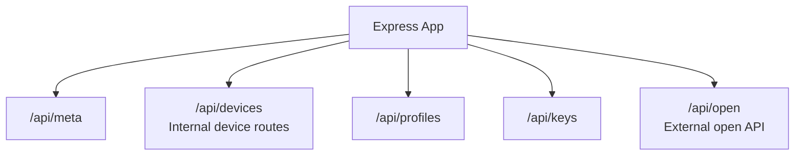
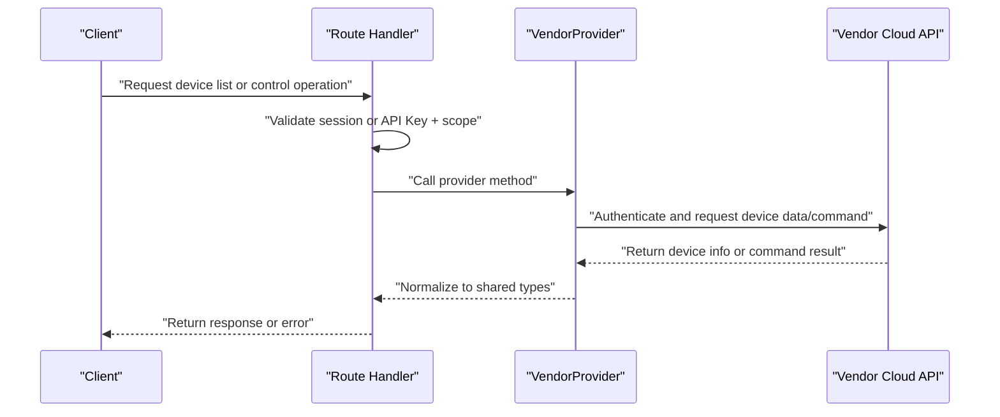
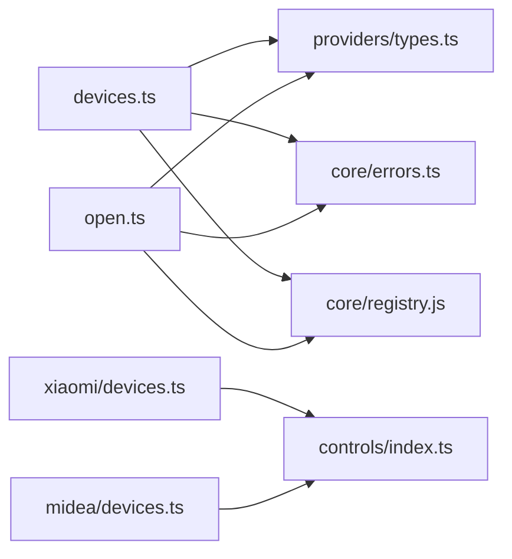

# Device Management API

<cite>
**Referenced Files in This Document**
- [README.md](file://README.md)
- [app.ts](file://src/app.ts)
- [devices.ts](file://src/routes/devices.ts)
- [open.ts](file://src/routes/open.ts)
- [types.ts](file://src/providers/types.ts)
- [errors.ts](file://src/core/errors.ts)
- [xiaomi_devices.ts](file://src/providers/xiaomi/devices.ts)
- [midea_devices.ts](file://src/providers/midea/devices.ts)
</cite>

## Table of Contents
1. [Introduction](#introduction)
2. [Project Structure](#project-structure)
3. [Core Components](#core-components)
4. [Architecture Overview](#architecture-overview)
5. [Detailed Component Analysis](#detailed-component-analysis)
6. [Dependency Analysis](#dependency-analysis)
7. [Performance Considerations](#performance-considerations)
8. [Troubleshooting Guide](#troubleshooting-guide)
9. [Conclusion](#conclusion)

## Introduction
This document describes the device management APIs exposed by the project. It covers:
- Device listing and discovery for multiple vendor accounts.
- Device detail, property reading, and property writing.
- Action execution endpoints for triggering device commands.
- Real-time status monitoring through live endpoints.
- Request/response schemas for device objects, properties, and actions.
- Error handling patterns, rate limiting behavior, and practical integration examples.

The system supports two authentication models:
- Internal control plane using a logged-in hub session.
- External open API using an API Key with scoped permissions.

## Project Structure
The Express application mounts several route groups under `/api`. Device-related routes are split between internal device management and external open API access.

**Diagram sources**
- [app.ts:13-23](file://src/app.ts#L13-L23)

**Section sources**
- [app.ts:13-23](file://src/app.ts#L13-L23)

## Core Components
The device management layer is composed of:
- Route handlers that enforce authentication and scope checks.
- Vendor provider interfaces that abstract device operations across vendors.
- Shared data types for devices, properties, actions, and live updates.
- Error utilities that normalize failures into public responses.

Key responsibilities:
- `/api/devices/*`: Internal endpoints requiring a logged-in hub session.
- `/api/open/*`: External endpoints requiring an API Key and appropriate scopes.
- Provider implementations (e.g., Xiaomi, Midea) implement `VendorProvider` methods such as listing devices, refreshing live values, reading/writing properties, and running actions.

**Section sources**
- [devices.ts:1-178](file://src/routes/devices.ts#L1-L178)
- [open.ts:1-324](file://src/routes/open.ts#L1-L324)
- [types.ts:105-143](file://src/providers/types.ts#L105-L143)
- [errors.ts:1-38](file://src/core/errors.ts#L1-L38)

## Architecture Overview
The device management architecture separates routing, provider abstraction, and vendor-specific logic.

**Diagram sources**
- [devices.ts:21-44](file://src/routes/devices.ts#L21-L44)
- [open.ts:177-202](file://src/routes/open.ts#L177-L202)
- [types.ts:105-143](file://src/providers/types.ts#L105-L143)

## Detailed Component Analysis

### Internal Device Management Endpoints
These endpoints require a logged-in hub session. They expose device listing, live updates, device details, property writes, print uploads, and action execution.

#### GET /api/devices
Lists all devices across all vendor accounts attached to the current hub.

- Authentication: Hub session cookie.
- Response body:
  - `devices`: Array of device summaries.
  - `warnings`: Array of warning messages when some accounts fail.
- Status codes:
  - `200`: Success.
  - `401`: Not logged in.
  - `502`: All accounts failed; includes warnings.

Device summary fields:
- `did`: Device identifier.
- `accountId`: Account identifier.
- `vendorId`: Vendor identifier.
- `name`: Display name.
- `model`: Model string.
- `online`: Online status.
- `room`: Room name.
- `icon`: Icon URL.
- `specType`: Optional capability identifier.
- `live`: Optional live items array.

**Section sources**
- [devices.ts:21-44](file://src/routes/devices.ts#L21-L44)
- [types.ts:22-33](file://src/providers/types.ts#L22-L33)

#### GET /api/devices/live
Aggregates live status items from all vendor accounts.

- Authentication: Hub session cookie.
- Response body:
  - `live`: Map keyed by `accountId:did`, each value is an array of live items.
- Live item fields:
  - `name`: Label.
  - `text`: Human-readable value.

**Section sources**
- [devices.ts:46-62](file://src/routes/devices.ts#L46-L62)
- [types.ts:17-20](file://src/providers/types.ts#L17-L20)

#### GET /api/devices/:accountId/:did
Returns full device detail including services, properties, and actions.

- Authentication: Hub session cookie.
- Path parameters:
  - `accountId`: Vendor account identifier.
  - `did`: Device identifier.
- Response body:
  - `device`: Device summary with added `accountId`.
  - `services`: Array of services, each containing properties and actions.

Service structure:
- `siid`: Service identifier.
- `name`: Service label.
- `properties`: Array of property definitions.
- `actions`: Array of action definitions.

Property definition fields:
- `id`: Stable field name from profile layer.
- `siid`: Service identifier.
- `piid`: Property identifier.
- `name`: Property label.
- `kind`: Control kind inferred by controls layer.
- `format`: Vendor-native format.
- `unit`: Unit string.
- `writable`: Whether the property can be written.
- `range`: Numeric range or null.
- `list`: Enumerated options.
- `value`: Current value.
- `error`: Error code if read failed.

Action definition fields:
- `id`: Stable action key.
- `siid`: Service identifier.
- `aiid`: Action identifier.
- `name`: Action label.

**Section sources**
- [devices.ts:64-77](file://src/routes/devices.ts#L64-L77)
- [types.ts:35-70](file://src/providers/types.ts#L35-L70)

#### POST /api/devices/:accountId/:did/prop
Writes a single device property.

- Authentication: Hub session cookie.
- Path parameters:
  - `accountId`: Vendor account identifier.
  - `did`: Device identifier.
- Request body:
  - `siid`: Service identifier.
  - `piid`: Property identifier.
  - `value`: Value to write.
  - `id`: Optional stable field name used by profile encoder.
- Response body:
  - `ok`: Boolean indicating success.
- Status codes:
  - `200`: Success.
  - `404`: Account not found.
  - `400`: Validation or vendor error.
  - `502`: Generic failure.

**Section sources**
- [devices.ts:79-92](file://src/routes/devices.ts#L79-L92)
- [types.ts:139-142](file://src/providers/types.ts#L139-L142)

#### POST /api/devices/:accountId/:did/action
Executes a device action.

- Authentication: Hub session cookie.
- Path parameters:
  - `accountId`: Vendor account identifier.
  - `did`: Device identifier.
- Request body:
  - `siid`: Service identifier.
  - `aiid`: Action identifier.
- Response body:
  - `ok`: Boolean indicating success.
- Status codes:
  - `200`: Success.
  - `404`: Account not found.
  - `400`: Missing parameters or unsupported action.
  - `502`: Generic failure.

**Section sources**
- [devices.ts:164-177](file://src/routes/devices.ts#L164-L177)
- [types.ts:53-58](file://src/providers/types.ts#L53-L58)

#### POST /api/devices/:accountId/:did/print
Uploads a file for printing on Pantum devices.

- Authentication: Hub session cookie.
- Path parameters:
  - `accountId`: Vendor account identifier.
  - `did`: Device identifier.
- Content-Type: `multipart/form-data`.
- Request body:
  - `file`: Binary file payload.
  - Additional form fields may be included.
- Constraints:
  - Only supported for Pantum vendor.
  - Maximum file size: 20MB.
- Response body:
  - `ok`: Boolean indicating success.
- Status codes:
  - `200`: Success.
  - `400`: Unsupported vendor or validation errors.
  - `404`: Account not found.
  - `502`: Generic failure.

**Section sources**
- [devices.ts:94-110](file://src/routes/devices.ts#L94-L110)
- [devices.ts:118-162](file://src/routes/devices.ts#L118-L162)

### External Open API Endpoints
These endpoints use API Key authentication and optional scope checks. Responses include `Cache-Control: no-store` and audit logging.

#### GET /api/open/info
Returns information about the API Key and visible accounts.

- Authentication: API Key via header or query parameter.
- Response body:
  - `keyId`: Key identifier.
  - `keyName`: Key display name.
  - `scopes`: Allowed scopes.
  - `accounts`: List of visible accounts with `accountId`, `vendorId`, and `region`.

**Section sources**
- [open.ts:150-162](file://src/routes/open.ts#L150-L162)

#### GET /api/open/accounts
Lists visible accounts.

- Scope required: `devices:read`.
- Response body:
  - `accounts`: Array of account summaries including `deviceCount`.

**Section sources**
- [open.ts:164-175](file://src/routes/open.ts#L164-L175)

#### GET /api/open/devices
Lists devices across visible accounts.

- Scope required: `devices:read`.
- Query parameters:
  - `accountId`: Optional filter by account.
- Response body:
  - `devices`: Array of presentable device summaries.
  - `warnings`: Warnings when device listing fails.
- Status codes:
  - `200`: Success.
  - `404`: No visible accounts.
  - `502`: All accounts failed.

**Section sources**
- [open.ts:177-202](file://src/routes/open.ts#L177-L202)

#### GET /api/open/devices/:accountId/:did
Returns device detail for external consumers.

- Scope required: `devices:read`.
- Path parameters:
  - `accountId`: Vendor account identifier.
  - `did`: Device identifier.
- Response body:
  - `device`: Presentable device summary with `accountId`.
  - `services`: Services with properties and actions.

**Section sources**
- [open.ts:204-220](file://src/routes/open.ts#L204-L220)

#### GET /api/open/devices/:accountId/:did/props
Reads device properties without service grouping.

- Scope required: `devices:read`.
- Path parameters:
  - `accountId`: Vendor account identifier.
  - `did`: Device identifier.
- Response body:
  - `did`: Device identifier.
  - `properties`: Array of property objects with `siid`, `piid`, `id`, `name`, `writable`, `unit`, and `value`.

**Section sources**
- [open.ts:222-245](file://src/routes/open.ts#L222-L245)

#### POST /api/open/devices/:accountId/:did/props
Writes a device property externally.

- Scope required: `devices:control`.
- Path parameters:
  - `accountId`: Vendor account identifier.
  - `did`: Device identifier.
- Request body:
  - `siid`: Service identifier.
  - `piid`: Property identifier.
  - `value`: Value to write.
  - `id`: Optional stable field name.
- Response body:
  - `ok`: Boolean indicating success.
- Status codes:
  - `200`: Success.
  - `400`: Missing parameters.
  - `404`: Account not found.
  - `502`: Generic failure.

**Section sources**
- [open.ts:247-271](file://src/routes/open.ts#L247-L271)

#### POST /api/open/devices/:accountId/:did/actions
Executes a device action externally.

- Scope required: `devices:control`.
- Path parameters:
  - `accountId`: Vendor account identifier.
  - `did`: Device identifier.
- Request body:
  - `siid`: Service identifier.
  - `aiid`: Action identifier.
- Response body:
  - `ok`: Boolean indicating success.
- Status codes:
  - `200`: Success.
  - `400`: Missing parameters.
  - `404`: Account not found.
  - `502`: Generic failure.

**Section sources**
- [open.ts:273-290](file://src/routes/open.ts#L273-L290)

#### GET /api/open/live
Reads live status for all visible devices.

- Scope required: `devices:live`.
- Query parameters:
  - `accountId`: Optional filter by account.
- Response body:
  - `live`: Map keyed by `accountId:did`, each value is an array of live items.

#### GET /api/open/live/:did
Reads live status for a specific device.

- Scope required: `devices:live`.
- Path parameters:
  - `did`: Device identifier.
- Response body:
  - `live`: Map keyed by `accountId:did`, each value is an array of live items.

**Section sources**
- [open.ts:292-324](file://src/routes/open.ts#L292-L324)

### Data Models

#### Device Summary
A lightweight representation of a device used for listing and presentation.

- Fields:
  - `did`: String device identifier.
  - `accountId`: Optional account identifier.
  - `vendorId`: String vendor identifier.
  - `name`: Display name.
  - `model`: Model string.
  - `online`: Boolean online status.
  - `room`: Room name.
  - `icon`: Icon URL.
  - `specType`: Optional capability identifier.
  - `live`: Optional array of live items.

**Section sources**
- [types.ts:22-33](file://src/providers/types.ts#L22-L33)

#### Device Property
A normalized property definition returned in device detail and property lists.

- Fields:
  - `id`: Stable field name from profile layer.
  - `siid`: Service identifier.
  - `piid`: Property identifier.
  - `name`: Property label.
  - `kind`: Control kind inferred by controls layer.
  - `format`: Vendor-native format.
  - `unit`: Unit string.
  - `writable`: Boolean writable flag.
  - `range`: Numeric range or null.
  - `list`: Array of enumerated options.
  - `value`: Current value.
  - `error`: Error code if read failed.

**Section sources**
- [types.ts:35-51](file://src/providers/types.ts#L35-L51)

#### Device Action
A normalized action definition returned in device detail.

- Fields:
  - `id`: Stable action key.
  - `siid`: Service identifier.
  - `aiid`: Action identifier.
  - `name`: Action label.

**Section sources**
- [types.ts:53-58](file://src/providers/types.ts#L53-L58)

#### Device Service
A container for properties and actions within a device.

- Fields:
  - `siid`: Service identifier.
  - `name`: Service label.
  - `properties`: Array of properties.
  - `actions`: Array of actions.

**Section sources**
- [types.ts:60-65](file://src/providers/types.ts#L60-L65)

#### Device Detail
Full device view including device summary and services.

- Fields:
  - `device`: Device summary.
  - `services`: Array of services.

**Section sources**
- [types.ts:67-70](file://src/providers/types.ts#L67-L70)

#### Live Item
Human-readable live status entry.

- Fields:
  - `name`: Label.
  - `text`: Display text.

**Section sources**
- [types.ts:17-20](file://src/providers/types.ts#L17-L20)

### Vendor Provider Interface
The `VendorProvider` interface defines the contract for vendor-specific device operations.

- Methods:
  - `listDevices(session)`: Returns device summaries and populates session cache.
  - `refreshLive(session, devices)`: Returns live items per device.
  - `getDeviceDetail(session, did)`: Returns device detail with properties and actions.
  - `setProperty(session, did, siid, piid, value, key?)`: Writes a property.
  - `runAction(session, did, siid, aiid)`: Executes an action.

**Section sources**
- [types.ts:105-143](file://src/providers/types.ts#L105-L143)

### Xiaomi Provider Implementation
Xiaomi provider integrates MIoT spec-based properties and actions.

Key behaviors:
- Lists devices from home rooms and caches them in session.
- Builds live items by selecting readable properties from MIoT spec.
- Reads and writes properties using MIoT spec endpoints.
- Executes actions defined in MIoT spec.

**Section sources**
- [xiaomi_devices.ts:180-223](file://src/providers/xiaomi/devices.ts#L180-L223)
- [xiaomi_devices.ts:225-245](file://src/providers/xiaomi/devices.ts#L225-L245)
- [xiaomi_devices.ts:247-266](file://src/providers/xiaomi/devices.ts#L247-L266)
- [xiaomi_devices.ts:268-287](file://src/providers/xiaomi/devices.ts#L268-L287)
- [xiaomi_devices.ts:289-297](file://src/providers/xiaomi/devices.ts#L289-L297)

### Midea Provider Implementation
Midea provider uses device status and Lua control commands.

Key behaviors:
- Lists devices from home groups and user appliance lists.
- Builds properties from device status fields.
- Writes properties using Lua control endpoint.
- Does not support actions.

**Section sources**
- [midea_devices.ts:90-128](file://src/providers/midea/devices.ts#L90-L128)
- [midea_devices.ts:130-147](file://src/providers/midea/devices.ts#L130-L147)
- [midea_devices.ts:149-156](file://src/providers/midea/devices.ts#L149-L156)
- [midea_devices.ts:158-175](file://src/providers/midea/devices.ts#L158-L175)
- [midea_devices.ts:177-179](file://src/providers/midea/devices.ts#L177-L179)

## Dependency Analysis
The following diagram shows how routes depend on providers and shared types.

**Diagram sources**
- [devices.ts:1-8](file://src/routes/devices.ts#L1-L8)
- [open.ts:1-15](file://src/routes/open.ts#L1-L15)
- [xiaomi_devices.ts:1-10](file://src/providers/xiaomi/devices.ts#L1-L10)
- [midea_devices.ts:1-5](file://src/providers/midea/devices.ts#L1-L5)

**Section sources**
- [devices.ts:1-8](file://src/routes/devices.ts#L1-L8)
- [open.ts:1-15](file://src/routes/open.ts#L1-L15)
- [types.ts:105-143](file://src/providers/types.ts#L105-L143)

## Performance Considerations
- JSON payload limit: The Express app sets a global JSON body limit of 64KB.
- Print upload limit: File uploads are limited to 20MB.
- Concurrent account requests: Device listing and live aggregation run concurrently across accounts to reduce latency.
- Spec caching: Xiaomi provider caches MIoT spec documents to avoid repeated network calls.
- Rate limiting: Invalid API Key requests trigger IP-based throttling for 30 seconds.

**Section sources**
- [app.ts:15](file://src/app.ts#L15)
- [devices.ts:125](file://src/routes/devices.ts#L125)
- [xiaomi_devices.ts:12-13](file://src/providers/xiaomi/devices.ts#L12-L13)
- [open.ts:88-96](file://src/routes/open.ts#L88-L96)

## Troubleshooting Guide

### Common Error Patterns
- Authentication failures:
  - Internal routes return `401` when no hub session exists.
  - External routes return `401` when API Key is missing, invalid, disabled, or expired.
- Permission denied:
  - External routes return `403` when required scope is missing.
- Device not found:
  - Internal and external routes return `404` when account does not exist or device is not cached.
- Vendor errors:
  - Routes map vendor-specific errors to `400` or `502` depending on context.
  - Public error responses include `error`, `code`, and optional `details`.

### Error Normalization
The error utility converts internal errors into public payloads:
- `AppError` exposes `message`, `code`, `status`, and optional `details`.
- `toPublicError` returns a safe object with `error` and `code`.
- `isAuthFailure` detects authentication-related errors for account status marking.

**Section sources**
- [errors.ts:1-38](file://src/core/errors.ts#L1-L38)

### Rate Limiting and Audit
- Every `/api/open` request is audited, including failed attempts.
- Audit records include time, hub/key identifiers, method, path, status, duration, IP, attribution, and message.
- Invalid Key requests are throttled per IP for 30 seconds.
- Successful requests clear previous failure counts for the same IP.

**Section sources**
- [open.ts:62-105](file://src/routes/open.ts#L62-L105)
- [README.md:88-95](file://README.md#L88-L95)

### Practical Examples

#### Example: List Devices Internally
- Method: `GET`
- Path: `/api/devices`
- Headers: Include hub session cookie.
- Response: `{ devices, warnings }`

#### Example: Read Properties Externally
- Method: `GET`
- Path: `/api/open/devices/:accountId/:did/props`
- Headers: `Authorization: Bearer <key>`
- Scope: `devices:read`
- Response: `{ did, properties }`

#### Example: Write Property Internally
- Method: `POST`
- Path: `/api/devices/:accountId/:did/prop`
- Headers: Include hub session cookie.
- Body: `{ siid, piid, value, id? }`
- Response: `{ ok: true }`

#### Example: Execute Action Externally
- Method: `POST`
- Path: `/api/open/devices/:accountId/:did/actions`
- Headers: `Authorization: Bearer <key>`
- Scope: `devices:control`
- Body: `{ siid, aiid }`
- Response: `{ ok: true }`

#### Example: Monitor Live Status
- Method: `GET`
- Path: `/api/open/live`
- Headers: `Authorization: Bearer <key>`
- Scope: `devices:live`
- Response: `{ live }`

**Section sources**
- [devices.ts:21-44](file://src/routes/devices.ts#L21-L44)
- [open.ts:222-245](file://src/routes/open.ts#L222-L245)
- [devices.ts:79-92](file://src/routes/devices.ts#L79-L92)
- [open.ts:273-290](file://src/routes/open.ts#L273-L290)
- [open.ts:292-324](file://src/routes/open.ts#L292-L324)

## Conclusion
The device management API provides a consistent interface for listing, discovering, reading, writing, and controlling devices across multiple vendors. Internal routes protect operations with hub sessions, while external routes enforce API Key authentication and scoped permissions. Shared types and provider abstractions ensure predictable request/response shapes, robust error handling, and extensibility for additional vendors. For reliable integrations, clients should:
- Use scoped API Keys for external access.
- Handle `401`, `403`, `404`, `400`, and `502` responses appropriately.
- Respect rate limiting and audit constraints.
- Cache device specs where applicable and poll live endpoints at reasonable intervals.