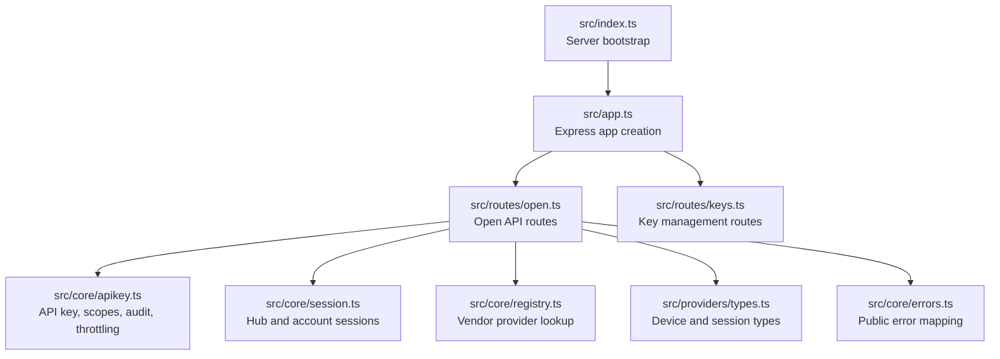
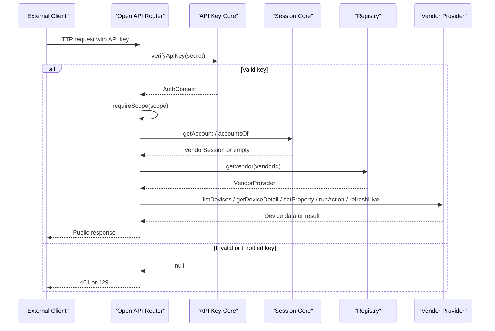
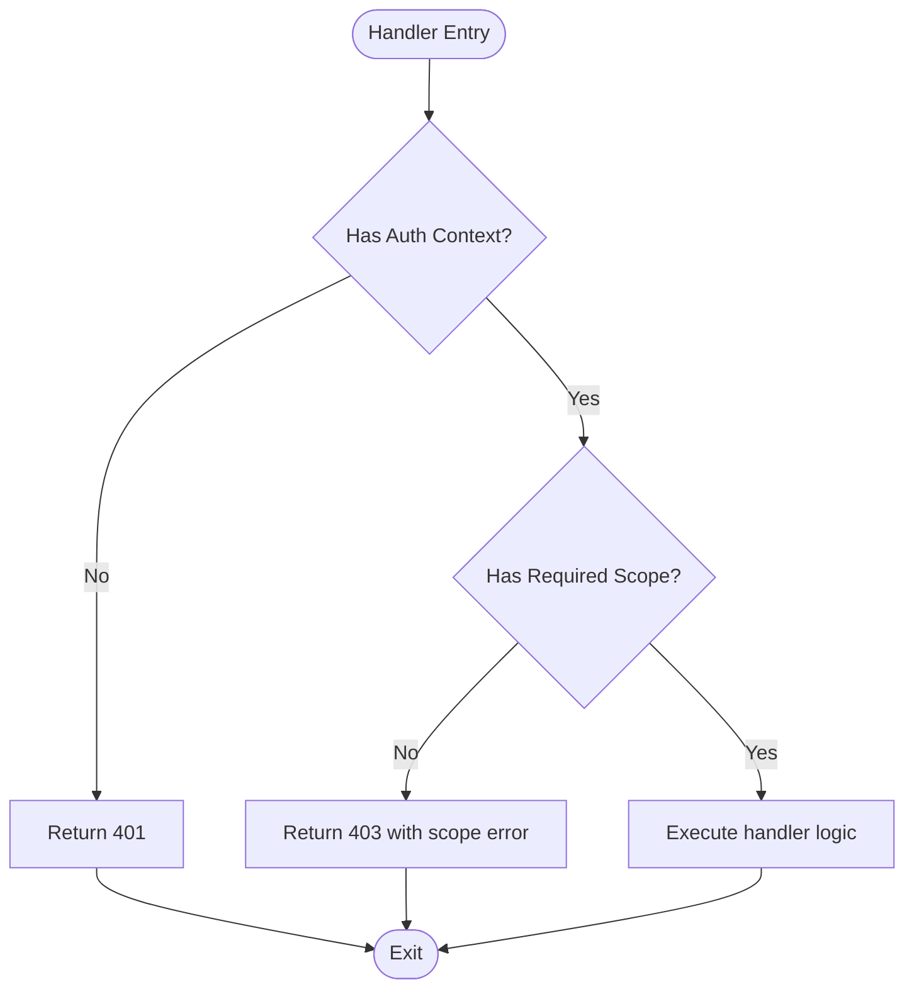
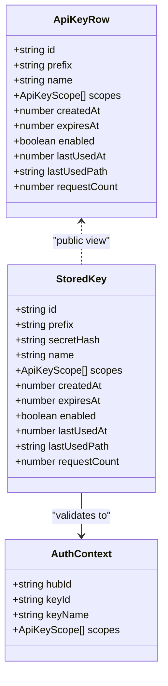
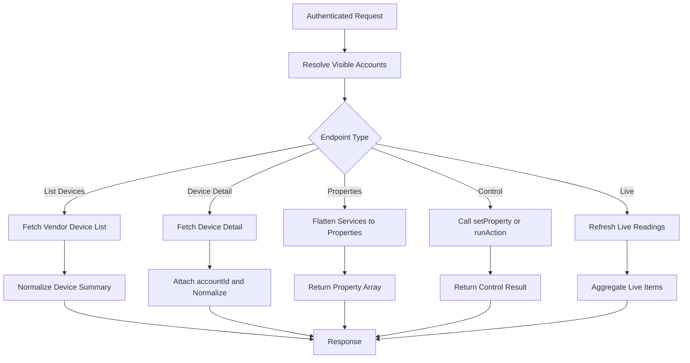
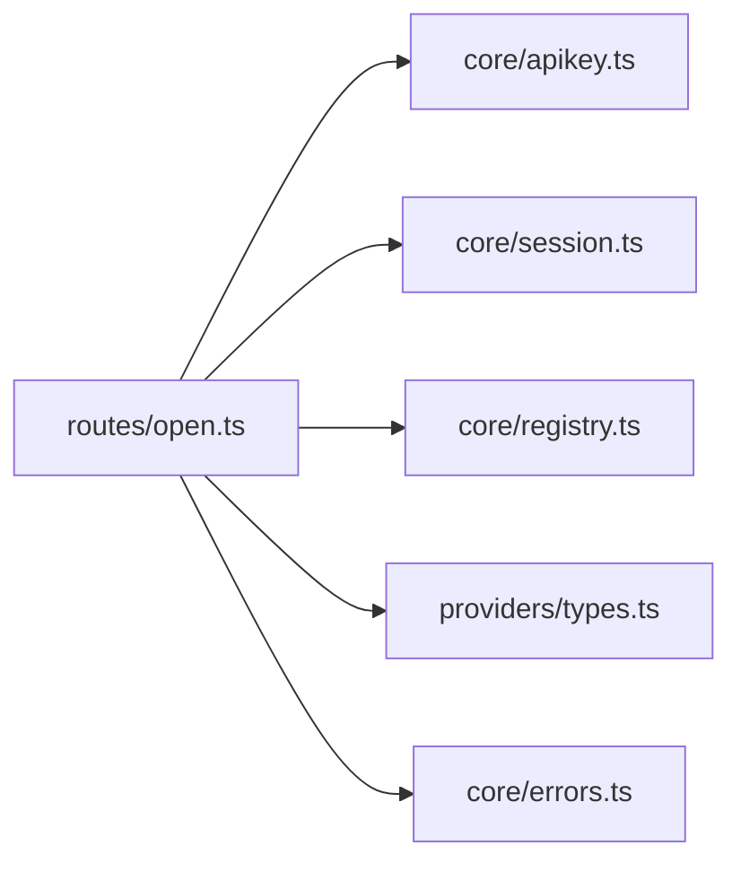

# Open API Gateway

<cite>
**Referenced Files in This Document**
- [README.md](file://README.md)
- [src/index.ts](file://src/index.ts)
- [src/app.ts](file://src/app.ts)
- [src/routes/open.ts](file://src/routes/open.ts)
- [src/routes/keys.ts](file://src/routes/keys.ts)
- [src/core/apikey.ts](file://src/core/apikey.ts)
- [src/core/session.ts](file://src/core/session.ts)
- [src/core/errors.ts](file://src/core/errors.ts)
- [src/core/registry.ts](file://src/core/registry.ts)
- [src/providers/types.ts](file://src/providers/types.ts)
</cite>

## Table of Contents
1. [Introduction](#introduction)
2. [Project Structure](#project-structure)
3. [Core Components](#core-components)
4. [Architecture Overview](#architecture-overview)
5. [Detailed Component Analysis](#detailed-component-analysis)
6. [Dependency Analysis](#dependency-analysis)
7. [Performance Considerations](#performance-considerations)
8. [Troubleshooting Guide](#troubleshooting-guide)
9. [Conclusion](#conclusion)
10. [Appendices](#appendices)

## Introduction
This document describes the Open API gateway that provides secure external access to device information and limited control operations. The gateway:
- Validates requests using scoped API keys.
- Enforces scope-based authorization for read, live data, and control endpoints.
- Filters and transforms vendor device data into a stable public format.
- Records detailed audit logs for every request, including failed authentication attempts.
- Applies rate limiting against repeated invalid key usage.
- Exposes management endpoints for creating, enabling/disabling, revoking, and auditing API keys.

The gateway is an Express application mounted under `/api`, with the open external endpoints under `/api/open`. Internal management endpoints for API keys are under `/api/keys` and require internal session login rather than an API key.

**Section sources**
- [README.md:59-96](file://README.md#L59-L96)
- [src/app.ts:13-23](file://src/app.ts#L13-L23)

## Project Structure
At runtime, the server boots from the entry file, initializes providers, creates the Express app, mounts routers, and listens on a configurable host and port. The open gateway router handles all external API paths, while the keys router manages API key lifecycle and audit queries.

**Diagram sources**
- [src/index.ts:1-12](file://src/index.ts#L1-L12)
- [src/app.ts:13-23](file://src/app.ts#L13-L23)
- [src/routes/open.ts:17-105](file://src/routes/open.ts#L17-L105)
- [src/routes/keys.ts:14-80](file://src/routes/keys.ts#L14-L80)
- [src/core/apikey.ts:1-304](file://src/core/apikey.ts#L1-L304)
- [src/core/session.ts:159-182](file://src/core/session.ts#L159-L182)
- [src/core/registry.ts:1-24](file://src/core/registry.ts#L1-L24)
- [src/providers/types.ts:22-84](file://src/providers/types.ts#L22-L84)
- [src/core/errors.ts:1-38](file://src/core/errors.ts#L1-L38)

**Section sources**
- [src/index.ts:1-12](file://src/index.ts#L1-L12)
- [src/app.ts:13-23](file://src/app.ts#L13-L23)

## Core Components
- Open API router: authenticates requests via API key, enforces scopes, records audit entries, and exposes device info, properties, actions, and live data endpoints.
- API key core: generates keys, stores hashed secrets, validates keys securely, tracks scopes, persists audit logs, and implements IP-based throttling for invalid keys.
- Session core: maintains hub-scoped vendor accounts, device caches, and status metadata used by the gateway to resolve visible accounts and devices.
- Registry: resolves vendor providers by ID; missing vendors raise structured errors.
- Error utilities: normalize vendor or provider errors into safe public responses.
- Provider types: define shared device, service, property, action, and session structures consumed across the gateway.

**Section sources**
- [src/routes/open.ts:17-324](file://src/routes/open.ts#L17-L324)
- [src/core/apikey.ts:6-304](file://src/core/apikey.ts#L6-L304)
- [src/core/session.ts:26-182](file://src/core/session.ts#L26-L182)
- [src/core/registry.ts:1-24](file://src/core/registry.ts#L1-L24)
- [src/core/errors.ts:1-38](file://src/core/errors.ts#L1-L38)
- [src/providers/types.ts:22-144](file://src/providers/types.ts#L22-L144)

## Architecture Overview
The Open API gateway applies a consistent middleware pipeline:
1. Set security headers and vary cache behavior.
2. Extract the API key from `Authorization: Bearer` or query parameter `apiKey`.
3. Check IP-based throttling for repeated invalid keys.
4. Validate the key securely using a SHA-256 index and constant-time comparison.
5. Attach an authenticated context to the request.
6. Route handlers enforce required scopes and call vendor providers through the registry.
7. Responses are transformed into a stable public shape and recorded in audit logs.

**Diagram sources**
- [src/routes/open.ts:62-119](file://src/routes/open.ts#L62-L119)
- [src/routes/open.ts:150-324](file://src/routes/open.ts#L150-L324)
- [src/core/apikey.ts:220-241](file://src/core/apikey.ts#L220-L241)
- [src/core/session.ts:174-182](file://src/core/session.ts#L174-L182)
- [src/core/registry.ts:10-14](file://src/core/registry.ts#L10-L14)
- [src/providers/types.ts:105-144](file://src/providers/types.ts#L105-L144)

## Detailed Component Analysis

### Scope-Based Authorization System
Supported scopes:
- `devices:read`: Read-only device discovery and details.
- `devices:live`: Live readings for devices.
- `devices:control`: Write properties and execute actions.

Each endpoint declares its required scope. If the key lacks the scope, the gateway returns a 403 with a clear message and records the failure reason in the audit log.

**Diagram sources**
- [src/routes/open.ts:107-119](file://src/routes/open.ts#L107-L119)

**Section sources**
- [src/core/apikey.ts:6-8](file://src/core/apikey.ts#L6-L8)
- [src/routes/open.ts:107-119](file://src/routes/open.ts#L107-L119)

### API Key Validation and Security
Key characteristics:
- Format: `mihome_<id>_<48hex>`.
- Storage: only SHA-256 hash is stored; plaintext is returned once at creation time.
- Validation: uses a precomputed index keyed by secret hash, then performs constant-time comparison.
- Lifecycle: supports creation, listing, enable/disable, revoke, expiration, and last-used tracking.
- Throttling: IPs with too many consecutive invalid key attempts within a short window are temporarily blocked.

**Diagram sources**
- [src/core/apikey.ts:11-48](file://src/core/apikey.ts#L11-L48)
- [src/core/apikey.ts:27-40](file://src/core/apikey.ts#L27-L40)
- [src/core/apikey.ts:220-241](file://src/core/apikey.ts#L220-L241)

**Section sources**
- [src/core/apikey.ts:151-183](file://src/core/apikey.ts#L151-L183)
- [src/core/apikey.ts:220-241](file://src/core/apikey.ts#L220-L241)
- [src/core/apikey.ts:273-303](file://src/core/apikey.ts#L273-L303)
- [README.md:96-96](file://README.md#L96-L96)

### Request Filtering and Data Transformation
The gateway filters and transforms vendor data before exposing it externally:
- Visible accounts are filtered by the authenticated hub.
- Device summaries are normalized to a stable public shape.
- Properties are flattened into a list with identifiers, writability, units, and values.
- Live data is aggregated per account and device.

**Diagram sources**
- [src/routes/open.ts:121-148](file://src/routes/open.ts#L121-L148)
- [src/routes/open.ts:177-245](file://src/routes/open.ts#L177-L245)
- [src/routes/open.ts:292-324](file://src/routes/open.ts#L292-L324)

**Section sources**
- [src/routes/open.ts:121-148](file://src/routes/open.ts#L121-L148)
- [src/routes/open.ts:177-245](file://src/routes/open.ts#L177-L245)
- [src/routes/open.ts:292-324](file://src/routes/open.ts#L292-L324)

### Supported Open API Endpoints
All open endpoints require a valid API key and return `Cache-Control: no-store`.

- GET `/api/open/info`
  - Purpose: Return key identity, scopes, and visible accounts.
  - Scopes: None (authentication required).
  - Response fields: `keyId`, `keyName`, `scopes`, `accounts`.

- GET `/api/open/accounts`
  - Purpose: List visible vendor accounts with device counts.
  - Scopes: `devices:read`.
  - Response fields: `accounts`.

- GET `/api/open/devices`
  - Purpose: List devices across visible accounts.
  - Query parameters: optional `accountId`.
  - Scopes: `devices:read`.
  - Response fields: `devices`, `warnings`.

- GET `/api/open/devices/:accountId/:did`
  - Purpose: Get device detail with services and properties.
  - Scopes: `devices:read`.
  - Response fields: `device`, plus normalized device summary.

- GET `/api/open/devices/:accountId/:did/props`
  - Purpose: Read device properties.
  - Scopes: `devices:read`.
  - Response fields: `did`, `properties`.

- POST `/api/open/devices/:accountId/:did/props`
  - Purpose: Write a device property.
  - Scopes: `devices:control`.
  - Request body fields: `siid`, `piid`, `value`, optional `id`.
  - Response field: `ok`.

- POST `/api/open/devices/:accountId/:did/actions`
  - Purpose: Execute a device action.
  - Scopes: `devices:control`.
  - Request body fields: `siid`, `aiid`.
  - Response field: `ok`.

- GET `/api/open/live`
  - Purpose: Read live readings for all visible devices.
  - Scopes: `devices:live`.
  - Response fields: `live`.

- GET `/api/open/live/:did`
  - Purpose: Read live readings for a specific device.
  - Scopes: `devices:live`.
  - Response fields: `live`.

**Section sources**
- [src/routes/open.ts:150-324](file://src/routes/open.ts#L150-L324)

### Management Endpoints for API Keys
These endpoints use internal session login (hub cookie), not API keys.

- GET `/api/keys/scopes`
  - Returns available scopes.

- GET `/api/keys`
  - Lists API keys for the current hub (no plaintext).

- POST `/api/keys`
  - Creates a new API key.
  - Request body fields: `name`, `scopes`, `expiresInDays`.
  - Response fields: `key`, `secret` (plaintext shown once).

- POST `/api/keys/:id/enabled`
  - Enable or disable a key without deleting it.
  - Request body field: `enabled`.

- DELETE `/api/keys/:id`
  - Revoke and delete a key.

- GET `/api/keys/audit/requests?keyId=&limit=`
  - Retrieve audit logs for the current hub, optionally filtered by key.

- POST `/api/keys/audit/clear`
  - Clear audit logs for the current hub.

**Section sources**
- [src/routes/keys.ts:14-80](file://src/routes/keys.ts#L14-L80)

### Audit Logging and Security Measures
Audit logging captures:
- Timestamp, hub ID, key ID, key name, method, path, status code, duration, source IP, and optional failure message.
- Paths redact sensitive query parameters such as `apiKey`.
- Unauthenticated failures are marked as unattributed and remain server-side only.
- Audit entries are capped and persisted asynchronously via microtask batching.

Security measures include:
- Secret hashing and constant-time comparison.
- Immediate effect of revocation, disabling, and expiration.
- IP-based throttling for repeated invalid key attempts.
- No caching of device data or auth results.

**Section sources**
- [src/routes/open.ts:31-105](file://src/routes/open.ts#L31-L105)
- [src/core/apikey.ts:67-107](file://src/core/apikey.ts#L67-L107)
- [src/core/apikey.ts:243-271](file://src/core/apikey.ts#L243-L271)
- [src/core/apikey.ts:273-303](file://src/core/apikey.ts#L273-L303)
- [README.md:88-96](file://README.md#L88-L96)

### Error Handling
Errors are normalized to safe public responses:
- Structured application errors expose a message, code, and optional details.
- Authentication-related errors are identified and handled consistently.
- Vendor or provider errors are mapped to user-friendly messages.

Common status codes:
- 400: Bad request or unsupported vendor.
- 401: Missing or invalid API key.
- 403: Insufficient scope.
- 404: Account or resource not found.
- 429: Too many invalid key attempts.
- 502: Vendor operation failure.

**Section sources**
- [src/core/errors.ts:1-38](file://src/core/errors.ts#L1-L38)
- [src/routes/open.ts:204-290](file://src/routes/open.ts#L204-L290)
- [src/core/registry.ts:10-14](file://src/core/registry.ts#L10-L14)

## Dependency Analysis
The open router depends on several core modules:
- API key module for validation, scoping, audit, and throttling.
- Session module for hub and account resolution.
- Registry for vendor provider lookup.
- Provider types for shared data models.
- Error utilities for public error formatting.

**Diagram sources**
- [src/routes/open.ts:1-15](file://src/routes/open.ts#L1-L15)
- [src/core/apikey.ts:1-48](file://src/core/apikey.ts#L1-L48)
- [src/core/session.ts:1-34](file://src/core/session.ts#L1-L34)
- [src/core/registry.ts:1-14](file://src/core/registry.ts#L1-L14)
- [src/providers/types.ts:1-34](file://src/providers/types.ts#L1-L34)
- [src/core/errors.ts:1-13](file://src/core/errors.ts#L1-L13)

**Section sources**
- [src/routes/open.ts:1-15](file://src/routes/open.ts#L1-L15)

## Performance Considerations
- JSON payload limit is set to 64KB to prevent oversized requests.
- Audit persistence is batched using microtasks to reduce disk writes during high-frequency logging.
- Device lists are cached per vendor session to avoid repeated remote calls when possible.
- Live data aggregation processes multiple accounts concurrently but isolates failures per account.

[No sources needed since this section provides general guidance]

## Troubleshooting Guide
Common integration issues and resolutions:
- Missing API key: Ensure the request includes `Authorization: Bearer <key>` or passes `apiKey` as a query parameter.
- Invalid or expired key: Verify the key exists, is enabled, and has not expired.
- Insufficient scope: Confirm the key includes the required scope for the endpoint.
- Rate-limited due to invalid keys: Wait for the throttle window to expire; avoid sending malformed keys repeatedly.
- Account not found: Verify the `accountId` belongs to the authenticated hub and is still active.
- Vendor errors: Check vendor-specific errors and session status; some failures map to 502.

Monitoring and debugging tools:
- Use `/api/keys/audit/requests` to inspect recent requests, statuses, durations, and failure reasons.
- Use `/api/keys` to review key metadata and last-used path.
- Use `/api/open/info` to confirm which scopes and accounts are visible to a given key.

**Section sources**
- [src/routes/open.ts:62-119](file://src/routes/open.ts#L62-L119)
- [src/routes/keys.ts:67-80](file://src/routes/keys.ts#L67-L80)
- [src/core/apikey.ts:243-271](file://src/core/apikey.ts#L243-L271)

## Conclusion
The Open API gateway offers a secure, auditable, and well-scoped interface for external clients to access device information and perform controlled operations. It emphasizes security through hashed secret storage, constant-time validation, strict scoping, and robust audit logging. Clients should generate narrowly scoped keys, handle errors gracefully, and respect rate limits. For ongoing operations, monitor audit logs and keep keys rotated and time-limited where appropriate.

[No sources needed since this section summarizes without analyzing specific files]

## Appendices

### Practical Integration Examples
- External client integration:
  - Obtain an API key via the management endpoint.
  - Call `/api/open/info` to validate the key and discover visible accounts.
  - Use `/api/open/devices` to enumerate devices.
  - Use `/api/open/devices/:accountId/:did/props` to read properties.
  - Use `/api/open/devices/:accountId/:did/props` with POST to write properties if the key has `devices:control`.
  - Use `/api/open/live` or `/api/open/live/:did` to poll live readings.

- API key generation and management:
  - Create a key with minimal required scopes.
  - Store the plaintext secret securely once; it is not recoverable later.
  - Periodically rotate keys and remove unused ones.
  - Use enable/disable to temporarily suspend access without losing metadata.

- Security best practices:
  - Use HTTPS in front of the gateway.
  - Restrict exposure to trusted networks or reverse proxies.
  - Limit scopes to read-only unless control is explicitly required.
  - Monitor audit logs for anomalies and adjust throttling policies as needed.

[No sources needed since this section provides general guidance]