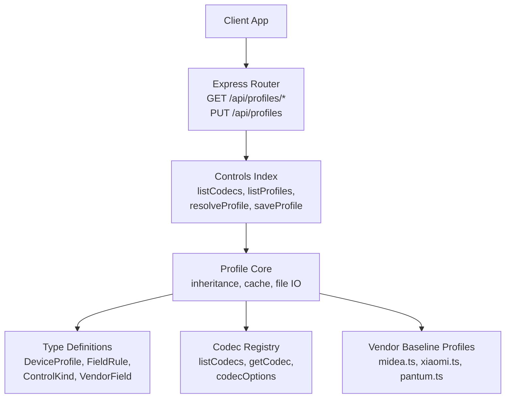
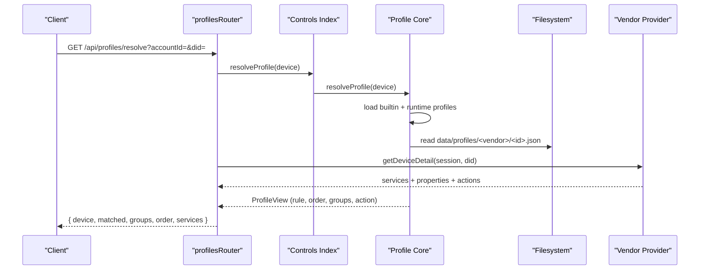
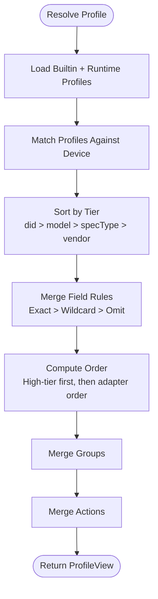
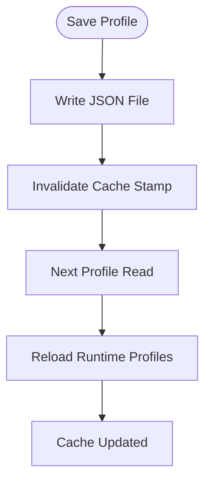
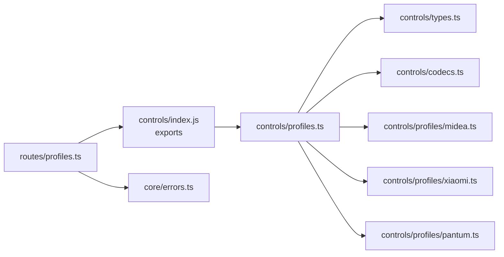

# Profile Management API

<cite>
**Referenced Files in This Document**
- [profiles.ts](file://src/routes/profiles.ts)
- [profiles.ts](file://src/controls/profiles.ts)
- [types.ts](file://src/controls/types.ts)
- [codecs.ts](file://src/controls/codecs.ts)
- [midea.ts](file://src/controls/profiles/midea.ts)
- [xiaomi.ts](file://src/controls/profiles/xiaomi.ts)
- [pantum.ts](file://src/controls/profiles/pantum.ts)
- [errors.ts](file://src/core/errors.ts)
- [README.md](file://README.md)
</cite>

## Table of Contents
1. [Introduction](#introduction)
2. [Project Structure](#project-structure)
3. [Core Components](#core-components)
4. [Architecture Overview](#architecture-overview)
5. [Detailed Component Analysis](#detailed-component-analysis)
6. [Dependency Analysis](#dependency-analysis)
7. [Performance Considerations](#performance-considerations)
8. [Troubleshooting Guide](#troubleshooting-guide)
9. [Conclusion](#conclusion)
10. [Appendices](#appendices)

## Introduction
This document provides comprehensive API documentation for profile management endpoints used to configure and control the dynamic UI panels for devices. Profiles define how device fields are displayed, validated, transformed, grouped, ordered, and written back. The system supports:

- CRUD-like operations for control panel profiles via HTTP endpoints.
- A layered inheritance model that merges vendor defaults, model-specific rules, capability-based overrides, and per-device overrides.
- Field codecs for bidirectional conversion between raw device values and normalized UI values.
- Dynamic UI generation based on resolved field rules, groups, order, and actions.
- Runtime profile deployment with file-based caching and immediate effect without restart.

The profile system is designed so that vendors contribute baseline profiles, while operators can deploy runtime JSON profiles under a configurable directory to override behavior per device, model, or capability.

## Project Structure
Profile-related functionality is split across route handlers, core profile resolution logic, shared type definitions, codec implementations, and vendor-specific baseline profiles.



**Diagram sources**
- [profiles.ts:1-88](file://src/routes/profiles.ts#L1-L88)
- [profiles.ts:1-196](file://src/controls/profiles.ts#L1-L196)
- [types.ts:1-114](file://src/controls/types.ts#L1-L114)
- [codecs.ts:1-256](file://src/controls/codecs.ts#L1-L256)
- [midea.ts:1-227](file://src/controls/profiles/midea.ts#L1-L227)
- [xiaomi.ts:1-41](file://src/controls/profiles/xiaomi.ts#L1-L41)
- [pantum.ts:1-30](file://src/controls/profiles/pantum.ts#L1-L30)

**Section sources**
- [README.md:1-58](file://README.md#L1-L58)
- [profiles.ts:1-88](file://src/routes/profiles.ts#L1-L88)

## Core Components
The profile management system consists of:

- **HTTP Route Handlers**: Expose endpoints for listing options, listing profiles, resolving a device’s final profile view, listing target devices, and saving profiles.
- **Profile Core**: Implements profile loading, runtime caching, pattern matching, tiered inheritance, rule merging, ordering, grouping, and action configuration.
- **Type System**: Defines `DeviceProfile`, `FieldRule`, `ControlKind`, `VendorField`, and related structures that describe both configuration and runtime views.
- **Codec Registry**: Provides built-in converters for transforming raw device values into normalized UI values and vice versa, plus utilities for generating option lists from mapping codecs.
- **Vendor Baseline Profiles**: Provide default behaviors for specific vendors (Midea, Xiaomi, Pantum), including labels, groups, ranges, and common patterns.

Key responsibilities:
- `GET /api/profiles/options`: Returns available codecs, allowed control kinds, and the active profile directory.
- `GET /api/profiles`: Lists all builtin and runtime profiles, optionally filtered by vendor.
- `GET /api/profiles/devices`: Lists devices associated with the current logged-in account(s).
- `GET /api/profiles/resolve`: Resolves the effective profile chain and merged field/action rules for a given device.
- `PUT /api/profiles`: Saves a profile JSON file under the configured profile directory.

**Section sources**
- [profiles.ts:1-88](file://src/routes/profiles.ts#L1-L88)
- [profiles.ts:1-196](file://src/controls/profiles.ts#L1-L196)
- [types.ts:1-114](file://src/controls/types.ts#L1-L114)
- [codecs.ts:1-256](file://src/controls/codecs.ts#L1-L256)

## Architecture Overview
The profile management architecture separates concerns between HTTP routing, profile resolution, data modeling, and vendor-specific defaults.



**Diagram sources**
- [profiles.ts:36-73](file://src/routes/profiles.ts#L36-L73)
- [profiles.ts:74-129](file://src/controls/profiles.ts#L74-L129)
- [profiles.ts:145-195](file://src/controls/profiles.ts#L145-L195)

## Detailed Component Analysis

### HTTP Endpoints

#### GET /api/profiles/options
Returns metadata needed by the configuration UI:
- `codecs`: List of registered codec names and hints.
- `kinds`: Allowed control kinds (`switch`, `segmented`, `select`, `slider`, `number`, `text`).
- `dir`: Active profile directory path.

Use this endpoint to populate dropdowns for codec selection and to inform the UI about supported control types.

**Response shape:**
- `codecs`: Array of `{ id, hint }`.
- `kinds`: Array of strings.
- `dir`: String path.

**Section sources**
- [profiles.ts:16-19](file://src/routes/profiles.ts#L16-L19)
- [codecs.ts:217-237](file://src/controls/codecs.ts#L217-L237)
- [profiles.ts:31-33](file://src/controls/profiles.ts#L31-L33)

#### GET /api/profiles
Lists all profiles, combining builtin profiles and runtime profiles loaded from disk. Supports optional filtering by vendor.

**Query parameters:**
- `vendor`: Optional string to filter profiles by vendor ID.

**Response shape:**
- `profiles`: Array of `DeviceProfile` objects.

**Section sources**
- [profiles.ts:21-25](file://src/routes/profiles.ts#L21-L25)
- [profiles.ts:131-133](file://src/controls/profiles.ts#L131-L133)

#### GET /api/profiles/devices
Lists devices belonging to accounts associated with the current hub session. Used to select a target device when configuring profiles.

**Response shape:**
- `devices`: Array of device summaries enriched with `accountId`.

**Section sources**
- [profiles.ts:27-34](file://src/routes/profiles.ts#L27-L34)

#### GET /api/profiles/resolve
Resolves the effective profile chain and merged field/action rules for a specific device. It also fetches provider-provided service details and maps each property/action to its final rule.

**Query parameters:**
- `accountId`: Account identifier.
- `did`: Device identifier.

**Response shape:**
- `device`: Device summary.
- `matched`: Array of profiles that matched, with their tier.
- `groups`: Merged group configuration.
- `order`: Final field order.
- `services`: Array of services, each containing:
  - `name`
  - `properties`: Array of property descriptors with `id`, `name`, `kind`, `writable`, and `rule`.
  - `actions`: Array of action descriptors with `id`, `name`, and `rule`.

**Error handling:**
- Returns 404 if the account or device is not found.
- Wraps provider errors using public error formatting.

**Section sources**
- [profiles.ts:36-73](file://src/routes/profiles.ts#L36-L73)
- [profiles.ts:74-129](file://src/controls/profiles.ts#L74-L129)

#### PUT /api/profiles
Saves a profile JSON file under the configured profile directory. The file path follows the structure `data/profiles/<vendor>/<id>.json`. On success, returns the saved file path.

**Request body:**
- Must be a valid `DeviceProfile` object with at least `id` and `vendor`.

**Response shape:**
- `ok`: Boolean indicating success.
- `file`: Absolute path to the saved profile file.

**Validation:**
- Rejects requests missing `id` or `vendor`.
- Uses `AppError` with code `"PROFILE"` and status `400` for validation failures.

**Section sources**
- [profiles.ts:75-87](file://src/routes/profiles.ts#L75-L87)
- [profiles.ts:135-143](file://src/controls/profiles.ts#L135-L143)
- [errors.ts:1-13](file://src/core/errors.ts#L1-L13)

### Profile Schema and Validation Rules

#### DeviceProfile
Defines a single profile configuration. Key fields:

- `id`: Unique profile identifier.
- `vendor`: Vendor identifier; must match the vendor context.
- `match`: Optional matching criteria:
  - `model`: Array of model patterns (supports `*`).
  - `specType`: Array of capability identifiers (supports `*`).
  - `did`: Array of exact device IDs (highest priority).
- `fields`: Mapping of field patterns to `FieldRule`. Patterns support exact names and `*` wildcards.
- `omit`: Array of field patterns to exclude.
- `order`: Array of field patterns to enforce display order.
- `groups`: Group configuration mapping field keys to group metadata (`name`, `order`).
- `actions`: Mapping of action patterns to action rules (`label`, `hidden`, `order`).

#### FieldRule
Defines transformation and presentation rules for a field:

- `label`: Human-readable label.
- `kind`: Control kind or `"auto"` for inference.
- `unit`: Display unit.
- `min`, `max`, `step`: Numeric constraints.
- `options`: Enumerated options as array or map.
- `codec`: Codec name for value transformation.
- `codecArgs`: Arguments passed to the codec.
- `digits`: Decimal precision for numeric codecs.
- `writable`: Whether the field can be written back.
- `hidden`: Whether the field should be hidden.
- `order`: Intra-group sort order.
- `group`: Group key.

#### ControlKind
Allowed UI control types:
- `switch`
- `segmented`
- `select`
- `slider`
- `number`
- `text`

#### VendorField
Represents the minimal fact produced by vendor adapters:
- `key`: Stable field identifier.
- `raw`: Raw device value.
- `writable`: Write capability.
- `label`, `kind`, `unit`, `range`, `options`, `group`, `siid`, `piid`, `meta`: Metadata and constraints.

**Section sources**
- [types.ts:10-114](file://src/controls/types.ts#L10-L114)

### Profile Inheritance and Override Mechanisms

Profiles are layered according to specificity:

1. Per-device (`did`)
2. Per-model (`model`)
3. Per-capability (`specType`)
4. Vendor default

Within the same tier, specificity ranking favors:
- Exact field names over wildcard patterns.
- Longer literal segments over shorter ones.
- Omit rules receive higher precedence within a profile to hard-exclude fields.

Resolution process:
- Collect all matching profiles.
- Sort by tier.
- Merge field rules by pattern, applying omit rules.
- Compute final `rule(key)` for any field.
- Compute final `order()` and `groups()`.
- Compute final `action(key)` for actions.



**Diagram sources**
- [profiles.ts:52-72](file://src/controls/profiles.ts#L52-L72)
- [profiles.ts:74-129](file://src/controls/profiles.ts#L74-L129)

**Section sources**
- [profiles.ts:52-72](file://src/controls/profiles.ts#L52-L72)
- [profiles.ts:74-129](file://src/controls/profiles.ts#L74-L129)

### Codec Usage and Dynamic UI Generation

Built-in codecs provide bidirectional transformations:

- `identity`: Pass-through.
- `bool`: Normalize to boolean.
- `shape`: Preserve original device shape on write.
- `shapebool`: Read as boolean, write preserving original shape.
- `shapenum`: Read as number, write preserving original shape.
- `auto`: Auto-detect boolean-like values.
- `onoff`, `zeroone`, `numbool`: Boolean encodings for different device formats.
- `number`: Numeric conversion with optional decimal rounding.
- `scale`: Linear scaling.
- `offset`: Offset addition/subtraction.
- `map`: Enum mapping using table or pairs.
- `duration`: Convert minutes to human-readable duration.

Dynamic UI generation uses:
- `kind` inferred from `options`, `range`, or value type when set to `"auto"`.
- `codecOptions(rule)` to derive option lists from `map` codecs when `options` are not explicitly provided.
- `normalizeOptions(options)` to accept both array and map forms.

```mermaid
classDiagram
class Codec {
+decode(raw, args, ctx) unknown
+encode(value, args, ctx) unknown
}
class CodecRegistry {
+registerCodec(id, codec) void
+listCodecs() {id,hint}[]
+getCodec(id) Codec
+codecOptions(rule) ControlOption[]
}
class FieldRule {
+string codec
+object codecArgs
+array|object options
+string kind
+boolean writable
+string unit
+number min
+number max
+number step
+number digits
}
CodecRegistry --> Codec : "manages"
FieldRule --> CodecRegistry : "uses for transform"
```

**Diagram sources**
- [codecs.ts:25-29](file://src/controls/codecs.ts#L25-L29)
- [codecs.ts:196-241](file://src/controls/codecs.ts#L196-L241)
- [codecs.ts:243-255](file://src/controls/codecs.ts#L243-L255)
- [types.ts:53-71](file://src/controls/types.ts#L53-L71)

**Section sources**
- [codecs.ts:1-256](file://src/controls/codecs.ts#L1-L256)
- [types.ts:53-71](file://src/controls/types.ts#L53-L71)

### Examples of Profile Configuration Structures

Below are conceptual examples illustrating typical profile configurations. These are not code snippets but structural references:

- **Midea Baseline Profile**:
  - Groups controls and readings.
  - Omits internal request fields and door-related noise.
  - Applies generic fallback codec `"auto"` for unknown fields.
  - Adds readable labels and common patterns for temperature, wind, mode, program, and time fields.

- **Midea Air Conditioner Profile**:
  - Matches models like `KFR-*`, `-AC-*`, and Chinese model names.
  - Overrides temperature range, mode mapping, and fan speed options.

- **Xiaomi Baseline Profile**:
  - Adds units and preferred slider controls for brightness, color temperature, fan level, and temperature/humidity sensors.

- **Pantum Baseline Profile**:
  - Defines read-only fields for serial number and cloud status.
  - Declares an upload print action.

These examples demonstrate how vendor baselines establish consistent UX, while runtime profiles can specialize behavior per device or model.

**Section sources**
- [midea.ts:110-227](file://src/controls/profiles/midea.ts#L110-L227)
- [xiaomi.ts:8-40](file://src/controls/profiles/xiaomi.ts#L8-L40)
- [pantum.ts:4-15](file://src/controls/profiles/pantum.ts#L4-L15)

### Profile Deployment and Caching Strategies

Deployment:
- Builtin profiles are registered at startup from vendor files.
- Runtime profiles are stored as JSON files under `data/profiles/<vendor>/<id>.json`.
- The directory can be overridden via environment variable `MIHOME_PROFILE_DIR`.

Caching:
- Runtime profiles are cached in memory with a stamp computed from file paths and modification times.
- If any file changes, the cache is invalidated and reloaded on next access.
- Invalid JSON files are skipped gracefully to avoid breaking device reads.

Immediate Effect:
- Saving a profile via `PUT /api/profiles` writes the file and invalidates the cache, making changes visible immediately without restarting the server.



**Diagram sources**
- [profiles.ts:135-143](file://src/controls/profiles.ts#L135-L143)
- [profiles.ts:145-195](file://src/controls/profiles.ts#L145-L195)

**Section sources**
- [profiles.ts:10-11](file://src/controls/profiles.ts#L10-L11)
- [profiles.ts:135-143](file://src/controls/profiles.ts#L135-L143)
- [profiles.ts:145-195](file://src/controls/profiles.ts#L145-L195)

## Dependency Analysis



**Diagram sources**
- [profiles.ts:1-88](file://src/routes/profiles.ts#L1-L88)
- [profiles.ts:1-196](file://src/controls/profiles.ts#L1-L196)
- [types.ts:1-114](file://src/controls/types.ts#L1-L114)
- [codecs.ts:1-256](file://src/controls/codecs.ts#L1-L256)
- [midea.ts:1-227](file://src/controls/profiles/midea.ts#L1-L227)
- [xiaomi.ts:1-41](file://src/controls/profiles/xiaomi.ts#L1-L41)
- [pantum.ts:1-30](file://src/controls/profiles/pantum.ts#L1-L30)
- [errors.ts:1-38](file://src/core/errors.ts#L1-L38)

**Section sources**
- [profiles.ts:1-88](file://src/routes/profiles.ts#L1-L88)
- [profiles.ts:1-196](file://src/controls/profiles.ts#L1-L196)

## Performance Considerations
- **Profile Loading**: Runtime profiles are scanned recursively; large directories may incur overhead. Use concise profile IDs and avoid excessive nesting.
- **Caching**: File timestamp stamping avoids unnecessary reloads. Keep profile files stable unless changes are intended.
- **Pattern Matching**: Wildcard patterns are compiled to regular expressions; prefer precise field names where possible to reduce regex complexity.
- **Codec Operations**: Numeric codecs round values based on `digits`; avoid excessive precision to minimize floating-point issues.
- **Provider Calls**: `/api/profiles/resolve` calls vendor providers to fetch device details; ensure provider responses are efficient and cached at the provider layer if possible.

[No sources needed since this section provides general guidance]

## Troubleshooting Guide

Common issues and resolutions:

- **Missing `id` or `vendor` in profile save**:
  - Cause: Request body does not include required fields.
  - Resolution: Ensure the payload includes `id` and `vendor` as strings.
  - Error response: Public error with code `"PROFILE"` and status `400`.

- **Account or device not found during resolve**:
  - Cause: Incorrect `accountId` or `did`, or device list not refreshed.
  - Resolution: Verify account/device identifiers and refresh device list before resolving.

- **Invalid JSON profile file**:
  - Behavior: The file is skipped during runtime profile loading; other profiles remain functional.
  - Resolution: Validate JSON syntax and ensure `vendor` and `id` are present.

- **Unexpected field visibility**:
  - Cause: Broad wildcard patterns in `fields` or `omit` may hide or show unintended fields.
  - Resolution: Narrow patterns or use higher-tier profiles to override `hidden` flags.

- **Codec mismatch**:
  - Cause: Using a codec incompatible with device value shape.
  - Resolution: Prefer `shape`, `shapebool`, or `shapenum` to preserve device format on write.

**Section sources**
- [profiles.ts:75-87](file://src/routes/profiles.ts#L75-L87)
- [profiles.ts:36-73](file://src/routes/profiles.ts#L36-L73)
- [profiles.ts:182-189](file://src/controls/profiles.ts#L182-L189)
- [errors.ts:1-38](file://src/core/errors.ts#L1-L38)

## Conclusion
The Profile Management API provides a robust, extensible mechanism for defining and deploying device control panel configurations. Its layered inheritance model, rich codec ecosystem, and runtime file-based deployment enable fine-grained customization without requiring application restarts. Operators can tailor UI behavior per device, model, or capability, while developers benefit from clear type definitions and predictable resolution semantics.

[No sources needed since this section summarizes without analyzing specific files]

## Appendices

### API Reference Summary

| Endpoint | Method | Purpose | Key Parameters | Response Highlights |
|---|---|---|---|---|
| `/api/profiles/options` | GET | Get available codecs, control kinds, and profile directory | None | `codecs`, `kinds`, `dir` |
| `/api/profiles` | GET | List builtin and runtime profiles | `vendor` (optional) | `profiles` |
| `/api/profiles/devices` | GET | List devices for current hub accounts | None | `devices` |
| `/api/profiles/resolve` | GET | Resolve effective profile chain and merged rules | `accountId`, `did` | `device`, `matched`, `groups`, `order`, `services` |
| `/api/profiles` | PUT | Save a profile JSON file | Body: `DeviceProfile` | `ok`, `file` |

**Section sources**
- [profiles.ts:16-87](file://src/routes/profiles.ts#L16-L87)