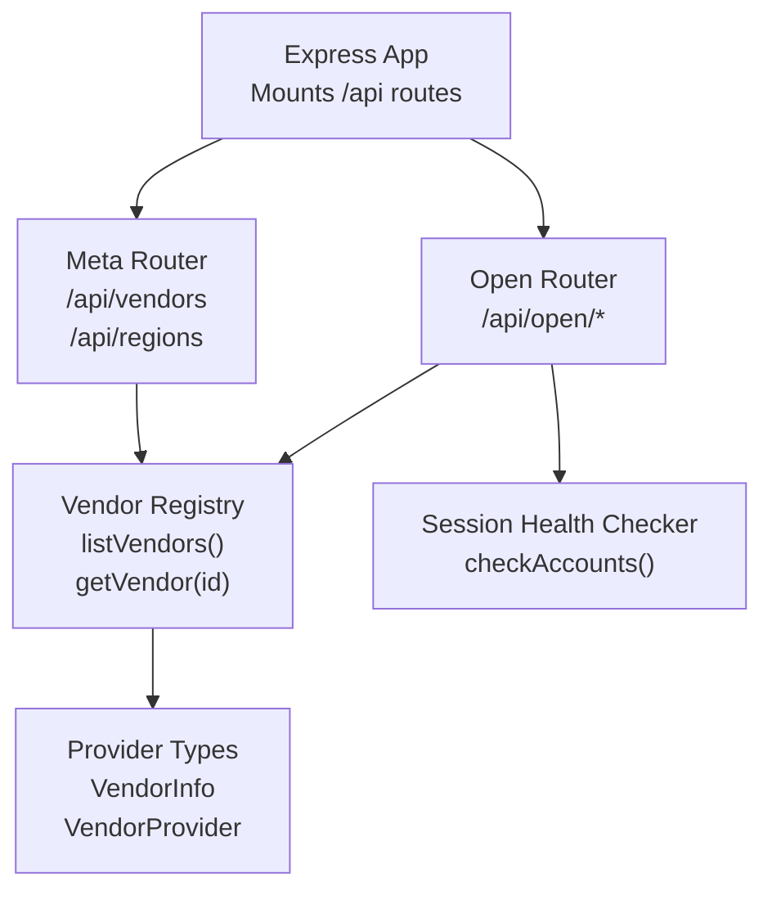
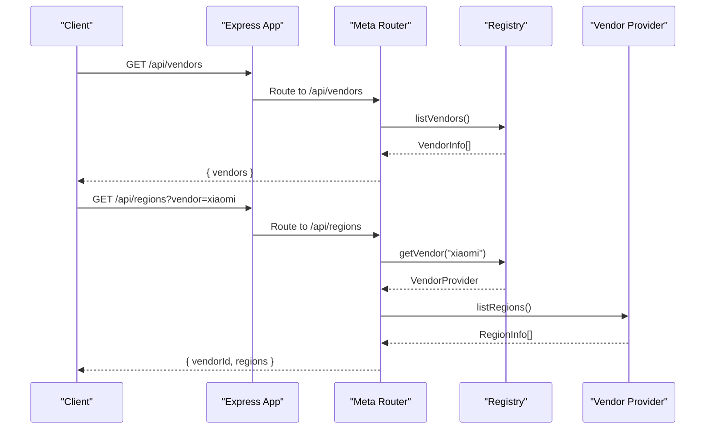
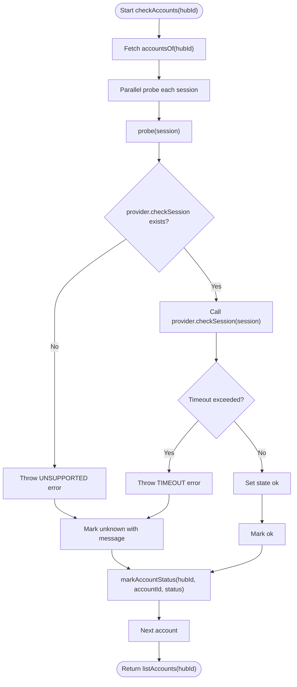
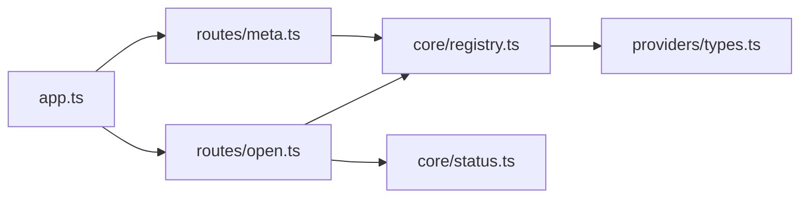

# System Meta API

<cite>
**Referenced Files in This Document**   
- [src/app.ts](file://src/app.ts)
- [src/routes/meta.ts](file://src/routes/meta.ts)
- [src/core/registry.ts](file://src/core/registry.ts)
- [src/providers/types.ts](file://src/providers/types.ts)
- [src/core/status.ts](file://src/core/status.ts)
- [src/routes/open.ts](file://src/routes/open.ts)
- [package.json](file://package.json)
</cite>

## Table of Contents
1. [Introduction](#introduction)
2. [Project Structure](#project-structure)
3. [Core Components](#core-components)
4. [Architecture Overview](#architecture-overview)
5. [Detailed Component Analysis](#detailed-component-analysis)
6. [Dependency Analysis](#dependency-analysis)
7. [Performance Considerations](#performance-considerations)
8. [Troubleshooting Guide](#troubleshooting-guide)
9. [Conclusion](#conclusion)

## Introduction
This document describes the system metadata and information endpoints exposed by the application. It covers:
- Provider discovery and capability enumeration
- Region availability per provider
- System health checks for account sessions
- Version and operational context through public info endpoints
- Response schemas, error behavior, and integration patterns for monitoring dashboards

The meta endpoints are mounted under `/api`, while authenticated device and live data endpoints are mounted under `/api/open`. The server is an Express application that also serves static frontend assets.

## Project Structure
The relevant backend structure for this documentation includes:
- Application bootstrap and route mounting
- Meta router for unauthenticated provider and region metadata
- Registry for vendor capabilities
- Provider type definitions used across APIs
- Status checker for session health probing
- Open router for authenticated device and live data access



**Diagram sources**
- [src/app.ts:13-23](file://src/app.ts#L13-L23)
- [src/routes/meta.ts:5-19](file://src/routes/meta.ts#L5-L19)
- [src/core/registry.ts:4-23](file://src/core/registry.ts#L4-L23)
- [src/providers/types.ts:10-15](file://src/providers/types.ts#L10-L15)
- [src/core/status.ts:34-50](file://src/core/status.ts#L34-L50)

**Section sources**
- [src/app.ts:1-25](file://src/app.ts#L1-L25)
- [package.json:1-24](file://package.json#L1-L24)

## Core Components
- Meta router exposes provider and region metadata without authentication.
- Vendor registry maintains registered providers and returns their capabilities.
- Provider types define the contract for vendor implementations, including regions, auth modes, and device operations.
- Session status checker probes vendor sessions to determine login validity with timeouts and error classification.
- Open router provides authenticated endpoints for system info, accounts, devices, properties, actions, and live telemetry.

**Section sources**
- [src/routes/meta.ts:1-20](file://src/routes/meta.ts#L1-L20)
- [src/core/registry.ts:1-24](file://src/core/registry.ts#L1-L24)
- [src/providers/types.ts:1-144](file://src/providers/types.ts#L1-L144)
- [src/core/status.ts:1-51](file://src/core/status.ts#L1-L51)
- [src/routes/open.ts:150-175](file://src/routes/open.ts#L150-L175)

## Architecture Overview
The system separates metadata discovery from authenticated device operations:
- Unauthenticated metadata endpoints allow clients to discover supported vendors and regions before authentication.
- Authenticated endpoints require an API Key and expose scopes for reading or controlling devices.
- Provider implementations encapsulate vendor-specific logic; the registry abstracts them behind a uniform interface.



**Diagram sources**
- [src/app.ts:13-21](file://src/app.ts#L13-L21)
- [src/routes/meta.ts:7-19](file://src/routes/meta.ts#L7-L19)
- [src/core/registry.ts:10-23](file://src/core/registry.ts#L10-L23)
- [src/providers/types.ts:10-15](file://src/providers/types.ts#L10-L15)

## Detailed Component Analysis

### Meta Endpoints
These endpoints provide system metadata about available providers and their supported regions.

#### GET /api/vendors
- Purpose: Enumerate all registered vendors and their basic capabilities.
- Authentication: Not required.
- Success response schema:
  - `vendors`: Array of `VendorInfo` objects containing:
    - `id`: string
    - `name`: string
    - `authModes`: Array of strings (e.g., `"password"`, `"sms"`, `"qr"`)
    - `regions`: Array of `RegionInfo` objects with `id` and `name`
- Error behavior: None expected for normal operation.

**Section sources**
- [src/routes/meta.ts:7-9](file://src/routes/meta.ts#L7-L9)
- [src/core/registry.ts:16-23](file://src/core/registry.ts#L16-L23)
- [src/providers/types.ts:10-15](file://src/providers/types.ts#L10-L15)

#### GET /api/regions
- Purpose: List supported regions for a specific vendor.
- Query parameters:
  - `vendor`: string (optional; defaults to `"xiaomi"`)
- Authentication: Not required.
- Success response schema:
  - `vendorId`: string
  - `regions`: Array of `RegionInfo` objects with `id` and `name`
- Error behavior:
  - Returns a public error object when the vendor is unsupported or invalid.
  - HTTP status codes:
    - `400` for unsupported vendor or invalid input
    - Other errors may be mapped to appropriate statuses via `toPublicError`

**Section sources**
- [src/routes/meta.ts:11-19](file://src/routes/meta.ts#L11-L19)
- [src/core/registry.ts:10-14](file://src/core/registry.ts#L10-L14)

### System Info and Operational Context
Authenticated endpoints under `/api/open` provide operational context and account visibility.

#### GET /api/open/info
- Purpose: Return information about the current API key and visible accounts.
- Authentication: Required (API Key).
- Success response schema:
  - `keyId`: string
  - `keyName`: string
  - `scopes`: Array of scope strings
  - `accounts`: Array of account summaries with:
    - `accountId`: string
    - `vendorId`: string
    - `region`: string
- Notes:
  - Accounts returned are those visible to the API Key.
  - If no accounts are visible, the array may be empty.

**Section sources**
- [src/routes/open.ts:150-162](file://src/routes/open.ts#L150-L162)

#### GET /api/open/accounts
- Purpose: List accounts visible to the API Key with device counts.
- Authentication: Requires `devices:read` scope.
- Success response schema:
  - `accounts`: Array of account summaries with:
    - `accountId`: string
    - `vendorId`: string
    - `region`: string
    - `deviceCount`: number

**Section sources**
- [src/routes/open.ts:164-175](file://src/routes/open.ts#L164-L175)

### Capability Discovery and Supported Features
Capability discovery is achieved through:
- Vendor enumeration via `/api/vendors`
- Region enumeration per vendor via `/api/regions`
- Provider type contract defining available methods such as `listRegions`, `loginPassword`, `beginQr`, `listDevices`, `getDeviceDetail`, `setProperty`, `runAction`, and optional `checkSession`

```mermaid
classDiagram
class VendorInfo {
+string id
+string name
+AuthMode[] authModes
+RegionInfo[] regions
}
class RegionInfo {
+string id
+string name
}
class VendorProvider {
<<interface>>
+string id
+string name
+AuthMode[] authModes
+listRegions() RegionInfo[]
+createPending(region) PendingAuth
+loginPassword(pending, captcha) Promise~LoginOutcome~
+loginSms?(pending) Promise~LoginOutcome~
+sendSms?(pending, captcha) Promise~{needCaptcha}~
+beginEmail2fa?(pending) Promise~PendingAuth~
+verifyEmail2fa?(pending, code) Promise~VendorSession~
+beginQr?(pending) Promise~PendingAuth~
+pollQr?(pending) Promise~VendorSession|null~
+getCaptchaImage?(pending) Promise~BinaryImage~
+getQrImage?(pending) Promise~BinaryImage~
+checkSession?(session) Promise~void~
+listDevices(session) Promise~DeviceSummary[]~
+refreshLive(session, devices) Promise~Record~string, LiveItem[]~~
+getDeviceDetail(session, did) Promise~DeviceDetail~
+setProperty(session, did, siid, piid, value, key?) Promise~void~
+runAction(session, did, siid, aiid) Promise~void~
}
VendorInfo --> RegionInfo : "contains"
VendorProvider --> RegionInfo : "returns"
```

**Diagram sources**
- [src/providers/types.ts:10-15](file://src/providers/types.ts#L10-L15)
- [src/providers/types.ts:105-143](file://src/providers/types.ts#L105-L143)

**Section sources**
- [src/providers/types.ts:1-144](file://src/providers/types.ts#L1-L144)

### System Health Checks and Account Status Monitoring
The session health checker validates whether vendor sessions remain valid. It:
- Iterates over accounts for a hub
- Probes each session using the vendor’s optional `checkSession` method
- Applies a timeout to avoid blocking requests
- Classifies errors into states:
  - `ok`: session is valid
  - `expired`: authentication failure detected
  - `unknown`: other errors during probe
- Persists the latest status per account and returns the updated account view



**Diagram sources**
- [src/core/status.ts:8-26](file://src/core/status.ts#L8-L26)
- [src/core/status.ts:34-50](file://src/core/status.ts#L34-L50)

**Section sources**
- [src/core/status.ts:1-51](file://src/core/status.ts#L1-L51)

### Device Properties and Actions
Authenticated endpoints allow reading and writing device properties and executing actions.

#### GET /api/open/devices/:accountId/:did/props
- Purpose: Read device properties and current values.
- Authentication: Requires `devices:read` scope.
- Success response schema:
  - `did`: string
  - `properties`: Array of property objects with:
    - `siid`: number
    - `piid`: number
    - `id`: string (optional stable field name)
    - `name`: string
    - `writable`: boolean
    - `unit`: string
    - `value`: any or null

**Section sources**
- [src/routes/open.ts:222-245](file://src/routes/open.ts#L222-L245)

#### POST /api/open/devices/:accountId/:did/props
- Purpose: Write a device property.
- Authentication: Requires `devices:control` scope.
- Request body fields:
  - `siid`: number
  - `piid`: number
  - `value`: any
  - `id`: string (optional stable field name)
- Success response: `{ ok: true }`

**Section sources**
- [src/routes/open.ts:247-271](file://src/routes/open.ts#L247-L271)

#### POST /api/open/devices/:accountId/:did/actions
- Purpose: Execute a device action.
- Authentication: Requires `devices:control` scope.
- Request body fields:
  - `siid`: number
  - `aiid`: number
- Success response: `{ ok: true }`

**Section sources**
- [src/routes/open.ts:273-290](file://src/routes/open.ts#L273-L290)

### Live Telemetry
The live endpoint reads real-time device readings.

#### GET /api/open/live
- Purpose: Read live telemetry for all devices visible to the API Key.
- Authentication: Requires `devices:live` scope.
- Success response schema:
  - `live`: Record mapping keys like `accountId:did` to arrays of live items

#### GET /api/open/live/:did
- Purpose: Read live telemetry for a specific device.
- Authentication: Requires `devices:live` scope.
- Success response schema:
  - `live`: Record mapping keys like `accountId:did` to arrays of live items

**Section sources**
- [src/routes/open.ts:292-323](file://src/routes/open.ts#L292-L323)

## Dependency Analysis
The following diagram shows how components depend on each other:



**Diagram sources**
- [src/app.ts:13-21](file://src/app.ts#L13-L21)
- [src/routes/meta.ts:1-19](file://src/routes/meta.ts#L1-L19)
- [src/routes/open.ts:1-15](file://src/routes/open.ts#L1-L15)
- [src/core/registry.ts:1-23](file://src/core/registry.ts#L1-L23)
- [src/providers/types.ts:1-15](file://src/providers/types.ts#L1-L15)
- [src/core/status.ts:1-5](file://src/core/status.ts#L1-L5)

**Section sources**
- [src/app.ts:1-25](file://src/app.ts#L1-L25)
- [src/routes/meta.ts:1-20](file://src/routes/meta.ts#L1-L20)
- [src/routes/open.ts:1-324](file://src/routes/open.ts#L1-L324)
- [src/core/registry.ts:1-24](file://src/core/registry.ts#L1-L24)
- [src/providers/types.ts:1-144](file://src/providers/types.ts#L1-L144)
- [src/core/status.ts:1-51](file://src/core/status.ts#L1-L51)

## Performance Considerations
- Health checks use parallel probing with a timeout to prevent slow vendor responses from blocking overall status updates.
- Device listing and live telemetry endpoints aggregate results across multiple accounts concurrently.
- Static frontend assets are served directly by Express, reducing overhead for client-side resources.

[No sources needed since this section provides general guidance]

## Troubleshooting Guide
Common issues and behaviors:
- Unsupported vendor in `/api/regions`:
  - Cause: Invalid or unregistered vendor ID
  - Response: Public error object with appropriate HTTP status
- Missing or invalid API Key:
  - Cause: Absent or expired key
  - Response: `401` with error message indicating missing or invalid key
- Insufficient scope:
  - Cause: API Key lacks required scope
  - Response: `403` with error message specifying missing scope
- Device not found:
  - Cause: Unknown account or device ID
  - Response: `404` with localized error message
- Vendor session check unsupported:
  - Cause: Vendor does not implement `checkSession`
  - Response: `501` with unsupported error
- Timeout during session check:
  - Cause: Vendor response exceeds configured timeout
  - Response: `504` with timeout error

**Section sources**
- [src/routes/meta.ts:11-19](file://src/routes/meta.ts#L11-L19)
- [src/routes/open.ts:86-119](file://src/routes/open.ts#L86-L119)
- [src/core/status.ts:22-26](file://src/core/status.ts#L22-L26)
- [src/core/status.ts:8-20](file://src/core/status.ts#L8-L20)

## Conclusion
The System Meta API provides essential discovery and operational endpoints:
- Unauthenticated metadata for vendors and regions enables clients to configure integrations safely.
- Authenticated endpoints expose system info, account visibility, device control, and live telemetry.
- Provider capabilities are defined by a consistent interface, allowing extension and robust integration.
- Health checking and error handling support reliable monitoring and troubleshooting.

[No sources needed since this section summarizes without analyzing specific files]