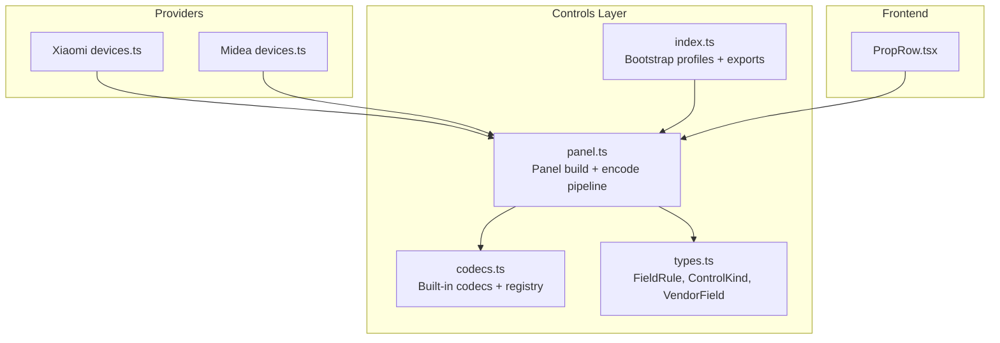
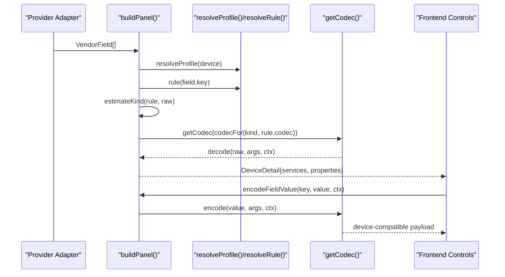
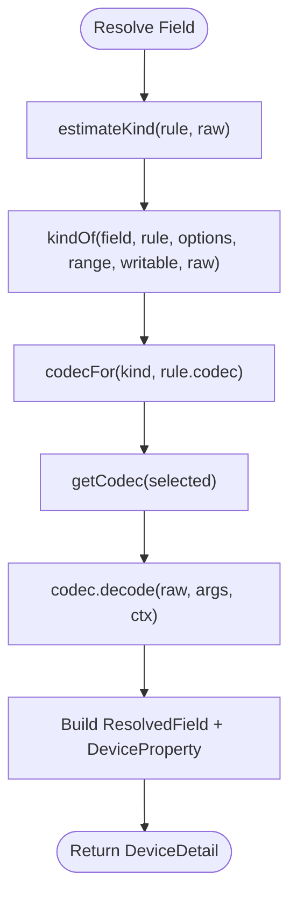
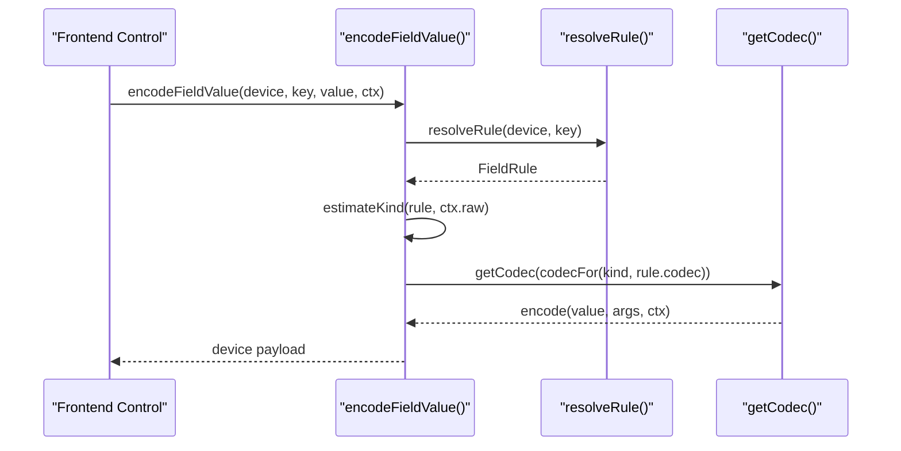
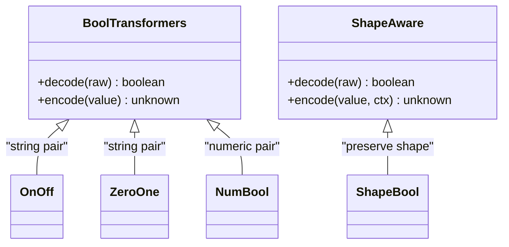
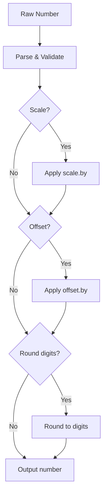
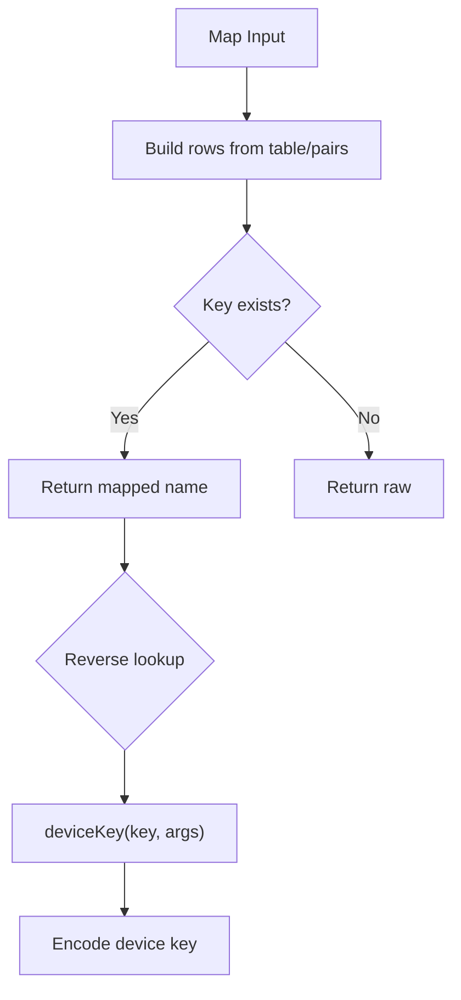
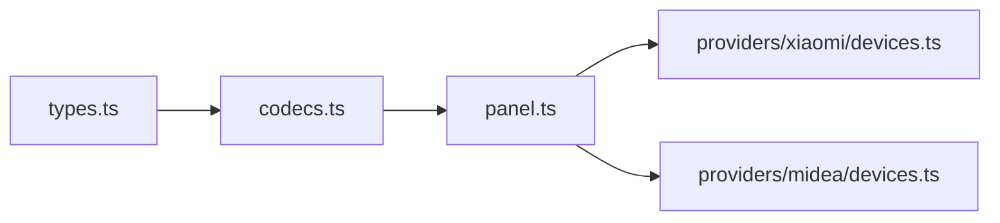

# Codec System

<cite>
**Referenced Files in This Document**
- [codecs.ts](file://src/controls/codecs.ts)
- [panel.ts](file://src/controls/panel.ts)
- [types.ts](file://src/controls/types.ts)
- [index.ts](file://src/controls/index.ts)
- [devices.ts (Xiaomi)](file://src/providers/xiaomi/devices.ts)
- [devices.ts (Midea)](file://src/providers/midea/devices.ts)
</cite>

## Table of Contents
1. [Introduction](#introduction)
2. [Project Structure](#project-structure)
3. [Core Components](#core-components)
4. [Architecture Overview](#architecture-overview)
5. [Detailed Component Analysis](#detailed-component-analysis)
6. [Dependency Analysis](#dependency-analysis)
7. [Performance Considerations](#performance-considerations)
8. [Troubleshooting Guide](#troubleshooting-guide)
9. [Conclusion](#conclusion)

## Introduction
This document explains the field codec transformation system used to convert raw device property values into user-friendly panel values, and vice versa when writing back to devices. The system is centered around a small set of built-in codecs, a registration mechanism for custom codecs, and a pipeline that integrates with device profiles and provider adapters.

The key goals are:
- Decode raw device data into normalized values suitable for UI controls.
- Encode user input back into device-compatible formats.
- Support common transformations such as scaling, offsetting, mapping, boolean coercion, shape preservation, and duration formatting.
- Provide a clear extension point for custom codecs.
- Handle malformed or missing data gracefully.

## Project Structure
The codec system lives under the controls layer and is consumed by provider-specific device modules and the frontend presentation layer.

**Diagram sources**
- [codecs.ts:1-256](file://src/controls/codecs.ts#L1-L256)
- [panel.ts:1-167](file://src/controls/panel.ts#L1-L167)
- [types.ts:1-114](file://src/controls/types.ts#L1-L114)
- [index.ts:1-24](file://src/controls/index.ts#L1-L24)
- [devices.ts (Xiaomi):247-266](file://src/providers/xiaomi/devices.ts#L247-L266)
- [devices.ts (Midea):149-156](file://src/providers/midea/devices.ts#L149-L156)

**Section sources**
- [codecs.ts:1-256](file://src/controls/codecs.ts#L1-L256)
- [panel.ts:1-167](file://src/controls/panel.ts#L1-L167)
- [types.ts:1-114](file://src/controls/types.ts#L1-L114)
- [index.ts:1-24](file://src/controls/index.ts#L1-L24)

## Core Components
The codec system defines a bidirectional transformation contract and provides several built-in implementations.

### Codec Contract
- `Codec`: Defines `decode(raw, args, ctx)` and `encode(value, args, ctx)`.
- `CodecArgs`: Arbitrary configuration passed through `FieldRule.codecArgs`.
- `CodecCtx`: Context including the current raw value and metadata, enabling shape-aware encoding.

Key behaviors:
- Decoding converts raw device payloads into normalized values for UI rendering.
- Encoding converts UI values back into device-compatible payloads.
- Shape-aware codecs use `ctx.raw` to preserve the original wire format across different device models.

**Section sources**
- [codecs.ts:3-29](file://src/controls/codecs.ts#L3-L29)

### Built-in Codecs
| Codec | Purpose | Key Arguments | Notes |
|---|---|---|---|
| `identity` | Pass-through | None | Returns raw as-is. |
| `bool` | Boolean coercion | None | Accepts many truthy forms. |
| `shape` | Preserve write-back shape | None | Uses `ctx.raw` to match device type. |
| `shapebool` | Read as boolean, write back preserving shape | None | Combines boolean decode with shape-aware encode. |
| `shapenum` | Read as number, write back preserving shape | `digits` | Rounds decoded numbers; preserves numeric/string form on encode. |
| `auto` | Auto-detect booleans, pass-through otherwise | None | Safe default when no explicit codec is configured. |
| `onoff` | Boolean ↔ `"on"/"off"` | None | String-based toggle. |
| `zeroone` | Boolean ↔ `"1"/"0"` | None | String-based toggle. |
| `numbool` | Boolean ↔ `1/0` | None | Numeric toggle. |
| `number` | Numeric normalization | `digits`, `text` | Rounds decimals; can return string if `text` is true. |
| `scale` | Linear scaling | `by`, `digits` | Divide by `by` on decode; multiply by `by` on encode. |
| `offset` | Offset adjustment | `by`, `digits` | Subtract `by` on decode; add `by` on encode. |
| `map` | Enum/value mapping | `table`, `pairs`, `strings` | Maps device keys to display names and back. |
| `duration` | Minutes to human-readable text | None | Converts minutes to localized-like text; encodes back to number. |

Common helper behaviors:
- `coerce`: Normalizes enum keys from strings to appropriate types.
- `normalizeOptions`: Supports both array and object option definitions.
- `truthy`: Flexible boolean detection across types and textual representations.
- `castTo` / `castString`: Shape-preserving casting using sample raw values.

**Section sources**
- [codecs.ts:31-194](file://src/controls/codecs.ts#L31-L194)
- [codecs.ts:196-211](file://src/controls/codecs.ts#L196-L211)

### Registration and Discovery
- `registerCodec(id, codec)`: Adds a custom codec to the internal registry.
- `getCodec(id)`: Retrieves a codec by id; falls back to `identity` if not found.
- `listCodecs()`: Exposes available codecs with hints for configuration UI.

This allows third-party code to extend the system without modifying core files.

**Section sources**
- [codecs.ts:213-241](file://src/controls/codecs.ts#L213-L241)

## Architecture Overview
The codec pipeline integrates three layers:
1. Provider adapters produce raw fields (`VendorField`).
2. Panel builder applies profile rules and codecs to render a normalized view (`DeviceDetail`).
3. Frontend renders controls based on `ControlKind` and uses the same codec selection logic to encode writes.

**Diagram sources**
- [panel.ts:12-32](file://src/controls/panel.ts#L12-L32)
- [panel.ts:55-86](file://src/controls/panel.ts#L55-L86)
- [panel.ts:102-154](file://src/controls/panel.ts#L102-L154)
- [panel.ts:161-166](file://src/controls/panel.ts#L161-L166)
- [codecs.ts:239-241](file://src/controls/codecs.ts#L239-L241)

**Section sources**
- [panel.ts:12-32](file://src/controls/panel.ts#L12-L32)
- [panel.ts:55-86](file://src/controls/panel.ts#L55-L86)
- [panel.ts:102-154](file://src/controls/panel.ts#L102-L154)
- [panel.ts:161-166](file://src/controls/panel.ts#L161-L166)

## Detailed Component Analysis

### Pipeline: Reading Raw Values into Panel Values
- `buildPanel` resolves profile rules and groups fields.
- For each field:
  - Determine control kind via `kindOf` and `estimateKind`.
  - Select codec via `codecFor`, which maps kinds like switch/slider/number to appropriate defaults.
  - Decode raw value using the selected codec with `rule.codecArgs` and `ctx` containing `raw` and `meta`.
  - Store normalized `value` alongside metadata for UI rendering.

**Diagram sources**
- [panel.ts:12-32](file://src/controls/panel.ts#L12-L32)
- [panel.ts:34-53](file://src/controls/panel.ts#L34-L53)
- [panel.ts:55-86](file://src/controls/panel.ts#L55-L86)
- [panel.ts:102-154](file://src/controls/panel.ts#L102-L154)

**Section sources**
- [panel.ts:12-32](file://src/controls/panel.ts#L12-L32)
- [panel.ts:34-53](file://src/controls/panel.ts#L34-L53)
- [panel.ts:55-86](file://src/controls/panel.ts#L55-L86)
- [panel.ts:102-154](file://src/controls/panel.ts#L102-L154)

### Pipeline: Writing Back to Devices
- `encodeFieldValue` re-applies the same kind-to-codec selection logic using `estimateKind` and `ctx.raw`.
- It throws an error if the field is hidden by profile rules.
- The selected codec encodes the user-provided value back into a device-compatible format.

**Diagram sources**
- [panel.ts:161-166](file://src/controls/panel.ts#L161-L166)
- [panel.ts:12-32](file://src/controls/panel.ts#L12-L32)

**Section sources**
- [panel.ts:161-166](file://src/controls/panel.ts#L161-L166)

### Built-in Codec Behaviors

#### Boolean Transformers
- `bool`: Coerces diverse inputs to boolean.
- `shapebool`: Reads as boolean but writes back matching the original shape.
- `onoff`, `zeroone`, `numbool`: Map boolean to specific device representations.

**Diagram sources**
- [codecs.ts:45-90](file://src/controls/codecs.ts#L45-L90)
- [codecs.ts:110-112](file://src/controls/codecs.ts#L110-L112)

**Section sources**
- [codecs.ts:45-90](file://src/controls/codecs.ts#L45-L90)
- [codecs.ts:110-112](file://src/controls/codecs.ts#L110-L112)

#### Numeric Transformations
- `number`: Normalizes numeric values with optional rounding and string output.
- `scale`: Applies linear scaling factor.
- `offset`: Applies additive offset.
- `shapenum`: Reads as number while preserving write-back shape.

**Diagram sources**
- [codecs.ts:114-149](file://src/controls/codecs.ts#L114-L149)

**Section sources**
- [codecs.ts:114-149](file://src/controls/codecs.ts#L114-L149)

#### Mapping and Options
- `map`: Translates between device keys and display names using `table` or `pairs`.
- `codecOptions`: Derives UI options from map table when not explicitly provided.

**Diagram sources**
- [codecs.ts:151-180](file://src/controls/codecs.ts#L151-L180)
- [codecs.ts:247-255](file://src/controls/codecs.ts#L247-L255)

**Section sources**
- [codecs.ts:151-180](file://src/controls/codecs.ts#L151-L180)
- [codecs.ts:247-255](file://src/controls/codecs.ts#L247-L255)

#### Duration Formatting
- `duration`: Converts minutes to human-readable text and back to numeric minutes.

**Section sources**
- [codecs.ts:182-192](file://src/controls/codecs.ts#L182-L192)

### Custom Codec Development Patterns
To add a custom codec:
1. Implement a `Codec` object with `decode` and `encode`.
2. Register it using `registerCodec(id, codec)`.
3. Reference it in `FieldRule.codec` and provide parameters via `FieldRule.codecArgs`.
4. Optionally expose documentation hints via `CODEC_DOCS` and list via `listCodecs`.

Example patterns:
- Temperature scaling: Use `scale` with `args.by` representing the divisor.
- Unit conversion: Combine `scale` and `offset` or implement a custom codec that transforms units.
- Conditional formatting: Use `map` to map numeric codes to descriptive labels.
- Value mapping: Use `map` with `table` or `pairs` for enumerated values.

**Section sources**
- [codecs.ts:213-241](file://src/controls/codecs.ts#L213-L241)
- [types.ts:53-71](file://src/controls/types.ts#L53-L71)

## Dependency Analysis
The codec system depends on:
- `types.ts` for shared interfaces like `FieldRule`, `ControlKind`, and `VendorField`.
- `panel.ts` for integrating codecs into the panel building and encoding pipelines.
- Provider modules for producing raw fields and consuming the panel output.

**Diagram sources**
- [types.ts:1-114](file://src/controls/types.ts#L1-L114)
- [codecs.ts:1-256](file://src/controls/codecs.ts#L1-L256)
- [panel.ts:1-167](file://src/controls/panel.ts#L1-L167)
- [devices.ts (Xiaomi):247-266](file://src/providers/xiaomi/devices.ts#L247-L266)
- [devices.ts (Midea):149-156](file://src/providers/midea/devices.ts#L149-L156)

**Section sources**
- [types.ts:1-114](file://src/controls/types.ts#L1-L114)
- [codecs.ts:1-256](file://src/controls/codecs.ts#L1-L256)
- [panel.ts:1-167](file://src/controls/panel.ts#L1-L167)
- [devices.ts (Xiaomi):247-266](file://src/providers/xiaomi/devices.ts#L247-L266)
- [devices.ts (Midea):149-156](file://src/providers/midea/devices.ts#L149-L156)

## Performance Considerations
- Codec operations are lightweight and operate on single-field values.
- Avoid heavy computations inside `decode`/`encode`; prefer precomputed mappings in `table` or `pairs`.
- Use `digits` to limit floating-point precision and reduce unnecessary conversions.
- Prefer `auto` or shape-aware codecs to minimize branching and improve predictability.

[No sources needed since this section provides general guidance]

## Troubleshooting Guide
Common issues and strategies:
- Malformed raw values:
  - Numeric codecs return `null` for non-finite or empty strings.
  - Boolean codecs accept multiple truthy forms; ensure expected semantics.
- Missing or incorrect codec arguments:
  - `scale` and `offset` default to safe values when `by` is missing.
  - `number` rounds only when `digits` is provided.
- Hidden fields:
  - `encodeFieldValue` throws an error if the field is hidden by profile rules.
- Shape mismatches:
  - Use `shape`, `shapebool`, or `shapenum` to preserve device-specific formats.
- Option lists:
  - If `options` are not defined, `codecOptions` derives them from `map` tables.

Error handling highlights:
- Provider errors propagate as structured errors with codes.
- Panel builder filters out hidden fields before processing.
- Codec fallback to `identity` ensures robustness when unknown codec ids are encountered.

**Section sources**
- [panel.ts:161-166](file://src/controls/panel.ts#L161-L166)
- [codecs.ts:31-37](file://src/controls/codecs.ts#L31-L37)
- [codecs.ts:114-149](file://src/controls/codecs.ts#L114-L149)
- [codecs.ts:239-241](file://src/controls/codecs.ts#L239-L241)
- [codecs.ts:247-255](file://src/controls/codecs.ts#L247-L255)

## Conclusion
The codec system provides a flexible, extensible framework for transforming raw device data into user-friendly values and back. Its design emphasizes:
- Clear separation between raw provider data and normalized panel values.
- Robust default behaviors for common cases.
- Extensibility through registration and configuration-driven rules.
- Consistent integration with profiles and provider adapters.

By leveraging built-in codecs and following the documented patterns, developers can implement complex transformations while maintaining clarity and reliability.

[No sources needed since this section summarizes without analyzing specific files]