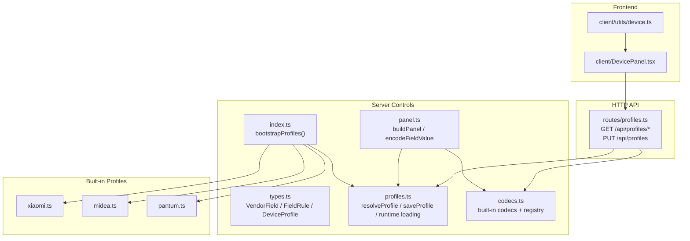
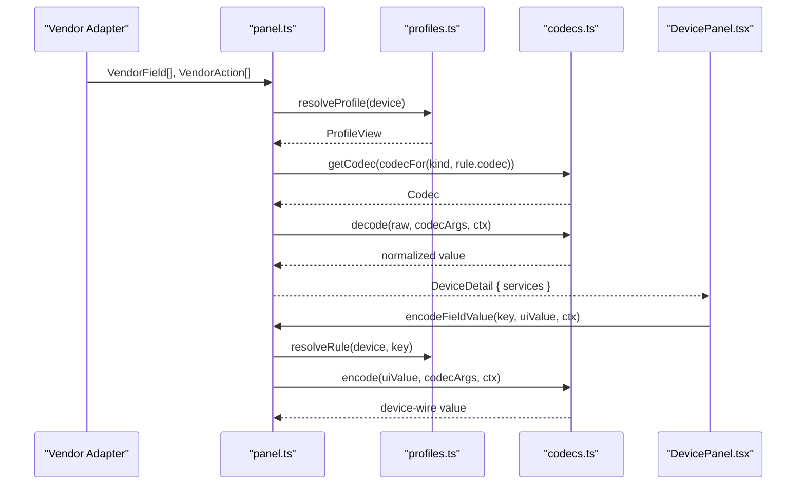
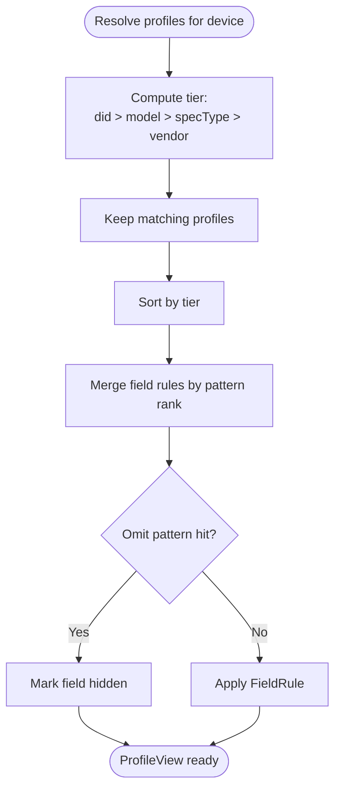
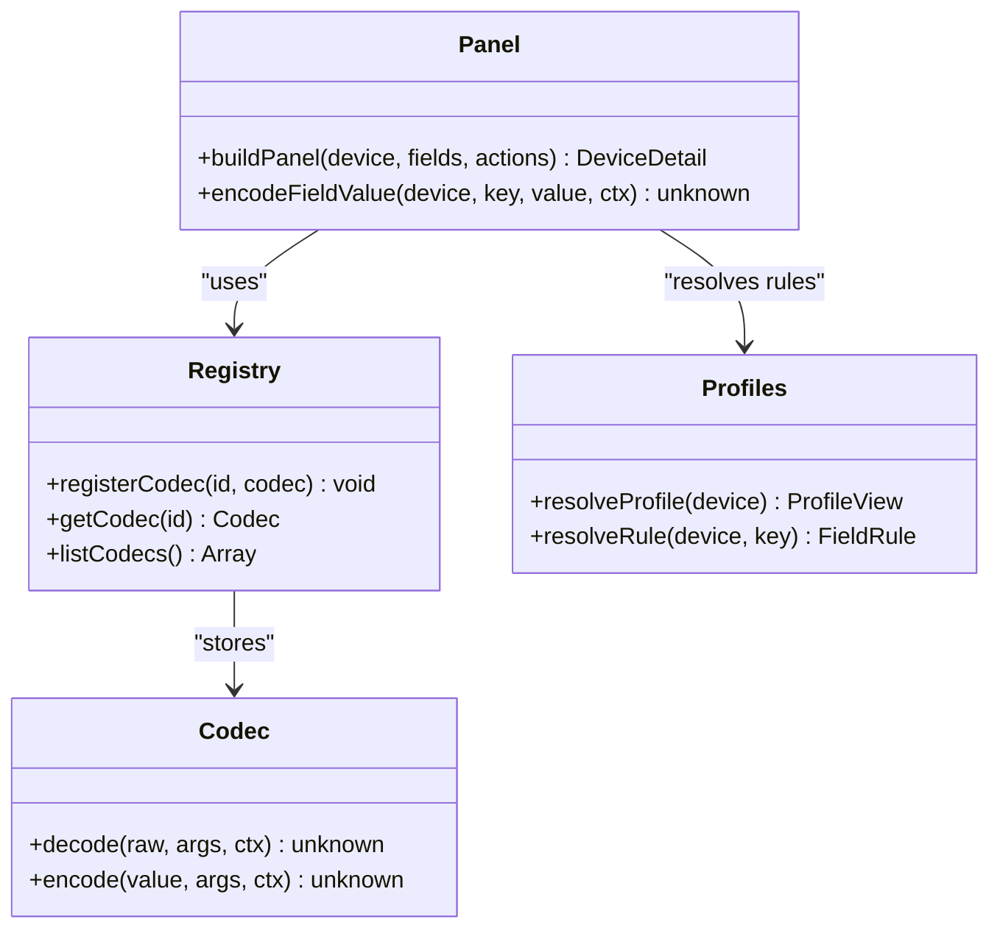
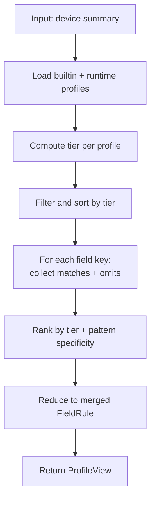
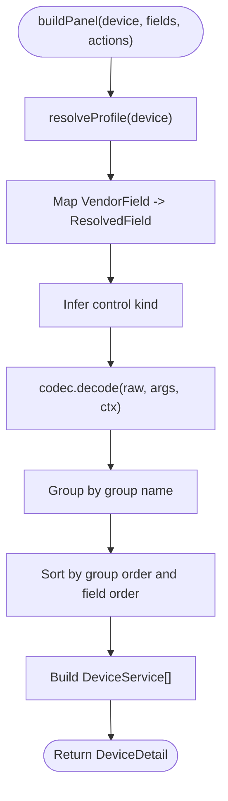
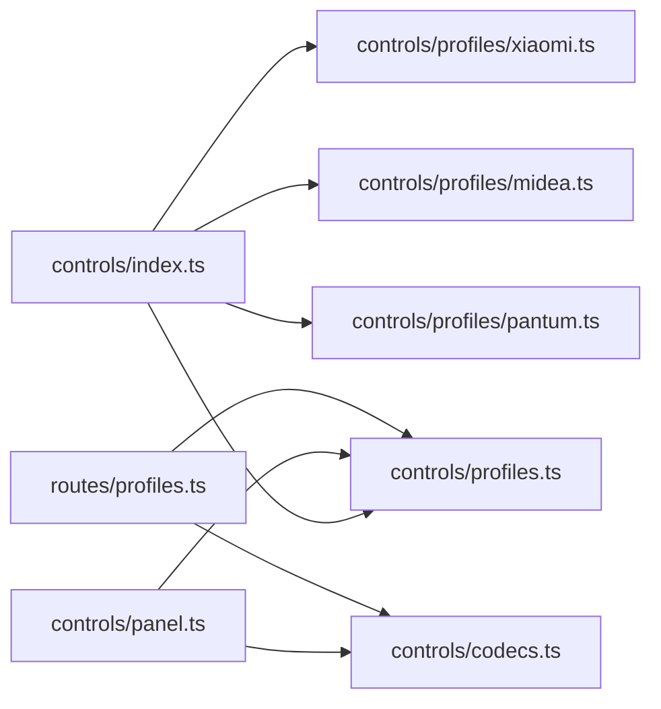
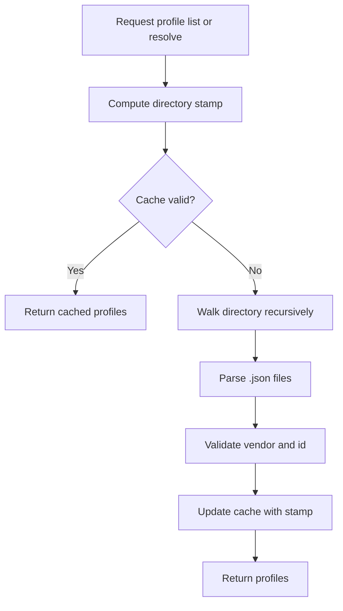

# Control Panel System

<cite>
**Referenced Files in This Document**   
- [types.ts](file://src/controls/types.ts)
- [profiles.ts](file://src/controls/profiles.ts)
- [codecs.ts](file://src/controls/codecs.ts)
- [panel.ts](file://src/controls/panel.ts)
- [index.ts](file://src/controls/index.ts)
- [midea.ts](file://src/controls/profiles/midea.ts)
- [pantum.ts](file://src/controls/profiles/pantum.ts)
- [xiaomi.ts](file://src/controls/profiles/xiaomi.ts)
- [profiles.ts](file://src/routes/profiles.ts)
- [DevicePanel.tsx](file://client/src/components/DevicePanel.tsx)
- [device.ts](file://client/src/utils/device.ts)
- [README.md](file://README.md)
</cite>

## Table of Contents
1. [Introduction](#introduction)
2. [Project Structure](#project-structure)
3. [Core Components](#core-components)
4. [Architecture Overview](#architecture-overview)
5. [Detailed Component Analysis](#detailed-component-analysis)
6. [Dependency Analysis](#dependency-analysis)
7. [Performance Considerations](#performance-considerations)
8. [Troubleshooting Guide](#troubleshooting-guide)
9. [Conclusion](#conclusion)
10. [Appendices](#appendices)

## Introduction
This document explains the profile-driven control panel system that turns vendor-specific device fields into a consistent, configurable UI. The system is organized around three layers:

- VendorField abstraction: the minimal fact produced by each vendor adapter (field key, raw value, and vendor-known constraints).
- DeviceProfile configuration: JSON-like rules that define labels, control kinds, ranges, options, grouping, ordering, codecs, and inheritance across device specificity levels.
- DeviceDetail rendering: the final structure sent to the frontend, where each property has a stable id, explicit control kind, and normalized value.

The design separates data transformation from presentation. Vendor adapters only produce raw field facts; all display semantics come from profiles and codecs. This makes it possible to add or override behavior for a specific device, model, capability type, or vendor without changing adapter code.

## Project Structure
The control panel logic lives under `src/controls/`, with built-in profiles per vendor and an HTTP route exposing profile management and resolution. The frontend renders the resolved panel using the `kind` and normalized values.

**Diagram sources**
- [index.ts:1-24](file://src/controls/index.ts#L1-L24)
- [profiles.ts:1-196](file://src/controls/profiles.ts#L1-L196)
- [codecs.ts:1-256](file://src/controls/codecs.ts#L1-L256)
- [panel.ts:1-167](file://src/controls/panel.ts#L1-L167)
- [xiaomi.ts:1-41](file://src/controls/profiles/xiaomi.ts#L1-L41)
- [midea.ts:1-227](file://src/controls/profiles/midea.ts#L1-L227)
- [pantum.ts:1-30](file://src/controls/profiles/pantum.ts#L1-L30)
- [profiles.ts:1-88](file://src/routes/profiles.ts#L1-L88)
- [DevicePanel.tsx:74-216](file://client/src/components/DevicePanel.tsx#L74-L216)
- [device.ts:1-69](file://client/src/utils/device.ts#L1-L69)

**Section sources**
- [README.md:3-57](file://README.md#L3-L57)
- [index.ts:1-24](file://src/controls/index.ts#L1-L24)

## Core Components
The core types define the contract between vendor adapters, profiles, and the renderer:

- VendorField: the smallest unit of truth from a vendor adapter. It includes the stable key, raw value, writability, optional label, kind, unit, range, options, group, service/property identifiers, and vendor-specific meta.
- FieldRule: the profile rule applied to a field. It can override label, kind, unit, min/max/step, options, codec, digits, writability, hidden state, order, and group.
- DeviceProfile: a named configuration scoped to a vendor, optionally matched by device id, model, or specType. It contains field rules, omit patterns, global order, groups, and action overrides.
- ResolvedField: the merged view used by both provider and frontend after applying profile rules and codecs.

Key responsibilities:
- Vendor adapters must not render UI; they only emit VendorField.
- Profiles provide all display semantics: labels, control kinds, ranges, options, grouping, ordering, and data transformation.
- The panel layer builds DeviceDetail, which the frontend consumes as services containing properties and actions.

**Section sources**
- [types.ts:1-114](file://src/controls/types.ts#L1-L114)

## Architecture Overview
The system follows a clear pipeline:

1. Vendor adapters return VendorField[] and VendorAction[].
2. buildPanel resolves the active DeviceProfile chain for the current device.
3. Each VendorField is merged with its FieldRule, transformed by a codec, and assigned a control kind.
4. Fields are grouped and ordered into DeviceService objects.
5. The frontend renders controls based on kind, list, range, and normalized value.
6. When writing back, encodeFieldValue uses the same profile and codec logic to convert the UI value into the device-compatible wire format.

**Diagram sources**
- [panel.ts:55-167](file://src/controls/panel.ts#L55-L167)
- [profiles.ts:74-129](file://src/controls/profiles.ts#L74-L129)
- [codecs.ts:25-29](file://src/controls/codecs.ts#L25-L29)
- [DevicePanel.tsx:130-163](file://client/src/components/DevicePanel.tsx#L130-L163)

## Detailed Component Analysis

### VendorField Abstraction
VendorField is the adapter’s output contract. It carries:
- A stable key used for write-back.
- The raw device value before any profile transformation.
- Writability and vendor-provided constraints such as kind, unit, range, and options.
- Optional grouping and MIoT-style siid/piid identifiers.
- Vendor-specific meta needed for write-back, such as boolStyle or text encoding hints.

This abstraction ensures vendor adapters remain focused on protocol details while profiles own user-facing semantics.

**Section sources**
- [types.ts:18-47](file://src/controls/types.ts#L18-L47)

### DeviceProfile Configuration Schema
A DeviceProfile defines how a vendor’s fields should be presented and controlled. Important schema elements include:

- id and vendor: identify the profile and scope it to a vendor.
- match: selects devices by did, model, or specType. Patterns support glob-style wildcards.
- fields: maps field keys or wildcard patterns to FieldRule. Exact keys take precedence over wildcard matches within the same profile.
- omit: excludes fields matching given patterns. Omit acts as a hard exclusion within a single profile; higher-level profiles can re-enable a field by explicitly setting hidden to false.
- order: declares preferred field ordering using exact names or wildcard patterns. Unmatched fields fall back to adapter order.
- groups: assigns section names and their display order.
- actions: configures action labels, visibility, and ordering.

Inheritance and specificity:
- Profiles are ranked by tier: device > model > specType > vendor.
- Within the same tier, more specific patterns win: exact name > longer literal > shorter literal > generic wildcard.
- Rules are merged in ascending rank order, so later hits overwrite earlier ones.

**Diagram sources**
- [profiles.ts:52-91](file://src/controls/profiles.ts#L52-L91)

**Section sources**
- [types.ts:49-95](file://src/controls/types.ts#L49-L95)
- [profiles.ts:52-123](file://src/controls/profiles.ts#L52-L123)
- [README.md:18-48](file://README.md#L18-L48)

### Built-in Profiles
The repository ships vendor-specific baseline profiles:

- Xiaomi: leverages MIoT spec metadata already provided by the adapter, adding units, slider preferences, and category-based ordering.
- Midea: maps lua field names to Chinese labels, applies map/duration/shapenum codecs, and provides baseline plus AC/fridge/washer overrides.
- Pantum: exposes cloud status and a print action.
- Demo: demonstrates switch and brightness sliders.

These profiles show how to use wildcards, groups, omit, order, and codec mappings.

**Section sources**
- [xiaomi.ts:1-41](file://src/controls/profiles/xiaomi.ts#L1-L41)
- [midea.ts:1-227](file://src/controls/profiles/midea.ts#L1-L227)
- [pantum.ts:1-30](file://src/controls/profiles/pantum.ts#L1-L30)

### Codec System
Codecs implement bidirectional transformations between device raw values and panel values. They are declared by name in FieldRule.codec, with parameters in FieldRule.codecArgs so profiles remain pure JSON.

Built-in codecs:
- identity: pass-through.
- bool: coerce arbitrary input to boolean.
- shape: preserve original device shape on write-back.
- shapebool: read as boolean, write back preserving original shape.
- shapenum: read as number, write back preserving original shape.
- auto: auto-detect boolean-like strings or numbers; otherwise pass through.
- onoff, zeroone, numbool: boolean <-> string or numeric representations.
- number: numeric conversion with optional decimal rounding via digits.
- scale: linear scaling by args.by.
- offset: additive shift by args.by.
- map: enum mapping via table or pairs.
- duration: minutes to human-readable duration.

Codec registration and discovery:
- registerCodec adds custom codecs at runtime.
- listCodecs returns available codecs with hints for configuration UIs.
- getCodec returns the codec by id or identity when none is specified.

Options inference:
- If a field uses map without explicit options, codecOptions derives options from the map table, preventing read-only-looking enums.

**Diagram sources**
- [codecs.ts:19-29](file://src/controls/codecs.ts#L19-L29)
- [codecs.ts:213-241](file://src/controls/codecs.ts#L213-L241)
- [panel.ts:27-32](file://src/controls/panel.ts#L27-L32)
- [panel.ts:161-166](file://src/controls/panel.ts#L161-L166)
- [profiles.ts:74-129](file://src/controls/profiles.ts#L74-L129)

**Section sources**
- [codecs.ts:1-256](file://src/controls/codecs.ts#L1-L256)

### Profile Resolution Logic
resolveProfile computes the effective rule set for a device:

- Combine builtin profiles with runtime-loaded profiles.
- Compute tier for each profile against the device summary.
- Sort profiles by tier.
- For each field key, collect all matching field rules and omit patterns.
- Rank matches by tier and pattern specificity.
- Reduce matches into a single merged FieldRule.
- Provide helpers for order, groups, and action merging.

Runtime profiles are loaded from a directory rooted at MIHOME_PROFILE_DIR or data/profiles. Each file is expected to contain a DeviceProfile or array of profiles. Invalid files are skipped so one bad profile does not break device loading.

**Diagram sources**
- [profiles.ts:74-123](file://src/controls/profiles.ts#L74-L123)

**Section sources**
- [profiles.ts:52-129](file://src/controls/profiles.ts#L52-L129)

### DeviceDetail Rendering
buildPanel is the single entry point for turning VendorField[] into DeviceDetail:

- Resolve the active profile view.
- Map each VendorField to a ResolvedField by merging with FieldRule.
- Infer control kind using options, range, value type, and writability.
- Apply codec decode to normalize values.
- Group fields by group name and order them by rule.order or fallback index.
- Build services with properties and actions.

formatPanelValue produces a consistent text representation for live cards and drawers, honoring option lists, boolean labels, and numeric units.

**Diagram sources**
- [panel.ts:55-154](file://src/controls/panel.ts#L55-L154)

**Section sources**
- [panel.ts:1-167](file://src/controls/panel.ts#L1-L167)

### Frontend Integration
The frontend receives DeviceDetail and renders sections for each service. Properties are rendered using PropRow based on kind, list, range, and normalized value. Actions are executed through callbacks, with special handling for print actions.

Client-side utilities also infer units and control kinds for legacy payloads, but the server-side kind takes priority when present.

**Section sources**
- [DevicePanel.tsx:74-216](file://client/src/components/DevicePanel.tsx#L74-L216)
- [device.ts:1-69](file://client/src/utils/device.ts#L1-L69)

## Dependency Analysis
The control panel module exports a bootstrap function that registers built-in profiles at startup. Runtime profiles are discovered from disk and cached until the directory timestamp changes.

**Diagram sources**
- [index.ts:1-24](file://src/controls/index.ts#L1-L24)
- [panel.ts:1-6](file://src/controls/panel.ts#L1-L6)
- [profiles.ts:1-5](file://src/controls/profiles.ts#L1-L5)
- [profiles.ts:1-3](file://src/routes/profiles.ts#L1-L3)

**Section sources**
- [index.ts:1-24](file://src/controls/index.ts#L1-L24)
- [profiles.ts:1-196](file://src/controls/profiles.ts#L1-L196)
- [profiles.ts:1-88](file://src/routes/profiles.ts#L1-L88)

## Performance Considerations
- Profile resolution scans builtin and runtime profiles once per device. The runtime cache avoids repeated filesystem reads when the directory content has not changed.
- Pattern matching uses simple glob-to-regex conversion. Wildcard-heavy profiles may increase matching cost; prefer precise keys where possible.
- Codec operations are lightweight, but complex map tables can grow large. Keep enum tables concise and reuse shared constants.
- buildPanel creates intermediate arrays and maps; for very large device trees, consider batching or lazy grouping if profiling shows bottlenecks.

[No sources needed since this section provides general guidance]

## Troubleshooting Guide
Common issues and resolutions:

- Field appears hidden:
  - Check omit patterns in the active profile chain.
  - Confirm whether a lower-tier profile omitted the field and whether a higher-tier profile re-declared it visible.
  - Use GET /api/profiles/resolve to inspect the merged rule for the field.

- Wrong control kind:
  - Verify FieldRule.kind and VendorField.kind.
  - Remember writable fields can become switch/slider/number; readonly fields degrade to text.
  - Options count and label length influence segmented vs select.

- Write-back fails or sends wrong shape:
  - Ensure the codec preserves device shape when needed (shape, shapebool, shapenum).
  - Confirm ctx.raw is passed during encodeFieldValue so shape-aware codecs can infer the correct wire format.

- Profile not taking effect:
  - Confirm the profile is saved under data/profiles/<vendor>/<id>.json.
  - Check MIHOME_PROFILE_DIR if using a custom directory.
  - Validate JSON syntax; invalid files are skipped.
  - Restart is not required; mtime-based cache invalidation reloads profiles automatically.

- Action missing or mislabeled:
  - Inspect profile.actions for the action key.
  - Use GET /api/profiles/resolve to see merged action rules.

**Section sources**
- [profiles.ts:135-195](file://src/controls/profiles.ts#L135-L195)
- [profiles.ts:36-73](file://src/routes/profiles.ts#L36-L73)
- [panel.ts:161-166](file://src/controls/panel.ts#L161-L166)

## Conclusion
The profile-driven control panel system cleanly separates vendor data from presentation. VendorField captures raw facts, DeviceProfile defines display and transformation rules, and DeviceDetail delivers a stable, frontend-friendly structure. The codec system enables safe, reversible conversions, while the tiered profile resolution supports fine-grained customization from vendor defaults up to individual devices. Runtime profile loading and hot-reloading make iteration fast and safe without restarting the server.

[No sources needed since this section summarizes without analyzing specific files]

## Appendices

### Practical Examples

#### Creating a Custom Profile
Steps:
1. Choose a vendor and id.
2. Add match criteria if targeting a specific device, model, or specType.
3. Define groups and order to organize the UI.
4. Use fields to assign labels, kinds, ranges, options, and codecs.
5. Use omit to hide noisy internal fields.
6. Save the profile to data/profiles/<vendor>/<id>.json.
7. Refresh the device detail page; the new profile takes effect immediately.

Reference endpoints:
- GET /api/profiles/options: available codecs, kinds, and profile directory.
- GET /api/profiles/devices: devices available for selection.
- GET /api/profiles/resolve?accountId=&did=: merged rules for a device.
- PUT /api/profiles: save a profile.

**Section sources**
- [README.md:50-57](file://README.md#L50-L57)
- [profiles.ts:131-143](file://src/routes/profiles.ts#L131-L143)

#### Implementing a Custom Codec
Steps:
1. Implement a Codec with decode and encode functions.
2. Register it using registerCodec with a unique id.
3. Reference the id in FieldRule.codec and pass parameters via FieldRule.codecArgs.
4. Use CodecCtx.raw and CodecCtx.meta when preserving device shape or accessing vendor-specific hints.
5. Optionally expose documentation hints via listCodecs for configuration UIs.

Example patterns:
- Numeric rounding with digits.
- Enum mapping with table or pairs.
- Boolean coercion with shape preservation.

**Section sources**
- [codecs.ts:19-29](file://src/controls/codecs.ts#L19-L29)
- [codecs.ts:213-241](file://src/controls/codecs.ts#L213-L241)
- [codecs.ts:247-255](file://src/controls/codecs.ts#L247-L255)

### Runtime Profile Loading and Hot-Reloading
- Built-in profiles are registered at bootstrap.
- Runtime profiles are loaded from a directory and cached by a stamp computed from file paths and modification times.
- Any change to a profile file invalidates the cache on the next access.
- Invalid JSON files are skipped to protect device loading.

**Diagram sources**
- [profiles.ts:145-195](file://src/controls/profiles.ts#L145-L195)

**Section sources**
- [profiles.ts:10-11](file://src/controls/profiles.ts#L10-L11)
- [profiles.ts:145-195](file://src/controls/profiles.ts#L145-L195)