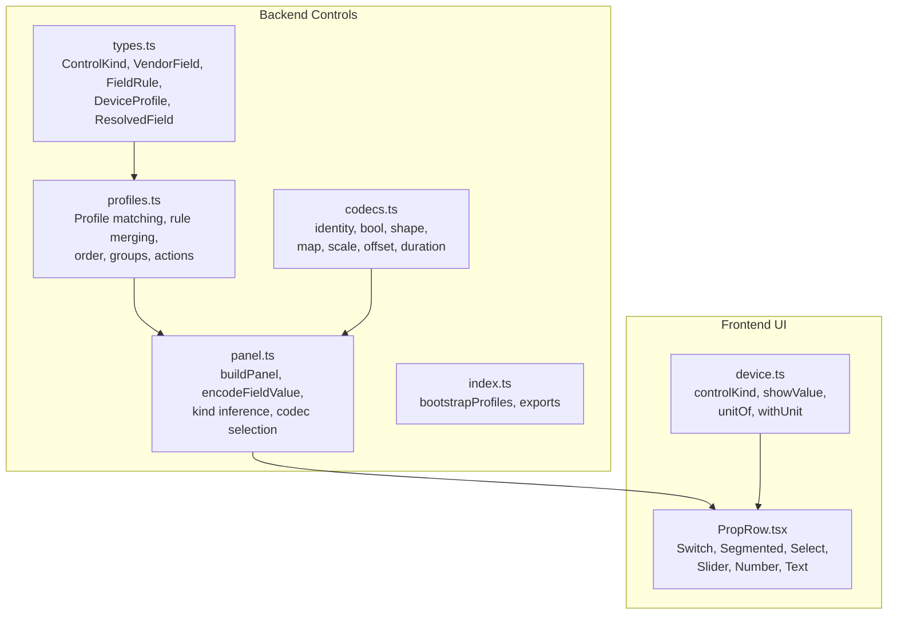
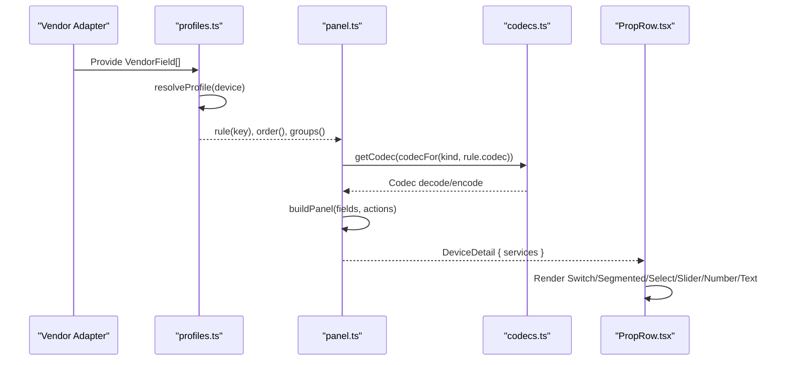
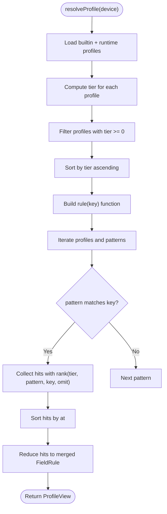
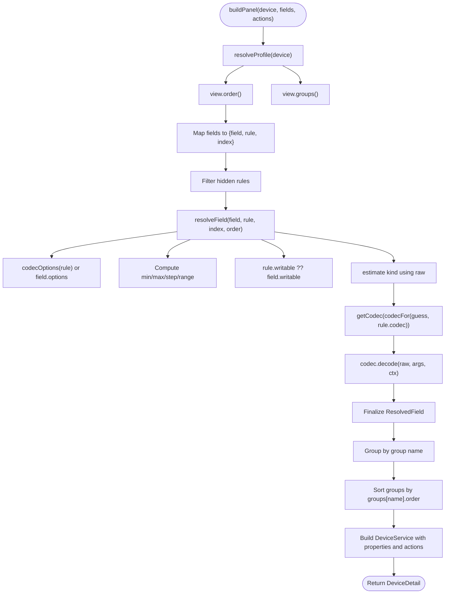
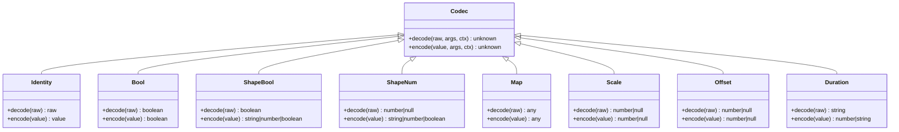
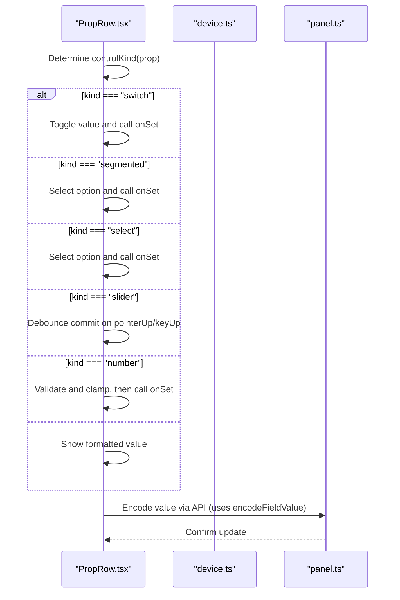
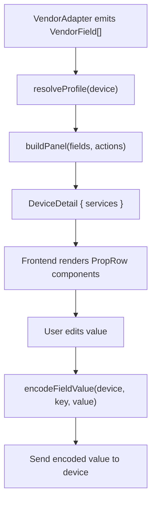
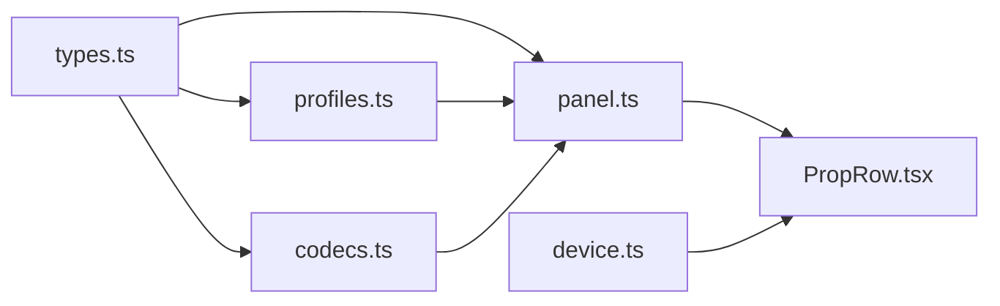

# Field Rendering Engine

<cite>
**Referenced Files in This Document**
- [README.md](file://README.md)
- [types.ts](file://src/controls/types.ts)
- [profiles.ts](file://src/controls/profiles.ts)
- [panel.ts](file://src/controls/panel.ts)
- [codecs.ts](file://src/controls/codecs.ts)
- [index.ts](file://src/controls/index.ts)
- [PropRow.tsx](file://client/src/components/PropRow.tsx)
- [device.ts](file://client/src/utils/device.ts)
</cite>

## Table of Contents
1. [Introduction](#introduction)
2. [Project Structure](#project-structure)
3. [Core Components](#core-components)
4. [Architecture Overview](#architecture-overview)
5. [Detailed Component Analysis](#detailed-component-analysis)
6. [Dependency Analysis](#dependency-analysis)
7. [Performance Considerations](#performance-considerations)
8. [Troubleshooting Guide](#troubleshooting-guide)
9. [Conclusion](#conclusion)
10. [Appendices](#appendices)

## Introduction
This document explains the field rendering engine that converts DeviceProfile configurations into interactive UI components. The system separates vendor-specific device data from presentation logic: vendors produce minimal `VendorField` values, while `DeviceProfile` and `FieldRule` describe how those fields should be displayed, grouped, ordered, validated, and written back. The backend builds a normalized panel structure, and the frontend renders it as switches, segmented controls, selects, sliders, numbers, or plain text.

The documentation covers:
- The FieldRule system: visibility, validation, display formatting, and interaction behavior.
- How fields are grouped, ordered, and rendered based on profile configurations.
- The component lifecycle from profile resolution to final UI rendering.
- Examples of complex field configurations with conditional logic, dynamic behavior, and custom styling options.

**Section sources**
- [README.md:3-57](file://README.md#L3-L57)

## Project Structure
The field rendering engine spans backend control definitions and frontend UI components:

**Diagram sources**
- [types.ts:1-114](file://src/controls/types.ts#L1-L114)
- [profiles.ts:1-196](file://src/controls/profiles.ts#L1-L196)
- [panel.ts:1-167](file://src/controls/panel.ts#L1-L167)
- [codecs.ts:1-256](file://src/controls/codecs.ts#L1-L256)
- [index.ts:1-25](file://src/controls/index.ts#L1-L25)
- [PropRow.tsx:1-144](file://client/src/components/PropRow.tsx#L1-L144)
- [device.ts:1-69](file://client/src/utils/device.ts#L1-L69)

**Section sources**
- [types.ts:1-114](file://src/controls/types.ts#L1-L114)
- [profiles.ts:1-196](file://src/controls/profiles.ts#L1-L196)
- [panel.ts:1-167](file://src/controls/panel.ts#L1-L167)
- [codecs.ts:1-256](file://src/controls/codecs.ts#L1-L256)
- [index.ts:1-25](file://src/controls/index.ts#L1-L25)
- [PropRow.tsx:1-144](file://client/src/components/PropRow.tsx#L1-L144)
- [device.ts:1-69](file://client/src/utils/device.ts#L1-L69)

## Core Components
- Control kinds define the UI widget type: switch, segmented, select, slider, number, text.
- VendorField is the minimal adapter output: stable key, raw value, writability, label, kind hint, unit, range, options, group, service/property identifiers, and vendor metadata.
- FieldRule describes presentation and transformation: label, kind override, unit, min/max/step, options, codec, digits, writable, hidden, order, and group.
- DeviceProfile is a configuration file describing match rules, field overrides, omit patterns, global order, groups, and actions.
- ResolvedField is the normalized view used by both backend and frontend after applying profiles and codecs.

Key responsibilities:
- Profile resolution merges multiple layers (vendor default, capability, model, device) and computes per-field rules.
- Panel building applies codecs, infers control kinds, groups fields, orders them, and produces a structured DeviceDetail.
- Frontend components render each property according to its resolved kind and constraints.

**Section sources**
- [types.ts:10-113](file://src/controls/types.ts#L10-L113)
- [profiles.ts:7-124](file://src/controls/profiles.ts#L7-L124)
- [panel.ts:34-86](file://src/controls/panel.ts#L34-L86)
- [codecs.ts:5-29](file://src/controls/codecs.ts#L5-L29)

## Architecture Overview
The rendering pipeline connects vendor adapters, profile resolution, codec conversion, panel construction, and frontend rendering.

**Diagram sources**
- [profiles.ts:74-124](file://src/controls/profiles.ts#L74-L124)
- [panel.ts:102-154](file://src/controls/panel.ts#L102-L154)
- [codecs.ts:196-241](file://src/controls/codecs.ts#L196-L241)
- [PropRow.tsx:130-143](file://client/src/components/PropRow.tsx#L130-L143)

**Section sources**
- [profiles.ts:74-124](file://src/controls/profiles.ts#L74-L124)
- [panel.ts:102-154](file://src/controls/panel.ts#L102-L154)
- [codecs.ts:196-241](file://src/controls/codecs.ts#L196-L241)
- [PropRow.tsx:130-143](file://client/src/components/PropRow.tsx#L130-L143)

## Detailed Component Analysis

### FieldRule System
FieldRule provides visibility, validation, display formatting, and interaction behavior:
- Visibility: `hidden` hides a field; `omit` patterns globally exclude fields across profiles.
- Validation: `min`, `max`, `step`, and `digits` constrain numeric input and rounding.
- Display formatting: `label`, `unit`, `group`, `order`, and `codecArgs.digits` control labels, units, grouping, ordering, and decimal precision.
- Interaction behavior: `writable` toggles interactivity; `kind` forces a specific control type; `options` defines selectable choices; `codec` transforms values bidirectionally.

Complex behaviors:
- Conditional visibility via higher-tier profiles can override lower-tier `hidden`.
- Dynamic behavior through `codec` types like `shapebool` and `shapenum`, which adapt write-back format to the device’s current raw value.
- Custom styling options come from frontend CSS classes applied per control kind (e.g., `ctl-switch`, `ctl-slider`).

**Section sources**
- [types.ts:53-71](file://src/controls/types.ts#L53-L71)
- [profiles.ts:67-92](file://src/controls/profiles.ts#L67-L92)
- [panel.ts:34-86](file://src/controls/panel.ts#L34-L86)
- [PropRow.tsx:130-143](file://client/src/components/PropRow.tsx#L130-L143)

### Profile Resolution and Rule Merging
Profile resolution determines which DeviceProfile applies to a device and merges field rules:
- Tier hierarchy: device (`did`) > model > specType > vendor default.
- Within a tier, specificity ranking favors exact names over wildcards, longer literal segments over shorter ones, and omits receive extra weight.
- Rules are merged left-to-right by specificity; later matches overwrite earlier ones.

**Diagram sources**
- [profiles.ts:52-92](file://src/controls/profiles.ts#L52-L92)

**Section sources**
- [profiles.ts:52-124](file://src/controls/profiles.ts#L52-L124)

### Panel Building and Field Resolution
Panel building normalizes fields into a consistent structure:
- Options normalization: map codec tables to option lists when no explicit options exist.
- Range computation: derive min/max/step from rule or field range; default ranges if partial.
- Order computation: use explicit `rule.order` or fallback to position in profile `order`; unmatched fields go to the end.
- Writability: prefer rule-defined writability; non-writable fields become text-only.
- Kind inference: two-pass process—first estimate kind using raw value, then refine after decoding.
- Grouping: assign fields to groups; default group is “状态” if unspecified.

**Diagram sources**
- [panel.ts:102-154](file://src/controls/panel.ts#L102-L154)
- [panel.ts:55-86](file://src/controls/panel.ts#L55-L86)
- [codecs.ts:247-255](file://src/controls/codecs.ts#L247-L255)

**Section sources**
- [panel.ts:34-86](file://src/controls/panel.ts#L34-L86)
- [panel.ts:102-154](file://src/controls/panel.ts#L102-L154)
- [codecs.ts:247-255](file://src/controls/codecs.ts#L247-L255)

### Codec System and Value Transformation
Codecs provide bidirectional transformations between device raw values and panel values:
- Identity: pass-through.
- Boolean variants: `bool`, `shapebool`, `onoff`, `zeroone`, `numbool`.
- Numeric variants: `number`, `scale`, `offset`, `shapenum`.
- Mapping: `map` with table/pairs for enum translation.
- Duration: minutes to human-readable strings.
- Auto: infer boolean-like values and otherwise pass through.

Codec selection:
- If `rule.codec` is declared and not `"auto"`, use it.
- Otherwise, infer based on inferred control kind: switch → `shapebool`, slider/number → `shapenum`.

**Diagram sources**
- [codecs.ts:25-29](file://src/controls/codecs.ts#L25-L29)
- [codecs.ts:194-211](file://src/controls/codecs.ts#L194-L211)

**Section sources**
- [codecs.ts:5-29](file://src/controls/codecs.ts#L5-L29)
- [codecs.ts:194-241](file://src/controls/codecs.ts#L194-L241)
- [panel.ts:27-32](file://src/controls/panel.ts#L27-L32)

### Frontend Rendering and Interaction
The frontend renders resolved properties using specialized components:
- Switch: toggle button with ARIA role and state.
- Segmented: radio-group style buttons for small option sets.
- Select: dropdown for larger option sets.
- Slider: range input with fill visualization and debounced commit.
- Number: numeric input with step, min/max, and validation.
- Text: read-only display for non-writable or untyped values.

Interaction details:
- Draft values are managed locally before committing changes.
- Sliders debounce commits on pointer up or keyup.
- Numbers validate input against regex and clamp to range.
- Units are appended where applicable.

**Diagram sources**
- [PropRow.tsx:12-143](file://client/src/components/PropRow.tsx#L12-L143)
- [device.ts:35-53](file://client/src/utils/device.ts#L35-L53)
- [panel.ts:161-166](file://src/controls/panel.ts#L161-L166)

**Section sources**
- [PropRow.tsx:12-143](file://client/src/components/PropRow.tsx#L12-L143)
- [device.ts:35-53](file://client/src/utils/device.ts#L35-L53)
- [panel.ts:161-166](file://src/controls/panel.ts#L161-L166)

### Lifecycle from Profile Resolution to UI Rendering
End-to-end flow:
1. Vendor adapters emit `VendorField[]`.
2. `resolveProfile` computes applicable profiles and per-field rules.
3. `buildPanel` applies codecs, infers kinds, groups fields, and constructs `DeviceDetail`.
4. Frontend receives `DeviceDetail` and renders each property using `PropRow`.
5. User interactions trigger encoding via `encodeFieldValue`, which re-applies codec rules to convert UI values back to device-compatible formats.

**Diagram sources**
- [profiles.ts:74-124](file://src/controls/profiles.ts#L74-L124)
- [panel.ts:102-154](file://src/controls/panel.ts#L102-L154)
- [panel.ts:161-166](file://src/controls/panel.ts#L161-L166)
- [PropRow.tsx:130-143](file://client/src/components/PropRow.tsx#L130-L143)

**Section sources**
- [profiles.ts:74-124](file://src/controls/profiles.ts#L74-L124)
- [panel.ts:102-166](file://src/controls/panel.ts#L102-L166)
- [PropRow.tsx:130-143](file://client/src/components/PropRow.tsx#L130-L143)

## Dependency Analysis
The rendering engine has clear layering:
- `types.ts` defines shared interfaces consumed by all modules.
- `profiles.ts` depends on `types.ts` and provider types to compute profile views.
- `panel.ts` depends on `profiles.ts`, `codecs.ts`, and `types.ts` to build panels.
- `codecs.ts` depends only on `types.ts`.
- Frontend `PropRow.tsx` depends on `device.ts` utilities and consumes the backend’s `DeviceDetail`.

**Diagram sources**
- [types.ts:1-114](file://src/controls/types.ts#L1-L114)
- [profiles.ts:1-196](file://src/controls/profiles.ts#L1-L196)
- [panel.ts:1-167](file://src/controls/panel.ts#L1-L167)
- [codecs.ts:1-256](file://src/controls/codecs.ts#L1-L256)
- [PropRow.tsx:1-144](file://client/src/components/PropRow.tsx#L1-L144)
- [device.ts:1-69](file://client/src/utils/device.ts#L1-L69)

**Section sources**
- [types.ts:1-114](file://src/controls/types.ts#L1-L114)
- [profiles.ts:1-196](file://src/controls/profiles.ts#L1-L196)
- [panel.ts:1-167](file://src/controls/panel.ts#L1-L167)
- [codecs.ts:1-256](file://src/controls/codecs.ts#L1-L256)
- [PropRow.tsx:1-144](file://client/src/components/PropRow.tsx#L1-L144)
- [device.ts:1-69](file://client/src/utils/device.ts#L1-L69)

## Performance Considerations
- Profile loading uses an mtime-based cache to avoid re-parsing runtime profiles on every request.
- Rule merging sorts hits once per field and reduces them linearly; complexity is proportional to the number of patterns across matched profiles.
- Codec operations are O(1) for most transformations except mapping, which may iterate over table entries.
- Frontend sliders debounce commits to reduce network calls during rapid user interaction.

[No sources needed since this section provides general guidance]

## Troubleshooting Guide
Common issues and resolutions:
- Field hidden unexpectedly: check `omit` patterns and higher-tier profiles overriding `hidden: false`.
- Wrong control kind: verify `rule.kind`, `field.kind`, options count/names, range integer checks, and writability.
- Incorrect value format: ensure appropriate `codec` and `codecArgs` (e.g., `digits`, `by`, `table`).
- Write-back errors: confirm `encodeFieldValue` path and that the field is not hidden; inspect `ctx.raw` and `meta` passed to codecs.

**Section sources**
- [profiles.ts:67-92](file://src/controls/profiles.ts#L67-L92)
- [panel.ts:34-86](file://src/controls/panel.ts#L34-L86)
- [panel.ts:161-166](file://src/controls/panel.ts#L161-L166)

## Conclusion
The field rendering engine cleanly separates vendor data from presentation logic through profiles and codecs. FieldRules govern visibility, validation, formatting, and interaction, while the panel builder normalizes everything into a consistent structure for the frontend. The system supports complex configurations with conditional logic, dynamic behavior, and customizable styling, enabling flexible and robust device control interfaces.

[No sources needed since this section summarizes without analyzing specific files]

## Appendices

### Example Complex Field Configurations
- Conditional visibility: Use a higher-tier profile to override `hidden: true` set by a wildcard omit.
- Dynamic behavior: Apply `codec: "shapebool"` so writes adapt to the device’s current boolean representation.
- Custom styling: Rely on frontend CSS classes like `ctl-switch`, `ctl-segmented`, `ctl-slider`, `ctl-number`, and `ctl-text` for visual customization.

[No sources needed since this section provides conceptual examples]