# Profile Configuration

<cite>
**Referenced Files in This Document**
- [profiles.ts](file://src/controls/profiles.ts)
- [types.ts](file://src/controls/types.ts)
- [profiles.ts (routes)](file://src/routes/profiles.ts)
- [xiaomi.ts](file://src/controls/profiles/xiaomi.ts)
- [midea.ts](file://src/controls/profiles/midea.ts)
- [pantum.ts](file://src/controls/profiles/pantum.ts)
- [index.ts](file://src/controls/index.ts)
</cite>

## Table of Contents
1. [Introduction](#introduction)
2. [Project Structure](#project-structure)
3. [Core Components](#core-components)
4. [Architecture Overview](#architecture-overview)
5. [Detailed Component Analysis](#detailed-component-analysis)
6. [Dependency Analysis](#dependency-analysis)
7. [Performance Considerations](#performance-considerations)
8. [Troubleshooting Guide](#troubleshooting-guide)
9. [Conclusion](#conclusion)
10. [Appendices](#appendices)

## Introduction
This document explains the DeviceProfile configuration schema used to customize device control panels. It covers:
- The complete profile structure, including vendor identification and match patterns.
- Field definitions with FieldRule specifications.
- Grouping rules, action configurations, and ordering mechanisms.
- The tier-based specificity system where device-specific profiles override model-specific ones, which override specType profiles, which override vendor defaults.
- Practical examples from built-in profiles showing different specificity levels and inheritance patterns.
- Glob pattern matching syntax for flexible targeting.
- The omit mechanism for field exclusion.

The goal is to help you author, extend, and troubleshoot profile configurations without needing to read every implementation detail.

## Project Structure
Device profiles are defined in two layers:
- Built-in TypeScript profile modules that ship with the application.
- Runtime JSON profile files loaded from a configurable directory.

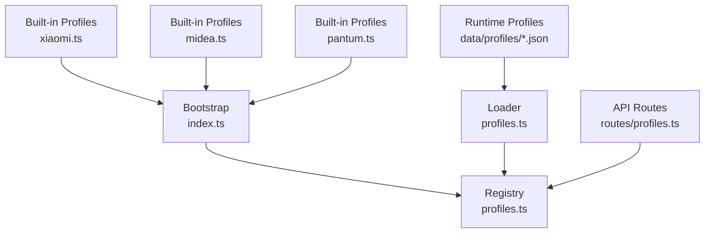

**Diagram sources**
- [index.ts:21-24](file://src/controls/index.ts#L21-L24)
- [profiles.ts:6-11](file://src/controls/profiles.ts#L6-L11)
- [profiles.ts:164-195](file://src/controls/profiles.ts#L164-L195)
- [profiles.ts (routes):1-8](file://src/routes/profiles.ts#L1-L8)

**Section sources**
- [index.ts:1-24](file://src/controls/index.ts#L1-L24)
- [profiles.ts:6-11](file://src/controls/profiles.ts#L6-L11)
- [profiles.ts:164-195](file://src/controls/profiles.ts#L164-L195)
- [profiles.ts (routes):1-8](file://src/routes/profiles.ts#L1-L8)

## Core Components
The schema centers on these types:
- DeviceProfile: one vendor-scoped configuration block.
- ProfileMatch: how a profile targets devices by did, model, or specType.
- FieldRule: per-field display and write behavior.
- ResolvedField: the final merged view used by providers and the frontend.

Key responsibilities:
- Matching profiles to devices using vendor and match fields.
- Merging field rules across multiple profiles with a clear precedence order.
- Providing ordering, grouping, and action metadata.
- Loading runtime profiles from disk and caching them efficiently.

**Section sources**
- [types.ts:49-95](file://src/controls/types.ts#L49-L95)
- [types.ts:97-113](file://src/controls/types.ts#L97-L113)
- [profiles.ts:13-20](file://src/controls/profiles.ts#L13-L20)

## Architecture Overview
The profile resolution pipeline works as follows:
1. Built-in profiles are registered at bootstrap.
2. Runtime profiles are scanned from the configured directory and cached by file timestamps.
3. For a given device, all matching profiles are selected and sorted by tier.
4. Field rules are merged in ascending specificity order; later rules overwrite earlier ones.
5. Ordering, groups, and actions are also merged according to their own rules.

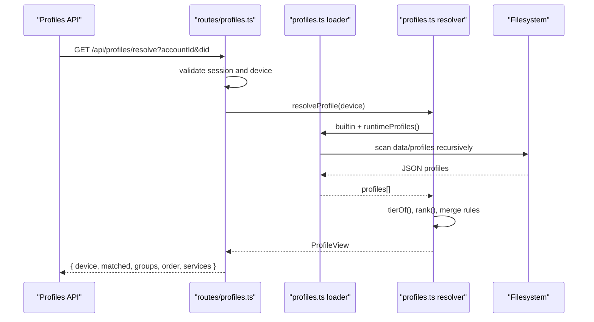

**Diagram sources**
- [profiles.ts (routes):36-73](file://src/routes/profiles.ts#L36-L73)
- [profiles.ts:74-124](file://src/controls/profiles.ts#L74-L124)
- [profiles.ts:164-195](file://src/controls/profiles.ts#L164-L195)

## Detailed Component Analysis

### DeviceProfile Schema
A DeviceProfile defines:
- id: unique identifier for the profile.
- vendor: vendor namespace; only profiles whose vendor matches the device’s vendorId are considered.
- match: optional targeting criteria.
- fields: mapping of field patterns to FieldRule objects.
- omit: list of field patterns to hide.
- order: explicit presentation order for fields and actions.
- groups: group metadata keyed by field names.
- actions: per-action metadata keyed by action identifiers.

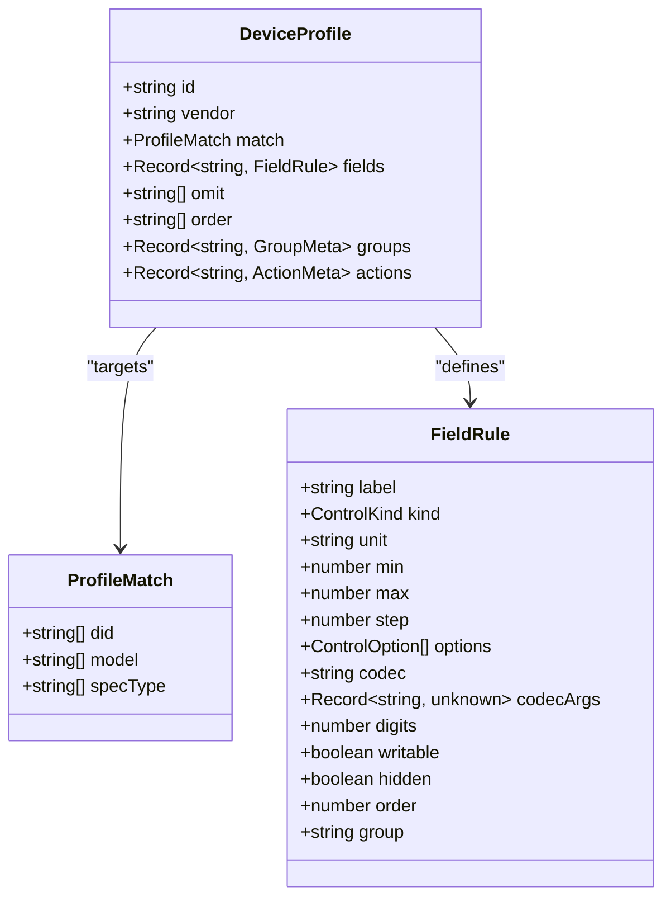

**Diagram sources**
- [types.ts:49-95](file://src/controls/types.ts#L49-L95)

**Section sources**
- [types.ts:49-95](file://src/controls/types.ts#L49-L95)

### Tier-Based Specificity System
Profiles are scored by tier based on how specifically they target a device:
- did: highest priority, exact device identity.
- model: model name patterns.
- specType: capability or service type patterns.
- vendor: default fallback when no match is present.

Within the same tier, specificity is further refined by:
- Exact match over wildcard match.
- Longer literal segments over shorter ones.
- Fewer wildcards preferred.
- Omit entries receive an extra boost so they act as hard exclusions within a profile.

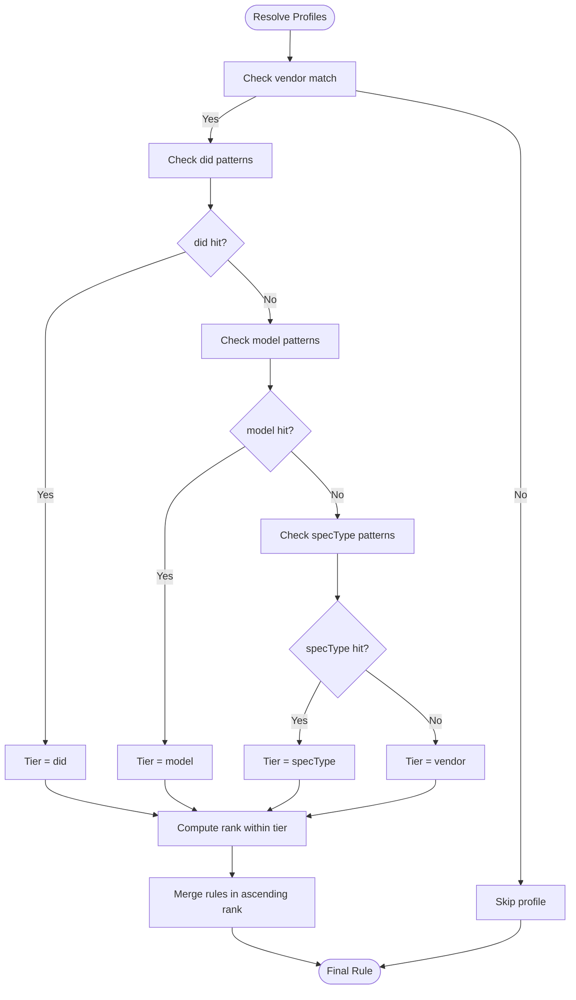

**Diagram sources**
- [profiles.ts:52-72](file://src/controls/profiles.ts#L52-L72)

**Section sources**
- [profiles.ts:6-8](file://src/controls/profiles.ts#L6-L8)
- [profiles.ts:52-72](file://src/controls/profiles.ts#L52-L72)

### Field Rules and Inheritance
Field rules are merged across all matching profiles:
- All matching field patterns contribute rules.
- All matching omit patterns contribute hidden: true.
- Matches are sorted by rank; later merges overwrite earlier ones.
- If a field is omitted by a lower-tier profile but re-declared with hidden: false in a higher-tier profile, the higher-tier rule wins.

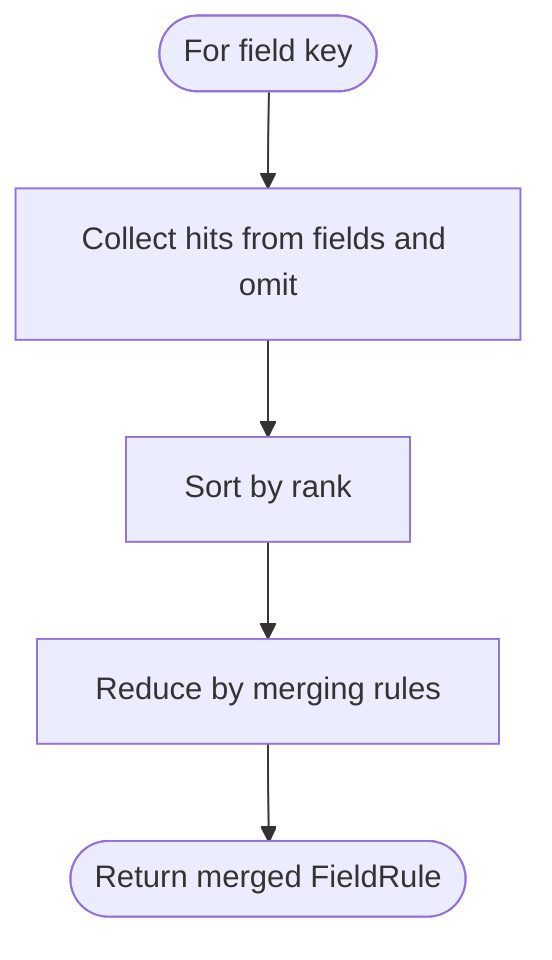

**Diagram sources**
- [profiles.ts:80-92](file://src/controls/profiles.ts#L80-L92)

**Section sources**
- [profiles.ts:80-92](file://src/controls/profiles.ts#L80-L92)

### Ordering Mechanism
Ordering controls the presentation sequence:
- order lists field keys or glob patterns.
- Higher-tier profiles take precedence; among equal tiers, earlier declarations win.
- Keys not listed appear after explicitly ordered keys.

Groups can also carry an order value to influence section layout.

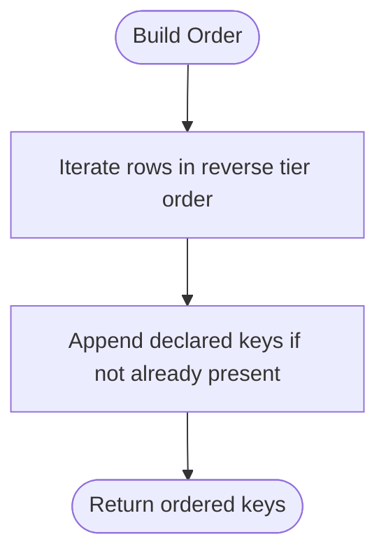

**Diagram sources**
- [profiles.ts:96-105](file://src/controls/profiles.ts#L96-L105)

**Section sources**
- [profiles.ts:96-105](file://src/controls/profiles.ts#L96-L105)

### Grouping Rules
Grouping metadata maps field names to group information:
- Each group entry may include a human-readable name and an order number.
- Group metadata is merged across profiles; later profiles can refine earlier definitions.

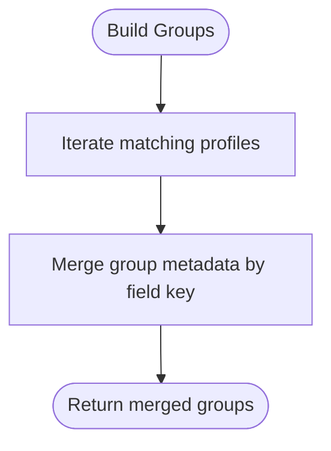

**Diagram sources**
- [profiles.ts:106-112](file://src/controls/profiles.ts#L106-L112)

**Section sources**
- [profiles.ts:106-112](file://src/controls/profiles.ts#L106-L112)

### Action Configurations
Actions are metadata for device operations:
- Actions are keyed by action identifiers.
- Patterns support exact matches and globs.
- Metadata includes label, visibility, and order.
- Action metadata is merged across matching profiles.

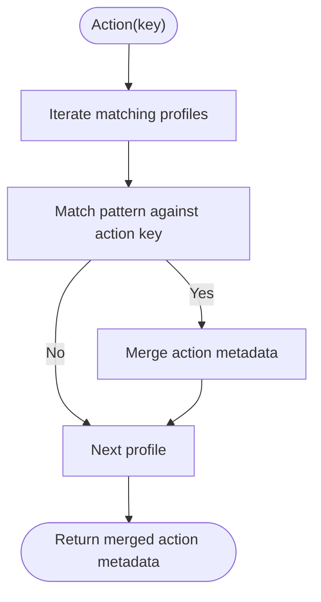

**Diagram sources**
- [profiles.ts:113-121](file://src/controls/profiles.ts#L113-L121)

**Section sources**
- [profiles.ts:113-121](file://src/controls/profiles.ts#L113-L121)

### Glob Pattern Matching Syntax
Patterns support:
- Exact string equality.
- Wildcard matching using asterisk (*).
- Case-insensitive matching.
- Special characters inside non-wildcard segments are escaped before regex construction.

This allows flexible targeting such as:
- "*.brightness" to match any property ending with brightness.
- "*-AC-*" to match model names containing “-AC-”.
- "*instance:vacuum*" to match specType values containing that substring.

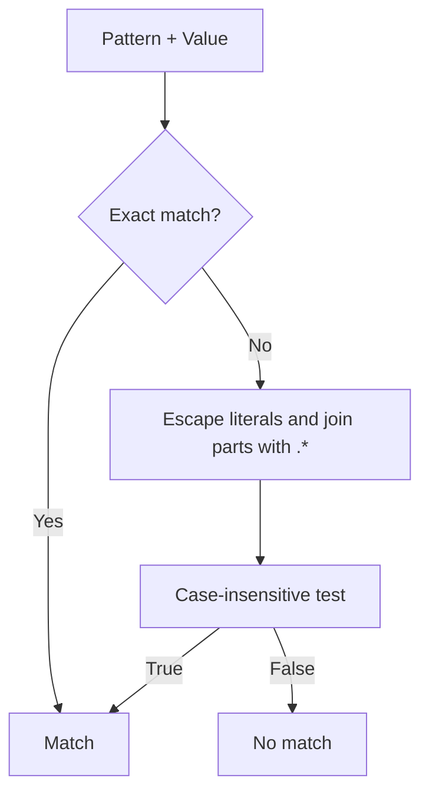

**Diagram sources**
- [profiles.ts:35-45](file://src/controls/profiles.ts#L35-L45)

**Section sources**
- [profiles.ts:35-45](file://src/controls/profiles.ts#L35-L45)

### Omit Mechanism
Omit provides field exclusion:
- Any field matching an omit pattern is marked hidden: true.
- Omit entries get a high internal rank so they act as hard exclusions within a profile.
- To recover a field accidentally omitted by a lower-tier profile, declare it explicitly with hidden: false in a higher-tier profile.

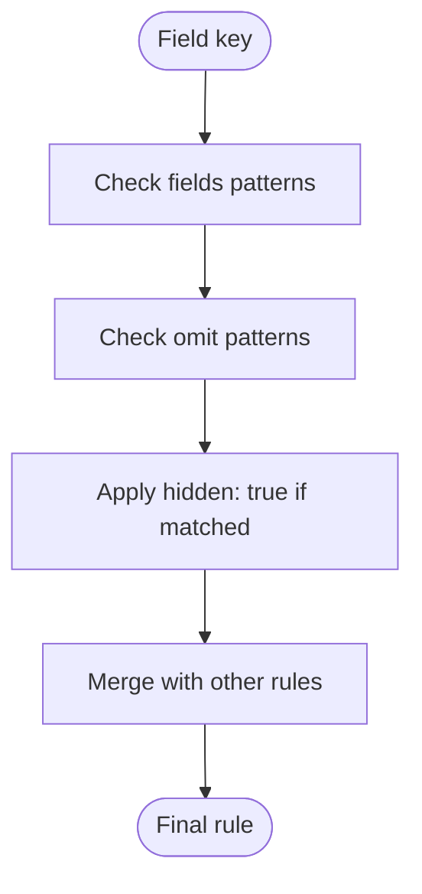

**Diagram sources**
- [profiles.ts:80-92](file://src/controls/profiles.ts#L80-L92)

**Section sources**
- [profiles.ts:80-92](file://src/controls/profiles.ts#L80-L92)

### Practical Examples from Built-in Profiles

#### Xiaomi Baseline and SpecType Profiles
- Baseline sets common units and slider preferences for light-like properties.
- SpecType-based profiles define ordering and action labels for lights, fans, and vacuums.

These demonstrate:
- Using specType patterns to target device capabilities.
- Using order to prioritize important controls.
- Using actions to rename service actions.

**Section sources**
- [xiaomi.ts:8-40](file://src/controls/profiles/xiaomi.ts#L8-L40)

#### Midea Baseline, AC, Fridge, and Washer Profiles
- Baseline defines broad field rules, groups, order, and extensive omit lists.
- AC profile narrows temperature ranges and mode selection for air conditioners.
- Fridge profile adjusts temperature ranges and labeling for refrigerators.
- Washer profile configures program selection and temperature steps.

These demonstrate:
- Broad vendor defaults with targeted overrides.
- Extensive use of omit to hide noisy fields.
- Model-based targeting with multiple patterns.
- Group ordering and consistent labeling.

**Section sources**
- [midea.ts:110-226](file://src/controls/profiles/midea.ts#L110-L226)

#### Pantum Baseline Profile
- Defines minimal read-only fields and a print action.

This demonstrates:
- Simple baseline profiles for vendors with limited telemetry.
- Action labeling for cloud-driven operations.

**Section sources**
- [pantum.ts:4-15](file://src/controls/profiles/pantum.ts#L4-L15)

## Dependency Analysis
The profile system integrates with the rest of the application through:
- Bootstrap registration of built-in profiles.
- API routes exposing listing, device enumeration, resolution, and saving endpoints.
- Runtime loading of JSON profiles from disk with timestamp-based caching.

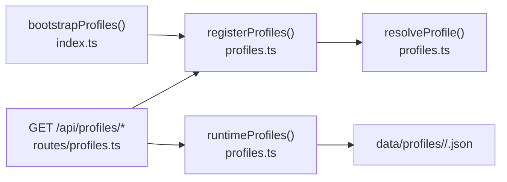

**Diagram sources**
- [index.ts:21-24](file://src/controls/index.ts#L21-L24)
- [profiles.ts (routes):17-25](file://src/routes/profiles.ts#L17-L25)
- [profiles.ts (routes):36-73](file://src/routes/profiles.ts#L36-L73)
- [profiles.ts:164-195](file://src/controls/profiles.ts#L164-L195)

**Section sources**
- [index.ts:1-24](file://src/controls/index.ts#L1-L24)
- [profiles.ts (routes):17-25](file://src/routes/profiles.ts#L17-L25)
- [profiles.ts (routes):36-73](file://src/routes/profiles.ts#L36-L73)
- [profiles.ts:164-195](file://src/controls/profiles.ts#L164-L195)

## Performance Considerations
- Built-in profiles are registered once at startup.
- Runtime profiles are scanned recursively and cached by a stamp composed of file paths and modification times.
- On each request, the resolver computes tier and rank for all matching profiles; this is linear in the number of profiles and field patterns.
- Avoid overly broad omit patterns that could unintentionally hide many fields.
- Prefer specific did or model matches for critical overrides to reduce ambiguity.

[No sources needed since this section provides general guidance]

## Troubleshooting Guide
Common issues and resolutions:
- Field unexpectedly hidden: check omit patterns in lower-tier profiles; add a higher-tier profile declaring hidden: false for that field.
- Wrong control kind or unit: verify FieldRule settings in the most specific matching profile.
- Incorrect ordering: ensure order arrays are present in the intended tier and that higher-tier profiles declare desired keys first.
- Action not appearing or mislabeled: confirm action key patterns match the actual action identifier and that metadata is merged correctly.
- Profile not loading: ensure the JSON file has valid structure and contains both vendor and id strings; malformed files are skipped safely.

Operational tips:
- Use the /api/profiles/options endpoint to discover available codecs and control kinds.
- Use /api/profiles/devices to enumerate devices under the current account for targeted testing.
- Use /api/profiles/resolve to inspect the matched profile chain and merged rules for a specific device.
- Save new profiles via PUT /api/profiles; they will be picked up on the next load due to timestamp-based cache invalidation.

**Section sources**
- [profiles.ts (routes):17-25](file://src/routes/profiles.ts#L17-L25)
- [profiles.ts (routes):36-73](file://src/routes/profiles.ts#L36-L73)
- [profiles.ts (routes):75-87](file://src/routes/profiles.ts#L75-L87)
- [profiles.ts:182-189](file://src/controls/profiles.ts#L182-L189)

## Conclusion
DeviceProfile provides a layered, predictable configuration system for device control panels. By combining vendor scoping, tiered specificity, glob-based matching, field rules, grouping, ordering, and action metadata, you can tailor interfaces precisely while keeping maintenance simple. Use built-in profiles as references, extend with runtime JSON files, and rely on the resolver to merge rules consistently.

[No sources needed since this section summarizes without analyzing specific files]

## Appendices

### Appendix A: FieldRule Reference
- label: human-readable name.
- kind: control type or auto inference.
- unit: display unit.
- min/max/step: numeric constraints.
- options: enumerated choices.
- codec/codecArgs: transformation logic.
- digits: decimal precision hint.
- writable: whether the field can be written back.
- hidden: visibility flag.
- order: intra-group ordering.
- group: grouping key.

**Section sources**
- [types.ts:49-71](file://src/controls/types.ts#L49-L71)

### Appendix B: ProfileMatch Reference
- did: exact device identifiers.
- model: model name patterns.
- specType: capability/service type patterns.

**Section sources**
- [types.ts:73-80](file://src/controls/types.ts#L73-L80)

### Appendix C: API Endpoints for Profiles
- GET /api/profiles/options: returns available codecs, control kinds, and profile directory.
- GET /api/profiles: lists profiles, optionally filtered by vendor.
- GET /api/profiles/devices: enumerates devices under the current account.
- GET /api/profiles/resolve: resolves matched profiles and merged rules for a device.
- PUT /api/profiles: saves a profile to disk.

**Section sources**
- [profiles.ts (routes):17-25](file://src/routes/profiles.ts#L17-L25)
- [profiles.ts (routes):27-34](file://src/routes/profiles.ts#L27-L34)
- [profiles.ts (routes):36-73](file://src/routes/profiles.ts#L36-L73)
- [profiles.ts (routes):75-87](file://src/routes/profiles.ts#L75-L87)