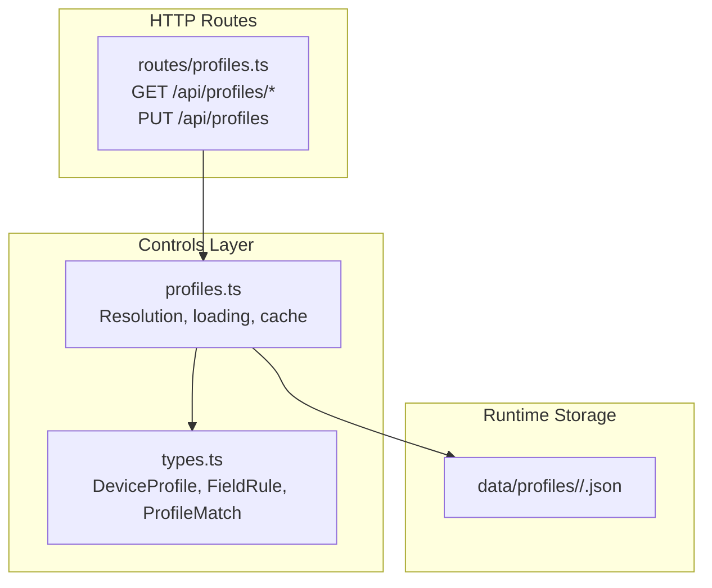
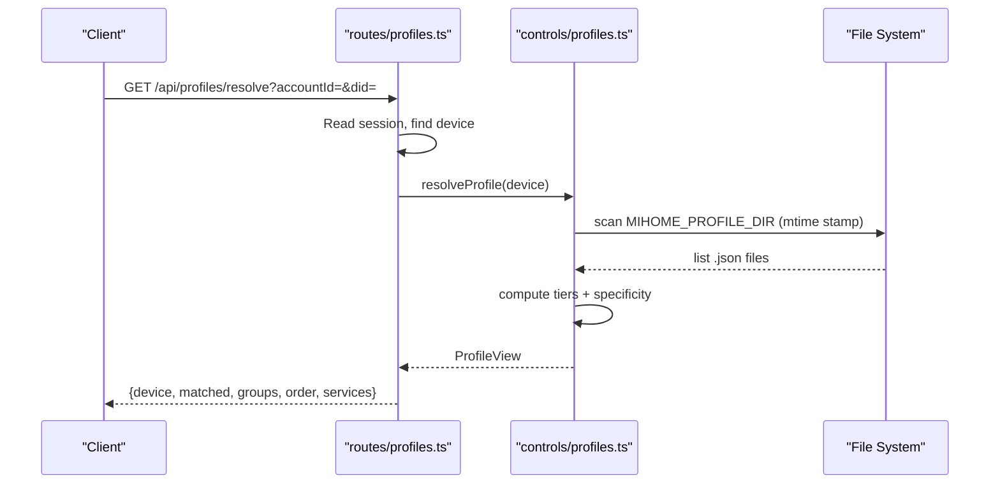
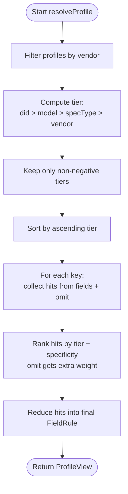
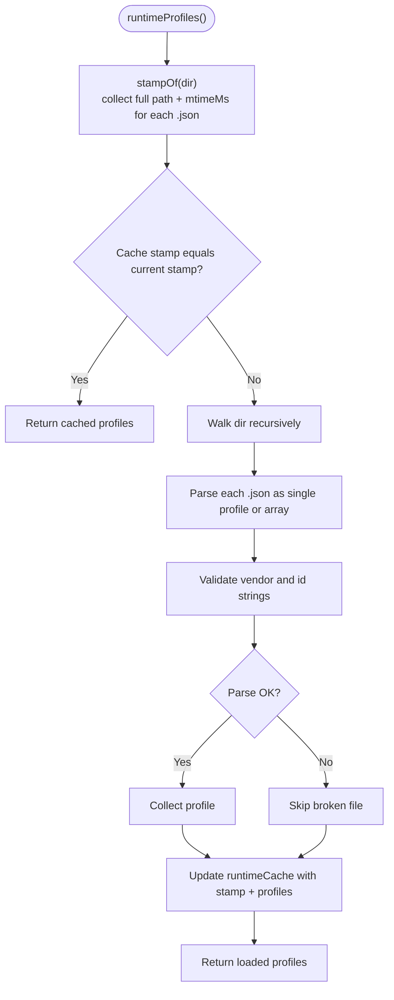
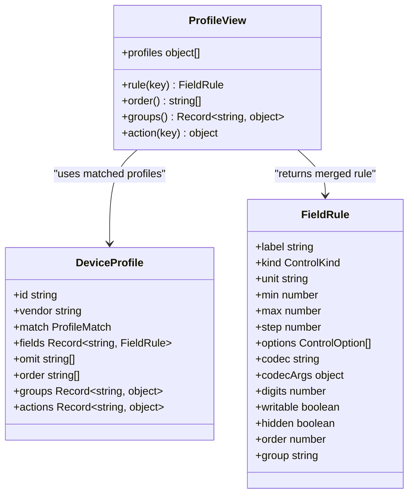
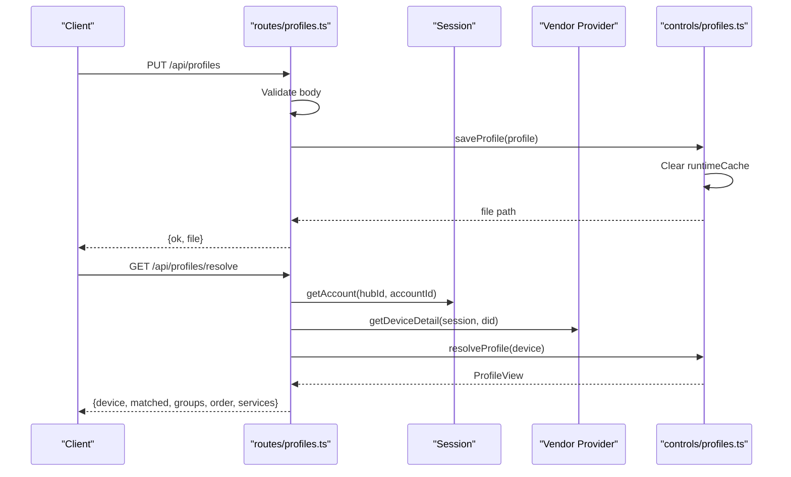
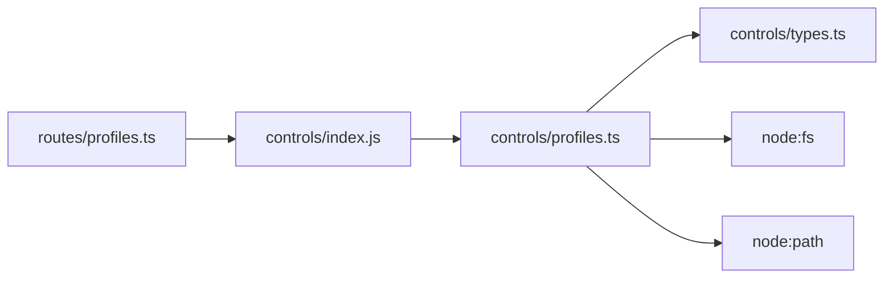

# Profile Resolution & Loading

<cite>
**Referenced Files in This Document**
- [profiles.ts](file://src/controls/profiles.ts)
- [types.ts](file://src/controls/types.ts)
- [profiles.ts](file://src/routes/profiles.ts)
- [README.md](file://README.md)
</cite>

## Table of Contents
1. [Introduction](#introduction)
2. [Project Structure](#project-structure)
3. [Core Components](#core-components)
4. [Architecture Overview](#architecture-overview)
5. [Detailed Component Analysis](#detailed-component-analysis)
6. [Dependency Analysis](#dependency-analysis)
7. [Performance Considerations](#performance-considerations)
8. [Troubleshooting Guide](#troubleshooting-guide)
9. [Conclusion](#conclusion)

## Introduction
This document explains how the system determines which profile applies to each device, how runtime profiles are loaded from disk, and how hot-reloading works without restarting the server. It also documents the `ProfileView` interface used by providers and routes to resolve field rules, ordering, grouping, and action metadata for a given device.

The profile resolution algorithm is tier-based:
- Device identifier (`did`)
- Model name (`model`)
- Capability type (`specType`)
- Vendor default

Within each tier, specificity scoring decides which rule wins when multiple patterns match the same key.

## Project Structure
The profile logic lives under `src/controls`, while the HTTP endpoints that expose profile listing, resolution, and saving live under `src/routes`. The data model for profiles and field rules is defined in `src/controls/types.ts`.

**Diagram sources**
- [profiles.ts:1-196](file://src/controls/profiles.ts#L1-L196)
- [types.ts:49-95](file://src/controls/types.ts#L49-L95)
- [profiles.ts:1-88](file://src/routes/profiles.ts#L1-L88)

**Section sources**
- [profiles.ts:1-196](file://src/controls/profiles.ts#L1-L196)
- [types.ts:49-95](file://src/controls/types.ts#L49-L95)
- [profiles.ts:1-88](file://src/routes/profiles.ts#L1-L88)

## Core Components
- `DeviceProfile`: A JSON-configurable configuration describing fields, omit rules, ordering, groups, actions, and matching criteria.
- `FieldRule`: Per-field behavior such as label, control kind, range, options, codec, visibility, order, and group.
- `ProfileMatch`: Matching criteria including `did`, `model`, and `specType`, all supporting wildcard patterns.
- `ProfileView`: A resolved view for one device, exposing methods to get merged field rules, ordered keys, grouped metadata, and action metadata.

Key responsibilities:
- Tiered matching and specificity ranking
- Merging field rules, omit lists, ordering, groups, and actions across matched profiles
- Scanning runtime profile files from disk with hot reload via mtime stamping
- Exposing an API for listing, resolving, and saving profiles

**Section sources**
- [types.ts:49-95](file://src/controls/types.ts#L49-L95)
- [profiles.ts:13-20](file://src/controls/profiles.ts#L13-L20)

## Architecture Overview
The runtime flow connects HTTP requests to profile resolution and disk scanning:

**Diagram sources**
- [profiles.ts:74-124](file://src/controls/profiles.ts#L74-L124)
- [profiles.ts:164-195](file://src/controls/profiles.ts#L164-L195)
- [profiles.ts:36-73](file://src/routes/profiles.ts#L36-L73)

## Detailed Component Analysis

### Tier-Based Matching and Specificity Scoring
The algorithm first filters profiles by vendor, then computes a tier based on how specifically the profile matches the device:
- `did`: highest tier
- `model`: next tier
- `specType`: next tier
- `vendor`: fallback tier if no match criteria exist

Within the same tier, specificity scoring ranks patterns:
- Exact match beats wildcard
- Longer literal parts beat shorter ones
- Fewer wildcards beat more wildcards
- Omit rules receive a large bonus so they override explicit field rules at the same tier

**Diagram sources**
- [profiles.ts:52-72](file://src/controls/profiles.ts#L52-L72)
- [profiles.ts:74-92](file://src/controls/profiles.ts#L74-L92)

**Section sources**
- [profiles.ts:52-72](file://src/controls/profiles.ts#L52-L72)
- [profiles.ts:74-92](file://src/controls/profiles.ts#L74-L92)

### Runtime Profile Loading and Hot Reloading
Runtime profiles are scanned from the directory configured by `MIHOME_PROFILE_DIR`, defaulting to `data/profiles`. Each request recomputes a filesystem stamp composed of file paths and modification times. If the stamp has not changed, cached profiles are returned; otherwise, the directory is walked again, `.json` files are parsed, and valid profiles are collected.

Hot reloading behavior:
- Changing or adding a profile file updates its mtime
- Next call to `runtimeProfiles()` detects the new stamp
- Cache is invalidated and profiles are reloaded immediately
- Saving a profile via `saveProfile()` clears the cache so subsequent reads pick up the new file

**Diagram sources**
- [profiles.ts:145-195](file://src/controls/profiles.ts#L145-L195)

**Section sources**
- [profiles.ts:10-11](file://src/controls/profiles.ts#L10-L11)
- [profiles.ts:135-143](file://src/controls/profiles.ts#L135-L143)
- [profiles.ts:145-195](file://src/controls/profiles.ts#L145-L195)

### ProfileView Interface and Methods
`ProfileView` encapsulates the resolved state for a specific device. Its methods provide:
- `rule(key)`: Returns the merged `FieldRule` for a field key, considering both `fields` and `omit` across all matched profiles.
- `order()`: Returns the ordered list of keys declared in higher-tier profiles first; undeclared keys appear later.
- `groups()`: Merges group metadata per key, allowing higher-tier profiles to refine names and order.
- `action(key)`: Merges action metadata for a given action key using pattern matching.
- `profiles`: Lists the IDs and tiers of profiles that matched this device.

**Diagram sources**
- [profiles.ts:13-20](file://src/controls/profiles.ts#L13-L20)
- [profiles.ts:74-124](file://src/controls/profiles.ts#L74-L124)
- [types.ts:49-95](file://src/controls/types.ts#L49-L95)

**Section sources**
- [profiles.ts:13-20](file://src/controls/profiles.ts#L13-L20)
- [profiles.ts:74-124](file://src/controls/profiles.ts#L74-L124)
- [types.ts:49-95](file://src/controls/types.ts#L49-L95)

### HTTP Integration for Resolution and Saving
The `/api/profiles/resolve` endpoint:
- Reads the active account and device from the session
- Retrieves device detail from the provider
- Calls `resolveProfile(device)` to build a `ProfileView`
- Returns matched profiles, groups, order, and per-service properties/actions with their resolved rules

The `/api/profiles` PUT endpoint:
- Validates required fields (`id`, `vendor`)
- Saves the profile to `data/profiles/<vendor>/<id>.json`
- Invalidates the runtime cache so the next read picks up the change

**Diagram sources**
- [profiles.ts:36-87](file://src/routes/profiles.ts#L36-L87)
- [profiles.ts:135-143](file://src/controls/profiles.ts#L135-L143)
- [profiles.ts:74-124](file://src/controls/profiles.ts#L74-L124)

**Section sources**
- [profiles.ts:36-87](file://src/routes/profiles.ts#L36-L87)
- [profiles.ts:135-143](file://src/controls/profiles.ts#L135-L143)

## Dependency Analysis
- `src/routes/profiles.ts` depends on `src/controls/index.js` exports, which include `getProfileDir`, `listProfiles`, `resolveProfile`, and `saveProfile`.
- `src/controls/profiles.ts` depends on Node’s `fs` and `path` modules for directory scanning and file operations.
- Data models come from `src/controls/types.ts`.
- The README documents the expected storage layout and environment variable `MIHOME_PROFILE_DIR`.

**Diagram sources**
- [profiles.ts:1-88](file://src/routes/profiles.ts#L1-L88)
- [profiles.ts:1-196](file://src/controls/profiles.ts#L1-L196)
- [types.ts:49-95](file://src/controls/types.ts#L49-L95)

**Section sources**
- [profiles.ts:1-88](file://src/routes/profiles.ts#L1-L88)
- [profiles.ts:1-196](file://src/controls/profiles.ts#L1-L196)
- [types.ts:49-95](file://src/controls/types.ts#L49-L95)
- [README.md:50-57](file://README.md#L50-L57)

## Performance Considerations
- Filesystem stamping avoids unnecessary parsing: if no `.json` files have changed, the cached profile list is reused.
- Wildcard matching uses a simple glob-to-regex conversion; keep patterns concise to minimize regex overhead.
- Sorting and merging happen per device resolution; avoid excessive nested loops by keeping profile counts reasonable.
- Broken JSON files are skipped gracefully to prevent blocking device resolution.

[No sources needed since this section provides general guidance]

## Troubleshooting Guide
Common issues and resolutions:

- **Profile not applied**:
  - Verify the profile’s `vendor` matches the device’s `vendorId`.
  - Check `match.did`, `match.model`, and `match.specType` patterns against the device values.
  - Confirm the profile is placed under `data/profiles/<vendor>/` or the configured `MIHOME_PROFILE_DIR`.

- **Field hidden unexpectedly**:
  - An `omit` rule can hide fields broadly; use a higher-tier profile (model or `did`) to explicitly set `hidden: false` for the desired field.
  - Use the `/api/profiles/resolve` endpoint to inspect the final merged rule for a field.

- **Ordering not as expected**:
  - Higher-tier profiles’ `order` arrays take precedence.
  - Ensure the intended profile tier is matched; lower-tier profiles cannot reorder fields declared by higher-tier profiles.

- **Hot reload not working**:
  - Ensure the file’s modification time changes after editing.
  - Confirm the file is valid JSON and contains `vendor` and `id` strings.
  - After saving via `PUT /api/profiles`, the cache is cleared automatically; verify the next `/api/profiles/resolve` reflects the change.

- **Profile conflicts**:
  - Multiple profiles may match the same device; the system merges rules by tier and specificity.
  - Use the `/api/profiles/resolve` response’s `matched` list to see which profiles contributed and their tiers.

**Section sources**
- [profiles.ts:52-72](file://src/controls/profiles.ts#L52-L72)
- [profiles.ts:74-124](file://src/controls/profiles.ts#L74-L124)
- [profiles.ts:135-143](file://src/controls/profiles.ts#L135-L143)
- [profiles.ts:164-195](file://src/controls/profiles.ts#L164-L195)
- [profiles.ts:36-73](file://src/routes/profiles.ts#L36-L73)

## Conclusion
The profile resolution system combines a clear tiered matching strategy with fine-grained specificity scoring to ensure predictable and maintainable device configurations. Runtime profiles are loaded from disk with hot reload support driven by file modification timestamps, and the `ProfileView` interface provides a stable contract for resolving field rules, ordering, grouping, and actions. Using the provided HTTP endpoints, operators can inspect and adjust profile application per device without restarting the server.

[No sources needed since this section summarizes without analyzing specific files]