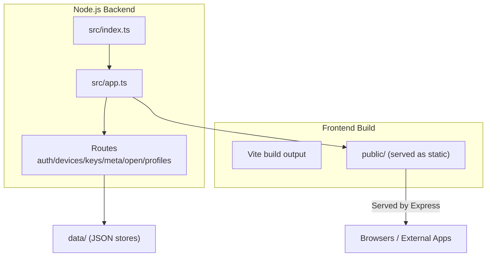
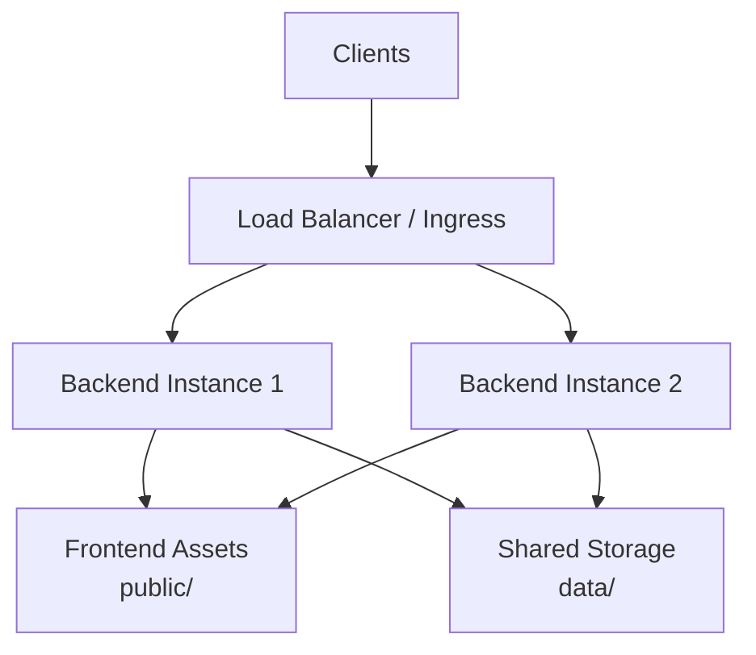
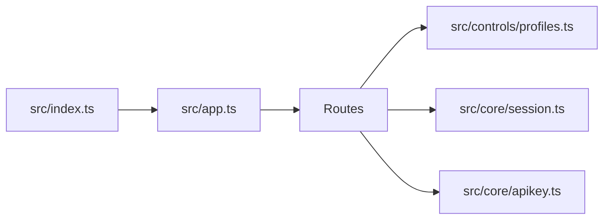

# Deployment & Operations

<cite>
**Referenced Files in This Document**
- [README.md](file://README.md)
- [package.json](file://package.json)
- [client/package.json](file://client/package.json)
- [src/index.ts](file://src/index.ts)
- [src/app.ts](file://src/app.ts)
- [src/controls/profiles.ts](file://src/controls/profiles.ts)
- [src/core/session.ts](file://src/core/session.ts)
- [src/core/apikey.ts](file://src/core/apikey.ts)
</cite>

## Table of Contents
1. [Introduction](#introduction)
2. [Project Structure](#project-structure)
3. [Core Components](#core-components)
4. [Architecture Overview](#architecture-overview)
5. [Detailed Component Analysis](#detailed-component-analysis)
6. [Dependency Analysis](#dependency-analysis)
7. [Performance Considerations](#performance-considerations)
8. [Troubleshooting Guide](#troubleshooting-guide)
9. [Conclusion](#conclusion)
10. [Appendices](#appendices)

## Introduction
This document provides production-oriented deployment and operations guidance for the mihome-web application. It covers building both backend and frontend components, environment configuration, persistent data storage, containerization with Docker, orchestration with Kubernetes, monitoring and logging, backup and recovery, scaling and high availability, and security hardening including SSL/TLS.

The application is a Node.js server that serves an Express API and static frontend assets. It persists user sessions, API keys, and device profiles to local JSON files under a data directory. The frontend is built with Vite and React and served statically by the backend.

## Project Structure
At runtime, the backend:
- Starts an Express server on a configurable host and port.
- Mounts API routers under /api.
- Serves the built frontend from the public directory.

**Diagram sources**
- [src/index.ts:1-12](file://src/index.ts#L1-L12)
- [src/app.ts:13-23](file://src/app.ts#L13-L23)

**Section sources**
- [src/index.ts:1-12](file://src/index.ts#L1-L12)
- [src/app.ts:13-23](file://src/app.ts#L13-L23)

## Core Components
- Backend entrypoint binds to HOST and PORT, initializes providers, creates the Express app, and starts listening.
- App builder mounts API routes and serves static files from public/.
- Profiles subsystem reads/writes JSON profile definitions from a configurable directory.
- Session store persists hub/account state to a JSON file.
- API key store persists API keys and audit records to a JSON file.

Key operational implications:
- All persistent data is stored as JSON files under data/.
- Profile overrides are hot-reloaded based on filesystem changes.
- The frontend is served statically; ensure the built assets exist under public/.

**Section sources**
- [src/index.ts:1-12](file://src/index.ts#L1-L12)
- [src/app.ts:13-23](file://src/app.ts#L13-L23)
- [src/controls/profiles.ts:10-11](file://src/controls/profiles.ts#L10-L11)
- [src/core/session.ts:35-35](file://src/core/session.ts#L35-L35)
- [src/core/apikey.ts:73-73](file://src/core/apikey.ts#L73-L73)

## Architecture Overview
Production deployment typically places a reverse proxy or load balancer in front of one or more backend instances. The frontend is built once and served statically by the backend. Persistent data resides on shared storage when running multiple replicas.

[No sources needed since this diagram shows conceptual workflow, not actual code structure]

## Detailed Component Analysis

### Production Build Processes

#### Backend Build
- Type-check and compile TypeScript into JavaScript using the project’s build script.
- Start the compiled server with Node.js.

Operational notes:
- Ensure dependencies are installed before building.
- The server listens on HOST and PORT configured via environment variables.

**Section sources**
- [package.json:5-10](file://package.json#L5-L10)
- [src/index.ts:6-11](file://src/index.ts#L6-L11)

#### Frontend Build
- Run the client build script to generate optimized static assets.
- Place the resulting assets under public/ so the backend can serve them.

Operational notes:
- The client uses Vite and React.
- The build process includes type checking before asset generation.

**Section sources**
- [client/package.json:5-8](file://client/package.json#L5-L8)
- [src/app.ts:22-22](file://src/app.ts#L22-L22)

### Environment Configuration Options
- HOST: Bind address for the server. Default is loopback.
- PORT: TCP port for the server. Default is 8787.
- MIHOME_PROFILE_DIR: Directory for runtime profile overrides. Defaults to data/profiles.

Recommendations:
- Set HOST to 0.0.0.0 only when behind a reverse proxy or container network.
- Pin PORT to a non-privileged port and expose it through your orchestrator.
- Use MIHOME_PROFILE_DIR to isolate profile data per environment.

**Section sources**
- [src/index.ts:6-7](file://src/index.ts#L6-L7)
- [src/controls/profiles.ts:10-10](file://src/controls/profiles.ts#L10-L10)

### Database Setup
There is no relational database. The application uses local JSON files for persistence:
- Hubs and account sessions: data/hubs.json
- API keys and audit logs: data/api-keys.json
- Device profiles: data/profiles/<vendor>/<id>.json

Operational guidance:
- Treat these files as the application’s “database.”
- Back up the entire data/ directory regularly.
- When running multiple replicas, mount a shared volume for data/.

**Section sources**
- [src/core/session.ts:35-35](file://src/core/session.ts#L35-L35)
- [src/core/apikey.ts:73-73](file://src/core/apikey.ts#L73-L73)
- [src/controls/profiles.ts:10-10](file://src/controls/profiles.ts#L10-L10)
- [README.md:53-57](file://README.md#L53-L57)
- [README.md:68-68](file://README.md#L68-L68)

### File Storage Requirements
- Write permissions for data/ and its subdirectories.
- Atomic writes for session data use temporary files and rename operations.
- Profile overrides are read on demand and cached with a filesystem stamp; invalid JSON files are skipped without crashing the service.

Best practices:
- Ensure consistent timezone and clock across nodes if relying on timestamps.
- Avoid concurrent writers unless using a shared filesystem with proper locking semantics.

**Section sources**
- [src/core/session.ts:72-97](file://src/core/session.ts#L72-L97)
- [src/controls/profiles.ts:145-194](file://src/controls/profiles.ts#L145-L194)

### Containerization Strategy (Docker)
Recommended approach:
- Multi-stage build:
  - Stage 1: Install dependencies and build frontend assets.
  - Stage 2: Install production dependencies and copy only necessary artifacts.
- Expose the configured PORT.
- Mount a persistent volume at data/.
- Serve the built frontend from public/ inside the container.

Example steps:
- Build frontend assets into public/.
- Build and run the backend with NODE_ENV=production.
- Configure HOST=0.0.0.0 and a fixed PORT.
- Persist data/ via a named volume or cloud disk.

[No sources needed since this section provides general guidance]

### Orchestration with Kubernetes
Deployment model:
- Deploy a Deployment with one or more replicas.
- Expose the service via a Service and Ingress.
- Mount a PersistentVolumeClaim at data/ for shared persistence.
- Manage secrets (e.g., TLS certificates) via Kubernetes Secrets.

Health checks:
- Readiness probe: HTTP GET on a lightweight endpoint such as /api/meta.
- Liveness probe: HTTP GET on the same endpoint.

Scaling:
- Horizontal Pod Autoscaler based on CPU/memory or custom metrics.
- Shared storage ensures consistent state across replicas.

[No sources needed since this section provides general guidance]

### Monitoring and Logging
Application-level observability:
- Server startup prints the bound URL.
- Session persistence errors are logged to stderr.
- Audit logs for open API usage are persisted to data/api-keys.json.

Recommendations:
- Collect stdout/stderr logs with your platform’s log aggregator.
- Monitor filesystem size for data/.
- Track request latency and error rates at the ingress/load balancer layer.
- Alert on repeated authentication failures or rate-limit triggers.

**Section sources**
- [src/index.ts:10-11](file://src/index.ts#L10-L11)
- [src/core/session.ts:72-77](file://src/core/session.ts#L72-L77)
- [README.md:88-95](file://README.md#L88-L95)

### Backup and Recovery Procedures
Backup targets:
- data/hubs.json (user sessions and device metadata).
- data/api-keys.json (API keys and audit logs).
- data/profiles/** (runtime profile overrides).

Procedure:
- Stop writes temporarily or use a snapshot-capable filesystem.
- Copy data/ to a secure backup location.
- For disaster recovery, restore data/ and restart the service.

Notes:
- Session state is encoded and written atomically; backups should capture the final renamed file.
- Profile overrides take effect immediately upon filesystem change.

**Section sources**
- [src/core/session.ts:72-97](file://src/core/session.ts#L72-L97)
- [src/controls/profiles.ts:145-194](file://src/controls/profiles.ts#L145-L194)
- [README.md:53-57](file://README.md#L53-L57)

### Scaling Considerations and Load Balancing
- Stateless compute: Each backend instance processes requests independently.
- Shared state: Persist all mutable state in data/ on shared storage.
- Load balancing: Distribute traffic across replicas using a Layer 7 load balancer or Ingress controller.
- Sticky sessions: Not required because session state is persisted to disk.

[No sources needed since this section provides general guidance]

### High Availability Setup
- Run multiple replicas behind a load balancer.
- Use a highly available storage backend for data/.
- Configure health probes to remove unhealthy instances automatically.
- Plan for rolling updates to minimize downtime.

[No sources needed since this section provides general guidance]

### Security Hardening
Network and access control:
- Do not bind directly to 0.0.0.0 unless behind a trusted proxy.
- Restrict inbound ports to the load balancer or ingress controller.
- Enforce HTTPS at the edge; terminate TLS at the proxy.

Authentication and authorization:
- API Key-based access for open endpoints with scoped permissions.
- Audit logging captures method, path, status, duration, source IP, and failure reasons.
- Rate limiting protects against brute-force attempts on invalid keys.

Data protection:
- Session state is encoded and written with restrictive file permissions.
- API keys are stored with hashed identifiers; plaintext is shown only once during creation.

Firewall and TLS:
- Open only the proxy port externally.
- Rotate TLS certificates regularly and automate renewal.

**Section sources**
- [src/index.ts:6-7](file://src/index.ts#L6-L7)
- [src/core/session.ts:94-97](file://src/core/session.ts#L94-L97)
- [README.md:60-95](file://README.md#L60-L95)

## Dependency Analysis
Runtime dependency graph between core modules:

**Diagram sources**
- [src/index.ts:1-8](file://src/index.ts#L1-L8)
- [src/app.ts:4-21](file://src/app.ts#L4-L21)
- [src/controls/profiles.ts:10-10](file://src/controls/profiles.ts#L10-L10)
- [src/core/session.ts:35-35](file://src/core/session.ts#L35-L35)
- [src/core/apikey.ts:73-73](file://src/core/apikey.ts#L73-L73)

**Section sources**
- [src/index.ts:1-8](file://src/index.ts#L1-L8)
- [src/app.ts:4-21](file://src/app.ts#L4-L21)

## Performance Considerations
- Keep payload limits reasonable; the server enforces a JSON body limit.
- Minimize cold starts by keeping the Node.js process warm.
- Cache frontend assets at the edge CDN or reverse proxy.
- Monitor I/O latency on data/ when many replicas write concurrently.
- Tune process memory and CPU limits according to workload.

**Section sources**
- [src/app.ts:15-15](file://src/app.ts#L15-L15)

## Troubleshooting Guide
Common issues and resolutions:
- Cannot connect to the server: Verify HOST and PORT settings and firewall rules.
- Frontend not loading: Ensure the frontend build exists under public/.
- Profile changes not applied: Check MIHOME_PROFILE_DIR and file permissions; verify JSON validity.
- Session loss after restart: Confirm data/hubs.json is present and readable.
- API key audit missing: Verify data/api-keys.json is writable and not rotated prematurely.

Diagnostic tips:
- Inspect server logs for startup messages and persistence errors.
- Validate JSON files manually if corruption is suspected.
- Use health check endpoints to confirm readiness.

**Section sources**
- [src/index.ts:10-11](file://src/index.ts#L10-L11)
- [src/core/session.ts:72-77](file://src/core/session.ts#L72-L77)
- [src/controls/profiles.ts:182-189](file://src/controls/profiles.ts#L182-L189)

## Conclusion
Deploy mihome-web as a stateless backend serving static frontend assets, with all mutable state persisted to a shared data directory. Containerize with multi-stage builds, orchestrate with Kubernetes, and place a reverse proxy or Ingress in front for TLS termination and load balancing. Implement robust monitoring and logging, back up data/ regularly, and enforce security best practices at the network and application layers.

## Appendices

### Quick Start Checklist
- Build frontend assets into public/.
- Install backend dependencies and build TypeScript.
- Create and mount data/ with appropriate permissions.
- Configure HOST, PORT, and MIHOME_PROFILE_DIR.
- Start the server and verify health endpoints.
- Add TLS termination at the edge and restrict inbound ports.

**Section sources**
- [client/package.json:5-8](file://client/package.json#L5-L8)
- [package.json:5-10](file://package.json#L5-L10)
- [src/index.ts:6-11](file://src/index.ts#L6-L11)
- [src/app.ts:22-22](file://src/app.ts#L22-L22)