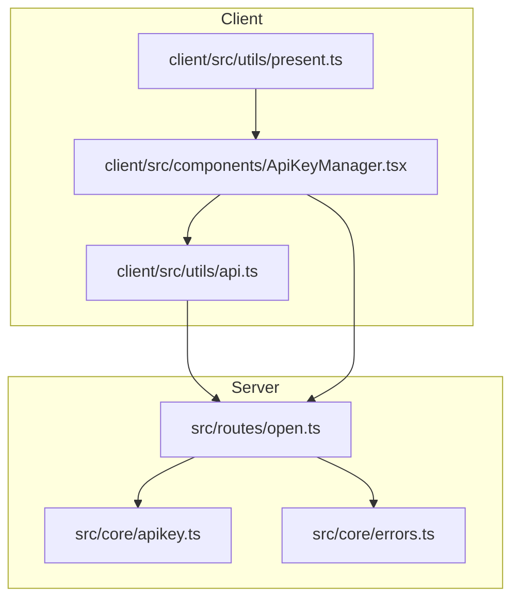
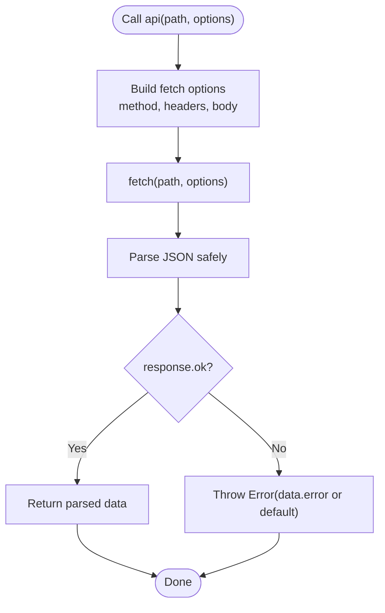
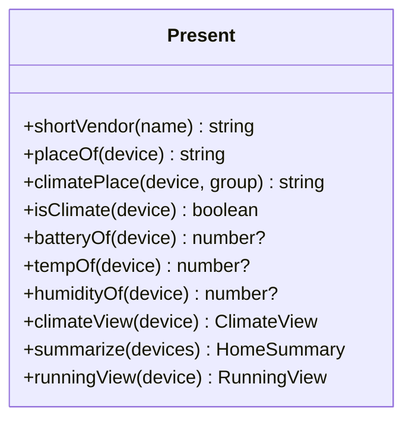
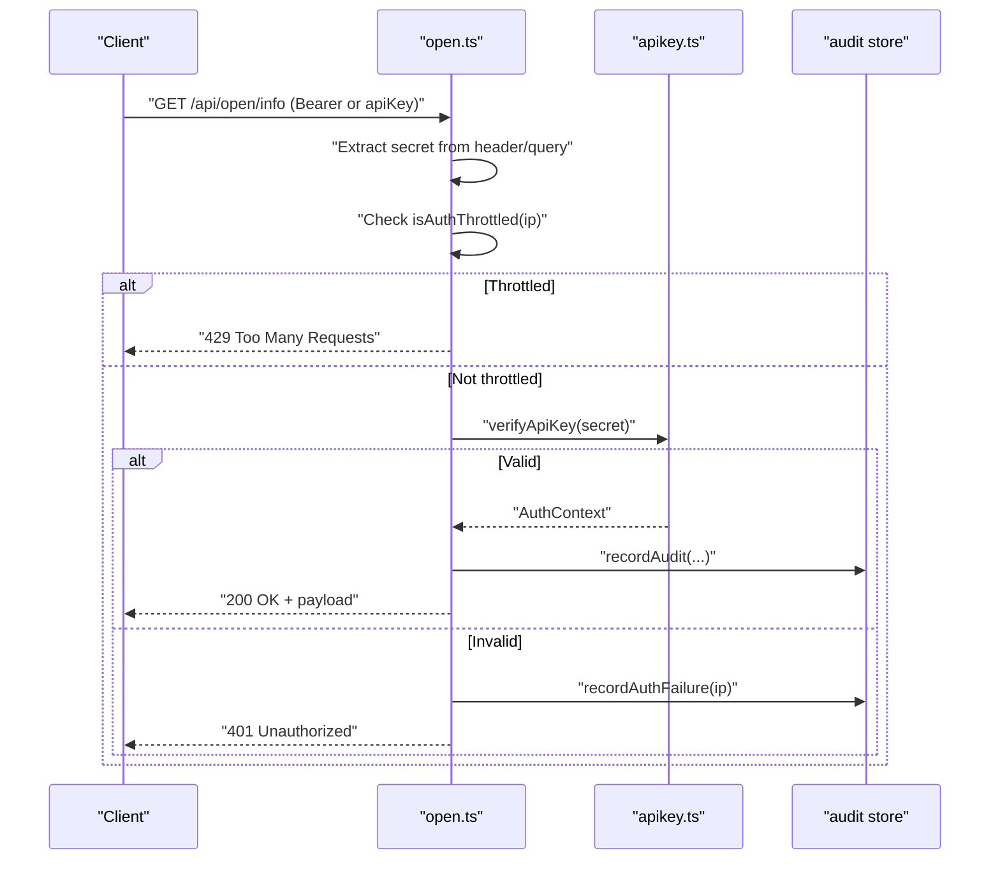
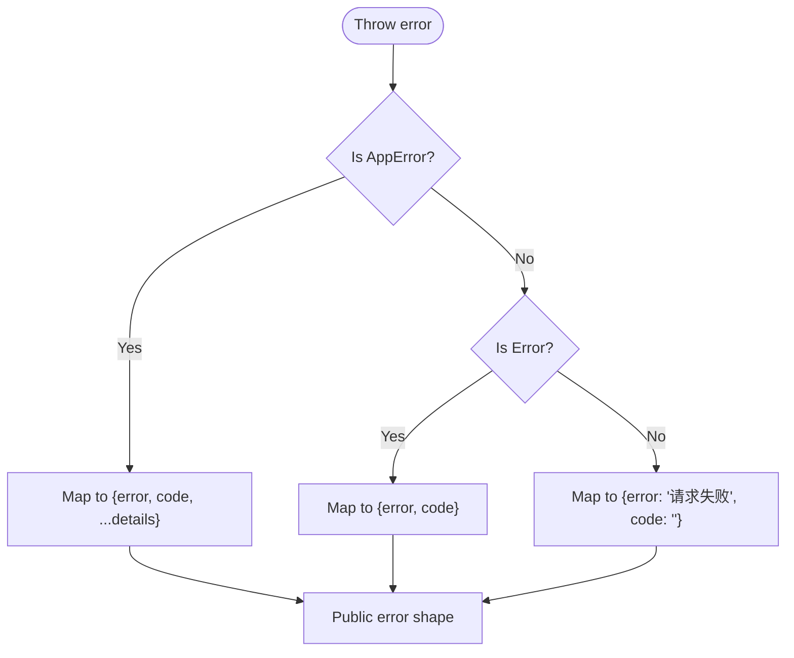
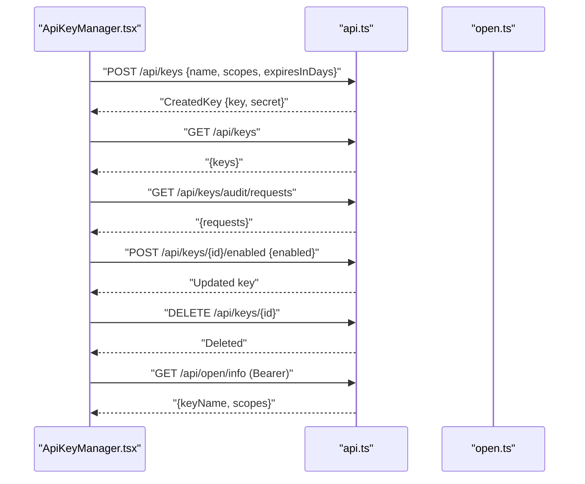
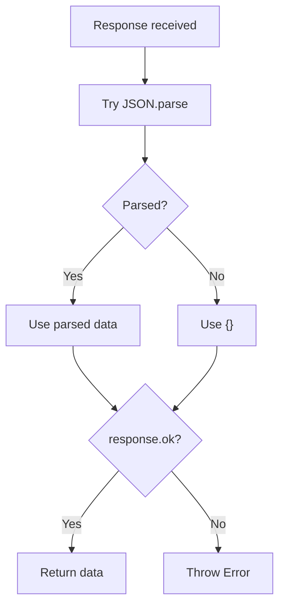
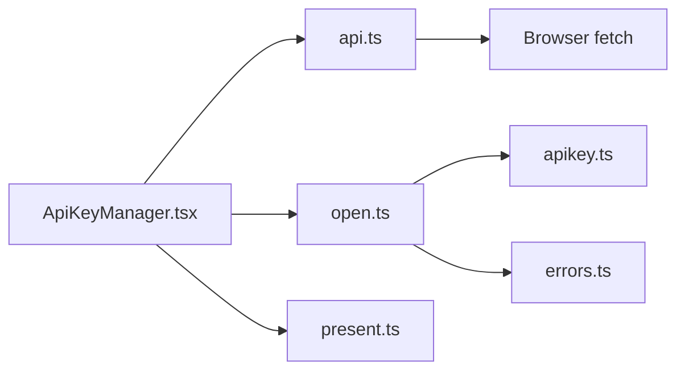

# API Integration Layer

<cite>
**Referenced Files in This Document**
- [api.ts](file://client/src/utils/api.ts)
- [present.ts](file://client/src/utils/present.ts)
- [errors.ts](file://src/core/errors.ts)
- [open.ts](file://src/routes/open.ts)
- [apikey.ts](file://src/core/apikey.ts)
- [ApiKeyManager.tsx](file://client/src/components/ApiKeyManager.tsx)
- [http.ts](file://src/providers/xiaomi/http.ts)
</cite>

## Table of Contents
1. [Introduction](#introduction)
2. [Project Structure](#project-structure)
3. [Core Components](#core-components)
4. [Architecture Overview](#architecture-overview)
5. [Detailed Component Analysis](#detailed-component-analysis)
6. [Dependency Analysis](#dependency-analysis)
7. [Performance Considerations](#performance-considerations)
8. [Troubleshooting Guide](#troubleshooting-guide)
9. [Conclusion](#conclusion)

## Introduction
This document explains the API integration layer that connects the frontend UI with the backend server. It covers:
- The `api` utility that wraps browser `fetch` calls, sets headers, and normalizes responses.
- The `apiBearer` helper for open endpoints that use a Bearer token.
- The `errorText` helper for safe error message extraction.
- The `present` utilities that format device data into user-friendly views.
- Server-side authentication via API Key, request auditing, throttling, and public error normalization.
- Examples of authenticated requests, response handling, and error boundaries.

The goal is to make it clear how HTTP requests are made, how authentication state flows, and how errors are handled consistently across the application.

## Project Structure
The API integration spans both client and server code:
- Client utilities under `client/src/utils` provide HTTP helpers and presentation logic.
- Server routes under `src/routes` handle API Key authentication, audit logging, and throttling.
- Core server modules under `src/core` define error types, API Key storage, and public error formatting.



**Diagram sources**
- [api.ts:1-33](file://client/src/utils/api.ts#L1-L33)
- [present.ts:1-229](file://client/src/utils/present.ts#L1-L229)
- [ApiKeyManager.tsx:1-420](file://client/src/components/ApiKeyManager.tsx#L1-L420)
- [open.ts:1-105](file://src/routes/open.ts#L1-L105)
- [apikey.ts:1-304](file://src/core/apikey.ts#L1-L304)
- [errors.ts:1-38](file://src/core/errors.ts#L1-L38)

**Section sources**
- [api.ts:1-33](file://client/src/utils/api.ts#L1-L33)
- [present.ts:1-229](file://client/src/utils/present.ts#L1-L229)
- [ApiKeyManager.tsx:1-420](file://client/src/components/ApiKeyManager.tsx#L1-L420)
- [open.ts:1-105](file://src/routes/open.ts#L1-L105)
- [apikey.ts:1-304](file://src/core/apikey.ts#L1-L304)
- [errors.ts:1-38](file://src/core/errors.ts#L1-L38)

## Core Components
- `api`: Wraps `fetch`, sends JSON bodies when present, uses same-origin credentials, and throws on non-OK responses.
- `apiBearer`: Sends a Bearer token header for open endpoints used for self-testing.
- `apiForm`: Sends multipart/form-data payloads.
- `errorText`: Safely extracts an error message from thrown values.
- `present`: Formats device data into readable views such as climate summaries, running status, and home summaries.
- Server `openRouter`: Middleware that validates API Keys, audits requests, and applies throttling.
- `AppError` and `toPublicError`: Standardized error type and public error formatter.

**Section sources**
- [api.ts:1-33](file://client/src/utils/api.ts#L1-L33)
- [present.ts:1-229](file://client/src/utils/present.ts#L1-L229)
- [open.ts:1-105](file://src/routes/open.ts#L1-L105)
- [errors.ts:1-38](file://src/core/errors.ts#L1-L38)

## Architecture Overview
The integration follows a simple pattern:
- Frontend components call `api` or `apiBearer`.
- Requests go through the browser’s `fetch` with appropriate headers.
- Backend middleware validates API Keys, records audit entries, and enforces throttling.
- Errors are normalized to a public shape before being sent back to the client.

```mermaid
sequenceDiagram
participant UI as "UI Component"
participant Api as "api.ts"
participant Fetch as "Browser fetch"
participant Open as "open.ts"
participant Auth as "apikey.ts"
participant Err as "errors.ts"
UI->>Api : "api(path, options)"
Api->>Fetch : "HTTP request with headers/body"
Fetch-->>Open : "Incoming request"
Open->>Auth : "verifyApiKey(secret)"
Auth-->>Open : "AuthContext or null"
Open->>Open : "Audit + throttle checks"
Open-->>Fetch : "JSON response"
Fetch-->>Api : "Response body"
Api-->>UI : "Normalized data or throw Error"
Note over Api,UI : "Non-OK responses throw; errorText extracts message"
```

**Diagram sources**
- [api.ts:3-13](file://client/src/utils/api.ts#L3-L13)
- [open.ts:62-105](file://src/routes/open.ts#L62-L105)
- [apikey.ts:220-231](file://src/core/apikey.ts#L220-L231)
- [errors.ts:28-37](file://src/core/errors.ts#L28-L37)

## Detailed Component Analysis

### API Utility Functions
The `api` function centralizes HTTP behavior:
- Uses `credentials: "same-origin"` for session-based auth.
- Sets `Content-Type: application/json` only when a body is provided.
- Normalizes JSON parsing failures to an empty object.
- Throws on non-OK responses, preferring the server-provided `error` field.

`apiBearer` is used for open endpoints where clients pass a Bearer token explicitly.

`apiForm` supports file uploads by sending `FormData`.

`errorText` ensures consistent error messages even if the thrown value is not an `Error`.



**Diagram sources**
- [api.ts:3-13](file://client/src/utils/api.ts#L3-L13)

**Section sources**
- [api.ts:1-33](file://client/src/utils/api.ts#L1-L33)

### Present Utilities for User-Facing Data
The `present` module transforms raw device data into structured views:
- `shortVendor`: Simplifies vendor names.
- `placeOf` / `climatePlace`: Derives room/place labels.
- `isClimate`: Detects climate-related devices.
- `batteryOf`, `tempOf`, `humidityOf`: Extract numeric sensor values.
- `climateView`: Builds a view with temperature, humidity, battery, and low-battery flag.
- `summarize`: Aggregates average temperature, average humidity, driest place, and low-battery count.
- `runningView`: Produces a rich display for device status, including paired water metrics and fault notes.

These functions do not perform network I/O; they focus purely on formatting and summarization.



**Diagram sources**
- [present.ts:3-8](file://client/src/utils/present.ts#L3-L8)
- [present.ts:10-22](file://client/src/utils/present.ts#L10-L22)
- [present.ts:44-51](file://client/src/utils/present.ts#L44-L51)
- [present.ts:57-96](file://client/src/utils/present.ts#L57-L96)
- [present.ts:105-122](file://client/src/utils/present.ts#L105-L122)
- [present.ts:192-228](file://client/src/utils/present.ts#L192-L228)

**Section sources**
- [present.ts:1-229](file://client/src/utils/present.ts#L1-L229)

### Authentication Flow for Open Endpoints
Open endpoints require an API Key passed via:
- Authorization header: `Authorization: Bearer <key>`
- Or query parameter: `apiKey=<key>`

Middleware behavior:
- Rejects missing keys with 401.
- Applies IP-based throttling after repeated failures.
- Verifies the key using secure hashing and timing-safe comparison.
- Records audit entries for every request, including failed ones.
- Adds `X-Request-Id` for successful authentications.



**Diagram sources**
- [open.ts:33-52](file://src/routes/open.ts#L33-L52)
- [open.ts:62-105](file://src/routes/open.ts#L62-L105)
- [apikey.ts:220-231](file://src/core/apikey.ts#L220-L231)
- [apikey.ts:243-255](file://src/core/apikey.ts#L243-L255)
- [apikey.ts:274-299](file://src/core/apikey.ts#L274-L299)

**Section sources**
- [open.ts:1-105](file://src/routes/open.ts#L1-L105)
- [apikey.ts:1-304](file://src/core/apikey.ts#L1-L304)

### Error Handling and Public Error Formatting
The server defines a custom `AppError` with fields for code, status, and details. Helpers:
- `isAuthFailure`: Determines whether an error indicates authentication failure based on codes or message hints.
- `toPublicError`: Converts internal errors into a safe public shape with `error`, `code`, and optional details.

On the client, `errorText` extracts a human-readable message from any thrown value.



**Diagram sources**
- [errors.ts:1-13](file://src/core/errors.ts#L1-L13)
- [errors.ts:28-37](file://src/core/errors.ts#L28-L37)

**Section sources**
- [errors.ts:1-38](file://src/core/errors.ts#L1-L38)
- [api.ts:30-32](file://client/src/utils/api.ts#L30-L32)

### Request Interceptors, Retry Logic, and Timeout Handling
Current implementation does not include:
- Global request/response interceptors.
- Automatic retry logic.
- Built-in timeout handling.

Recommendations for future enhancements:
- Add a wrapper around `fetch` to implement retries with exponential backoff.
- Introduce timeouts per request or globally.
- Centralize interceptor-like logic for adding headers, logging, and error mapping.

[No sources needed since this section provides general guidance]

### Examples of Authenticated Requests and Response Handling
Examples are implemented in the API Key management UI:
- Creating a key: POST `/api/keys` with name, scopes, and expiry.
- Listing keys and audit logs: GET `/api/keys` and `/api/keys/audit/requests`.
- Toggling enabled state: POST `/api/keys/{id}/enabled`.
- Revoking a key: DELETE `/api/keys/{id}`.
- Self-test with Bearer token: GET `/api/open/info` using `apiBearer`.

All these operations use `api` or `apiBearer`, and errors are displayed via `errorText`.



**Diagram sources**
- [ApiKeyManager.tsx:172-193](file://client/src/components/ApiKeyManager.tsx#L172-L193)
- [ApiKeyManager.tsx:195-222](file://client/src/components/ApiKeyManager.tsx#L195-L222)
- [ApiKeyManager.tsx:224-239](file://client/src/components/ApiKeyManager.tsx#L224-L239)
- [api.ts:3-13](file://client/src/utils/api.ts#L3-L13)
- [api.ts:16-21](file://client/src/utils/api.ts#L16-L21)

**Section sources**
- [ApiKeyManager.tsx:1-420](file://client/src/components/ApiKeyManager.tsx#L1-L420)
- [api.ts:1-33](file://client/src/utils/api.ts#L1-L33)

### Handling Different Response Formats
- JSON responses are parsed by `api` and returned directly.
- Non-JSON responses are caught during parsing and converted to an empty object, then treated as invalid if the response is not OK.
- For form submissions, `apiForm` sends `FormData` without setting JSON content type.
- On the server side, provider-specific helpers like `parseJsonBody` can strip wrappers or normalize vendor payloads.



**Diagram sources**
- [api.ts:4-12](file://client/src/utils/api.ts#L4-L12)
- [http.ts:27-35](file://src/providers/xiaomi/http.ts#L27-L35)

**Section sources**
- [api.ts:1-33](file://client/src/utils/api.ts#L1-L33)
- [http.ts:1-35](file://src/providers/xiaomi/http.ts#L1-L35)

### Implementing Proper Error Boundaries for API Failures
Recommended patterns:
- Wrap async UI actions in try/catch blocks and set local error state.
- Use `errorText` to convert thrown values into user-facing messages.
- For critical pages, consider higher-level error boundaries that catch unhandled promise rejections and show fallback UI.
- On the server, ensure all errors are mapped to public shapes via `toPublicError`.

Example usage pattern in the UI:
- Catch errors from `api` calls.
- Display the message via `errorText`.
- Reset loading states in finally blocks.

**Section sources**
- [ApiKeyManager.tsx:90-102](file://client/src/components/ApiKeyManager.tsx#L90-L102)
- [ApiKeyManager.tsx:172-193](file://client/src/components/ApiKeyManager.tsx#L172-L193)
- [errors.ts:28-37](file://src/core/errors.ts#L28-L37)

## Dependency Analysis
The main dependencies between components are:
- `ApiKeyManager.tsx` depends on `api.ts` for HTTP calls and displays results.
- `api.ts` relies on browser `fetch` and returns normalized data or throws.
- `open.ts` depends on `apikey.ts` for verification and auditing.
- `open.ts` uses `errors.ts` for public error formatting.
- `present.ts` is independent of HTTP and focuses on data presentation.



**Diagram sources**
- [ApiKeyManager.tsx:1-420](file://client/src/components/ApiKeyManager.tsx#L1-L420)
- [api.ts:1-33](file://client/src/utils/api.ts#L1-L33)
- [open.ts:1-105](file://src/routes/open.ts#L1-L105)
- [apikey.ts:1-304](file://src/core/apikey.ts#L1-L304)
- [errors.ts:1-38](file://src/core/errors.ts#L1-L38)
- [present.ts:1-229](file://client/src/utils/present.ts#L1-L229)

**Section sources**
- [ApiKeyManager.tsx:1-420](file://client/src/components/ApiKeyManager.tsx#L1-L420)
- [api.ts:1-33](file://client/src/utils/api.ts#L1-L33)
- [open.ts:1-105](file://src/routes/open.ts#L1-L105)
- [apikey.ts:1-304](file://src/core/apikey.ts#L1-L304)
- [errors.ts:1-38](file://src/core/errors.ts#L1-L38)
- [present.ts:1-229](file://client/src/utils/present.ts#L1-L229)

## Performance Considerations
- Avoid unnecessary re-renders by batching API calls and updating state minimally.
- Use `present` utilities to compute derived views once and cache them if needed.
- On the server, audit writes are batched via microtask flushing to reduce disk I/O.
- Keep API Key verification efficient using precomputed hashes and timing-safe comparisons.

[No sources needed since this section provides general guidance]

## Troubleshooting Guide
Common issues and resolutions:
- Missing API Key: Ensure the Authorization header includes `Bearer <key>` or pass `apiKey` in the query string.
- Throttled requests: If too many invalid attempts occur within the time window, wait before retrying.
- Network errors: `api` throws on non-OK responses; use `errorText` to display a friendly message.
- Parsing errors: Non-JSON responses are treated as empty objects; verify server response format.
- Session vs Token: `api` uses same-origin credentials; `apiBearer` requires explicit Bearer tokens.

**Section sources**
- [open.ts:86-97](file://src/routes/open.ts#L86-L97)
- [apikey.ts:274-299](file://src/core/apikey.ts#L274-L299)
- [api.ts:4-12](file://client/src/utils/api.ts#L4-L12)
- [api.ts:30-32](file://client/src/utils/api.ts#L30-L32)

## Conclusion
The API integration layer provides a clear separation between HTTP concerns and presentation logic. The `api` and `apiBearer` utilities standardize requests, while `present` focuses on user-facing formatting. Server-side middleware enforces authentication, auditing, and throttling, and errors are normalized for safe consumption by the client. To improve resilience, consider adding interceptors, retries, and timeouts in future iterations.

[No sources needed since this section summarizes without analyzing specific files]