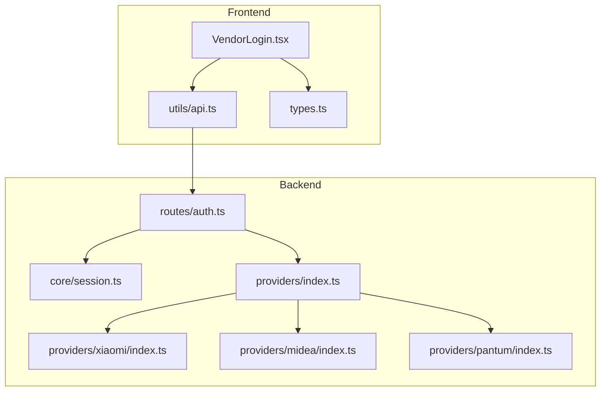
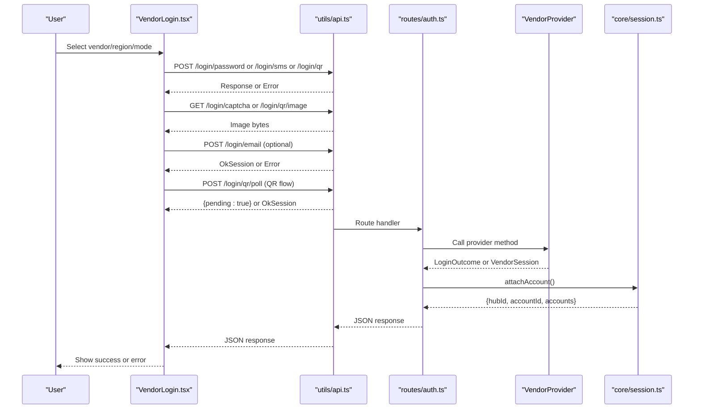
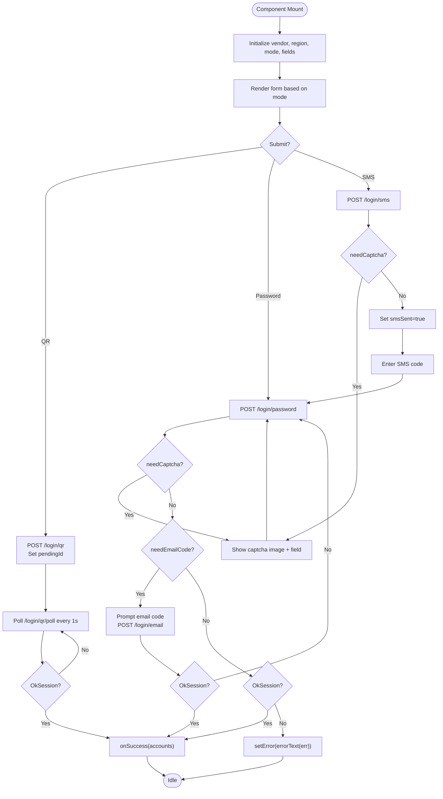
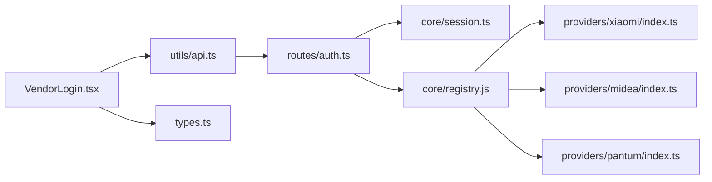

# Authentication UI

<cite>
**Referenced Files in This Document**
- [VendorLogin.tsx](file://client/src/components/VendorLogin.tsx)
- [api.ts](file://client/src/utils/api.ts)
- [types.ts](file://client/src/types.ts)
- [auth.ts](file://src/routes/auth.ts)
- [session.ts](file://src/core/session.ts)
- [providers/index.ts](file://src/providers/index.ts)
- [xiaomi/index.ts](file://src/providers/xiaomi/index.ts)
- [midea/index.ts](file://src/providers/midea/index.ts)
- [pantum/index.ts](file://src/providers/pantum/index.ts)
</cite>

## Table of Contents
1. [Introduction](#introduction)
2. [Project Structure](#project-structure)
3. [Core Components](#core-components)
4. [Architecture Overview](#architecture-overview)
5. [Detailed Component Analysis](#detailed-component-analysis)
6. [Dependency Analysis](#dependency-analysis)
7. [Performance Considerations](#performance-considerations)
8. [Troubleshooting Guide](#troubleshooting-guide)
9. [Conclusion](#conclusion)
10. [Appendices](#appendices)

## Introduction
This document explains the authentication user interface and its backend integration for multi-vendor smart home accounts. It focuses on the VendorLogin component, which supports password-based login, SMS verification, QR code scanning, and email-based two-factor authentication. The documentation covers form validation, error handling, progress indicators, backend endpoint contracts, session management, and how to customize or extend vendor authentication flows.

## Project Structure
The authentication UI is implemented as a React component that calls backend endpoints through a shared API helper. Backend routes delegate to vendor-specific providers, which implement per-vendor authentication logic. Sessions are managed server-side with persistence and hub-scoped account storage.

**Diagram sources**
- [VendorLogin.tsx:1-278](file://client/src/components/VendorLogin.tsx#L1-L278)
- [api.ts:1-33](file://client/src/utils/api.ts#L1-L33)
- [types.ts:1-141](file://client/src/types.ts#L1-L141)
- [auth.ts:1-200](file://src/routes/auth.ts#L1-L200)
- [session.ts:1-266](file://src/core/session.ts#L1-L266)
- [providers/index.ts:1-16](file://src/providers/index.ts#L1-L16)
- [xiaomi/index.ts:1-29](file://src/providers/xiaomi/index.ts#L1-L29)
- [midea/index.ts:1-26](file://src/providers/midea/index.ts#L1-L26)
- [pantum/index.ts:52-91](file://src/providers/pantum/index.ts#L52-L91)

**Section sources**
- [VendorLogin.tsx:1-278](file://client/src/components/VendorLogin.tsx#L1-L278)
- [api.ts:1-33](file://client/src/utils/api.ts#L1-L33)
- [types.ts:1-141](file://client/src/types.ts#L1-L141)
- [auth.ts:1-200](file://src/routes/auth.ts#L1-L200)
- [session.ts:1-266](file://src/core/session.ts#L1-L266)
- [providers/index.ts:1-16](file://src/providers/index.ts#L1-L16)

## Core Components
- VendorLogin: A React component that renders vendor selection, region selection, and mode tabs (SMS, QR, Password). It manages local state for credentials, captchas, pending IDs, and UI flags like needCaptcha, needEmail, smsSent, busy, and error.
- API helper: A small fetch wrapper that sends JSON payloads, handles non-OK responses by throwing errors, and exposes an errorText utility.
- Shared types: Defines auth modes, vendor info, account structures, and discriminated union types for login outcomes.
- Backend auth routes: Express router exposing endpoints for password login, SMS send, captcha image, email 2FA, QR flow, logout, me, and account status.
- Session manager: In-memory hub/account store with file-backed persistence, pending authentication context TTL, and cookie-based hub identification.
- Vendor providers: Per-vendor implementations declaring supported authModes, regions, and methods such as loginPassword, loginSms, sendSms, beginQr, pollQr, getCaptchaImage, getQrImage.

**Section sources**
- [VendorLogin.tsx:1-278](file://client/src/components/VendorLogin.tsx#L1-L278)
- [api.ts:1-33](file://client/src/utils/api.ts#L1-L33)
- [types.ts:1-141](file://client/src/types.ts#L1-L141)
- [auth.ts:1-200](file://src/routes/auth.ts#L1-L200)
- [session.ts:1-266](file://src/core/session.ts#L1-L266)
- [providers/index.ts:1-16](file://src/providers/index.ts#L1-L16)

## Architecture Overview
The authentication UI follows a layered architecture:
- UI layer: VendorLogin orchestrates user input and displays progress/error states.
- Client API layer: api.ts wraps fetch calls and normalizes errors.
- Server routing layer: auth.ts validates inputs, delegates to vendor providers, and manages pending contexts.
- Provider layer: Each vendor provider implements vendor-specific flows and returns standardized outcomes.
- Session layer: session.ts persists sessions and pending contexts, sets cookies, and tracks account status.

**Diagram sources**
- [VendorLogin.tsx:81-103](file://client/src/components/VendorLogin.tsx#L81-L103)
- [VendorLogin.tsx:146-202](file://client/src/components/VendorLogin.tsx#L146-L202)
- [api.ts:3-13](file://client/src/utils/api.ts#L3-L13)
- [auth.ts:35-71](file://src/routes/auth.ts#L35-L71)
- [auth.ts:73-91](file://src/routes/auth.ts#L73-L91)
- [auth.ts:109-121](file://src/routes/auth.ts#L109-L121)
- [auth.ts:123-173](file://src/routes/auth.ts#L123-L173)
- [session.ts:184-210](file://src/core/session.ts#L184-L210)

## Detailed Component Analysis

### VendorLogin Component
VendorLogin manages:
- Vendor and region selection based on VendorInfo.
- Mode switching between SMS, QR, and Password using vendor.authModes.
- Credential fields: username, password/SMS code, captcha, email code.
- Pending ID lifecycle for multi-step flows.
- UI flags: needCaptcha, needEmail, smsSent, busy, error.

Key behaviors:
- On vendor change, reset pending, captcha, email, SMS, and error states.
- QR polling: When in QR mode with a pendingId, polls /api/login/qr/poll every second until success or error.
- SMS flow: Sends /api/login/sms; may require captcha before sending; shows sent state.
- Password flow: Submits /api/login/password; may return needCaptcha or needEmailCode; if email required, prompts for email code and submits /api/login/email.
- Progress indicator: Busy flag disables submit button and changes label text.
- Error display: Renders error messages from API errors.

Form validation:
- Required fields depend on mode and vendor:
  - SMS: phone number and SMS code; optional captcha depending on backend.
  - Password: username and password; optional captcha depending on backend.
  - Email 2FA: one-time code after backend requests email verification.
- Vendor-specific hints adjust labels and placeholders.

Progress indicators:
- Busy state during all network requests.
- QR mode disables submit while waiting for scan.
- SMS flow shows “验证码会发到这个手机号” and “短信已发送”.

Error handling:
- Uses errorText to normalize error messages.
- Clears previous errors before each request.
- Handles expired pending contexts and unsupported features via backend error codes.

Customization points:
- heading, note, vendorLocked, initialVendorId, initialRegion, initialUsername, replaceAccountId props allow embedding and preconfiguration.
- VendorInfo drives available authModes and regions.

**Section sources**
- [VendorLogin.tsx:21-79](file://client/src/components/VendorLogin.tsx#L21-L79)
- [VendorLogin.tsx:81-114](file://client/src/components/VendorLogin.tsx#L81-L114)
- [VendorLogin.tsx:116-202](file://client/src/components/VendorLogin.tsx#L116-L202)
- [VendorLogin.tsx:204-278](file://client/src/components/VendorLogin.tsx#L204-L278)

#### VendorLogin State Flow

**Diagram sources**
- [VendorLogin.tsx:146-202](file://client/src/components/VendorLogin.tsx#L146-L202)
- [VendorLogin.tsx:81-103](file://client/src/components/VendorLogin.tsx#L81-L103)

### Backend Authentication Endpoints
- POST /login/password:
  - Accepts vendor, region, username, password, captcha, pendingId, method, accountId.
  - Validates required fields; creates pending context if missing.
  - Delegates to provider.loginPassword or provider.loginSms.
  - Returns needCaptcha or needEmailCode when additional steps are required.
  - On success, binds session and returns OkSession.
- POST /login/sms:
  - Accepts vendor, region, username, captcha, pendingId.
  - Calls provider.sendSms; may require captcha.
  - Returns pendingId and needCaptcha flag.
- GET /login/captcha:
  - Serves captcha image for a pendingId using provider.getCaptchaImage.
- POST /login/email:
  - Requires pendingId; calls provider.verifyEmail2fa.
  - Returns OkSession upon successful email verification.
- POST /login/qr:
  - Creates pending context and calls provider.beginQr.
  - Returns pendingId and image URL.
- GET /login/qr/image:
  - Serves QR image using provider.getQrImage.
- POST /login/qr/poll:
  - Polls provider.pollQr; returns pending:true until success.
  - On success, binds session and returns OkSession.
- POST /logout:
  - Removes account or clears hub; returns updated accounts list.
- GET /me:
  - Lists accounts for current hub.
- GET /accounts/status:
  - Checks account health and returns statuses.

**Section sources**
- [auth.ts:35-71](file://src/routes/auth.ts#L35-L71)
- [auth.ts:73-91](file://src/routes/auth.ts#L73-L91)
- [auth.ts:93-107](file://src/routes/auth.ts#L93-L107)
- [auth.ts:109-121](file://src/routes/auth.ts#L109-L121)
- [auth.ts:123-173](file://src/routes/auth.ts#L123-L173)
- [auth.ts:175-199](file://src/routes/auth.ts#L175-L199)

### Session Management
- Hub-scoped sessions:
  - Each browser session gets a hubId stored in a cookie named hub.
  - Accounts are stored per hub; multiple accounts can coexist.
- Pending contexts:
  - Multi-step authentication uses pending contexts with TTL (10 minutes).
  - Functions keepPending, takePending, peekPending, putPending, dropPending manage lifecycle.
- Persistence:
  - Hubs and accounts are persisted to data/hubs.json with safe encoding/decoding.
  - Sensitive fields like passwords are excluded from persistence.
- Account replacement:
  - Re-authenticating same vendor/user/region replaces existing session; optionally target accountId for replacement.

**Section sources**
- [session.ts:26-35](file://src/core/session.ts#L26-L35)
- [session.ts:72-98](file://src/core/session.ts#L72-L98)
- [session.ts:100-129](file://src/core/session.ts#L100-L129)
- [session.ts:159-163](file://src/core/session.ts#L159-L163)
- [session.ts:184-210](file://src/core/session.ts#L184-L210)
- [session.ts:230-265](file://src/core/session.ts#L230-L265)

### Vendor Provider Integration
- Registration:
  - bootstrapProviders registers xiaomi, midea, pantum, demo vendors.
- Vendor capabilities:
  - xiaomi: supports password and QR; includes email 2FA and captcha support.
  - midea: supports SMS and password; includes captcha support.
  - pantum: supports SMS only; enforces phone format and requires app binding.
- Provider contract:
  - Methods include createPending, loginPassword, loginSms, sendSms, beginEmail2fa, verifyEmail2fa, beginQr, pollQr, getCaptchaImage, getQrImage.

**Section sources**
- [providers/index.ts:1-16](file://src/providers/index.ts#L1-L16)
- [xiaomi/index.ts:1-29](file://src/providers/xiaomi/index.ts#L1-L29)
- [midea/index.ts:1-26](file://src/providers/midea/index.ts#L1-L26)
- [pantum/index.ts:52-91](file://src/providers/pantum/index.ts#L52-L91)

## Dependency Analysis
The following diagram maps key dependencies among components and modules involved in authentication.

**Diagram sources**
- [VendorLogin.tsx:1-5](file://client/src/components/VendorLogin.tsx#L1-L5)
- [api.ts:1-13](file://client/src/utils/api.ts#L1-L13)
- [auth.ts:1-17](file://src/routes/auth.ts#L1-L17)
- [session.ts:1-6](file://src/core/session.ts#L1-L6)
- [providers/index.ts:1-16](file://src/providers/index.ts#L1-L16)

**Section sources**
- [VendorLogin.tsx:1-5](file://client/src/components/VendorLogin.tsx#L1-L5)
- [api.ts:1-13](file://client/src/utils/api.ts#L1-L13)
- [auth.ts:1-17](file://src/routes/auth.ts#L1-L17)
- [session.ts:1-6](file://src/core/session.ts#L1-L6)
- [providers/index.ts:1-16](file://src/providers/index.ts#L1-L16)

## Performance Considerations
- QR polling interval is set to 1 second; consider increasing the interval if vendor rate limits are encountered.
- Avoid unnecessary re-renders by memoizing vendor and region selections where appropriate.
- Debounce rapid SMS resend attempts to prevent abuse and reduce backend load.
- Use lazy loading for vendor providers if the number of vendors grows significantly.

[No sources needed since this section provides general guidance]

## Troubleshooting Guide
Common issues and resolutions:
- Expired pending context:
  - Symptoms: Errors indicating login or verification has expired.
  - Cause: Pending context TTL exceeded (10 minutes).
  - Resolution: Restart the flow to obtain a new pendingId.
- Unsupported feature:
  - Symptoms: Errors stating vendor does not support SMS, email, or QR login.
  - Cause: Vendor provider lacks corresponding method.
  - Resolution: Use supported authModes for the selected vendor.
- Captcha failures:
  - Symptoms: Captcha mismatch or image not loading.
  - Cause: Invalid captcha input or missing getCaptchaImage implementation.
  - Resolution: Refresh captcha image and retry; ensure vendor implements getCaptchaImage.
- Session persistence issues:
  - Symptoms: Accounts disappear after restart.
  - Cause: File write failure or corrupted data/hubs.json.
  - Resolution: Check permissions and file integrity; clear corrupted store if necessary.

**Section sources**
- [auth.ts:42-43](file://src/routes/auth.ts#L42-L43)
- [auth.ts:79-80](file://src/routes/auth.ts#L79-L80)
- [auth.ts:110-111](file://src/routes/auth.ts#L110-L111)
- [session.ts:230-265](file://src/core/session.ts#L230-L265)

## Conclusion
The VendorLogin component provides a flexible, vendor-aware authentication UI supporting password, SMS, QR, and email-based flows. It integrates cleanly with backend routes and vendor providers, leveraging a robust session manager for multi-account hubs and persistent storage. Customization is straightforward through props and vendor configuration, enabling extension to new vendors and authentication methods.

[No sources needed since this section summarizes without analyzing specific files]

## Appendices

### Customizing Authentication Flows
- Change default mode:
  - Adjust firstMode logic to prioritize different authModes based on vendor preferences.
- Add vendor-specific hints:
  - Extend conditional hint rendering for new vendors in the form UI.
- Preconfigure login:
  - Use initialVendorId, initialRegion, initialUsername, and replaceAccountId props to embed pre-filled values.

**Section sources**
- [VendorLogin.tsx:9-13](file://client/src/components/VendorLogin.tsx#L9-L13)
- [VendorLogin.tsx:21-43](file://client/src/components/VendorLogin.tsx#L21-L43)
- [VendorLogin.tsx:235-258](file://client/src/components/VendorLogin.tsx#L235-L258)

### Adding Support for New Vendor Authentication Methods
Steps to add a new vendor:
1. Implement a VendorProvider with required methods:
   - createPending, loginPassword, sendSms, beginQr, pollQr, getCaptchaImage, getQrImage.
   - Optionally implement loginSms, beginEmail2fa, verifyEmail2fa for advanced flows.
2. Register the vendor in bootstrapProviders.
3. Configure authModes and regions in the provider definition.
4. Update VendorInfo consumption in VendorLogin to reflect new capabilities.

Example references:
- Xiaomi provider registration and capabilities.
- Midea provider registration and capabilities.
- Pantum provider registration and capabilities.

**Section sources**
- [providers/index.ts:8-14](file://src/providers/index.ts#L8-L14)
- [xiaomi/index.ts:6-29](file://src/providers/xiaomi/index.ts#L6-L29)
- [midea/index.ts:6-26](file://src/providers/midea/index.ts#L6-L26)
- [pantum/index.ts:52-91](file://src/providers/pantum/index.ts#L52-L91)