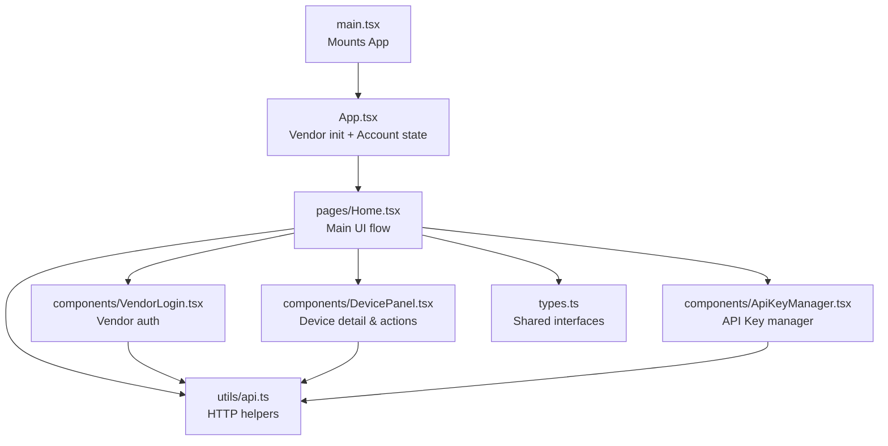
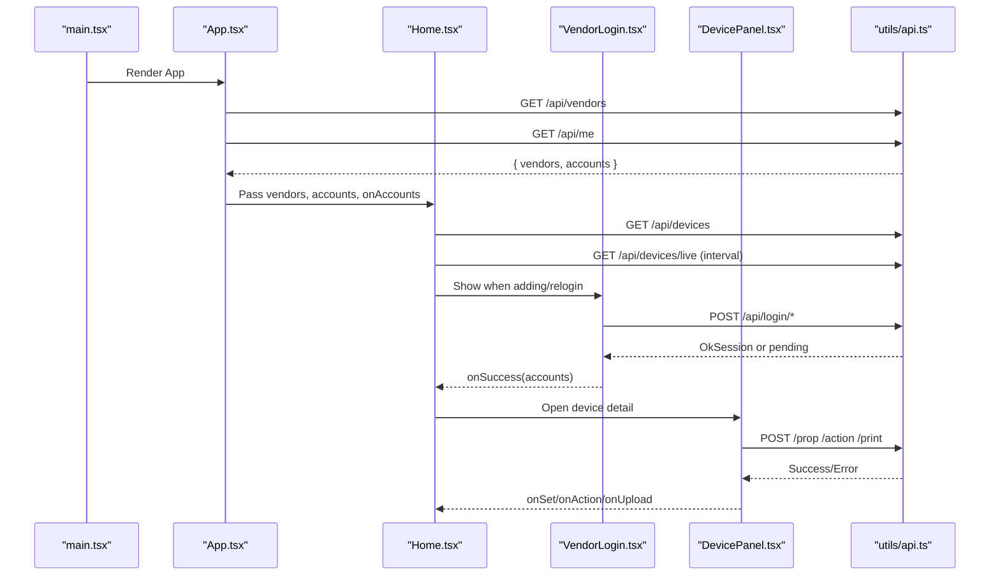
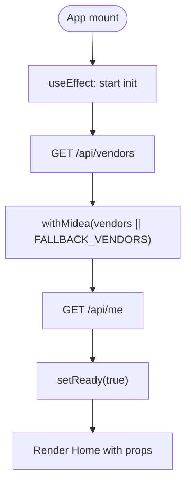
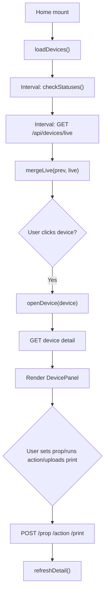
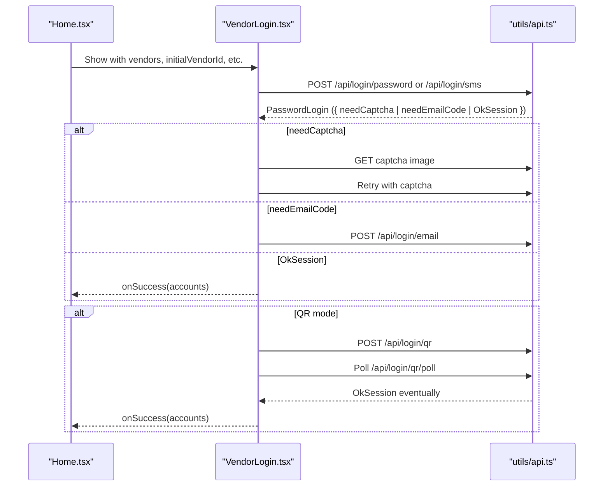
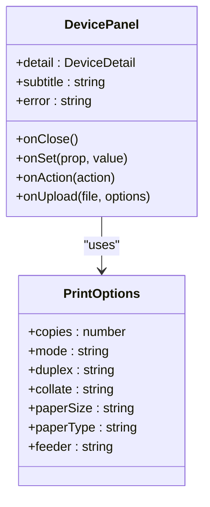
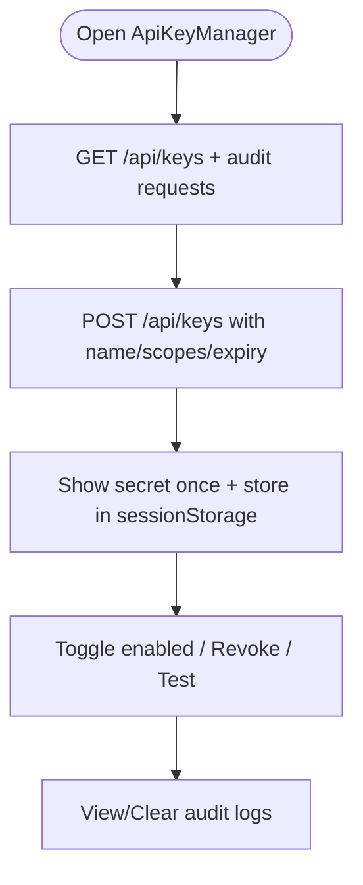
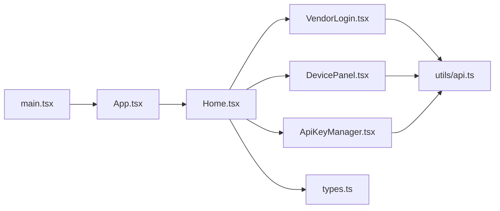

# Component Architecture

<cite>
**Referenced Files in This Document**
- [main.tsx](file://client/src/main.tsx)
- [App.tsx](file://client/src/App.tsx)
- [Home.tsx](file://client/src/pages/Home.tsx)
- [VendorLogin.tsx](file://client/src/components/VendorLogin.tsx)
- [DevicePanel.tsx](file://client/src/components/DevicePanel.tsx)
- [ApiKeyManager.tsx](file://client/src/components/ApiKeyManager.tsx)
- [types.ts](file://client/src/types.ts)
- [api.ts](file://client/src/utils/api.ts)
</cite>

## Table of Contents
1. [Introduction](#introduction)
2. [Project Structure](#project-structure)
3. [Core Components](#core-components)
4. [Architecture Overview](#architecture-overview)
5. [Detailed Component Analysis](#detailed-component-analysis)
6. [Dependency Analysis](#dependency-analysis)
7. [Performance Considerations](#performance-considerations)
8. [Troubleshooting Guide](#troubleshooting-guide)
9. [Conclusion](#conclusion)

## Introduction
This document explains the React component architecture for the client application. It focuses on:
- The root App component that initializes vendor information and manages account state.
- The Home page component that orchestrates device listing, filtering, detail panels, and vendor login flows.
- The component hierarchy and how components communicate through props and events.
- The shared type definitions used across the UI.
- Data models for vendor information and accounts.

The goal is to make the architecture understandable for both technical and non-technical readers while providing precise references to the source files.

## Project Structure
At a high level, the client app is a standard React application:
- Entry point mounts the root App component.
- App fetches vendor metadata and current accounts, then renders Home with this data.
- Home manages device lists, live updates, filters, and user interactions.
- VendorLogin handles multi-vendor authentication flows.
- DevicePanel displays device details and actions.
- ApiKeyManager provides API key management and audit logs.
- types.ts defines shared interfaces for vendors, accounts, devices, properties, actions, and more.
- utils/api.ts centralizes HTTP requests and error handling.

**Diagram sources**
- [main.tsx:1-14](file://client/src/main.tsx#L1-L14)
- [App.tsx:1-62](file://client/src/App.tsx#L1-L62)
- [Home.tsx:1-511](file://client/src/pages/Home.tsx#L1-L511)
- [VendorLogin.tsx:1-278](file://client/src/components/VendorLogin.tsx#L1-L278)
- [DevicePanel.tsx:1-216](file://client/src/components/DevicePanel.tsx#L1-L216)
- [ApiKeyManager.tsx:1-306](file://client/src/components/ApiKeyManager.tsx#L1-L306)
- [types.ts:1-141](file://client/src/types.ts#L1-L141)
- [api.ts:1-33](file://client/src/utils/api.ts#L1-L33)

**Section sources**
- [main.tsx:1-14](file://client/src/main.tsx#L1-L14)
- [App.tsx:1-62](file://client/src/App.tsx#L1-L62)

## Core Components
- App: Initializes vendor list and accounts, ensures readiness before rendering Home.
- Home: Orchestrates device loading, live polling, vendor/account UI, and delegates detailed operations to subcomponents.
- VendorLogin: Handles vendor selection, region, and multiple authentication modes (password, SMS, QR).
- DevicePanel: Renders device services, properties, actions, and print upload workflow.
- ApiKeyManager: Manages API keys, scopes, expiration, and audit logs; includes self-test against open endpoints.
- types.ts: Defines shared interfaces for vendors, accounts, devices, properties, actions, sessions, and API keys.
- api.ts: Provides standardized fetch wrappers and error formatting.

**Section sources**
- [App.tsx:31-61](file://client/src/App.tsx#L31-L61)
- [Home.tsx:13-511](file://client/src/pages/Home.tsx#L13-L511)
- [VendorLogin.tsx:21-278](file://client/src/components/VendorLogin.tsx#L21-L278)
- [DevicePanel.tsx:74-216](file://client/src/components/DevicePanel.tsx#L74-L216)
- [ApiKeyManager.tsx:73-306](file://client/src/components/ApiKeyManager.tsx#L73-L306)
- [types.ts:1-141](file://client/src/types.ts#L1-L141)
- [api.ts:1-33](file://client/src/utils/api.ts#L1-L33)

## Architecture Overview
The application follows a top-down data flow:
- main.tsx creates the React root and renders App.
- App fetches vendor metadata and current accounts, sets local state, and passes them down to Home.
- Home coordinates device fetching, live status polling, and user interactions. It uses subcomponents for focused responsibilities.
- Subcomponents call backend APIs via utils/api.ts and emit events back up to Home through callbacks.

**Diagram sources**
- [main.tsx:9-13](file://client/src/main.tsx#L9-L13)
- [App.tsx:36-60](file://client/src/App.tsx#L36-L60)
- [Home.tsx:35-123](file://client/src/pages/Home.tsx#L35-L123)
- [VendorLogin.tsx:81-103](file://client/src/components/VendorLogin.tsx#L81-L103)
- [DevicePanel.tsx:130-163](file://client/src/components/DevicePanel.tsx#L130-L163)
- [api.ts:3-13](file://client/src/utils/api.ts#L3-L13)

## Detailed Component Analysis

### App Component
Responsibilities:
- Define default vendor entries and ensure Midea presence.
- Fetch vendor list from backend; fallback to defaults if unavailable.
- Fetch current accounts and set ready flag after initialization.
- Render Home with vendors, accounts, and an updater callback.

State and lifecycle:
- Uses useState for vendors, accounts, and ready.
- useEffect performs async initialization with cleanup guard to avoid stale updates.
- Returns null until ready to prevent partial render.

Data flow:
- Calls /api/vendors and /api/me via utils/api.ts.
- Normalizes vendor list with withMidea helper.
- Passes accounts and vendors to Home; onAccounts allows Home to update account state.

**Diagram sources**
- [App.tsx:6-29](file://client/src/App.tsx#L6-L29)
- [App.tsx:31-61](file://client/src/App.tsx#L31-L61)

**Section sources**
- [App.tsx:6-29](file://client/src/App.tsx#L6-L29)
- [App.tsx:31-61](file://client/src/App.tsx#L31-L61)

### Home Page Component
Responsibilities:
- Manage device list, room/vendor filters, detail panel, errors, and re-login flow.
- Periodically refresh device statuses and live readings.
- Coordinate vendor login and device control workflows.

Key states:
- devices, room, vendor, adding, loading, detail, current, error, relogin, keys.
- detailSeq ref ensures race-free detail updates.

Data fetching:
- loadDevices calls /api/devices.
- checkStatuses calls /api/accounts/status and updates accounts via onAccounts.
- Live polling calls /api/devices/live and merges results using mergeLive.

User interactions:
- openDevice/closePanel manage detail view lifecycle.
- setProp/runAction/uploadPrint send commands to backend and refresh detail.
- unlink/logout manage account lifecycle.

UI orchestration:
- Renders vendor/device filters, account list, running/climate/offline sections.
- Opens VendorLogin for adding/relogin.
- Opens DevicePanel for device details.
- Opens ApiKeyManager for API key management.

**Diagram sources**
- [Home.tsx:35-123](file://client/src/pages/Home.tsx#L35-L123)
- [Home.tsx:125-208](file://client/src/pages/Home.tsx#L125-L208)
- [Home.tsx:475-507](file://client/src/pages/Home.tsx#L475-L507)

**Section sources**
- [Home.tsx:13-511](file://client/src/pages/Home.tsx#L13-L511)

### VendorLogin Component
Responsibilities:
- Allow users to add or re-authenticate vendor accounts.
- Support multiple auth modes: password, SMS, QR.
- Handle pending flows (captcha, email code, QR poll).

Flow highlights:
- Select vendor and region based on initial props.
- Switch between auth modes dynamically.
- For QR mode, poll /api/login/qr/poll until success.
- For password/SMS, submit credentials and handle server-driven steps (captcha/email).
- On success, call onSuccess with updated accounts.

**Diagram sources**
- [VendorLogin.tsx:81-103](file://client/src/components/VendorLogin.tsx#L81-L103)
- [VendorLogin.tsx:146-202](file://client/src/components/VendorLogin.tsx#L146-L202)

**Section sources**
- [VendorLogin.tsx:21-278](file://client/src/components/VendorLogin.tsx#L21-L278)

### DevicePanel Component
Responsibilities:
- Display device detail including services, properties, and actions.
- Handle file-based print uploads with configurable options.
- Provide keyboard and click-outside-to-close behavior.

Key behaviors:
- Props include detail, subtitle, error, onClose, onSet, onAction, onUpload.
- Property rows are rendered via PropRow (not analyzed here).
- Print action triggers a secondary sheet with options like copies, paper size, feeder.
- Uploads via FormData to /print endpoint.

**Diagram sources**
- [DevicePanel.tsx:7-25](file://client/src/components/DevicePanel.tsx#L7-L25)
- [DevicePanel.tsx:74-216](file://client/src/components/DevicePanel.tsx#L74-L216)

**Section sources**
- [DevicePanel.tsx:74-216](file://client/src/components/DevicePanel.tsx#L74-L216)

### ApiKeyManager Component
Responsibilities:
- Create, toggle, revoke, and test API keys.
- Store secret temporarily in sessionStorage for convenience.
- Display audit logs and allow clearing them.
- Provide usage instructions for external apps.

Highlights:
- Scopes: devices:read, devices:live, devices:control.
- Expiration presets: permanent, 30 days, 90 days, 1 year.
- Self-test against /api/open/info using bearer token.

**Diagram sources**
- [ApiKeyManager.tsx:86-125](file://client/src/components/ApiKeyManager.tsx#L86-L125)
- [ApiKeyManager.tsx:127-178](file://client/src/components/ApiKeyManager.tsx#L127-L178)

**Section sources**
- [ApiKeyManager.tsx:73-306](file://client/src/components/ApiKeyManager.tsx#L73-L306)

### Shared Types and Models
Key interfaces:
- VendorInfo: id, name, authModes, regions.
- Account: accountId, vendorId, userId, region, optional status.
- Device: did, accountId, vendorId, name, model, online, specType, room, icon, live.
- DeviceProp: stable id, siid/piid identifiers, display info, writability, range, list options, current value.
- DeviceAction: siid/aiid identifiers and name.
- DeviceService: grouping of properties and actions.
- DeviceDetail: device plus services.
- Session types: OkSession, PasswordLogin, QrPoll.
- API Key types: ApiKeyScope, ApiKeyRow, CreatedKey, AuditRow.

These types define the contract between components and backend responses, ensuring consistent data shapes across the UI.

**Section sources**
- [types.ts:1-141](file://client/src/types.ts#L1-L141)

## Dependency Analysis
Component relationships:
- main.tsx depends only on App.
- App depends on Home and types; uses utils/api for vendor and account data.
- Home depends on VendorLogin, DevicePanel, ApiKeyManager, types, and utils/api.
- VendorLogin and DevicePanel depend on utils/api for network operations.
- ApiKeyManager depends on utils/api for key management and open endpoints.

**Diagram sources**
- [main.tsx:1-14](file://client/src/main.tsx#L1-L14)
- [App.tsx:1-62](file://client/src/App.tsx#L1-L62)
- [Home.tsx:1-511](file://client/src/pages/Home.tsx#L1-L511)
- [VendorLogin.tsx:1-278](file://client/src/components/VendorLogin.tsx#L1-L278)
- [DevicePanel.tsx:1-216](file://client/src/components/DevicePanel.tsx#L1-L216)
- [ApiKeyManager.tsx:1-306](file://client/src/components/ApiKeyManager.tsx#L1-L306)
- [types.ts:1-141](file://client/src/types.ts#L1-L141)
- [api.ts:1-33](file://client/src/utils/api.ts#L1-L33)

**Section sources**
- [main.tsx:1-14](file://client/src/main.tsx#L1-L14)
- [App.tsx:1-62](file://client/src/App.tsx#L1-L62)
- [Home.tsx:1-511](file://client/src/pages/Home.tsx#L1-L511)

## Performance Considerations
- Polling intervals:
  - Live device readings use a short interval to keep UI responsive.
  - Account status checks use a longer interval to reduce backend load.
- Visibility handling:
  - Both polling loops pause when the tab is hidden to save resources.
- State merging:
  - Live data is merged into existing device list to avoid full re-renders.
- Cleanup:
  - Timers and event listeners are properly cleaned up in effect hooks.

[No sources needed since this section provides general guidance]

## Troubleshooting Guide
Common issues and strategies:
- Network errors:
  - All API calls throw normalized errors; components surface messages via errorText.
- Stale updates:
  - Detail operations use a sequence counter to ignore outdated responses.
- Vendor login failures:
  - VendorLogin resets form state when switching vendors or modes.
  - Captcha and email code flows are handled explicitly by the server response shape.
- Device control errors:
  - Errors are displayed inline and do not close the detail panel unintentionally.

Operational tips:
- Use ApiKeyManager’s self-test to verify open endpoints and scope permissions.
- Clear audit logs to focus on recent activity.
- Check account status indicators in Home to diagnose expired or unknown sessions.

**Section sources**
- [api.ts:30-32](file://client/src/utils/api.ts#L30-L32)
- [Home.tsx:125-208](file://client/src/pages/Home.tsx#L125-L208)
- [VendorLogin.tsx:105-114](file://client/src/components/VendorLogin.tsx#L105-L114)
- [ApiKeyManager.tsx:152-167](file://client/src/components/ApiKeyManager.tsx#L152-L167)

## Conclusion
The client application uses a clear, layered React architecture:
- App initializes global vendor and account data.
- Home orchestrates device management and user flows.
- VendorLogin, DevicePanel, and ApiKeyManager encapsulate specific responsibilities.
- Shared types enforce consistent contracts across components and backend integrations.
- Centralized API utilities simplify networking and error handling.

This structure supports extensibility (adding new vendors or device features), maintainability (focused components), and usability (clear feedback and controls).

[No sources needed since this section summarizes without analyzing specific files]