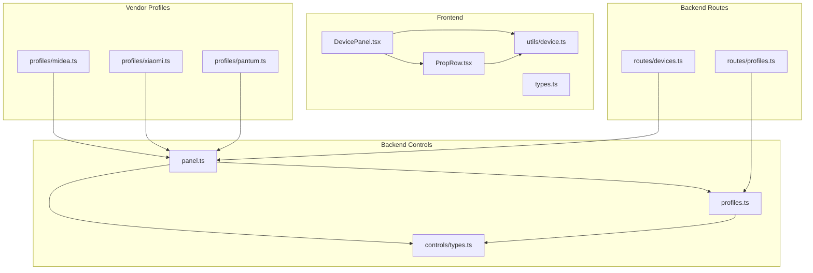
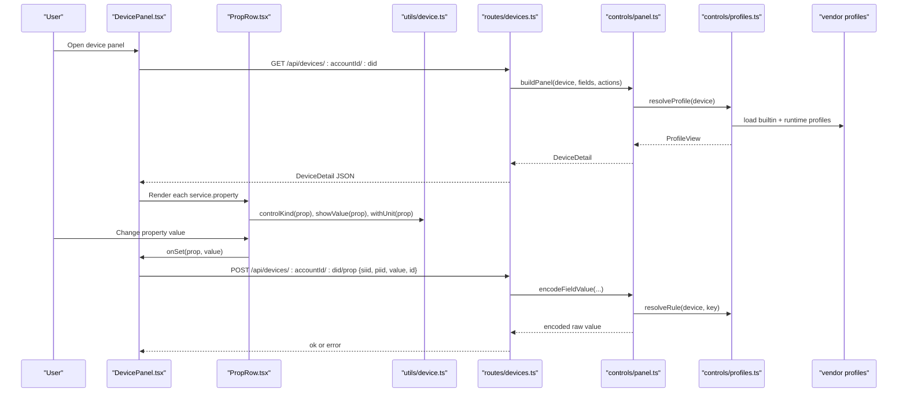
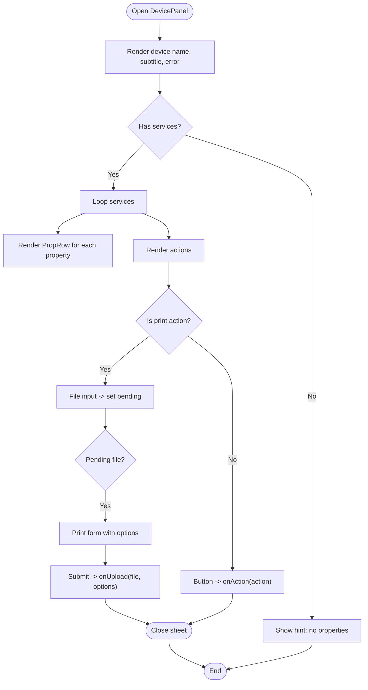
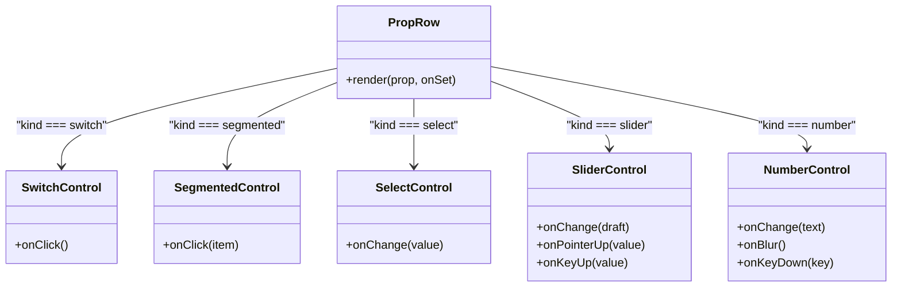
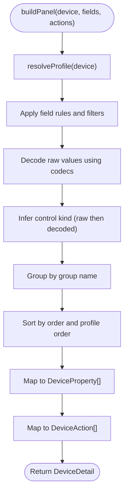
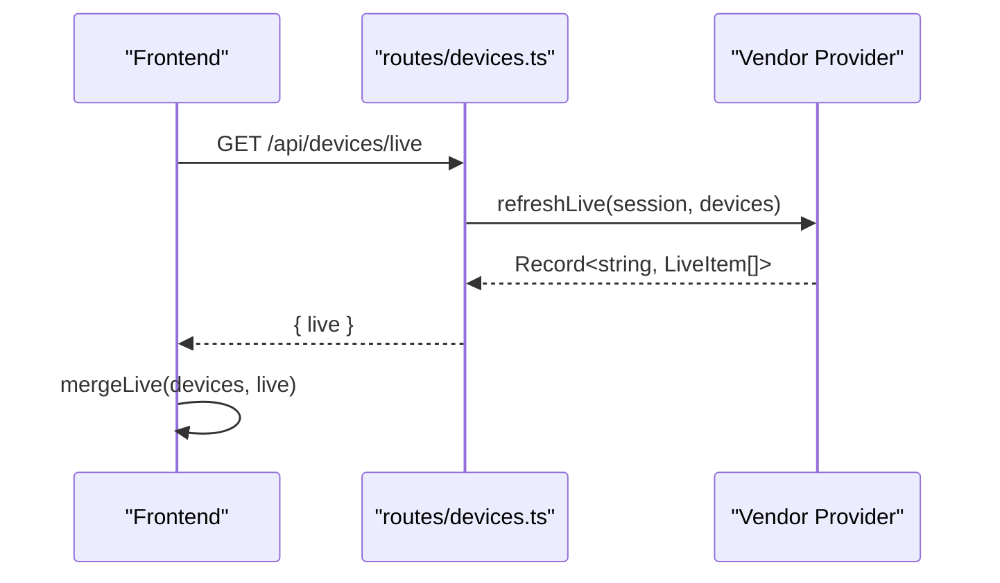
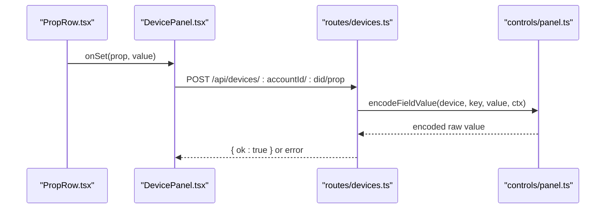
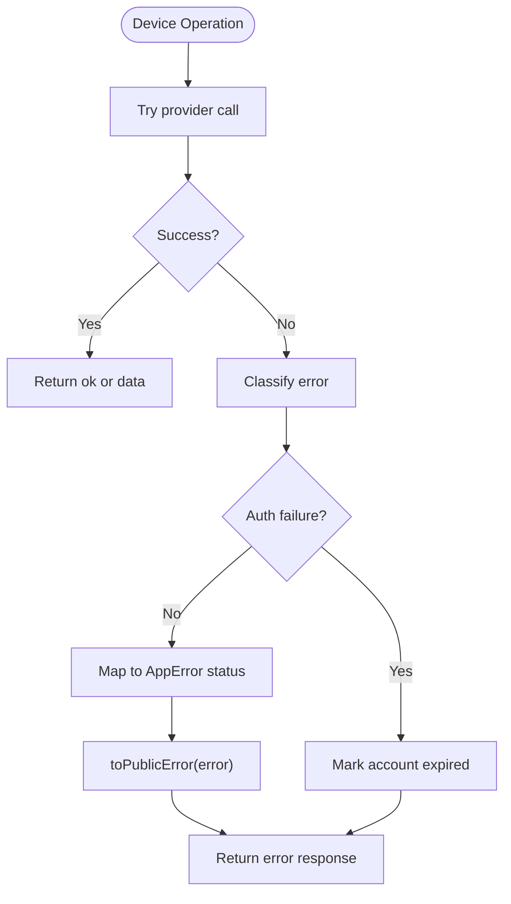
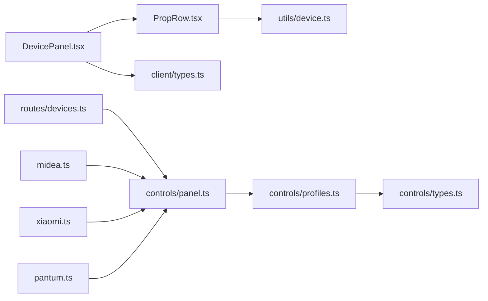

# Device Panel System

<cite>
**Referenced Files in This Document**
- [DevicePanel.tsx](file://client/src/components/DevicePanel.tsx)
- [PropRow.tsx](file://client/src/components/PropRow.tsx)
- [device.ts](file://client/src/utils/device.ts)
- [types.ts](file://client/src/types.ts)
- [panel.ts](file://src/controls/panel.ts)
- [profiles.ts](file://src/controls/profiles.ts)
- [types.ts](file://src/controls/types.ts)
- [midea.ts](file://src/controls/profiles/midea.ts)
- [xiaomi.ts](file://src/controls/profiles/xiaomi.ts)
- [pantum.ts](file://src/controls/profiles/pantum.ts)
- [devices.ts](file://src/routes/devices.ts)
- [profiles.ts](file://src/routes/profiles.ts)
</cite>

## Table of Contents
1. [Introduction](#introduction)
2. [Project Structure](#project-structure)
3. [Core Components](#core-components)
4. [Architecture Overview](#architecture-overview)
5. [Detailed Component Analysis](#detailed-component-analysis)
6. [Dependency Analysis](#dependency-analysis)
7. [Performance Considerations](#performance-considerations)
8. [Troubleshooting Guide](#troubleshooting-guide)
9. [Conclusion](#conclusion)

## Introduction
This document explains the dynamic device panel system that renders interactive control interfaces for smart devices based on vendor-specific profiles. It covers:
- How `DevicePanel` renders services, properties, and actions from a normalized device detail structure.
- How `PropRow` renders individual property controls such as switches, segmented selectors, sliders, numbers, and text.
- How device utility functions handle value formatting, unit display, control kind inference, live state merging, and API path generation.
- How backend profile resolution turns raw vendor fields into a consistent panel model with stable identifiers, groups, ordering, and control kinds.
- Examples of how different vendors (Midea, Xiaomi, Pantum) are rendered through profiles.
- Property validation, real-time status updates, backend integration, and error handling for device communication failures.

## Project Structure
The system is split between a React frontend and a Node.js backend:
- Frontend components render the device panel and property controls.
- Frontend utilities normalize values, infer control kinds, and merge live data.
- Backend controls layer resolves vendor profiles and builds a unified panel model.
- Backend routes expose device listing, live updates, property writes, actions, and profile management APIs.

**Diagram sources**
- [DevicePanel.tsx:74-165](file://client/src/components/DevicePanel.tsx#L74-L165)
- [PropRow.tsx:130-143](file://client/src/components/PropRow.tsx#L130-L143)
- [device.ts:3-68](file://client/src/utils/device.ts#L3-L68)
- [panel.ts:102-154](file://src/controls/panel.ts#L102-L154)
- [profiles.ts:74-129](file://src/controls/profiles.ts#L74-L129)
- [midea.ts:110-226](file://src/controls/profiles/midea.ts#L110-L226)
- [xiaomi.ts:8-40](file://src/controls/profiles/xiaomi.ts#L8-L40)
- [pantum.ts:4-15](file://src/controls/profiles/pantum.ts#L4-L15)
- [devices.ts:21-177](file://src/routes/devices.ts#L21-L177)
- [profiles.ts:17-87](file://src/routes/profiles.ts#L17-L87)

**Section sources**
- [DevicePanel.tsx:74-165](file://client/src/components/DevicePanel.tsx#L74-L165)
- [panel.ts:102-154](file://src/controls/panel.ts#L102-L154)
- [profiles.ts:74-129](file://src/controls/profiles.ts#L74-L129)
- [devices.ts:21-177](file://src/routes/devices.ts#L21-L177)

## Core Components
- `DevicePanel`: Renders a modal-like panel showing device name, subtitle, errors, services, properties, and actions. It also handles print file selection and printing options.
- `PropRow`: Renders a single property row with a label and an appropriate control based on inferred or declared control kind.
- `device.ts`: Provides helpers for units, formatted display values, control kind inference, live state merging, and device path construction.
- `panel.ts`: Builds the final panel model by resolving vendor profiles, applying field rules, determining control kinds, grouping, ordering, and encoding values for writes.
- `profiles.ts`: Loads built-in and runtime profiles, merges them by tier and specificity, and exposes rule resolution, ordering, grouping, and action overrides.
- Vendor profiles (`midea.ts`, `xiaomi.ts`, `pantum.ts`): Define labels, groups, field rules, ranges, options, and actions per vendor and device type.

**Section sources**
- [DevicePanel.tsx:74-215](file://client/src/components/DevicePanel.tsx#L74-L215)
- [PropRow.tsx:12-143](file://client/src/components/PropRow.tsx#L12-L143)
- [device.ts:3-68](file://client/src/utils/device.ts#L3-L68)
- [panel.ts:12-166](file://src/controls/panel.ts#L12-L166)
- [profiles.ts:74-195](file://src/controls/profiles.ts#L74-L195)
- [midea.ts:110-226](file://src/controls/profiles/midea.ts#L110-L226)
- [xiaomi.ts:8-40](file://src/controls/profiles/xiaomi.ts#L8-L40)
- [pantum.ts:4-15](file://src/controls/profiles/pantum.ts#L4-L15)

## Architecture Overview
The panel rendering pipeline connects frontend UI to backend profile resolution:

**Diagram sources**
- [DevicePanel.tsx:120-165](file://client/src/components/DevicePanel.tsx#L120-L165)
- [PropRow.tsx:130-143](file://client/src/components/PropRow.tsx#L130-L143)
- [device.ts:35-53](file://client/src/utils/device.ts#L35-L53)
- [devices.ts:64-92](file://src/routes/devices.ts#L64-L92)
- [panel.ts:102-166](file://src/controls/panel.ts#L102-L166)
- [profiles.ts:74-129](file://src/controls/profiles.ts#L74-L129)

## Detailed Component Analysis

### DevicePanel Rendering Flow
`DevicePanel` receives a normalized `DeviceDetail` containing:
- `device`: basic device metadata.
- `services`: grouped properties and actions.

It renders:
- A header with device name and close button.
- A subtitle and error message.
- For each service:
  - A section heading.
  - Each property via `PropRow`.
  - Each action:
    - Special handling for print-related actions to open a file picker and print sheet.
    - Generic actions trigger `onAction`.

Print flow:
- File input selects a PDF or image.
- Print defaults are applied.
- Submit validates copies and calls `onUpload(file, options)`.
- Errors are displayed using `errorText`.

Keyboard and overlay behavior:
- Escape closes the panel unless a file is pending.
- Clicking outside the panel triggers close when not pending.

**Diagram sources**
- [DevicePanel.tsx:120-215](file://client/src/components/DevicePanel.tsx#L120-L215)

**Section sources**
- [DevicePanel.tsx:74-215](file://client/src/components/DevicePanel.tsx#L74-L215)

### PropRow Control Rendering
`PropRow` determines the control kind using `controlKind(prop)` and renders:
- Switch: toggle boolean-like properties.
- Segmented: small list of short labels.
- Select: larger lists or long labels.
- Slider: numeric range with step.
- Number: typed numeric input with min/max/step.
- Text: read-only display.

Control kind inference:
- Prefers explicit `kind`.
- Falls back to format, list, range, and current value semantics.
- Non-writable properties become text.

Validation and UX:
- Slider uses draft state and debounced commit on pointer up or keyup.
- Number input validates numeric format and clamps to range.
- Units are shown where applicable.

**Diagram sources**
- [PropRow.tsx:12-143](file://client/src/components/PropRow.tsx#L12-L143)

**Section sources**
- [PropRow.tsx:12-143](file://client/src/components/PropRow.tsx#L12-L143)
- [device.ts:35-53](file://client/src/utils/device.ts#L35-L53)

### Device Utility Functions
Key utilities:
- `unitOf(prop)`: infers unit from prop.unit or name patterns.
- `withUnit(prop, value)`: formats numeric values with units.
- `showValue(prop)`: displays human-readable values, including mapped names, booleans, and units.
- `controlKind(prop)`: infers control kind from kind, writable, list, range, format, and value.
- `mergeLive(devices, live)`: merges live chips into device objects.
- `devicePath(accountId, did)`: constructs API path for device detail.

These functions ensure consistent display and interaction across different device types.

**Section sources**
- [device.ts:3-68](file://client/src/utils/device.ts#L3-L68)

### Backend Profile Resolution and Panel Building
`buildPanel` is the central function that transforms vendor-provided raw fields into a panel-ready structure:
- Resolves the effective profile for the device.
- Applies field rules, including labels, units, ranges, options, and codecs.
- Determines control kind using both raw and decoded values.
- Groups fields and orders them according to profile configuration.
- Maps actions with labels and ordering.
- Produces `DeviceDetail` with stable IDs, si/pi identifiers, and normalized properties.

Encoding for writes:
- `encodeFieldValue` re-applies the same control kind inference and codec selection to convert UI values back to vendor-specific raw values.

**Diagram sources**
- [panel.ts:102-154](file://src/controls/panel.ts#L102-L154)
- [panel.ts:161-166](file://src/controls/panel.ts#L161-L166)
- [profiles.ts:74-129](file://src/controls/profiles.ts#L74-L129)

**Section sources**
- [panel.ts:12-166](file://src/controls/panel.ts#L12-L166)
- [profiles.ts:74-195](file://src/controls/profiles.ts#L74-L195)

### Vendor-Specific Profiles and Examples

#### Midea
- Defines labels for many lua field names.
- Groups fields into “控制” (control) and “读数” (readout).
- Uses codecs like `map` and `shapenum` to translate codes and shapes.
- Applies ranges and steps for temperature and fan speed.
- Overrides for AC, fridge, and washer models.

Examples:
- Temperature fields use sliders with degree units.
- Mode and program fields use map codecs to show readable names.
- Time fields are read-only and formatted as durations.

**Section sources**
- [midea.ts:1-226](file://src/controls/profiles/midea.ts#L1-L226)

#### Xiaomi
- Relies on MIoT spec constraints provided by the adapter.
- Adds units and preferred control kinds for brightness, color temperature, fan level, and temperatures.
- Orders common properties for lights, fans, and vacuums.
- Renames vacuum actions to friendly labels.

**Section sources**
- [xiaomi.ts:1-40](file://src/controls/profiles/xiaomi.ts#L1-L40)

#### Pantum
- Exposes serial number and cloud status as readout fields.
- Declares a print action labeled “上传打印”.
- Integrates with the print upload flow in `DevicePanel`.

**Section sources**
- [pantum.ts:1-15](file://src/controls/profiles/pantum.ts#L1-L15)

### Real-Time Status Updates
Real-time updates are handled by:
- Backend `/api/devices/live` endpoint aggregating live chips per account and device.
- Frontend merging live chips into device objects using `mergeLive`.
- Displaying live chips in device summaries and panels.

**Diagram sources**
- [devices.ts:46-62](file://src/routes/devices.ts#L46-L62)
- [device.ts:59-64](file://client/src/utils/device.ts#L59-L64)

**Section sources**
- [devices.ts:46-62](file://src/routes/devices.ts#L46-L62)
- [device.ts:59-64](file://client/src/utils/device.ts#L59-L64)

### Property Validation and Writeback
Property writeback involves:
- Frontend validating user input (e.g., numeric format, range clamping).
- Sending `{ siid, piid, value, id }` to `/api/devices/:accountId/:did/prop`.
- Backend decoding the value using the same control kind and codec rules.
- Returning success or error responses.

**Diagram sources**
- [PropRow.tsx:95-128](file://client/src/components/PropRow.tsx#L95-L128)
- [devices.ts:79-92](file://src/routes/devices.ts#L79-L92)
- [panel.ts:161-166](file://src/controls/panel.ts#L161-L166)

**Section sources**
- [PropRow.tsx:95-128](file://client/src/components/PropRow.tsx#L95-L128)
- [devices.ts:79-92](file://src/routes/devices.ts#L79-L92)
- [panel.ts:161-166](file://src/controls/panel.ts#L161-L166)

### Integration with Backend Profile System
Profile management endpoints:
- `GET /api/profiles/options`: returns available codecs, control kinds, and profile directory.
- `GET /api/profiles`: lists profiles filtered by vendor.
- `GET /api/profiles/devices`: lists devices under logged-in accounts.
- `GET /api/profiles/resolve`: resolves effective profile chain and merged rules for a device.
- `PUT /api/profiles`: saves a profile to disk.

These endpoints allow administrators to inspect and adjust how devices are rendered without changing code.

**Section sources**
- [profiles.ts:17-87](file://src/routes/profiles.ts#L17-L87)
- [profiles.ts:131-143](file://src/controls/profiles.ts#L131-L143)

### Error Handling for Device Communication Failures
Error handling spans multiple layers:
- Device listing catches provider errors, marks accounts as expired when authentication fails, and aggregates warnings.
- Device detail, property writes, and actions return public-safe error objects with HTTP status codes.
- Print upload validates multipart content, file size, and presence of a file, returning structured errors.
- Frontend displays errors via `errorText` and inline messages in the panel.

**Diagram sources**
- [devices.ts:21-44](file://src/routes/devices.ts#L21-L44)
- [devices.ts:64-92](file://src/routes/devices.ts#L64-L92)
- [devices.ts:94-110](file://src/routes/devices.ts#L94-L110)

**Section sources**
- [devices.ts:21-44](file://src/routes/devices.ts#L21-L44)
- [devices.ts:64-110](file://src/routes/devices.ts#L64-L110)

## Dependency Analysis
The system exhibits clear separation of concerns:
- Frontend components depend on normalized data structures and utility functions.
- Backend controls layer depends on vendor adapters and profile definitions.
- Vendor profiles define presentation semantics independent of adapter implementation details.
- Routes orchestrate session, provider calls, and error mapping.

**Diagram sources**
- [DevicePanel.tsx:1-5](file://client/src/components/DevicePanel.tsx#L1-L5)
- [PropRow.tsx:1-4](file://client/src/components/PropRow.tsx#L1-L4)
- [device.ts:1-1](file://client/src/utils/device.ts#L1-L1)
- [types.ts:61-96](file://client/src/types.ts#L61-L96)
- [devices.ts:1-8](file://src/routes/devices.ts#L1-L8)
- [panel.ts:1-6](file://src/controls/panel.ts#L1-L6)
- [profiles.ts:1-4](file://src/controls/profiles.ts#L1-L4)
- [types.ts:1-114](file://src/controls/types.ts#L1-L114)
- [midea.ts:1-2](file://src/controls/profiles/midea.ts#L1-L2)
- [xiaomi.ts:1-2](file://src/controls/profiles/xiaomi.ts#L1-L2)
- [pantum.ts:1-2](file://src/controls/profiles/pantum.ts#L1-L2)

**Section sources**
- [types.ts:61-96](file://client/src/types.ts#L61-L96)
- [types.ts:1-114](file://src/controls/types.ts#L1-L114)

## Performance Considerations
- Debounced commits for sliders reduce unnecessary network requests during rapid changes.
- Profile loading caches runtime profiles by filesystem timestamp to avoid repeated parsing.
- Live updates aggregate per-account results and ignore individual provider failures to keep the UI responsive.
- Frontend avoids re-rendering unchanged values by comparing stringified drafts and current values.

[No sources needed since this section provides general guidance]

## Troubleshooting Guide
Common issues and resolutions:
- Property shows as text instead of slider:
  - Check if the field is marked writable; non-writable fields default to text.
  - Verify range and step configuration in the profile.
- Value displays incorrectly:
  - Ensure the correct codec is configured (e.g., `map`, `shapenum`).
  - Confirm unit settings match expected display.
- Print upload fails:
  - Validate file size limit and MIME type.
  - Ensure only one file is uploaded and it is selected.
- Real-time status not updating:
  - Confirm `/api/devices/live` returns data for the device.
  - Check that `mergeLive` is called with correct device keys.

**Section sources**
- [devices.ts:94-162](file://src/routes/devices.ts#L94-L162)
- [panel.ts:35-53](file://src/controls/panel.ts#L35-L53)
- [device.ts:3-26](file://client/src/utils/device.ts#L3-L26)

## Conclusion
The dynamic device panel system combines vendor-neutral UI components with flexible, layered profile configurations to render consistent control interfaces across diverse devices. The architecture cleanly separates presentation, normalization, and vendor-specific logic, enabling maintainable extensions and robust error handling. By leveraging profiles, the system adapts to vendor quirks while providing a uniform experience for users managing smart devices.