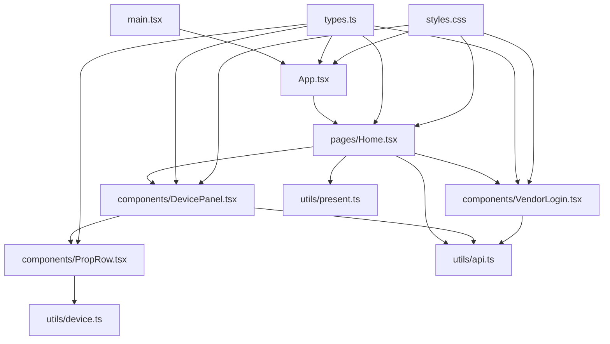
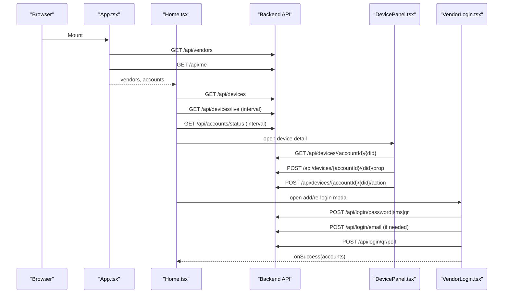
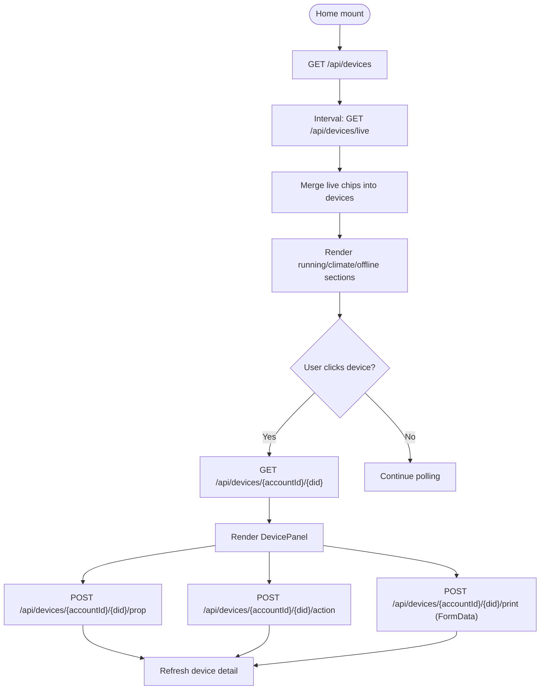
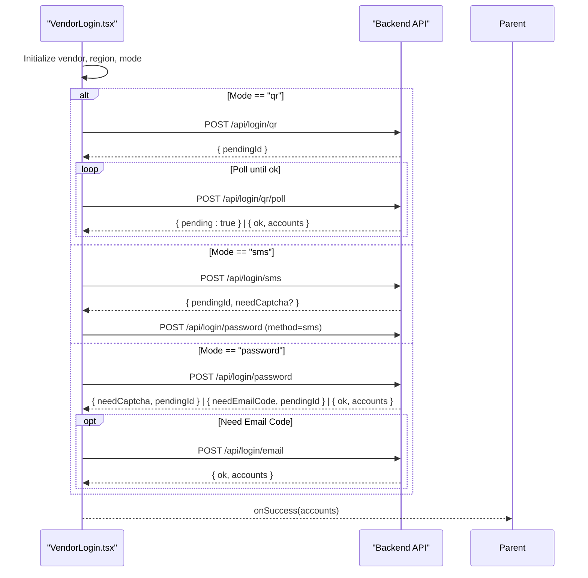
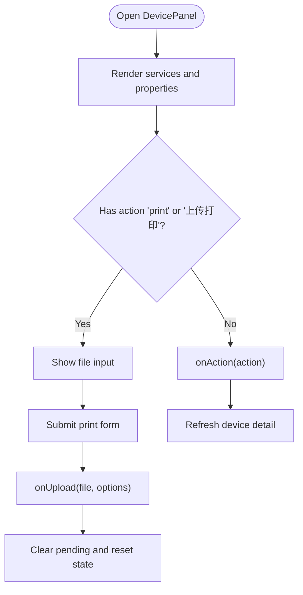
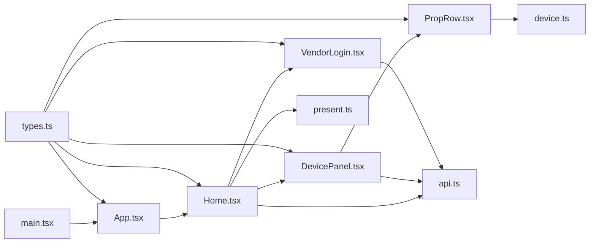

# Frontend Application

<cite>
**Referenced Files in This Document**
- [main.tsx](file://client/src/main.tsx)
- [App.tsx](file://client/src/App.tsx)
- [Home.tsx](file://client/src/pages/Home.tsx)
- [VendorLogin.tsx](file://client/src/components/VendorLogin.tsx)
- [DevicePanel.tsx](file://client/src/components/DevicePanel.tsx)
- [PropRow.tsx](file://client/src/components/PropRow.tsx)
- [api.ts](file://client/src/utils/api.ts)
- [device.ts](file://client/src/utils/device.ts)
- [present.ts](file://client/src/utils/present.ts)
- [types.ts](file://client/src/types.ts)
- [styles.css](file://client/src/styles.css)
</cite>

## Table of Contents
1. [Introduction](#introduction)
2. [Project Structure](#project-structure)
3. [Core Components](#core-components)
4. [Architecture Overview](#architecture-overview)
5. [Detailed Component Analysis](#detailed-component-analysis)
6. [Dependency Analysis](#dependency-analysis)
7. [Performance Considerations](#performance-considerations)
8. [Troubleshooting Guide](#troubleshooting-guide)
9. [Conclusion](#conclusion)
10. [Appendices](#appendices)

## Introduction
This document explains the React-based frontend application that provides a unified dashboard for multiple smart home vendors. It covers:
- The main application shell and how vendor accounts are initialized.
- Page-level routing through a single-page layout with state-driven views.
- Reusable UI components for device control, property editing, and login flows.
- The dynamic device panel system that renders controls based on vendor profiles.
- The API utility layer for HTTP requests, authentication state handling, and error formatting.
- Styling conventions using global CSS with responsive design patterns.
- Guidelines for extending the UI with new components and integrating additional vendor-specific features.

## Project Structure
The frontend is organized by feature areas under `client/src`:
- Entry point and root component: `main.tsx`, `App.tsx`
- Pages: `pages/Home.tsx`
- Shared components: `components/DevicePanel.tsx`, `components/VendorLogin.tsx`, `components/PropRow.tsx`, `components/ApiKeyManager.tsx`
- Utilities: `utils/api.ts`, `utils/device.ts`, `utils/present.ts`
- Types: `types.ts`
- Styles: `styles.css`

**Diagram sources**
- [main.tsx:1-14](file://client/src/main.tsx#L1-L14)
- [App.tsx:1-62](file://client/src/App.tsx#L1-L62)
- [Home.tsx:1-511](file://client/src/pages/Home.tsx#L1-L511)
- [DevicePanel.tsx:1-216](file://client/src/components/DevicePanel.tsx#L1-L216)
- [VendorLogin.tsx:1-278](file://client/src/components/VendorLogin.tsx#L1-L278)
- [PropRow.tsx:1-144](file://client/src/components/PropRow.tsx#L1-L144)
- [api.ts:1-33](file://client/src/utils/api.ts#L1-L33)
- [device.ts:1-69](file://client/src/utils/device.ts#L1-L69)
- [present.ts:1-229](file://client/src/utils/present.ts#L1-L229)
- [types.ts:1-141](file://client/src/types.ts#L1-L141)
- [styles.css:1-481](file://client/src/styles.css#L1-L481)

**Section sources**
- [main.tsx:1-14](file://client/src/main.tsx#L1-L14)
- [App.tsx:1-62](file://client/src/App.tsx#L1-L62)
- [Home.tsx:1-511](file://client/src/pages/Home.tsx#L1-L511)

## Core Components
- Root entry and app shell:
  - `main.tsx` mounts the React root and renders `<App />`.
  - `App.tsx` fetches vendor metadata and current accounts, then renders the `Home` page.
- Page view:
  - `Home.tsx` manages device lists, live updates, account status polling, vendor filtering, room filtering, and orchestrates device detail panels and login modals.
- Login flow:
  - `VendorLogin.tsx` supports multi-factor authentication modes (password, SMS, QR), region selection, captcha handling, email verification, and session success callbacks.
- Device control:
  - `DevicePanel.tsx` renders services, properties, actions, and a print sheet form for supported devices.
  - `PropRow.tsx` renders property controls (switch, segmented, select, slider, number, text).
- Utilities:
  - `api.ts` wraps fetch calls, handles JSON responses, errors, and provides Bearer token helpers.
  - `device.ts` formats values, infers control kinds, merges live data, and builds device paths.
  - `present.ts` formats display labels, summarizes climate data, and derives running device views.
- Types:
  - `types.ts` defines shared interfaces for accounts, devices, properties, actions, sessions, API keys, and audit rows.

**Section sources**
- [main.tsx:1-14](file://client/src/main.tsx#L1-L14)
- [App.tsx:1-62](file://client/src/App.tsx#L1-L62)
- [Home.tsx:1-511](file://client/src/pages/Home.tsx#L1-L511)
- [VendorLogin.tsx:1-278](file://client/src/components/VendorLogin.tsx#L1-L278)
- [DevicePanel.tsx:1-216](file://client/src/components/DevicePanel.tsx#L1-L216)
- [PropRow.tsx:1-144](file://client/src/components/PropRow.tsx#L1-L144)
- [api.ts:1-33](file://client/src/utils/api.ts#L1-L33)
- [device.ts:1-69](file://client/src/utils/device.ts#L1-L69)
- [present.ts:1-229](file://client/src/utils/present.ts#L1-L229)
- [types.ts:1-141](file://client/src/types.ts#L1-L141)

## Architecture Overview
The frontend follows a unidirectional data flow:
- `App` initializes vendor info and accounts via `/api/vendors` and `/api/me`.
- `Home` polls `/api/devices/live` for live updates and `/api/accounts/status` for account health.
- User interactions trigger device property writes or actions via per-device endpoints.
- Vendor login uses `/api/login/*` endpoints to support password, SMS, and QR flows.
- UI rendering is driven by typed data models and presentation utilities.

**Diagram sources**
- [App.tsx:31-60](file://client/src/App.tsx#L31-L60)
- [Home.tsx:35-123](file://client/src/pages/Home.tsx#L35-L123)
- [Home.tsx:125-208](file://client/src/pages/Home.tsx#L125-L208)
- [VendorLogin.tsx:81-202](file://client/src/components/VendorLogin.tsx#L81-L202)
- [DevicePanel.tsx:120-215](file://client/src/components/DevicePanel.tsx#L120-L215)

## Detailed Component Analysis

### App Component
Responsibilities:
- Fetch vendor metadata and merge fallback vendors if backend returns none.
- Fetch current user’s accounts and render the `Home` page once ready.
- Provide vendor list and account list to child components.

Key behaviors:
- Uses `api` to call `/api/vendors` and `/api.me`.
- Ensures Midea vendor is present in the list.
- Renders `null` until both vendor and account data are loaded.

**Section sources**
- [App.tsx:1-62](file://client/src/App.tsx#L1-L62)

### Home Page
Responsibilities:
- Manage device inventory, live telemetry, and account status.
- Filter devices by vendor and room.
- Render running devices, climate sensors, offline devices, and summary metrics.
- Open device details in a side panel and handle property/action operations.
- Launch vendor login modal for adding or re-authenticating accounts.

Key behaviors:
- Polls `/api/devices/live` every 8 seconds and merges live chips into device state.
- Polls `/api/accounts/status` every 5 minutes to refresh account states.
- Opens device detail via `/api/devices/{accountId}/{did}`.
- Writes properties via `/api/devices/{accountId}/{did}/prop`.
- Executes actions via `/api/devices/{accountId}/{did}/action`.
- Uploads print jobs via `/api/devices/{accountId}/{did}/print` with FormData.
- Unlinks accounts via `/api/logout`.

**Diagram sources**
- [Home.tsx:35-123](file://client/src/pages/Home.tsx#L35-L123)
- [Home.tsx:125-208](file://client/src/pages/Home.tsx#L125-L208)

**Section sources**
- [Home.tsx:1-511](file://client/src/pages/Home.tsx#L1-L511)

### VendorLogin Component
Responsibilities:
- Handle multi-factor authentication flows across vendors.
- Support password, SMS, and QR login modes.
- Manage captcha images, email verification codes, pending IDs, and polling for QR completion.
- On success, return updated accounts to parent.

Key behaviors:
- Selects default mode based on vendor configuration.
- Sends SMS code via `/api/login/sms`.
- Submits credentials via `/api/login/password`.
- Handles email verification via `/api/login/email`.
- Starts QR poll loop via `/api/login/qr/poll`.
- Displays QR image via `/api/login/qr/image?pendingId=...`.

**Diagram sources**
- [VendorLogin.tsx:81-202](file://client/src/components/VendorLogin.tsx#L81-L202)

**Section sources**
- [VendorLogin.tsx:1-278](file://client/src/components/VendorLogin.tsx#L1-L278)

### DevicePanel Component
Responsibilities:
- Render device services, properties, and actions.
- Provide a print sheet form for supported actions.
- Manage close animations, keyboard shortcuts, and error display.

Key behaviors:
- Detects print-related actions and opens a file picker.
- Validates print options and submits via `onUpload`.
- Closes on Escape key or backdrop click when not uploading.

**Diagram sources**
- [DevicePanel.tsx:120-215](file://client/src/components/DevicePanel.tsx#L120-L215)

**Section sources**
- [DevicePanel.tsx:1-216](file://client/src/components/DevicePanel.tsx#L1-L216)

### PropRow Component
Responsibilities:
- Render property controls based on inferred or explicit control kind.
- Support switch, segmented, select, slider, number, and text displays.
- Debounce slider changes and validate number inputs.

Key behaviors:
- Infers control kind from `kind`, `format`, `list`, `range`, and boolean semantics.
- Formats values with units where applicable.
- Commits changes only when value differs from server state.

**Section sources**
- [PropRow.tsx:1-144](file://client/src/components/PropRow.tsx#L1-L144)
- [device.ts:1-69](file://client/src/utils/device.ts#L1-L69)

### API Utility Layer
Responsibilities:
- Provide typed wrappers around `fetch` for JSON and form submissions.
- Normalize error messages and throw consistent errors.
- Support Bearer token authorization for open APIs.

Key functions:
- `api<T>`: JSON request/response with same-origin credentials.
- `apiBearer<T>`: Authorization header with Bearer token.
- `apiForm<T>`: FormData submission.
- `errorText`: Extracts message from Error objects.

**Section sources**
- [api.ts:1-33](file://client/src/utils/api.ts#L1-L33)

### Styling Approach
- Global CSS variables define colors, typography, and spacing.
- Layout uses CSS Grid for app shell and responsive breakpoints.
- Animations provide smooth transitions for panels, sheets, and row entries.
- Accessibility considerations include roles and aria attributes for switches and radiogroups.

Responsive highlights:
- Single-column layout on small screens.
- Sticky sidebar collapses to static positioning.
- Reduced motion media query disables animations for accessibility.

**Section sources**
- [styles.css:1-481](file://client/src/styles.css#L1-L481)

## Dependency Analysis
Component relationships and imports:

**Diagram sources**
- [main.tsx:1-14](file://client/src/main.tsx#L1-L14)
- [App.tsx:1-62](file://client/src/App.tsx#L1-L62)
- [Home.tsx:1-511](file://client/src/pages/Home.tsx#L1-L511)
- [DevicePanel.tsx:1-216](file://client/src/components/DevicePanel.tsx#L1-L216)
- [VendorLogin.tsx:1-278](file://client/src/components/VendorLogin.tsx#L1-L278)
- [PropRow.tsx:1-144](file://client/src/components/PropRow.tsx#L1-L144)
- [api.ts:1-33](file://client/src/utils/api.ts#L1-L33)
- [device.ts:1-69](file://client/src/utils/device.ts#L1-L69)
- [present.ts:1-229](file://client/src/utils/present.ts#L1-L229)
- [types.ts:1-141](file://client/src/types.ts#L1-L141)

Coupling and cohesion:
- `Home` is the central orchestrator but remains cohesive by delegating specific concerns to `DevicePanel` and `VendorLogin`.
- `DevicePanel` depends on `PropRow` for property rendering, keeping control logic modular.
- Utilities (`api`, `device`, `present`) are pure and reusable, minimizing cross-component coupling.
- Types are centralized to ensure consistency across components.

Potential circular dependencies:
- None observed; imports are directional from pages/components to utilities and types.

External integration points:
- Backend REST endpoints for vendors, devices, live telemetry, account status, and login flows.
- Open API endpoints for device information distribution using Bearer tokens.

**Section sources**
- [Home.tsx:1-511](file://client/src/pages/Home.tsx#L1-L511)
- [DevicePanel.tsx:1-216](file://client/src/components/DevicePanel.tsx#L1-L216)
- [VendorLogin.tsx:1-278](file://client/src/components/VendorLogin.tsx#L1-L278)
- [PropRow.tsx:1-144](file://client/src/components/PropRow.tsx#L1-L144)
- [api.ts:1-33](file://client/src/utils/api.ts#L1-L33)
- [device.ts:1-69](file://client/src/utils/device.ts#L1-L69)
- [present.ts:1-229](file://client/src/utils/present.ts#L1-L229)
- [types.ts:1-141](file://client/src/types.ts#L1-L141)

## Performance Considerations
- Polling intervals:
  - Live telemetry updates every 8 seconds; consider throttling or debouncing if device count grows significantly.
  - Account status checks every 5 minutes; acceptable for typical usage.
- State merging:
  - `mergeLive` maps over devices to attach live chips; complexity is O(n) per poll.
- UI rendering:
  - Avoid unnecessary re-renders by memoizing derived lists and using stable keys.
- Network efficiency:
  - Use conditional requests or caching strategies at the backend for `/api/devices/live`.
- Accessibility:
  - Respect `prefers-reduced-motion` to disable animations for users who prefer reduced motion.

[No sources needed since this section provides general guidance]

## Troubleshooting Guide
Common issues and resolutions:
- Authentication failures:
  - Check `/api/login/password`, `/api/login/sms`, and `/api/login/email` responses for `needCaptcha` or `needEmailCode`.
  - Ensure captcha images load correctly via `/api/login/captcha?pendingId=...`.
- QR login not completing:
  - Verify QR poll endpoint `/api/login/qr/poll` returns `{ pending: true }` until session is established.
- Device property write errors:
  - Inspect error messages returned by `/api/devices/{accountId}/{did}/prop`.
  - Validate property payloads match expected structure (`id`, `siid`, `piid`, `value`).
- Print upload failures:
  - Confirm FormData fields are correctly appended and accepted by `/api/devices/{accountId}/{did}/print`.
- Account status unknown:
  - Retry `/api/accounts/status`; transient network issues may delay status resolution.

Error handling patterns:
- `api.ts` throws consistent errors with normalized messages via `errorText`.
- Components catch errors and display user-friendly messages without crashing.

**Section sources**
- [api.ts:1-33](file://client/src/utils/api.ts#L1-L33)
- [VendorLogin.tsx:81-202](file://client/src/components/VendorLogin.tsx#L81-L202)
- [Home.tsx:125-208](file://client/src/pages/Home.tsx#L125-L208)

## Conclusion
The frontend application provides a robust, extensible interface for managing multiple smart home vendors. Its architecture separates concerns cleanly between orchestration (`Home`), device control (`DevicePanel` + `PropRow`), authentication (`VendorLogin`), and utilities (`api`, `device`, `present`). The styling approach emphasizes readability, responsiveness, and accessibility. Extending the system involves adding new vendor configurations, updating type definitions, and implementing vendor-specific providers on the backend while leveraging the existing UI patterns.

[No sources needed since this section summarizes without analyzing specific files]

## Appendices

### Guidelines for Extending the UI
- Adding a new vendor:
  - Update vendor metadata in `App.tsx` or backend `/api/vendors`.
  - Extend `types.ts` if new fields are required.
  - Implement vendor-specific provider logic on the backend; frontend will consume standardized device profiles.
- Adding a new property control:
  - Extend `controlKind` inference in `device.ts` if necessary.
  - Add a new control component in `PropRow.tsx` and wire it to the control kind.
  - Style the new control in `styles.css`.
- Integrating additional vendor-specific features:
  - Define new actions in backend device profiles.
  - Handle action execution in `Home.tsx` and `DevicePanel.tsx`.
  - Update presentation logic in `present.ts` if new device categories emerge.

[No sources needed since this section provides general guidance]