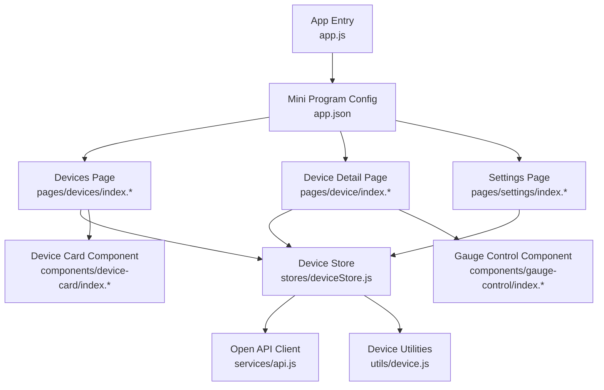
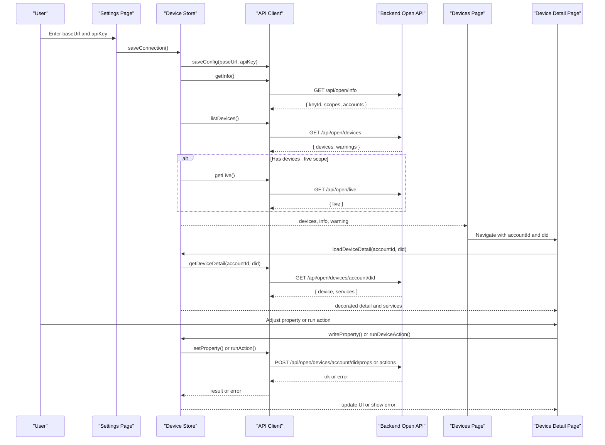
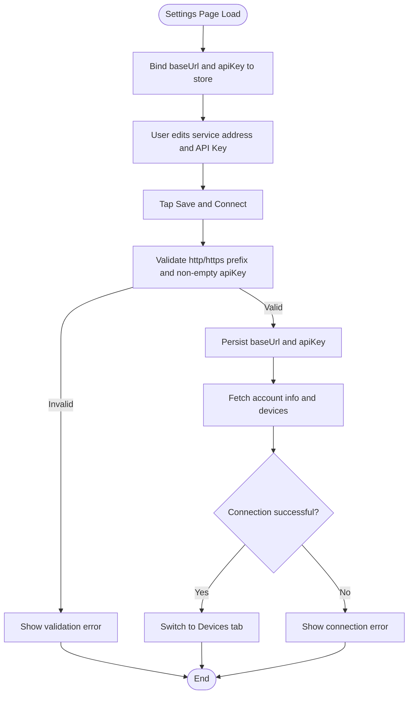
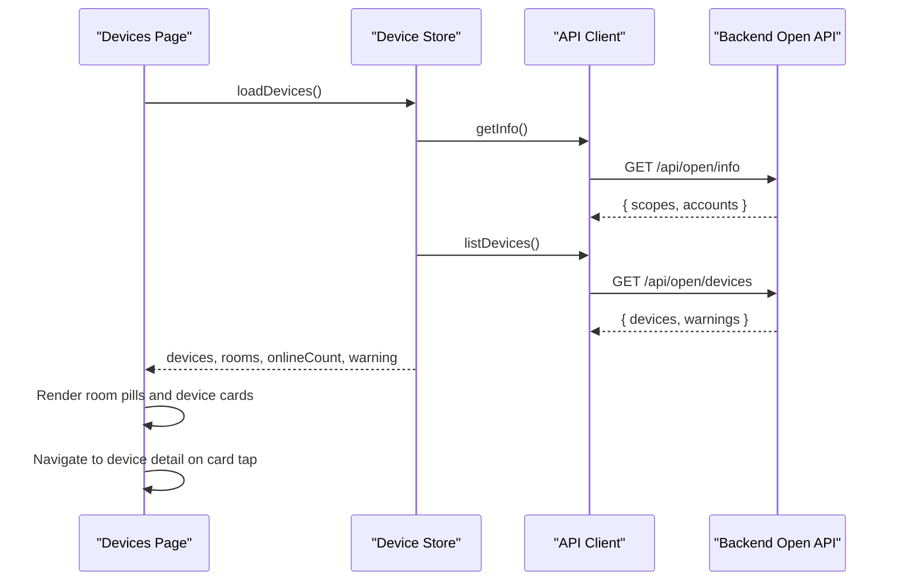
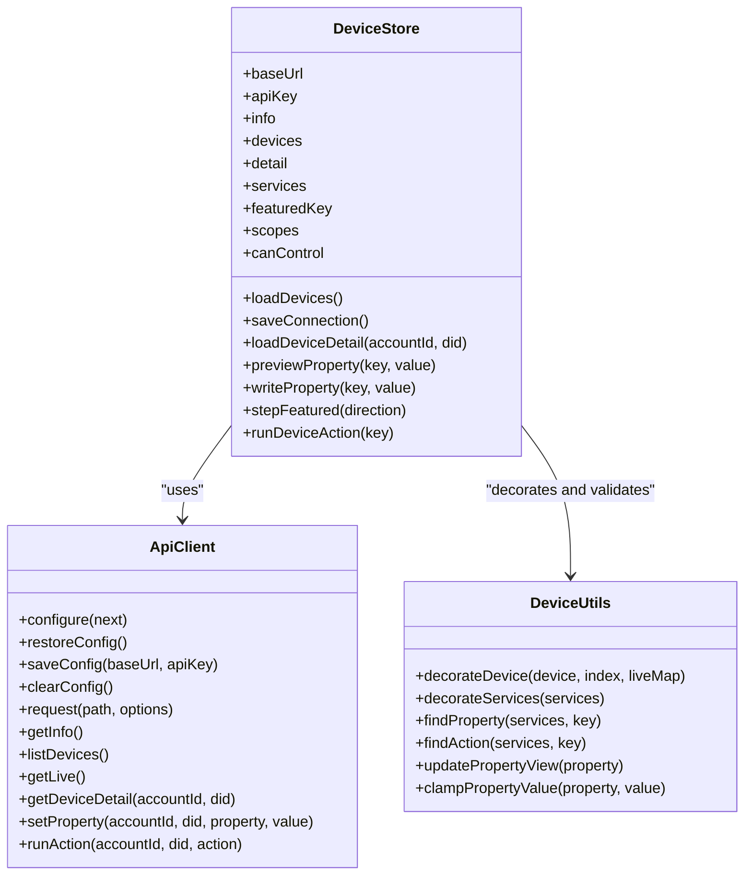
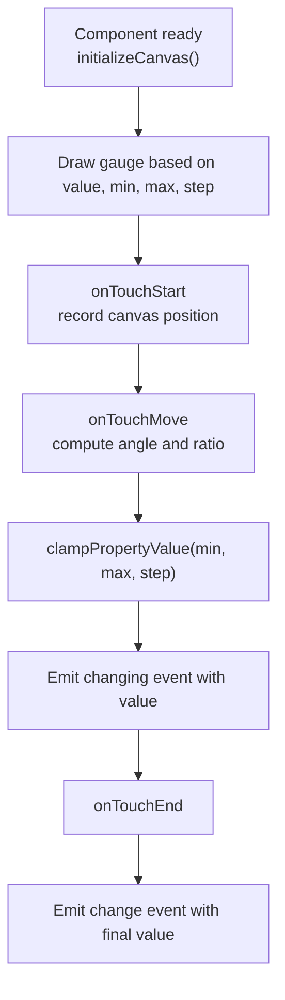
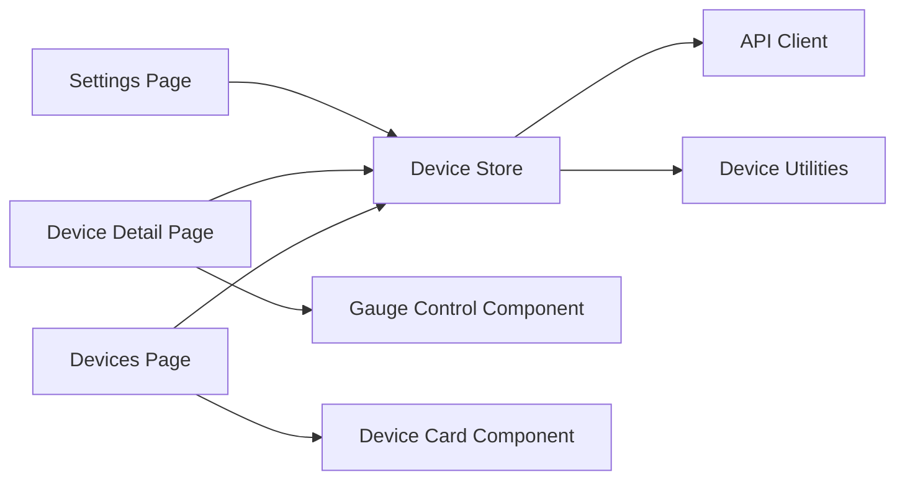

# WeChat Mini-Program Client

<cite>
**Referenced Files in This Document**
- [app.js](file://weapp/miniprogram/app.js)
- [app.json](file://weapp/miniprogram/app.json)
- [package.json](file://weapp/package.json)
- [api.js](file://weapp/miniprogram/services/api.js)
- [deviceStore.js](file://weapp/miniprogram/stores/deviceStore.js)
- [device.js](file://weapp/miniprogram/utils/device.js)
- [devices/index.js](file://weapp/miniprogram/pages/devices/index.js)
- [devices/index.wxml](file://weapp/miniprogram/pages/devices/index.wxml)
- [device/index.js](file://weapp/miniprogram/pages/device/index.js)
- [device/index.wxml](file://weapp/miniprogram/pages/device/index.wxml)
- [settings/index.js](file://weapp/miniprogram/pages/settings/index.js)
- [settings/index.wxml](file://weapp/miniprogram/pages/settings/index.wxml)
- [device-card/index.js](file://weapp/miniprogram/components/device-card/index.js)
- [gauge-control/index.js](file://weapp/miniprogram/components/gauge-control/index.js)
</cite>

## Table of Contents
1. [Introduction](#introduction)
2. [Project Structure](#project-structure)
3. [Core Components](#core-components)
4. [Architecture Overview](#architecture-overview)
5. [Detailed Component Analysis](#detailed-component-analysis)
6. [Dependency Analysis](#dependency-analysis)
7. [Performance Considerations](#performance-considerations)
8. [Troubleshooting Guide](#troubleshooting-guide)
9. [Conclusion](#conclusion)

## Introduction
This document describes the WeChat Mini-Program client for the Smart Home project. The mini-program is a read-and-control frontend that connects to an external backend through a Bearer API Key. It lists devices, groups them by room, shows device details with services and properties, supports live status when permitted, and allows property writes and actions when the API Key grants `devices:control`.

The client uses MobX for state management, stores connection configuration locally, and renders pages and reusable components using the standard WeChat Mini-Program structure.

## Project Structure
The WeChat Mini-Program lives under `weapp/miniprogram`. Its main runtime entry is `app.js`, while routing and tab configuration are declared in `app.json`. Dependencies such as MobX bindings are declared in `weapp/package.json`.

**Diagram sources**
- [app.js:1-6](file://weapp/miniprogram/app.js#L1-L6)
- [app.json:1-34](file://weapp/miniprogram/app.json#L1-L34)
- [devices/index.js:1-57](file://weapp/miniprogram/pages/devices/index.js#L1-L57)
- [device/index.js:1-59](file://weapp/miniprogram/pages/device/index.js#L1-L59)
- [settings/index.js:1-63](file://weapp/miniprogram/pages/settings/index.js#L1-L63)
- [deviceStore.js:1-279](file://weapp/miniprogram/stores/deviceStore.js#L1-L279)
- [api.js:1-74](file://weapp/miniprogram/services/api.js#L1-L74)
- [device.js:1-132](file://weapp/miniprogram/utils/device.js#L1-L132)
- [device-card/index.js:1-14](file://weapp/miniprogram/components/device-card/index.js#L1-L14)
- [gauge-control/index.js:1-158](file://weapp/miniprogram/components/gauge-control/index.js#L1-L158)

**Section sources**
- [app.js:1-6](file://weapp/miniprogram/app.js#L1-L6)
- [app.json:1-34](file://weapp/miniprogram/app.json#L1-L34)
- [package.json:1-14](file://weapp/package.json#L1-L14)

## Core Components
The mini-program is organized around four core layers:

- **Pages**: User-facing screens for device listing, device detail control, and service connection settings.
- **Store**: A single MobX observable store holding connection state, device list, device detail, permissions, and write actions.
- **API Client**: A thin HTTP wrapper that attaches the Bearer token, normalizes base URLs, persists configuration, and exposes typed helpers for open endpoints.
- **Utilities**: Helpers for decorating devices, inferring UI kinds, formatting values, clamping numeric ranges, and finding properties or actions.

Key responsibilities:

| Layer | Responsibility |
| --- | --- |
| Pages | Bind UI events to store actions, navigate between routes, and render data from the store. |
| Store | Manage loading states, fetch device info and live data, decorate raw responses, validate scopes, and perform controlled writes. |
| API Client | Normalize and persist `baseUrl` and `apiKey`, attach `Authorization: Bearer <key>`, and reject requests without a key. |
| Utilities | Convert backend device/service/property shapes into stable keys, display-friendly values, and UI hints such as slider range and step. |

**Section sources**
- [deviceStore.js:16-77](file://weapp/miniprogram/stores/deviceStore.js#L16-L77)
- [api.js:1-74](file://weapp/miniprogram/services/api.js#L1-L74)
- [device.js:21-132](file://weapp/miniprogram/utils/device.js#L21-L132)

## Architecture Overview
The mini-program follows a unidirectional data flow:

1. The user enters a service address and API Key on the Settings page.
2. The store validates and saves the configuration, then calls the open API to retrieve account information and device lists.
3. If the API Key includes `devices:live`, the store also fetches live status and merges it into each device.
4. The Devices page renders rooms and device cards; selecting a card navigates to the Device detail page.
5. The Device detail page decorates services and properties, optionally renders a gauge control for a featured writable property, and performs writes or actions after scope checks.

**Diagram sources**
- [settings/index.js:39-47](file://weapp/miniprogram/pages/settings/index.js#L39-L47)
- [deviceStore.js:142-163](file://weapp/miniprogram/stores/deviceStore.js#L142-L163)
- [deviceStore.js:96-140](file://weapp/miniprogram/stores/deviceStore.js#L96-L140)
- [deviceStore.js:185-212](file://weapp/miniprogram/stores/deviceStore.js#L185-L212)
- [deviceStore.js:221-275](file://weapp/miniprogram/stores/deviceStore.js#L221-L275)
- [api.js:43-74](file://weapp/miniprogram/services/api.js#L43-L74)

## Detailed Component Analysis

### Connection and Configuration Flow
The Settings page is the entry point for connecting the mini-program to the backend. It binds local inputs to the store, validates the URL format, persists the configuration, and triggers a connection attempt.

**Diagram sources**
- [settings/index.js:10-21](file://weapp/miniprogram/pages/settings/index.js#L10-L21)
- [settings/index.js:39-47](file://weapp/miniprogram/pages/settings/index.js#L39-L47)
- [deviceStore.js:142-163](file://weapp/miniprogram/stores/deviceStore.js#L142-L163)
- [api.js:22-35](file://weapp/miniprogram/services/api.js#L22-L35)

**Section sources**
- [settings/index.js:1-63](file://weapp/miniprogram/pages/settings/index.js#L1-L63)
- [settings/index.wxml:22-58](file://weapp/miniprogram/pages/settings/index.wxml#L22-L58)
- [deviceStore.js:142-183](file://weapp/miniprogram/stores/deviceStore.js#L142-L183)
- [api.js:10-35](file://weapp/miniprogram/services/api.js#L10-L35)

### Device Listing and Room Filtering
The Devices page loads the device list when the app is configured, displays room pills, and navigates to the device detail page on selection.

Key behaviors:
- On `onShow`, it reloads devices if already configured.
- Pull-to-refresh triggers another load.
- Room filtering is computed in the store via `filteredDevices`.
- Selecting a device navigates with encoded `accountId` and `did`.

**Diagram sources**
- [devices/index.js:4-56](file://weapp/miniprogram/pages/devices/index.js#L4-L56)
- [deviceStore.js:96-140](file://weapp/miniprogram/stores/deviceStore.js#L96-L140)
- [api.js:43-74](file://weapp/miniprogram/services/api.js#L43-L74)

**Section sources**
- [devices/index.js:1-57](file://weapp/miniprogram/pages/devices/index.js#L1-L57)
- [devices/index.wxml:44-94](file://weapp/miniprogram/pages/devices/index.wxml#L44-L94)
- [deviceStore.js:58-73](file://weapp/miniprogram/stores/deviceStore.js#L58-L73)

### Device Detail and Property Control
The Device detail page loads a single device’s services and properties, highlights a “featured” writable property suitable for quick adjustment, and supports switches, segmented options, sliders, text/number inputs, and actions.

Important logic:
- Decorated services select a featured property when there is a writable, ranged, slider-like property.
- Preview updates happen immediately; actual writes roll back on failure.
- Range values are clamped and stepped according to `rangeMin`, `rangeMax`, and `rangeStep`.
- Actions are guarded by `canControl` and device online status.

**Diagram sources**
- [deviceStore.js:16-279](file://weapp/miniprogram/stores/deviceStore.js#L16-L279)
- [api.js:1-74](file://weapp/miniprogram/services/api.js#L1-L74)
- [device.js:21-132](file://weapp/miniprogram/utils/device.js#L21-L132)

**Section sources**
- [device/index.js:1-59](file://weapp/miniprogram/pages/device/index.js#L1-L59)
- [device/index.wxml:17-178](file://weapp/miniprogram/pages/device/index.wxml#L17-L178)
- [deviceStore.js:185-275](file://weapp/miniprogram/stores/deviceStore.js#L185-L275)
- [device.js:34-132](file://weapp/miniprogram/utils/device.js#L34-L132)

### Gauge Control Component
The gauge component renders a circular progress arc and converts touch input into a clamped numeric value. It emits `changing` during drag and `change` on release.

**Diagram sources**
- [gauge-control/index.js:14-44](file://weapp/miniprogram/components/gauge-control/index.js#L14-L44)
- [gauge-control/index.js:46-108](file://weapp/miniprogram/components/gauge-control/index.js#L46-L108)
- [gauge-control/index.js:110-155](file://weapp/miniprogram/components/gauge-control/index.js#L110-L155)
- [device.js:113-121](file://weapp/miniprogram/utils/device.js#L113-L121)

**Section sources**
- [gauge-control/index.js:1-158](file://weapp/miniprogram/components/gauge-control/index.js#L1-L158)

### Device Card Component
The device card is a small presentational component that emits a `select` event carrying the bound device object.

**Section sources**
- [device-card/index.js:1-14](file://weapp/miniprogram/components/device-card/index.js#L1-L14)
- [devices/index.wxml:86-93](file://weapp/miniprogram/pages/devices/index.wxml#L86-L93)

## Dependency Analysis
The mini-program has a clear dependency direction:

- Pages depend on the store.
- The store depends on the API client and device utilities.
- The API client depends only on WeChat runtime APIs and local storage.
- Components are mostly presentational and depend on utilities only when needed.

**Diagram sources**
- [devices/index.js:1-57](file://weapp/miniprogram/pages/devices/index.js#L1-L57)
- [device/index.js:1-59](file://weapp/miniprogram/pages/device/index.js#L1-L59)
- [settings/index.js:1-63](file://weapp/miniprogram/pages/settings/index.js#L1-L63)
- [deviceStore.js:1-279](file://weapp/miniprogram/stores/deviceStore.js#L1-L279)
- [api.js:1-74](file://weapp/miniprogram/services/api.js#L1-L74)
- [device.js:1-132](file://weapp/miniprogram/utils/device.js#L1-L132)
- [device-card/index.js:1-14](file://weapp/miniprogram/components/device-card/index.js#L1-L14)
- [gauge-control/index.js:1-158](file://weapp/miniprogram/components/gauge-control/index.js#L1-L158)

**Section sources**
- [deviceStore.js:1-11](file://weapp/miniprogram/stores/deviceStore.js#L1-L11)
- [api.js:1-74](file://weapp/miniprogram/services/api.js#L1-L74)
- [device.js:1-132](file://weapp/miniprogram/utils/device.js#L1-L132)

## Performance Considerations
- **Generation counters**: The store uses `devicesGeneration` and `detailGeneration` to ignore stale responses after rapid navigation or reconnection.
- **Parallel fetching**: Device info and device lists are fetched concurrently; live data is fetched conditionally when permitted.
- **Local persistence**: Base URL and API Key are stored in WeChat sync storage to avoid repeated manual entry.
- **UI responsiveness**: Loading and busy states prevent duplicate writes and keep the interface responsive during network operations.
- **Range clamping**: Numeric inputs are clamped and stepped before sending to reduce invalid payloads and unnecessary retries.

[No sources needed since this section provides general guidance]

## Troubleshooting Guide
Common issues and their likely causes:

| Symptom | Likely Cause | Resolution |
| --- | --- | --- |
| Request fails with missing API Key | No API Key persisted or cleared | Re-enter the API Key on the Settings page and save. |
| Service address rejected | Missing `http://` or `https://` prefix | Add a valid protocol prefix to the service address. |
| Devices not loaded | Invalid API Key, wrong base URL, or no `devices:read` scope | Verify the backend URL, API Key, and granted scopes. |
| Live status unavailable | Missing `devices:live` scope | Enable the live scope in the backend key configuration. |
| Property write blocked | Missing `devices:control` scope or device offline | Grant control scope and ensure the device is online. |
| Write rolls back | Backend returned an error | Check the error message shown in the device detail page and retry. |
| Gauge does not respond | Component canvas not initialized or disabled | Ensure the device is online, the key has control permission, and the component is visible. |

Relevant implementation points:
- API request rejection without an API Key.
- Validation of the base URL and API Key before saving.
- Scope-based guards for live and control features.
- Error propagation from the API client to store fields and UI banners.

**Section sources**
- [api.js:43-67](file://weapp/miniprogram/services/api.js#L43-L67)
- [deviceStore.js:142-163](file://weapp/miniprogram/stores/deviceStore.js#L142-L163)
- [deviceStore.js:221-275](file://weapp/miniprogram/stores/deviceStore.js#L221-L275)
- [settings/index.wxml:87-111](file://weapp/miniprogram/pages/settings/index.wxml#L87-L111)

## Conclusion
The WeChat Mini-Program client provides a clean, scoped, and extensible interface for managing smart home devices through a backend open API. Its architecture separates presentation, state, networking, and utility concerns, making it straightforward to add new device types, adjust UI rendering, or extend permissions. For production use, developers should configure HTTPS, restrict API Key scopes to the minimum required, and handle network errors gracefully in both the mini-program and the backend.

[No sources needed since this section summarizes without analyzing specific files]