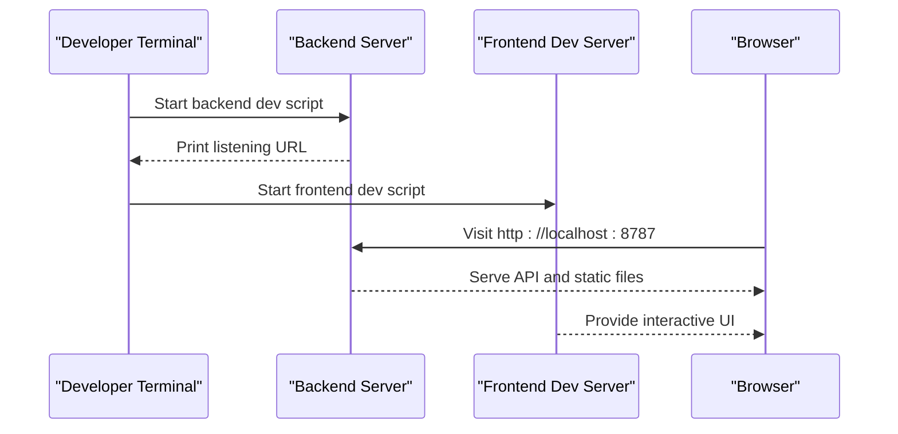
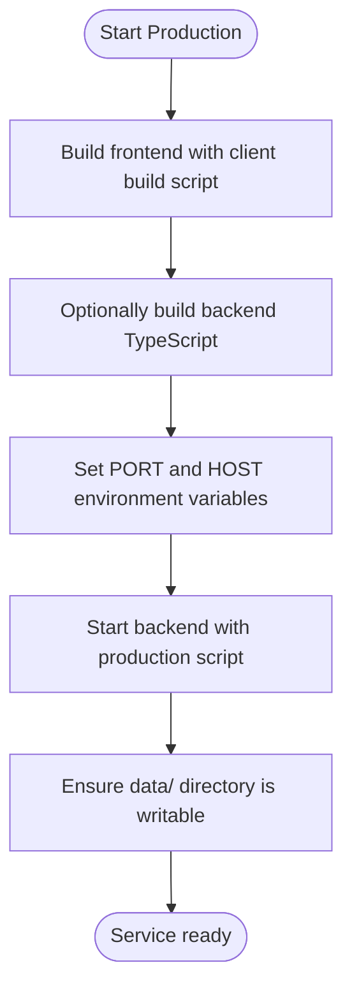
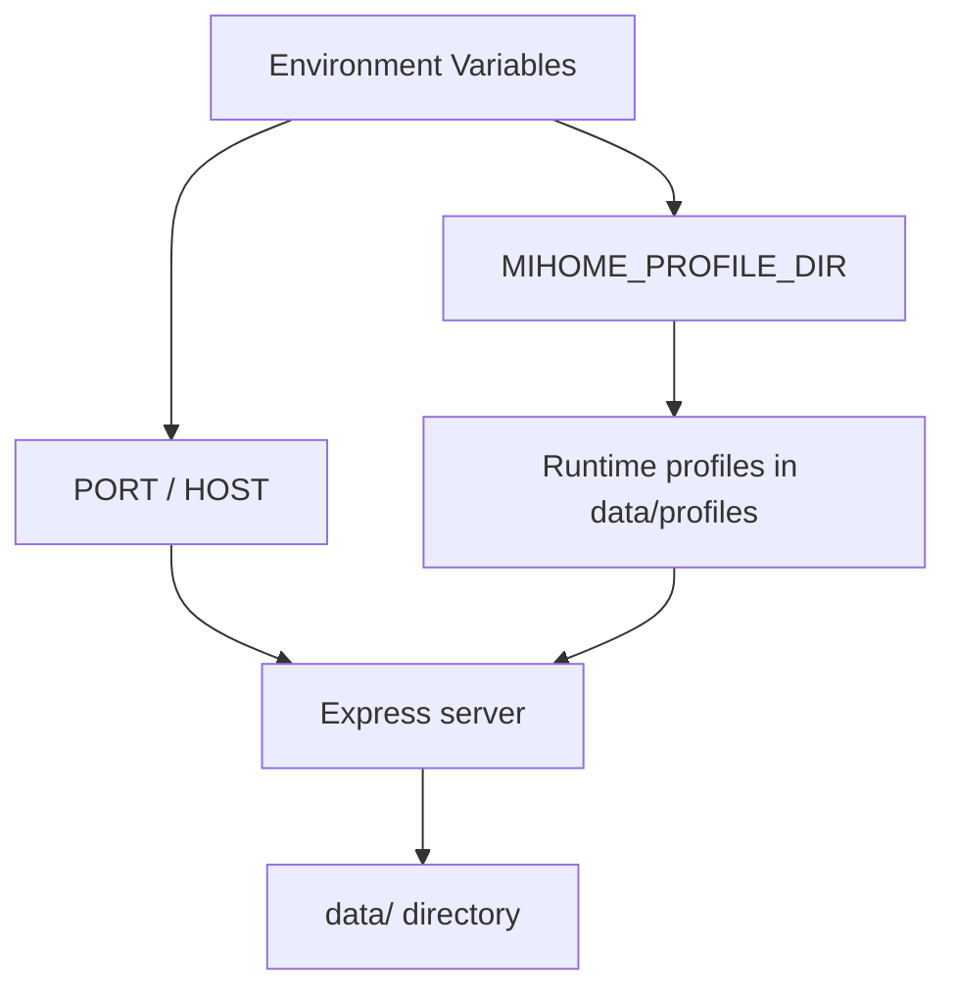
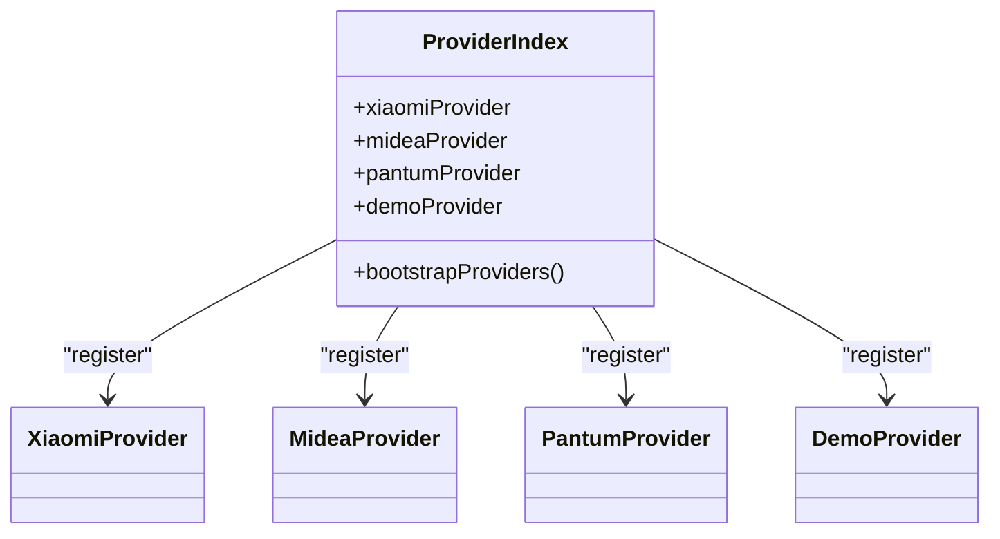
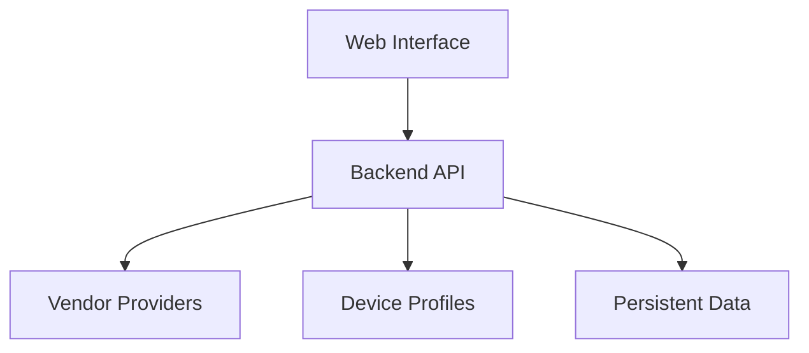
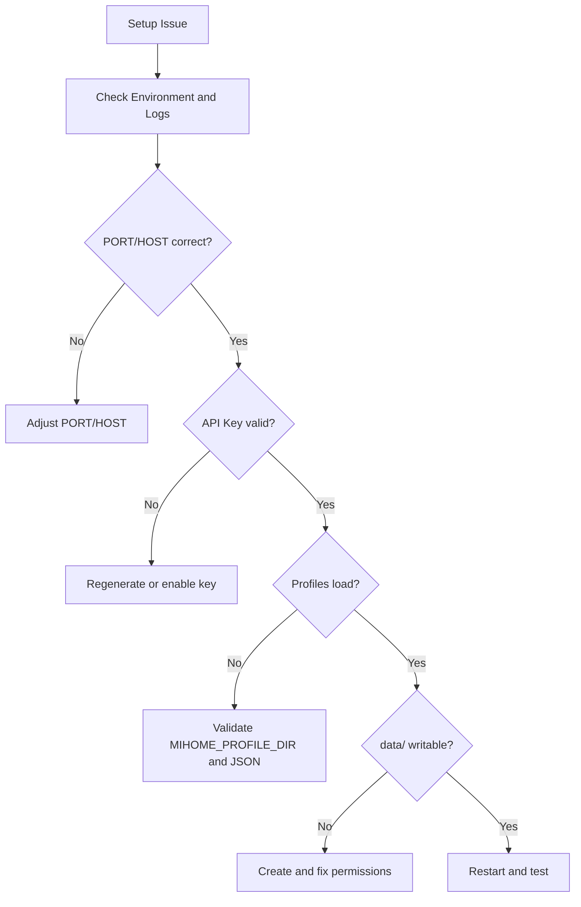

# Getting Started

<cite>
**Referenced Files in This Document**
- [README.md](file://README.md)
- [package.json](file://package.json)
- [client/package.json](file://client/package.json)
- [src/index.ts](file://src/index.ts)
- [src/app.ts](file://src/app.ts)
- [src/providers/index.ts](file://src/providers/index.ts)
- [src/controls/profiles.ts](file://src/controls/profiles.ts)
- [src/core/apikey.ts](file://src/core/apikey.ts)
- [src/routes/open.ts](file://src/routes/open.ts)
</cite>

## Table of Contents
1. [Introduction](#introduction)
2. [Project Structure](#project-structure)
3. [Installation Requirements](#installation-requirements)
4. [Development Setup](#development-setup)
5. [Production Setup](#production-setup)
6. [Basic Usage](#basic-usage)
7. [Initial Configuration](#initial-configuration)
8. [Vendor Integrations](#vendor-integrations)
9. [Web Interface Overview](#web-interface-overview)
10. [Troubleshooting Guide](#troubleshooting-guide)
11. [Conclusion](#conclusion)

## Introduction
mihome-web is a multi-vendor smart home device management platform. It provides:
- A unified web interface for controlling devices from different vendors.
- Secure external API access through scoped API keys.
- Built-in vendor integrations for Xiaomi, Midea, and Pantum.
- A flexible device profile system that normalizes vendor-specific device properties into a consistent control panel.

At a high level, the backend is an Express server written in TypeScript. The frontend is a React application built with Vite. Vendor providers are registered at startup, and device profiles define how each vendor’s raw data is presented to the user.

**Section sources**
- [README.md:1-97](file://README.md#L1-L97)
- [src/providers/index.ts:1-17](file://src/providers/index.ts#L1-L17)

## Project Structure
The repository is organized into three main layers:
- Backend server: `src/` contains routes, providers, core modules, and configuration.
- Frontend client: `client/` contains the React UI and build configuration.
- Public assets: `public/` serves static files such as the built frontend.

```mermaid
graph TB
subgraph "Backend"
Index["src/index.ts"]
App["src/app.ts"]
Providers["src/providers/index.ts"]
OpenAPI["src/routes/open.ts"]
Profiles["src/controls/profiles.ts"]
ApiKey["src/core/apikey.ts"]
end
subgraph "Frontend"
ClientPkg["client/package.json"]
end
subgraph "Public"
Public["public/"]
end
Index --> App
Index --> Providers
App --> OpenAPI
App --> Profiles
OpenAPI --> ApiKey
ClientPkg --> Public
```

**Diagram sources**
- [src/index.ts:1-12](file://src/index.ts#L1-L12)
- [src/app.ts:1-25](file://src/app.ts#L1-L25)
- [src/providers/index.ts:1-17](file://src/providers/index.ts#L1-L17)
- [src/routes/open.ts:1-324](file://src/routes/open.ts#L1-L324)
- [src/controls/profiles.ts:1-196](file://src/controls/profiles.ts#L1-L196)
- [src/core/apikey.ts:1-304](file://src/core/apikey.ts#L1-L304)
- [client/package.json:1-22](file://client/package.json#L1-L22)

**Section sources**
- [package.json:1-24](file://package.json#L1-L24)
- [client/package.json:1-22](file://client/package.json#L1-L22)
- [src/index.ts:1-12](file://src/index.ts#L1-L12)
- [src/app.ts:1-25](file://src/app.ts#L1-L25)

## Installation Requirements
Before installing mihome-web, ensure your environment has:
- Node.js (the project uses modern ESM and TypeScript).
- npm or yarn (used by both backend and frontend scripts).
- A terminal with permission to create directories under the project root.

The backend depends on Express and runs directly via tsx. The frontend uses Vite and React.

**Section sources**
- [package.json:1-24](file://package.json#L1-L24)
- [client/package.json:1-22](file://client/package.json#L1-L22)

## Development Setup
Follow these steps to set up the development environment:

1. Install dependencies:
   - Backend: run the package manager install command in the repository root.
   - Frontend: run the package manager install command inside the `client/` directory.

2. Start the backend server:
   - Use the development script to start the server with hot reload.
   - The server listens on port `8787` by default unless overridden by environment variables.

3. Start the frontend development server:
   - Use the frontend development script inside `client/`.
   - The frontend will serve the React UI during development.

4. Access the web interface:
   - Open your browser and navigate to the backend URL shown after startup.
   - The backend also serves static files from `public/`, which can include the built frontend.



**Diagram sources**
- [package.json:5-10](file://package.json#L5-L10)
- [client/package.json:5-9](file://client/package.json#L5-L9)
- [src/index.ts:6-12](file://src/index.ts#L6-L12)
- [src/app.ts:22-23](file://src/app.ts#L22-L23)

**Section sources**
- [package.json:5-10](file://package.json#L5-L10)
- [client/package.json:5-9](file://client/package.json#L5-L9)
- [src/index.ts:6-12](file://src/index.ts#L6-L12)
- [src/app.ts:22-23](file://src/app.ts#L22-L23)

## Production Setup
For production deployment:

1. Build the frontend:
   - Run the frontend build script inside `client/`.
   - The output should be placed where the backend serves static files.

2. Build the backend (optional):
   - Run the TypeScript build script if you want compiled JavaScript instead of running tsx directly.

3. Start the backend in production:
   - Use the production script to start the server.
   - Configure environment variables such as `PORT` and `HOST` as needed.

4. Ensure persistent storage:
   - The server writes runtime data under `data/`.
   - Make sure this directory exists and is writable by the process.



**Diagram sources**
- [package.json:5-10](file://package.json#L5-L10)
- [src/index.ts:6-12](file://src/index.ts#L6-L12)
- [src/core/apikey.ts:73-99](file://src/core/apikey.ts#L73-L99)

**Section sources**
- [package.json:5-10](file://package.json#L5-L10)
- [src/index.ts:6-12](file://src/index.ts#L6-L12)
- [src/core/apikey.ts:73-99](file://src/core/apikey.ts#L73-L99)

## Basic Usage
After installation:

- Start the server using the backend development or production script.
- Open the URL printed by the server in your browser.
- Log in to the hub account through the web interface.
- Generate an API key for external applications if needed.
- Use the generated API key to call the open API endpoints.

Example usage patterns:
- Start the server and visit the local URL.
- Create an API key with read-only scope for external dashboards.
- Call `/api/open/devices` with the API key to list devices.
- Call `/api/open/live` to receive live device readings.

**Section sources**
- [src/index.ts:6-12](file://src/index.ts#L6-L12)
- [src/routes/open.ts:150-175](file://src/routes/open.ts#L150-L175)
- [src/routes/open.ts:292-324](file://src/routes/open.ts#L292-L324)

## Initial Configuration
mihome-web supports several configuration points:

- Server host and port:
  - `PORT`: overrides the default listening port.
  - `HOST`: overrides the default binding address.

- Device profile directory:
  - `MIHOME_PROFILE_DIR`: changes the runtime profile directory.
  - Default location: `data/profiles`.
  - Runtime profiles are loaded from JSON files and take effect without restarting the server.

- API key storage:
  - Keys and audit logs are stored under `data/api-keys.json`.
  - The file is created automatically when needed.



**Diagram sources**
- [src/index.ts:6-8](file://src/index.ts#L6-L8)
- [src/controls/profiles.ts:10-11](file://src/controls/profiles.ts#L10-L11)
- [src/core/apikey.ts:73-99](file://src/core/apikey.ts#L73-L99)

**Section sources**
- [src/index.ts:6-8](file://src/index.ts#L6-L8)
- [src/controls/profiles.ts:10-11](file://src/controls/profiles.ts#L10-L11)
- [src/core/apikey.ts:73-99](file://src/core/apikey.ts#L73-L99)

## Vendor Integrations
mihome-web registers multiple vendor providers at startup:
- Xiaomi
- Midea
- Pantum
- Demo provider

These providers expose device listing, device details, property updates, actions, and live refresh capabilities. The platform normalizes vendor-specific responses into a unified model used by the web interface and open API.



**Diagram sources**
- [src/providers/index.ts:1-17](file://src/providers/index.ts#L1-L17)

**Section sources**
- [src/providers/index.ts:1-17](file://src/providers/index.ts#L1-L17)

## Web Interface Overview
The web interface is served statically by the backend and interacts with the backend APIs. During development, you typically use the frontend development server; in production, the backend serves the built frontend.

Key responsibilities:
- Displaying devices from all configured vendor accounts.
- Allowing users to generate and manage API keys.
- Presenting normalized device properties based on device profiles.
- Providing controls for supported device operations.



**Diagram sources**
- [src/app.ts:13-23](file://src/app.ts#L13-L23)
- [src/controls/profiles.ts:74-123](file://src/controls/profiles.ts#L74-L123)
- [src/core/apikey.ts:151-183](file://src/core/apikey.ts#L151-L183)

**Section sources**
- [src/app.ts:13-23](file://src/app.ts#L13-L23)
- [src/controls/profiles.ts:74-123](file://src/controls/profiles.ts#L74-L123)
- [src/core/apikey.ts:151-183](file://src/core/apikey.ts#L151-L183)

## Troubleshooting Guide
Common setup issues and resolutions:

- Server does not start or prints wrong address:
  - Check `PORT` and `HOST` environment variables.
  - Confirm the process has permission to bind the selected port.

- Frontend cannot connect to backend:
  - Ensure the backend is running and accessible at the expected URL.
  - If using the frontend dev server, verify proxy or CORS settings if customized.

- API key authentication fails:
  - Verify the API key format and scope.
  - Check whether the key is enabled and not expired.
  - Review audit logs for failed requests and throttling behavior.

- Device profiles not loading:
  - Confirm `MIHOME_PROFILE_DIR` points to a valid directory.
  - Ensure profile JSON files are well-formed and located under `data/profiles`.

- Persistent data errors:
  - Ensure the `data/` directory exists and is writable.
  - Check permissions for `data/api-keys.json`.



**Diagram sources**
- [src/index.ts:6-12](file://src/index.ts#L6-L12)
- [src/routes/open.ts:62-105](file://src/routes/open.ts#L62-L105)
- [src/controls/profiles.ts:10-11](file://src/controls/profiles.ts#L10-L11)
- [src/core/apikey.ts:73-99](file://src/core/apikey.ts#L73-L99)

**Section sources**
- [src/index.ts:6-12](file://src/index.ts#L6-L12)
- [src/routes/open.ts:62-105](file://src/routes/open.ts#L62-L105)
- [src/controls/profiles.ts:10-11](file://src/controls/profiles.ts#L10-L11)
- [src/core/apikey.ts:73-99](file://src/core/apikey.ts#L73-L99)

## Conclusion
mihome-web provides a practical foundation for managing multi-vendor smart home devices through a unified web interface and secure external API. By following the installation steps, configuring environment variables, setting up vendor integrations, and generating API keys, you can quickly get the platform running in both development and production environments. Use the troubleshooting guide to resolve common issues and leverage the open API to integrate external applications safely.

[No sources needed since this section summarizes without analyzing specific files]