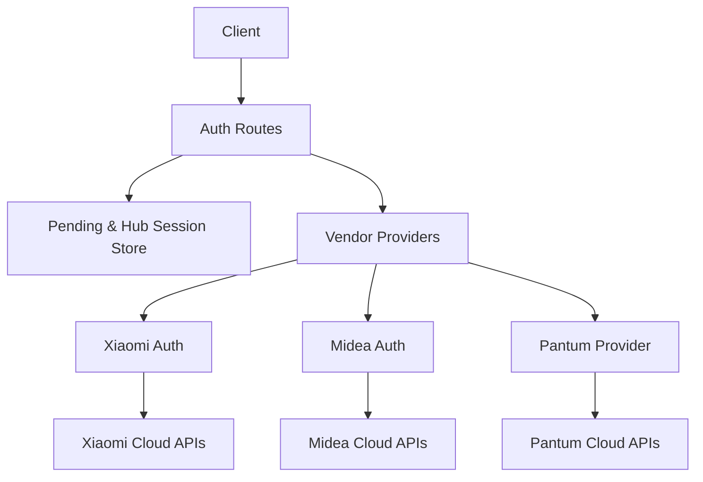
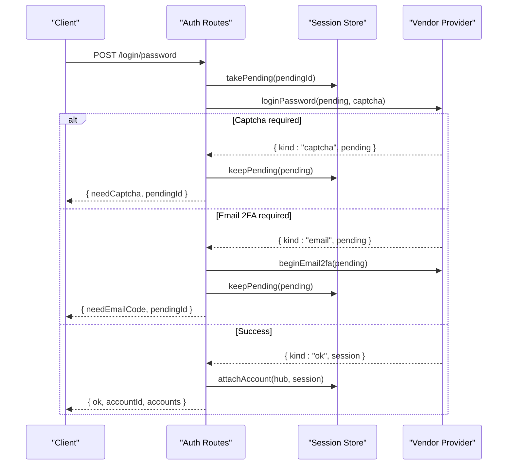
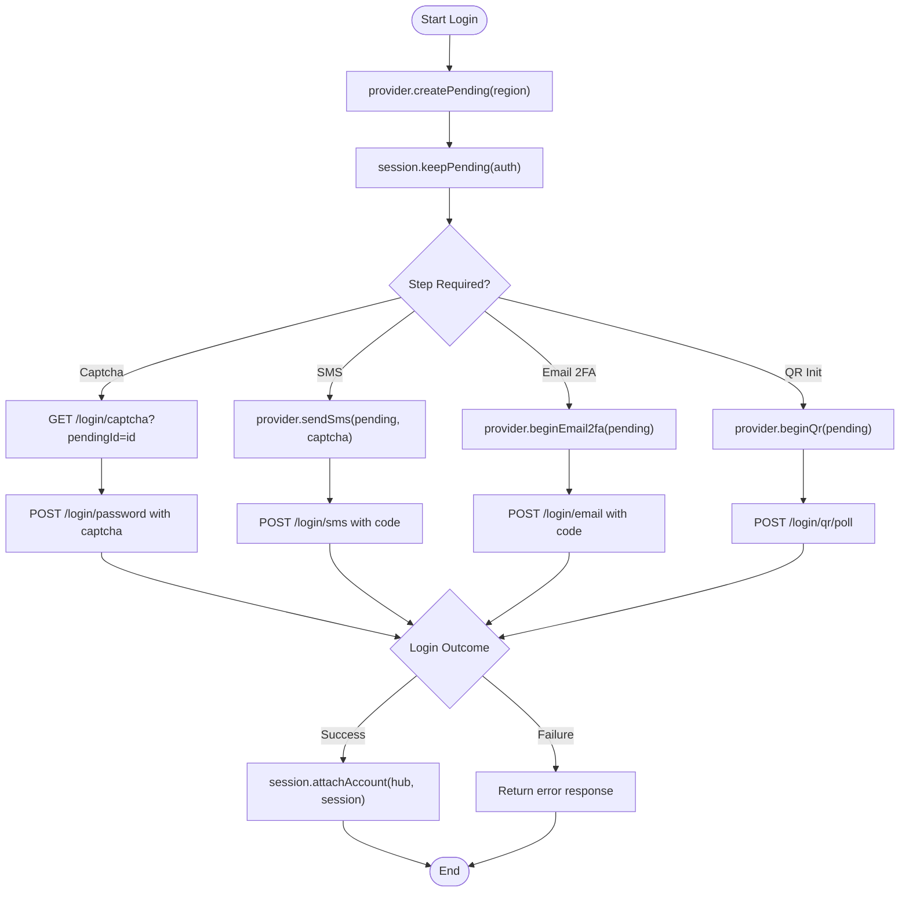
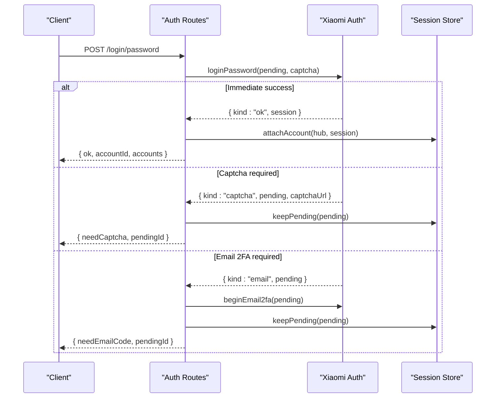
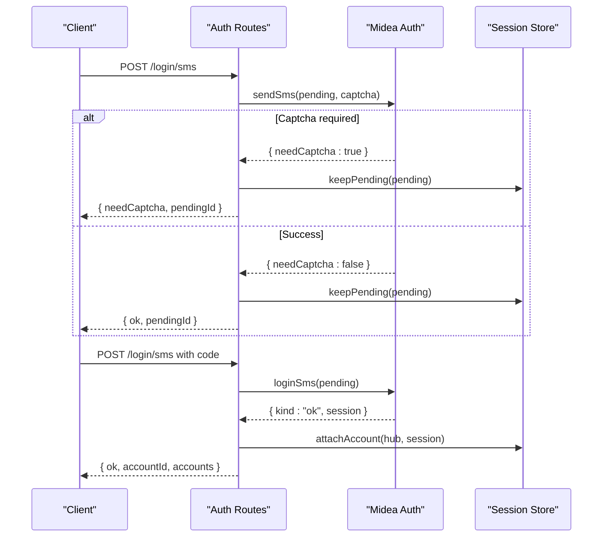
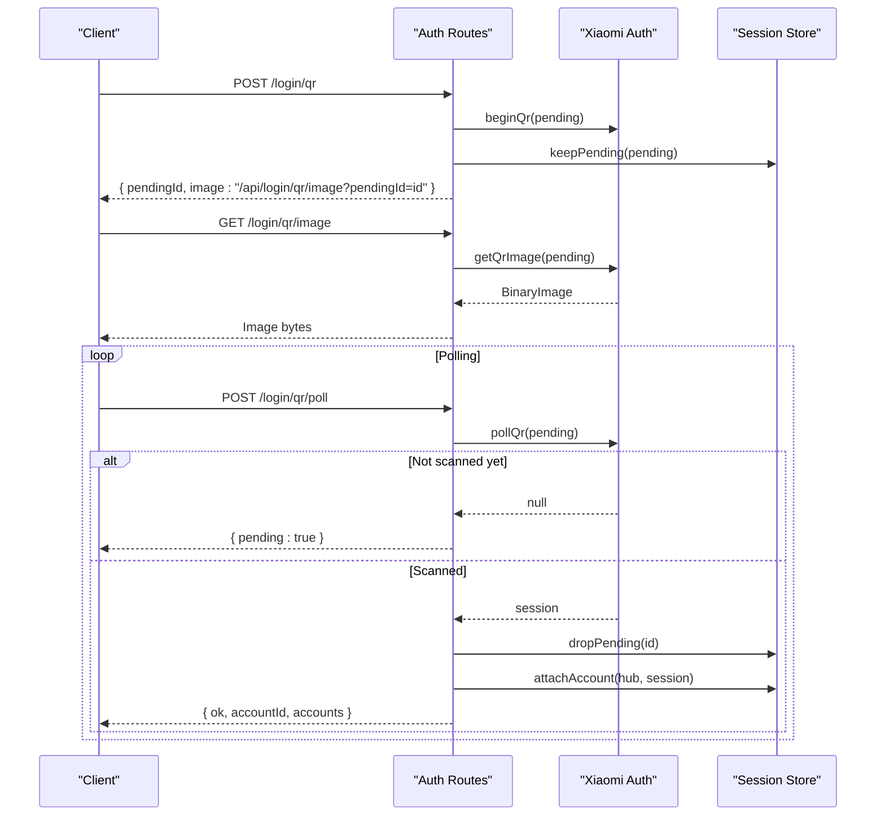
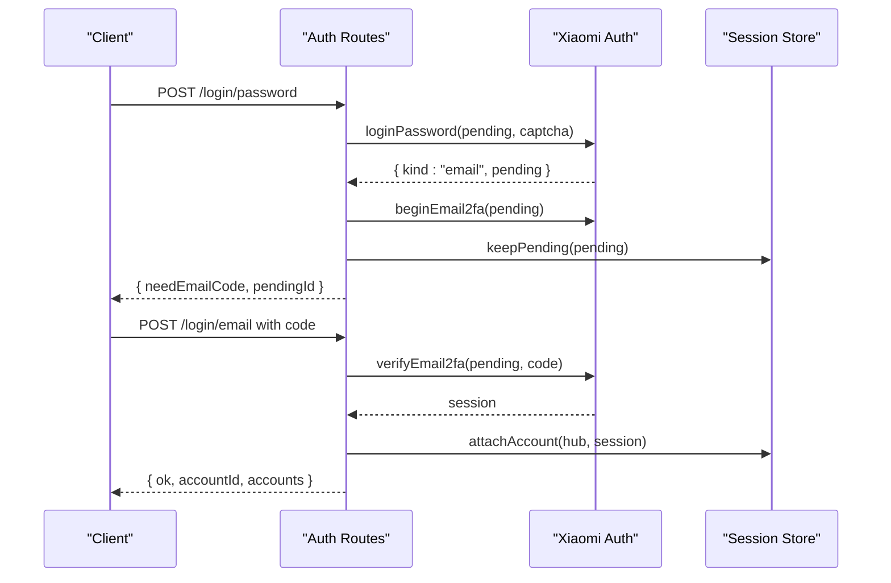
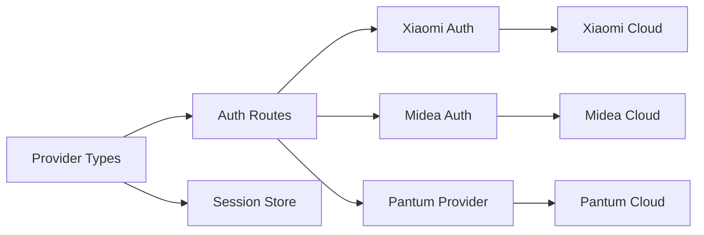

# Authentication Flow Implementation

<cite>
**Referenced Files in This Document**
- [types.ts](file://src/providers/types.ts)
- [session.ts](file://src/core/session.ts)
- [auth.ts](file://src/routes/auth.ts)
- [xiaomi-auth.ts](file://src/providers/xiaomi/auth.ts)
- [midea-auth.ts](file://src/providers/midea/auth.ts)
- [pantum-provider.ts](file://src/providers/pantum/index.ts)
</cite>

## Table of Contents
1. [Introduction](#introduction)
2. [Project Structure](#project-structure)
3. [Core Components](#core-components)
4. [Architecture Overview](#architecture-overview)
5. [Detailed Component Analysis](#detailed-component-analysis)
6. [Dependency Analysis](#dependency-analysis)
7. [Performance Considerations](#performance-considerations)
8. [Troubleshooting Guide](#troubleshooting-guide)
9. [Security Considerations](#security-considerations)
10. [Conclusion](#conclusion)

## Introduction
This document explains how vendor-specific authentication flows are implemented across Xiaomi, Midea, and Pantum. It covers:
- Three authentication modes: password-based login, SMS verification, and QR code scanning.
- The PendingAuth state machine for multi-step processes such as captcha verification, email two-factor authentication, and session polling.
- Concrete implementation differences between vendors.
- Error handling patterns for network failures, invalid credentials, and rate limiting signals.
- Security considerations for token storage and session management.

The goal is to help developers understand the end-to-end flow from user input to a persistent vendor session, while supporting flexible vendor behaviors.

## Project Structure
Authentication spans three layers:
- Provider interface and types define the contract for vendors.
- Route handlers orchestrate pending sessions, vendor calls, and cookie binding.
- Vendor providers implement concrete flows for Xiaomi, Midea, and Pantum.

**Diagram sources**
- [auth.ts:35-186](file://src/routes/auth.ts#L35-L186)
- [session.ts:184-265](file://src/core/session.ts#L184-L265)
- [xiaomi-auth.ts:33-267](file://src/providers/xiaomi/auth.ts#L33-L267)
- [midea-auth.ts:51-175](file://src/providers/midea/auth.ts#L51-L175)
- [pantum-provider.ts:52-111](file://src/providers/pantum/index.ts#L52-L111)

**Section sources**
- [types.ts:1-144](file://src/providers/types.ts#L1-L144)
- [auth.ts:1-200](file://src/routes/auth.ts#L1-L200)
- [session.ts:1-266](file://src/core/session.ts#L1-L266)

## Core Components
- VendorProvider contract: defines auth modes, pending creation, login methods, QR flow, session checks, device operations, and optional image retrieval.
- PendingAuth: represents an incomplete login with vendor context, optional credentials, captcha or notification URLs, and timestamps.
- LoginOutcome: indicates whether login succeeded, requires captcha, or requires email verification.
- Session store: manages hub-scoped accounts, pending sessions, TTL expiration, persistence, and status tracking.

Key responsibilities:
- Route layer validates inputs, creates or resumes PendingAuth, invokes provider methods, binds successful sessions to a hub, and returns structured responses.
- Provider layer implements vendor-specific protocols, including encryption, cookies, tokens, and polling.
- Session layer persists active sessions and temporary pending states, sanitizes sensitive fields, and enforces TTL.

**Section sources**
- [types.ts:3-144](file://src/providers/types.ts#L3-L144)
- [session.ts:30-265](file://src/core/session.ts#L30-L265)
- [auth.ts:29-186](file://src/routes/auth.ts#L29-L186)

## Architecture Overview
The authentication architecture follows a layered design:
- HTTP routes expose endpoints for password login, SMS send/verify, captcha retrieval, email 2FA, QR initiation, QR image retrieval, and QR polling.
- PendingAuth acts as a shared state container across multiple requests until login completes.
- Vendor providers encapsulate protocol details and return either a completed VendorSession or intermediate outcomes.
- Session manager attaches successful sessions to a hub, persists them, and exposes account views and status checks.

**Diagram sources**
- [auth.ts:35-71](file://src/routes/auth.ts#L35-L71)
- [session.ts:184-210](file://src/core/session.ts#L184-L210)
- [xiaomi-auth.ts:33-92](file://src/providers/xiaomi/auth.ts#L33-L92)

## Detailed Component Analysis

### PendingAuth State Machine
PendingAuth is the central state object used during multi-step authentication. It carries:
- Vendor identity and region.
- Optional username/password.
- Captcha URL or notification URL for email 2FA.
- Timestamps and optional replaceAccountId for re-login behavior.

Lifecycle:
- Creation: provider.createPending initializes vendor-specific state.
- Persistence: session.keepPending assigns an id and stores it with TTL.
- Consumption: session.takePending retrieves and removes it; session.peekPending allows read-only access without removal.
- Expiration: TTL-based cleanup prevents stale pending states.

**Diagram sources**
- [session.ts:230-265](file://src/core/session.ts#L230-L265)
- [auth.ts:35-186](file://src/routes/auth.ts#L35-L186)

**Section sources**
- [types.ts:91-103](file://src/providers/types.ts#L91-L103)
- [session.ts:230-265](file://src/core/session.ts#L230-L265)

### Password-Based Authentication

#### Xiaomi Password Flow
Xiaomi’s password flow may:
- Return immediate success if ssecurity and location are present.
- Require a captcha when captchaUrl is returned.
- Require email 2FA when notificationUrl is present without sufficient ssecurity.
- Complete by following redirects and extracting serviceToken.

**Diagram sources**
- [xiaomi-auth.ts:33-92](file://src/providers/xiaomi/auth.ts#L33-L92)
- [auth.ts:35-71](file://src/routes/auth.ts#L35-L71)
- [session.ts:184-210](file://src/core/session.ts#L184-L210)

**Section sources**
- [xiaomi-auth.ts:33-92](file://src/providers/xiaomi/auth.ts#L33-L92)
- [auth.ts:35-71](file://src/routes/auth.ts#L35-L71)

#### Midea Password Flow
Midea’s password flow:
- Validates account and password presence.
- Performs a two-step login: first obtains a loginId, then logs in with encrypted credentials.
- Accepts the login result, extracts accessToken, userId, and optional sessionKey.
- Clears pending password before returning success.

**Section sources**
- [midea-auth.ts:142-175](file://src/providers/midea/auth.ts#L142-L175)

### SMS Verification

#### Midea SMS Flow
Midea supports sending SMS codes and verifying them:
- sendSms validates phone number format, optionally handles captcha images (URL or base64), and returns needCaptcha.
- loginSms validates phone and code, performs registration/login API call, and accepts the login result.

**Diagram sources**
- [midea-auth.ts:51-139](file://src/providers/midea/auth.ts#L51-L139)
- [auth.ts:73-91](file://src/routes/auth.ts#L73-L91)
- [session.ts:184-210](file://src/core/session.ts#L184-L210)

**Section sources**
- [midea-auth.ts:51-139](file://src/providers/midea/auth.ts#L51-L139)
- [auth.ts:73-91](file://src/routes/auth.ts#L73-L91)

#### Pantum SMS Flow
Pantum only supports SMS login:
- sendSms validates phone number and sends a login code.
- loginSms validates phone and code, logs in via cloud API, refreshes devices, and returns a session.

**Section sources**
- [pantum-provider.ts:65-84](file://src/providers/pantum/index.ts#L65-L84)

### QR Code Scanning

#### Xiaomi QR Flow
Xiaomi’s QR flow:
- beginQr requests a long-polling URL and QR image URL.
- getQrImage serves the QR image using the stored qr value.
- pollQr performs a long-polling request with timeout; on success, extracts ssecurity and location, then finalizes the session.

**Diagram sources**
- [xiaomi-auth.ts:175-223](file://src/providers/xiaomi/auth.ts#L175-L223)
- [auth.ts:123-173](file://src/routes/auth.ts#L123-L173)
- [session.ts:230-265](file://src/core/session.ts#L230-L265)

**Section sources**
- [xiaomi-auth.ts:175-223](file://src/providers/xiaomi/auth.ts#L175-L223)
- [auth.ts:123-173](file://src/routes/auth.ts#L123-L173)

### Email Two-Factor Authentication

#### Xiaomi Email 2FA Flow
Xiaomi’s email 2FA:
- beginEmail2fa uses notificationUrl to initiate email ticket sending.
- verifyEmail2fa verifies the email code, follows redirects, extracts ssecurity and location, and finalizes the session.

**Diagram sources**
- [xiaomi-auth.ts:94-173](file://src/providers/xiaomi/auth.ts#L94-L173)
- [auth.ts:109-121](file://src/routes/auth.ts#L109-L121)
- [session.ts:184-210](file://src/core/session.ts#L184-L210)

**Section sources**
- [xiaomi-auth.ts:94-173](file://src/providers/xiaomi/auth.ts#L94-L173)
- [auth.ts:109-121](file://src/routes/auth.ts#L109-L121)

## Dependency Analysis
The authentication system depends on:
- Provider contracts defining capabilities per vendor.
- Route handlers coordinating multi-step flows and session binding.
- Session store managing pending states and persistent accounts.
- Vendor-specific implementations handling network protocols, encryption, cookies, and polling.

**Diagram sources**
- [types.ts:1-144](file://src/providers/types.ts#L1-L144)
- [auth.ts:1-200](file://src/routes/auth.ts#L1-L200)
- [session.ts:1-266](file://src/core/session.ts#L1-L266)
- [xiaomi-auth.ts:1-268](file://src/providers/xiaomi/auth.ts#L1-L268)
- [midea-auth.ts:1-176](file://src/providers/midea/auth.ts#L1-L176)
- [pantum-provider.ts:1-112](file://src/providers/pantum/index.ts#L1-L112)

**Section sources**
- [types.ts:1-144](file://src/providers/types.ts#L1-L144)
- [auth.ts:1-200](file://src/routes/auth.ts#L1-L200)
- [session.ts:1-266](file://src/core/session.ts#L1-L266)

## Performance Considerations
- PendingTTL: PendingAuth entries expire after a fixed duration to prevent resource leaks and stale states.
- Long polling: Xiaomi QR polling uses a timeout to avoid hanging connections; clients should handle partial results and retry.
- Persistence: Sessions are written atomically using temp files and rename to reduce corruption risk.
- Cookie handling: Vendor providers use cookie jars to maintain session state across requests, reducing redundant authentication steps.

[No sources needed since this section provides general guidance]

## Troubleshooting Guide
Common errors and handling strategies:
- Network failures: Vendors throw AppError with descriptive messages and status codes; route handlers map these to public error responses.
- Invalid credentials: Vendors validate inputs and return structured errors; route handlers preserve pending state for recovery.
- Rate limiting: Some vendors signal rate limits via specific error codes; clients should back off and retry after delays.
- Expired pending: Route handlers return explicit errors when pendingId is missing or expired; clients must restart the flow.

Recommended debugging steps:
- Check pendingId validity and TTL.
- Inspect vendor-specific error codes and messages.
- Validate phone numbers and captcha formats.
- Ensure cookies and tokens are preserved across requests.

**Section sources**
- [auth.ts:35-186](file://src/routes/auth.ts#L35-L186)
- [xiaomi-auth.ts:33-267](file://src/providers/xiaomi/auth.ts#L33-L267)
- [midea-auth.ts:51-175](file://src/providers/midea/auth.ts#L51-L175)
- [pantum-provider.ts:65-84](file://src/providers/pantum/index.ts#L65-L84)

## Security Considerations
- Token storage: Vendor sessions store tokens and cookies in vendor-private state; passwords are cleared from PendingAuth after successful login.
- Session persistence: Active sessions are persisted with restricted file permissions; sensitive fields like passwords are excluded during encoding.
- Hub isolation: Accounts are scoped to hubs identified by cookies; removing an account clears its status and updates persistence.
- Audit and logging: Open API usage is audited with sanitized keys and rate limiting for invalid attempts.
- Best practices:
  - Avoid logging raw tokens or cookies.
  - Use HTTPS for all vendor API calls.
  - Rotate or revoke sessions when suspicious activity is detected.
  - Enforce minimum security headers and cache-control policies for sensitive endpoints.

**Section sources**
- [session.ts:37-49](file://src/core/session.ts#L37-L49)
- [session.ts:80-98](file://src/core/session.ts#L80-L98)
- [session.ts:184-210](file://src/core/session.ts#L184-L210)
- [xiaomi-auth.ts:86-91](file://src/providers/xiaomi/auth.ts#L86-L91)
- [midea-auth.ts:107-108](file://src/providers/midea/auth.ts#L107-L108)

## Conclusion
The authentication system provides a flexible, vendor-agnostic framework for handling password-based, SMS, and QR code flows. PendingAuth enables robust multi-step processes, while route handlers and session management ensure secure and persistent user sessions. Vendor-specific implementations demonstrate diverse strategies for captcha handling, email 2FA, and polling. Proper error handling and security measures protect against common threats and operational issues.

[No sources needed since this section summarizes without analyzing specific files]