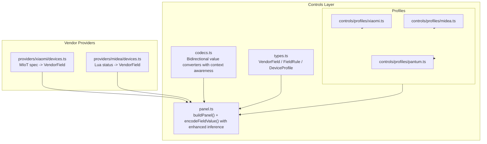
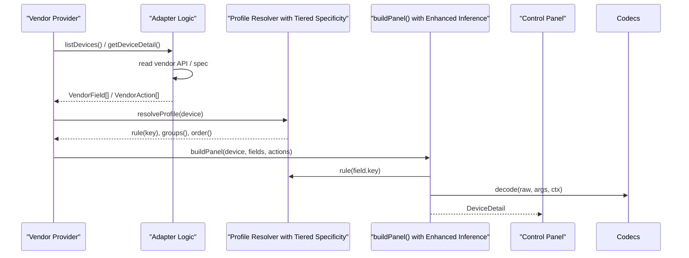
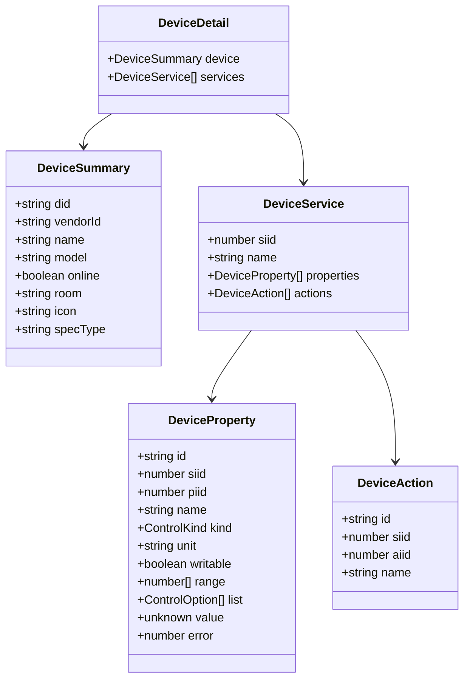
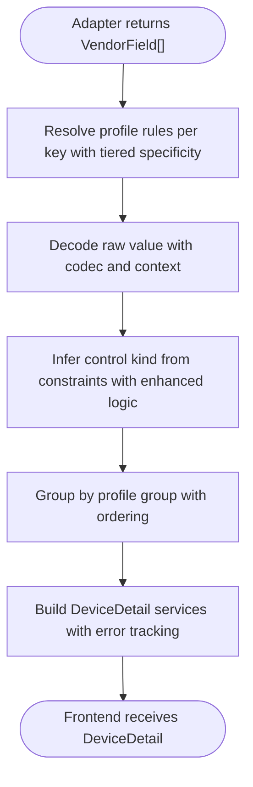
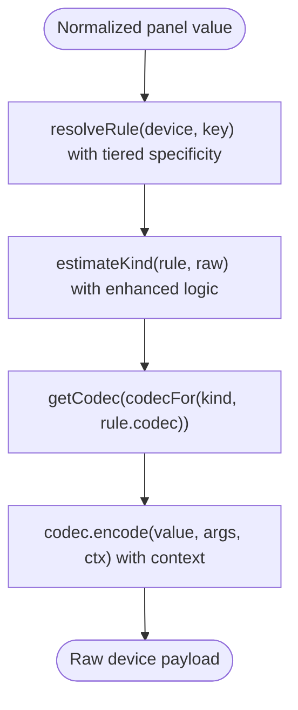
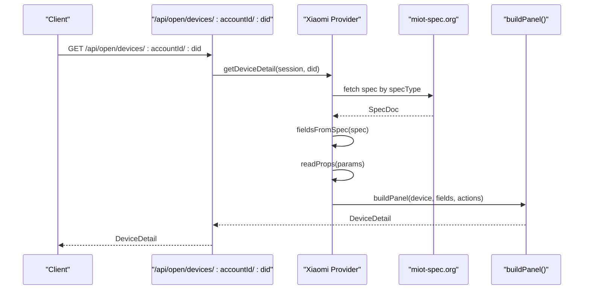
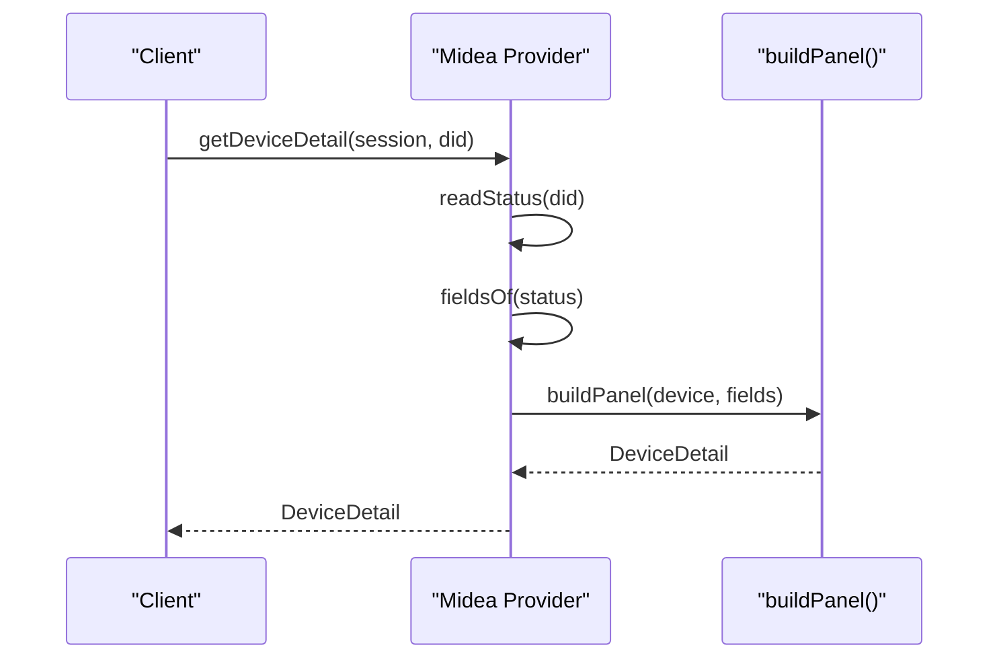
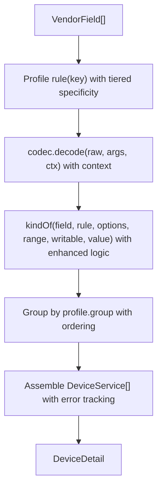
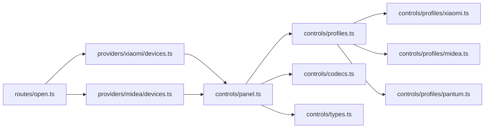

# Device Property Mapping

<cite>
**Referenced Files in This Document**
- [types.ts](file://src/controls/types.ts)
- [profiles.ts](file://src/controls/profiles.ts)
- [codecs.ts](file://src/controls/codecs.ts)
- [panel.ts](file://src/controls/panel.ts)
- [xiaomi.ts](file://src/controls/profiles/xiaomi.ts)
- [midea.ts](file://src/controls/profiles/midea.ts)
- [pantum.ts](file://src/controls/profiles/pantum.ts)
- [devices.ts](file://src/providers/xiaomi/devices.ts)
- [devices.ts](file://src/providers/midea/devices.ts)
- [open.ts](file://src/routes/open.ts)
- [profiles.ts](file://src/routes/profiles.ts)
</cite>

## Update Summary
**Changes Made**
- Enhanced VendorField processing with improved metadata handling and shape preservation
- Updated profile-based transformations with tiered specificity and runtime profile loading
- Integrated codec system for bidirectional data conversion with context-aware encoding
- Improved panel generation with better control kind inference and grouping mechanisms
- Added comprehensive troubleshooting guide for profile resolution and codec usage

## Table of Contents
1. [Introduction](#introduction)
2. [Project Structure](#project-structure)
3. [Core Components](#core-components)
4. [Architecture Overview](#architecture-overview)
5. [Detailed Component Analysis](#detailed-component-analysis)
6. [Dependency Analysis](#dependency-analysis)
7. [Performance Considerations](#performance-considerations)
8. [Troubleshooting Guide](#troubleshooting-guide)
9. [Conclusion](#conclusion)

## Introduction
This document explains how vendor-specific device schemas are transformed into the standardized `DeviceDetail` format used by the control panel through an enhanced mapping pipeline. The system now features improved VendorField processing, profile-based transformations with tiered specificity, and integrated codecs for bidirectional data conversion. It covers:
- The service-property-action model and how vendor protocols map to `siid`/`piid` identifiers.
- How vendor adapters produce minimal facts through enhanced `VendorField` and `VendorAction`.
- How `DeviceProfile` and `FieldRule` normalize values using profile-based transformations with tiered specificity.
- How bidirectional codecs convert between normalized panel values and raw device payloads with context awareness.
- Examples for Xiaomi MIoT spec devices, Midea Lua fields, and Pantum cloud actions.
- Challenges in reverse engineering vendor protocols and maintaining compatibility across firmware versions.

The goal is to make it possible to add or adjust mappings without changing adapter code, while keeping stable identifiers (`did`, `siid`, `piid`) for write-back operations through a robust, layered architecture.

## Project Structure
The enhanced mapping pipeline lives mainly under `src/controls` and is consumed by vendor providers under `src/providers`.

**Diagram sources**
- [types.ts:19-114](file://src/controls/types.ts#L19-L114)
- [profiles.ts:74-129](file://src/controls/profiles.ts#L74-L129)
- [codecs.ts:196-240](file://src/controls/codecs.ts#L196-L240)
- [panel.ts:102-166](file://src/controls/panel.ts#L102-L166)
- [devices.ts:131-172](file://src/providers/xiaomi/devices.ts#L131-L172)
- [devices.ts:18-31](file://src/providers/midea/devices.ts#L18-L31)
- [xiaomi.ts:8-40](file://src/controls/profiles/xiaomi.ts#L8-L40)
- [midea.ts:110-176](file://src/controls/profiles/midea.ts#L110-L176)
- [pantum.ts:4-14](file://src/controls/profiles/pantum.ts#L4-L14)

## Core Components
This section defines the core data structures that enable vendor-neutral property mapping with enhanced capabilities.

### Enhanced VendorField and VendorAction
- `VendorField` carries the stable field key, raw device value, writability, optional label/kind/unit/range/options, grouping, protocol identifiers such as `siid`/`piid`, and enhanced metadata for shape preservation.
- `VendorAction` carries action keys, names, groups, and identifiers like `siid`/`aiid`.
- These are the only outputs vendor adapters must produce; all UI semantics come from profiles with enhanced rule resolution.

**Section sources**
- [types.ts:19-47](file://src/controls/types.ts#L19-L47)

### Profile-Based FieldRule and DeviceProfile
- `FieldRule` declares display and conversion behavior: label, kind, unit, range, options, codec, digits, writability, hidden flag, order, and group with enhanced specificity matching.
- `DeviceProfile` matches a vendor/model/specType/device and merges rules using tiered specificity: exact field name > longest wildcard > fallback `"*"`.
- Profiles support runtime loading from JSON files with automatic caching and hot reloading capabilities.
- Profiles can also define global ordering, groups, omitted fields, and action overrides with pattern matching.

**Section sources**
- [types.ts:53-95](file://src/controls/types.ts#L53-L95)
- [profiles.ts:7-123](file://src/controls/profiles.ts#L7-L123)

### ResolvedField and DeviceDetail
- `ResolvedField` is the merged view after profile resolution and codec decoding with enhanced type safety.
- `DeviceDetail` contains a device summary plus services with normalized properties and actions.
- Properties carry stable `id`, explicit `kind`, normalized `value`, and protocol identifiers for write-back with error tracking.

**Section sources**
- [types.ts:97-114](file://src/controls/types.ts#L97-L114)

## Architecture Overview
The enhanced system follows a three-layer design with improved profile resolution and codec integration:
1. Vendor adapters translate vendor protocols into enhanced `VendorField`/`VendorAction`.
2. Profiles merge rules with tiered specificity and apply codecs to produce normalized `ResolvedField`.
3. `buildPanel()` assembles `DeviceDetail` with enhanced control kind inference, which the frontend renders by `kind`.

**Diagram sources**
- [devices.ts:247-266](file://src/providers/xiaomi/devices.ts#L247-L266)
- [devices.ts:149-156](file://src/providers/midea/devices.ts#L149-L156)
- [profiles.ts:74-129](file://src/controls/profiles.ts#L74-L129)
- [panel.ts:102-154](file://src/controls/panel.ts#L102-L154)

## Detailed Component Analysis

### Service-Property-Action Model and siid/piid Mapping
Vendor providers expose a service-oriented model with enhanced stability:
- Services contain properties and actions with consistent identification.
- Properties use `siid` (service ID) and `piid` (property ID) for precise targeting.
- Actions use `siid` and `aiid` (action ID) for reliable execution.
- The stable field `id` (often derived from semantic URN or Lua key) is preferred for write-back when present; otherwise `siid`/`piid` identify the target.

Xiaomi example:
- MIoT spec URNs are parsed to derive semantic keys like `<service>.<property>`.
- Read/write access, ranges, lists, units, and formats are translated into enhanced `VendorField`.
- Live properties are selected from spec metadata and fetched via `/miotspec/prop/get`.

Midea example:
- Lua status fields become `VendorField` entries keyed by Lua field names with shape preservation.
- Boolean-like values are treated as writable switches unless overridden by profiles.
- Write-back uses the same Lua field key and preserves original shape via enhanced `meta.asText`.

Pantum example:
- Cloud-only status fields are exposed as read-only properties with enhanced grouping.
- A custom action `print` is declared in the profile and rendered as an action button.

**Diagram sources**
- [types.ts:22-70](file://src/controls/types.ts#L22-L70)

**Section sources**
- [devices.ts:131-172](file://src/providers/xiaomi/devices.ts#L131-L172)
- [devices.ts:18-31](file://src/providers/midea/devices.ts#L18-L31)
- [pantum.ts:4-14](file://src/controls/profiles/pantum.ts#L4-L14)

### Enhanced Transforming Vendor Schemas into DeviceDetail
The enhanced transformation pipeline:
1. Adapter reads vendor data and produces enhanced `VendorField[]` and `VendorAction[]`.
2. Profile resolver merges rules with tiered specificity for each field key.
3. Codec decodes raw values into normalized panel values with context awareness.
4. `buildPanel()` groups fields with enhanced control kind inference and builds `DeviceDetail`.

**Diagram sources**
- [panel.ts:55-86](file://src/controls/panel.ts#L55-L86)
- [panel.ts:102-154](file://src/controls/panel.ts#L102-L154)

**Section sources**
- [panel.ts:55-86](file://src/controls/panel.ts#L55-L86)
- [panel.ts:102-154](file://src/controls/panel.ts#L102-L154)

### Advanced Bidirectional Codecs and Value Conversions
The enhanced codec system provides consistent decode/encode pairs with context awareness:
- `identity`: pass-through for simple cases.
- `bool`, `shapebool`, `shapenum`: boolean/numeric normalization with shape preservation on write-back.
- `auto`: auto-detect booleans and pass-through otherwise with intelligent type inference.
- `onoff`, `zeroone`, `numbool`: fixed boolean encodings for different vendor requirements.
- `number`: numeric rounding with configurable decimal places.
- `scale`, `offset`: linear transformations for unit conversions.
- `map`: enum mapping with table or pairs for complex value translations.
- `duration`: minutes to human-readable duration with cultural formatting.

Write-back path with enhanced context:
- `encodeFieldValue()` resolves the final rule for the field key with profile specificity.
- Control kind is estimated again to pick the correct codec with enhanced inference.
- The current raw value is passed as context so shape-preserving codecs can match the device's expected payload format.

**Diagram sources**
- [panel.ts:161-166](file://src/controls/panel.ts#L161-L166)
- [codecs.ts:196-240](file://src/controls/codecs.ts#L196-L240)

**Section sources**
- [codecs.ts:196-240](file://src/controls/codecs.ts#L196-L240)
- [panel.ts:161-166](file://src/controls/panel.ts#L161-L166)

### Example: Xiaomi MIoT Spec Devices
- Adapter fetches MIoT spec by `specType` with caching and converts services/properties/actions into enhanced `VendorField`/`VendorAction`.
- Semantic keys are derived from URN tails, e.g., `<service>.<property>`.
- Ranges, lists, units, and formats are preserved as constraints with enhanced validation.
- Live properties are selected by scoring URN/description and fetching top candidates.

**Diagram sources**
- [devices.ts:247-266](file://src/providers/xiaomi/devices.ts#L247-L266)
- [open.ts:204-220](file://src/routes/open.ts#L204-L220)

**Section sources**
- [devices.ts:131-172](file://src/providers/xiaomi/devices.ts#L131-L172)
- [devices.ts:247-266](file://src/providers/xiaomi/devices.ts#L247-L266)
- [open.ts:204-220](file://src/routes/open.ts#L204-L220)

### Example: Midea Lua Fields
- Adapter reads device status via Lua API and maps each scalar field to enhanced `VendorField` with shape detection.
- Boolean-like values are marked writable and inferred as switches with enhanced type detection.
- Profiles define labels, groups, ranges, and codecs for common appliances (AC, fridge, washer) with tiered specificity.
- Write-back sends the Lua field key with the encoded raw value preserving original shape.

**Diagram sources**
- [devices.ts:149-156](file://src/providers/midea/devices.ts#L149-L156)

**Section sources**
- [devices.ts:18-31](file://src/providers/midea/devices.ts#L18-L31)
- [devices.ts:149-156](file://src/providers/midea/devices.ts#L149-L156)
- [midea.ts:110-176](file://src/controls/profiles/midea.ts#L110-L176)

### Example: Pantum Cloud Actions
- Cloud provider exposes limited status fields with enhanced grouping.
- Profile declares a `print` action with a user-friendly label and enhanced rendering.
- Action rendering is independent of property codecs; it uses action rules and grouping with pattern matching.

**Section sources**
- [pantum.ts:4-14](file://src/controls/profiles/pantum.ts#L4-L14)

### Relationship Between Device Properties and Control Panel Generation
- `buildPanel()` is the single entry point for generating the control panel structure with enhanced inference.
- It resolves profile rules with tiered specificity, applies codecs, infers control kinds, groups items, and constructs services.
- Frontend renders based on `kind`; write-back uses the stable `id` to look up the same rule and codec with context awareness.

**Diagram sources**
- [panel.ts:55-86](file://src/controls/panel.ts#L55-L86)
- [panel.ts:102-154](file://src/controls/panel.ts#L102-L154)

**Section sources**
- [panel.ts:55-86](file://src/controls/panel.ts#L55-L86)
- [panel.ts:102-154](file://src/controls/panel.ts#L102-L154)

## Dependency Analysis
Key dependencies and relationships with enhanced integration:
- Providers depend on controls layer for panel building and encoding with enhanced context.
- Controls layer depends on types, profiles, and codecs with improved inter-module communication.
- Profiles load built-in and runtime JSON files with automatic caching and hot reloading.
- Open API routes call provider methods and return normalized `DeviceDetail` with enhanced error handling.

**Diagram sources**
- [open.ts:204-220](file://src/routes/open.ts#L204-L220)
- [devices.ts:247-266](file://src/providers/xiaomi/devices.ts#L247-L266)
- [devices.ts:149-156](file://src/providers/midea/devices.ts#L149-L156)
- [panel.ts:102-154](file://src/controls/panel.ts#L102-L154)
- [profiles.ts:74-129](file://src/controls/profiles.ts#L74-L129)
- [codecs.ts:196-240](file://src/controls/codecs.ts#L196-L240)
- [xiaomi.ts:8-40](file://src/controls/profiles/xiaomi.ts#L8-L40)
- [midea.ts:110-176](file://src/controls/profiles/midea.ts#L110-L176)
- [pantum.ts:4-14](file://src/controls/profiles/pantum.ts#L4-L14)

**Section sources**
- [open.ts:204-220](file://src/routes/open.ts#L204-L220)
- [profiles.ts:74-129](file://src/controls/profiles.ts#L74-L129)

## Performance Considerations
Enhanced performance optimizations:
- MIoT spec fetching is cached per `specType` to avoid repeated network calls with improved cache management.
- Property reads are chunked (e.g., 16 at a time) to reduce request size with optimized batching.
- Live updates select a small set of high-scoring properties to minimize payload with intelligent selection.
- Runtime profiles are loaded once per directory stamp change and cached with automatic invalidation.

Recommendations:
- Prefer profile-driven normalization over heavy adapter logic for better maintainability.
- Use codecs to keep conversions deterministic and fast with optimized encoding paths.
- Avoid unnecessary re-parsing of specs; rely on caching with proper invalidation strategies.
- Leverage tiered profile specificity to minimize rule evaluation overhead.

## Troubleshooting Guide
Enhanced troubleshooting for common issues and resolutions:
- Missing device detail: ensure device list was refreshed before reading details with session validation.
- Write-back errors: verify the field key exists and is not hidden by profile rules with enhanced error reporting.
- Incorrect control kind: check profile `kind`, `options`, `range`, and codec configuration with diagnostic tools.
- Firmware changes: update profiles to override defaults; higher-tier profiles (model/did) take precedence with automatic conflict resolution.
- Authentication/session failures: provider checks session validity and throws structured errors with detailed diagnostics.
- Profile resolution issues: use `/api/profiles/resolve?accountId=&did=` to inspect the final rule chain for a device with tiered specificity visualization.

Operational tips:
- Use `/api/profiles/resolve?accountId=&did=` to inspect the final rule chain for a device with enhanced debugging information.
- Save runtime profiles to `data/profiles/<vendor>/<id>.json` for hot reloading with automatic cache invalidation.
- Audit open API usage and scopes to diagnose permission-related failures with detailed logging.
- Monitor codec usage patterns to optimize conversion performance and identify bottlenecks.

**Section sources**
- [devices.ts:247-266](file://src/providers/xiaomi/devices.ts#L247-L266)
- [devices.ts:149-156](file://src/providers/midea/devices.ts#L149-L156)
- [panel.ts:161-166](file://src/controls/panel.ts#L161-L166)

## Conclusion
The enhanced device property mapping system separates vendor-specific parsing from UI presentation with improved reliability and maintainability. Vendors emit minimal facts (`VendorField`/`VendorAction`), profiles define normalization and display semantics through tiered specificity, and codecs handle bidirectional conversions with context awareness. This architecture supports multiple device types, flexible value conversions, and stable protocol identifiers (`siid`/`piid`). It also provides mechanisms to adapt to firmware changes and reverse-engineered protocol quirks through layered, overridable profiles with enhanced error handling and performance optimization.