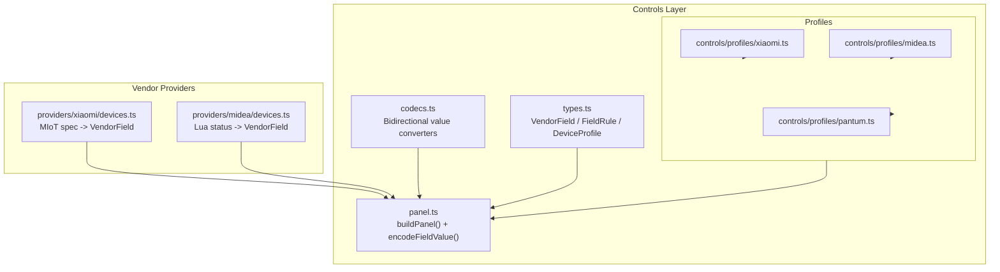
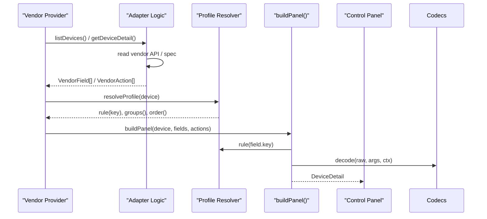
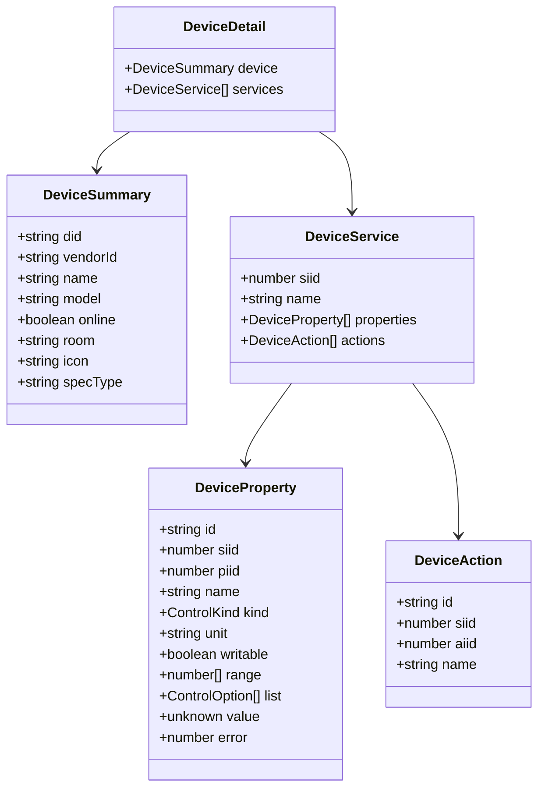
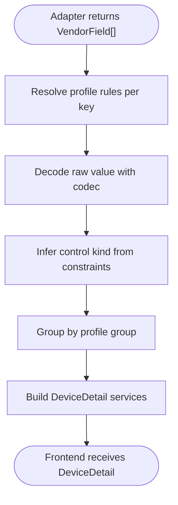
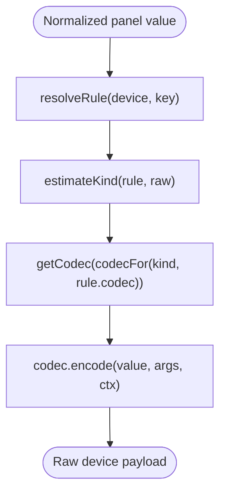
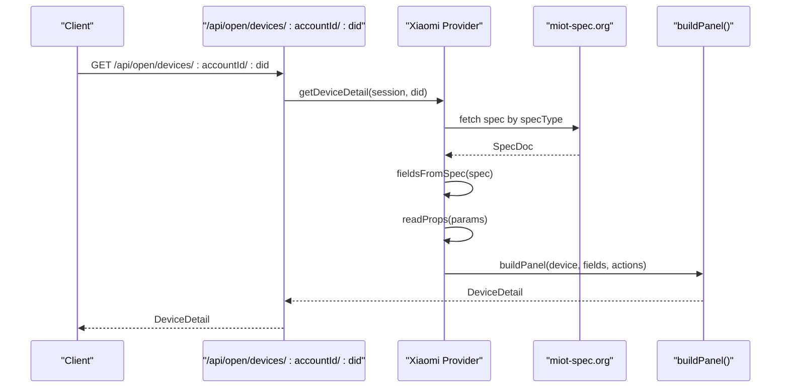
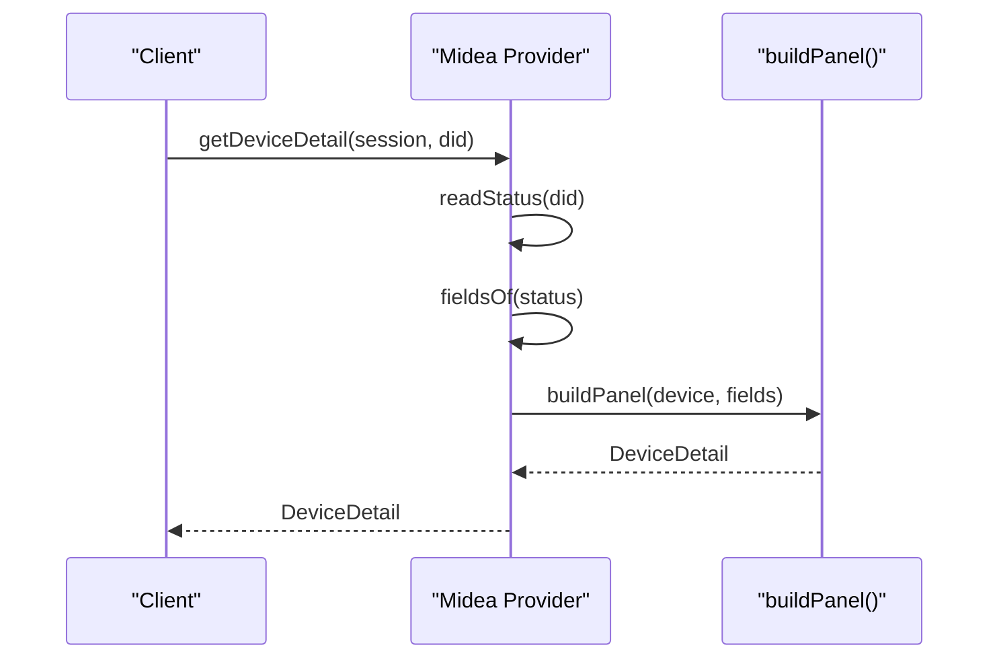
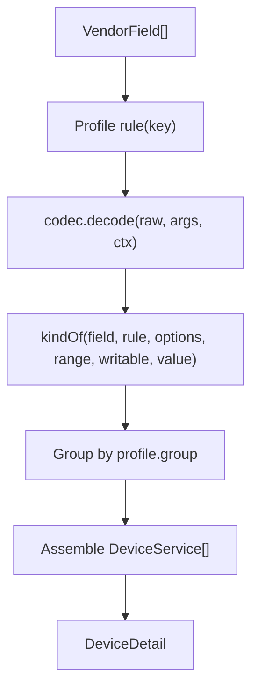
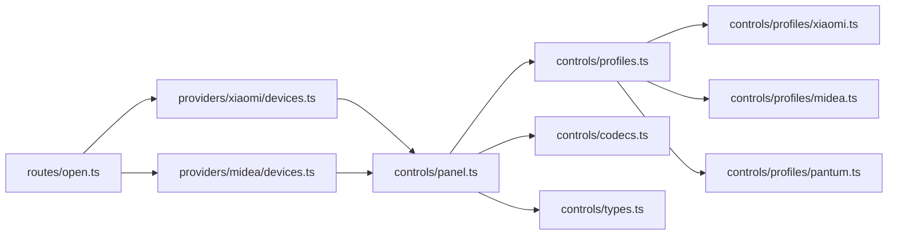

# Device Property Mapping

<cite>
**Referenced Files in This Document**
- [README.md](file://README.md)
- [types.ts](file://src/controls/types.ts)
- [panel.ts](file://src/controls/panel.ts)
- [profiles.ts](file://src/controls/profiles.ts)
- [codecs.ts](file://src/controls/codecs.ts)
- [xiaomi.ts](file://src/controls/profiles/xiaomi.ts)
- [midea.ts](file://src/controls/profiles/midea.ts)
- [pantum.ts](file://src/controls/profiles/pantum.ts)
- [devices.ts](file://src/providers/xiaomi/devices.ts)
- [devices.ts](file://src/providers/midea/devices.ts)
- [state.ts](file://src/providers/xiaomi/state.ts)
- [state.ts](file://src/providers/midea/state.ts)
- [open.ts](file://src/routes/open.ts)
</cite>

## Table of Contents
1. [Introduction](#introduction)
2. [Project Structure](#project-structure)
3. [Core Components](#core-components)
4. [Architecture Overview](#architecture-overview)
5. [Detailed Component Analysis](#detailed-component-analysis)
6. [Dependency Analysis](#dependency-analysis)
7. [Performance Considerations](#performance-considerations)
8. [Troubleshooting Guide](#troubleshooting-guide)
9. [Conclusion](#conclusion)

## Introduction
This document explains how vendor-specific device schemas are transformed into the standardized `DeviceDetail` format used by the control panel. It covers:
- The service-property-action model and how vendor protocols map to `siid`/`piid` identifiers.
- How vendor adapters produce minimal facts through `VendorField` and `VendorAction`.
- How `DeviceProfile` and `FieldRule` normalize values, choose UI controls, and group properties.
- How bidirectional codecs convert between normalized panel values and raw device payloads.
- Examples for Xiaomi MIoT spec devices, Midea Lua fields, and Pantum cloud actions.
- Challenges in reverse engineering vendor protocols and maintaining compatibility across firmware versions.

The goal is to make it possible to add or adjust mappings without changing adapter code, while keeping stable identifiers (`did`, `siid`, `piid`) for write-back operations.

## Project Structure
The mapping pipeline lives mainly under `src/controls` and is consumed by vendor providers under `src/providers`.

**Diagram sources**
- [types.ts:19-95](file://src/controls/types.ts#L19-L95)
- [profiles.ts:74-129](file://src/controls/profiles.ts#L74-L129)
- [codecs.ts:196-240](file://src/controls/codecs.ts#L196-L240)
- [panel.ts:102-166](file://src/controls/panel.ts#L102-L166)
- [devices.ts:131-172](file://src/providers/xiaomi/devices.ts#L131-L172)
- [devices.ts:18-31](file://src/providers/midea/devices.ts#L18-L31)
- [xiaomi.ts:8-40](file://src/controls/profiles/xiaomi.ts#L8-L40)
- [midea.ts:110-176](file://src/controls/profiles/midea.ts#L110-L176)
- [pantum.ts:4-14](file://src/controls/profiles/pantum.ts#L4-L14)

**Section sources**
- [README.md:3-57](file://README.md#L3-L57)
- [types.ts:19-95](file://src/controls/types.ts#L19-L95)
- [panel.ts:102-166](file://src/controls/panel.ts#L102-L166)

## Core Components
This section defines the core data structures that enable vendor-neutral property mapping.

### VendorField and VendorAction
- `VendorField` carries the stable field key, raw device value, writability, optional label/kind/unit/range/options, grouping, and protocol identifiers such as `siid`/`piid`.
- `VendorAction` carries action keys, names, groups, and identifiers like `siid`/`aiid`.
- These are the only outputs vendor adapters must produce; all UI semantics come from profiles.

**Section sources**
- [types.ts:19-47](file://src/controls/types.ts#L19-L47)

### FieldRule and DeviceProfile
- `FieldRule` declares display and conversion behavior: label, kind, unit, range, options, codec, digits, writability, hidden flag, order, and group.
- `DeviceProfile` matches a vendor/model/specType/device and merges rules using tiered specificity: exact field name > longest wildcard > fallback `"*"`.
- Profiles can also define global ordering, groups, omitted fields, and action overrides.

**Section sources**
- [types.ts:53-95](file://src/controls/types.ts#L53-L95)
- [profiles.ts:7-123](file://src/controls/profiles.ts#L7-L123)

### ResolvedField and DeviceDetail
- `ResolvedField` is the merged view after profile resolution and codec decoding.
- `DeviceDetail` contains a device summary plus services with normalized properties and actions.
- Properties carry stable `id`, explicit `kind`, normalized `value`, and protocol identifiers for write-back.

**Section sources**
- [types.ts:97-113](file://src/controls/types.ts#L97-L113)
- [types.ts:67-70](file://src/controls/types.ts#L67-L70)

## Architecture Overview
The system follows a three-layer design:
1. Vendor adapters translate vendor protocols into `VendorField`/`VendorAction`.
2. Profiles merge rules and apply codecs to produce normalized `ResolvedField`.
3. `buildPanel()` assembles `DeviceDetail`, which the frontend renders by `kind`.

**Diagram sources**
- [devices.ts:247-266](file://src/providers/xiaomi/devices.ts#L247-L266)
- [devices.ts:149-156](file://src/providers/midea/devices.ts#L149-L156)
- [profiles.ts:74-129](file://src/controls/profiles.ts#L74-L129)
- [panel.ts:102-154](file://src/controls/panel.ts#L102-L154)

## Detailed Component Analysis

### Service-Property-Action Model and siid/piid Mapping
Vendor providers expose a service-oriented model:
- Services contain properties and actions.
- Properties use `siid` (service ID) and `piid` (property ID).
- Actions use `siid` and `aiid` (action ID).
- The stable field `id` (often derived from semantic URN or Lua key) is preferred for write-back when present; otherwise `siid`/`piid` identify the target.

Xiaomi example:
- MIoT spec URNs are parsed to derive semantic keys like `<service>.<property>`.
- Read/write access, ranges, lists, units, and formats are translated into `VendorField`.
- Live properties are selected from spec metadata and fetched via `/miotspec/prop/get`.

Midea example:
- Lua status fields become `VendorField` entries keyed by Lua field names.
- Boolean-like values are treated as writable switches unless overridden by profiles.
- Write-back uses the same Lua field key and preserves original shape via `meta.asText`.

Pantum example:
- Cloud-only status fields are exposed as read-only properties.
- A custom action `print` is declared in the profile and rendered as an action button.

**Diagram sources**
- [types.ts:22-70](file://src/controls/types.ts#L22-L70)

**Section sources**
- [devices.ts:131-172](file://src/providers/xiaomi/devices.ts#L131-L172)
- [devices.ts:18-31](file://src/providers/midea/devices.ts#L18-L31)
- [pantum.ts:4-14](file://src/controls/profiles/pantum.ts#L4-L14)

### Transforming Vendor Schemas into DeviceDetail
The transformation pipeline:
1. Adapter reads vendor data and produces `VendorField[]` and `VendorAction[]`.
2. Profile resolver merges rules for each field key.
3. Codec decodes raw values into normalized panel values.
4. `buildPanel()` groups fields, assigns control kinds, and builds `DeviceDetail`.

**Diagram sources**
- [panel.ts:55-86](file://src/controls/panel.ts#L55-L86)
- [panel.ts:102-154](file://src/controls/panel.ts#L102-L154)

**Section sources**
- [panel.ts:55-86](file://src/controls/panel.ts#L55-L86)
- [panel.ts:102-154](file://src/controls/panel.ts#L102-L154)

### Bidirectional Codecs and Value Conversions
Codecs provide consistent decode/encode pairs:
- `identity`: pass-through.
- `bool`, `shapebool`, `shapenum`: boolean/numeric normalization with shape preservation on write-back.
- `auto`: auto-detect booleans and pass-through otherwise.
- `onoff`, `zeroone`, `numbool`: fixed boolean encodings.
- `number`: numeric rounding with configurable decimal places.
- `scale`, `offset`: linear transformations.
- `map`: enum mapping with table or pairs.
- `duration`: minutes to human-readable duration.

Write-back path:
- `encodeFieldValue()` resolves the final rule for the field key.
- Control kind is estimated again to pick the correct codec.
- The current raw value is passed as context so shape-preserving codecs can match the device’s expected payload format.

**Diagram sources**
- [panel.ts:161-166](file://src/controls/panel.ts#L161-L166)
- [codecs.ts:196-240](file://src/controls/codecs.ts#L196-L240)

**Section sources**
- [codecs.ts:196-240](file://src/controls/codecs.ts#L196-L240)
- [panel.ts:161-166](file://src/controls/panel.ts#L161-L166)

### Example: Xiaomi MIoT Spec Devices
- Adapter fetches MIoT spec by `specType` and converts services/properties/actions into `VendorField`/`VendorAction`.
- Semantic keys are derived from URN tails, e.g., `<service>.<property>`.
- Ranges, lists, units, and formats are preserved as constraints.
- Live properties are selected by scoring URN/description and fetching top candidates.

**Diagram sources**
- [devices.ts:247-266](file://src/providers/xiaomi/devices.ts#L247-L266)
- [open.ts:204-220](file://src/routes/open.ts#L204-L220)

**Section sources**
- [devices.ts:131-172](file://src/providers/xiaomi/devices.ts#L131-L172)
- [devices.ts:247-266](file://src/providers/xiaomi/devices.ts#L247-L266)
- [open.ts:204-220](file://src/routes/open.ts#L204-L220)

### Example: Midea Lua Fields
- Adapter reads device status via Lua API and maps each scalar field to `VendorField`.
- Boolean-like values are marked writable and inferred as switches.
- Profiles define labels, groups, ranges, and codecs for common appliances (AC, fridge, washer).
- Write-back sends the Lua field key with the encoded raw value.

**Diagram sources**
- [devices.ts:149-156](file://src/providers/midea/devices.ts#L149-L156)

**Section sources**
- [devices.ts:18-31](file://src/providers/midea/devices.ts#L18-L31)
- [devices.ts:149-156](file://src/providers/midea/devices.ts#L149-L156)
- [midea.ts:110-176](file://src/controls/profiles/midea.ts#L110-L176)

### Example: Pantum Cloud Actions
- Cloud provider exposes limited status fields.
- Profile declares a `print` action with a user-friendly label.
- Action rendering is independent of property codecs; it uses action rules and grouping.

**Section sources**
- [pantum.ts:4-14](file://src/controls/profiles/pantum.ts#L4-L14)

### Relationship Between Device Properties and Control Panel Generation
- `buildPanel()` is the single entry point for generating the control panel structure.
- It resolves profile rules, applies codecs, infers control kinds, groups items, and constructs services.
- Frontend renders based on `kind`; write-back uses the stable `id` to look up the same rule and codec.

**Diagram sources**
- [panel.ts:55-86](file://src/controls/panel.ts#L55-L86)
- [panel.ts:102-154](file://src/controls/panel.ts#L102-L154)

**Section sources**
- [panel.ts:55-86](file://src/controls/panel.ts#L55-L86)
- [panel.ts:102-154](file://src/controls/panel.ts#L102-L154)

## Dependency Analysis
Key dependencies and relationships:
- Providers depend on controls layer for panel building and encoding.
- Controls layer depends on types, profiles, and codecs.
- Profiles load built-in and runtime JSON files, merging them by tier and pattern specificity.
- Open API routes call provider methods and return normalized `DeviceDetail`.

**Diagram sources**
- [open.ts:204-220](file://src/routes/open.ts#L204-L220)
- [devices.ts:247-266](file://src/providers/xiaomi/devices.ts#L247-L266)
- [devices.ts:149-156](file://src/providers/midea/devices.ts#L149-L156)
- [panel.ts:102-154](file://src/controls/panel.ts#L102-L154)
- [profiles.ts:74-129](file://src/controls/profiles.ts#L74-L129)
- [codecs.ts:196-240](file://src/controls/codecs.ts#L196-L240)
- [xiaomi.ts:8-40](file://src/controls/profiles/xiaomi.ts#L8-L40)
- [midea.ts:110-176](file://src/controls/profiles/midea.ts#L110-L176)
- [pantum.ts:4-14](file://src/controls/profiles/pantum.ts#L4-L14)

**Section sources**
- [open.ts:204-220](file://src/routes/open.ts#L204-L220)
- [profiles.ts:74-129](file://src/controls/profiles.ts#L74-L129)

## Performance Considerations
- MIoT spec fetching is cached per `specType` to avoid repeated network calls.
- Property reads are chunked (e.g., 16 at a time) to reduce request size.
- Live updates select a small set of high-scoring properties to minimize payload.
- Runtime profiles are loaded once per directory stamp change and cached.

Recommendations:
- Prefer profile-driven normalization over heavy adapter logic.
- Use codecs to keep conversions deterministic and fast.
- Avoid unnecessary re-parsing of specs; rely on caching.

[No sources needed since this section provides general guidance]

## Troubleshooting Guide
Common issues and resolutions:
- Missing device detail: ensure device list was refreshed before reading details.
- Write-back errors: verify the field key exists and is not hidden by profile rules.
- Incorrect control kind: check profile `kind`, `options`, `range`, and codec configuration.
- Firmware changes: update profiles to override defaults; higher-tier profiles (model/did) take precedence.
- Authentication/session failures: provider checks session validity and throws structured errors.

Operational tips:
- Use `/api/profiles/resolve?accountId=&did=` to inspect the final rule chain for a device.
- Save runtime profiles to `data/profiles/<vendor>/<id>.json` for hot reloading.
- Audit open API usage and scopes to diagnose permission-related failures.

**Section sources**
- [devices.ts:247-266](file://src/providers/xiaomi/devices.ts#L247-L266)
- [devices.ts:149-156](file://src/providers/midea/devices.ts#L149-L156)
- [panel.ts:161-166](file://src/controls/panel.ts#L161-L166)
- [README.md:50-57](file://README.md#L50-L57)

## Conclusion
The device property mapping system separates vendor-specific parsing from UI presentation. Vendors emit minimal facts (`VendorField`/`VendorAction`), profiles define normalization and display semantics, and codecs handle bidirectional conversions. This architecture supports multiple device types, flexible value conversions, and stable protocol identifiers (`siid`/`piid`). It also provides mechanisms to adapt to firmware changes and reverse-engineered protocol quirks through layered, overridable profiles.

[No sources needed since this section summarizes without analyzing specific files]