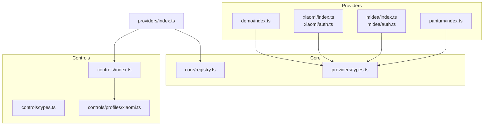
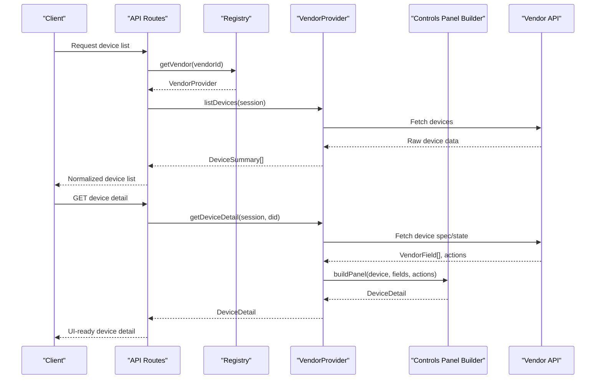
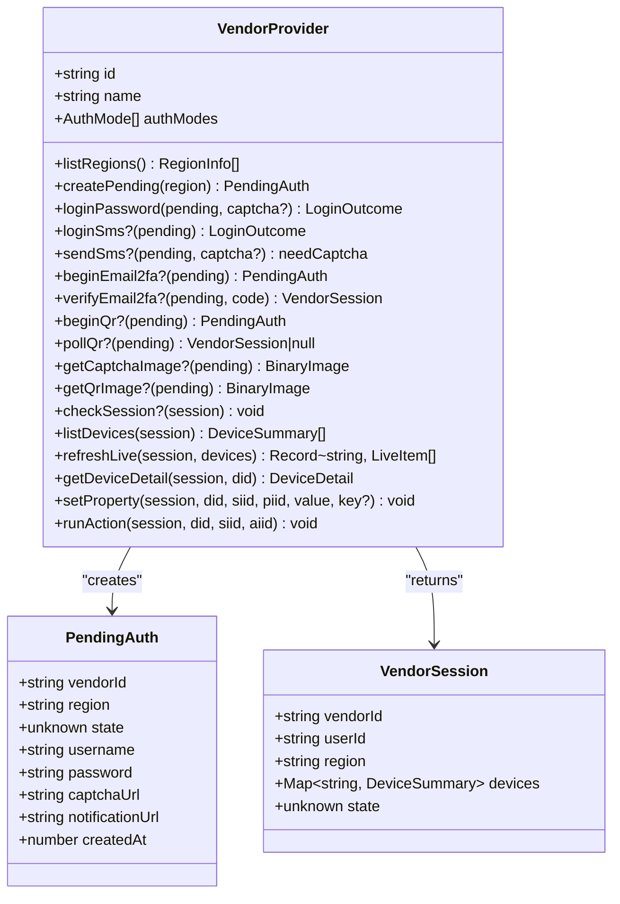
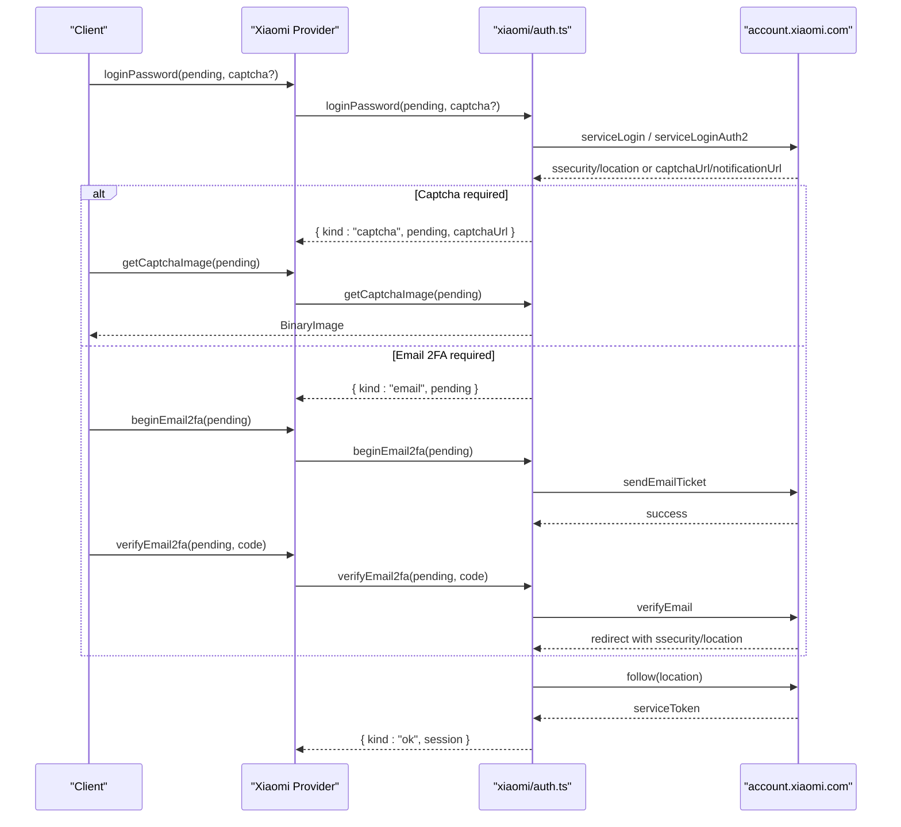
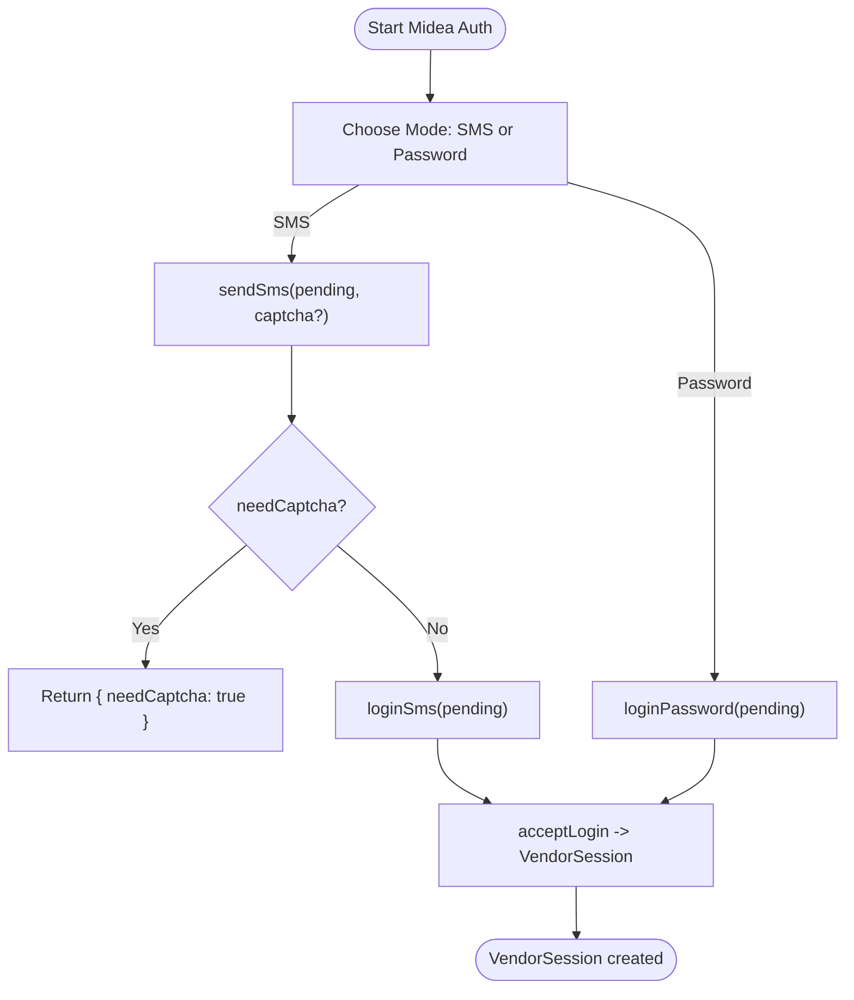
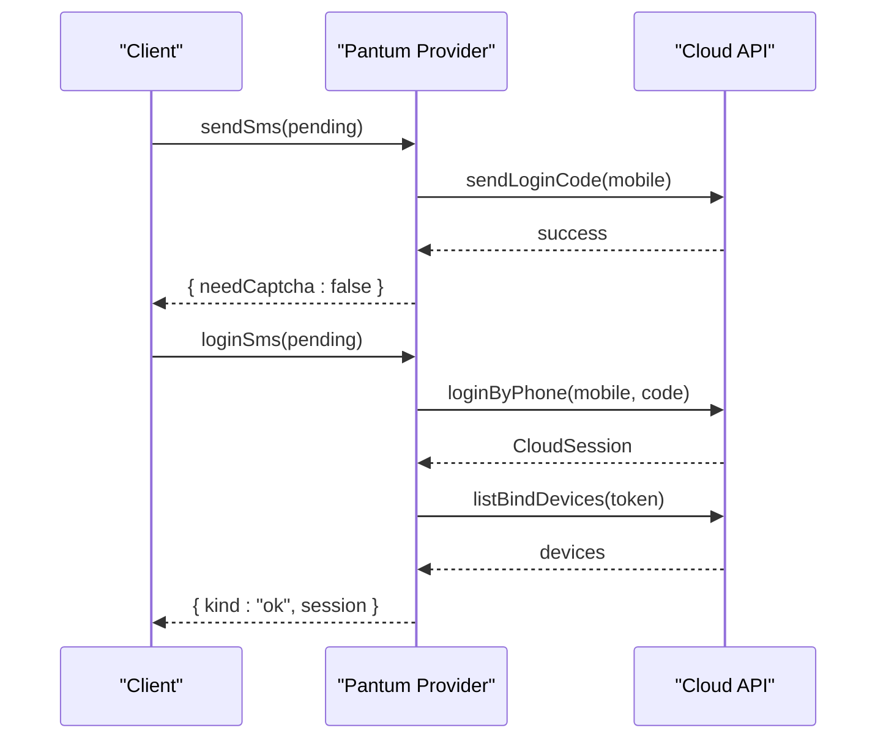
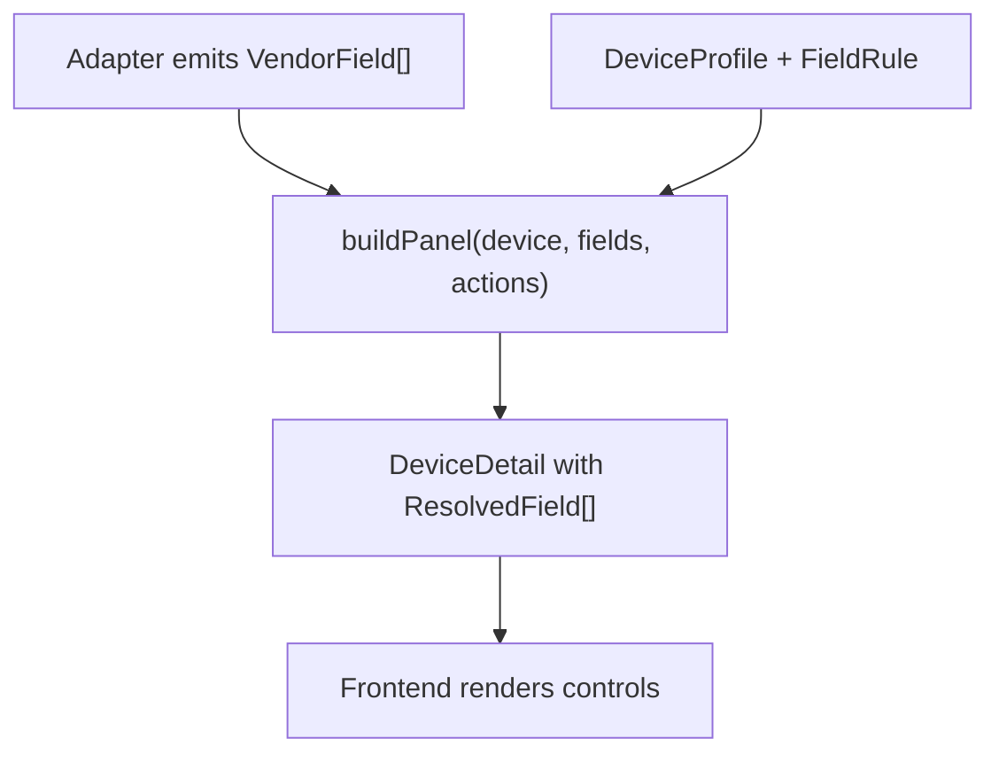
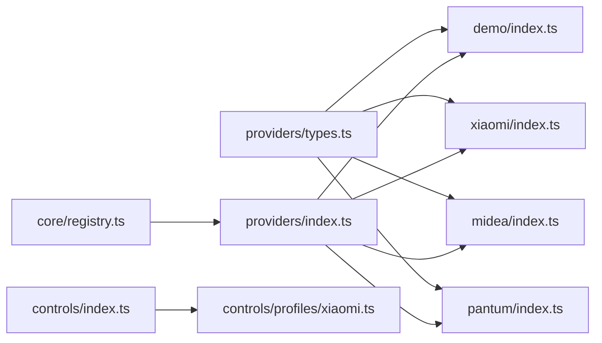

# Provider Development

<cite>
**Referenced Files in This Document**
- [types.ts](file://src/providers/types.ts)
- [index.ts](file://src/providers/demo/index.ts)
- [index.ts](file://src/providers/xiaomi/index.ts)
- [auth.ts](file://src/providers/xiaomi/auth.ts)
- [index.ts](file://src/providers/midea/index.ts)
- [auth.ts](file://src/providers/midea/auth.ts)
- [index.ts](file://src/providers/pantum/index.ts)
- [registry.ts](file://src/core/registry.ts)
- [index.ts](file://src/providers/index.ts)
- [types.ts](file://src/controls/types.ts)
- [index.ts](file://src/controls/index.ts)
- [xiaomi.ts](file://src/controls/profiles/xiaomi.ts)
- [README.md](file://README.md)
</cite>

## Table of Contents
1. [Introduction](#introduction)
2. [Project Structure](#project-structure)
3. [Core Components](#core-components)
4. [Architecture Overview](#architecture-overview)
5. [Detailed Component Analysis](#detailed-component-analysis)
6. [Dependency Analysis](#dependency-analysis)
7. [Performance Considerations](#performance-considerations)
8. [Troubleshooting Guide](#troubleshooting-guide)
9. [Conclusion](#conclusion)

## Introduction
This document explains how to implement custom vendor providers for the control panel system. It focuses on:
- The `VendorProvider` interface contract, including authentication, device discovery, property management, and action execution.
- Authentication flow patterns across different vendor ecosystems, such as Xiaomi’s multi-step account flow with QR and email verification, Midea’s SMS/password flows with encrypted payloads, and Pantum’s phone-based cloud login.
- Device property mapping strategies using the controls layer, where adapters emit minimal vendor fields and profiles define UI behavior.
- A step-by-step guide to creating a new provider using the demo provider as a template.
- Testing strategies and integration points with the registry and control panel.
- Common challenges in reverse engineering vendor protocols and normalizing data.

The goal is to make it possible to add a new vendor without changing the frontend or core routing logic, by implementing a single provider object and registering it at bootstrap.

## Project Structure
The provider system lives under `src/providers`, with each vendor having its own folder. The shared type contract is defined centrally, while the controls layer handles UI normalization through profiles.

**Diagram sources**
- [index.ts:1-17](file://src/providers/index.ts#L1-L17)
- [registry.ts:1-24](file://src/core/registry.ts#L1-L24)
- [types.ts:105-143](file://src/providers/types.ts#L105-L143)
- [index.ts:1-108](file://src/providers/demo/index.ts#L1-L108)
- [index.ts:1-30](file://src/providers/xiaomi/index.ts#L1-L30)
- [auth.ts:1-268](file://src/providers/xiaomi/auth.ts#L1-L268)
- [index.ts:1-27](file://src/providers/midea/index.ts#L1-L27)
- [auth.ts:1-176](file://src/providers/midea/auth.ts#L1-L176)
- [index.ts:1-112](file://src/providers/pantum/index.ts#L1-L112)
- [index.ts:1-25](file://src/controls/index.ts#L1-L25)
- [types.ts:1-114](file://src/controls/types.ts#L1-L114)
- [xiaomi.ts:1-41](file://src/controls/profiles/xiaomi.ts#L1-L41)

**Section sources**
- [index.ts:1-17](file://src/providers/index.ts#L1-L17)
- [registry.ts:1-24](file://src/core/registry.ts#L1-L24)
- [types.ts:105-143](file://src/providers/types.ts#L105-L143)
- [index.ts:1-25](file://src/controls/index.ts#L1-L25)
- [README.md:1-58](file://README.md#L1-L58)

## Core Components
At the center of provider development is the `VendorProvider` interface. It defines:
- Identity and capabilities: `id`, `name`, `authModes`.
- Region handling: `listRegions`, `createPending`.
- Authentication methods: password, SMS, QR, email 2FA, captcha retrieval, session validation.
- Device operations: listing devices, refreshing live status, reading device detail, setting properties, running actions.

The controls layer separates adapter logic from UI rendering:
- Adapters produce `VendorField` objects containing stable field keys, raw values, writability, and vendor-specific constraints.
- Profiles map those fields to user-facing controls (`kind`, `unit`, `range`, `options`, grouping).
- `buildPanel` merges adapter fields and profile rules into `DeviceDetail`, which the frontend renders.

Key responsibilities per component:
- `providers/types.ts`: Defines all provider contracts, sessions, pending auth, device summaries, properties, services, and actions.
- `providers/{vendor}/index.ts`: Exposes a `VendorProvider` instance that wires region info, pending creation, and method implementations.
- `providers/{vendor}/auth.ts` (where present): Implements vendor-specific authentication flows and session checks.
- `controls/types.ts`: Defines `VendorField`, `VendorAction`, `FieldRule`, `DeviceProfile`, and resolved field structures.
- `controls/index.ts`: Bootstraps built-in profiles and exports panel builders and encoders.
- `controls/profiles/*.ts`: Vendor-specific UI mappings and overrides.

**Section sources**
- [types.ts:1-144](file://src/providers/types.ts#L1-L144)
- [index.ts:1-108](file://src/providers/demo/index.ts#L1-L108)
- [types.ts:1-114](file://src/controls/types.ts#L1-L114)
- [index.ts:1-25](file://src/controls/index.ts#L1-L25)

## Architecture Overview
The provider architecture follows a clear separation:
- Providers encapsulate vendor protocol details and return normalized data.
- The controls layer normalizes vendor data into a consistent panel model.
- The registry manages provider lookup and enumeration.
- Bootstrap functions register providers and profiles once at startup.

**Diagram sources**
- [registry.ts:10-23](file://src/core/registry.ts#L10-L23)
- [index.ts:6-29](file://src/providers/xiaomi/index.ts#L6-L29)
- [index.ts:60-107](file://src/providers/demo/index.ts#L60-L107)
- [index.ts:1-25](file://src/controls/index.ts#L1-L25)

## Detailed Component Analysis

### VendorProvider Interface Specification
The `VendorProvider` interface specifies:
- Identity and capabilities:
  - `id`: Unique provider identifier.
  - `name`: Human-readable name.
  - `authModes`: Supported authentication modes like password, SMS, QR.
- Regions:
  - `listRegions()`: Returns available regions.
  - `createPending(region)`: Creates an incomplete login context for later steps.
- Authentication:
  - `loginPassword(pending, captcha?)`: May succeed immediately or require captcha/email.
  - `loginSms?(pending)`: Completes login via SMS code.
  - `sendSms?(pending, captcha?)`: Sends SMS; may require captcha.
  - `beginEmail2fa?(pending)`, `verifyEmail2fa?(pending, code)`: Email-based second factor.
  - `beginQr?(pending)`, `pollQr?(pending)`: QR login initiation and polling.
  - `getCaptchaImage?(pending)`, `getQrImage?(pending)`: Binary image retrieval.
  - `checkSession?(session)`: Validates session; throws on invalid state.
- Devices and control:
  - `listDevices(session)`: Populates `session.devices` and returns summaries.
  - `refreshLive(session, devices)`: Returns live status text per device.
  - `getDeviceDetail(session, did)`: Returns services, properties, and actions with current values.
  - `setProperty(session, did, siid, piid, value, key?)`: Writes a property using stable field key when available.
  - `runAction(session, did, siid, aiid)`: Executes a device action.

**Diagram sources**
- [types.ts:105-143](file://src/providers/types.ts#L105-L143)
- [types.ts:77-103](file://src/providers/types.ts#L77-L103)

**Section sources**
- [types.ts:105-143](file://src/providers/types.ts#L105-L143)

### Authentication Flow Patterns

#### Xiaomi: Multi-step Account Flow with QR and Email Verification
Xiaomi’s provider demonstrates a complex authentication sequence:
- Password login may require a captcha or email verification before completing.
- Email 2FA involves sending a ticket and verifying it to obtain tokens and location redirects.
- QR login initiates a long-polling endpoint and resolves to a session upon scan.
- Session validation checks passport status and throws errors on expiration.

**Diagram sources**
- [auth.ts:33-92](file://src/providers/xiaomi/auth.ts#L33-L92)
- [auth.ts:94-173](file://src/providers/xiaomi/auth.ts#L94-L173)
- [auth.ts:175-223](file://src/providers/xiaomi/auth.ts#L175-L223)
- [auth.ts:227-242](file://src/providers/xiaomi/auth.ts#L227-L242)

**Section sources**
- [auth.ts:1-268](file://src/providers/xiaomi/auth.ts#L1-L268)
- [index.ts:1-30](file://src/providers/xiaomi/index.ts#L1-L30)

#### Midea: SMS and Password Flows with Encrypted Payloads
Midea’s provider supports SMS and password authentication:
- SMS flow sends a code request, optionally requiring a captcha image embedded in the response.
- Password flow encrypts credentials using vendor-specific algorithms and obtains access tokens.
- Captcha images can be base64 or remote URLs; the implementation detects formats and returns binary images.

**Diagram sources**
- [auth.ts:51-86](file://src/providers/midea/auth.ts#L51-L86)
- [auth.ts:111-140](file://src/providers/midea/auth.ts#L111-L140)
- [auth.ts:142-175](file://src/providers/midea/auth.ts#L142-L175)

**Section sources**
- [auth.ts:1-176](file://src/providers/midea/auth.ts#L1-L176)
- [index.ts:1-27](file://src/providers/midea/index.ts#L1-L27)

#### Pantum: Phone-Based Cloud Login
Pantum uses SMS-only login:
- `sendSms` validates mobile numbers and calls the cloud API to send a login code.
- `loginSms` authenticates via phone and code, then refreshes bound devices.
- `checkSession` validates token by listing devices; property writes are disabled for cloud devices.

**Diagram sources**
- [index.ts:65-84](file://src/providers/pantum/index.ts#L65-L84)

**Section sources**
- [index.ts:1-112](file://src/providers/pantum/index.ts#L1-L112)

### Device Property Mapping Strategies
The controls layer decouples vendor data from UI rendering:
- Adapters emit `VendorField` objects with stable keys, raw values, writability, and optional constraints like unit, range, options, and metadata.
- Profiles define UI behavior: label, control kind, grouping, ordering, codec transformations, and hidden fields.
- `buildPanel` merges adapter fields and profile rules into `DeviceDetail`, which includes services, properties, and actions with normalized values.

**Diagram sources**
- [types.ts:18-47](file://src/controls/types.ts#L18-L47)
- [index.ts:1-25](file://src/controls/index.ts#L1-L25)
- [xiaomi.ts:1-41](file://src/controls/profiles/xiaomi.ts#L1-L41)

**Section sources**
- [types.ts:1-114](file://src/controls/types.ts#L1-L114)
- [index.ts:1-25](file://src/controls/index.ts#L1-L25)
- [xiaomi.ts:1-41](file://src/controls/profiles/xiaomi.ts#L1-L41)
- [README.md:1-58](file://README.md#L1-L58)

### Step-by-Step Guide: Creating a New Provider Using the Demo Template
Use the demo provider as a starting point:
1. Create a new folder under `src/providers/<your-vendor>/`.
2. Implement a `VendorProvider` object following the interface contract:
   - Define `id`, `name`, `authModes`.
   - Implement `listRegions` and `createPending`.
   - Implement authentication methods based on your vendor’s protocol (password, SMS, QR, email 2FA).
   - Implement `listDevices`, `refreshLive`, `getDeviceDetail`, `setProperty`, and `runAction`.
3. Emit `VendorField` arrays from `getDeviceDetail` with stable keys and raw values.
4. Add vendor-specific profiles under `src/controls/profiles/<your-vendor>.ts` to map fields to UI controls.
5. Register the provider in `src/providers/index.ts` by calling `registerVendor(yourProvider)` inside `bootstrapProviders`.
6. Optionally export the provider alongside others for testing and inspection.

Example references:
- Demo provider structure and minimal implementation: [index.ts:1-108](file://src/providers/demo/index.ts#L1-L108)
- Registration entry point: [index.ts:1-17](file://src/providers/index.ts#L1-L17)
- Controls bootstrap and profile registration: [index.ts:1-25](file://src/controls/index.ts#L1-L25)

**Section sources**
- [index.ts:1-108](file://src/providers/demo/index.ts#L1-L108)
- [index.ts:1-17](file://src/providers/index.ts#L1-L17)
- [index.ts:1-25](file://src/controls/index.ts#L1-L25)

### Testing Strategies for Provider Implementations
Recommended testing approaches:
- Unit tests for authentication flows:
  - Validate pending creation and region handling.
  - Mock vendor HTTP endpoints to test captcha, SMS, QR, and email flows.
  - Assert error codes and messages for invalid inputs.
- Integration tests for device operations:
  - Mock device lists and live status responses.
  - Verify `getDeviceDetail` produces correct `DeviceDetail` with services and properties.
  - Test `setProperty` and `runAction` error paths and successful invocations.
- Controls layer tests:
  - Ensure `buildPanel` merges adapter fields and profile rules correctly.
  - Validate `encodeFieldValue` reverses transformations using stable field keys.
- Registry tests:
  - Confirm providers are registered and retrievable by ID.
  - Validate `listVendors` returns expected metadata.

Reference points:
- Error handling pattern via `AppError`: [index.ts:70-78](file://src/providers/demo/index.ts#L70-L78)
- Provider registration: [index.ts:8-14](file://src/providers/index.ts#L8-L14)
- Registry lookup and enumeration: [registry.ts:6-23](file://src/core/registry.ts#L6-L23)

**Section sources**
- [index.ts:60-107](file://src/providers/demo/index.ts#L60-L107)
- [index.ts:1-17](file://src/providers/index.ts#L1-L17)
- [registry.ts:1-24](file://src/core/registry.ts#L1-L24)

### Integration with the Control Panel System
Integration points:
- Providers must return normalized `DeviceDetail` objects composed via `buildPanel`.
- Profiles define UI semantics; adapters should avoid embedding display logic.
- The controls layer exposes utilities for encoding/decoding field values and formatting panel values.

Best practices:
- Use stable field keys in `VendorField.key` so write-back operations resolve correctly.
- Provide vendor-specific metadata only when necessary (e.g., Midea’s boolStyle).
- Keep adapter logic focused on protocol translation and data normalization.

**Section sources**
- [index.ts:1-25](file://src/controls/index.ts#L1-L25)
- [types.ts:18-47](file://src/controls/types.ts#L18-L47)
- [README.md:1-58](file://README.md#L1-L58)

## Dependency Analysis
The dependency graph shows how providers depend on shared types and how the registry centralizes provider access.

**Diagram sources**
- [types.ts:105-143](file://src/providers/types.ts#L105-L143)
- [index.ts:1-108](file://src/providers/demo/index.ts#L1-L108)
- [index.ts:1-30](file://src/providers/xiaomi/index.ts#L1-L30)
- [index.ts:1-27](file://src/providers/midea/index.ts#L1-L27)
- [index.ts:1-112](file://src/providers/pantum/index.ts#L1-L112)
- [registry.ts:1-24](file://src/core/registry.ts#L1-L24)
- [index.ts:1-17](file://src/providers/index.ts#L1-L17)
- [index.ts:1-25](file://src/controls/index.ts#L1-L25)
- [xiaomi.ts:1-41](file://src/controls/profiles/xiaomi.ts#L1-L41)

**Section sources**
- [index.ts:1-17](file://src/providers/index.ts#L1-L17)
- [registry.ts:1-24](file://src/core/registry.ts#L1-L24)

## Performance Considerations
- Minimize network round-trips by batching device listings and live updates where vendors allow.
- Cache vendor-specific configuration (regions, profiles) appropriately; profiles already support hot reload via file mtime.
- Avoid heavy transformations in authentication flows; keep crypto and parsing efficient.
- Use stable field keys to reduce reconciliation overhead in the frontend.

[No sources needed since this section provides general guidance]

## Troubleshooting Guide
Common issues and resolutions:
- Authentication failures:
  - Check pending state initialization and region selection.
  - Validate input formats (mobile numbers, passwords, captcha codes).
  - Inspect error codes returned by vendor APIs and map them to user-friendly messages.
- Session expiration:
  - Implement `checkSession` to proactively detect expired tokens and prompt re-login.
- Device not found:
  - Ensure `listDevices` populates `session.devices` and `getDeviceDetail` validates device existence.
- Property write errors:
  - Verify stable field keys are provided and match profile definitions.
  - Use `encodeFieldValue` to normalize values before sending to vendor APIs.

Reference points:
- Error throwing patterns: [index.ts:70-78](file://src/providers/demo/index.ts#L70-L78), [index.ts:105-110](file://src/providers/pantum/index.ts#L105-L110)
- Session validation example: [auth.ts:227-242](file://src/providers/xiaomi/auth.ts#L227-L242)

**Section sources**
- [index.ts:70-78](file://src/providers/demo/index.ts#L70-L78)
- [index.ts:105-110](file://src/providers/pantum/index.ts#L105-L110)
- [auth.ts:227-242](file://src/providers/xiaomi/auth.ts#L227-L242)

## Conclusion
Implementing a custom vendor provider requires adhering to the `VendorProvider` interface, focusing on clean authentication flows, normalized device data, and robust property/action handling. The controls layer ensures consistent UI rendering through profiles, allowing adapters to remain protocol-focused. By following the demo provider template, leveraging the registry, and applying the testing strategies outlined here, you can integrate new vendors efficiently and maintain a scalable control panel system.

[No sources needed since this section summarizes without analyzing specific files]