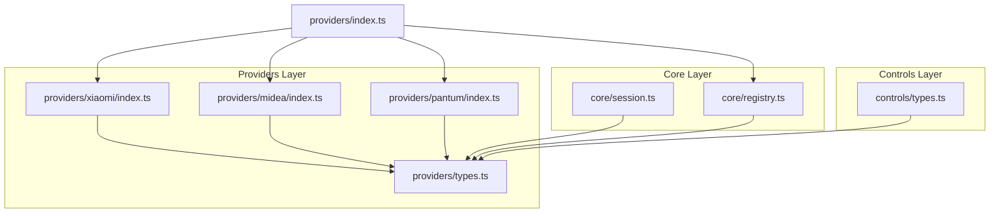
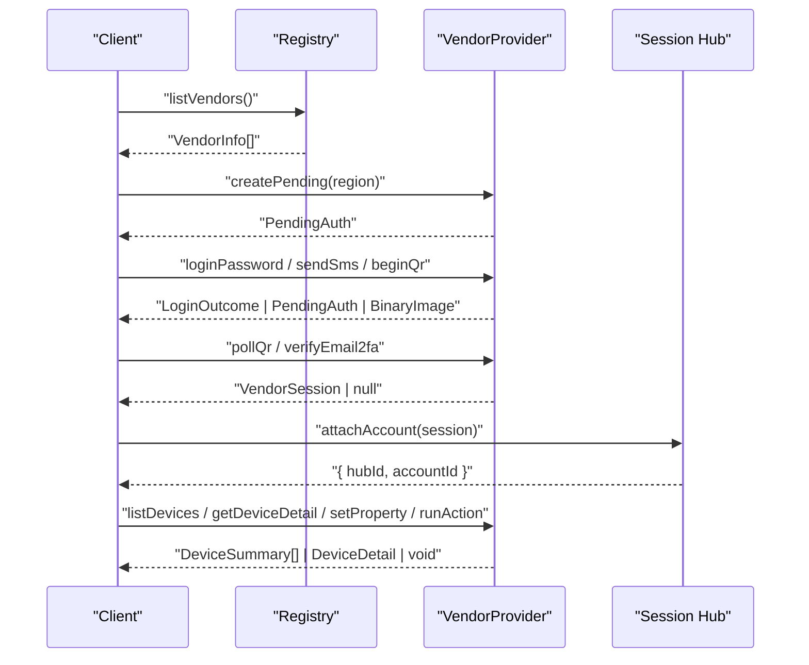
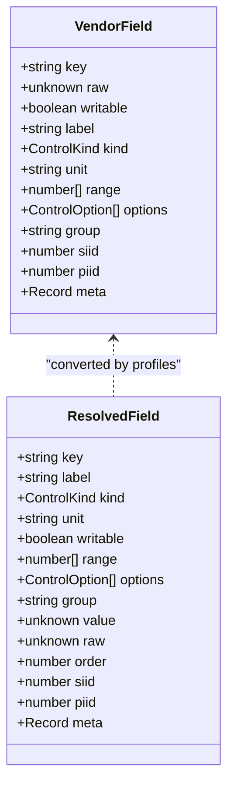
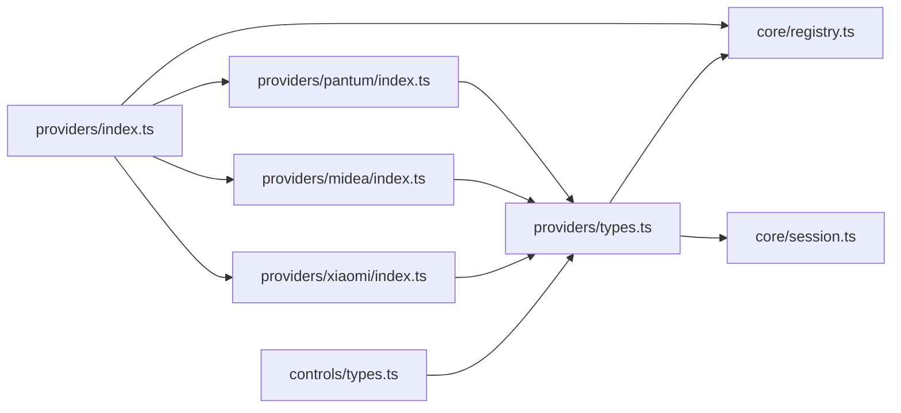

# Provider Interface Specification

<cite>
**Referenced Files in This Document**
- [types.ts](file://src/providers/types.ts)
- [session.ts](file://src/core/session.ts)
- [registry.ts](file://src/core/registry.ts)
- [index.ts](file://src/providers/index.ts)
- [xiaomi/index.ts](file://src/providers/xiaomi/index.ts)
- [midea/index.ts](file://src/providers/midea/index.ts)
- [pantum/index.ts](file://src/providers/pantum/index.ts)
- [controls/types.ts](file://src/controls/types.ts)
</cite>

## Table of Contents
1. [Introduction](#introduction)
2. [Project Structure](#project-structure)
3. [Core Components](#core-components)
4. [Architecture Overview](#architecture-overview)
5. [Detailed Component Analysis](#detailed-component-analysis)
6. [Dependency Analysis](#dependency-analysis)
7. [Performance Considerations](#performance-considerations)
8. [Troubleshooting Guide](#troubleshooting-guide)
9. [Conclusion](#conclusion)

## Introduction
This document specifies the VendorProvider interface contract used by the system to integrate different smart-device vendors. It explains required and optional methods, authentication flows, device management operations, property writes, action execution, data models such as VendorSession, DeviceSummary, DeviceDetail, and PendingAuth, and how sessions and pending authentication contexts are managed across the application.

The goal is to help implementers build a correct vendor provider, understand how the runtime uses it, and troubleshoot common integration issues.

## Project Structure
The provider specification lives in the providers layer, while session persistence, account hub management, and vendor registration live in the core layer. Concrete vendor implementations (Xiaomi, Midea, Pantum, Demo) register themselves through a central bootstrap function.

**Diagram sources**
- [providers/index.ts:8-16](file://src/providers/index.ts#L8-L16)
- [core/registry.ts:1-23](file://src/core/registry.ts#L1-L23)
- [core/session.ts:1-35](file://src/core/session.ts#L1-L35)
- [providers/types.ts:1-144](file://src/providers/types.ts#L1-L144)
- [controls/types.ts:1-114](file://src/controls/types.ts#L1-L114)

**Section sources**
- [providers/index.ts:8-16](file://src/providers/index.ts#L8-L16)
- [core/registry.ts:1-23](file://src/core/registry.ts#L1-L23)
- [core/session.ts:1-35](file://src/core/session.ts#L1-L35)
- [providers/types.ts:1-144](file://src/providers/types.ts#L1-L144)
- [controls/types.ts:1-114](file://src/controls/types.ts#L1-L114)

## Core Components
The VendorProvider interface defines the contract between the runtime and vendor-specific adapters. Key responsibilities include:
- Declaring vendor identity and supported authentication modes.
- Managing regions and pending authentication contexts.
- Performing login flows for password, SMS, and QR-based authentication.
- Listing devices, refreshing live status, reading device details, writing properties, and executing actions.

Important related types:
- AuthMode: "password", "sms", or "qr".
- RegionInfo: vendor service region identifier and display name.
- VendorInfo: metadata returned by the registry listing available vendors.
- VendorSession: authenticated context including vendor/user identifiers, region, cached device summaries, and vendor-private state.
- PendingAuth: incomplete authentication context that can be passed across steps like sending SMS, submitting captcha, scanning QR, or completing email 2FA.
- DeviceSummary, DeviceDetail, DeviceService, DeviceProperty, DeviceAction: device model abstractions consumed by the control panel.

**Section sources**
- [providers/types.ts:3-144](file://src/providers/types.ts#L3-L144)
- [core/registry.ts:10-23](file://src/core/registry.ts#L10-L23)

## Architecture Overview
The runtime discovers providers via the registry, exposes vendor capabilities, and routes API calls to the appropriate provider implementation. Sessions are stored in an in-memory hub with persistence to disk, and pending authentication contexts are kept temporarily with TTL-based expiration.

**Diagram sources**
- [core/registry.ts:10-23](file://src/core/registry.ts#L10-L23)
- [core/session.ts:184-210](file://src/core/session.ts#L184-L210)
- [providers/types.ts:105-143](file://src/providers/types.ts#L105-L143)

## Detailed Component Analysis

### VendorProvider Interface
The VendorProvider interface is the central contract. Implementations must provide:
- Identity fields: id, name, authModes.
- Region management: listRegions.
- Pending context creation: createPending.
- Authentication methods: loginPassword is required; loginSms, sendSms, beginEmail2fa, verifyEmail2fa, beginQr, pollQr, getCaptchaImage, getQrImage are optional depending on supported authModes.
- Session validation: checkSession is optional but recommended.
- Device operations: listDevices, refreshLive, getDeviceDetail, setProperty, runAction.

Method categories:
- Authentication flows:
  - Password login: loginPassword(pending, captcha?) returns LoginOutcome.
  - SMS login: loginSms(pending) returns LoginOutcome; sendSms(pending, captcha?) returns { needCaptcha }.
  - QR login: beginQr(pending) returns PendingAuth; pollQr(pending) returns VendorSession | null.
  - Email 2FA: beginEmail2fa(pending) returns PendingAuth; verifyEmail2fa(pending, code) returns VendorSession.
  - Captcha images: getCaptchaImage(pending), getQrImage(pending).
- Device management:
  - listDevices(session) returns DeviceSummary[] and updates session.devices.
  - refreshLive(session, devices) returns per-device live items.
  - getDeviceDetail(session, did) returns DeviceDetail.
- Property and action operations:
  - setProperty(session, did, siid, piid, value, key?) writes a device property.
  - runAction(session, did, siid, aiid) executes a device action.

Return types:
- LoginOutcome is a discriminated union:
  - ok: contains VendorSession.
  - captcha: requires user interaction with a captcha URL.
  - email: requires email 2FA flow.

Error handling:
- Providers should throw AppError for invalid inputs, unsupported operations, or failed network calls. The runtime expects these errors to carry a type and HTTP-like status code.

Implementation requirements:
- If a method is not applicable to a vendor, either omit it (if marked optional) or throw a clear error indicating the operation is unsupported.
- Always validate parameters before calling vendor APIs.
- Keep session.state vendor-private and serializable where possible.

**Section sources**
- [providers/types.ts:105-143](file://src/providers/types.ts#L105-L143)

### Data Models

#### VendorSession
Represents an authenticated vendor session. It includes:
- vendorId: vendor identifier.
- userId: user identifier within the vendor.
- region: selected service region.
- devices: Map of device summaries keyed by device id.
- state: vendor-private runtime state, potentially containing tokens, cookies, or other credentials.

Usage patterns:
- Returned by successful login flows.
- Passed into device operations like listDevices, getDeviceDetail, setProperty, runAction.
- Stored in the session hub and persisted to disk.

Persistence considerations:
- The session hub encodes complex values like Buffer, Map, and CookieJar for storage.
- Sensitive fields like passwords are excluded from persistence.

**Section sources**
- [providers/types.ts:77-84](file://src/providers/types.ts#L77-L84)
- [core/session.ts:37-70](file://src/core/session.ts#L37-L70)
- [core/session.ts:80-98](file://src/core/session.ts#L80-L98)

#### PendingAuth
Represents an incomplete authentication context that can be passed across multiple steps. It includes:
- id: optional unique identifier assigned by the session hub.
- vendorId: vendor identifier.
- region: selected service region.
- state: vendor-private pending state.
- username/password: may hold phone number, email, or temporary credentials depending on flow.
- captchaUrl/notificationUrl: URLs for UI-driven interactions.
- replaceAccountId: optional target account id when re-login replaces an existing account.
- createdAt: timestamp used for TTL expiration.

Usage patterns:
- Created by createPending(region).
- Updated by beginQr, beginEmail2fa, sendSms, etc.
- Consumed by loginPassword, loginSms, verifyEmail2fa, pollQr.
- Managed by keepPending/takePending/peekPending/putPending/dropPending with TTL.

**Section sources**
- [providers/types.ts:86-103](file://src/providers/types.ts#L86-L103)
- [core/session.ts:230-265](file://src/core/session.ts#L230-L265)

#### DeviceSummary
Lightweight device representation used in lists and caches. Fields include:
- did: device id.
- accountId: optional account id.
- vendorId: vendor identifier.
- name, model: human-readable device info.
- online: connectivity status.
- room: logical location or grouping label.
- icon: asset reference.
- specType: capability identifier.
- live: optional live status items.

Usage patterns:
- Returned by listDevices.
- Cached in session.devices.
- Used by refreshLive to attach live status.

**Section sources**
- [providers/types.ts:22-33](file://src/providers/types.ts#L22-L33)

#### DeviceDetail
Full device view presented to the control panel. It includes:
- device: DeviceSummary.
- services: array of DeviceService entries, each with properties and actions.

DeviceService:
- siid: service identifier.
- name: service name.
- properties: DeviceProperty[].
- actions: DeviceAction[].

DeviceProperty:
- id: stable field name preferred for writes.
- siid/piid: native identifiers.
- name: display name.
- kind: control type inferred by controls layer.
- format/unit: vendor-native metadata.
- writable/range/list/value/error: constraints and current value.

DeviceAction:
- id/siid/aiid/name: action identifiers and label.

Usage patterns:
- Returned by getDeviceDetail.
- Consumed by the control panel to render switches, sliders, selects, and action buttons.

**Section sources**
- [providers/types.ts:35-70](file://src/providers/types.ts#L35-L70)

#### Control Model Integration
The controls layer transforms vendor-provided raw fields into standardized control views. VendorField describes the minimal fact a provider outputs, including key, raw value, writability, and optional constraints. ResolvedField is the merged view used by both provider and frontend.

**Diagram sources**
- [controls/types.ts:18-47](file://src/controls/types.ts#L18-L47)
- [controls/types.ts:97-113](file://src/controls/types.ts#L97-L113)

**Section sources**
- [controls/types.ts:18-47](file://src/controls/types.ts#L18-L47)
- [controls/types.ts:97-113](file://src/controls/types.ts#L97-L113)

### Authentication Modes and Implementation Requirements

#### Password Mode
- Required method: loginPassword(pending, captcha?).
- Returns LoginOutcome:
  - ok: VendorSession if credentials are valid.
  - captcha: PendingAuth plus captchaUrl if a graphic captcha is required.
  - email: PendingAuth if email 2FA is required.
- Validation:
  - Ensure pending has required fields like username/password.
  - Validate captcha input if provided.
- Example signature path:
  - [loginPassword:114-114](file://src/providers/types.ts#L114-L114)

#### SMS Mode
- Optional methods:
  - sendSms(pending, captcha?): returns { needCaptcha }.
  - loginSms(pending): returns LoginOutcome.
- Validation:
  - Validate phone number format and presence of verification code.
  - Handle captcha requirement from vendor API.
- Example signature paths:
  - [sendSms:118-118](file://src/providers/types.ts#L118-L118)
  - [loginSms:116-116](file://src/providers/types.ts#L116-L116)

#### QR Mode
- Optional methods:
  - beginQr(pending): returns PendingAuth with QR URL.
  - pollQr(pending): returns VendorSession | null until scanned.
  - getQrImage(pending): returns BinaryImage for QR image rendering.
- Validation:
  - Ensure pending has region and vendorId.
  - Polling should return null while waiting for scan.
- Example signature paths:
  - [beginQr:124-124](file://src/providers/types.ts#L124-L124)
  - [pollQr:126-126](file://src/providers/types.ts#L126-L126)
  - [getQrImage:130-130](file://src/providers/types.ts#L130-L130)

#### Email 2FA Mode
- Optional methods:
  - beginEmail2fa(pending): returns PendingAuth to trigger email code.
  - verifyEmail2fa(pending, code): returns VendorSession upon success.
- Validation:
  - Ensure pending contains email address.
  - Validate code format and expiry.
- Example signature paths:
  - [beginEmail2fa:120-120](file://src/providers/types.ts#L120-L120)
  - [verifyEmail2fa:122-122](file://src/providers/types.ts#L122-L122)

#### Captcha Images
- Optional method: getCaptchaImage(pending): returns BinaryImage.
- Use cases:
  - Display graphic captcha during password or SMS flows.
- Example signature path:
  - [getCaptchaImage:128-128](file://src/providers/types.ts#L128-L128)

**Section sources**
- [providers/types.ts:114-130](file://src/providers/types.ts#L114-L130)

### Device Management Operations

#### listDevices
- Purpose: Fetch device list for the authenticated session and update session.devices.
- Parameters: session.
- Return: DeviceSummary[].
- Validation:
  - Ensure session is valid and not expired.
  - Update session.devices map with fetched devices.
- Example signature path:
  - [listDevices:134-134](file://src/providers/types.ts#L134-L134)

#### refreshLive
- Purpose: Read current device status and return live items per device.
- Parameters: session, devices.
- Return: Record<string, LiveItem[]>.
- Validation:
  - Use provided devices to avoid redundant lookups.
- Example signature path:
  - [refreshLive:136-136](file://src/providers/types.ts#L136-L136)

#### getDeviceDetail
- Purpose: Read controllable properties and actions for a specific device.
- Parameters: session, did.
- Return: DeviceDetail.
- Validation:
  - Verify device exists in session.devices or fetch from vendor API.
- Example signature path:
  - [getDeviceDetail:138-138](file://src/providers/types.ts#L138-L138)

**Section sources**
- [providers/types.ts:134-138](file://src/providers/types.ts#L134-L138)

### Property and Action Operations

#### setProperty
- Purpose: Write a device property.
- Parameters: session, did, siid, piid, value, key?.
- Return: Promise<void>.
- Validation:
  - Prefer stable field name key if provided; otherwise use siid/piid.
  - Validate value against property constraints.
- Example signature path:
  - [setProperty:140-140](file://src/providers/types.ts#L140-L140)

#### runAction
- Purpose: Execute a device action.
- Parameters: session, did, siid, aiid.
- Return: Promise<void>.
- Validation:
  - Ensure action exists and is executable.
- Example signature path:
  - [runAction:142-142](file://src/providers/types.ts#L142-L142)

**Section sources**
- [providers/types.ts:140-142](file://src/providers/types.ts#L140-L142)

### Concrete Provider Examples

#### Xiaomi Provider
- Supported authModes: ["password", "qr"].
- Delegates most logic to internal auth and devices modules.
- Implements:
  - listRegions, createPending, loginPassword, beginEmail2fa, verifyEmail2fa, beginQr, pollQr, getCaptchaImage, getQrImage, checkSession.
  - listDevices, refreshLive, getDeviceDetail, setProperty, runAction.

**Section sources**
- [xiaomi/index.ts:6-29](file://src/providers/xiaomi/index.ts#L6-L29)

#### Midea Provider
- Supported authModes: ["sms", "password"].
- Implements:
  - listRegions, createPending, loginPassword, loginSms, sendSms, getCaptchaImage, checkSession.
  - listDevices, refreshLive, getDeviceDetail, setProperty, runAction.

**Section sources**
- [midea/index.ts:6-26](file://src/providers/midea/index.ts#L6-L26)

#### Pantum Provider
- Supported authModes: ["sms"].
- Implements SMS-only flow and cloud printing actions.
- Throws AppError for unsupported operations like property writes and generic actions.

**Section sources**
- [pantum/index.ts:52-111](file://src/providers/pantum/index.ts#L52-L111)

## Dependency Analysis
The provider ecosystem depends on:
- providers/types.ts: Defines all shared interfaces and data models.
- core/registry.ts: Registers and retrieves providers, exposing VendorInfo.
- core/session.ts: Manages session hubs, account persistence, and pending auth lifecycle.
- controls/types.ts: Provides control model abstractions used by providers to construct DeviceDetail.

**Diagram sources**
- [providers/types.ts:1-144](file://src/providers/types.ts#L1-L144)
- [core/registry.ts:1-23](file://src/core/registry.ts#L1-L23)
- [core/session.ts:1-35](file://src/core/session.ts#L1-L35)
- [controls/types.ts:1-114](file://src/controls/types.ts#L1-L114)
- [providers/index.ts:8-16](file://src/providers/index.ts#L8-L16)

**Section sources**
- [providers/types.ts:1-144](file://src/providers/types.ts#L1-L144)
- [core/registry.ts:1-23](file://src/core/registry.ts#L1-L23)
- [core/session.ts:1-35](file://src/core/session.ts#L1-L35)
- [controls/types.ts:1-114](file://src/controls/types.ts#L1-L114)
- [providers/index.ts:8-16](file://src/providers/index.ts#L8-L16)

## Performance Considerations
- Avoid unnecessary network calls:
  - Use session.devices cache populated by listDevices.
  - Leverage refreshLive with pre-fetched devices to minimize requests.
- Batch operations:
  - Where vendor APIs allow, batch device detail reads or property writes.
- Serialization overhead:
  - Be mindful of encoding complex state objects for persistence; exclude sensitive fields.
- Polling efficiency:
  - For QR polling, implement backoff strategies to reduce load.

[No sources needed since this section provides general guidance]

## Troubleshooting Guide
Common issues and resolutions:
- Unsupported operation:
  - Some providers intentionally throw AppError for unsupported methods (e.g., property writes on cloud-only devices). Check provider documentation and adjust client behavior accordingly.
- Invalid pending context:
  - Ensure PendingAuth has required fields like vendorId, region, username/password depending on flow.
- Expired sessions:
  - Use checkSession to detect invalid sessions; handle re-authentication flows.
- Missing device:
  - Verify device existence in session.devices before calling getDeviceDetail or setProperty.
- Captcha and 2FA flows:
  - Follow LoginOutcome branches: handle captchaUrl and email 2FA steps as indicated.

**Section sources**
- [pantum/index.ts:62-75](file://src/providers/pantum/index.ts#L62-L75)
- [providers/types.ts:86-103](file://src/providers/types.ts#L86-L103)
- [providers/types.ts:131-132](file://src/providers/types.ts#L131-L132)

## Conclusion
The VendorProvider interface standardizes how vendor adapters integrate with the system. By adhering to the specified methods, data models, and error handling patterns, implementers can support diverse authentication flows and device operations consistently. The session hub and registry provide robust lifecycle management and discovery mechanisms, while the controls layer ensures a unified presentation of device properties and actions.

[No sources needed since this section summarizes without analyzing specific files]