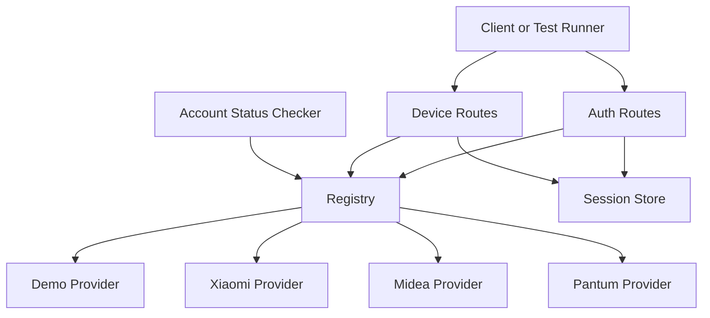
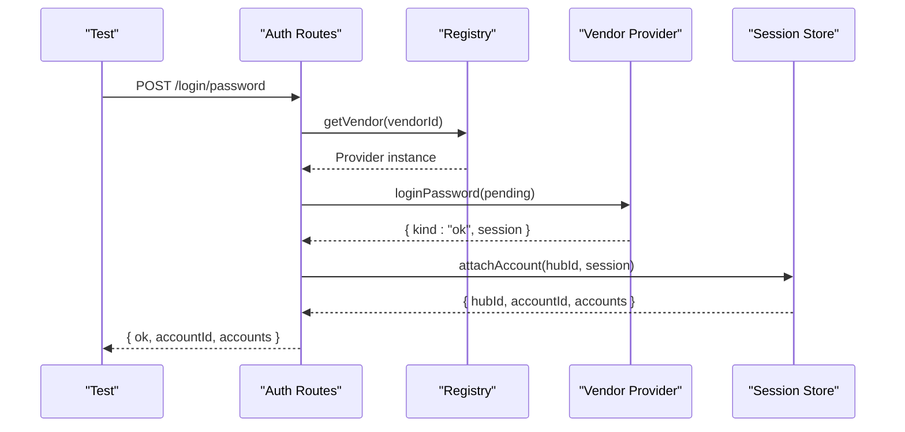
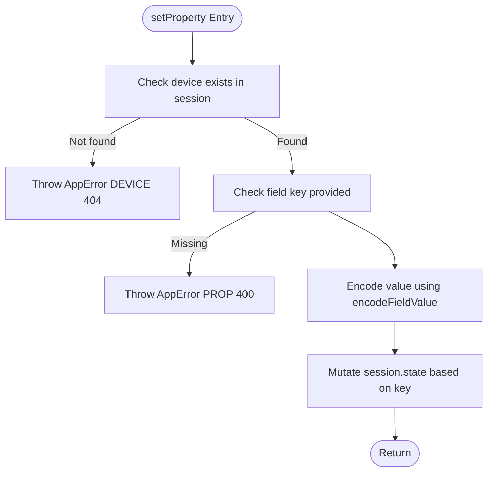
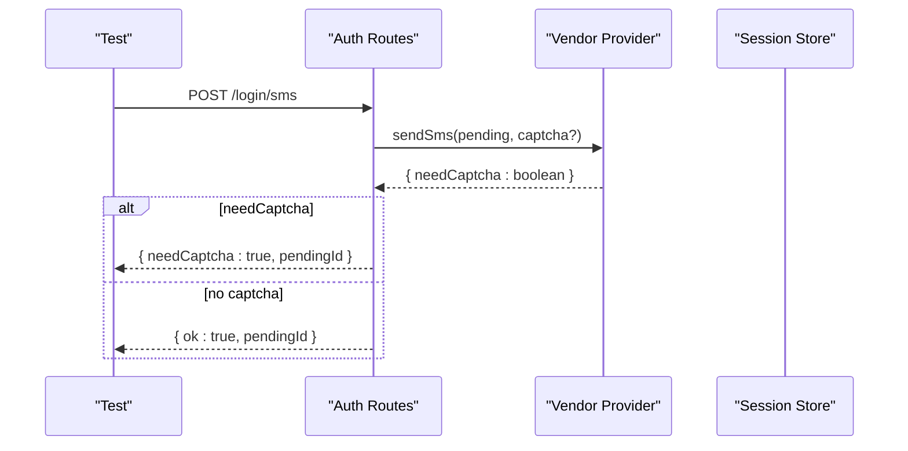
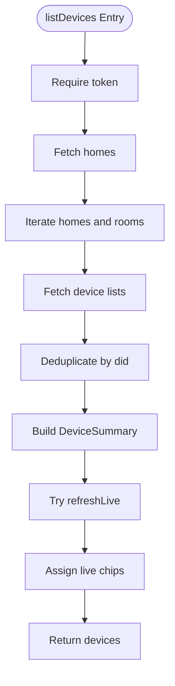
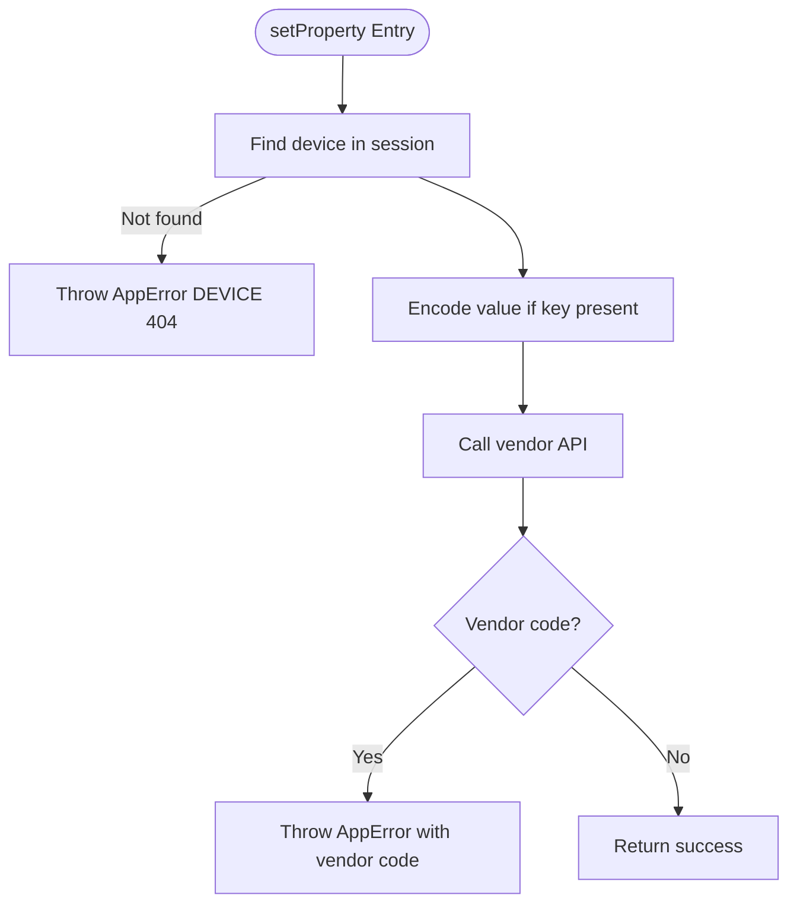
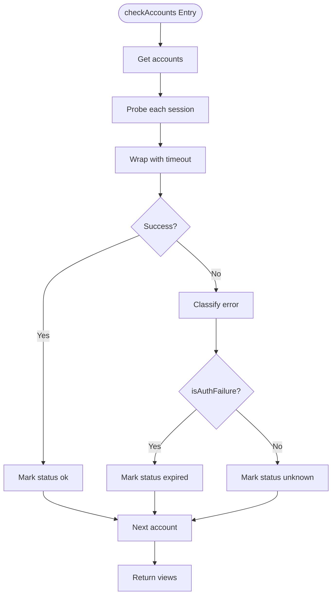
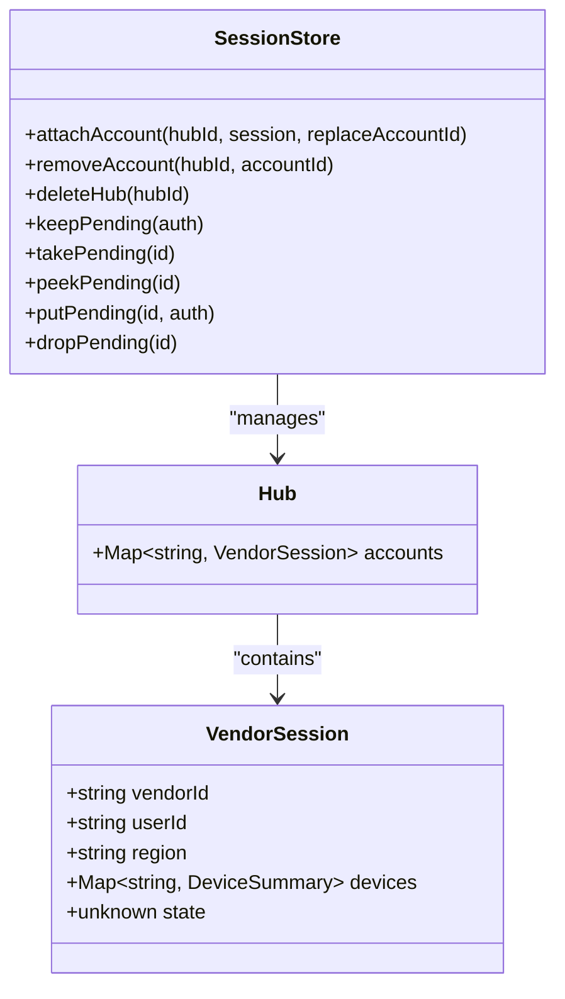
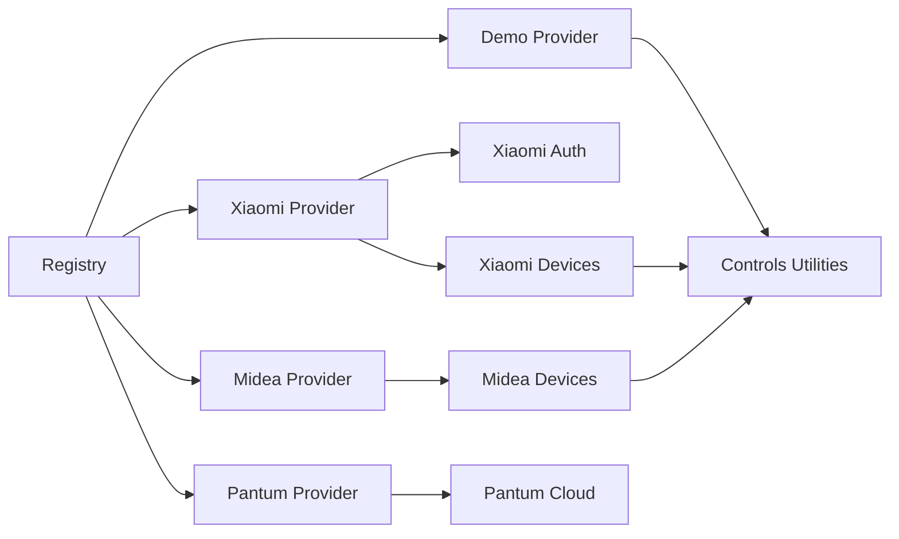

# Testing Strategies

<cite>
**Referenced Files in This Document**
- [README.md](file://README.md)
- [src/providers/types.ts](file://src/providers/types.ts)
- [src/providers/demo/index.ts](file://src/providers/demo/index.ts)
- [src/core/registry.ts](file://src/core/registry.ts)
- [src/core/session.ts](file://src/core/session.ts)
- [src/core/errors.ts](file://src/core/errors.ts)
- [src/core/status.ts](file://src/core/status.ts)
- [src/routes/auth.ts](file://src/routes/auth.ts)
- [src/routes/devices.ts](file://src/routes/devices.ts)
- [src/providers/xiaomi/index.ts](file://src/providers/xiaomi/index.ts)
- [src/providers/xiaomi/auth.ts](file://src/providers/xiaomi/auth.ts)
- [src/providers/xiaomi/devices.ts](file://src/providers/xiaomi/devices.ts)
- [src/providers/midea/index.ts](file://src/providers/midea/index.ts)
- [src/providers/midea/devices.ts](file://src/providers/midea/devices.ts)
- [src/providers/pantum/index.ts](file://src/providers/pantum/index.ts)
</cite>

## Table of Contents
1. [Introduction](#introduction)
2. [Project Structure](#project-structure)
3. [Core Components](#core-components)
4. [Architecture Overview](#architecture-overview)
5. [Detailed Component Analysis](#detailed-component-analysis)
6. [Dependency Analysis](#dependency-analysis)
7. [Performance Considerations](#performance-considerations)
8. [Troubleshooting Guide](#troubleshooting-guide)
9. [Conclusion](#conclusion)

## Introduction
This document defines comprehensive testing strategies for vendor providers in the project. It explains how to use the demo provider as a template, how to test authentication flows, device discovery, and property operations, and how to design integration tests that mock vendor APIs and simulate network conditions. It also covers error scenarios, timeout handling, retry logic, session persistence, state management, and performance testing for large device inventories.

The system exposes a VendorProvider interface that vendors implement. Providers are registered centrally and invoked by HTTP routes. Sessions are persisted across restarts, and account status checks enforce timeouts and auth failure detection.

## Project Structure
At a high level:
- Provider implementations live under src/providers/{vendor}.
- The demo provider is a minimal in-memory implementation suitable as a testing template.
- Core modules provide registry, session persistence, error utilities, and account status checking.
- HTTP routes expose authentication and device control endpoints.

**Diagram sources**
- [src/routes/auth.ts:1-200](file://src/routes/auth.ts#L1-L200)
- [src/routes/devices.ts:1-178](file://src/routes/devices.ts#L1-L178)
- [src/core/registry.ts:1-24](file://src/core/registry.ts#L1-L24)
- [src/core/session.ts:1-266](file://src/core/session.ts#L1-L266)
- [src/core/status.ts:1-51](file://src/core/status.ts#L1-L51)
- [src/providers/demo/index.ts:1-108](file://src/providers/demo/index.ts#L1-L108)
- [src/providers/xiaomi/index.ts:1-30](file://src/providers/xiaomi/index.ts#L1-L30)
- [src/providers/midea/index.ts:1-27](file://src/providers/midea/index.ts#L1-L27)
- [src/providers/pantum/index.ts:1-112](file://src/providers/pantum/index.ts#L1-L112)

**Section sources**
- [README.md:1-97](file://README.md#L1-L97)
- [src/providers/types.ts:1-144](file://src/providers/types.ts#L1-L144)

## Core Components
Key components for testing:
- VendorProvider interface: defines all methods providers must implement, including authentication, device listing, live refresh, detail retrieval, property writes, and actions.
- Demo provider: an in-memory provider with deterministic behavior, ideal for unit and integration tests.
- Registry: centralizes provider lookup; tests can register custom providers.
- Session store: persists accounts and pending auth flows; supports serialization of Maps and buffers.
- Error utilities: AppError, isAuthFailure, toPublicError; essential for asserting error codes and messages.
- Account status checker: probes checkSession with timeouts and classifies failures.

Testing implications:
- Use the demo provider to validate route-level behaviors without external dependencies.
- Mock network calls in real providers (xiaomi, midea, pantum) to isolate business logic.
- Assert AppError codes and status values for robust error handling.
- Validate session persistence and pending flow TTL behavior.

**Section sources**
- [src/providers/types.ts:105-143](file://src/providers/types.ts#L105-L143)
- [src/providers/demo/index.ts:1-108](file://src/providers/demo/index.ts#L1-L108)
- [src/core/registry.ts:1-24](file://src/core/registry.ts#L1-L24)
- [src/core/session.ts:1-266](file://src/core/session.ts#L1-L266)
- [src/core/errors.ts:1-38](file://src/core/errors.ts#L1-L38)
- [src/core/status.ts:1-51](file://src/core/status.ts#L1-L51)

## Architecture Overview
The end-to-end flows involve:
- Authentication routes orchestrate pending flows, provider login methods, and session attachment.
- Device routes call provider methods for listing devices, refreshing live data, getting details, setting properties, and running actions.
- The registry resolves providers by id.
- The session store persists hub accounts and pending auth states.
- The status checker periodically probes provider sessions with timeouts.

**Diagram sources**
- [src/routes/auth.ts:35-71](file://src/routes/auth.ts#L35-L71)
- [src/core/registry.ts:10-14](file://src/core/registry.ts#L10-L14)
- [src/core/session.ts:184-210](file://src/core/session.ts#L184-L210)

## Detailed Component Analysis

### Using the Demo Provider as a Testing Template
The demo provider demonstrates:
- Minimal region list and pending creation.
- Deterministic password-based login with explicit validation errors.
- In-memory device map and simple state object.
- Live items derived from panel building utilities.
- Property encoding via encodeFieldValue and field key mapping.
- Consistent AppError usage for missing devices and unsupported actions.

Recommended test patterns:
- Unit tests for loginPassword: valid credentials, invalid credentials, missing fields.
- Unit tests for listDevices: verify returned devices include live chips.
- Unit tests for getDeviceDetail: assert services and properties built from fieldsOf.
- Unit tests for setProperty: assert state mutation based on key and encoded value.
- Integration tests against routes: POST /login/password, GET /devices, GET /devices/:accountId/:did, POST /devices/:accountId/:did/prop.

**Diagram sources**
- [src/providers/demo/index.ts:96-103](file://src/providers/demo/index.ts#L96-L103)

**Section sources**
- [src/providers/demo/index.ts:1-108](file://src/providers/demo/index.ts#L1-L108)

### Unit Testing Authentication Flows
Focus areas:
- Password login: success path, captcha/email flows, invalid credentials, missing fields.
- SMS login: sendSms and loginSms flows where supported.
- QR login: beginQr, pollQr, and image retrieval.
- Pending flows: keepPending, takePending, peekPending, putPending, dropPending, TTL expiration.

Approach:
- For demo provider: directly invoke provider methods and assert outcomes.
- For xiaomi/midea/pantum: mock http/fetch calls used by their auth modules.
- Assert AppError codes like AUTH, CAPTCHA, EMAIL, QR, and status codes.
- Validate session structure after successful login: vendorId, userId, region, devices Map, state.

**Diagram sources**
- [src/routes/auth.ts:73-91](file://src/routes/auth.ts#L73-L91)
- [src/providers/midea/devices.ts:65-70](file://src/providers/midea/devices.ts#L65-L70)

**Section sources**
- [src/routes/auth.ts:35-121](file://src/routes/auth.ts#L35-L121)
- [src/core/session.ts:230-265](file://src/core/session.ts#L230-L265)
- [src/providers/xiaomi/auth.ts:33-92](file://src/providers/xiaomi/auth.ts#L33-L92)
- [src/providers/midea/devices.ts:65-84](file://src/providers/midea/devices.ts#L65-L84)
- [src/providers/pantum/index.ts:62-84](file://src/providers/pantum/index.ts#L62-L84)

### Unit Testing Device Discovery
Focus areas:
- listDevices: returns DeviceSummary[] and populates session.devices.
- refreshLive: returns per-device LiveItem[].
- getDeviceDetail: builds panel with services, properties, and actions.

Approach:
- For demo provider: assert deterministic outputs.
- For xiaomi: mock apiCall and spec fetch; assert room mapping, deduplication, and live props selection.
- For midea: mock mas calls; assert homegroup traversal and fallback user list.
- For pantum: mock cloud functions; assert summary and live text.

**Diagram sources**
- [src/providers/xiaomi/devices.ts:180-223](file://src/providers/xiaomi/devices.ts#L180-L223)
- [src/providers/midea/devices.ts:90-127](file://src/providers/midea/devices.ts#L90-L127)

**Section sources**
- [src/providers/demo/index.ts:82-90](file://src/providers/demo/index.ts#L82-L90)
- [src/providers/xiaomi/devices.ts:180-245](file://src/providers/xiaomi/devices.ts#L180-L245)
- [src/providers/midea/devices.ts:90-147](file://src/providers/midea/devices.ts#L90-L147)
- [src/providers/pantum/index.ts:32-38](file://src/providers/pantum/index.ts#L32-L38)

### Unit Testing Property Operations
Focus areas:
- setProperty: validates device existence, encodes value, and calls vendor API.
- runAction: validates device existence and invokes action endpoint.

Approach:
- For demo provider: assert state mutation and error cases.
- For xiaomi: mock apiCall for prop/set and action; assert code handling.
- For midea: mock mas control call; assert field key encoding.
- For pantum: assert unsupported operation errors.

**Diagram sources**
- [src/providers/demo/index.ts:96-103](file://src/providers/demo/index.ts#L96-L103)
- [src/providers/xiaomi/devices.ts:268-287](file://src/providers/xiaomi/devices.ts#L268-L287)
- [src/providers/midea/devices.ts:158-175](file://src/providers/midea/devices.ts#L158-L175)

**Section sources**
- [src/providers/demo/index.ts:96-106](file://src/providers/demo/index.ts#L96-L106)
- [src/providers/xiaomi/devices.ts:268-298](file://src/providers/xiaomi/devices.ts#L268-L298)
- [src/providers/midea/devices.ts:158-180](file://src/providers/midea/devices.ts#L158-L180)
- [src/providers/pantum/index.ts:105-110](file://src/providers/pantum/index.ts#L105-L110)

### Integration Testing Patterns for Mocking Vendor APIs
Patterns:
- Replace global fetch/http/mas/apiCall with spies/stubs during tests.
- For xiaomi: stub apiCall and spec fetch; return controlled responses for homeroom, device lists, miotspec prop get/set, and action.
- For midea: stub mas calls; return controlled homegroup and appliance lists, status, and control results.
- For pantum: stub cloud functions; return controlled tokens, device lists, and print results.
- Simulate network conditions:
  - Delays: wrap promises with slow timers to test timeouts.
  - Failures: throw network errors or malformed JSON.
  - Partial failures: some devices succeed while others fail; assert warnings aggregation.

Route-level integration tests should:
- POST /login/password and /login/sms: assert pendingId, needCaptcha, needEmailCode, and final binding.
- GET /devices: assert aggregated devices and warnings when some providers fail.
- GET /devices/:accountId/:did: assert device detail structure.
- POST /devices/:accountId/:did/prop: assert property write outcome.
- POST /devices/:accountId/:did/action: assert action execution outcome.

**Section sources**
- [src/routes/auth.ts:35-173](file://src/routes/auth.ts#L35-L173)
- [src/routes/devices.ts:21-178](file://src/routes/devices.ts#L21-L178)
- [src/providers/xiaomi/devices.ts:106-121](file://src/providers/xiaomi/devices.ts#L106-L121)
- [src/providers/midea/devices.ts:37-44](file://src/providers/midea/devices.ts#L37-L44)
- [src/providers/pantum/index.ts:46-50](file://src/providers/pantum/index.ts#L46-L50)

### Error Scenarios, Timeout Handling, and Retry Logic
Error handling:
- AppError carries code, status, and optional details; routes convert to public JSON.
- isAuthFailure detects expired or unauthorized sessions; routes mark account status as expired.
- toPublicError sanitizes internal errors for clients.

Timeout handling:
- checkAccounts wraps provider.checkSession with a timeout; TIMEOUT errors are classified appropriately.
- Route handlers catch errors and return appropriate status codes.

Retry logic:
- No built-in retry in status checker; tests should assert single-attempt behavior.
- For provider-specific retries (e.g., QR polling), ensure tests cover abort and timeout paths.

**Diagram sources**
- [src/core/status.ts:34-50](file://src/core/status.ts#L34-L50)
- [src/core/errors.ts:15-26](file://src/core/errors.ts#L15-L26)

**Section sources**
- [src/core/errors.ts:1-38](file://src/core/errors.ts#L1-L38)
- [src/core/status.ts:1-51](file://src/core/status.ts#L1-L51)
- [src/routes/devices.ts:21-44](file://src/routes/devices.ts#L21-L44)

### Session Persistence and State Management
Session persistence:
- attachAccount persists hub accounts and marks status ok.
- removeAccount and deleteHub persist changes.
- Pending flows have TTL and support peek/take/put/drop.

State management:
- VendorSession includes devices Map and vendor-private state.
- Serialization handles Buffer, Map, and CookieJar.

Testing approach:
- Verify attachAccount creates hubId and accountId, persists to disk, and returns views.
- Verify pending flow lifecycle: keepPending -> peekPending -> takePending -> expiration.
- Verify serialization round-trip for complex state objects.
- Ensure passwords are not persisted.

**Diagram sources**
- [src/core/session.ts:26-35](file://src/core/session.ts#L26-L35)
- [src/core/session.ts:184-265](file://src/core/session.ts#L184-L265)
- [src/providers/types.ts:77-84](file://src/providers/types.ts#L77-L84)

**Section sources**
- [src/core/session.ts:1-266](file://src/core/session.ts#L1-L266)
- [src/providers/types.ts:77-103](file://src/providers/types.ts#L77-L103)

### Performance Testing Considerations for Large Device Inventories
Considerations:
- Device listing may iterate multiple homes and rooms; ensure tests cover large datasets.
- Live refresh batches property reads in chunks of 16; verify batching behavior under load.
- Spec fetching caches per type; ensure cache hits reduce overhead.
- Aggregated device listing runs provider calls in parallel; assert concurrency and partial failure handling.

Test strategies:
- Generate synthetic device lists with hundreds of devices and measure time/memory.
- Simulate slow vendor APIs and verify timeouts do not block other accounts.
- Validate that failed live refresh does not prevent returning other devices.

**Section sources**
- [src/providers/xiaomi/devices.ts:106-121](file://src/providers/xiaomi/devices.ts#L106-L121)
- [src/providers/xiaomi/devices.ts:225-245](file://src/providers/xiaomi/devices.ts#L225-L245)
- [src/routes/devices.ts:21-44](file://src/routes/devices.ts#L21-L44)

## Dependency Analysis
Providers depend on:
- Registry for resolution.
- Errors for consistent error reporting.
- Controls utilities for building panels and encoding values.
- Network layers (http/fetch/mas) for vendor APIs.

**Diagram sources**
- [src/core/registry.ts:1-24](file://src/core/registry.ts#L1-L24)
- [src/providers/demo/index.ts:1-108](file://src/providers/demo/index.ts#L1-L108)
- [src/providers/xiaomi/index.ts:1-30](file://src/providers/xiaomi/index.ts#L1-L30)
- [src/providers/midea/index.ts:1-27](file://src/providers/midea/index.ts#L1-L27)
- [src/providers/pantum/index.ts:1-112](file://src/providers/pantum/index.ts#L1-L112)

**Section sources**
- [src/core/registry.ts:1-24](file://src/core/registry.ts#L1-L24)
- [src/providers/xiaomi/index.ts:1-30](file://src/providers/xiaomi/index.ts#L1-L30)
- [src/providers/midea/index.ts:1-27](file://src/providers/midea/index.ts#L1-L27)
- [src/providers/pantum/index.ts:1-112](file://src/providers/pantum/index.ts#L1-L112)

## Performance Considerations
- Batch property reads to limit API payload size.
- Cache spec documents per device type to avoid repeated network calls.
- Parallelize provider calls at route level but handle partial failures gracefully.
- Avoid blocking operations in hot paths; use timeouts for status checks.

[No sources needed since this section provides general guidance]

## Troubleshooting Guide
Common issues and diagnostics:
- Authentication failures: check AppError codes and isAuthFailure classification; verify pending flow TTL and cookie handling.
- Device listing failures: inspect warnings array and account status; ensure provider tokens are present.
- Property write failures: validate field keys and encoded values; check vendor error codes.
- Session persistence: confirm hubs.json is written atomically and contains expected structures.

**Section sources**
- [src/core/errors.ts:1-38](file://src/core/errors.ts#L1-L38)
- [src/routes/devices.ts:21-44](file://src/routes/devices.ts#L21-L44)
- [src/core/session.ts:72-98](file://src/core/session.ts#L72-L98)

## Conclusion
Use the demo provider as a baseline for deterministic testing. Implement unit tests for provider methods and integration tests for routes with mocked network layers. Cover authentication, device discovery, property operations, error handling, timeouts, and session persistence. For performance, validate batching, caching, and parallelism under large device inventories.

[No sources needed since this section summarizes without analyzing specific files]