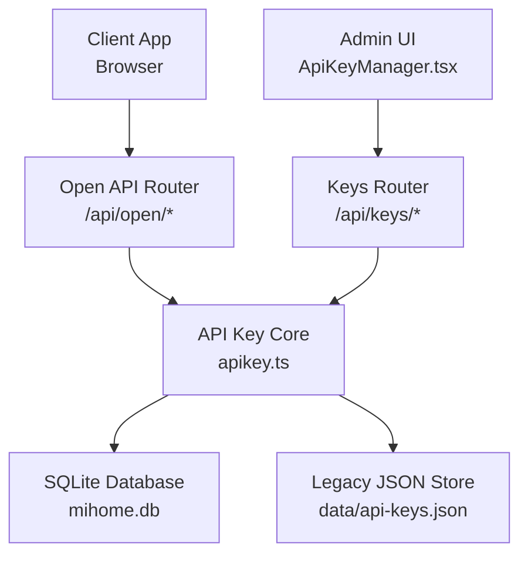
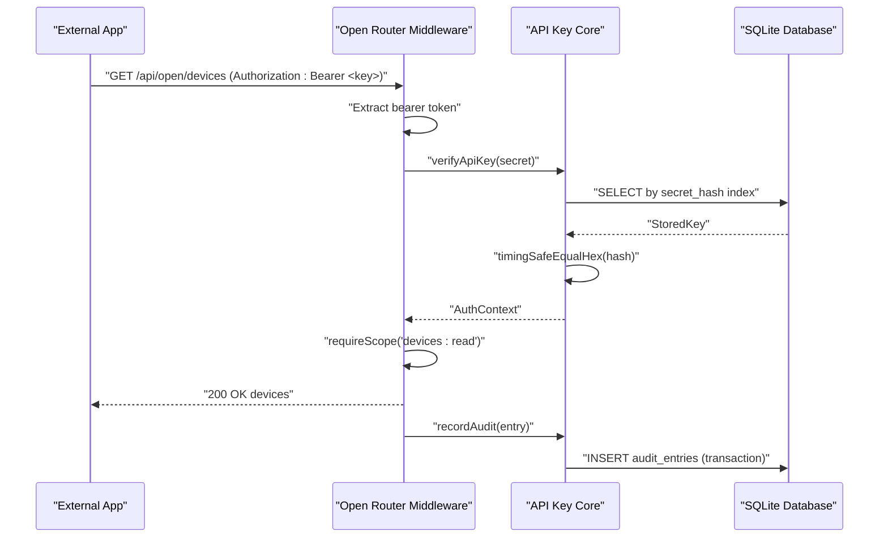
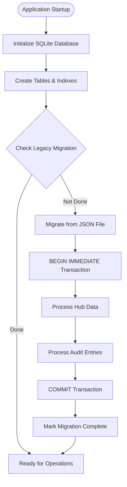
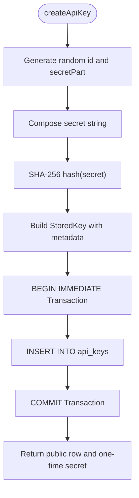
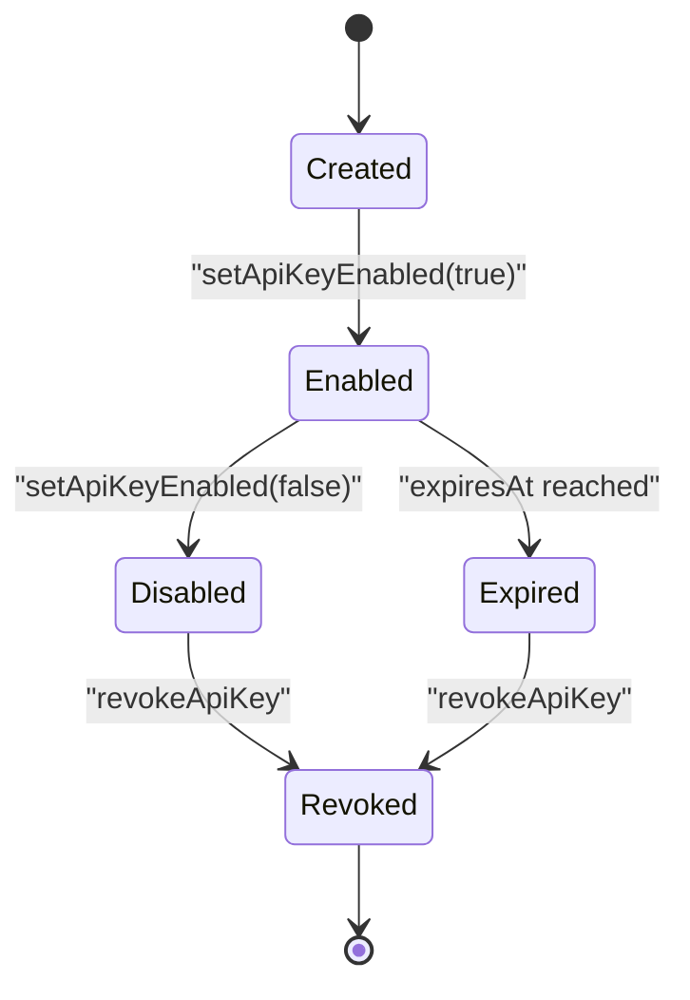
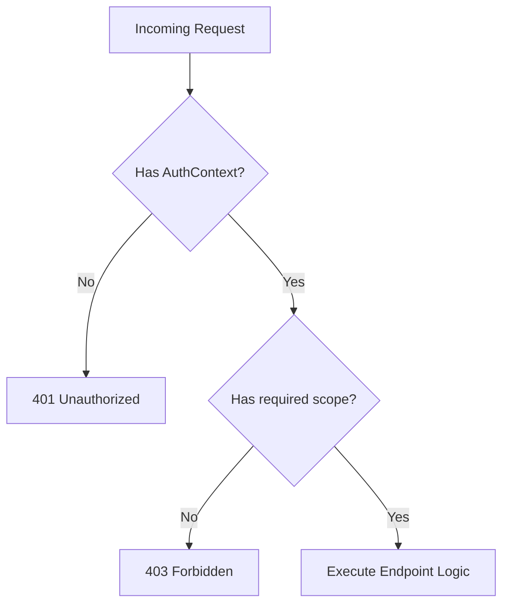
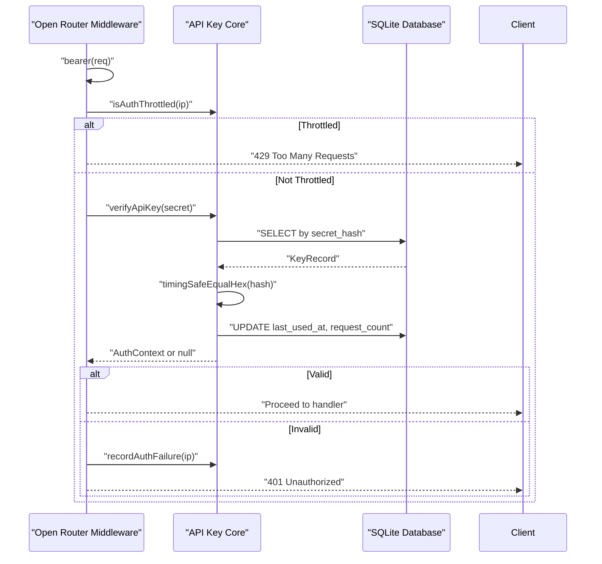
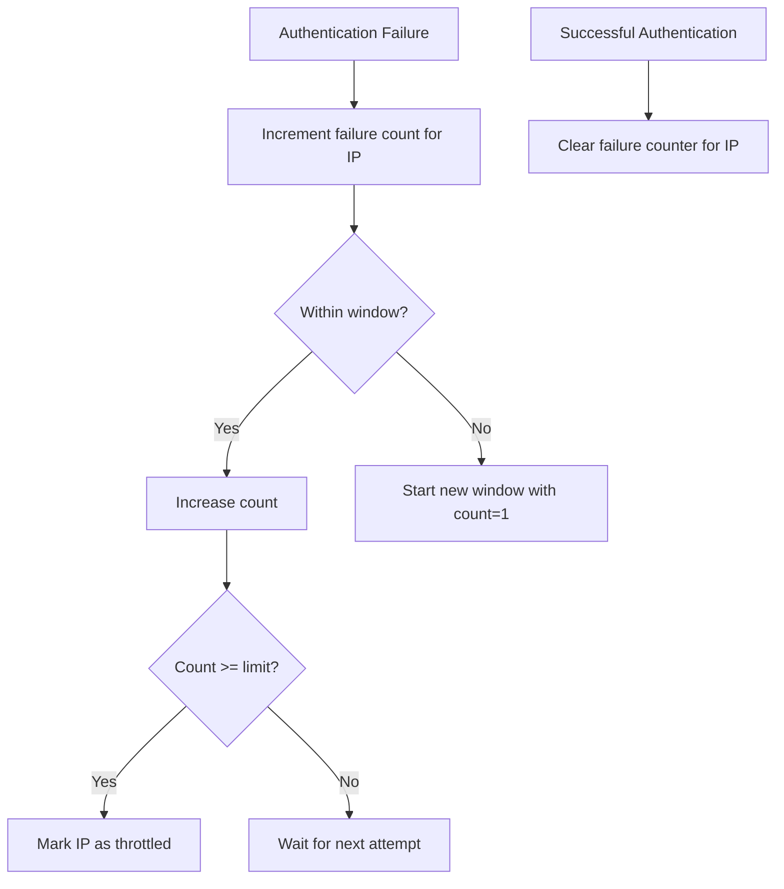
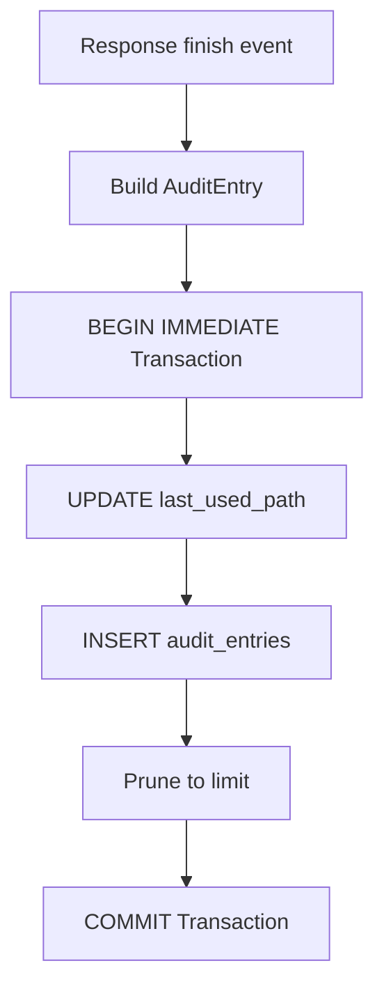
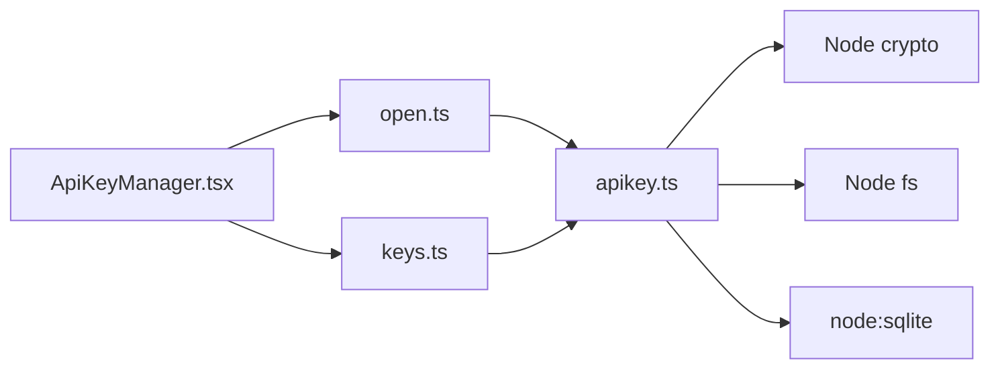

# API Key Management

<cite>
**Referenced Files in This Document**
- [apikey.ts](file://src/core/apikey.ts)
- [keys.ts](file://src/routes/keys.ts)
- [open.ts](file://src/routes/open.ts)
- [ApiKeyManager.tsx](file://client/src/components/ApiKeyManager.tsx)
- [types.ts](file://client/src/types.ts)
</cite>

## Update Summary
**Changes Made**
- Updated storage architecture documentation to reflect SQLite database migration
- Enhanced security implementation details with database-level protections
- Added comprehensive migration system documentation
- Updated transaction support and data integrity features
- Revised performance considerations for database operations

## Table of Contents
1. [Introduction](#introduction)
2. [Project Structure](#project-structure)
3. [Core Components](#core-components)
4. [Architecture Overview](#architecture-overview)
5. [Detailed Component Analysis](#detailed-component-analysis)
6. [Dependency Analysis](#dependency-analysis)
7. [Performance Considerations](#performance-considerations)
8. [Troubleshooting Guide](#troubleshooting-guide)
9. [Conclusion](#conclusion)
10. [Appendices](#appendices)

## Introduction
This document explains the enhanced API key management system used by the application. It covers how keys are generated with SHA-256 hashing, how secrets are securely stored in a SQLite database with transaction support, and how the full key lifecycle is managed: creation, rotation through expiration, enabling/disabling, and revocation. The system implements robust security features including scope-based authorization, comprehensive audit logging, rate limiting for failed authentication attempts, and database-level data integrity. It also documents the key validation process, monitoring capabilities, and provides security best practices and integration examples for external applications.

## Project Structure
The API key system spans a focused set of modules with clear separation of concerns:
- Core key storage, generation, verification, scoping, auditing, and throttling logic lives in the core module with SQLite database integration.
- Administrative routes expose operations for listing, creating, toggling, and revoking keys, plus audit queries.
- The open API router implements bearer token validation, scope checks, request auditing, and rate limiting for public endpoints.
- The client component provides an interactive UI for managing keys, viewing audit logs, and testing integrations.

**Diagram sources**
- [open.ts:17-105](file://src/routes/open.ts#L17-L105)
- [keys.ts:14-81](file://src/routes/keys.ts#L14-L81)
- [apikey.ts:95-152](file://src/core/apikey.ts#L95-L152)

**Section sources**
- [apikey.ts:1-152](file://src/core/apikey.ts#L1-L152)
- [keys.ts:1-81](file://src/routes/keys.ts#L1-L81)
- [open.ts:1-105](file://src/routes/open.ts#L1-L105)
- [ApiKeyManager.tsx:1-106](file://client/src/components/ApiKeyManager.tsx#L1-L106)

## Core Components
The core module defines the types, constants, persistence, and algorithms for API keys with enhanced security features and SQLite database integration:
- Scope definitions and allowed values for fine-grained access control.
- Public row representation without secret material.
- Stored key record containing a SHA-256 hash of the secret.
- Authentication context attached after successful validation.
- Audit entry structure capturing method, path, status, timing, IP, and optional failure message.
- SQLite database connection with transaction support and WAL mode for improved concurrency.
- Migration system for seamless transition from legacy JSON storage.
- Functions for creating, listing, enabling/disabling, revoking, verifying, scoping, auditing, and throttling.

Key responsibilities include:
- Generate random key identifiers and secret parts using cryptographic randomness.
- Hash secrets using SHA-256 before storing in SQLite database.
- Validate keys with constant-time comparison to prevent timing attacks.
- Enforce scopes per endpoint with granular permission control.
- Record usage and failures with transactional persistence.
- Protect against brute-force authentication failures using IP-based throttling.
- Provide automatic migration from legacy JSON format to SQLite database.

**Section sources**
- [apikey.ts:6-88](file://src/core/apikey.ts#L6-L88)
- [apikey.ts:90-152](file://src/core/apikey.ts#L90-L152)
- [apikey.ts:154-178](file://src/core/apikey.ts#L154-L178)
- [apikey.ts:189-265](file://src/core/apikey.ts#L189-L265)
- [apikey.ts:298-336](file://src/core/apikey.ts#L298-L336)
- [apikey.ts:360-384](file://src/core/apikey.ts#L360-L384)
- [apikey.ts:386-481](file://src/core/apikey.ts#L386-L481)

## Architecture Overview
The system separates admin operations from public API operations with comprehensive security controls and SQLite database backend:
- Admin routes require a logged-in hub session and manage keys and audits.
- Public routes accept Bearer tokens or query parameters, validate them, enforce scopes, and log every request.
- All data operations use SQLite transactions for atomicity and consistency.
- Automatic migration handles seamless transition from legacy JSON storage.

**Diagram sources**
- [open.ts:33-105](file://src/routes/open.ts#L33-L105)
- [apikey.ts:360-374](file://src/core/apikey.ts#L360-L374)
- [apikey.ts:386-412](file://src/core/apikey.ts#L386-L412)

## Detailed Component Analysis

### SQLite Database Storage and Migration
The storage system has been migrated from JSON files to SQLite database with comprehensive migration support:
- Database initialization: Creates SQLite database with WAL journaling mode, foreign key constraints, and busy timeout settings.
- Schema design: Defines tables for app metadata, API keys, and audit entries with appropriate indexes for performance.
- Transaction support: All database operations are wrapped in transactions for atomicity and consistency.
- Migration system: Automatically migrates data from legacy JSON format to SQLite during startup.
- Security: Database file permissions set to 0o600, directory permissions set to 0o700 for enhanced security.

**Diagram sources**
- [apikey.ts:95-152](file://src/core/apikey.ts#L95-L152)
- [apikey.ts:168-178](file://src/core/apikey.ts#L168-L178)
- [apikey.ts:189-265](file://src/core/apikey.ts#L189-L265)

**Section sources**
- [apikey.ts:95-152](file://src/core/apikey.ts#L95-L152)
- [apikey.ts:168-178](file://src/core/apikey.ts#L168-L178)
- [apikey.ts:189-265](file://src/core/apikey.ts#L189-L265)

### Key Generation Algorithm and Secure Storage
The key generation process uses cryptographic security measures with SQLite storage:
- Secret composition: combines a prefix, a random identifier, and a random secret part.
- Secret hashing: SHA-256 digest of the full secret is stored; the plaintext secret is returned only once at creation time.
- Persistence: keys are inserted into SQLite database within transactions with proper indexing for fast lookups.
- On startup, the store is restored from SQLite database and the migration system ensures data consistency.

**Diagram sources**
- [apikey.ts:298-336](file://src/core/apikey.ts#L298-L336)
- [apikey.ts:168-178](file://src/core/apikey.ts#L168-L178)

**Section sources**
- [apikey.ts:298-336](file://src/core/apikey.ts#L298-L336)

### Key Lifecycle Management
The complete key lifecycle includes multiple states and transitions with database-backed persistence:
- Creation: returns both a public row and the plaintext secret exactly once, stored in SQLite.
- Listing and retrieval: exposes non-secret metadata sorted by creation time using optimized SQL queries.
- Enable/disable: toggles the enabled flag and persists changes immediately within a transaction.
- Revocation: removes the key from the database and clears its secret hash index entry.
- Expiration: supports optional expiry days; expired keys fail verification automatically.

**Diagram sources**
- [apikey.ts:347-358](file://src/core/apikey.ts#L347-L358)
- [apikey.ts:360-374](file://src/core/apikey.ts#L360-L374)

**Section sources**
- [apikey.ts:338-358](file://src/core/apikey.ts#L338-L358)
- [apikey.ts:360-374](file://src/core/apikey.ts#L360-L374)

### Scope-Based Authorization System
The scope-based authorization system provides fine-grained access control:
- devices:read: list devices and properties.
- devices:live: read live readings.
- devices:control: write properties and execute actions.

Endpoints enforce scopes consistently:
- GET /api/open/accounts: requires devices:read.
- GET /api/open/devices and related property reads: require devices:read.
- POST /api/open/devices/:accountId/:did/props and actions: require devices:control.
- GET /api/open/live and /api/open/live/:did: require devices:live.

**Diagram sources**
- [open.ts:107-119](file://src/routes/open.ts#L107-L119)
- [open.ts:164-324](file://src/routes/open.ts#L164-L324)

**Section sources**
- [apikey.ts:6-10](file://src/core/apikey.ts#L6-L10)
- [apikey.ts:382-384](file://src/core/apikey.ts#L382-L384)
- [open.ts:107-119](file://src/routes/open.ts#L107-L119)
- [open.ts:164-324](file://src/routes/open.ts#L164-L324)

### Key Validation Process
The validation pipeline implements multiple security layers with SQLite optimization:
- Extract bearer token from Authorization header or apiKey query parameter.
- If missing, return 401 with descriptive error message.
- If IP is throttled due to too many recent failures, return 429.
- Compute SHA-256 of the provided secret and look up by hash index in SQLite.
- Verify enabled state and expiration timestamp.
- Perform constant-time comparison of hashes to prevent timing attacks.
- On success, attach AuthContext and clear any auth failure counters for the IP.
- Update last_used_at and request_count fields atomically within a transaction.

**Diagram sources**
- [open.ts:33-105](file://src/routes/open.ts#L33-L105)
- [apikey.ts:360-374](file://src/core/apikey.ts#L360-L374)
- [apikey.ts:450-481](file://src/core/apikey.ts#L450-L481)

**Section sources**
- [open.ts:33-105](file://src/routes/open.ts#L33-L105)
- [apikey.ts:360-384](file://src/core/apikey.ts#L360-L384)

### Rate Limiting Implementation
The rate limiting system protects against brute-force attacks:
- Failure tracking: per-IP counter within a fixed time window (30 seconds).
- Threshold: if failures reach 20 within the window, subsequent requests receive 429 until the window expires.
- Reset: successful validations clear the failure counter for the IP.
- Memory cleanup: expired entries are pruned when the map grows beyond 1000 entries.

**Diagram sources**
- [apikey.ts:450-481](file://src/core/apikey.ts#L450-L481)
- [open.ts:86-98](file://src/routes/open.ts#L86-L98)

**Section sources**
- [apikey.ts:450-481](file://src/core/apikey.ts#L450-L481)
- [open.ts:86-98](file://src/routes/open.ts#L86-L98)

### Audit Trail for API Key Usage
Every request to the open API is comprehensively audited with SQLite persistence, including failed authentications:
- Captures timestamp, hub/key identity, HTTP method, path (with redacted apiKey), status code, duration, client IP, and optional error summary.
- Unattributed failures (no valid key) are kept server-side and not distributed across hubs.
- Audit entries are limited to 5000 records and persisted asynchronously via transactional writes.
- Admin routes allow querying and clearing audit logs scoped to the current hub.

**Diagram sources**
- [open.ts:70-84](file://src/routes/open.ts#L70-L84)
- [apikey.ts:386-412](file://src/core/apikey.ts#L386-L412)

**Section sources**
- [open.ts:70-84](file://src/routes/open.ts#L70-L84)
- [apikey.ts:386-448](file://src/core/apikey.ts#L386-L448)
- [keys.ts:67-81](file://src/routes/keys.ts#L67-L81)

### Administrative Key Management Endpoints
The administrative API provides comprehensive key management capabilities with SQLite backend:
- GET /api/keys/scopes: lists available scopes.
- GET /api/keys: lists keys for the logged-in hub using optimized SQL queries.
- POST /api/keys: creates a key with name, scopes, and optional expiry days.
- POST /api/keys/:id/enabled: toggles enabled state.
- DELETE /api/keys/:id: revokes a key.
- GET /api/keys/audit/requests: retrieves audit entries filtered by key and limit.
- POST /api/keys/audit/clear: clears audit entries for the hub.

These endpoints require a valid hub session cookie and perform input validation on names, scopes, and expiry ranges.

**Section sources**
- [keys.ts:1-81](file://src/routes/keys.ts#L1-L81)

### Client-Side Key Management UI
The React component provides a comprehensive interface for key management:
- Key creation form with name, scope selection, and expiry options.
- One-time display of the plaintext secret with copy support and local vault storage.
- Key list showing status, last used time, request count, and expiry information.
- Actions to test a key against the open API, toggle enablement, and revoke.
- Audit log viewer with filtering by key and ability to clear logs.
- Integration hints showing required Authorization header and common endpoints.

**Section sources**
- [ApiKeyManager.tsx:6-17](file://client/src/components/ApiKeyManager.tsx#L6-L17)
- [ApiKeyManager.tsx:73-106](file://client/src/components/ApiKeyManager.tsx#L73-L106)
- [ApiKeyManager.tsx:172-254](file://client/src/components/ApiKeyManager.tsx#L172-L254)
- [ApiKeyManager.tsx:258-531](file://client/src/components/ApiKeyManager.tsx#L258-L531)

## Dependency Analysis
The following diagram shows how the main components depend on each other with SQLite integration:

**Diagram sources**
- [apikey.ts:1-5](file://src/core/apikey.ts#L1-L5)
- [open.ts:1-15](file://src/routes/open.ts#L1-L15)
- [keys.ts:1-13](file://src/routes/keys.ts#L1-L13)
- [ApiKeyManager.tsx:1-5](file://client/src/components/ApiKeyManager.tsx#L1-L5)

**Section sources**
- [apikey.ts:1-5](file://src/core/apikey.ts#L1-L5)
- [open.ts:1-15](file://src/routes/open.ts#L1-L15)
- [keys.ts:1-13](file://src/routes/keys.ts#L1-L13)
- [ApiKeyManager.tsx:1-5](file://client/src/components/ApiKeyManager.tsx#L1-L5)

## Performance Considerations
The system is optimized for performance while maintaining security with SQLite backend:
- Verification uses SQLite's unique index on secret_hash for O(1) lookup, followed by constant-time comparison to mitigate timing attacks.
- Audit writes are transactional to ensure data consistency and reduce disk I/O overhead.
- Database uses WAL (Write-Ahead Logging) mode for improved concurrent read/write performance.
- Foreign key constraints ensure referential integrity across related data.
- Scoping checks are simple array inclusion checks over small scope sets.
- Rate limiting uses in-memory maps with periodic pruning to bound memory growth.
- Query optimization through proper indexing on frequently accessed columns like hub_id, created_at, and seq.

## Troubleshooting Guide
Common issues and their resolutions:
- Missing API Key: ensure Authorization header includes Bearer token or pass apiKey query parameter.
- Invalid, disabled, or expired key: verify key status and expiry; regenerate if necessary.
- Insufficient scope: grant the required scope during key creation or update.
- Rate-limited due to repeated failures: wait for the throttle window to expire or reset failures by succeeding once.
- Audit log not visible: confirm hub session and correct key filter; clear logs only when appropriate.
- Database migration issues: check application logs for migration errors; ensure proper file permissions.
- SQLite database corruption: backup data directory and restart application to trigger re-migration.

Operational tips:
- Use the "test" action in the UI to validate a key against the open info endpoint.
- Monitor audit logs for unusual patterns such as repeated 401/403 responses or spikes in request counts.
- Rotate keys by creating new ones with appropriate scopes and expiring old ones.
- Regularly backup the data directory to preserve API keys and audit history.

**Section sources**
- [open.ts:86-98](file://src/routes/open.ts#L86-L98)
- [open.ts:107-119](file://src/routes/open.ts#L107-L119)
- [apikey.ts:360-384](file://src/core/apikey.ts#L360-L384)
- [apikey.ts:450-481](file://src/core/apikey.ts#L450-L481)
- [ApiKeyManager.tsx:224-239](file://client/src/components/ApiKeyManager.tsx#L224-L239)

## Conclusion
The enhanced API key management system provides secure generation with SHA-256 hashing, SQLite database storage with transaction support, strict scope-based authorization, robust validation with constant-time comparison, rate limiting, and comprehensive auditing. The migration system ensures seamless transition from legacy JSON storage, while the admin routes and client UI make key lifecycle operations straightforward. The SQLite backend provides better performance, reliability, and scalability compared to the previous JSON file approach. Following the recommended best practices will help maintain safe and reliable integrations.

## Appendices

### Security Best Practices
Enhanced security recommendations:
- Distribution: share plaintext secrets only once and store them in a secure vault outside the browser; do not log or embed secrets in source code.
- Storage: rely on server-side SQLite database storage with proper file permissions (0o600); never persist plaintext secrets.
- Rotation: prefer short-lived keys with explicit expiry; rotate regularly and revoke compromised keys immediately.
- Monitoring: watch audit logs for anomalies such as repeated failures, unexpected paths, or high request rates.
- Least privilege: assign only the minimum scopes required by the integrating application.
- Rate limiting: monitor for brute-force attempts and adjust thresholds based on your security requirements.
- Database security: ensure proper file system permissions and regular backups of the data directory.

### Integration Examples
Practical integration guidance:
- Header format: include Authorization: Bearer <API Key>.
- Common endpoints:
  - GET /api/open/devices
  - GET /api/open/devices/:accountId/:did
  - GET /api/open/devices/:accountId/:did/props
  - POST /api/open/devices/:accountId/:did/props
  - POST /api/open/devices/:accountId/:did/actions
  - GET /api/open/live

These examples are surfaced in the client UI's usage section and correspond to the open API endpoints defined in the router.

**Section sources**
- [ApiKeyManager.tsx:493-525](file://client/src/components/ApiKeyManager.tsx#L493-L525)
- [open.ts:150-324](file://src/routes/open.ts#L150-L324)