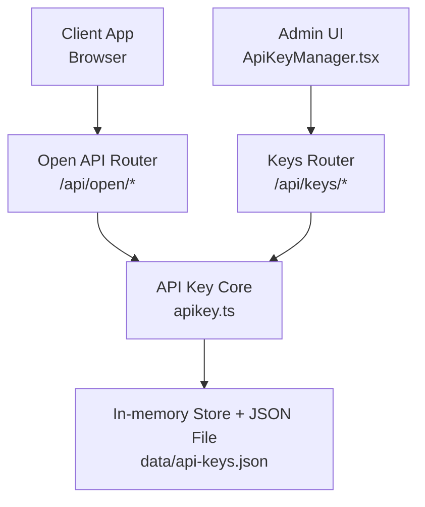
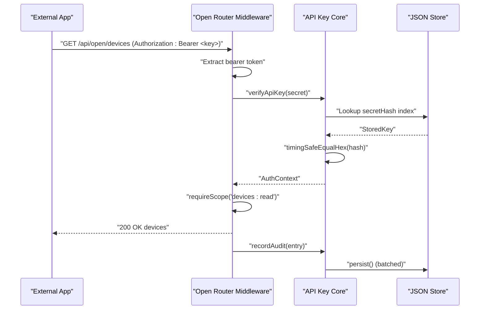
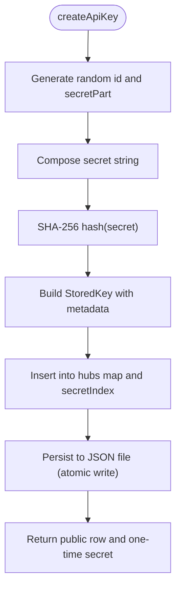
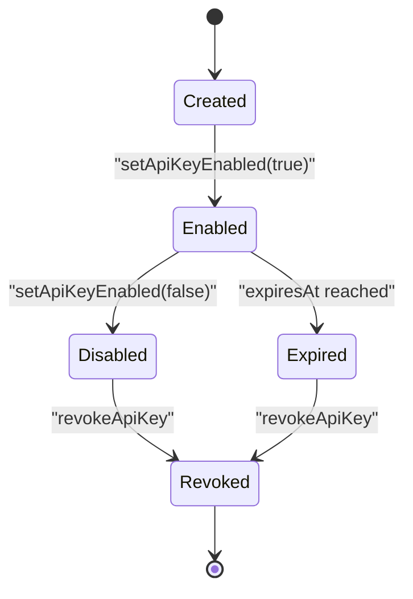
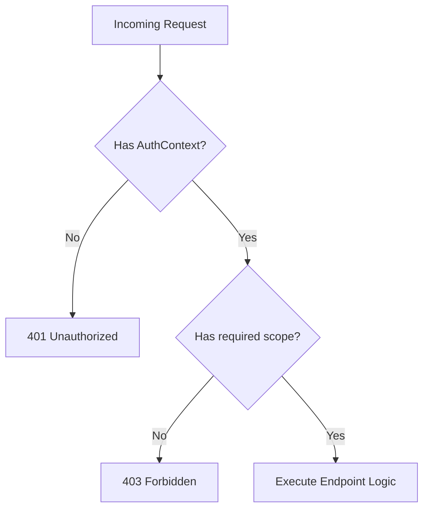
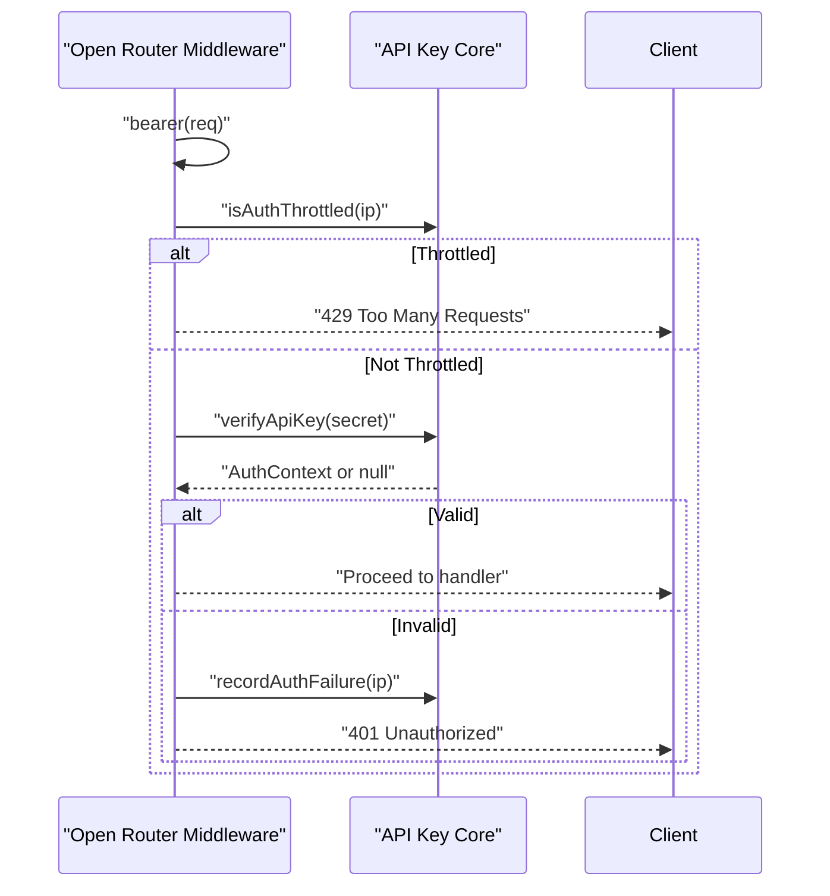
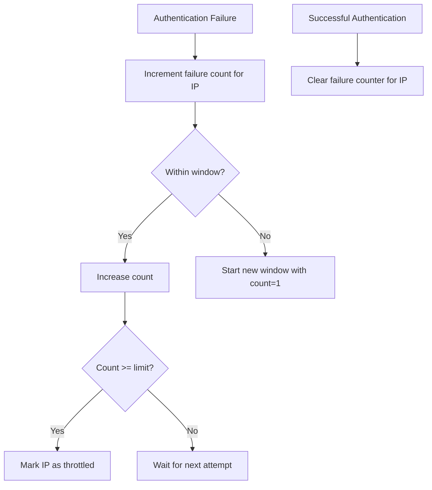
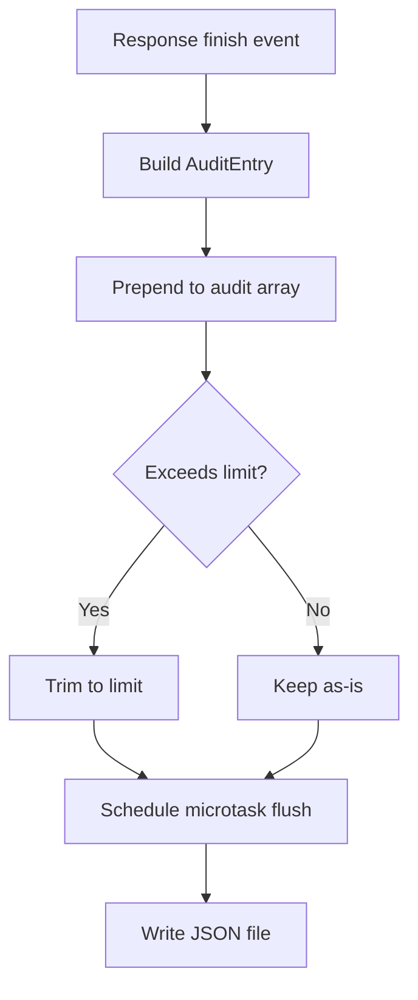
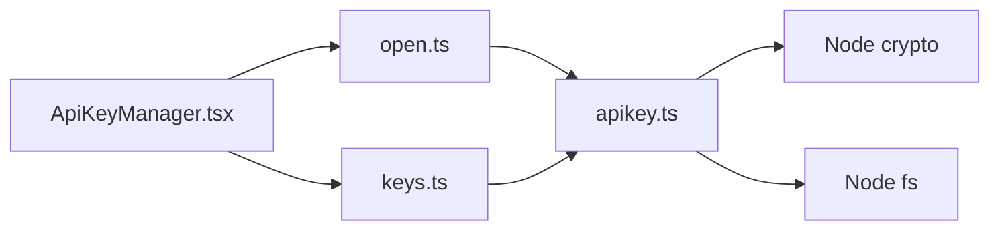

# API Key Management

<cite>
**Referenced Files in This Document**
- [apikey.ts](file://src/core/apikey.ts)
- [keys.ts](file://src/routes/keys.ts)
- [open.ts](file://src/routes/open.ts)
- [ApiKeyManager.tsx](file://client/src/components/ApiKeyManager.tsx)
</cite>

## Table of Contents
1. [Introduction](#introduction)
2. [Project Structure](#project-structure)
3. [Core Components](#core-components)
4. [Architecture Overview](#architecture-overview)
5. [Detailed Component Analysis](#detailed-component-analysis)
6. [Dependency Analysis](#dependency-analysis)
7. [Performance Considerations](#performance-considerations)
8. [Troubleshooting Guide](#troubleshooting-guide)
9. [Conclusion](#conclusion)
10. [Appendices](#appendices)

## Introduction
This document explains the API key management system used by the application. It covers how keys are generated with SHA-256 hashing, how secrets are securely stored, and how the full key lifecycle is managed: creation, rotation through expiration, enabling/disabling, and revocation. It also documents the scope-based authorization model that controls access to device read, live data, and control endpoints, as well as key validation, rate limiting for failed authentication attempts, and audit logging. Finally, it provides security best practices and integration examples for external applications.

## Project Structure
The API key system spans a small set of focused modules:
- Core key storage, generation, verification, scoping, auditing, and throttling logic lives in the core module.
- The management routes expose administrative operations for listing, creating, toggling, and revoking keys, plus audit queries.
- The open API router implements bearer token validation, scope checks, request auditing, and rate limiting for public endpoints.
- The client component provides an interactive UI for managing keys and viewing audit logs.

**Diagram sources**
- [open.ts:1-105](file://src/routes/open.ts#L1-L105)
- [keys.ts:1-81](file://src/routes/keys.ts#L1-L81)
- [apikey.ts:73-149](file://src/core/apikey.ts#L73-L149)

**Section sources**
- [apikey.ts:1-81](file://src/core/apikey.ts#L1-L81)
- [keys.ts:1-81](file://src/routes/keys.ts#L1-L81)
- [open.ts:1-105](file://src/routes/open.ts#L1-L105)
- [ApiKeyManager.tsx:1-106](file://client/src/components/ApiKeyManager.tsx#L1-L106)

## Core Components
The core module defines the types, constants, persistence, and algorithms for API keys:
- Scope definitions and allowed values.
- Public row representation without secret material.
- Stored key record containing a SHA-256 hash of the secret.
- Authentication context attached after successful validation.
- Audit entry structure capturing method, path, status, timing, IP, and optional failure message.
- In-process store keyed by hub ID, plus a secret hash index for fast lookup.
- Functions for creating, listing, enabling/disabling, revoking, verifying, scoping, auditing, and throttling.

Key responsibilities:
- Generate random key identifiers and secret parts.
- Hash secrets using SHA-256 before storing.
- Persist keys and audit records atomically via temp file rename.
- Validate keys with constant-time comparison.
- Enforce scopes per endpoint.
- Record usage and failures, with microtask-batched persistence.
- Protect against brute-force authentication failures using IP-based throttling.

**Section sources**
- [apikey.ts:6-65](file://src/core/apikey.ts#L6-L65)
- [apikey.ts:67-85](file://src/core/apikey.ts#L67-L85)
- [apikey.ts:87-149](file://src/core/apikey.ts#L87-L149)
- [apikey.ts:151-237](file://src/core/apikey.ts#L151-L237)
- [apikey.ts:239-304](file://src/core/apikey.ts#L239-L304)

## Architecture Overview
The system separates admin operations from public API operations:
- Admin routes require a logged-in hub session and manage keys and audits.
- Public routes accept Bearer tokens or query parameters, validate them, enforce scopes, and log every request.

**Diagram sources**
- [open.ts:33-105](file://src/routes/open.ts#L33-L105)
- [apikey.ts:220-255](file://src/core/apikey.ts#L220-L255)

## Detailed Component Analysis

### Key Generation Algorithm and Secure Storage
- Secret composition: a prefix, a random identifier, and a random secret part.
- Secret hashing: SHA-256 digest of the full secret is stored; the plaintext secret is returned only once at creation time.
- Persistence: keys are written to a temporary file with restrictive permissions and then atomically renamed to the final path. On startup, the store is restored from disk and the secret hash index is rebuilt.

**Diagram sources**
- [apikey.ts:151-183](file://src/core/apikey.ts#L151-L183)
- [apikey.ts:83-99](file://src/core/apikey.ts#L83-L99)

**Section sources**
- [apikey.ts:83-99](file://src/core/apikey.ts#L83-L99)
- [apikey.ts:109-149](file://src/core/apikey.ts#L109-L149)
- [apikey.ts:151-183](file://src/core/apikey.ts#L151-L183)

### Key Lifecycle Management
- Creation: returns both a public row and the plaintext secret exactly once.
- Listing and retrieval: exposes non-secret metadata sorted by creation time.
- Enable/disable: toggles the enabled flag and persists changes.
- Revocation: removes the key from the hub’s key map and clears its secret hash index entry.
- Expiration: supports optional expiry days; expired keys fail verification.

**Diagram sources**
- [apikey.ts:201-218](file://src/core/apikey.ts#L201-L218)
- [apikey.ts:220-231](file://src/core/apikey.ts#L220-L231)

**Section sources**
- [apikey.ts:190-218](file://src/core/apikey.ts#L190-L218)
- [apikey.ts:220-231](file://src/core/apikey.ts#L220-L231)

### Scope-Based Authorization System
Scopes define fine-grained access:
- devices:read: list devices and properties.
- devices:live: read live readings.
- devices:control: write properties and execute actions.

Endpoints enforce scopes:
- GET /api/open/accounts: requires devices:read.
- GET /api/open/devices and related property reads: require devices:read.
- POST /api/open/devices/:accountId/:did/props and actions: require devices:control.
- GET /api/open/live and /api/open/live/:did: require devices:live.

**Diagram sources**
- [open.ts:107-119](file://src/routes/open.ts#L107-L119)
- [open.ts:164-324](file://src/routes/open.ts#L164-L324)

**Section sources**
- [apikey.ts:6-9](file://src/core/apikey.ts#L6-L9)
- [apikey.ts:239-241](file://src/core/apikey.ts#L239-L241)
- [open.ts:107-119](file://src/routes/open.ts#L107-L119)
- [open.ts:164-324](file://src/routes/open.ts#L164-L324)

### Key Validation Process
Validation pipeline:
- Extract bearer token from Authorization header or apiKey query parameter.
- If missing, return 401.
- If IP is throttled due to too many recent failures, return 429.
- Compute SHA-256 of the provided secret and look up by hash index.
- Verify enabled state and expiration.
- Perform constant-time comparison of hashes.
- On success, attach AuthContext and clear any auth failure counters for the IP.

**Diagram sources**
- [open.ts:33-105](file://src/routes/open.ts#L33-L105)
- [apikey.ts:220-237](file://src/core/apikey.ts#L220-L237)
- [apikey.ts:273-304](file://src/core/apikey.ts#L273-L304)

**Section sources**
- [open.ts:33-105](file://src/routes/open.ts#L33-L105)
- [apikey.ts:220-237](file://src/core/apikey.ts#L220-L237)

### Rate Limiting Implementation
- Failure tracking: per-IP counter within a fixed time window.
- Threshold: if failures reach a limit within the window, subsequent requests receive 429 until the window expires.
- Reset: successful validations clear the failure counter for the IP.
- Memory cleanup: expired entries are pruned when the map grows large.

**Diagram sources**
- [apikey.ts:273-304](file://src/core/apikey.ts#L273-L304)
- [open.ts:86-98](file://src/routes/open.ts#L86-L98)

**Section sources**
- [apikey.ts:273-304](file://src/core/apikey.ts#L273-L304)
- [open.ts:86-98](file://src/routes/open.ts#L86-L98)

### Audit Trail for API Key Usage
Every request to the open API is audited, including failed authentications:
- Captures timestamp, hub/key identity, HTTP method, path (with redacted apiKey), status code, duration, client IP, and optional error summary.
- Unattributed failures (no valid key) are kept server-side and not distributed across hubs.
- Audit entries are limited in size and persisted asynchronously via microtask batching.
- Admin routes allow querying and clearing audit logs scoped to the current hub.

**Diagram sources**
- [open.ts:70-84](file://src/routes/open.ts#L70-L84)
- [apikey.ts:243-255](file://src/core/apikey.ts#L243-L255)

**Section sources**
- [open.ts:70-84](file://src/routes/open.ts#L70-L84)
- [apikey.ts:243-271](file://src/core/apikey.ts#L243-L271)
- [keys.ts:67-81](file://src/routes/keys.ts#L67-L81)

### Administrative Key Management Endpoints
- GET /api/keys/scopes: lists available scopes.
- GET /api/keys: lists keys for the logged-in hub.
- POST /api/keys: creates a key with name, scopes, and optional expiry days.
- POST /api/keys/:id/enabled: toggles enabled state.
- DELETE /api/keys/:id: revokes a key.
- GET /api/keys/audit/requests: retrieves audit entries filtered by key and limit.
- POST /api/keys/audit/clear: clears audit entries for the hub.

These endpoints require a valid hub session cookie and perform input validation on names, scopes, and expiry ranges.

**Section sources**
- [keys.ts:1-81](file://src/routes/keys.ts#L1-L81)

### Client-Side Key Management UI
The React component provides:
- Key creation form with name, scope selection, and expiry options.
- One-time display of the plaintext secret with copy support.
- Key list showing status, last used time, request count, and expiry.
- Actions to test a key against the open API, toggle enablement, and revoke.
- Audit log viewer with filtering by key and ability to clear logs.
- Integration hints showing required Authorization header and common endpoints.

**Section sources**
- [ApiKeyManager.tsx:6-17](file://client/src/components/ApiKeyManager.tsx#L6-L17)
- [ApiKeyManager.tsx:73-106](file://client/src/components/ApiKeyManager.tsx#L73-L106)
- [ApiKeyManager.tsx:172-254](file://client/src/components/ApiKeyManager.tsx#L172-L254)
- [ApiKeyManager.tsx:258-419](file://client/src/components/ApiKeyManager.tsx#L258-L419)

## Dependency Analysis
The following diagram shows how the main components depend on each other:

**Diagram sources**
- [apikey.ts:1-4](file://src/core/apikey.ts#L1-L4)
- [open.ts:1-15](file://src/routes/open.ts#L1-L15)
- [keys.ts:1-13](file://src/routes/keys.ts#L1-L13)
- [ApiKeyManager.tsx:1-5](file://client/src/components/ApiKeyManager.tsx#L1-L5)

**Section sources**
- [apikey.ts:1-4](file://src/core/apikey.ts#L1-L4)
- [open.ts:1-15](file://src/routes/open.ts#L1-L15)
- [keys.ts:1-13](file://src/routes/keys.ts#L1-L13)
- [ApiKeyManager.tsx:1-5](file://client/src/components/ApiKeyManager.tsx#L1-L5)

## Performance Considerations
- Verification uses a precomputed secret hash index for O(1) lookup, followed by constant-time comparison to mitigate timing attacks.
- Audit writes are batched using microtasks to reduce frequent disk I/O while preserving order and limits.
- Store persistence uses atomic temp file rename to avoid partial writes.
- Scoping checks are simple array inclusion checks over small scope sets.
- Rate limiting uses in-memory maps with periodic pruning to bound memory growth.

[No sources needed since this section provides general guidance]

## Troubleshooting Guide
Common issues and resolutions:
- Missing API Key: ensure Authorization header includes Bearer token or pass apiKey query parameter.
- Invalid, disabled, or expired key: verify key status and expiry; regenerate if necessary.
- Insufficient scope: grant the required scope during key creation or update.
- Rate-limited due to repeated failures: wait for the throttle window to expire or reset failures by succeeding once.
- Audit log not visible: confirm hub session and correct key filter; clear logs only when appropriate.

Operational tips:
- Use the “test” action in the UI to validate a key against the open info endpoint.
- Monitor audit logs for unusual patterns such as repeated 401/403 responses or spikes in request counts.
- Rotate keys by creating new ones with appropriate scopes and expiring old ones.

**Section sources**
- [open.ts:86-98](file://src/routes/open.ts#L86-L98)
- [open.ts:107-119](file://src/routes/open.ts#L107-L119)
- [apikey.ts:220-237](file://src/core/apikey.ts#L220-L237)
- [apikey.ts:273-304](file://src/core/apikey.ts#L273-L304)
- [ApiKeyManager.tsx:224-239](file://client/src/components/ApiKeyManager.tsx#L224-L239)

## Conclusion
The API key management system provides secure generation, hashed storage, strict scope-based authorization, robust validation, rate limiting, and comprehensive auditing. The admin routes and client UI make key lifecycle operations straightforward, while the open API enforces consistent security policies across all endpoints. Following the recommended best practices will help maintain safe and reliable integrations.

[No sources needed since this section summarizes without analyzing specific files]

## Appendices

### Security Best Practices
- Distribution: share plaintext secrets only once and store them in a secure vault outside the browser; do not log or embed secrets in source code.
- Storage: rely on server-side hashed storage; never persist plaintext secrets.
- Rotation: prefer short-lived keys with explicit expiry; rotate regularly and revoke compromised keys immediately.
- Monitoring: watch audit logs for anomalies such as repeated failures, unexpected paths, or high request rates.
- Least privilege: assign only the minimum scopes required by the integrating application.

[No sources needed since this section provides general guidance]

### Integration Examples
- Header format: include Authorization: Bearer <API Key>.
- Common endpoints:
  - GET /api/open/devices
  - GET /api/open/devices/:accountId/:did
  - GET /api/open/devices/:accountId/:did/props
  - POST /api/open/devices/:accountId/:did/props
  - POST /api/open/devices/:accountId/:did/actions
  - GET /api/open/live

These examples are surfaced in the client UI’s usage section and correspond to the open API endpoints defined in the router.

**Section sources**
- [ApiKeyManager.tsx:405-416](file://client/src/components/ApiKeyManager.tsx#L405-L416)
- [open.ts:150-324](file://src/routes/open.ts#L150-L324)