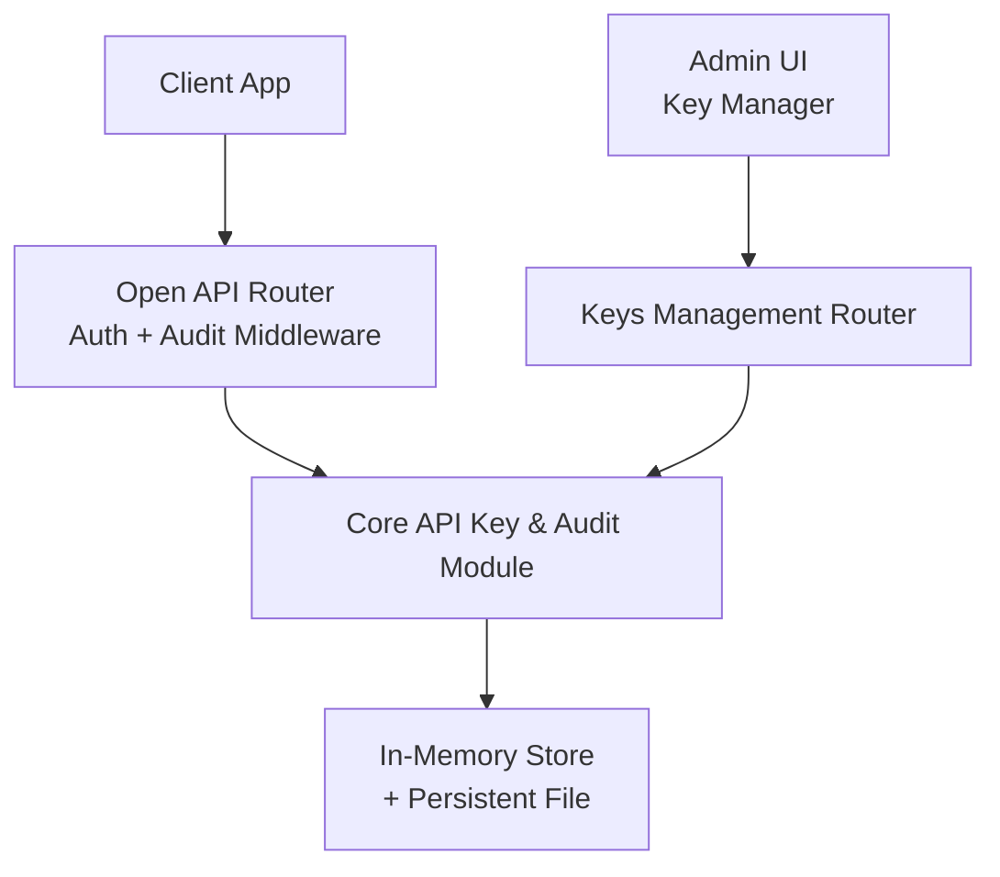
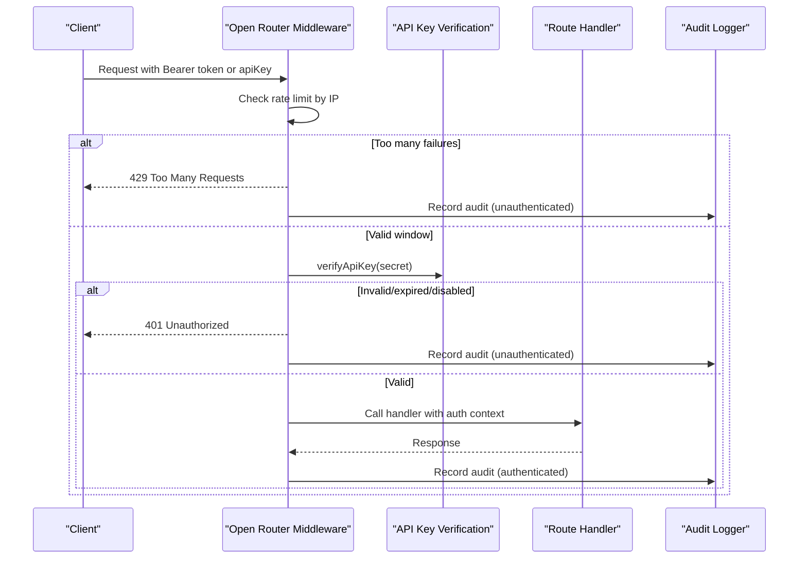
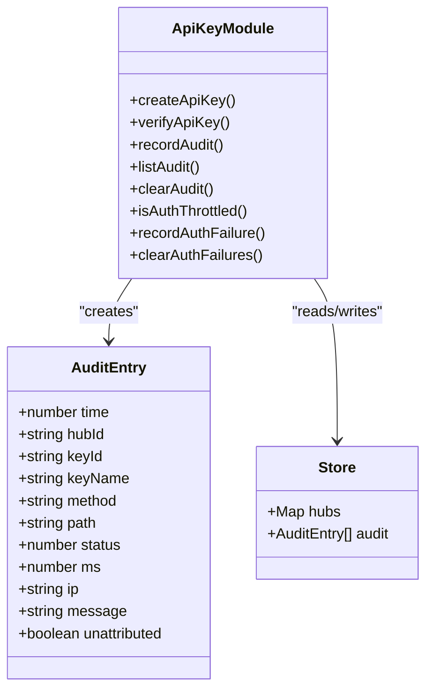
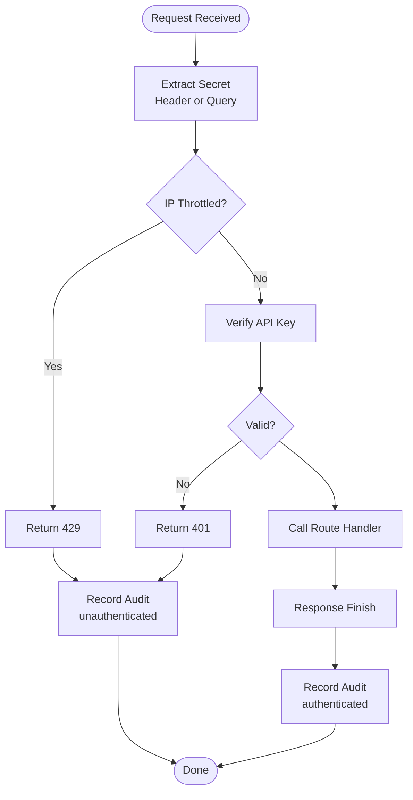
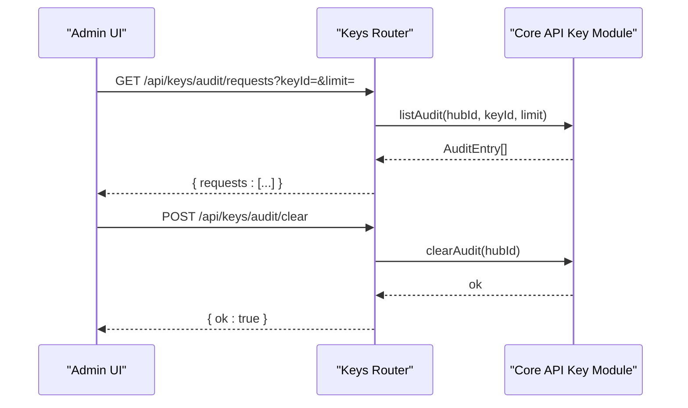
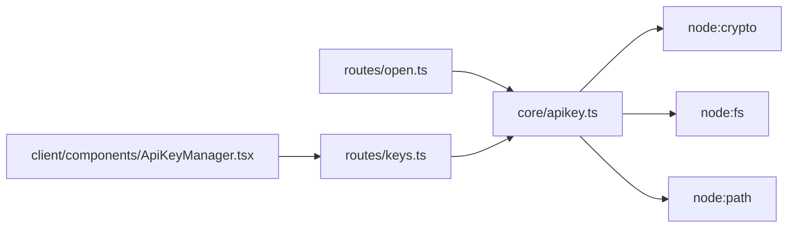

# Audit Logging

<cite>
**Referenced Files in This Document**
- [src/core/apikey.ts](file://src/core/apikey.ts)
- [src/routes/open.ts](file://src/routes/open.ts)
- [src/routes/keys.ts](file://src/routes/keys.ts)
- [client/src/components/ApiKeyManager.tsx](file://client/src/components/ApiKeyManager.tsx)
- [README.md](file://README.md)
</cite>

## Table of Contents
1. [Introduction](#introduction)
2. [Project Structure](#project-structure)
3. [Core Components](#core-components)
4. [Architecture Overview](#architecture-overview)
5. [Detailed Component Analysis](#detailed-component-analysis)
6. [Dependency Analysis](#dependency-analysis)
7. [Performance Considerations](#performance-considerations)
8. [Troubleshooting Guide](#troubleshooting-guide)
9. [Conclusion](#conclusion)
10. [Appendices](#appendices)

## Introduction
This document explains the audit logging system for the API Key-based device information distribution service. It covers what events are logged, how logs are structured and stored, retention behavior, security protections, and how to analyze logs for monitoring, compliance, and troubleshooting. It also documents configuration points available in this codebase and provides guidance for integrating with external logging systems.

## Project Structure
The audit logging system is centered around:
- A core module that defines the audit entry model, in-memory storage, persistence, and rate limiting helpers.
- An Open API middleware that records every request, including authentication failures.
- Management routes that expose audit retrieval and clearing operations.
- A client UI that displays recent audit entries and allows filtering by key.

**Diagram sources**
- [src/routes/open.ts:58-105](file://src/routes/open.ts#L58-L105)
- [src/core/apikey.ts:50-78](file://src/core/apikey.ts#L50-L78)
- [src/routes/keys.ts:67-80](file://src/routes/keys.ts#L67-L80)
- [client/src/components/ApiKeyManager.tsx:90-102](file://client/src/components/ApiKeyManager.tsx#L90-L102)

**Section sources**
- [src/routes/open.ts:58-105](file://src/routes/open.ts#L58-L105)
- [src/core/apikey.ts:50-78](file://src/core/apikey.ts#L50-L78)
- [src/routes/keys.ts:67-80](file://src/routes/keys.ts#L67-L80)
- [client/src/components/ApiKeyManager.tsx:90-102](file://client/src/components/ApiKeyManager.tsx#L90-L102)

## Core Components
- Audit entry model: timestamp, hub identifier, key identifier, key name, HTTP method, path, status code, duration, source IP, optional failure message, and an unattributed flag for failed authentications without a known owner.
- In-memory store: keeps keys and audit entries per process; persists on changes.
- Persistence: atomic file write to `data/api-keys.json` using a temporary file and rename; file permissions restrict access.
- Rate limiting: tracks recent authentication failures per IP to mitigate brute-force attempts.
- Audit recording: appends each request to the front of the list and enforces a maximum size.
- Audit listing: filters by hub and optionally by key ID, enforcing isolation.

**Section sources**
- [src/core/apikey.ts:50-78](file://src/core/apikey.ts#L50-L78)
- [src/core/apikey.ts:87-99](file://src/core/apikey.ts#L87-L99)
- [src/core/apikey.ts:243-255](file://src/core/apikey.ts#L243-L255)
- [src/core/apikey.ts:257-271](file://src/core/apikey.ts#L257-L271)
- [src/core/apikey.ts:273-303](file://src/core/apikey.ts#L273-L303)

## Architecture Overview
The Open API router applies a global middleware that:
- Extracts the API Key from Authorization header or query parameter.
- Checks IP-based rate limiting before attempting verification.
- Verifies the key and attaches an authentication context when valid.
- Records an audit entry on response finish, capturing timing, path (with redaction), status, and optional failure reason.

**Diagram sources**
- [src/routes/open.ts:58-105](file://src/routes/open.ts#L58-L105)
- [src/core/apikey.ts:220-231](file://src/core/apikey.ts#L220-L231)
- [src/core/apikey.ts:243-255](file://src/core/apikey.ts#L243-L255)

## Detailed Component Analysis

### Audit Entry Model and Storage
- Fields include time, hubId, keyId, keyName, method, path, status, ms, ip, optional message, and unattributed flag.
- The store holds both API keys and audit entries. On startup, it restores persisted data and rebuilds indexes.
- Persistence writes atomically via a temp file and rename, with restrictive file mode.

**Diagram sources**
- [src/core/apikey.ts:50-78](file://src/core/apikey.ts#L50-L78)
- [src/core/apikey.ts:87-99](file://src/core/apikey.ts#L87-L99)
- [src/core/apikey.ts:109-149](file://src/core/apikey.ts#L109-L149)

**Section sources**
- [src/core/apikey.ts:50-78](file://src/core/apikey.ts#L50-L78)
- [src/core/apikey.ts:87-99](file://src/core/apikey.ts#L87-L99)
- [src/core/apikey.ts:109-149](file://src/core/apikey.ts#L109-L149)

### Authentication Flow and Audit Recording
- The Open API middleware extracts the secret, checks throttling, verifies the key, and sets response headers.
- On response finish, it records an audit entry with sanitized path and optional failure message.
- Successful requests clear the IP’s failure counter; invalid ones increment it.

**Diagram sources**
- [src/routes/open.ts:33-56](file://src/routes/open.ts#L33-L56)
- [src/routes/open.ts:62-105](file://src/routes/open.ts#L62-L105)
- [src/core/apikey.ts:220-231](file://src/core/apikey.ts#L220-L231)
- [src/core/apikey.ts:243-255](file://src/core/apikey.ts#L243-L255)

**Section sources**
- [src/routes/open.ts:33-56](file://src/routes/open.ts#L33-L56)
- [src/routes/open.ts:62-105](file://src/routes/open.ts#L62-L105)
- [src/core/apikey.ts:220-231](file://src/core/apikey.ts#L220-L231)
- [src/core/apikey.ts:243-255](file://src/core/apikey.ts#L243-L255)

### API Key Management and Audit Access
- Management endpoints require internal hub session and expose:
  - List keys and scopes
  - Create, enable/disable, revoke keys
  - Retrieve audit entries filtered by hub and optional key ID
  - Clear audit entries for the current hub
- The client UI fetches and renders recent audit rows, supports filtering by key, and offers refresh/clear actions.

**Diagram sources**
- [src/routes/keys.ts:67-80](file://src/routes/keys.ts#L67-L80)
- [src/core/apikey.ts:257-271](file://src/core/apikey.ts#L257-L271)
- [client/src/components/ApiKeyManager.tsx:90-102](file://client/src/components/ApiKeyManager.tsx#L90-L102)

**Section sources**
- [src/routes/keys.ts:16-80](file://src/routes/keys.ts#L16-L80)
- [client/src/components/ApiKeyManager.tsx:90-102](file://client/src/components/ApiKeyManager.tsx#L90-L102)

### Events Logged
Every request to `/api/open/*` generates an audit entry, including:
- Authentication attempts: missing key, invalid/expired/disabled key, throttled requests.
- API key usage: successful calls with key identity and scope context.
- Device operations: reads, property updates, and action executions under authenticated contexts.
- Security-relevant actions: permission denials due to missing scopes, account resolution failures, and provider errors surfaced through route handlers.

Examples of logged scenarios:
- Missing API Key: status 401, unattributed flag set.
- Invalid/expired/disabled key: status 401, unattributed flag set.
- Throttled IP: status 429, unattributed flag set.
- Insufficient scope: status 403, message indicates missing scope.
- Account not found or provider error: status varies, message summarizes failure.

**Section sources**
- [src/routes/open.ts:62-105](file://src/routes/open.ts#L62-L105)
- [src/routes/open.ts:107-119](file://src/routes/open.ts#L107-L119)
- [src/routes/open.ts:177-220](file://src/routes/open.ts#L177-L220)
- [src/routes/open.ts:247-290](file://src/routes/open.ts#L247-L290)

### Log Format
Each audit entry contains:
- time: epoch milliseconds
- hubId: owning hub identifier
- keyId: key identifier if authenticated; empty otherwise
- keyName: key name or placeholder for unauthenticated cases
- method: HTTP method
- path: sanitized URL path and query; apiKey values are redacted
- status: HTTP status code
- ms: request duration in milliseconds
- ip: client IP address
- message: optional summary of failure reason
- unattributed: boolean indicating whether the request could not be attributed to a hub

Path sanitization ensures sensitive query parameters like apiKey are replaced with a redacted marker. Path length is truncated to a maximum to bound log size.

**Section sources**
- [src/core/apikey.ts:50-78](file://src/core/apikey.ts#L50-L78)
- [src/routes/open.ts:43-56](file://src/routes/open.ts#L43-L56)

### Storage Mechanisms
- In-memory store: maintains keys and audit entries during runtime.
- Persistence: writes to `data/api-keys.json` atomically using a PID-specific temp file and rename; file mode restricts access to owner only.
- Restore: on startup, parses persisted JSON and reconstructs in-memory structures, validating fields and truncating audit entries to the configured limit.

Security considerations:
- Only SHA-256 hashes of secrets are stored; plaintext keys are never persisted.
- File permissions are set to restrictive mode during write.
- Audit entries are isolated by hub; listing enforces hub scoping.

**Section sources**
- [src/core/apikey.ts:87-99](file://src/core/apikey.ts#L87-L99)
- [src/core/apikey.ts:109-149](file://src/core/apikey.ts#L109-L149)
- [src/core/apikey.ts:151-183](file://src/core/apikey.ts#L151-L183)

### Retention Policies
- Maximum audit entries: capped at a fixed limit; older entries are dropped when exceeded.
- Batched persistence: audit writes are coalesced into microtasks to reduce disk I/O frequency.
- Clearing: administrators can clear audit entries for their hub via management endpoint.

**Section sources**
- [src/core/apikey.ts:67-71](file://src/core/apikey.ts#L67-L71)
- [src/core/apikey.ts:243-255](file://src/core/apikey.ts#L243-L255)
- [src/core/apikey.ts:257-271](file://src/core/apikey.ts#L257-L271)

### Configuration Points Available in Code
- Audit limit: configurable constant controlling maximum retained audit entries.
- Rate limiting threshold and window: constants define failure count and time window used to throttle IPs.
- Path truncation limit: maximum length for audit path field.
- Store path: location of the persistent JSON file.
- Response caching: Open API responses include cache-control headers to prevent caching of sensitive data.

Note: These are defined as constants in the source; there is no dynamic configuration API exposed for them.

**Section sources**
- [src/core/apikey.ts:67-71](file://src/core/apikey.ts#L67-L71)
- [src/routes/open.ts:31-31](file://src/routes/open.ts#L31-L31)
- [src/routes/open.ts:62-64](file://src/routes/open.ts#L62-L64)

### Sensitive Information Handling
- API Key redaction: query parameters containing apiKey are replaced with a redacted marker in audit paths.
- Plaintext secret exposure: only returned once upon creation; server stores only SHA-256 hash.
- Scope enforcement: unauthorized scope access returns 403 and records a descriptive message.

**Section sources**
- [src/routes/open.ts:43-56](file://src/routes/open.ts#L43-L56)
- [src/core/apikey.ts:151-183](file://src/core/apikey.ts#L151-L183)
- [src/routes/open.ts:107-119](file://src/routes/open.ts#L107-L119)

### Integration with External Logging Systems
The current implementation persists audit entries to a local JSON file. To integrate with external logging systems:
- Replace or wrap the persistence layer to emit structured logs to stdout/stderr or a logging SDK.
- Forward audit entries to centralized log collectors (e.g., syslog, Fluent Bit, Vector) by piping output.
- Add correlation IDs: use the X-Request-Id header already set on successful requests to correlate across services.
- Enforce log integrity: consider signing or appending tamper-evident metadata when forwarding to external systems.

[No sources needed since this section provides general guidance]

## Dependency Analysis
The audit logging system depends on:
- Express routing for request handling and middleware composition.
- Node.js crypto utilities for hashing and secure comparison.
- Node.js filesystem for atomic persistence.
- Client-side components for viewing and managing audit entries.

**Diagram sources**
- [src/routes/open.ts:1-15](file://src/routes/open.ts#L1-L15)
- [src/routes/keys.ts:1-13](file://src/routes/keys.ts#L1-L13)
- [src/core/apikey.ts:1-4](file://src/core/apikey.ts#L1-L4)
- [client/src/components/ApiKeyManager.tsx:1-5](file://client/src/components/ApiKeyManager.tsx#L1-L5)

**Section sources**
- [src/routes/open.ts:1-15](file://src/routes/open.ts#L1-L15)
- [src/routes/keys.ts:1-13](file://src/routes/keys.ts#L1-L13)
- [src/core/apikey.ts:1-4](file://src/core/apikey.ts#L1-L4)
- [client/src/components/ApiKeyManager.tsx:1-5](file://client/src/components/ApiKeyManager.tsx#L1-L5)

## Performance Considerations
- Audit writes are batched via microtasks to minimize disk I/O overhead.
- In-memory list insertion at the head is O(1); trimming to a fixed limit avoids unbounded growth.
- Rate limiting uses a Map with bounded size cleanup to prevent memory leaks.
- Path sanitization and truncation keep log sizes predictable.

[No sources needed since this section provides general guidance]

## Troubleshooting Guide
Common issues and resolutions:
- Repeated 401 responses: check API Key validity, expiration, and enabled state; review audit messages for missing scope or invalid key.
- 429 responses: indicates too many invalid requests from the same IP within the time window; wait for the window to expire or clear failures.
- Missing devices or accounts: audit messages may indicate account not found or provider errors; verify vendor sessions and credentials.
- Unable to view audit entries: ensure you are authenticated via the internal hub session and filter by correct hub/key.

Operational tips:
- Use the client UI to filter audit entries by key and refresh frequently.
- Clear audit entries cautiously; clearing removes all entries for the current hub.
- Monitor X-Request-Id in successful responses to correlate logs across components.

**Section sources**
- [src/routes/open.ts:86-105](file://src/routes/open.ts#L86-L105)
- [src/routes/open.ts:107-119](file://src/routes/open.ts#L107-L119)
- [client/src/components/ApiKeyManager.tsx:241-254](file://client/src/components/ApiKeyManager.tsx#L241-L254)

## Conclusion
The audit logging system provides comprehensive visibility into API Key authentication, authorization, and device operations. It balances security and performance by storing only hashed secrets, redacting sensitive query parameters, isolating audit data by hub, and batching persistence. Administrators can manage keys, inspect recent audit entries, and clear logs through the management interface. For advanced needs, the system can be extended to forward structured logs to external collectors while preserving integrity and privacy.

[No sources needed since this section summarizes without analyzing specific files]

## Appendices

### Example Analyses Using Audit Logs
- Security monitoring:
  - Detect spikes in 401/429 responses from specific IPs to identify brute-force attempts.
  - Track unattributed entries to find requests lacking a valid key or belonging to unknown hubs.
- Compliance reporting:
  - Export audit entries filtered by hub and key to demonstrate who accessed which endpoints and when.
  - Correlate X-Request-Id with downstream logs for full traceability.
- Troubleshooting incidents:
  - Investigate 403 responses to confirm missing scopes and adjust key permissions accordingly.
  - Review messages for provider errors or account resolution failures to pinpoint integration issues.

[No sources needed since this section provides general guidance]