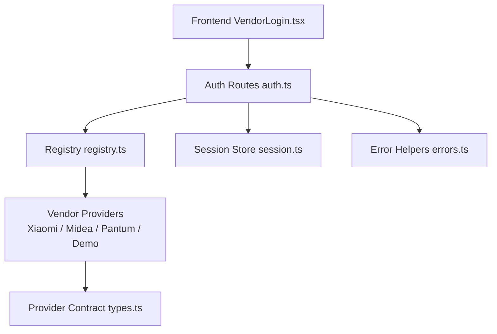
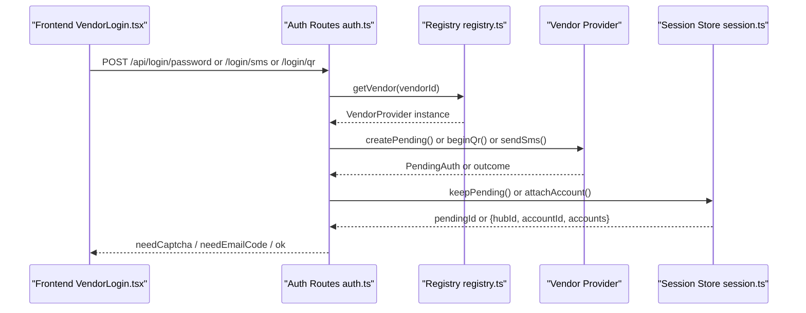
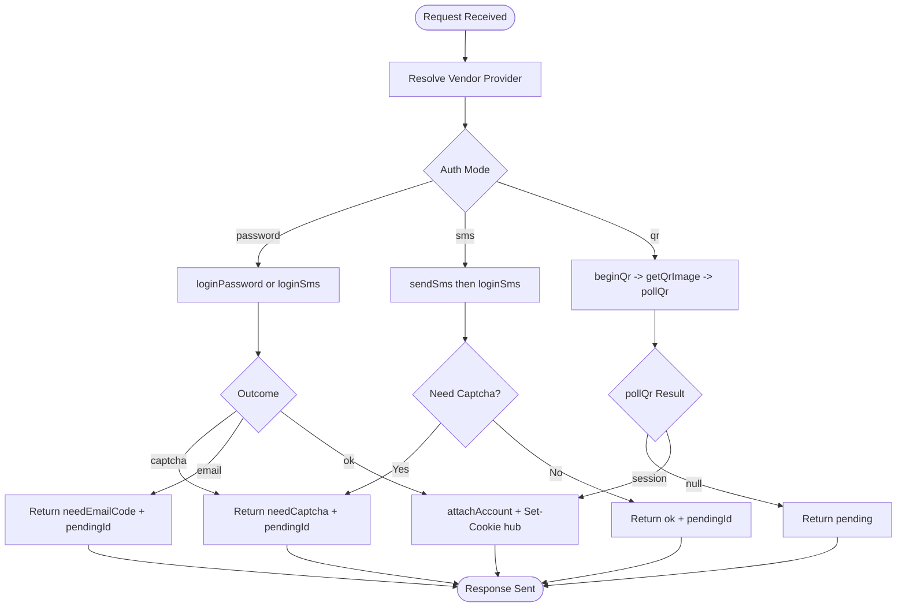
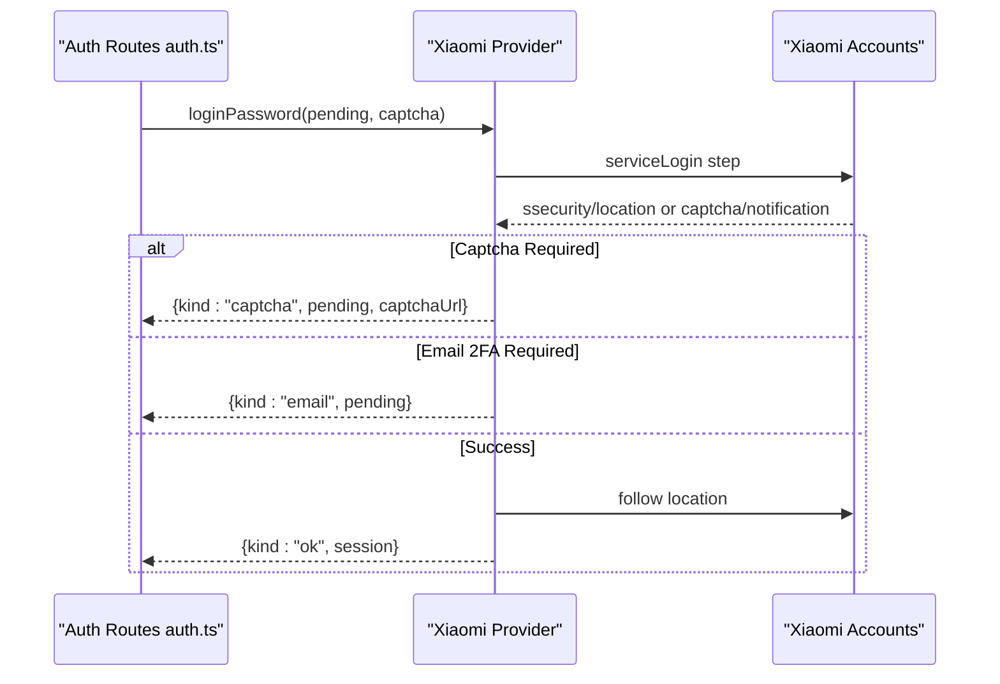
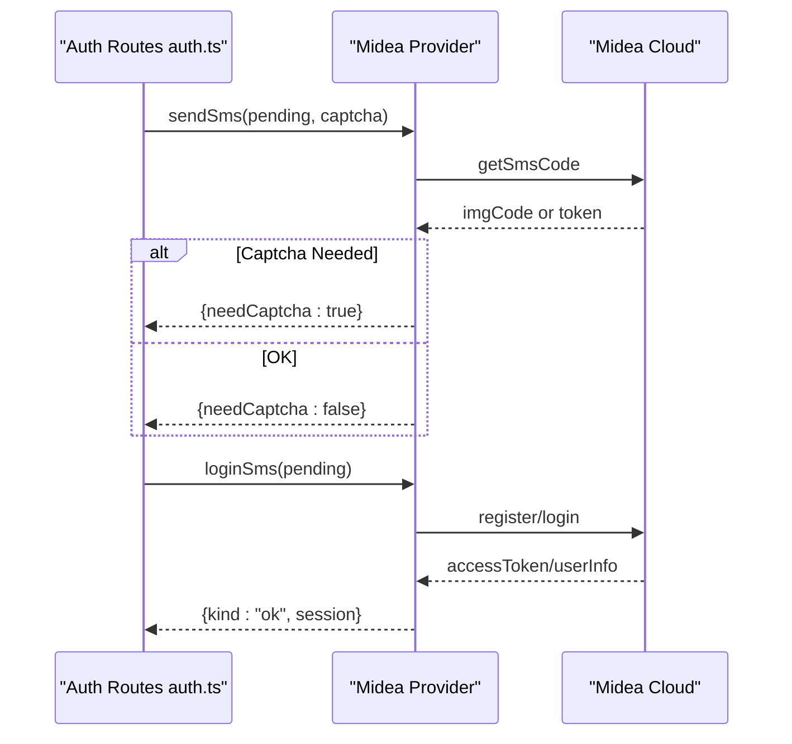
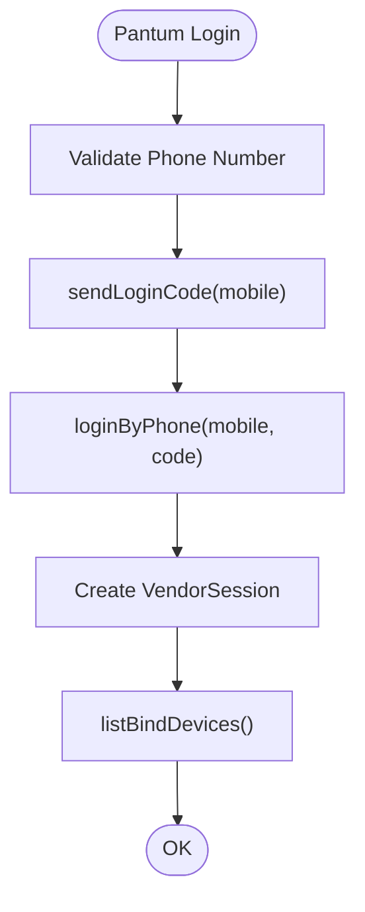
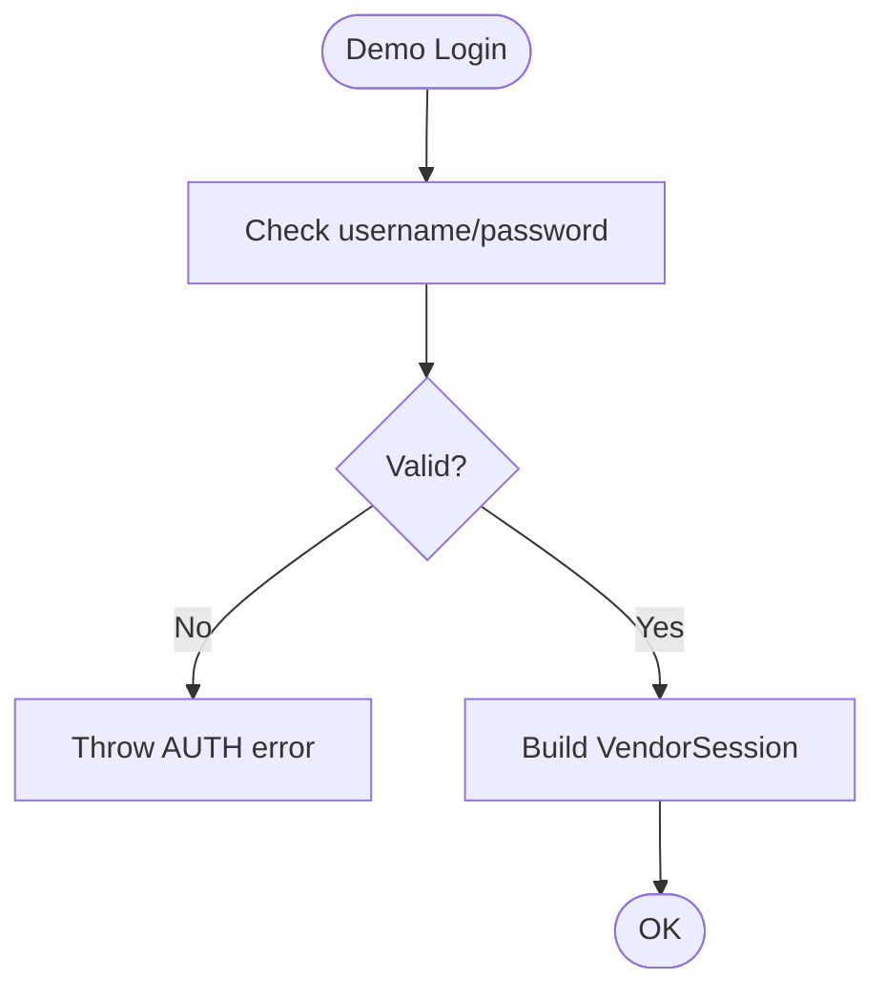
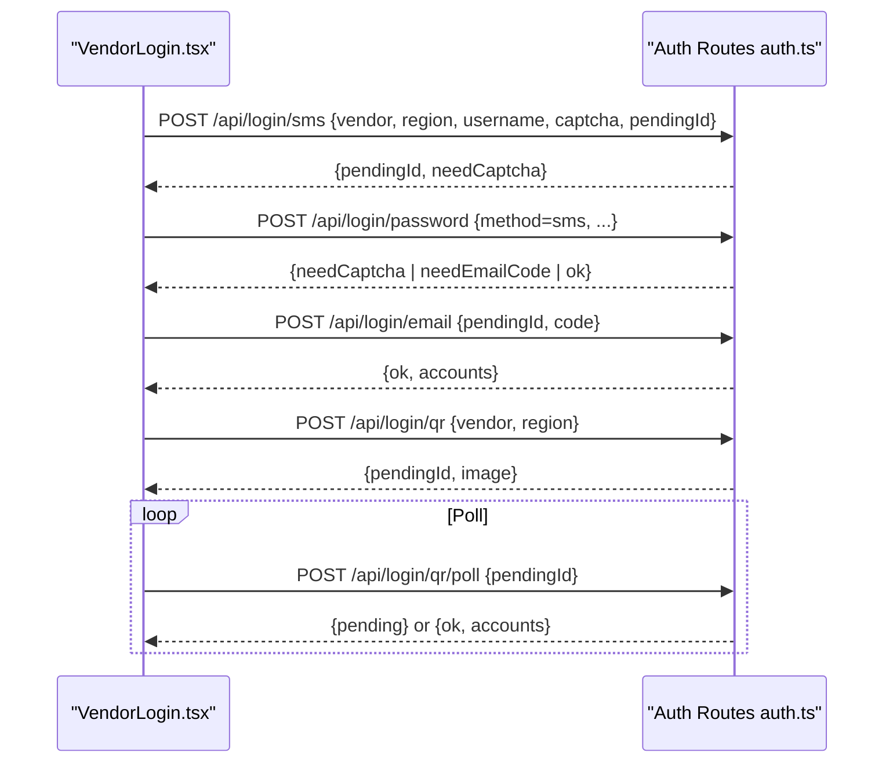
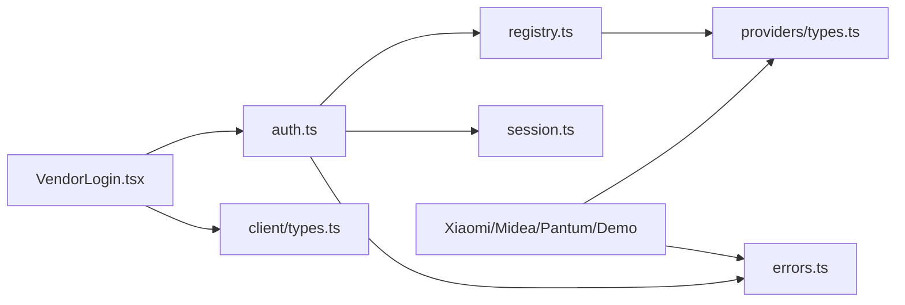

# Multi-Vendor Authentication

<cite>
**Referenced Files in This Document**
- [types.ts](file://src/providers/types.ts)
- [index.ts](file://src/providers/index.ts)
- [auth.ts](file://src/routes/auth.ts)
- [session.ts](file://src/core/session.ts)
- [registry.ts](file://src/core/registry.ts)
- [errors.ts](file://src/core/errors.ts)
- [VendorLogin.tsx](file://client/src/components/VendorLogin.tsx)
- [xiaomi-auth.ts](file://src/providers/xiaomi/auth.ts)
- [midea-auth.ts](file://src/providers/midea/auth.ts)
- [pantum-provider.ts](file://src/providers/pantum/index.ts)
- [demo-provider.ts](file://src/providers/demo/index.ts)
- [client-types.ts](file://client/src/types.ts)
</cite>

## Table of Contents
1. [Introduction](#introduction)
2. [Project Structure](#project-structure)
3. [Core Components](#core-components)
4. [Architecture Overview](#architecture-overview)
5. [Detailed Component Analysis](#detailed-component-analysis)
6. [Dependency Analysis](#dependency-analysis)
7. [Performance Considerations](#performance-considerations)
8. [Troubleshooting Guide](#troubleshooting-guide)
9. [Conclusion](#conclusion)

## Introduction
This document explains the multi-vendor authentication system that unifies different smart home ecosystems behind a single interface. The system supports password-based login, SMS verification, QR code scanning, and email-based two-factor authentication. It abstracts vendor-specific protocols through a `VendorProvider` contract, manages multi-account sessions with persistence, and exposes a consistent REST API for the frontend.

The implementation covers:
- A unified authentication interface and state model.
- Vendor providers for Xiaomi, Midea, Pantum, and a demo provider.
- Server-side session management, pending authentication flows, and hub-scoped account binding.
- Frontend UI that adapts to each vendor’s supported authentication modes.
- Error handling, retry behavior, and status checking.

## Project Structure
The authentication system is split into:
- Provider contracts and implementations under `src/providers`.
- Unified routes under `src/routes/auth.ts`.
- Session and registry utilities under `src/core`.
- Frontend login component under `client/src/components/VendorLogin.tsx`.



**Diagram sources**
- [VendorLogin.tsx:146-201](file://client/src/components/VendorLogin.tsx#L146-L201)
- [auth.ts:35-173](file://src/routes/auth.ts#L35-L173)
- [registry.ts:1-24](file://src/core/registry.ts#L1-L24)
- [types.ts:105-143](file://src/providers/types.ts#L105-L143)
- [session.ts:184-210](file://src/core/session.ts#L184-L210)
- [errors.ts:1-38](file://src/core/errors.ts#L1-L38)

**Section sources**
- [types.ts:1-144](file://src/providers/types.ts#L1-L144)
- [index.ts:1-17](file://src/providers/index.ts#L1-L17)
- [auth.ts:1-200](file://src/routes/auth.ts#L1-L200)
- [session.ts:1-266](file://src/core/session.ts#L1-L266)
- [registry.ts:1-24](file://src/core/registry.ts#L1-L24)
- [errors.ts:1-38](file://src/core/errors.ts#L1-L38)
- [VendorLogin.tsx:1-278](file://client/src/components/VendorLogin.tsx#L1-L278)

## Core Components
- VendorProvider contract: defines authentication methods, device operations, and optional capabilities like captcha or QR image retrieval.
- PendingAuth: represents an in-progress login flow across multiple steps (e.g., password -> captcha -> email).
- VendorSession: represents a successful login with vendor-specific runtime state.
- Hub-scoped accounts: multiple vendor accounts can be bound to one browser session via a hub cookie.
- Registry: centralizes vendor discovery and lookup.
- Error helpers: normalize vendor errors into public responses and detect authentication failures.

Key responsibilities:
- Route handlers orchestrate vendor calls and manage pending states.
- Session store persists active accounts and pending logins.
- Providers implement vendor-specific protocols while conforming to the shared contract.

**Section sources**
- [types.ts:77-143](file://src/providers/types.ts#L77-L143)
- [session.ts:184-266](file://src/core/session.ts#L184-L266)
- [registry.ts:1-24](file://src/core/registry.ts#L1-L24)
- [errors.ts:1-38](file://src/core/errors.ts#L1-L38)

## Architecture Overview
The authentication architecture follows a layered design:
- Frontend: VendorLogin component selects vendor, region, and mode; handles polling and user input.
- API layer: Express router dispatches to vendor providers based on method and vendor id.
- Provider layer: Each vendor implements the VendorProvider interface with its own protocol details.
- Session layer: Manages hub-scoped accounts, pending logins, and persistence.



**Diagram sources**
- [VendorLogin.tsx:146-201](file://client/src/components/VendorLogin.tsx#L146-L201)
- [auth.ts:35-173](file://src/routes/auth.ts#L35-L173)
- [registry.ts:10-14](file://src/core/registry.ts#L10-L14)
- [session.ts:230-266](file://src/core/session.ts#L230-L266)

## Detailed Component Analysis

### Unified Authentication Interface
The `VendorProvider` interface standardizes how vendors authenticate and expose devices. It includes:
- Metadata: id, name, supported authModes, regions.
- Lifecycle: createPending, checkSession.
- Password flow: loginPassword, getCaptchaImage.
- SMS flow: sendSms, loginSms.
- Email 2FA: beginEmail2fa, verifyEmail2fa.
- QR flow: beginQr, pollQr, getQrImage.
- Device operations: listDevices, refreshLive, getDeviceDetail, setProperty, runAction.

```mermaid
classDiagram
class VendorProvider {
+string id
+string name
+AuthMode[] authModes
+listRegions() RegionInfo[]
+createPending(region) PendingAuth
+loginPassword(pending, captcha) LoginOutcome
+sendSms?(pending, captcha) {needCaptcha : boolean}
+loginSms?(pending) LoginOutcome
+beginEmail2fa?(pending) PendingAuth
+verifyEmail2fa?(pending, code) VendorSession
+beginQr?(pending) PendingAuth
+pollQr?(pending) VendorSession | null
+getCaptchaImage?(pending) BinaryImage
+getQrImage?(pending) BinaryImage
+checkSession?(session) void
+listDevices(session) DeviceSummary[]
+refreshLive(session, devices) Record~string, LiveItem[]~
+getDeviceDetail(session, did) DeviceDetail
+setProperty(session, did, siid, piid, value, key) void
+runAction(session, did, siid, aiid) void
}
class PendingAuth {
+string? id
+string vendorId
+string region
+unknown state
+string? username
+string? password
+string? captchaUrl
+string? notificationUrl
+string? replaceAccountId
+number createdAt
}
class VendorSession {
+string vendorId
+string userId
+string region
+Map~string, DeviceSummary~ devices
+unknown state
}
VendorProvider --> PendingAuth : "creates"
VendorProvider --> VendorSession : "returns"
```

**Diagram sources**
- [types.ts:77-143](file://src/providers/types.ts#L77-L143)

**Section sources**
- [types.ts:105-143](file://src/providers/types.ts#L105-L143)

### Router Orchestration and State Management
The auth router coordinates:
- Password login with optional captcha and email 2FA.
- SMS sending and SMS-based login.
- QR code initiation, image retrieval, and polling.
- Account binding to a hub and logout.



**Diagram sources**
- [auth.ts:35-173](file://src/routes/auth.ts#L35-L173)
- [session.ts:184-210](file://src/core/session.ts#L184-L210)

**Section sources**
- [auth.ts:35-173](file://src/routes/auth.ts#L35-L173)
- [session.ts:184-266](file://src/core/session.ts#L184-L266)

### Vendor Implementations

#### Xiaomi Provider
Capabilities:
- Password login with optional captcha and email 2FA.
- QR code login with long-polling.
- Captcha and QR image retrieval.
- Session validation against passport status endpoint.

Key behaviors:
- Uses HTTP cookies and service tokens.
- Handles redirects and security headers.
- Cleans sensitive fields from pending state after success.



**Diagram sources**
- [xiaomi-auth.ts:33-92](file://src/providers/xiaomi/auth.ts#L33-L92)
- [auth.ts:35-71](file://src/routes/auth.ts#L35-L71)

**Section sources**
- [xiaomi-auth.ts:1-268](file://src/providers/xiaomi/auth.ts#L1-L268)

#### Midea Provider
Capabilities:
- SMS code sending with optional captcha.
- SMS-based login.
- Password-based login using encrypted credentials.
- Captcha image retrieval from base64 or URL.

Key behaviors:
- Validates phone number format.
- Maintains randomToken and deviceId across steps.
- Accepts login response and extracts accessToken and userId.



**Diagram sources**
- [midea-auth.ts:51-175](file://src/providers/midea/auth.ts#L51-L175)
- [auth.ts:73-91](file://src/routes/auth.ts#L73-L91)

**Section sources**
- [midea-auth.ts:1-176](file://src/providers/midea/auth.ts#L1-L176)

#### Pantum Provider
Capabilities:
- SMS-only login.
- Cloud device listing and printing actions.
- No password or QR support.

Key behaviors:
- Enforces phone number format.
- Refreshes device list and maps cloud devices to summaries.
- Throws explicit errors for unsupported operations.



**Diagram sources**
- [pantum-provider.ts:65-85](file://src/providers/pantum/index.ts#L65-L85)

**Section sources**
- [pantum-provider.ts:1-112](file://src/providers/pantum/index.ts#L1-L112)

#### Demo Provider
Capabilities:
- Password-only login with fixed test credentials.
- In-memory device state and properties.
- Demonstrates property writing and action stubs.

Key behaviors:
- Simple credential check.
- Returns static device list and live chips.
- Encodes field values and updates local state.



**Diagram sources**
- [demo-provider.ts:70-78](file://src/providers/demo/index.ts#L70-L78)

**Section sources**
- [demo-provider.ts:1-108](file://src/providers/demo/index.ts#L1-L108)

### Frontend Login Flow
The VendorLogin component:
- Chooses default mode based on vendor capabilities.
- Sends SMS codes when required.
- Displays captcha images and prompts for email codes.
- Polls QR login until success or failure.
- Handles errors and busy states.



**Diagram sources**
- [VendorLogin.tsx:116-201](file://client/src/components/VendorLogin.tsx#L116-L201)
- [auth.ts:73-173](file://src/routes/auth.ts#L73-L173)

**Section sources**
- [VendorLogin.tsx:1-278](file://client/src/components/VendorLogin.tsx#L1-L278)
- [client-types.ts:98-141](file://client/src/types.ts#L98-L141)

## Dependency Analysis
The system has clear separation between routing, provider logic, and session management:
- Routes depend on registry to resolve providers.
- Providers depend on vendor-specific HTTP clients and crypto utilities.
- Session store depends on file system for persistence and crypto for IDs.
- Frontend depends on client types and API helpers.



**Diagram sources**
- [auth.ts:1-200](file://src/routes/auth.ts#L1-L200)
- [registry.ts:1-24](file://src/core/registry.ts#L1-L24)
- [session.ts:1-266](file://src/core/session.ts#L1-L266)
- [errors.ts:1-38](file://src/core/errors.ts#L1-L38)
- [types.ts:1-144](file://src/providers/types.ts#L1-L144)
- [VendorLogin.tsx:1-278](file://client/src/components/VendorLogin.tsx#L1-L278)
- [client-types.ts:1-141](file://client/src/types.ts#L1-L141)

**Section sources**
- [index.ts:1-17](file://src/providers/index.ts#L1-L17)
- [registry.ts:1-24](file://src/core/registry.ts#L1-L24)

## Performance Considerations
- Pending authentication state has a TTL to prevent stale flows.
- QR polling uses short intervals and abort signals to avoid hanging requests.
- Session persistence writes atomically via temp files and rename.
- Vendor providers should minimize unnecessary network calls by caching where appropriate.
- Frontend polling should respect backoff if vendor APIs rate-limit.

[No sources needed since this section provides general guidance]

## Troubleshooting Guide
Common issues and strategies:
- Captcha loops: Ensure pendingId is carried across requests; re-fetch captcha only when needCaptcha is returned.
- Email 2FA not starting: Some vendors require beginEmail2fa before verifyEmail2fa; route handler enforces this.
- QR expired: If pollQr returns null repeatedly or pendingId becomes invalid, restart QR flow.
- Session invalidation: Use checkSession or account status endpoints; handle 401/403 and prompt re-login.
- Vendor not supported: Registry throws VENDOR error if vendor id is unknown.

Operational tips:
- Inspect AppError code and status for precise diagnostics.
- Use /api/accounts/status to see per-account health.
- Clear hub cookie to reset all accounts if necessary.

**Section sources**
- [errors.ts:15-38](file://src/core/errors.ts#L15-L38)
- [auth.ts:192-199](file://src/routes/auth.ts#L192-L199)
- [session.ts:230-266](file://src/core/session.ts#L230-L266)

## Conclusion
The multi-vendor authentication system provides a robust, extensible foundation for integrating diverse smart home ecosystems. By standardizing vendor interactions through VendorProvider, managing complex login flows with PendingAuth, and persisting hub-scoped sessions, it enables consistent user experiences across vendors. The router orchestrates flows cleanly, while error handling and status checks improve resilience. Extending the system requires implementing VendorProvider methods according to vendor-specific protocols and registering the provider in bootstrap.

[No sources needed since this section summarizes without analyzing specific files]