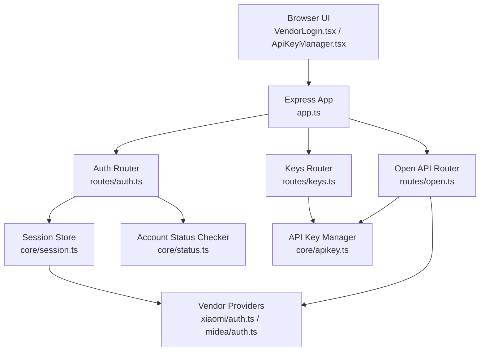
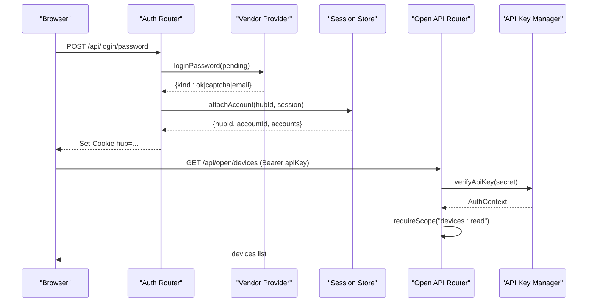
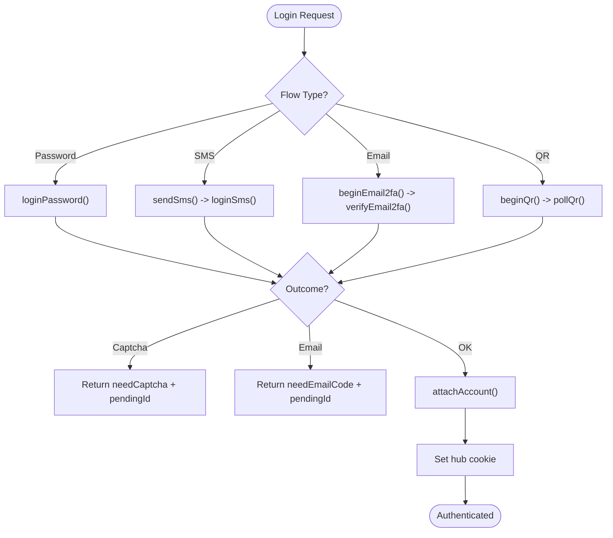
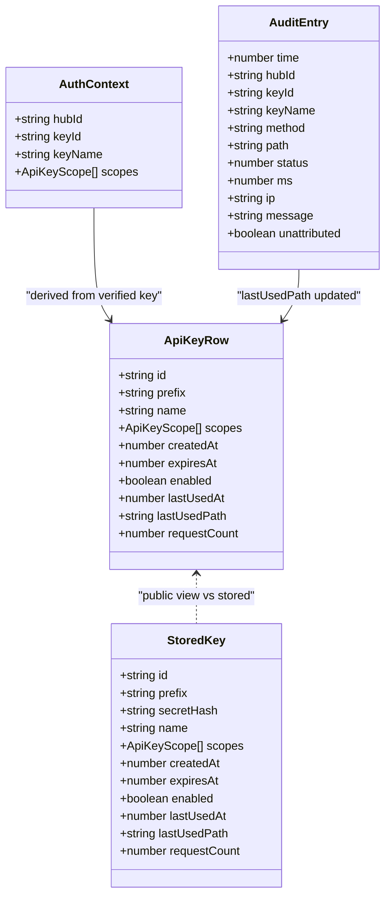
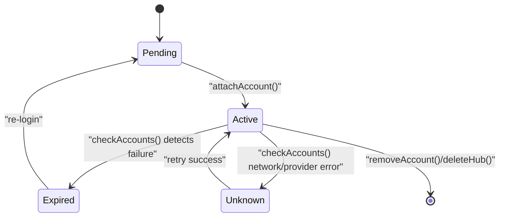
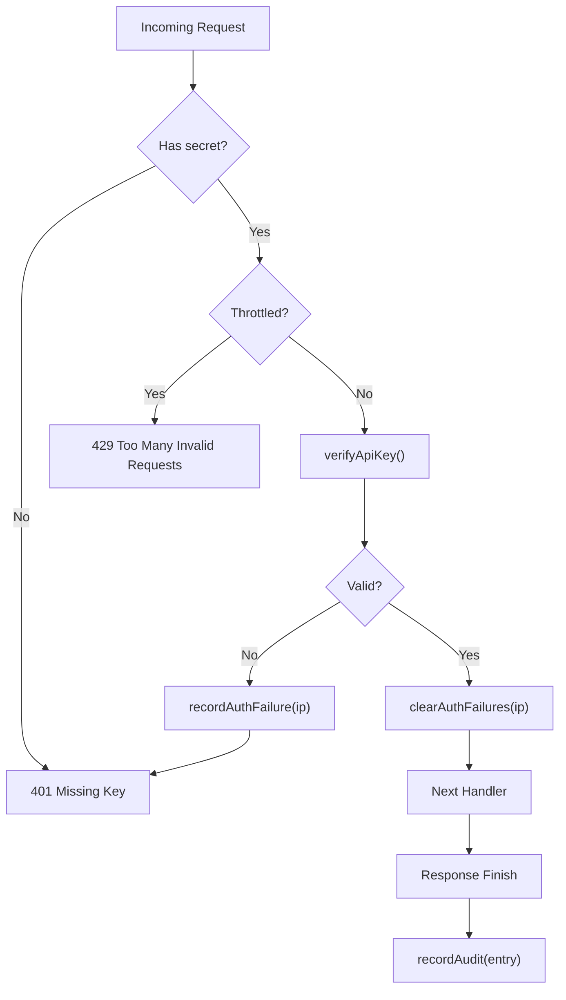
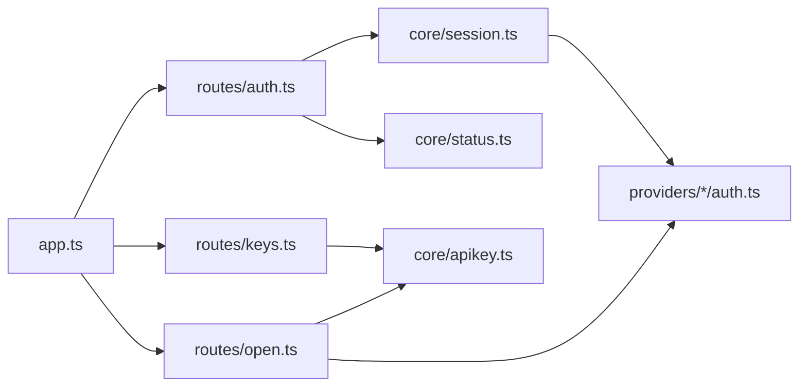

# Security & Authentication

<cite>
**Referenced Files in This Document**
- [app.ts](file://src/app.ts)
- [auth.ts](file://src/routes/auth.ts)
- [keys.ts](file://src/routes/keys.ts)
- [open.ts](file://src/routes/open.ts)
- [apikey.ts](file://src/core/apikey.ts)
- [session.ts](file://src/core/session.ts)
- [status.ts](file://src/core/status.ts)
- [errors.ts](file://src/core/errors.ts)
- [xiaomi_auth.ts](file://src/providers/xiaomi/auth.ts)
- [midea_auth.ts](file://src/providers/midea/auth.ts)
- [ApiKeyManager.tsx](file://client/src/components/ApiKeyManager.tsx)
- [VendorLogin.tsx](file://client/src/components/VendorLogin.tsx)
</cite>

## Table of Contents
1. [Introduction](#introduction)
2. [Project Structure](#project-structure)
3. [Core Components](#core-components)
4. [Architecture Overview](#architecture-overview)
5. [Detailed Component Analysis](#detailed-component-analysis)
6. [Dependency Analysis](#dependency-analysis)
7. [Performance Considerations](#performance-considerations)
8. [Troubleshooting Guide](#troubleshooting-guide)
9. [Conclusion](#conclusion)
10. [Appendices](#appendices)

## Introduction
This document explains the security model and authentication mechanisms for the multi-vendor smart home hub. It covers:
- Multi-vendor authentication flows for password, SMS, QR code, and email-based login.
- API key generation, scope-based authorization, secure storage using SHA-256 hashing, and audit logging.
- Session management for maintaining vendor authentication states per hub.
- Rate limiting for failed authentication attempts.
- Input validation and protection patterns used across routes.
- Production security best practices, key rotation policies, and monitoring guidance.

The system separates two concerns:
- Web application authentication: users log into vendor accounts through a browser session managed by a `hub` cookie.
- External API authentication: third-party applications authenticate via an API Key sent as a Bearer token or query parameter.

## Project Structure
Security-related functionality is split between Express routers, core modules, provider-specific authentication implementations, and frontend components.

**Diagram sources**
- [app.ts:14-23](file://src/app.ts#L14-L23)
- [auth.ts:19-23](file://src/routes/auth.ts#L19-L23)
- [keys.ts:14-24](file://src/routes/keys.ts#L14-L24)
- [open.ts:17-37](file://src/routes/open.ts#L17-L37)
- [session.ts:30-35](file://src/core/session.ts#L30-L35)
- [apikey.ts:67-80](file://src/core/apikey.ts#L67-L80)
- [xiaomi_auth.ts:7-15](file://src/providers/xiaomi/auth.ts#L7-L15)
- [midea_auth.ts:8-16](file://src/providers/midea/auth.ts#L8-L16)

**Section sources**
- [app.ts:14-23](file://src/app.ts#L14-L23)

## Core Components
- API Key manager: generates keys, stores only SHA-256 hashes, enforces scopes, tracks usage, and records audit entries.
- Session manager: maintains vendor sessions per hub, persists account state, handles pending authentication steps, and exposes account views.
- Error utilities: normalize errors, detect authentication failures, and return safe public error responses.
- Account status checker: probes vendor sessions with timeouts and marks them expired or unknown based on provider feedback.

Key responsibilities:
- API Key creation returns the plaintext secret once; only its hash is persisted.
- API Key verification uses constant-time comparison to prevent timing attacks.
- Audit logs capture request metadata, including IP, method, path, status, duration, and failure summaries.
- Session persistence safely serializes sensitive objects while excluding passwords.

**Section sources**
- [apikey.ts:151-183](file://src/core/apikey.ts#L151-L183)
- [apikey.ts:220-241](file://src/core/apikey.ts#L220-L241)
- [apikey.ts:243-271](file://src/core/apikey.ts#L243-L271)
- [session.ts:37-49](file://src/core/session.ts#L37-L49)
- [session.ts:184-210](file://src/core/session.ts#L184-L210)
- [errors.ts:1-37](file://src/core/errors.ts#L1-L37)
- [status.ts:34-50](file://src/core/status.ts#L34-L50)

## Architecture Overview
The system has two authentication layers:

1. Web authentication layer (vendor login):
   - Users authenticate against vendor providers through Express endpoints.
   - The server creates a temporary pending authentication context and then attaches a persistent vendor session to a hub identified by a cookie.
   - Pending contexts support captcha, email 2FA, and QR polling.

2. External API layer (API Key):
   - Third-party clients authenticate using an API Key.
   - A middleware verifies the key, applies rate limiting, sets request-scoped auth context, and records audit logs.
   - Route handlers enforce scope-based authorization.

**Diagram sources**
- [auth.ts:35-71](file://src/routes/auth.ts#L35-L71)
- [auth.ts:184-210](file://src/core/session.ts#L184-L210)
- [open.ts:62-105](file://src/routes/open.ts#L62-L105)
- [open.ts:107-119](file://src/routes/open.ts#L107-L119)
- [open.ts:177-202](file://src/routes/open.ts#L177-L202)
- [apikey.ts:220-241](file://src/core/apikey.ts#L220-L241)

## Detailed Component Analysis

### Multi-Vendor Authentication System
Supported flows:
- Password login: supports vendor-specific credential handling and optional captcha.
- SMS login: sends SMS codes and validates them; may require captcha depending on vendor.
- Email 2FA: initiates email verification and completes login after code submission.
- QR code login: starts QR flow, serves image, polls until approved.

Vendor-specific behaviors:
- Xiaomi: password login may trigger captcha or email 2FA; QR polling uses long-polling endpoint; session check validates passToken and serviceToken.
- Midea: SMS login requires phone number format validation; password login encrypts credentials before sending; captcha can be base64 or remote image.

**Diagram sources**
- [auth.ts:35-71](file://src/routes/auth.ts#L35-L71)
- [auth.ts:73-91](file://src/routes/auth.ts#L73-L91)
- [auth.ts:109-121](file://src/routes/auth.ts#L109-L121)
- [auth.ts:123-173](file://src/routes/auth.ts#L123-L173)
- [xiaomi_auth.ts:33-92](file://src/providers/xiaomi/auth.ts#L33-L92)
- [xiaomi_auth.ts:94-173](file://src/providers/xiaomi/auth.ts#L94-L173)
- [xiaomi_auth.ts:175-223](file://src/providers/xiaomi/auth.ts#L175-L223)
- [midea_auth.ts:51-86](file://src/providers/midea/auth.ts#L51-L86)
- [midea_auth.ts:111-175](file://src/providers/midea/auth.ts#L111-L175)

**Section sources**
- [auth.ts:35-173](file://src/routes/auth.ts#L35-L173)
- [xiaomi_auth.ts:33-223](file://src/providers/xiaomi/auth.ts#L33-L223)
- [midea_auth.ts:51-175](file://src/providers/midea/auth.ts#L51-L175)

### API Key System
Key lifecycle:
- Generation: creates a unique ID and secret prefix, computes SHA-256 hash, stores only the hash, and returns plaintext secret once.
- Storage: serialized to disk with restricted file permissions; in-memory index maps hash to key row for fast lookup.
- Verification: constant-time comparison of provided secret hash against stored hash; checks enabled and expiration.
- Scopes: read-only device access, live data access, and control access are enforced per route.
- Audit: every request writes an audit entry, redacting sensitive parameters and truncating paths.

**Diagram sources**
- [apikey.ts:11-48](file://src/core/apikey.ts#L11-L48)
- [apikey.ts:27-40](file://src/core/apikey.ts#L27-L40)
- [apikey.ts:50-65](file://src/core/apikey.ts#L50-L65)

**Section sources**
- [apikey.ts:151-183](file://src/core/apikey.ts#L151-L183)
- [apikey.ts:220-241](file://src/core/apikey.ts#L220-L241)
- [apikey.ts:243-271](file://src/core/apikey.ts#L243-L271)
- [open.ts:33-56](file://src/routes/open.ts#L33-L56)
- [open.ts:62-105](file://src/routes/open.ts#L62-L105)
- [open.ts:107-119](file://src/routes/open.ts#L107-L119)

### Secure Storage and Hashing
- Secrets are hashed using SHA-256 before persistence.
- Filesystem writes use atomic temp files and restrictive permissions.
- In-memory structures include a reverse index from hash to key row for O(1) lookup.
- Comparison uses constant-time equality to mitigate timing side channels.

Best practices reflected:
- Never store plaintext secrets.
- Use atomic writes to avoid partial corruption.
- Limit file permissions to owner-only access.

**Section sources**
- [apikey.ts:83-99](file://src/core/apikey.ts#L83-L99)
- [apikey.ts:109-149](file://src/core/apikey.ts#L109-L149)
- [apikey.ts:233-237](file://src/core/apikey.ts#L233-L237)

### Session Management
Hub and account model:
- A hub groups multiple vendor accounts for one browser session.
- Each account contains vendor identity, region, device cache, and provider-specific state.
- Pending authentication contexts are short-lived and TTL-bound.

Persistence:
- Sessions are serialized to disk with special handling for buffers, Maps, and cookie jars.
- Password fields are excluded during serialization.

Operations:
- Attach account replaces existing same-vendor/same-user sessions when appropriate.
- Remove account deletes session and associated status.
- Delete hub removes all accounts and statuses.

**Diagram sources**
- [session.ts:184-210](file://src/core/session.ts#L184-L210)
- [status.ts:34-50](file://src/core/status.ts#L34-L50)

**Section sources**
- [session.ts:30-49](file://src/core/session.ts#L30-L49)
- [session.ts:72-98](file://src/core/session.ts#L72-L98)
- [session.ts:100-129](file://src/core/session.ts#L100-L129)
- [session.ts:184-210](file://src/core/session.ts#L184-L210)
- [session.ts:230-265](file://src/core/session.ts#L230-L265)
- [status.ts:6-20](file://src/core/status.ts#L6-L20)
- [status.ts:22-31](file://src/core/status.ts#L22-L31)

### Audit Logging System
Audit entries record:
- Timestamp, hub/key identifiers, HTTP method, path, status code, duration, client IP, and optional failure summary.
- Paths are sanitized to remove API keys and truncated to limit size.
- Failed requests without valid key still generate unattributed audit entries.

Usage:
- Every open API request triggers audit recording on response finish.
- Successful verifications clear per-IP failure counters.
- Admin UI allows filtering and clearing audit logs per hub.

**Diagram sources**
- [open.ts:62-105](file://src/routes/open.ts#L62-L105)
- [apikey.ts:273-299](file://src/core/apikey.ts#L273-L299)
- [apikey.ts:243-255](file://src/core/apikey.ts#L243-L255)

**Section sources**
- [open.ts:33-56](file://src/routes/open.ts#L33-L56)
- [open.ts:62-105](file://src/routes/open.ts#L62-L105)
- [apikey.ts:243-271](file://src/core/apikey.ts#L243-L271)
- [keys.ts:67-80](file://src/routes/keys.ts#L67-L80)

### Authorization Controls
Scopes:
- devices:read: list devices and details.
- devices:live: read live telemetry.
- devices:control: write properties and execute actions.

Enforcement:
- Middleware attaches AuthContext upon successful key verification.
- Route handlers call requireScope to ensure the key includes the required scope.
- Missing scope returns 403 with a descriptive error and updates audit message.

**Section sources**
- [apikey.ts:6-9](file://src/core/apikey.ts#L6-L9)
- [open.ts:107-119](file://src/routes/open.ts#L107-L119)
- [open.ts:164-175](file://src/routes/open.ts#L164-L175)
- [open.ts:247-290](file://src/routes/open.ts#L247-L290)

### Frontend Security Interfaces
- VendorLogin component orchestrates multi-step login flows, including QR polling, captcha display, and email verification.
- ApiKeyManager component manages key creation, toggling, revocation, testing, and audit viewing. Plaintext secret is shown only once and optionally saved in sessionStorage for local testing.

**Section sources**
- [VendorLogin.tsx:21-202](file://client/src/components/VendorLogin.tsx#L21-L202)
- [VendorLogin.tsx:204-278](file://client/src/components/VendorLogin.tsx#L204-L278)
- [ApiKeyManager.tsx:72-177](file://client/src/components/ApiKeyManager.tsx#L72-L177)
- [ApiKeyManager.tsx:179-305](file://client/src/components/ApiKeyManager.tsx#L179-L305)

## Dependency Analysis
High-level dependencies:
- Express app mounts routers for auth, keys, and open APIs.
- Auth router depends on session store and status checker.
- Open router depends on API key manager and vendor providers.
- Keys router depends on API key manager and session store.

**Diagram sources**
- [app.ts:14-23](file://src/app.ts#L14-L23)
- [auth.ts:1-17](file://src/routes/auth.ts#L1-L17)
- [keys.ts:1-13](file://src/routes/keys.ts#L1-L13)
- [open.ts:1-15](file://src/routes/open.ts#L1-L15)

**Section sources**
- [app.ts:14-23](file://src/app.ts#L14-L23)

## Performance Considerations
- Audit writes are batched using microtask flushing to reduce disk I/O overhead.
- API key verification uses an in-memory hash-to-row index for constant-time lookups.
- Account status checks run concurrently with a timeout to avoid blocking.
- JSON body parsing is limited to 64KB to prevent oversized payloads.

Recommendations:
- Monitor audit queue flush frequency and disk latency.
- Consider moving audit storage to a dedicated backend if throughput increases.
- Cache vendor device lists where appropriate, but refresh on changes.

**Section sources**
- [apikey.ts:243-255](file://src/core/apikey.ts#L243-L255)
- [apikey.ts:220-241](file://src/core/apikey.ts#L220-L241)
- [status.ts:6-20](file://src/core/status.ts#L6-L20)
- [app.ts:15](file://src/app.ts#L15)

## Troubleshooting Guide
Common issues and diagnostics:
- Login expired or pending invalid: retry login flow; pending IDs expire after TTL.
- Missing API Key: ensure Authorization header or apiKey query parameter is present.
- Invalid or throttled API Key: check key enabled state, expiration, and recent failures.
- Scope missing: create a new key with required scopes or adjust existing key scopes.
- Account status unknown/expired: re-authenticate vendor account; check provider availability.

Error handling:
- AppError normalizes messages and codes; public errors omit internal details.
- Authentication failure detection distinguishes between auth failures and transient provider/network errors.

**Section sources**
- [auth.ts:35-71](file://src/routes/auth.ts#L35-L71)
- [auth.ts:73-91](file://src/routes/auth.ts#L73-L91)
- [open.ts:62-105](file://src/routes/open.ts#L62-L105)
- [errors.ts:1-37](file://src/core/errors.ts#L1-L37)
- [status.ts:34-50](file://src/core/status.ts#L34-L50)

## Conclusion
The system provides robust multi-vendor authentication with flexible flows and strong external API security. API keys are securely generated and stored, with scope-based authorization and comprehensive audit logging. Session management isolates vendor accounts per hub and persists state safely. Rate limiting protects against brute-force attempts, and input validation reduces attack surface. For production deployments, follow the recommended best practices below to maintain security posture.

## Appendices

### Security Best Practices for Production Deployment
- Enforce HTTPS everywhere; do not expose the service directly to the internet without a reverse proxy enforcing TLS.
- Restrict file permissions on persisted data directories; ensure only the service user can read/write.
- Rotate API keys regularly; prefer short-lived keys with minimal scopes.
- Monitor audit logs for suspicious patterns: repeated 401/403 responses, unusual IPs, and high request rates.
- Enable request size limits and validate all inputs; reject malformed or unexpected payloads.
- Implement additional rate limiting at the gateway level for global protection.
- Back up and encrypt persisted data containing session state and audit logs.
- Review vendor provider integrations for credential handling and ensure secrets are not logged.

### Key Rotation Policies
- Generate new keys with least privilege scopes.
- Disable old keys after verifying new ones work.
- Revoke compromised keys immediately.
- Track last-used timestamps and request counts to identify dormant keys.
- Automate expiry reminders and cleanup of expired keys.

### Monitoring Suspicious Activities
- Alert on spikes in failed authentication attempts per IP.
- Watch for unauthorized scope usage and frequent 403 responses.
- Correlate audit entries with IP geolocation and known threat intelligence.
- Inspect unattributed audit entries for missing or invalid keys.

### Rate Limiting and Input Validation
- Per-IP failure window: track failed API key attempts within a time window; block further attempts after threshold.
- Validate vendor credentials formats (e.g., phone numbers) before calling providers.
- Sanitize and truncate audit paths; redact sensitive query parameters.
- Limit pending authentication lifetimes to reduce abuse.

**Section sources**
- [apikey.ts:273-299](file://src/core/apikey.ts#L273-L299)
- [midea_auth.ts:51-86](file://src/providers/midea/auth.ts#L51-L86)
- [open.ts:33-56](file://src/routes/open.ts#L33-L56)
- [open.ts:62-105](file://src/routes/open.ts#L62-L105)