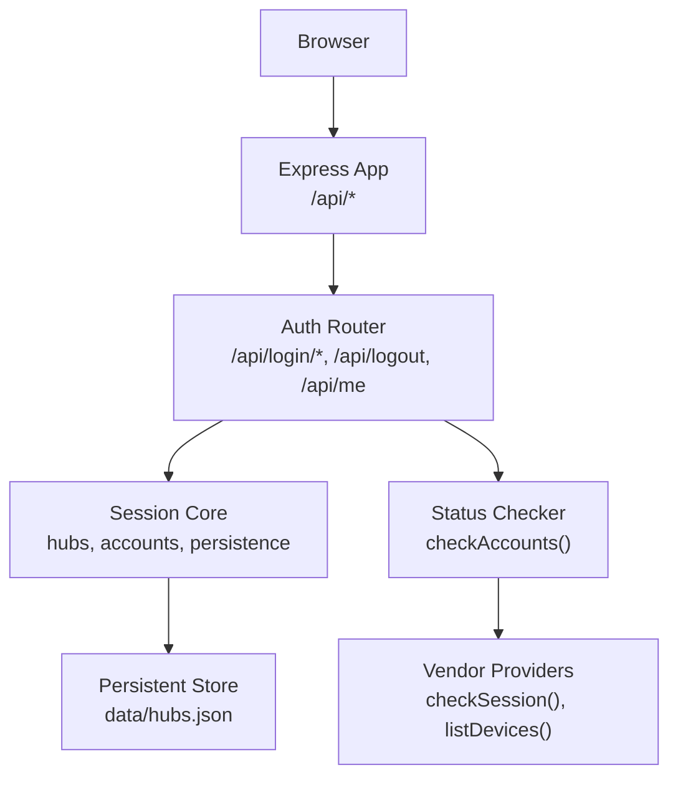
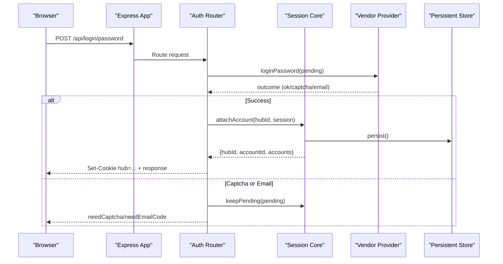
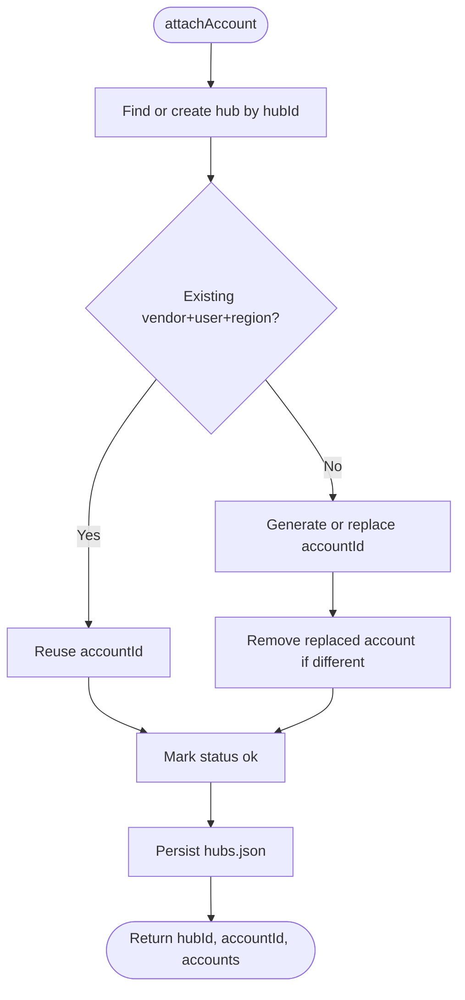
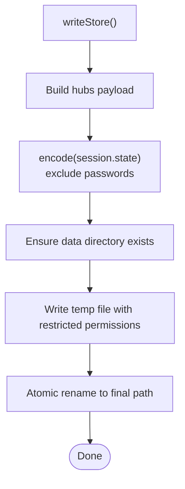
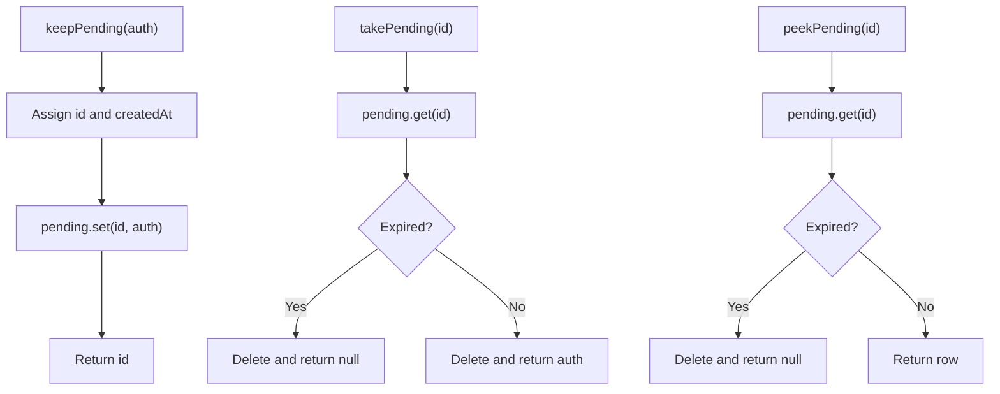
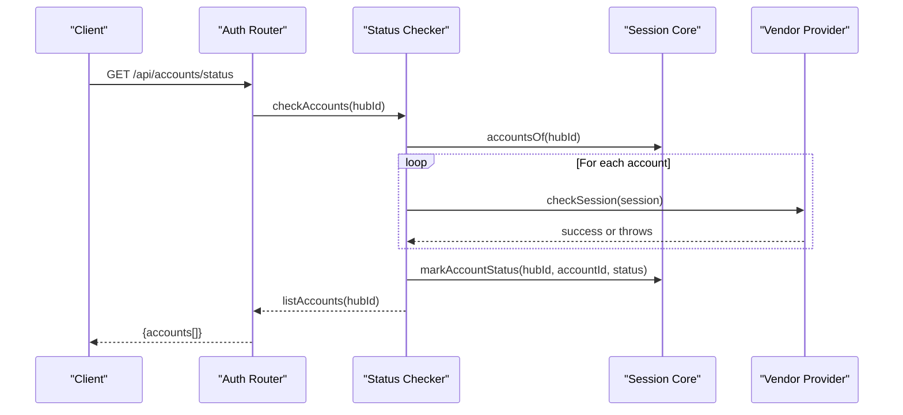
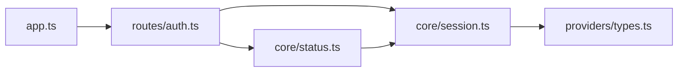

# Session Security

<cite>
**Referenced Files in This Document**
- [session.ts](file://src/core/session.ts)
- [auth.ts](file://src/routes/auth.ts)
- [status.ts](file://src/core/status.ts)
- [types.ts](file://src/providers/types.ts)
- [app.ts](file://src/app.ts)
</cite>

## Table of Contents
1. [Introduction](#introduction)
2. [Project Structure](#project-structure)
3. [Core Components](#core-components)
4. [Architecture Overview](#architecture-overview)
5. [Detailed Component Analysis](#detailed-component-analysis)
6. [Dependency Analysis](#dependency-analysis)
7. [Performance Considerations](#performance-considerations)
8. [Troubleshooting Guide](#troubleshooting-guide)
9. [Conclusion](#conclusion)

## Introduction
This document explains how vendor sessions are created, isolated, stored, refreshed, and cleaned up in the application. It focuses on:
- How a browser session maps to an in-process “hub” containing one or more vendor accounts.
- How account state is persisted securely to disk.
- How pending authentication flows are protected with time-to-live policies.
- How account health is probed and marked as valid, expired, or unknown.
- What security controls are applied to cookies, persistence files, and sensitive fields.
- How to debug session issues, monitor health, and extend storage if needed.

## Project Structure
The session system spans three layers:
- HTTP routing layer: binds login outcomes to a hub cookie and exposes session management endpoints.
- Core session layer: manages hubs, accounts, status, and persistent storage.
- Status probing layer: validates vendor sessions and updates their health state.



**Diagram sources**
- [app.ts:13-23](file://src/app.ts#L13-L23)
- [auth.ts:19-190](file://src/routes/auth.ts#L19-L190)
- [session.ts:30-131](file://src/core/session.ts#L30-L131)
- [status.ts:33-50](file://src/core/status.ts#L33-L50)

**Section sources**
- [app.ts:13-23](file://src/app.ts#L13-L23)
- [auth.ts:19-190](file://src/routes/auth.ts#L19-L190)
- [session.ts:30-131](file://src/core/session.ts#L30-L131)
- [status.ts:33-50](file://src/core/status.ts#L33-L50)

## Core Components
- Hub and Account model:
  - A hub groups multiple vendor accounts for a single browser session.
  - Each account contains vendor identity, region, device cache, and provider-specific state.
- Pending authentication:
  - Temporary multi-step login contexts (password, SMS, email 2FA, QR code) with TTL-based expiration.
- Persistence:
  - In-memory hubs are serialized to a file with restricted permissions and atomic writes.
- Health checking:
  - Optional per-vendor session validation; results are cached until next check.

Key responsibilities:
- `src/core/session.ts`: Hub lifecycle, account attach/remove, persistence, pending auth TTL.
- `src/routes/auth.ts`: Cookie binding, login flows, logout, listing accounts, triggering health checks.
- `src/core/status.ts`: Probing vendor sessions and marking them ok/expired/unknown.
- `src/providers/types.ts`: Vendor session shape and optional `checkSession` contract.

**Section sources**
- [session.ts:26-35](file://src/core/session.ts#L26-L35)
- [session.ts:184-228](file://src/core/session.ts#L184-L228)
- [auth.ts:21-33](file://src/routes/auth.ts#L21-L33)
- [status.ts:22-50](file://src/core/status.ts#L22-L50)
- [types.ts:77-132](file://src/providers/types.ts#L77-L132)

## Architecture Overview
The session architecture isolates each browser’s context into a server-side hub identified by a secure cookie. Login flows create or update vendor sessions within that hub. The system persists non-sensitive identifiers and caches, while carefully excluding secrets from disk. Health checks validate active sessions against vendors and surface status to clients.



**Diagram sources**
- [auth.ts:35-71](file://src/routes/auth.ts#L35-L71)
- [session.ts:184-210](file://src/core/session.ts#L184-L210)
- [session.ts:72-98](file://src/core/session.ts#L72-L98)

## Detailed Component Analysis

### Hub and Account Lifecycle
- Hub creation and selection:
  - If a valid hub cookie exists, the existing hub is reused; otherwise a random hub ID is generated.
  - Hubs are keyed by this ID and contain a map of accounts.
- Account attachment:
  - When logging in, the system finds an existing account with the same vendor, user, and region, and replaces it.
  - If not found, a new account ID is created or an explicitly requested replacement account is removed.
  - After attaching, the account status is set to valid and the store is persisted.
- Account removal and hub cleanup:
  - Removing the last account deletes the hub and clears associated status entries.
  - Deleting a hub removes all its accounts and statuses.



**Diagram sources**
- [session.ts:184-210](file://src/core/session.ts#L184-L210)

**Section sources**
- [session.ts:184-228](file://src/core/session.ts#L184-L228)

### Cookie Binding and Session Isolation
- The hub identifier is stored in an HttpOnly, SameSite=Lax cookie named `hub`.
- The cookie path is `/`, and it has a long-lived Max-Age.
- Logout clears the cookie when no accounts remain or when the entire hub is deleted.
- Isolation:
  - Each browser session maps to exactly one hub.
  - Accounts within a hub are separated by unique account IDs.
  - Cross-hub data leakage is prevented because only the hub cookie grants access to a specific hub.

```mermaid
sequenceDiagram
participant Browser as "Browser"
participant Auth as "Auth Router"
participant Session as "Session Core"
Browser->>Auth : POST /api/login/password
Auth->>Session : attachAccount(readHubId(cookie), session)
Session-->>Auth : {hubId, accountId, accounts}
Auth-->>Browser : Set-Cookie hub=<hubId>; HttpOnly; SameSite=Lax
Browser->>Auth : GET /api/me
Auth->>Session : listAccounts(readHubId(cookie))
Session-->>Auth : accounts[]
Auth-->>Browser : {accounts[]}
```

**Diagram sources**
- [auth.ts:21-33](file://src/routes/auth.ts#L21-L33)
- [auth.ts:175-190](file://src/routes/auth.ts#L175-L190)
- [session.ts:159-172](file://src/core/session.ts#L159-L172)

**Section sources**
- [auth.ts:21-33](file://src/routes/auth.ts#L21-L33)
- [auth.ts:175-190](file://src/routes/auth.ts#L175-L190)
- [session.ts:159-172](file://src/core/session.ts#L159-L172)

### Persistent Storage and Security Controls
- Storage location:
  - Data is written to a JSON file under a `data` directory relative to the core module.
- Atomicity:
  - Writes use a temporary file with process-specific naming, then atomically rename to the final path.
- Permissions:
  - The file is created with restrictive mode bits to limit access to the current user.
- Sensitive field handling:
  - During serialization, password fields are excluded.
  - Complex types like buffers, maps, and cookie jars are encoded safely.
- Restoration:
  - On startup, the store is parsed and reconstructed into memory. Invalid rows are skipped.



**Diagram sources**
- [session.ts:72-98](file://src/core/session.ts#L72-L98)
- [session.ts:37-70](file://src/core/session.ts#L37-L70)

**Section sources**
- [session.ts:72-131](file://src/core/session.ts#L72-L131)

### Pending Authentication Expiration
- Pending auth objects represent multi-step login flows (SMS, email 2FA, QR).
- They are stored in memory with a fixed TTL of 10 minutes.
- Accessors automatically delete expired entries:
  - `takePending` consumes and removes the entry.
  - `peekPending` reads without consuming but still cleans expired entries.
  - `putPending` refreshes the creation timestamp.
- Expired pending values cause login endpoints to reject further progress.



**Diagram sources**
- [session.ts:230-265](file://src/core/session.ts#L230-L265)

**Section sources**
- [session.ts:230-265](file://src/core/session.ts#L230-L265)

### Session Health Checking and Expiration Policies
- Health checking is optional per vendor via `checkSession`.
- The status checker probes each account concurrently with a timeout.
- Results are classified:
  - `ok`: probe succeeded.
  - `expired`: vendor returned an authentication failure.
  - `unknown`: other errors or unsupported providers.
- Status is cached in memory and exposed through account views.



**Diagram sources**
- [status.ts:33-50](file://src/core/status.ts#L33-L50)
- [auth.ts:192-199](file://src/routes/auth.ts#L192-L199)
- [session.ts:178-182](file://src/core/session.ts#L178-L182)

**Section sources**
- [status.ts:22-50](file://src/core/status.ts#L22-L50)
- [auth.ts:192-199](file://src/routes/auth.ts#L192-L199)
- [types.ts:131-132](file://src/providers/types.ts#L131-L132)

### Secure Transmission and Encryption Notes
- Cookies:
  - The hub cookie is HttpOnly and SameSite=Lax to reduce cross-site risks.
  - The cookie value is only a random hub identifier, not a secret token.
- Persistence:
  - The store file uses restrictive permissions and excludes password fields during encoding.
- Vendor encryption:
  - Some providers implement transport-level or payload-level cryptography for vendor APIs. This is separate from session storage and applies to vendor communication.

**Section sources**
- [auth.ts:21-27](file://src/routes/auth.ts#L21-L27)
- [session.ts:37-49](file://src/core/session.ts#L37-L49)
- [session.ts:94-97](file://src/core/session.ts#L94-L97)

## Dependency Analysis
The following diagram shows how modules depend on each other for session functionality.



**Diagram sources**
- [app.ts:13-23](file://src/app.ts#L13-L23)
- [auth.ts:1-17](file://src/routes/auth.ts#L1-L17)
- [status.ts:1-4](file://src/core/status.ts#L1-L4)
- [session.ts:1-5](file://src/core/session.ts#L1-L5)

**Section sources**
- [app.ts:13-23](file://src/app.ts#L13-L23)
- [auth.ts:1-17](file://src/routes/auth.ts#L1-L17)
- [status.ts:1-4](file://src/core/status.ts#L1-L4)
- [session.ts:1-5](file://src/core/session.ts#L1-L5)

## Performance Considerations
- Concurrent health checks:
  - All accounts in a hub are probed concurrently, bounded by a per-probe timeout.
- Memory usage:
  - Hubs, accounts, devices, and pending auths reside in memory; large device lists increase memory footprint.
- Persistence overhead:
  - Every account attach or remove triggers a full store write; consider batching operations if high-frequency changes occur.
- File I/O safety:
  - Atomic rename avoids partial writes; however, frequent writes may impact disk performance.

[No sources needed since this section provides general guidance]

## Troubleshooting Guide

Common symptoms and diagnostics:
- Login succeeds but subsequent requests fail:
  - Verify the `hub` cookie is present and matches the expected hub.
  - Check account status via `/api/accounts/status`; look for `expired` or `unknown`.
- Multi-step login stuck:
  - Confirm the pending ID is still valid; expired pending flows return errors.
  - Re-initiate the flow if captcha or email verification is required.
- Session data missing after restart:
  - Inspect the persistent store file for corruption or permission issues.
  - Ensure the data directory exists and is writable by the process.

Operational checks:
- List accounts:
  - Call `/api/me` to see all accounts attached to the current hub.
- Force health check:
  - Call `/api/accounts/status` to refresh account states.
- Logout behavior:
  - Single-account logout removes that account; if none remain, the hub cookie is cleared.
  - Full hub deletion clears all accounts and the cookie.

Debugging tips:
- Enable verbose logging around persistence failures to identify disk permission problems.
- Validate vendor `checkSession` implementations; unsupported providers will be marked unknown.
- Monitor pending TTL behavior; ensure clients retry within the 10-minute window.

**Section sources**
- [auth.ts:175-199](file://src/routes/auth.ts#L175-L199)
- [session.ts:72-78](file://src/core/session.ts#L72-L78)
- [session.ts:230-265](file://src/core/session.ts#L230-L265)
- [status.ts:22-50](file://src/core/status.ts#L22-L50)

## Conclusion
The session system provides strong isolation between browser sessions using a hub cookie, safe persistence with restricted permissions and secret exclusion, and robust handling of multi-step authentication flows with TTL-based expiration. Health checking integrates with vendor providers to detect expired sessions and surface actionable status. For production deployments, consider adding explicit cookie encryption, rotating hub identifiers, and externalizing session storage to a secure backend if multi-instance scaling is required.

[No sources needed since this section summarizes without analyzing specific files]