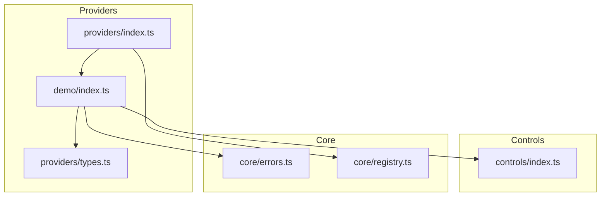
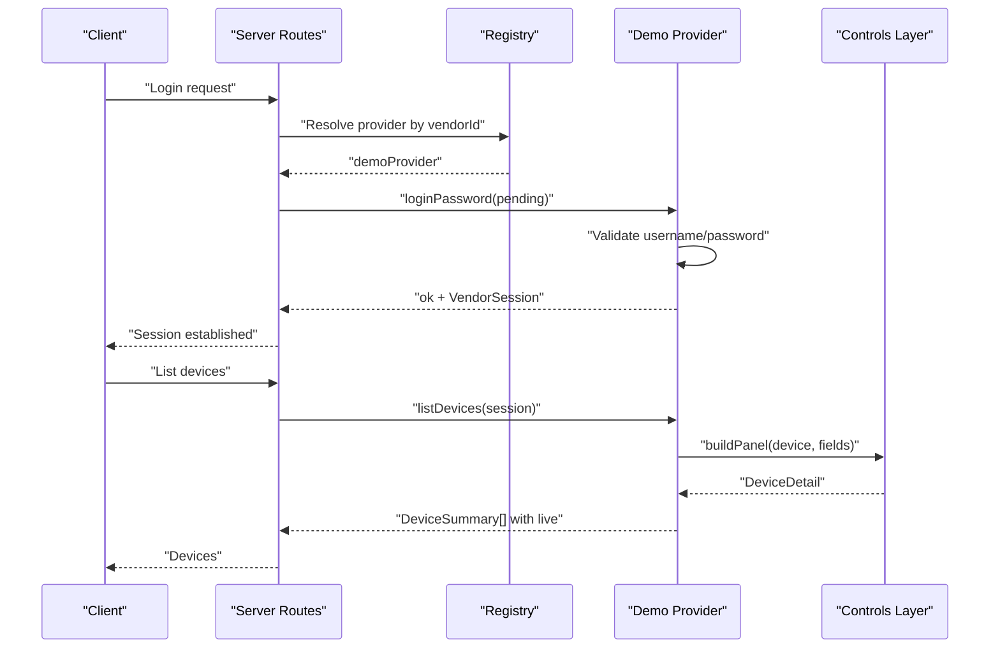
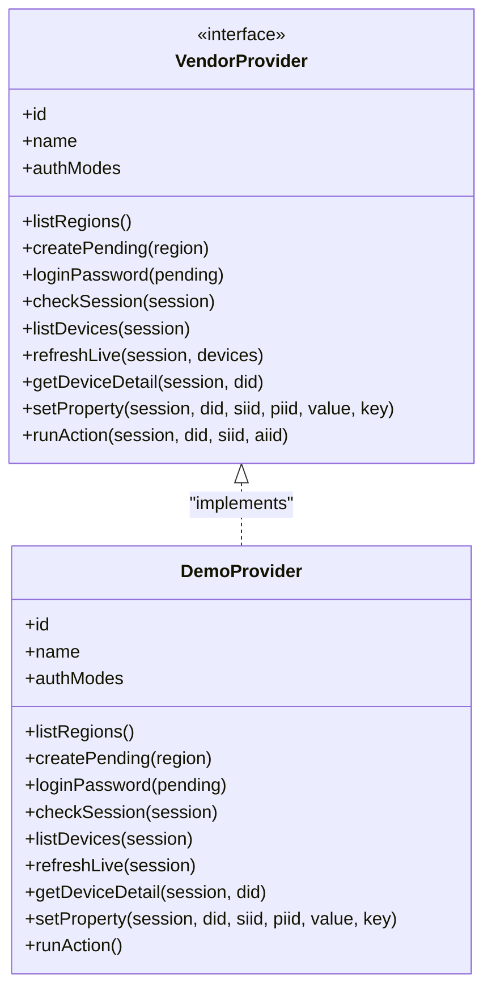
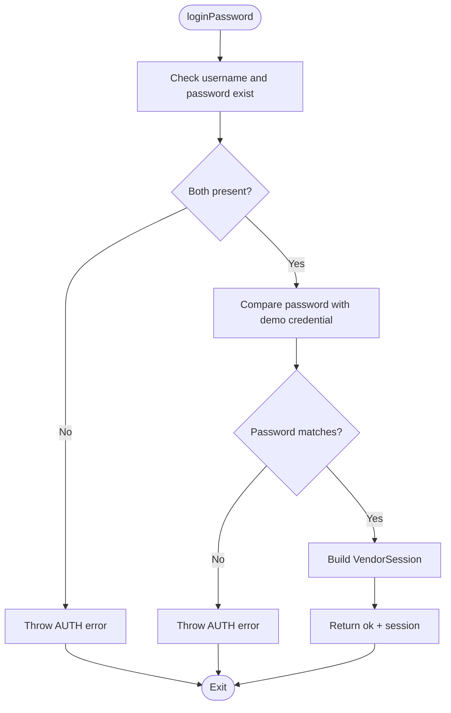
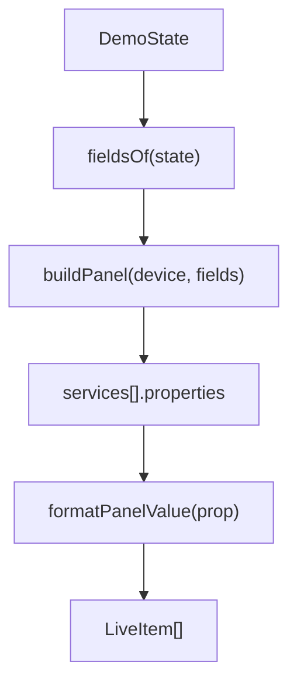
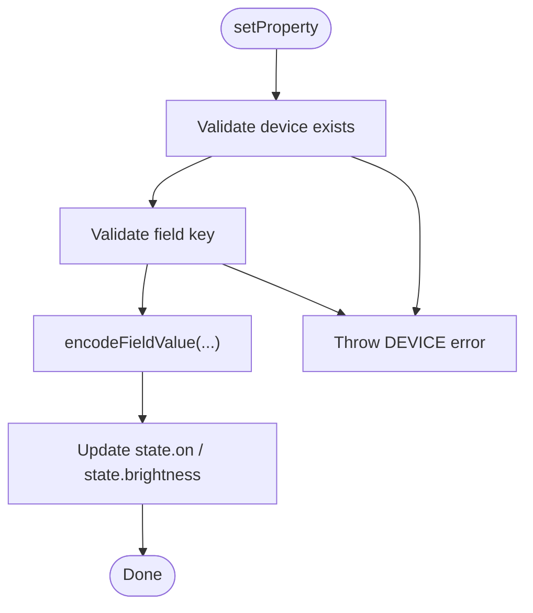
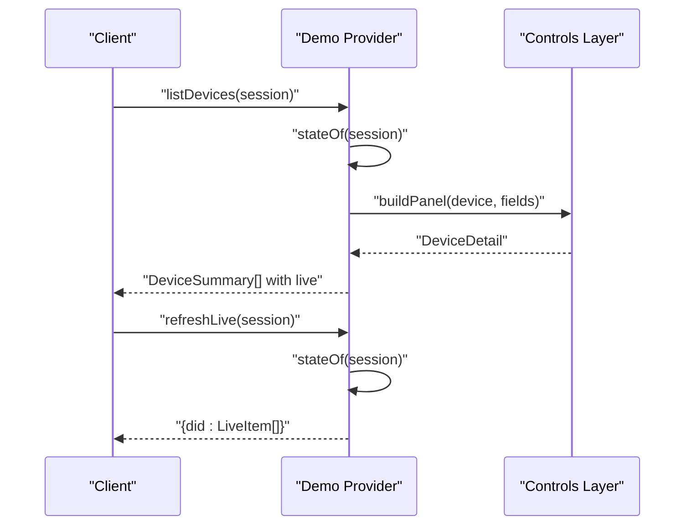
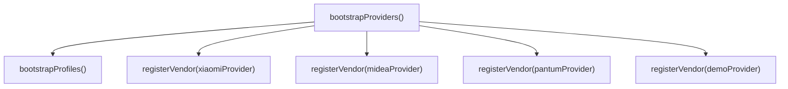
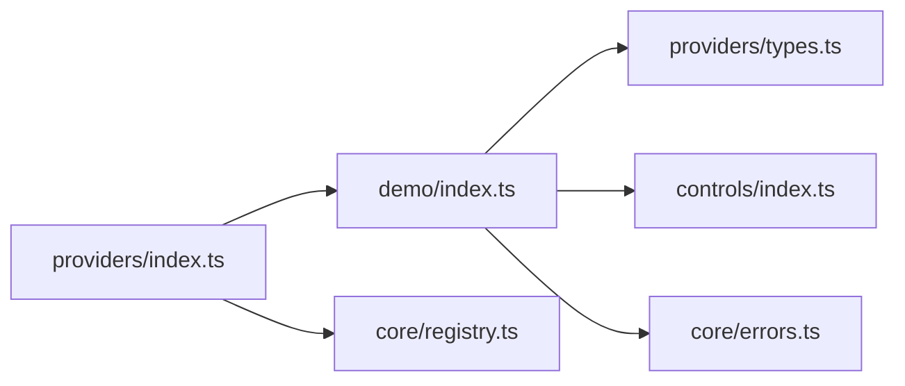

# Demo Provider

<cite>
**Referenced Files in This Document**
- [index.ts](file://src/providers/demo/index.ts)
- [types.ts](file://src/providers/types.ts)
- [index.ts](file://src/providers/index.ts)
- [README.md](file://README.md)
</cite>

## Table of Contents
1. [Introduction](#introduction)
2. [Project Structure](#project-structure)
3. [Core Components](#core-components)
4. [Architecture Overview](#architecture-overview)
5. [Detailed Component Analysis](#detailed-component-analysis)
6. [Dependency Analysis](#dependency-analysis)
7. [Performance Considerations](#performance-considerations)
8. [Troubleshooting Guide](#troubleshooting-guide)
9. [Conclusion](#conclusion)
10. [Appendices](#appendices)

## Introduction
The demo provider is a minimal, fully working vendor adapter that demonstrates the complete provider interface without talking to any real device or cloud service. It simulates:
- A single mock device with controllable properties
- Password-based authentication with a fixed test credential
- Device listing, live status, property detail, and property write operations
- The integration between providers, control profiles, and the registry

It is intended as a template for building new vendor integrations. When implementing a real adapter, you should follow the same structure, state model, and field mapping strategy shown here, but replace the mock logic with actual network calls and device protocol handling.

## Project Structure
The demo provider lives under `src/providers/demo` and implements the shared provider contract defined in `src/providers/types.ts`. It is exported from the providers entry point and registered alongside other vendors.



**Diagram sources**
- [index.ts:1-108](file://src/providers/demo/index.ts#L1-L108)
- [types.ts:1-144](file://src/providers/types.ts#L1-L144)
- [index.ts:1-17](file://src/providers/index.ts#L1-L17)

**Section sources**
- [index.ts:1-108](file://src/providers/demo/index.ts#L1-L108)
- [types.ts:1-144](file://src/providers/types.ts#L1-L144)
- [index.ts:1-17](file://src/providers/index.ts#L1-L17)

## Core Components
The demo provider exposes one main object that implements the `VendorProvider` interface:
- Provider identity and capabilities
- Region enumeration
- Pending login context creation
- Password login with mock validation
- Session validation (no-op for demo)
- Device listing with live chips
- Live refresh
- Device detail panel construction
- Property write simulation
- Action stub

Key responsibilities:
- Maintain an in-memory session containing devices and a simple device state
- Convert internal state into vendor fields and live items using the controls layer
- Validate inputs and throw typed application errors

**Section sources**
- [index.ts:12-108](file://src/providers/demo/index.ts#L12-L108)
- [types.ts:105-143](file://src/providers/types.ts#L105-L143)

## Architecture Overview
The demo provider integrates with three layers:
- Provider contract: defines the methods and data shapes
- Controls layer: builds UI panels and encodes/decodes property values based on profiles
- Core registry: registers the provider so it can be discovered by the rest of the system



**Diagram sources**
- [index.ts:60-108](file://src/providers/demo/index.ts#L60-L108)
- [types.ts:77-143](file://src/providers/types.ts#L77-L143)
- [index.ts:8-14](file://src/providers/index.ts#L8-L14)

## Detailed Component Analysis

### Demo Provider Object
The demo provider is a single object implementing `VendorProvider`. It contains:
- Static device metadata
- Helper functions to convert between session state, vendor fields, and live items
- All required provider methods



**Diagram sources**
- [types.ts:105-143](file://src/providers/types.ts#L105-L143)
- [index.ts:60-108](file://src/providers/demo/index.ts#L60-L108)

**Section sources**
- [index.ts:60-108](file://src/providers/demo/index.ts#L60-L108)
- [types.ts:105-143](file://src/providers/types.ts#L105-L143)

### Mock Authentication Flow
The demo provider supports password-based login:
- Creates a pending auth context per region
- Validates that both username and password are present
- Accepts only a fixed demo password
- Returns a successful login outcome with a constructed session



**Diagram sources**
- [index.ts:67-78](file://src/providers/demo/index.ts#L67-L78)

**Section sources**
- [index.ts:67-78](file://src/providers/demo/index.ts#L67-L78)

### Device Model and State Simulation
The demo provider simulates one light-like device:
- Device summary includes id, vendor, name, model, room, and online status
- Session holds a map of devices and a simple state object with `on` and `brightness`
- Properties are exposed through vendor fields with writable flags and ranges

```mermaid
erDiagram
VENDOR_SESSION {
string vendorId
string userId
string region
map devices
unknown state
}
DEVICE_SUMMARY {
string did
string vendorId
string name
string model
boolean online
string room
string icon
}
DEMO_STATE {
boolean on
number brightness
}
VENDOR_SESSION ||--o{ DEVICE_SUMMARY : "contains"
VENDOR_SESSION o--|| DEMO_STATE : "holds"
```

**Diagram sources**
- [index.ts:18-38](file://src/providers/demo/index.ts#L18-L38)
- [types.ts:22-33](file://src/providers/types.ts#L22-L33)
- [types.ts:77-84](file://src/providers/types.ts#L77-L84)

**Section sources**
- [index.ts:18-38](file://src/providers/demo/index.ts#L18-L38)
- [types.ts:22-33](file://src/providers/types.ts#L22-L33)
- [types.ts:77-84](file://src/providers/types.ts#L77-L84)

### Field Mapping and Panel Construction
The demo provider uses the controls layer to:
- Generate vendor fields from internal state
- Build a device detail panel with services and properties
- Format live property text for display

This keeps UI concerns out of the provider and centralizes them in profiles and controls.



**Diagram sources**
- [index.ts:44-58](file://src/providers/demo/index.ts#L44-L58)

**Section sources**
- [index.ts:44-58](file://src/providers/demo/index.ts#L44-L58)

### Property Write Simulation
When a client writes a property:
- The provider validates the device exists
- Encodes the user-provided value using the controls encoder
- Updates the in-memory state accordingly



**Diagram sources**
- [index.ts:96-103](file://src/providers/demo/index.ts#L96-L103)

**Section sources**
- [index.ts:96-103](file://src/providers/demo/index.ts#L96-L103)

### Live Status and Refresh
The provider computes live chips by converting properties into human-readable text. Listing devices attaches live items to each device, and `refreshLive` returns a map of device id to live items.



**Diagram sources**
- [index.ts:82-90](file://src/providers/demo/index.ts#L82-L90)

**Section sources**
- [index.ts:82-90](file://src/providers/demo/index.ts#L82-L90)

### Registration and Bootstrap
The demo provider is exported from the providers index and registered during bootstrap. This makes it discoverable by routes and the open API.



**Diagram sources**
- [index.ts:8-14](file://src/providers/index.ts#L8-L14)

**Section sources**
- [index.ts:8-14](file://src/providers/index.ts#L8-L14)

## Dependency Analysis
The demo provider depends on:
- Shared provider types
- Controls utilities for building panels and encoding values
- Application error type for consistent error reporting
- Provider registry via the providers entry point



**Diagram sources**
- [index.ts:1-10](file://src/providers/demo/index.ts#L1-L10)
- [index.ts:1-17](file://src/providers/index.ts#L1-L17)

**Section sources**
- [index.ts:1-10](file://src/providers/demo/index.ts#L1-L10)
- [index.ts:1-17](file://src/providers/index.ts#L1-L17)

## Performance Considerations
- The demo provider uses in-memory state, which is fast and suitable for testing.
- For real adapters, avoid unnecessary re-computation of live items; cache results when appropriate and invalidate on property changes.
- Keep device lists lightweight; attach live data only when needed.

[No sources needed since this section provides general guidance]

## Troubleshooting Guide
Common issues and how they are handled:
- Missing credentials during login: throws an authentication error indicating required fields
- Wrong password: throws an authentication error with a message about the demo credential
- Unknown device id: throws a device error
- Missing property key: throws a property error
- Unsupported action: throws an action error

These patterns ensure consistent error semantics across providers.

**Section sources**
- [index.ts:70-78](file://src/providers/demo/index.ts#L70-L78)
- [index.ts:91-106](file://src/providers/demo/index.ts#L91-L106)

## Conclusion
The demo provider is a compact, self-contained example of a vendor adapter. It shows how to:
- Implement the full provider interface
- Simulate authentication and device behavior
- Map internal state to vendor fields and live items
- Use the controls layer for panel construction and value encoding
- Register and bootstrap a provider

Use it as a blueprint for custom vendor integrations: keep device logic separate from UI, rely on profiles for stable field names, and simulate vendor-specific flows until you integrate real APIs or protocols.

[No sources needed since this section summarizes without analyzing specific files]

## Appendices

### How to Use the Demo Provider for Testing and Development
- Enable the demo provider during bootstrap so it is available alongside real vendors.
- Use password-based login with the expected demo credential to obtain a session.
- List devices and inspect live chips to verify property rendering.
- Read device details to confirm services and properties.
- Write properties such as power and brightness to validate encoding and state updates.
- Attempt unsupported actions to verify error handling.

**Section sources**
- [index.ts:8-14](file://src/providers/index.ts#L8-L14)
- [index.ts:67-106](file://src/providers/demo/index.ts#L67-L106)

### Patterns to Replicate When Building Custom Vendor Integrations
- Define a clear session shape and store device maps inside it.
- Expose vendor fields with stable keys and constraints.
- Use the controls layer to build panels and encode values instead of hardcoding UI logic.
- Validate all inputs and return typed application errors.
- Separate live status computation from device listing where possible.
- Provide stubs for actions until supported by the vendor.

**Section sources**
- [index.ts:44-106](file://src/providers/demo/index.ts#L44-L106)
- [types.ts:105-143](file://src/providers/types.ts#L105-L143)

### Step-by-Step Guide to Extending the Demo Provider
1. Create a new provider file under `src/providers/<vendor>/index.ts`.
2. Implement the `VendorProvider` interface following the demo structure.
3. Add mock devices and a simple in-memory state if you are prototyping.
4. Implement authentication methods:
   - Start with password simulation similar to the demo.
   - Add SMS or QR flows later if your vendor requires them.
5. Implement device lifecycle methods:
   - `listDevices`: populate device summaries and attach live items.
   - `getDeviceDetail`: use `buildPanel` with vendor fields.
   - `refreshLive`: compute live chips from current state or real device queries.
6. Implement property writes:
   - Validate device and key.
   - Use `encodeFieldValue` to normalize values before updating state or calling vendor APIs.
7. Add action support gradually:
   - Start with a stub that throws an action error.
   - Replace with real vendor calls when ready.
8. Register the provider in `src/providers/index.ts`.
9. Test the full flow: login, list devices, read detail, write property, refresh live.

**Section sources**
- [index.ts:60-108](file://src/providers/demo/index.ts#L60-L108)
- [index.ts:8-14](file://src/providers/index.ts#L8-L14)
- [README.md:1-17](file://README.md#L1-L17)