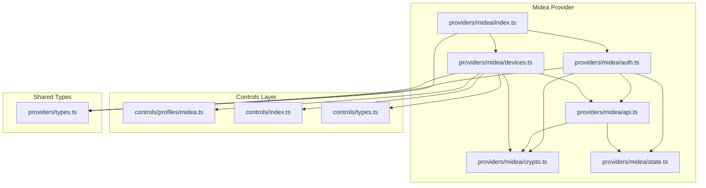
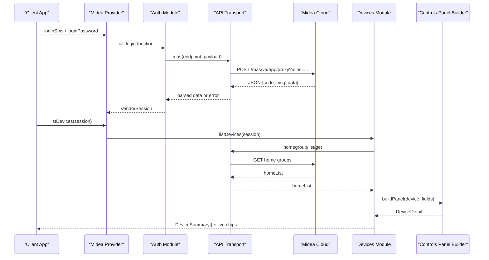
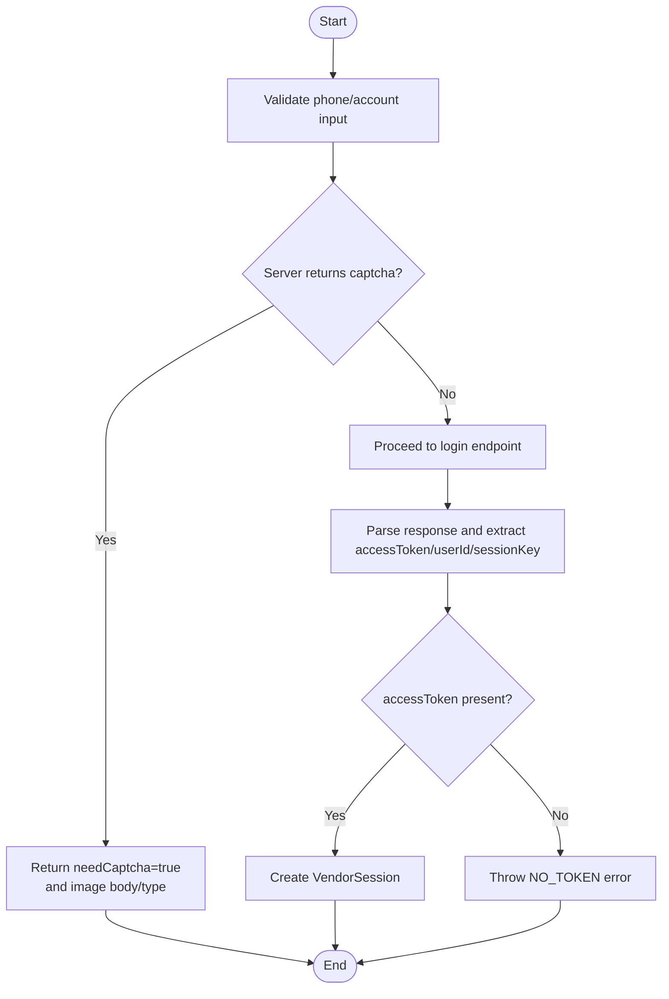
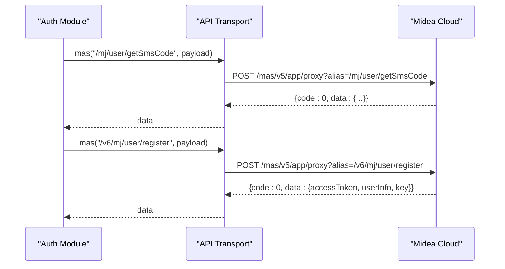
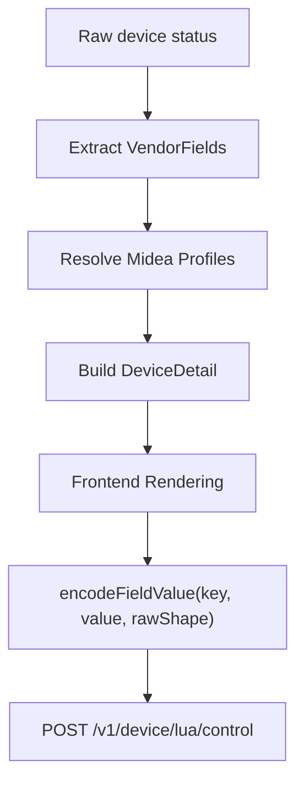
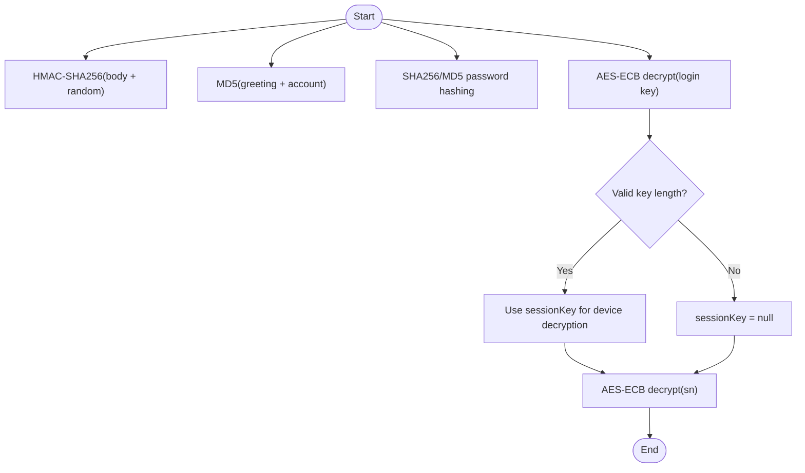
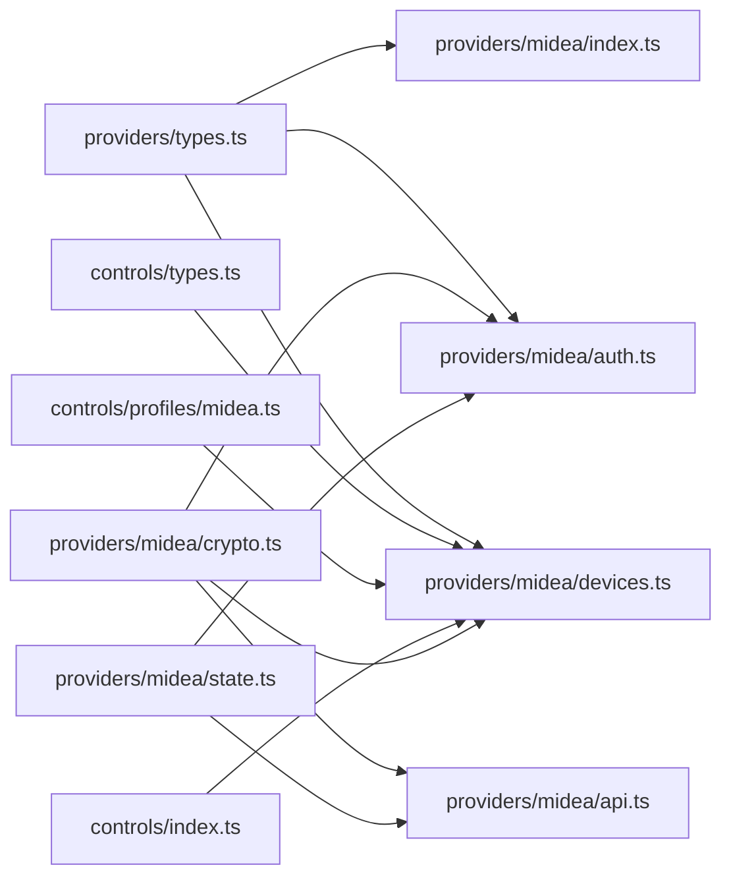

# Midea Smart Home Integration

<cite>
**Referenced Files in This Document**
- [README.md](file://README.md)
- [index.ts](file://src/providers/midea/index.ts)
- [auth.ts](file://src/providers/midea/auth.ts)
- [api.ts](file://src/providers/midea/api.ts)
- [crypto.ts](file://src/providers/midea/crypto.ts)
- [devices.ts](file://src/providers/midea/devices.ts)
- [state.ts](file://src/providers/midea/state.ts)
- [midea.ts](file://src/controls/profiles/midea.ts)
- [index.ts](file://src/controls/index.ts)
- [types.ts](file://src/controls/types.ts)
- [types.ts](file://src/providers/types.ts)
</cite>

## Table of Contents
1. [Introduction](#introduction)
2. [Project Structure](#project-structure)
3. [Core Components](#core-components)
4. [Architecture Overview](#architecture-overview)
5. [Detailed Component Analysis](#detailed-component-analysis)
6. [Dependency Analysis](#dependency-analysis)
7. [Performance Considerations](#performance-considerations)
8. [Troubleshooting Guide](#troubleshooting-guide)
9. [Conclusion](#conclusion)

## Introduction
This document explains the Midea Smart Home integration implemented in this repository. It covers:
- Authentication flows for SMS verification and password-based login.
- Midea-specific API endpoints, request/response handling, and signature generation.
- Data transformation from Midea’s proprietary device models to a unified control interface.
- Supported device categories and their capabilities.
- Property mapping examples for temperature control, mode switching, and scheduling-related fields.
- Encryption and decryption mechanisms used for secure communication.
- Connection behavior and error handling strategies.
- Debugging guidance for authentication and device connectivity issues.

The integration is part of a multi-vendor platform that normalizes vendor devices into a shared panel model. The Midea provider exposes standard provider methods such as region listing, pending authentication creation, SMS/password login, session validation, device listing, live status refresh, detail retrieval, property writing, and action execution.

**Section sources**
- [README.md:1-97](file://README.md#L1-L97)
- [index.ts:6-26](file://src/providers/midea/index.ts#L6-L26)

## Project Structure
The Midea integration lives under `src/providers/midea` and integrates with the shared controls layer under `src/controls`. Key responsibilities are split across files:
- Provider entry point exports Midea capabilities and wires auth/device functions.
- Auth module implements SMS and password login, captcha handling, and session acceptance.
- API module handles HTTP transport, signing, timestamping, and response parsing.
- Crypto module provides signatures, device ID derivation, password hashing, AES decryption, and session key extraction.
- Devices module lists homes/devices, reads live status, builds panels, and writes properties.
- State module defines regions, host resolution, and Midea auth state shape.
- Controls profiles define field labels, read-only/read-write rules, and device-category overrides.

**Diagram sources**
- [index.ts:1-26](file://src/providers/midea/index.ts#L1-L26)
- [auth.ts:1-176](file://src/providers/midea/auth.ts#L1-L176)
- [api.ts:1-52](file://src/providers/midea/api.ts#L1-L52)
- [crypto.ts:1-47](file://src/providers/midea/crypto.ts#L1-L47)
- [devices.ts:1-180](file://src/providers/midea/devices.ts#L1-L180)
- [state.ts:1-42](file://src/providers/midea/state.ts#L1-L42)
- [midea.ts:1-227](file://src/controls/profiles/midea.ts#L1-L227)
- [index.ts:1-25](file://src/controls/index.ts#L1-L25)
- [types.ts:1-114](file://src/controls/types.ts#L1-L114)
- [types.ts:1-144](file://src/providers/types.ts#L1-L144)

**Section sources**
- [index.ts:1-26](file://src/providers/midea/index.ts#L1-L26)
- [auth.ts:1-176](file://src/providers/midea/auth.ts#L1-L176)
- [api.ts:1-52](file://src/providers/midea/api.ts#L1-L52)
- [crypto.ts:1-47](file://src/providers/midea/crypto.ts#L1-L47)
- [devices.ts:1-180](file://src/providers/midea/devices.ts#L1-L180)
- [state.ts:1-42](file://src/providers/midea/state.ts#L1-L42)
- [midea.ts:1-227](file://src/controls/profiles/midea.ts#L1-L227)
- [index.ts:1-25](file://src/controls/index.ts#L1-L25)
- [types.ts:1-114](file://src/controls/types.ts#L1-L114)
- [types.ts:1-144](file://src/providers/types.ts#L1-L144)

## Core Components
- Midea Provider Entry Point
  - Exposes provider identity, supported auth modes (`sms`, `password`), region listing, pending auth creation, and all device operations.
- Authentication Module
  - Implements SMS code sending, captcha image retrieval, SMS login, and password login. Normalizes login responses into a vendor session.
- API Transport Module
  - Builds signed requests, attaches access tokens, calls the Midea proxy endpoint, parses JSON, and maps non-zero codes to application errors.
- Crypto Module
  - Provides HMAC signing, device ID derivation, password hashing, AES-ECB decryption, and session key extraction from login payloads.
- Devices Module
  - Lists homes and appliances, extracts summaries, reads live status, builds normalized panels, and writes properties using profile-aware encoding.
- State Module
  - Defines region configuration (currently China), host resolution, and the Midea auth state structure including token, user ID, session key, and raw device states.
- Controls Profiles
  - Maps Midea Lua field names to human-readable labels, defines read-only vs writable fields, and provides category-specific overrides for air conditioners, refrigerators, and washing machines.

**Section sources**
- [index.ts:6-26](file://src/providers/midea/index.ts#L6-L26)
- [auth.ts:18-175](file://src/providers/midea/auth.ts#L18-L175)
- [api.ts:6-47](file://src/providers/midea/api.ts#L6-L47)
- [crypto.ts:3-46](file://src/providers/midea/crypto.ts#L3-L46)
- [devices.ts:7-179](file://src/providers/midea/devices.ts#L7-L179)
- [state.ts:3-41](file://src/providers/midea/state.ts#L3-L41)
- [midea.ts:3-226](file://src/controls/profiles/midea.ts#L3-L226)

## Architecture Overview
The Midea integration follows a layered architecture:
- Provider Layer: Standardized vendor interface for auth and device operations.
- Transport Layer: Secure HTTP calls to Midea cloud with signature and token handling.
- Crypto Layer: Hashing, encryption, and decryption utilities.
- Device Layer: Mapping Midea device data to unified device summaries and panels.
- Controls Layer: Profile-driven normalization of fields and values for UI rendering and write-back.

**Diagram sources**
- [auth.ts:111-175](file://src/providers/midea/auth.ts#L111-L175)
- [api.ts:17-47](file://src/providers/midea/api.ts#L17-L47)
- [devices.ts:90-156](file://src/providers/midea/devices.ts#L90-L156)
- [index.ts:6-26](file://src/providers/midea/index.ts#L6-L26)

## Detailed Component Analysis

### Authentication Mechanisms
The Midea provider supports two authentication modes:
- SMS Verification Flow
  - Sends an SMS code to a validated Chinese mobile number.
  - Optionally requires a captcha image if the server returns one.
  - Completes login by calling the registration/login endpoint with SMS code and app metadata.
  - Accepts the response, extracts access token, user ID, and optional session key.
- Password-Based Login Flow
  - First resolves a login ID via an ID lookup endpoint.
  - Encrypts the password using Midea-specific hashing and sends it along with other required fields.
  - Accepts the response similarly to SMS flow.

Captcha Handling
- Captcha images can be provided as base64 data URIs or remote URLs.
- The implementation detects image types by magic bytes or MIME prefixes and stores them in the pending auth state.

Session Creation
- A vendor session includes vendor ID, user ID, region, device map, and private auth state.
- Access token is attached to subsequent requests; session key may be derived from login payload for encrypted device data.

**Diagram sources**
- [auth.ts:51-109](file://src/providers/midea/auth.ts#L51-L109)
- [auth.ts:111-175](file://src/providers/midea/auth.ts#L111-L175)

**Section sources**
- [auth.ts:18-109](file://src/providers/midea/auth.ts#L18-L109)
- [auth.ts:111-175](file://src/providers/midea/auth.ts#L111-L175)

### Midea-Specific API Endpoints and Request/Response Formats
All Midea calls go through a single proxy endpoint:
- Endpoint: `/mas/v5/app/proxy?alias=<endpoint>`
- Headers:
  - `Content-Type`: `application/json; charset=utf-8`
  - `secretVersion`: `1`
  - `sign`: HMAC-SHA256 signature over body and random value
  - `random`: Unix timestamp string
  - `accesstoken`: Present when authenticated
- Body: JSON payload containing endpoint-specific fields plus `reqId` and `stamp`.

Common Endpoints Used
- Authentication:
  - `/mj/user/getSmsCode` — Send SMS code
  - `/v6/mj/user/register` — SMS login
  - `/v1/user/login/id/get` — Resolve login ID
  - `/mj/user/login` — Password login
- Device Management:
  - `/v1/homegroup/list/get` — List home groups
  - `/v1/appliance/home/list/get` — List appliances per home
  - `/v1/appliance/user/list/get` — Fallback list of user appliances
  - `/v1/device/status/lua/get` — Read device status
  - `/v1/device/lua/control` — Write device property

Response Format
- Top-level JSON contains `code`, `msg`/`message`, and `data`.
- Non-zero `code` results in an application error with vendor message.
- Successful responses return `data` object.

**Diagram sources**
- [api.ts:17-47](file://src/providers/midea/api.ts#L17-L47)
- [auth.ts:51-139](file://src/providers/midea/auth.ts#L51-L139)

**Section sources**
- [api.ts:6-47](file://src/providers/midea/api.ts#L6-L47)
- [auth.ts:51-175](file://src/providers/midea/auth.ts#L51-L175)

### Data Transformation Layers
The transformation pipeline converts Midea’s proprietary device models into a unified interface:
- Raw Status Extraction
  - Reads device status via `/v1/device/status/lua/get`.
  - Extracts top-level status object or nested result/status structures.
- Field Discovery
  - Converts each scalar field into a `VendorField` with key, raw value, writability inferred from boolean-like shapes, and kind hints.
- Profile Resolution
  - Applies built-in Midea profiles to assign labels, groups, ranges, options, codecs, and writability.
  - Category-specific profiles override baseline behavior for ACs, fridges, and washers.
- Panel Building
  - Builds services and properties for the frontend, normalizing values and preserving raw values for write-back.
- Write-Back Encoding
  - Uses profile-defined encoders to convert UI values back to Midea-compatible formats before sending control commands.

**Diagram sources**
- [devices.ts:17-44](file://src/providers/midea/devices.ts#L17-L44)
- [devices.ts:149-175](file://src/providers/midea/devices.ts#L149-L175)
- [midea.ts:110-226](file://src/controls/profiles/midea.ts#L110-L226)

**Section sources**
- [devices.ts:17-44](file://src/providers/midea/devices.ts#L17-L44)
- [devices.ts:149-175](file://src/providers/midea/devices.ts#L149-L175)
- [midea.ts:110-226](file://src/controls/profiles/midea.ts#L110-L226)

### Supported Device Categories and Capabilities
- Air Conditioners
  - Model patterns include `KFR-*`, `*-AC-*`, and Chinese substring matches.
  - Capabilities: power on/off, mode selection (auto, cool, dehumidify, fan, heat), target temperature slider, wind speed segmentation.
- Refrigerators
  - Model patterns include `BCD-*`, `*DBFP*`, and Chinese substring matches.
  - Capabilities: storage/freezing temperature ranges, zone power toggles, mode selections.
- Washing Machines
  - Model patterns include `MG*`, `ME*`, and Chinese substring matches.
  - Capabilities: program selection, wash temperature range, dehydration speed, progress/time readouts.

Baseline Rules
- Labels map Lua field names to Chinese-friendly display names.
- Read-only fields include running status, error codes, progress, remaining time, indoor/outdoor temperatures.
- Control fields include power switches, lock, appointment/memory features, temperature sliders, wind/fan sliders.

**Section sources**
- [midea.ts:3-108](file://src/controls/profiles/midea.ts#L3-L108)
- [midea.ts:110-226](file://src/controls/profiles/midea.ts#L110-L226)

### Property Mapping Examples
- Temperature Control
  - Baseline rule applies `shapenum` codec to any field matching `*temperature*`, exposing a slider with unit and range.
  - AC-specific profile sets target temperature range 16–30°C.
  - Fridge-specific profiles set storage/freezing temperature ranges and label mappings.
- Mode Switching
  - AC mode uses a map table for common mode codes (auto, cool, dehumidify, fan, heat).
  - Generic mode/program fields use a shared code-to-name table for readable labels.
- Scheduling Features
  - Appointment and memory fields are exposed as writable controls.
  - Time-related fields like `remain_time` are displayed as durations but not writable.

These mappings are defined in the Midea profiles and applied during panel building and write-back encoding.

**Section sources**
- [midea.ts:55-108](file://src/controls/profiles/midea.ts#L55-L108)
- [midea.ts:177-226](file://src/controls/profiles/midea.ts#L177-L226)

### Encryption and Decryption Processes
- Signature Generation
  - HMAC-SHA256 over concatenation of IOT key, request body, and random value.
- Device ID Derivation
  - MD5 hash of a greeting string incorporating the account, truncated to 16 characters.
- Password Hashing
  - Two variants:
    - `encryptIamPassword`: double MD5 of the password.
    - `encryptPassword`: SHA-256 chain involving login ID, hashed password, and login key.
- Session Key Extraction
  - Decrypts hex-encoded key from login response using AES-ECB with a fixed ASCII key buffer.
  - Validates resulting key length (16/24/32 bytes) to ensure usability.
- Device Data Decryption
  - Attempts AES-ECB decryption of hex-encoded device payloads using the extracted session key; returns empty string on failure.

**Diagram sources**
- [crypto.ts:10-46](file://src/providers/midea/crypto.ts#L10-L46)

**Section sources**
- [crypto.ts:3-46](file://src/providers/midea/crypto.ts#L3-L46)

### Connection Pooling Strategies
- The implementation uses Node.js native `fetch` for HTTP requests without explicit connection pooling configuration.
- Requests are made sequentially per operation; concurrent operations (e.g., refreshing live status for multiple devices) use `Promise.all` to parallelize independent device reads.
- No persistent connection pool or retry/backoff logic is implemented at the transport layer.

[No sources needed since this section provides general guidance]

### Error Handling for Network Issues
- HTTP Errors
  - Non-OK HTTP status throws an application error with the cloud HTTP status.
- Parsing Errors
  - Invalid JSON responses throw a parse error.
- Cloud Code Errors
  - Non-zero `code` in response throws an application error with vendor message/code.
- Authentication Errors
  - Missing access token throws an auth error prompting re-login.
  - Missing login ID or access token during login raises specific errors.
- Device Errors
  - Missing device in session throws a device-not-found error.
  - Missing field key during property write throws a property error.

**Section sources**
- [api.ts:36-47](file://src/providers/midea/api.ts#L36-L47)
- [auth.ts:94-109](file://src/providers/midea/auth.ts#L94-L109)
- [devices.ts:77-81](file://src/providers/midea/devices.ts#L77-L81)
- [devices.ts:149-175](file://src/providers/midea/devices.ts#L149-L175)

## Dependency Analysis
The Midea provider depends on:
- Shared provider types defining sessions, devices, actions, and provider interfaces.
- Controls layer for panel building, field encoding, and profile resolution.
- Crypto utilities for signing, hashing, and decryption.
- State utilities for region/host resolution and auth state management.

**Diagram sources**
- [types.ts:1-144](file://src/providers/types.ts#L1-L144)
- [types.ts:1-114](file://src/controls/types.ts#L1-L114)
- [midea.ts:1-227](file://src/controls/profiles/midea.ts#L1-L227)
- [index.ts:1-25](file://src/controls/index.ts#L1-L25)
- [auth.ts:1-176](file://src/providers/midea/auth.ts#L1-L176)
- [api.ts:1-52](file://src/providers/midea/api.ts#L1-L52)
- [devices.ts:1-180](file://src/providers/midea/devices.ts#L1-L180)
- [state.ts:1-42](file://src/providers/midea/state.ts#L1-L42)

**Section sources**
- [types.ts:1-144](file://src/providers/types.ts#L1-L144)
- [types.ts:1-114](file://src/controls/types.ts#L1-L114)
- [midea.ts:1-227](file://src/controls/profiles/midea.ts#L1-L227)
- [index.ts:1-25](file://src/controls/index.ts#L1-L25)
- [auth.ts:1-176](file://src/providers/midea/auth.ts#L1-L176)
- [api.ts:1-52](file://src/providers/midea/api.ts#L1-L52)
- [devices.ts:1-180](file://src/providers/midea/devices.ts#L1-L180)
- [state.ts:1-42](file://src/providers/midea/state.ts#L1-L42)

## Performance Considerations
- Parallel Live Refresh
  - Live status for multiple devices is fetched concurrently using `Promise.all`, reducing total latency.
- Minimal Payloads
  - Device status queries send minimal command objects; control writes only include the targeted property.
- Profile Optimization
  - Baseline and category-specific profiles reduce unnecessary fields and improve UI rendering performance.
- No Built-in Retry/Backoff
  - Network failures rely on caller-side retries; consider adding exponential backoff for robustness.

[No sources needed since this section provides general guidance]

## Troubleshooting Guide
Authentication Problems
- Missing or invalid phone number format
  - Ensure the phone number matches the expected pattern and is within the supported region.
- Captcha Required
  - If the server returns a captcha, retrieve and submit the image correctly; verify base64 or URL format.
- No Access Token
  - Check login response parsing and ensure `accessToken` is present; re-authenticate if missing.
- Session Key Not Available
  - Some device data may remain encrypted; verify session key extraction and AES decryption steps.

Device Connectivity Issues
- Device Not Found
  - Refresh the device list before reading details or writing properties.
- Property Write Failures
  - Ensure the field key exists and the value conforms to profile constraints; check raw shape preservation for correct encoding.
- Live Status Empty
  - Individual device status reads may fail; the system gracefully falls back to empty live chips.

Network and API Errors
- HTTP Status Errors
  - Inspect the underlying HTTP status and retry with appropriate backoff.
- Parse Errors
  - Verify server response format; malformed JSON will cause parse failures.
- Cloud Code Errors
  - Map vendor error codes/messages to actionable steps; log full request context for debugging.

**Section sources**
- [auth.ts:51-109](file://src/providers/midea/auth.ts#L51-L109)
- [auth.ts:111-175](file://src/providers/midea/auth.ts#L111-L175)
- [api.ts:36-47](file://src/providers/midea/api.ts#L36-L47)
- [devices.ts:77-81](file://src/providers/midea/devices.ts#L77-L81)
- [devices.ts:149-175](file://src/providers/midea/devices.ts#L149-L175)

## Conclusion
The Midea Smart Home integration provides a robust bridge between Midea’s proprietary device ecosystem and a unified control interface. It supports SMS and password authentication, secure communication via HMAC and AES, and comprehensive device lifecycle management. The profile-driven transformation layer ensures consistent UI representation and reliable write-back across diverse device categories. For production deployments, consider enhancing connection resilience with retry/backoff and expanding region support beyond China.

[No sources needed since this section summarizes without analyzing specific files]