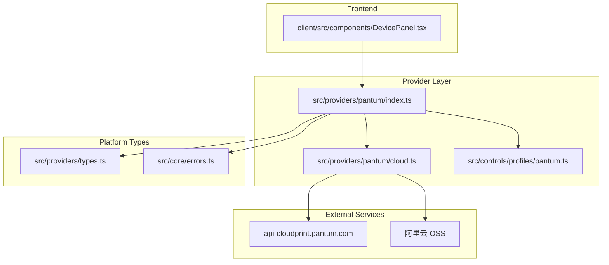
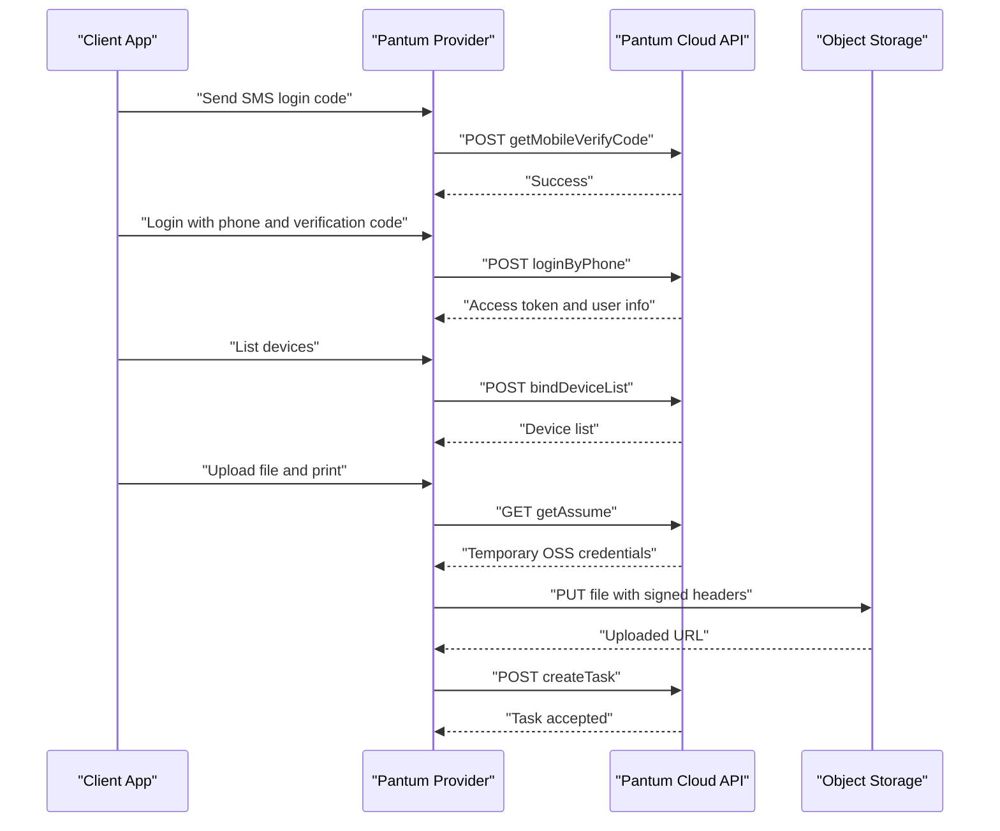
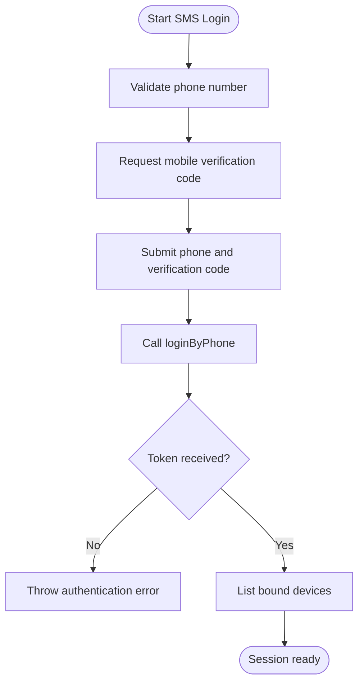
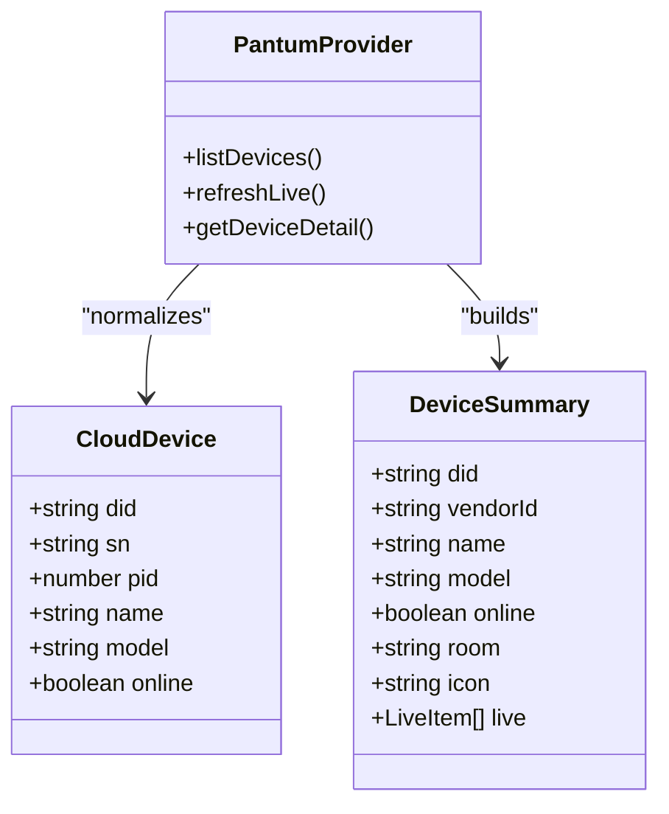
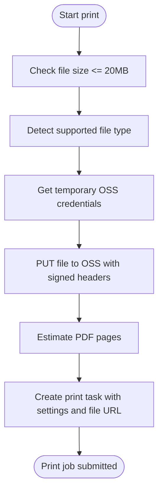
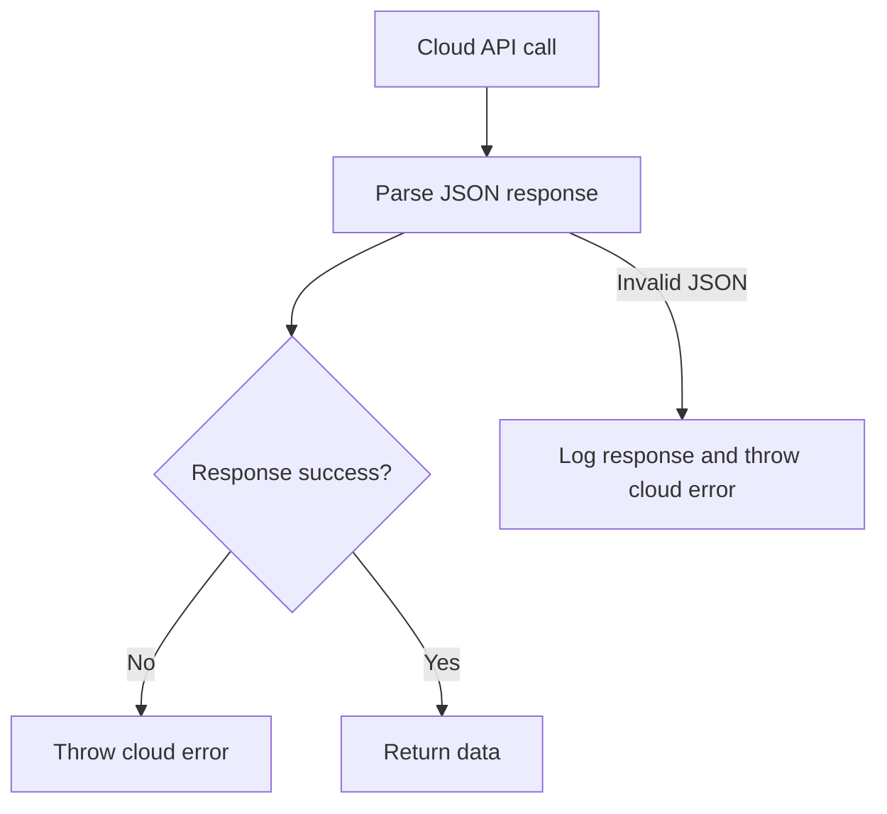
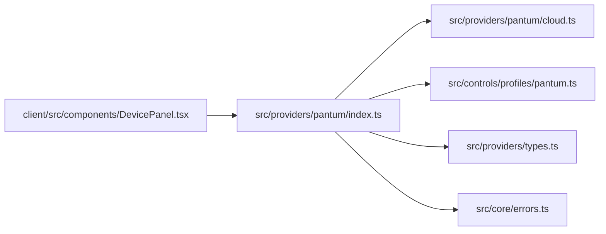

# Pantum Printer Integration

<cite>
**Referenced Files in This Document**
- [README.md](file://README.md)
- [index.ts](file://src/providers/pantum/index.ts)
- [cloud.ts](file://src/providers/pantum/cloud.ts)
- [pantum.ts](file://src/controls/profiles/pantum.ts)
- [types.ts](file://src/providers/types.ts)
- [errors.ts](file://src/core/errors.ts)
- [DevicePanel.tsx](file://client/src/components/DevicePanel.tsx)
- [Pantum-MobilePrint-V2_24_2-通信协议技术方案.md](file://docs/Pantum-MobilePrint-V2_24_2-通信协议分析/Pantum-MobilePrint-V2_24_2-通信协议技术方案.md)
</cite>

## Table of Contents
1. [Introduction](#introduction)
2. [Project Structure](#project-structure)
3. [Core Components](#core-components)
4. [Architecture Overview](#architecture-overview)
5. [Detailed Component Analysis](#detailed-component-analysis)
6. [Dependency Analysis](#dependency-analysis)
7. [Performance Considerations](#performance-considerations)
8. [Troubleshooting Guide](#troubleshooting-guide)
9. [Conclusion](#conclusion)

## Introduction
This document explains the Pantum printer integration implemented in this project. The integration uses Pantum’s cloud-based print service rather than direct local printing. It supports SMS-based account login, device discovery through the cloud, basic online status monitoring, and file upload printing via an OSS-backed workflow.

The implementation is a vendor provider that plugs into the platform’s control panel system. It does not implement direct network protocols such as IPP or SNMP; instead, it relies on Pantum’s HTTPS API and temporary object storage credentials to submit print jobs.

## Project Structure
The Pantum integration lives under the provider layer and is composed of:
- A provider entry point that implements login, device listing, live refresh, detail panel generation, and print submission.
- A cloud client module that handles authentication, device list retrieval, signature construction, STS credential acquisition, OSS upload, and print task creation.
- A profile definition that maps the limited cloud fields to user-facing labels and actions.
- Client-side UI configuration for print options such as color mode, duplex, paper size, and copies.

**Diagram sources**
- [index.ts:1-112](file://src/providers/pantum/index.ts#L1-L112)
- [cloud.ts:1-269](file://src/providers/pantum/cloud.ts#L1-L269)
- [pantum.ts:1-30](file://src/controls/profiles/pantum.ts#L1-L30)
- [types.ts:1-144](file://src/providers/types.ts#L1-L144)
- [errors.ts:1-38](file://src/core/errors.ts#L1-L38)
- [DevicePanel.tsx:27-55](file://client/src/components/DevicePanel.tsx#L27-L55)

**Section sources**
- [README.md:1-97](file://README.md#L1-L97)
- [index.ts:1-112](file://src/providers/pantum/index.ts#L1-L112)
- [cloud.ts:1-269](file://src/providers/pantum/cloud.ts#L1-L269)
- [pantum.ts:1-30](file://src/controls/profiles/pantum.ts#L1-L30)
- [types.ts:1-144](file://src/providers/types.ts#L1-L144)

## Core Components
### Provider Entry Point
The Pantum provider exposes:
- Region support for mainland China.
- SMS-only authentication flow.
- Device listing by calling the cloud device list endpoint.
- Live refresh returning serial number and cloud online/offline status.
- A fixed detail panel with read-only serial number and cloud status, plus a print action.
- Explicit rejection of property writes and generic actions because cloud devices are managed remotely.

Key responsibilities:
- Validate session state before any operation.
- Map cloud device records to platform device summaries.
- Convert frontend print fields into validated print options.
- Delegate actual file upload and task creation to the cloud module.

**Section sources**
- [index.ts:6-14](file://src/providers/pantum/index.ts#L6-L14)
- [index.ts:16-38](file://src/providers/pantum/index.ts#L16-L38)
- [index.ts:40-50](file://src/providers/pantum/index.ts#L40-L50)
- [index.ts:52-84](file://src/providers/pantum/index.ts#L52-L84)
- [index.ts:86-111](file://src/providers/pantum/index.ts#L86-L111)

### Cloud Client Module
The cloud module implements the full HTTP interaction with Pantum’s cloud service:
- Mobile verification code request.
- Phone-number login returning access token and user identifier.
- Binding device list retrieval.
- Print option validation.
- Temporary OSS credential acquisition.
- Direct PUT upload to OSS using signed headers.
- Print task creation with page count, print settings, and uploaded file URL.

It also defines the internal cloud data structures for sessions and devices.

**Section sources**
- [cloud.ts:15-28](file://src/providers/pantum/cloud.ts#L15-L28)
- [cloud.ts:37-66](file://src/providers/pantum/cloud.ts#L37-L66)
- [cloud.ts:68-107](file://src/providers/pantum/cloud.ts#L68-L107)
- [cloud.ts:109-141](file://src/providers/pantum/cloud.ts#L109-L141)
- [cloud.ts:143-176](file://src/providers/pantum/cloud.ts#L143-L176)
- [cloud.ts:178-195](file://src/providers/pantum/cloud.ts#L178-L195)
- [cloud.ts:197-241](file://src/providers/pantum/cloud.ts#L197-L241)
- [cloud.ts:243-268](file://src/providers/pantum/cloud.ts#L243-L268)

### Profile Definition
The Pantum profile declares:
- Read-only fields for serial number and cloud status.
- A print action labeled for uploading files to print.
- Grouping for display in the control panel.

This profile compensates for the limited cloud response by giving stable UI labels and grouping.

**Section sources**
- [pantum.ts:1-15](file://src/controls/profiles/pantum.ts#L1-L15)

### Platform Types and Errors
Vendor types define the shared contract between providers and the platform:
- Session, device summary, live items, and provider interface.
- Login outcome and pending authentication context.
- Property and action abstractions used by other vendors.

Error handling uses a structured `AppError` with message, error code, HTTP status, and optional details. There is also helper logic to detect authentication failures and convert errors into public payloads.

**Section sources**
- [types.ts:3-144](file://src/providers/types.ts#L3-L144)
- [errors.ts:1-38](file://src/core/errors.ts#L1-L38)

## Architecture Overview
The integration follows a cloud-first architecture. Authentication and device management go through Pantum’s HTTPS API. Printing uploads the file to temporary object storage and then creates a print task.

**Diagram sources**
- [index.ts:65-84](file://src/providers/pantum/index.ts#L65-L84)
- [index.ts:90-103](file://src/providers/pantum/index.ts#L90-L103)
- [index.ts:46-50](file://src/providers/pantum/index.ts#L46-L50)
- [cloud.ts:37-57](file://src/providers/pantum/cloud.ts#L37-L57)
- [cloud.ts:59-66](file://src/providers/pantum/cloud.ts#L59-L66)
- [cloud.ts:109-141](file://src/providers/pantum/cloud.ts#L109-L141)
- [cloud.ts:212-241](file://src/providers/pantum/cloud.ts#L212-L241)

## Detailed Component Analysis

### Authentication Flow
Pantum authentication in this integration is SMS-based:
1. The client requests a mobile verification code.
2. The provider validates the phone number format and calls the cloud verification endpoint.
3. The client submits the phone number and verification code.
4. The provider logs in, stores the access token, and initializes the session.
5. The provider immediately lists bound devices so the session contains device metadata.

**Diagram sources**
- [index.ts:65-84](file://src/providers/pantum/index.ts#L65-L84)
- [cloud.ts:37-57](file://src/providers/pantum/cloud.ts#L37-L57)

**Section sources**
- [index.ts:52-84](file://src/providers/pantum/index.ts#L52-L84)
- [cloud.ts:37-57](file://src/providers/pantum/cloud.ts#L37-L57)

### Device Discovery and Status Monitoring
Device discovery is cloud-driven:
- The provider calls the binding device list endpoint.
- Each device record is normalized into a cloud device structure.
- The provider builds a platform device summary with ID, name, model, online flag, room label, and live items.
- Live refresh returns per-device live text items, currently showing serial number and cloud online/offline status.

Important limitation:
- The cloud response provides only basic fields such as serial number, product name, PID, SN, and online flag.
- Ink levels, toner levels, paper tray status, and detailed hardware diagnostics are not exposed by the current cloud integration.

**Diagram sources**
- [cloud.ts:15-22](file://src/providers/pantum/cloud.ts#L15-L22)
- [types.ts:22-33](file://src/providers/types.ts#L22-L33)
- [index.ts:16-38](file://src/providers/pantum/index.ts#L16-L38)
- [index.ts:90-103](file://src/providers/pantum/index.ts#L90-L103)

**Section sources**
- [index.ts:16-38](file://src/providers/pantum/index.ts#L16-L38)
- [index.ts:90-103](file://src/providers/pantum/index.ts#L90-L103)
- [cloud.ts:59-66](file://src/providers/pantum/cloud.ts#L59-L66)
- [cloud.ts:183-195](file://src/providers/pantum/cloud.ts#L183-L195)

### Print Job Submission Workflow
Printing is a three-step cloud workflow:
1. Get temporary object storage credentials.
2. Upload the file directly to object storage using signed headers.
3. Create a print task referencing the uploaded file URL and print settings.

Supported input formats:
- PDF
- JPEG
- PNG

File size limit:
- Maximum 20 MB.

Page counting:
- For PDFs, the implementation counts `/Type /Page` occurrences to estimate page count.
- For images, page count defaults to one.

Print settings include collation, duplex mode, feeder selection, color mode, number of copies, paper size, and paper type. These values are validated against allowed sets.

**Diagram sources**
- [cloud.ts:109-141](file://src/providers/pantum/cloud.ts#L109-L141)
- [cloud.ts:197-210](file://src/providers/pantum/cloud.ts#L197-L210)
- [cloud.ts:212-241](file://src/providers/pantum/cloud.ts#L212-L241)

**Section sources**
- [index.ts:46-50](file://src/providers/pantum/index.ts#L46-L50)
- [cloud.ts:68-107](file://src/providers/pantum/cloud.ts#L68-L107)
- [cloud.ts:109-141](file://src/providers/pantum/cloud.ts#L109-L141)
- [cloud.ts:197-210](file://src/providers/pantum/cloud.ts#L197-L210)
- [cloud.ts:212-241](file://src/providers/pantum/cloud.ts#L212-L241)

### Supported Printer Models and Limitations
Model information:
- The provider reads model names from the cloud device list.
- No explicit model whitelist is enforced in the provider.
- The cloud device normalization falls back to generic names when product identifiers are missing.

Limitations compared to direct network printing:
- Only cloud-managed devices are visible.
- Only basic online status is available.
- Hardware-level telemetry such as ink/toner levels, paper tray status, and maintenance counters is not exposed.
- Property writes and generic actions are rejected because cloud devices cannot be controlled through this provider.
- Local discovery methods such as mDNS, SLP, SNMP, SoftAP, and USB are not part of this integration.

For broader protocol context, the repository includes reverse-engineering notes about Pantum MobilePrint, including SoftAP, local LLD-HTTP, mDNS/SLP/SNMP, and USB paths. Those are separate from the current cloud-only provider.

**Section sources**
- [index.ts:95-110](file://src/providers/pantum/index.ts#L95-L110)
- [cloud.ts:183-195](file://src/providers/pantum/cloud.ts#L183-L195)
- [Pantum-MobilePrint-V2_24_2-通信协议技术方案.md:196-255](file://docs/Pantum-MobilePrint-V2_24_2-通信协议分析/Pantum-MobilePrint-V2_24_2-通信协议技术方案.md#L196-L255)

### Communication Protocols and Security
Cloud communication characteristics:
- Base host: `https://api-cloudprint.pantum.com`.
- Requests use HTTPS with JSON bodies.
- Requests include common headers such as User-Agent, country code, language, timestamp, and signature.
- Authenticated requests include an Authorization bearer token.
- File upload uses temporary OSS credentials obtained from the cloud API.

Signature construction:
- The signature combines body content, timestamp, and a secret value.
- The resulting MD5 digest is placed in the `sign` header.
- Timestamp is sent as seconds since epoch.

Retry behavior:
- The cloud client does not implement automatic retry.
- Network timeouts are configured for both the main API call and the OSS upload.
- Retry logic should be added at the caller or route layer if required.

**Section sources**
- [cloud.ts:1-7](file://src/providers/pantum/cloud.ts#L1-L7)
- [cloud.ts:143-176](file://src/providers/pantum/cloud.ts#L143-L176)
- [cloud.ts:178-181](file://src/providers/pantum/cloud.ts#L178-L181)
- [cloud.ts:251-261](file://src/providers/pantum/cloud.ts#L251-L261)

### Error Handling
Errors are represented as structured application errors:
- Authentication failures return specific codes and statuses.
- Cloud API failures parse the response envelope and throw errors with messages.
- Invalid print options throw validation errors.
- Unsupported file types throw print errors.
- Incomplete OSS credentials or upload failures throw print/cloud errors.

Public error conversion:
- Errors are converted into public payloads containing message, code, and optional details.
- Authentication failure detection helps higher layers decide whether to re-authenticate.

**Diagram sources**
- [cloud.ts:143-176](file://src/providers/pantum/cloud.ts#L143-L176)
- [errors.ts:1-38](file://src/core/errors.ts#L1-L38)

**Section sources**
- [cloud.ts:143-176](file://src/providers/pantum/cloud.ts#L143-L176)
- [cloud.ts:197-241](file://src/providers/pantum/cloud.ts#L197-L241)
- [errors.ts:1-38](file://src/core/errors.ts#L1-L38)

## Dependency Analysis
The Pantum provider depends on:
- Control panel utilities for building device panels.
- Platform types for session, device summary, and provider contracts.
- Cloud client for all external network operations.
- Profile definitions for UI labeling and action mapping.

**Diagram sources**
- [index.ts:1-4](file://src/providers/pantum/index.ts#L1-L4)
- [pantum.ts:1-15](file://src/controls/profiles/pantum.ts#L1-L15)
- [types.ts:1-144](file://src/providers/types.ts#L1-L144)
- [errors.ts:1-38](file://src/core/errors.ts#L1-L38)
- [DevicePanel.tsx:27-55](file://client/src/components/DevicePanel.tsx#L27-L55)

**Section sources**
- [index.ts:1-112](file://src/providers/pantum/index.ts#L1-L112)
- [cloud.ts:1-269](file://src/providers/pantum/cloud.ts#L1-L269)
- [pantum.ts:1-30](file://src/controls/profiles/pantum.ts#L1-L30)
- [types.ts:1-144](file://src/providers/types.ts#L1-L144)
- [errors.ts:1-38](file://src/core/errors.ts#L1-L38)
- [DevicePanel.tsx:27-55](file://client/src/components/DevicePanel.tsx#L27-L55)

## Performance Considerations
- File upload is the most expensive operation. The maximum payload is 20 MB.
- PDF page counting scans the file as text, which adds CPU work proportional to file size.
- Cloud API calls have a 20-second timeout.
- OSS upload has a 60-second timeout.
- There is no built-in retry, so transient network failures can fail the whole operation.
- Device listing and live refresh both call the cloud device list endpoint, so repeated refreshes increase cloud API usage.

Recommendations:
- Add retry with exponential backoff for transient network errors.
- Cache device lists briefly when appropriate.
- Avoid unnecessary live refreshes.
- Consider streaming large files if future changes require larger uploads.
- Validate and reject unsupported MIME types early to avoid wasted upload attempts.

[No sources needed since this section provides general guidance]

## Troubleshooting Guide

### Printer Registration Problems
Symptoms:
- No devices appear after login.
- Device list is empty.

Likely causes:
- The printer is not registered to the Pantum account used for login.
- The cloud device list endpoint returns no entries.
- The returned device records lack required identifiers.

Actions:
- Confirm the printer is bound to the same Pantum account.
- Check the cloud device list response.
- Verify that device records contain serial number and product ID.

**Section sources**
- [index.ts:32-38](file://src/providers/pantum/index.ts#L32-L38)
- [cloud.ts:59-66](file://src/providers/pantum/cloud.ts#L59-L66)
- [cloud.ts:183-195](file://src/providers/pantum/cloud.ts#L183-L195)

### Cloud Service Outages
Symptoms:
- Login fails.
- Device listing fails.
- Print task creation fails.

Likely causes:
- Cloud API returns non-success envelopes.
- Network timeout occurs.
- Response body is not valid JSON.

Actions:
- Inspect the error code and message.
- Check whether the base cloud host is reachable.
- Retry after a short delay for transient failures.
- If the response contains a cloud-specific message, treat it as a service-side issue.

**Section sources**
- [cloud.ts:143-176](file://src/providers/pantum/cloud.ts#L143-L176)
- [errors.ts:18-26](file://src/core/errors.ts#L18-L26)

### Print Job Failures
Symptoms:
- Upload fails.
- Print task is not created.
- Invalid print options are rejected.

Likely causes:
- File exceeds 20 MB.
- Unsupported file type.
- Invalid print option values.
- Incomplete temporary OSS credentials.
- OSS upload signature or network failure.

Actions:
- Ensure the file is PDF, JPEG, or PNG and under 20 MB.
- Validate print options before submission.
- Check temporary credential fields returned by the cloud API.
- Review OSS upload error details, especially security token and signing information.

**Section sources**
- [cloud.ts:109-107](file://src/providers/pantum/cloud.ts#L109-L107)
- [cloud.ts:197-204](file://src/providers/pantum/cloud.ts#L197-L204)
- [cloud.ts:212-241](file://src/providers/pantum/cloud.ts#L212-L241)

### Ink Levels and Paper Status
Current capability:
- The provider shows serial number and cloud online/offline status.
- It does not expose ink levels, toner levels, paper tray status, or hardware diagnostics.

Workaround:
- Use the official Pantum app or direct local printing path if hardware telemetry is required.
- Treat cloud status as a high-level connectivity indicator, not a hardware health report.

**Section sources**
- [index.ts:95-103](file://src/providers/pantum/index.ts#L95-L103)
- [pantum.ts:4-14](file://src/controls/profiles/pantum.ts#L4-L14)

## Conclusion
The Pantum integration in this project is a cloud-focused provider. It authenticates users via SMS, discovers printers through the Pantum cloud, and submits print jobs by uploading files to temporary object storage and creating cloud print tasks. It intentionally does not implement direct network printing or hardware telemetry.

For advanced features such as ink level checks, paper tray monitoring, local device discovery, or direct printer control, the current cloud provider is insufficient. Those capabilities belong to the broader Pantum ecosystem described in the reverse-engineering documentation, but they are not implemented by this integration.

[No sources needed since this section summarizes without analyzing specific files]