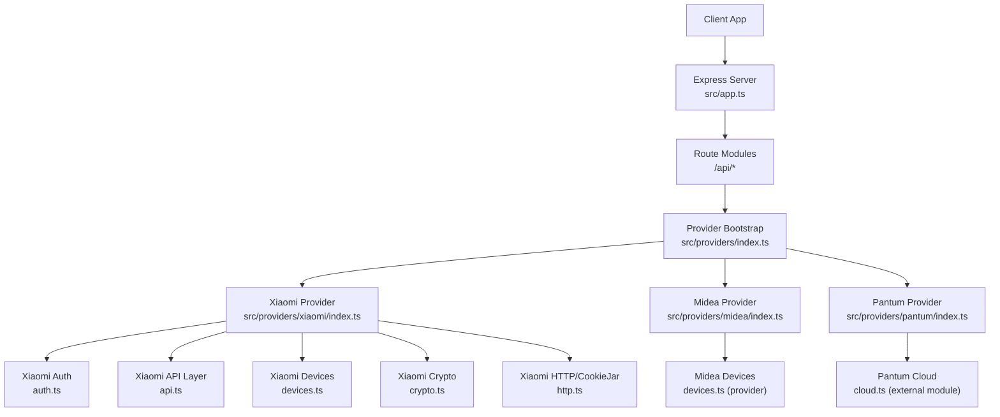
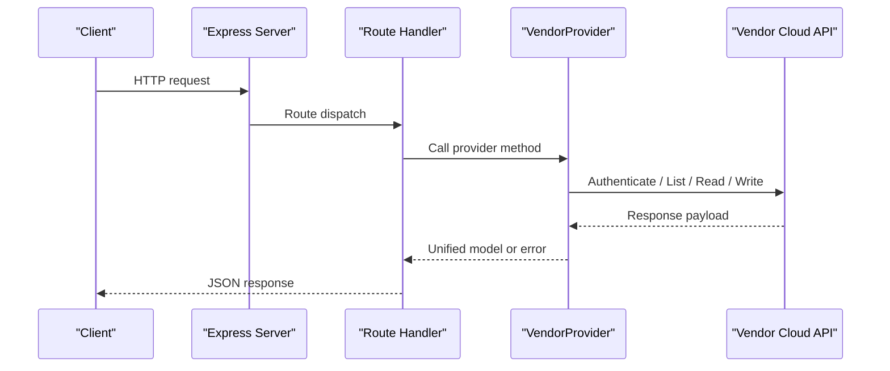
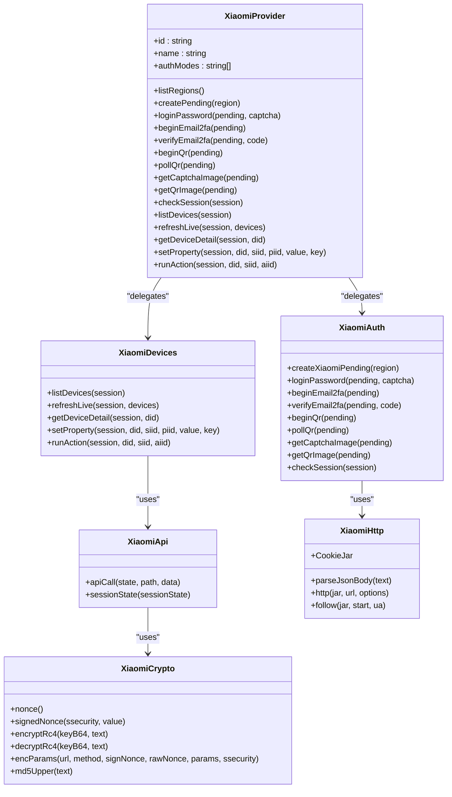
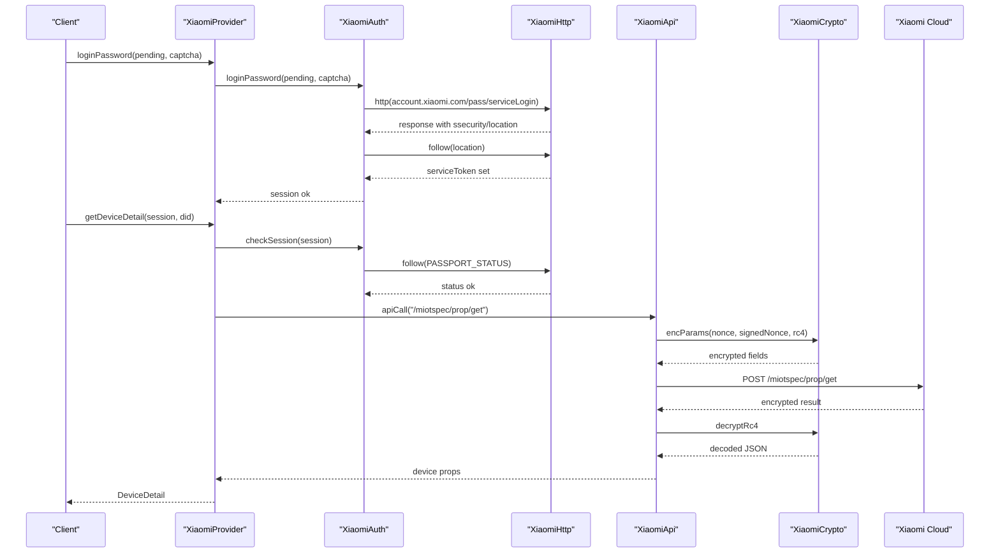
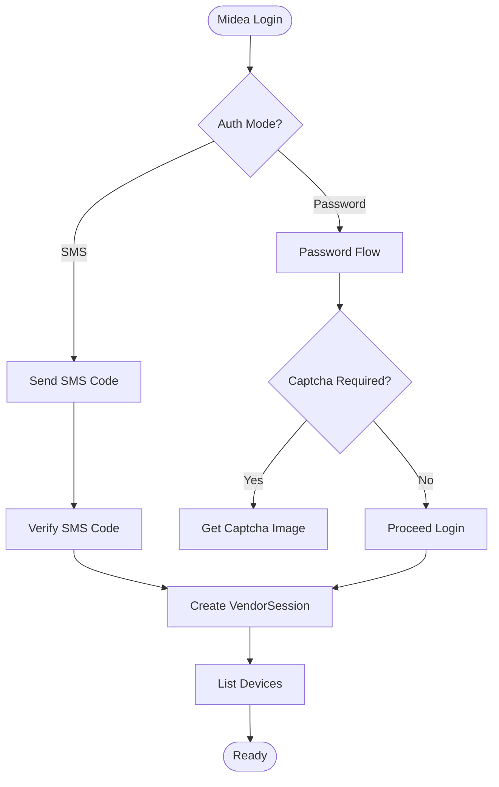
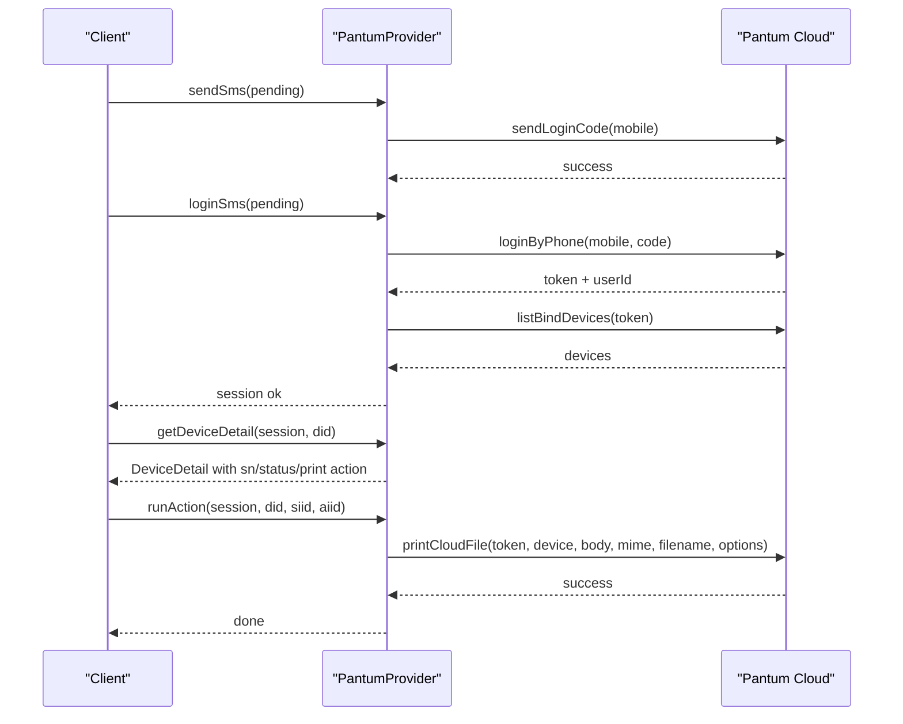
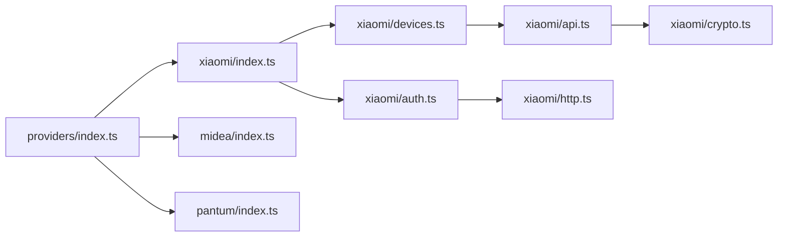

# Vendor Integrations

<cite>
**Referenced Files in This Document**
- [README.md](file://README.md)
- [app.ts](file://src/app.ts)
- [index.ts](file://src/index.ts)
- [package.json](file://package.json)
- [providers/index.ts](file://src/providers/index.ts)
- [providers/types.ts](file://src/providers/types.ts)
- [xiaomi/index.ts](file://src/providers/xiaomi/index.ts)
- [xiaomi/auth.ts](file://src/providers/xiaomi/auth.ts)
- [xiaomi/api.ts](file://src/providers/xiaomi/api.ts)
- [xiaomi/crypto.ts](file://src/providers/xiaomi/crypto.ts)
- [xiaomi/http.ts](file://src/providers/xiaomi/http.ts)
- [xiaomi/devices.ts](file://src/providers/xiaomi/devices.ts)
- [midea/index.ts](file://src/providers/midea/index.ts)
- [pantum/index.ts](file://src/providers/pantum/index.ts)
</cite>

## Table of Contents
1. [Introduction](#introduction)
2. [Project Structure](#project-structure)
3. [Core Components](#core-components)
4. [Architecture Overview](#architecture-overview)
5. [Detailed Component Analysis](#detailed-component-analysis)
6. [Dependency Analysis](#dependency-analysis)
7. [Performance Considerations](#performance-considerations)
8. [Troubleshooting Guide](#troubleshooting-guide)
9. [Conclusion](#conclusion)

## Introduction
This document explains the vendor integrations for Xiaomi Mi Home, Midea Smart Home, and Pantum printers within the mihome-web project. It covers authentication flows, API endpoints, device property mappings, protocol quirks, reverse engineering approaches, supported features, limitations, data transformation layers, rate limiting, connection pooling, and error handling strategies. The goal is to make each integration understandable for both developers and non-technical users while preserving precise implementation details from the codebase.

## Project Structure
The application is an Express-based Node.js server that registers vendor providers and exposes REST routes under `/api`. Providers encapsulate vendor-specific login, device listing, live status, device detail, property writes, and action execution. A controls/profiles layer normalizes vendor responses into a unified panel model.

**Diagram sources**
- [app.ts:13-23](file://src/app.ts#L13-L23)
- [providers/index.ts:8-14](file://src/providers/index.ts#L8-L14)
- [xiaomi/index.ts:6-29](file://src/providers/xiaomi/index.ts#L6-L29)
- [midea/index.ts:6-26](file://src/providers/midea/index.ts#L6-L26)
- [pantum/index.ts:52-111](file://src/providers/pantum/index.ts#L52-L111)

**Section sources**
- [app.ts:13-23](file://src/app.ts#L13-L23)
- [index.ts:1-12](file://src/index.ts#L1-L12)
- [package.json:1-24](file://package.json#L1-L24)
- [providers/index.ts:8-14](file://src/providers/index.ts#L8-L14)

## Core Components
- VendorProvider interface defines the contract for all vendors: region listing, pending auth creation, login methods, session checks, device listing, live refresh, device detail, property write, and action run.
- DeviceSummary, DeviceDetail, DeviceProperty, DeviceService, DeviceAction, LiveItem, VendorSession, PendingAuth, and LoginOutcome are shared types used by all providers.
- Controls/profiles layer transforms vendor fields into a normalized UI model with stable field ids, kinds, ranges, options, units, and actions.

Key responsibilities:
- Authentication: per-vendor login flows (password, SMS, QR, email 2FA).
- Device discovery: list devices and build summaries.
- Live status: select readable properties from MIoT spec or vendor APIs and format display text.
- Property mapping: map vendor payloads to unified fields; encode/decode values via profiles.
- Actions: invoke vendor-specific device actions.

**Section sources**
- [providers/types.ts:105-143](file://src/providers/types.ts#L105-L143)
- [providers/types.ts:22-84](file://src/providers/types.ts#L22-L84)
- [README.md:3-57](file://README.md#L3-L57)

## Architecture Overview
The system uses a provider registry to bootstrap Xiaomi, Midea, and Pantum integrations. Each provider implements the VendorProvider contract and delegates to vendor-specific modules for auth, crypto, HTTP, and device operations. Data flows from vendor APIs through provider modules into the controls layer, which builds a unified DeviceDetail for the frontend.

**Diagram sources**
- [app.ts:13-23](file://src/app.ts#L13-L23)
- [providers/index.ts:8-14](file://src/providers/index.ts#L8-L14)
- [providers/types.ts:105-143](file://src/providers/types.ts#L105-L143)

## Detailed Component Analysis

### Xiaomi Mi Home Integration
Authentication methods:
- Password login with optional captcha and email 2FA.
- QR code login with polling.
- Session validation via passport status endpoint.

Protocol and security:
- Uses cookie-based sessions with a CookieJar abstraction.
- Encrypted API calls using RC4 with nonce/signNonce and signature generation.
- Region-aware host resolution for API endpoints.

Device model and properties:
- Device listing pulls homes and devices, maps rooms, and caches MIoT spec URNs.
- Live status selects readable properties from MIoT spec and formats them.
- Device detail reads current property values and builds a panel via the controls layer.
- Property writes and actions use MIoT spec endpoints.

Reverse engineering approach:
- Reverse engineered Xiaomi account flow and MIoT spec-based device model.
- Captured cookie/session propagation, ssecurity token usage, and RC4 encryption scheme.
- Mapped MIoT URN services/properties/actions to generic fields and actions.

Supported features and limitations:
- Supports password, QR login, email 2FA, device listing, live status, property control, and actions.
- Limitations include dependency on MIoT spec availability and potential regional endpoint differences.

**Diagram sources**
- [xiaomi/index.ts:6-29](file://src/providers/xiaomi/index.ts#L6-L29)
- [xiaomi/auth.ts:7-267](file://src/providers/xiaomi/auth.ts#L7-L267)
- [xiaomi/devices.ts:12-298](file://src/providers/xiaomi/devices.ts#L12-L298)
- [xiaomi/api.ts:5-54](file://src/providers/xiaomi/api.ts#L5-L54)
- [xiaomi/crypto.ts:3-83](file://src/providers/xiaomi/crypto.ts#L3-L83)
- [xiaomi/http.ts:1-85](file://src/providers/xiaomi/http.ts#L1-L85)

**Diagram sources**
- [xiaomi/auth.ts:33-91](file://src/providers/xiaomi/auth.ts#L33-L91)
- [xiaomi/auth.ts:227-242](file://src/providers/xiaomi/auth.ts#L227-L242)
- [xiaomi/devices.ts:247-266](file://src/providers/xiaomi/devices.ts#L247-L266)
- [xiaomi/api.ts:5-50](file://src/providers/xiaomi/api.ts#L5-L50)
- [xiaomi/crypto.ts:64-79](file://src/providers/xiaomi/crypto.ts#L64-L79)

Key implementation notes:
- Authentication uses multiple steps: initial account page fetch, optional captcha, optional email 2FA, then location redirect to obtain serviceToken.
- API calls encrypt parameters with RC4 and compute signatures using SHA1 over URL/method/params/signNonce.
- Device properties are derived from MIoT spec URNs; readable properties are selected for live status and control panels.
- Errors propagate as AppError with vendor codes and HTTP statuses.

**Section sources**
- [xiaomi/index.ts:6-29](file://src/providers/xiaomi/index.ts#L6-L29)
- [xiaomi/auth.ts:33-267](file://src/providers/xiaomi/auth.ts#L33-L267)
- [xiaomi/devices.ts:12-298](file://src/providers/xiaomi/devices.ts#L12-L298)
- [xiaomi/api.ts:5-54](file://src/providers/xiaomi/api.ts#L5-L54)
- [xiaomi/crypto.ts:3-83](file://src/providers/xiaomi/crypto.ts#L3-L83)
- [xiaomi/http.ts:1-85](file://src/providers/xiaomi/http.ts#L1-L85)

### Midea Smart Home Integration
Authentication methods:
- SMS-based login and password login.
- Captcha image retrieval when required.

Protocol and security:
- Provider delegates to Midea auth and devices modules.
- Session checking is implemented in devices module.

Device model and properties:
- Device listing, live refresh, device detail, property writes, and actions are delegated to Midea devices module.
- Profiles normalize vendor-specific responses into unified fields.

Reverse engineering approach:
- Reverse engineered Midea app communication protocol to support SMS/password login and device operations.
- Mapped Midea device capabilities to the unified device model via profiles.

Supported features and limitations:
- Supports SMS and password login, device listing, live status, property control, and actions.
- Limitations depend on Midea cloud availability and device capability exposure.

**Diagram sources**
- [midea/index.ts:6-26](file://src/providers/midea/index.ts#L6-L26)

**Section sources**
- [midea/index.ts:6-26](file://src/providers/midea/index.ts#L6-L26)

### Pantum Printers Integration
Authentication methods:
- SMS-only login for Chinese mainland region.

Protocol and cloud model:
- Uses Pantum cloud API for phone-based login, device listing, and print file upload.
- State includes cloud token and bound devices.

Device model and properties:
- Device summary includes serial number and online status.
- Properties are read-only; actions trigger cloud printing.

Reverse engineering approach:
- Reverse engineered Pantum mobile print communication protocol to support SMS login and cloud printing.
- Mapped cloud device fields to unified model and exposed print action.

Supported features and limitations:
- Supports SMS login, device listing, live status, and print action.
- Property writes are not supported for cloud devices; only file upload printing is available.

**Diagram sources**
- [pantum/index.ts:52-111](file://src/providers/pantum/index.ts#L52-L111)

**Section sources**
- [pantum/index.ts:6-111](file://src/providers/pantum/index.ts#L6-L111)

## Dependency Analysis
Providers are registered centrally and expose consistent interfaces. Xiaomi depends on auth, devices, api, crypto, and http modules. Midea and Pantum delegate to their respective internal modules. The controls/profiles layer is independent and consumes provider outputs.

**Diagram sources**
- [providers/index.ts:8-14](file://src/providers/index.ts#L8-L14)
- [xiaomi/index.ts:6-29](file://src/providers/xiaomi/index.ts#L6-L29)
- [xiaomi/devices.ts:12-298](file://src/providers/xiaomi/devices.ts#L12-L298)
- [xiaomi/api.ts:5-54](file://src/providers/xiaomi/api.ts#L5-L54)
- [xiaomi/crypto.ts:3-83](file://src/providers/xiaomi/crypto.ts#L3-L83)
- [xiaomi/http.ts:1-85](file://src/providers/xiaomi/http.ts#L1-L85)

**Section sources**
- [providers/index.ts:8-14](file://src/providers/index.ts#L8-L14)

## Performance Considerations
- Rate limiting: Open API endpoints implement IP-based rate limiting for invalid key attempts; this protects against brute-force probing but does not directly apply to vendor APIs.
- Connection pooling: No explicit connection pool is configured; HTTP requests use native fetch. For high concurrency, consider adding a pooled HTTP client.
- Caching: MIoT spec documents are cached in memory per type to avoid repeated network calls.
- Payload size: Express JSON body limit is set to 64kb; ensure vendor payloads fit within limits.
- Error handling: All vendor errors are wrapped as AppError with meaningful codes and HTTP statuses.

Recommendations:
- Add retry logic with exponential backoff for transient vendor API failures.
- Introduce connection pooling for vendor HTTP clients to reduce overhead.
- Cache device lists and live status with TTL based on vendor update frequency.
- Monitor and log vendor API latency and error rates.

[No sources needed since this section provides general guidance]

## Troubleshooting Guide
Common issues and resolutions:

- Xiaomi authentication failures:
  - Missing ssecurity or serviceToken after login redirects indicates incomplete session establishment. Ensure follow redirects capture cookies and tokens.
  - Email 2FA requires correct context and ticket; verify notificationUrl and identity endpoints.
  - QR login polling may time out; handle AbortError gracefully and prompt user to refresh QR.

- Xiaomi API decryption errors:
  - Decryption failure suggests incorrect ssecurity or nonce/signNonce mismatch. Validate RC4 key derivation and signature computation.
  - Large numeric IDs must be quoted during JSON parsing to preserve precision.

- Xiaomi device property errors:
  - Non-zero code from prop/set or action indicates device-side rejection; surface error code to client.
  - Missing specType leads to empty fields; fallback to default behavior or require manual profile override.

- Midea login issues:
  - SMS code validation requires valid mobile number format; enforce regex checks before sending.
  - Captcha images must be fetched with proper headers and cookies.

- Pantum cloud issues:
  - Phone number validation must match expected pattern; reject malformed inputs early.
  - Cloud device properties are read-only; instruct users to use print action instead of property writes.

General connectivity problems:
- Network timeouts or DNS failures: Retry with backoff and provide user feedback.
- Regional endpoint mismatches: Ensure regionHost resolves correctly for Xiaomi; validate region configuration.

**Section sources**
- [xiaomi/auth.ts:33-267](file://src/providers/xiaomi/auth.ts#L33-L267)
- [xiaomi/api.ts:5-54](file://src/providers/xiaomi/api.ts#L5-L54)
- [xiaomi/devices.ts:247-298](file://src/providers/xiaomi/devices.ts#L247-L298)
- [pantum/index.ts:65-84](file://src/providers/pantum/index.ts#L65-L84)

## Conclusion
The mihome-web project integrates Xiaomi Mi Home, Midea Smart Home, and Pantum printers through a consistent provider architecture. Xiaomi leverages MIoT spec URNs and RC4-encrypted API calls; Midea supports SMS/password login; Pantum focuses on SMS-based cloud printing. The controls/profiles layer normalizes vendor responses into a unified device model, enabling consistent UI rendering and control. Robust error handling, caching, and clear authentication flows improve reliability. Future enhancements should include connection pooling, advanced retry strategies, and expanded profile coverage for diverse device models.

[No sources needed since this section summarizes without analyzing specific files]