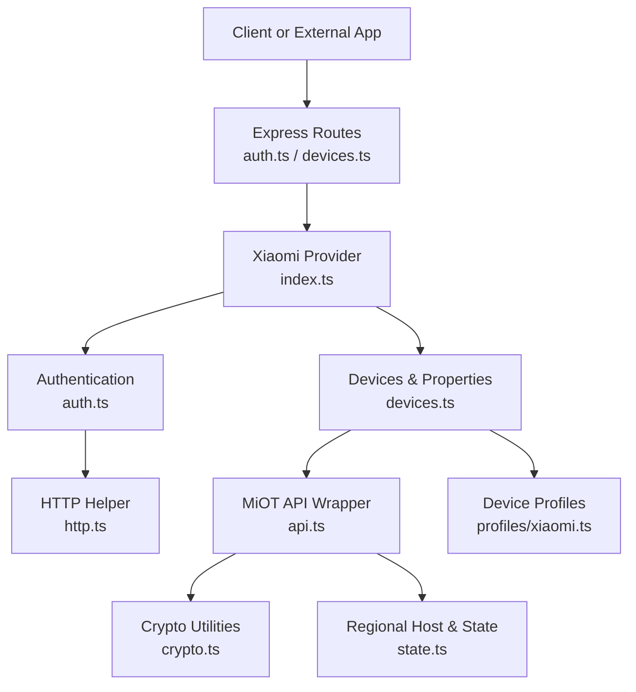
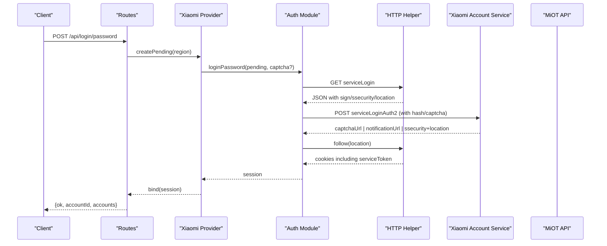
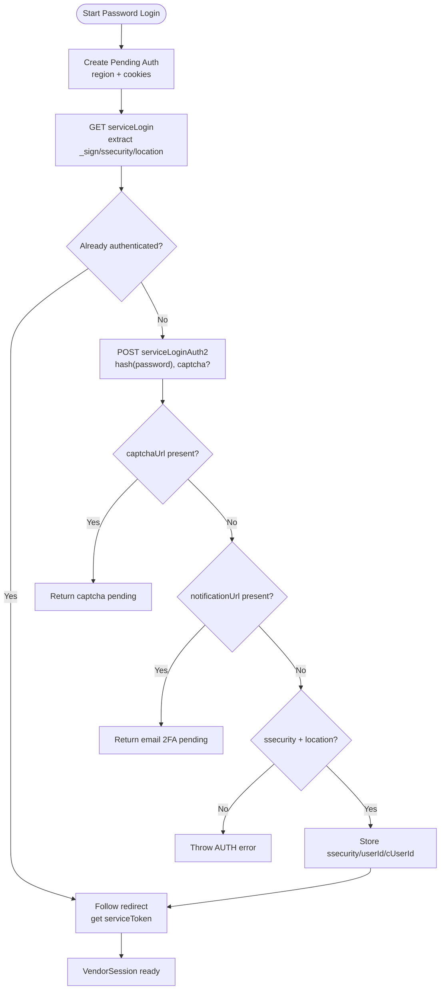
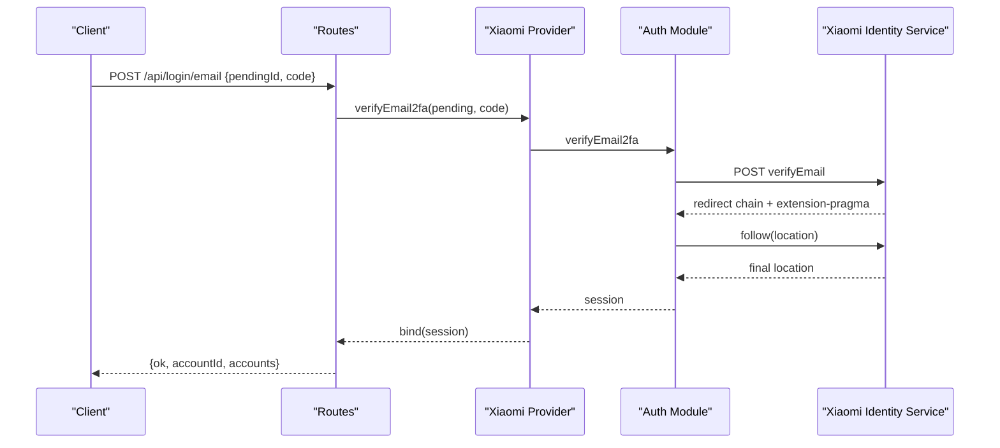
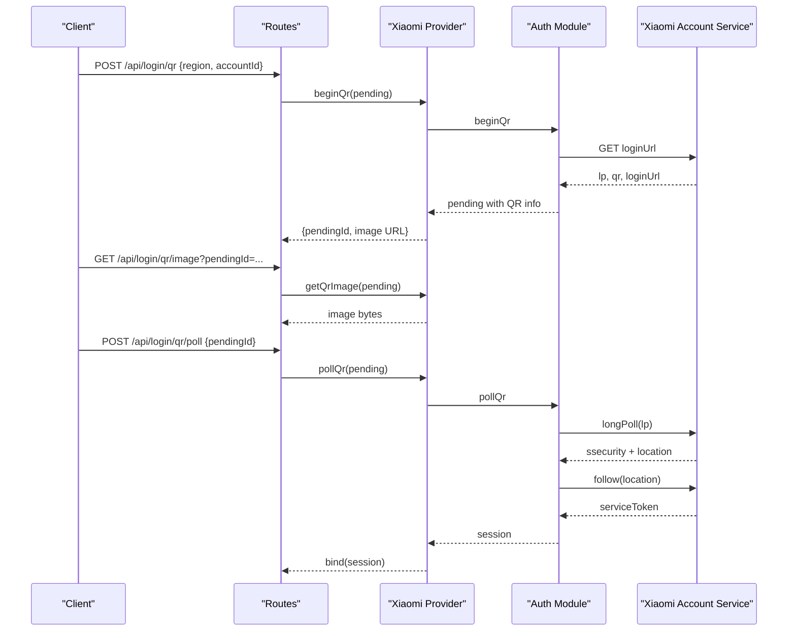
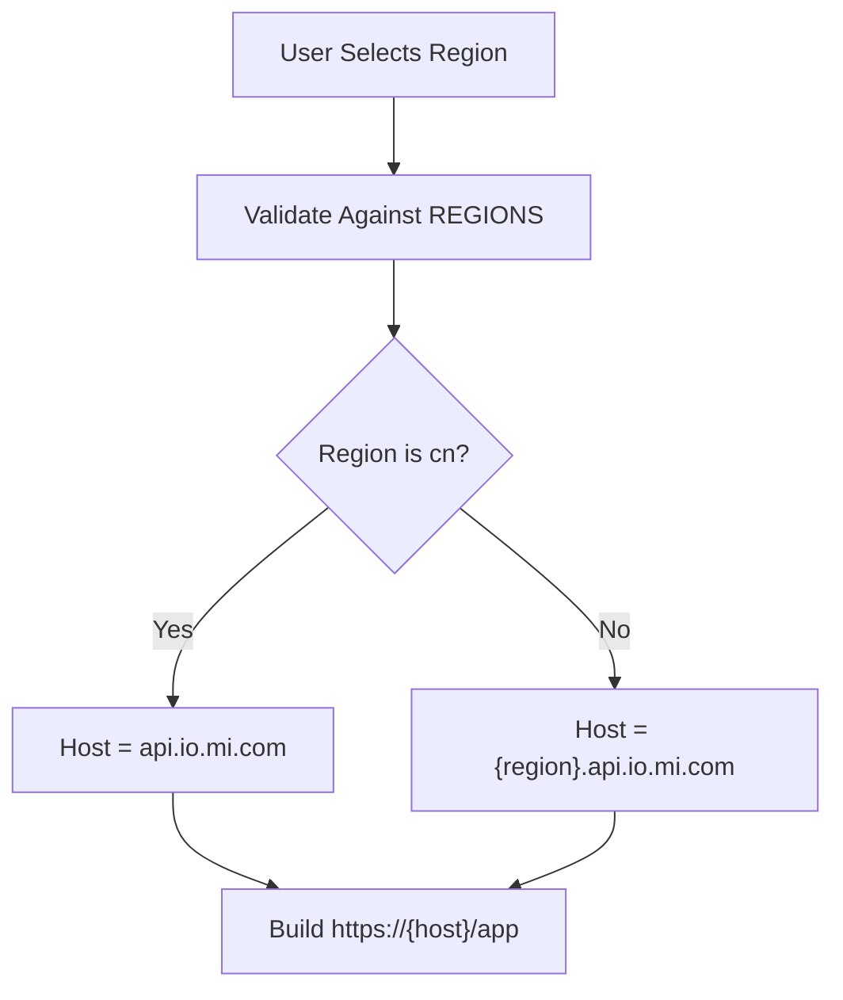
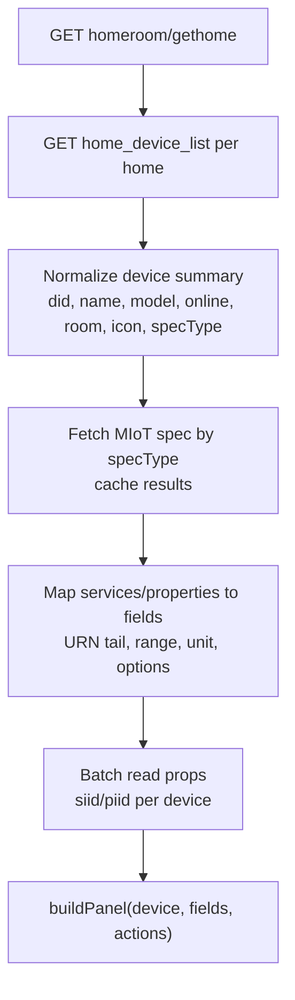
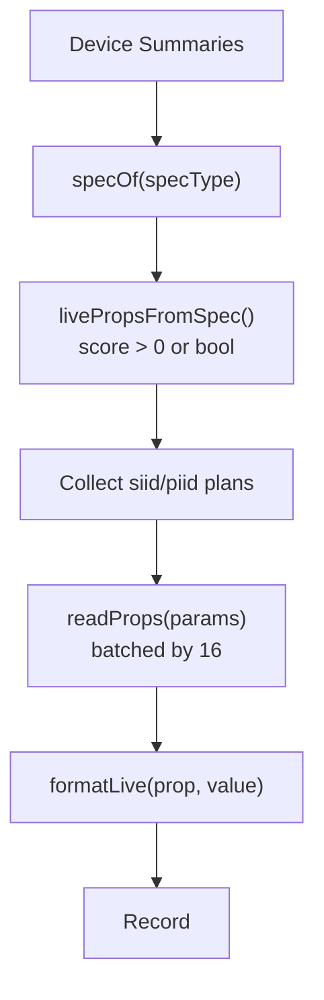
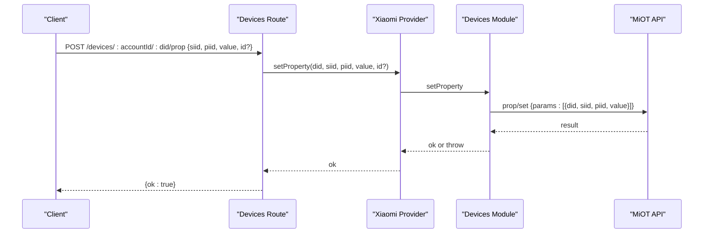
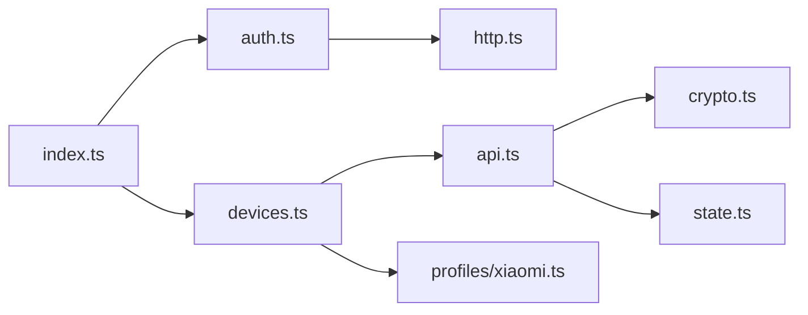

# Xiaomi Mi Home Integration

<cite>
**Referenced Files in This Document**
- [README.md](file://README.md)
- [index.ts](file://src/providers/xiaomi/index.ts)
- [auth.ts](file://src/providers/xiaomi/auth.ts)
- [api.ts](file://src/providers/xiaomi/api.ts)
- [crypto.ts](file://src/providers/xiaomi/crypto.ts)
- [devices.ts](file://src/providers/xiaomi/devices.ts)
- [state.ts](file://src/providers/xiaomi/state.ts)
- [http.ts](file://src/providers/xiaomi/http.ts)
- [xiaomi.ts](file://src/controls/profiles/xiaomi.ts)
- [types.ts](file://src/providers/types.ts)
- [errors.ts](file://src/core/errors.ts)
- [devices.ts](file://src/routes/devices.ts)
- [auth.ts](file://src/routes/auth.ts)
</cite>

## Table of Contents
1. [Introduction](#introduction)
2. [Project Structure](#project-structure)
3. [Core Components](#core-components)
4. [Architecture Overview](#architecture-overview)
5. [Detailed Component Analysis](#detailed-component-analysis)
6. [Dependency Analysis](#dependency-analysis)
7. [Performance Considerations](#performance-considerations)
8. [Troubleshooting Guide](#troubleshooting-guide)
9. [Conclusion](#conclusion)

## Introduction
This document explains the Xiaomi Mi Home integration implemented by the project. It covers:
- Multi-step authentication flows: password login, QR code authentication, and email-based two-factor authentication.
- Regional server configuration and how it changes API endpoints.
- Device discovery, MIoT property mapping, and real-time state updates.
- Supported device types, properties, and control actions.
- Cryptographic methods used for secure communication.
- Error handling strategies for network timeouts and authentication failures.
- Rate limiting considerations.
- Troubleshooting guidance for region mismatches, device discovery failures, and session expiration problems.

The integration is exposed through a vendor provider interface and wired into generic routes that handle login, device listing, live updates, property writes, and action execution.

## Project Structure
The Xiaomi integration lives under `src/providers/xiaomi` and is composed of:
- Provider entry point exposing auth modes, regions, and all vendor operations.
- Authentication module implementing password, email 2FA, and QR flows.
- HTTP helper with cookie jar, JSON parsing, and redirect following.
- Crypto module providing nonces, signatures, RC4 encryption, and MD5 hashing.
- API wrapper that builds signed, encrypted requests to regional MiOT endpoints.
- Device module that lists homes/devices, reads specs, maps properties, refreshes live values, and controls devices.
- State module defining supported regions, auth state shape, user agent generation, and regional host resolution.
- Control profiles that refine UI behavior for common Xiaomi device categories.

**Diagram sources**
- [index.ts:6-29](file://src/providers/xiaomi/index.ts#L6-L29)
- [auth.ts:33-267](file://src/providers/xiaomi/auth.ts#L33-L267)
- [devices.ts:180-297](file://src/providers/xiaomi/devices.ts#L180-L297)
- [api.ts:5-50](file://src/providers/xiaomi/api.ts#L5-L50)
- [crypto.ts:3-83](file://src/providers/xiaomi/crypto.ts#L3-L83)
- [state.ts:3-60](file://src/providers/xiaomi/state.ts#L3-L60)
- [http.ts:1-85](file://src/providers/xiaomi/http.ts#L1-L85)
- [xiaomi.ts:8-40](file://src/controls/profiles/xiaomi.ts#L8-L40)

**Section sources**
- [index.ts:6-29](file://src/providers/xiaomi/index.ts#L6-L29)
- [README.md:3-57](file://README.md#L3-L57)

## Core Components
- Vendor provider: declares Xiaomi as supporting password and QR authentication, exposes region list, pending creation, and all device operations.
- Authentication: implements password login with optional captcha and email 2FA, QR code initiation and polling, image retrieval, and session validation.
- API wrapper: constructs signed and RC4-encrypted payloads for MiOT endpoints, handles decryption and error translation.
- Crypto utilities: generates time-aware nonces, computes signed nonces, performs RC4 stream masking, signature calculation, and MD5 hashing.
- Devices: discovers homes and devices, fetches MIoT specs, maps properties and actions, reads current values, refreshes live summaries, and executes property writes and actions.
- State: defines supported regions, creates auth state with cookies and user agent, resolves regional API hosts.
- HTTP helper: manages cookies, parses JSON bodies, wraps fetch with manual redirects, and follows location headers.
- Profiles: provide display hints, units, ordering, and action labels for lights, fans, vacuums, and baseline fields.

**Section sources**
- [index.ts:6-29](file://src/providers/xiaomi/index.ts#L6-L29)
- [auth.ts:33-267](file://src/providers/xiaomi/auth.ts#L33-L267)
- [api.ts:5-50](file://src/providers/xiaomi/api.ts#L5-L50)
- [crypto.ts:3-83](file://src/providers/xiaomi/crypto.ts#L3-L83)
- [devices.ts:12-297](file://src/providers/xiaomi/devices.ts#L12-L297)
- [state.ts:3-60](file://src/providers/xiaomi/state.ts#L3-L60)
- [http.ts:1-85](file://src/providers/xiaomi/http.ts#L1-L85)
- [xiaomi.ts:8-40](file://src/controls/profiles/xiaomi.ts#L8-L40)

## Architecture Overview
The integration follows a layered architecture:
- Routes layer validates hub context and delegates to the vendor provider.
- Provider layer selects Xiaomi implementation and orchestrates auth and device operations.
- Auth layer interacts with Xiaomi account services using cookies and redirects.
- Devices layer uses MiOT spec definitions to map proprietary properties into a unified model.
- API layer signs and encrypts requests, then decrypts responses.
- Crypto layer provides primitives for security.
- State layer centralizes region-to-host mapping and auth state.

**Diagram sources**
- [auth.ts:33-91](file://src/providers/xiaomi/auth.ts#L33-L91)
- [auth.ts:17-22](file://src/providers/xiaomi/auth.ts#L17-L22)
- [http.ts:37-84](file://src/providers/xiaomi/http.ts#L37-L84)
- [routes/auth.ts:35-70](file://src/routes/auth.ts#L35-L70)

## Detailed Component Analysis

### Authentication Flows

#### Password Login Flow
- Creates a pending auth context with region and initial cookies.
- Calls the Xiaomi account service to obtain signing parameters.
- If already authenticated, follows the redirect to acquire `serviceToken`.
- Otherwise, submits hashed password and optional captcha; may return:
  - Captcha challenge requiring an image.
  - Email-based second factor requiring ticket verification.
  - Successful authentication with `ssecurity`, `userId`, and redirect location.
- Finalizes session by following the final redirect and extracting `serviceToken`.

**Diagram sources**
- [auth.ts:33-91](file://src/providers/xiaomi/auth.ts#L33-L91)
- [auth.ts:17-22](file://src/providers/xiaomi/auth.ts#L17-L22)

**Section sources**
- [auth.ts:33-91](file://src/providers/xiaomi/auth.ts#L33-L91)
- [auth.ts:17-22](file://src/providers/xiaomi/auth.ts#L17-L22)

#### Email-Based Two-Factor Authentication
- Initiates email ticket sending using stored notification context.
- Verifies the email ticket and follows additional redirects.
- Extracts `ssecurity` from response headers when available.
- Requires both `ssecurity` and final STS location; otherwise throws errors.
- Finalizes session via redirect and returns a valid session.

**Diagram sources**
- [auth.ts:94-173](file://src/providers/xiaomi/auth.ts#L94-L173)
- [routes/auth.ts:109-121](file://src/routes/auth.ts#L109-L121)

**Section sources**
- [auth.ts:94-173](file://src/providers/xiaomi/auth.ts#L94-L173)
- [routes/auth.ts:109-121](file://src/routes/auth.ts#L109-L121)

#### QR Code Authentication
- Begins QR flow by requesting login URL and QR data.
- Stores long-poll endpoint, QR image URL, and login URL.
- Polling uses a short timeout and manual redirect handling; on success, extracts credentials and finalizes session.
- Image retrieval returns binary content with appropriate MIME type.

**Diagram sources**
- [auth.ts:175-223](file://src/providers/xiaomi/auth.ts#L175-L223)
- [auth.ts:256-267](file://src/providers/xiaomi/auth.ts#L256-L267)
- [routes/auth.ts:123-173](file://src/routes/auth.ts#L123-L173)

**Section sources**
- [auth.ts:175-223](file://src/providers/xiaomi/auth.ts#L175-L223)
- [auth.ts:256-267](file://src/providers/xiaomi/auth.ts#L256-L267)
- [routes/auth.ts:123-173](file://src/routes/auth.ts#L123-L173)

#### Session Validation
- Checks presence of user ID and pass token.
- Follows passport status endpoint and verifies response code.
- Throws authentication failure if invalid or missing.

**Section sources**
- [auth.ts:225-242](file://src/providers/xiaomi/auth.ts#L225-L242)

### Regional Server Configuration
- Supported regions include China, Europe, US, Russia, Singapore, Taiwan, and India.
- Region selection affects the base API host:
  - China uses `https://api.io.mi.com/app`.
  - Other regions use `https://{region}.api.io.mi.com/app`.
- The provider exposes region list and uses it to create pending contexts and resolve hosts.

**Diagram sources**
- [state.ts:3-11](file://src/providers/xiaomi/state.ts#L3-L11)
- [state.ts:56-60](file://src/providers/xiaomi/state.ts#L56-L60)

**Section sources**
- [state.ts:3-11](file://src/providers/xiaomi/state.ts#L3-L11)
- [state.ts:56-60](file://src/providers/xiaomi/state.ts#L56-L60)
- [index.ts:10-14](file://src/providers/xiaomi/index.ts#L10-L14)

### Device Discovery and Property Mapping
- Lists homes and devices per home, deduplicates by device ID, and attaches room names.
- Fetches MIoT spec documents by device spec type and caches them.
- Maps MIoT services and properties into unified fields:
  - Uses URN tail extraction to derive semantic property names.
  - Exposes read/write access, units, ranges, value lists, and groups.
- Builds panel structures combining device metadata, fields, and actions.
- Reads current property values in batches of up to 16 per request.

**Diagram sources**
- [devices.ts:180-223](file://src/providers/xiaomi/devices.ts#L180-L223)
- [devices.ts:35-43](file://src/providers/xiaomi/devices.ts#L35-L43)
- [devices.ts:123-172](file://src/providers/xiaomi/devices.ts#L123-L172)
- [devices.ts:106-121](file://src/providers/xiaomi/devices.ts#L106-L121)

**Section sources**
- [devices.ts:180-223](file://src/providers/xiaomi/devices.ts#L180-L223)
- [devices.ts:35-43](file://src/providers/xiaomi/devices.ts#L35-L43)
- [devices.ts:123-172](file://src/providers/xiaomi/devices.ts#L123-L172)
- [devices.ts:106-121](file://src/providers/xiaomi/devices.ts#L106-L121)

### Real-Time State Updates
- For each device, selects top live-friendly properties based on MIoT spec scoring and boolean fallback.
- Batches property reads across devices and formats values into human-readable text.
- Returns a map of device IDs to live items for UI consumption.

**Diagram sources**
- [devices.ts:67-104](file://src/providers/xiaomi/devices.ts#L67-L104)
- [devices.ts:225-245](file://src/providers/xiaomi/devices.ts#L225-L245)

**Section sources**
- [devices.ts:67-104](file://src/providers/xiaomi/devices.ts#L67-L104)
- [devices.ts:225-245](file://src/providers/xiaomi/devices.ts#L225-L245)

### Device Control Actions
- Property write: encodes field value using profile rules when a stable key is provided, then calls `/miotspec/prop/set`.
- Action execution: calls `/miotspec/action` with empty input array for no-parameter actions.
- Errors from device responses are translated into application errors with device-specific codes.

**Diagram sources**
- [devices.ts:268-287](file://src/providers/xiaomi/devices.ts#L268-L287)
- [routes/devices.ts:79-92](file://src/routes/devices.ts#L79-L92)

**Section sources**
- [devices.ts:268-287](file://src/providers/xiaomi/devices.ts#L268-L287)
- [routes/devices.ts:79-92](file://src/routes/devices.ts#L79-L92)

### Supported Device Types, Properties, and Actions
- Baseline fields include brightness, color temperature, fan level, target temperature, temperature, humidity, and PM2.5 density.
- Light devices emphasize on, brightness, and color temperature ordering.
- Fan devices emphasize on, fan level, and mode ordering.
- Vacuum devices expose specific actions such as start cleaning and return to charge.

Examples of supported properties and actions:
- Lights: on/off, brightness slider, color temperature slider.
- Fans: on/off, fan-level slider, mode selection.
- Vacuums: start cleaning, return to charge.

These behaviors are refined by profiles that add units, preferred control kinds, ordering, and action labels.

**Section sources**
- [xiaomi.ts:8-40](file://src/controls/profiles/xiaomi.ts#L8-L40)

## Dependency Analysis
The Xiaomi provider depends on:
- Authentication module for credential flows and session management.
- Devices module for discovery, property mapping, and control.
- API wrapper for signed and encrypted communication.
- Crypto utilities for nonce/signature/encryption.
- State module for region/host resolution and auth state.
- HTTP helper for cookie handling and redirects.
- Control profiles for UI refinement.

**Diagram sources**
- [index.ts:1-29](file://src/providers/xiaomi/index.ts#L1-L29)
- [devices.ts:1-10](file://src/providers/xiaomi/devices.ts#L1-L10)
- [api.ts:1-4](file://src/providers/xiaomi/api.ts#L1-L4)
- [crypto.ts:1-2](file://src/providers/xiaomi/crypto.ts#L1-L2)
- [state.ts:1-2](file://src/providers/xiaomi/state.ts#L1-L2)
- [http.ts:1-2](file://src/providers/xiaomi/http.ts#L1-L2)
- [xiaomi.ts:1-2](file://src/controls/profiles/xiaomi.ts#L1-L2)

**Section sources**
- [index.ts:1-29](file://src/providers/xiaomi/index.ts#L1-L29)
- [devices.ts:1-10](file://src/providers/xiaomi/devices.ts#L1-L10)
- [api.ts:1-4](file://src/providers/xiaomi/api.ts#L1-L4)
- [crypto.ts:1-2](file://src/providers/xiaomi/crypto.ts#L1-L2)
- [state.ts:1-2](file://src/providers/xiaomi/state.ts#L1-L2)
- [http.ts:1-2](file://src/providers/xiaomi/http.ts#L1-L2)
- [xiaomi.ts:1-2](file://src/controls/profiles/xiaomi.ts#L1-L2)

## Performance Considerations
- Batched property reads: device properties are read in chunks of up to 16 to reduce API round-trips.
- Spec caching: MIoT spec documents are cached per spec type to avoid repeated network calls.
- Live property selection: only high-scoring or boolean properties are selected for live updates to minimize payload size.
- Redirect following: limited to six hops to prevent excessive redirection loops.
- Long-poll timeout: QR polling aborts after a short timeout to avoid hanging connections.

[No sources needed since this section provides general guidance]

## Troubleshooting Guide

### Region Mismatches
- Symptom: API calls fail or return unexpected data.
- Cause: Selected region does not match the account’s expected region.
- Resolution: Ensure the region passed during pending creation matches one of the supported regions; verify host resolution.

**Section sources**
- [state.ts:3-11](file://src/providers/xiaomi/state.ts#L3-L11)
- [state.ts:56-60](file://src/providers/xiaomi/state.ts#L56-L60)

### Device Discovery Failures
- Symptom: Empty device list or warnings returned.
- Cause: Network issues, authentication failures, or malformed home/device responses.
- Resolution: Check account status, retry listing, and inspect warnings; ensure session tokens are present.

**Section sources**
- [routes/devices.ts:21-44](file://src/routes/devices.ts#L21-L44)
- [devices.ts:180-223](file://src/providers/xiaomi/devices.ts#L180-L223)

### Session Expiration Problems
- Symptom: Repeated authentication prompts or expired account status.
- Cause: Missing pass token, invalid ssecurity, or failed passport status check.
- Resolution: Re-authenticate; use session validation to detect expiration early.

**Section sources**
- [auth.ts:225-242](file://src/providers/xiaomi/auth.ts#L225-L242)
- [errors.ts:15-26](file://src/core/errors.ts#L15-L26)
- [routes/devices.ts:21-44](file://src/routes/devices.ts#L21-L44)

### Captcha and QR Issues
- Symptom: Captcha image not loading or QR never completes.
- Cause: Expired pending context, missing captcha URL, or long-poll timeout.
- Resolution: Refresh captcha image, re-initiate QR flow, and ensure pending context is still valid.

**Section sources**
- [auth.ts:244-267](file://src/providers/xiaomi/auth.ts#L244-L267)
- [auth.ts:198-223](file://src/providers/xiaomi/auth.ts#L198-L223)
- [routes/auth.ts:93-107](file://src/routes/auth.ts#L93-L107)
- [routes/auth.ts:142-156](file://src/routes/auth.ts#L142-L156)
- [routes/auth.ts:158-173](file://src/routes/auth.ts#L158-L173)

### Decryption and Network Errors
- Symptom: Response cannot be decrypted or HTTP errors from cloud.
- Cause: Invalid ssecurity, wrong nonce/signature, or upstream service errors.
- Resolution: Re-authenticate to refresh ssecurity; check network connectivity and retry.

**Section sources**
- [api.ts:32-49](file://src/providers/xiaomi/api.ts#L32-L49)

### Rate Limiting Considerations
- Open API rate limiting: IP-based throttling for invalid API Key attempts over a short window.
- Device listing and live updates: batched requests help mitigate excessive load.
- Recommendation: Avoid rapid polling of QR status or live endpoints; respect client-side intervals.

**Section sources**
- [README.md:88-95](file://README.md#L88-L95)
- [devices.ts:106-121](file://src/providers/xiaomi/devices.ts#L106-L121)

## Conclusion
The Xiaomi Mi Home integration provides a robust, multi-step authentication system, region-aware API communication, and a flexible device model built on MIoT specifications. It supports password login with captcha and email 2FA, QR code authentication, and comprehensive device discovery and control. Security is enforced through signed and RC4-encrypted payloads, while error handling and session validation improve reliability. Profiles refine the user experience for common device types, and batching plus caching optimize performance. Proper region selection and timely re-authentication are essential to avoid common pitfalls.