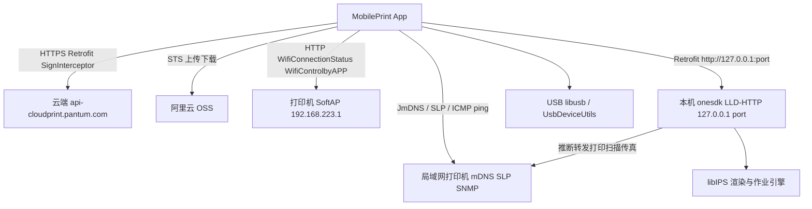
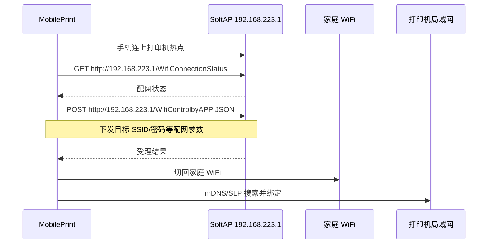
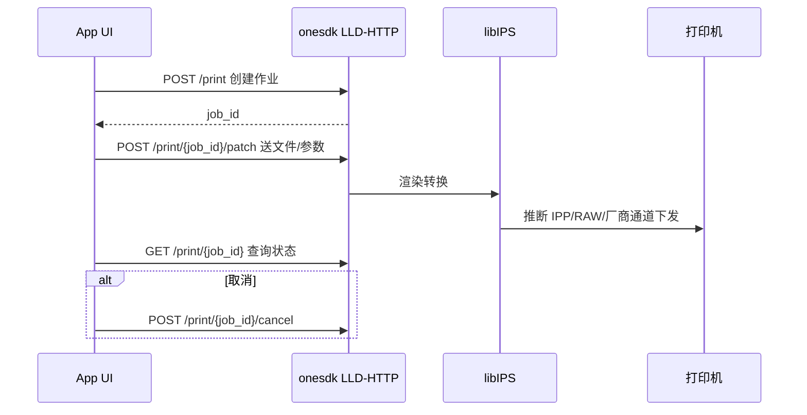
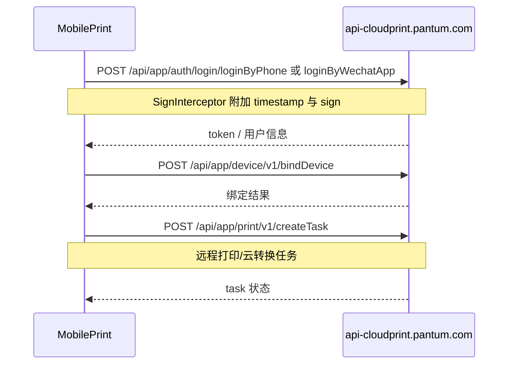

# 奔图 MobilePrint（com.pantum.mobileprint）V2.24.2 通信协议逆向分析技术方案

## 0、变更记录

| 版本 | 作者 | 日期 | 变更内容 |
| --- | --- | --- | --- |
| v0.1 | REA + JADX 静态逆向 | 2026-10-30 | 基于 chinaProdRelease APK 初稿：云端 API / SoftAP 配网 / mDNS+SLP 发现 / 本机 LLD-HTTP（onesdk）/ SNMP / USB |

> 说明：本文为**已发布 APK 静态逆向**产出，非 LUCP Flow 需求方案。结论区分观察 / 推断 / 未知。未做运行时抓包与设备联调。

## 1、需求概况

### 1.1 分析对象

| 项 | 值 |
| --- | --- |
| 本地路径 | `/Users/wuwei/Downloads/Pantum MobilePrint Android APP V2_24_2 chinaProdRelease.apk` |
| 包名 | `com.pantum.mobileprint`（BuildConfig） |
| versionName / versionCode | `2.24.2` / `570` |
| 构建变体 | `chinaProdRelease`（AGP 8.9.2） |
| 文件大小 | 455,287,939 bytes（约 434 MiB） |
| SHA-256 | `2d16430aa92794fb41dd520c075695c763ff3e1cdf01d299823b160c0cf21ef1` |
| 签名 | 仅 v2；证书 SHA-256（声明）`43f8c076b41d4e33f66732b8fea47b717e8c069cbe79dd1931cde2733168881c`；`self_consistent=true`，**未做密码学校验** |
| DEX | 9 个 `classes*.dex` |
| 原生库 | `arm64-v8a` / `armeabi-v7a`；关键 `libonesdk.so`、`libIPS.so`、`libCPS.so`、`libusb-1.0.so`、`libping.so` |
| 容器清单 | 约 4943 个 ZIP 条目（REA inventory） |

### 1.2 分析目标与上下游

- **目标**：梳理奔图 MobilePrint 与云端 / 打印机 SoftAP / 局域网发现 / 本机打印引擎（LLD-HTTP）/ SNMP / USB 的通信分层与主协议面，形成可对接或模拟的技术方案。
- **上游**：用户安装包；手机号/微信/邮箱登录；阿里云 OSS；支付（支付宝/微信/京东等周边）。
- **下游**：奔图打印机固件（SoftAP HTTP、IPP/mDNS、SLP、SNMP、USB）；云端 `api-cloudprint.pantum.com`；本机 onesdk HTTP 服务。

### 1.3 证据边界

| 类型 | 覆盖 |
| --- | --- |
| 已做 | REA open/inventory/签名；DEX 字符串挖掘；jadx 1.5.1 反编译；关键 Retrofit 接口与配网常量还原 |
| 未做 | apktool Manifest 完整解码；运行时抓包；SoftAP/LLD 请求体字段级联调；固件侧 IPP 端口实测 |
| 工具缺口 | REA 侧 `REA_JADX_MCP_JAR` / `REA_APKTOOL_COMMAND` 未配置；本机另用 portable jadx 完成反编译 |

## 2、技术方案

### 2.1 架构图（观察 + 推断）

通信主面可拆为四层：

| 层级 | 通道 | 关键组件（观察） |
| --- | --- | --- |
| 云端业务 | HTTPS | `PantumCloudApiService`、`DevServerConfig`、`SignInterceptor` |
| SoftAP 配网 | HTTP 直连打印机热点 | `PrinterApiService`、`BonjourUtils.PRINTER_DIRECT_CONNECTION_MODE_IP` |
| 局域网发现与状态 | mDNS / SLP / SNMP / Ping | `BonjourUtils`、`SLPSearchUtils`、`SnmpQueryClient`、`libping.so` |
| 本机打印控制面 | 本机 HTTP（onesdk） | `LLDHttpSdk` → `com.pantum.onesdk.Server.start_http_server` → `LLDHttpService` |

### 2.2 核心时序图

#### 2.2.1 SoftAP 配网（观察）

#### 2.2.2 本机打印作业（观察路径，固件侧为推断）

#### 2.2.3 云端登录与设备绑定（观察接口，鉴权细节部分推断）

### 2.3 状态流转（配网连接模型，观察）

`BonjourUtils` 维护连接模型：普通 WiFi、打印机 SoftAP（`192.168.223.*`）、Wi‑Fi P2P、USB。搜索类型：

| 常量 | 值 | 含义 |
| --- | --- | --- |
| `SEARCH_TYPE_ON_CHANGE` | 0 | 网络变更触发 |
| `SEARCH_TYPE_MDNS` | 1 | JmDNS |
| `SEARCH_TYPE_SLP` | 2 | SLP |

直连 SoftAP IP：`192.168.223.1`。

## 3、详细设计

### 3.1 云端 API（观察）

#### 3.1.1 Host 与环境

`com.pantum.api.DevServerConfig`（chinaProdRelease 静态赋值）：

| 环境常量 | Host |
| --- | --- |
| `RELEASE` / 当前 `BASE` | `api-cloudprint.pantum.com` |
| `PRE_HF` | `api-pre-cloudprint-hf.pantumcloudprint.com` |
| `DEFAULT` / UAT | `api-uat-cloudprint.pantum.com` |
| `TEST1`~`TEST4` | `api-uat{n}-cloudprint-hf.pantumcloudprint.com` |
| `RELEASE_OVERSEA_1` | `api-cloudprint-sg.pantum.com` |

`PantumCloudApiConfig.PANTUM_FORMAL_BASE_URL = "api-cloudprint.pantum.com"`。  
Base URL 形态：`https://{BASE}`；业务网关前缀 `GATEWAY = "/api/app"`。

其它可见域名（字符串）：`shouji.pantum.cn`、`shouji.pantum.com.cn`、`support-network-log.oss-cn-shenzhen.aliyuncs.com`、`oss-cn-hangzhou.aliyuncs.com`。

#### 3.1.2 鉴权

- 实际密钥是 `PantumCloudApiConfig.magicSpell`。`chantingMagicalIncantations` 按 `spellDirectory` 下标 `1,5,3,0,4,2` 拼接后再去掉首尾各 1 个字符，结果为 `AdOK0dsdF9sSDkj344`。静态字段 `PRIVATE_KEY = dsf21s515d9RR398E368v3DFsd5sdFR=` 与 `PANTUM_CLOUD_APP_SECRET = test-sectrt` 不参与签名。
- 签名串：无 query 时为 `_body={原始 JSON}&timestamp={秒级时间戳}&secret={magicSpell}`；无 body 时为 `timestamp={秒}&secret={magicSpell}`。`sign` 为该串 UTF-8 MD5 的大写十六进制，放在 header `sign`，时间戳放 header `timestamp`。
- 公共头：`UserAgent`（`Pantum/android/{version}/{userId}/{model}/`）、`countryCode`（大陆为 `CN`）、`Accept-Language`（简中为 `zh-Hans`）。登录后加 `Authorization: Bearer {access_token}`。
- 登录：`POST /api/app/auth/verify/getMobileVerifyCode`，body `{mobile,type:LOGIN}`；`POST /api/app/auth/login/loginByPhone`，body `{mobile,verifyCode}`。这两条带 `Not-Need-Token: true`。

#### 3.1.2a 云打印下发

1. `GET /api/app/appendix/sts/getAssume` 取 OSS 临时凭证（`accessKeyId`、`accessKeySecret`、`securityToken`、`bucketName`、`wanAddr`、`uploadUrl`）。
2. 用 STS 把文件 PUT 到 `https://{bucket}.{wanAddr}/{uploadUrl}/{yyyyMMddHHmmss}/{uuid}/{filename}`，对象标签 `expiration_1=1`。任务里使用的地址是这条 HTTPS 原文，不带签名参数。
3. `POST /api/app/print/v1/createTask`。App 组包字段依次为 `sn`、`pid`、`fileType`（`pdf`/`jpg`/`png`/`prn`）、`pageCount`、`printSetting`、可选 `fileUrl`、可选 `transFileUrl` 与 `transFileSize`、`resourceLevel`。`printSetting` 云端取值包括 `duplex=simplex`、`feeder=auto`、`mode=bw|color`、`paperSize=A4`、`paperType=plain`、`numOfCopies`。本地已转成 PRN 时走 `transFileUrl`；原文交给云端转换时走 `fileUrl`。
4. 设备列表：`POST /api/app/device/v1/bindDeviceList`（无 body），返回 `bindDeviceList[]`，含 `sn`、`pid`、`nickName`、`online`。

#### 3.1.3 接口分组（从 `PantumCloudApiService` / DEX 路径汇总）

| 域 | 代表路径 |
| --- | --- |
| 账号 | `/api/app/auth/*`、`/api/app/user/*`、`/api/app/blade-user/getUserInfo` |
| 设备绑定/分享 | `/api/app/device/v1/bindDevice`、`bindDeviceList`、`unbindDevice`、`shareDevice`、`bindShareDevice` |
| 远程控制 | `/api/app/device/remoteControl/wake`、`turnOn`、`turnOff`、`power-switch/get|set` |
| 云打印任务 | `/api/app/print/v1/createTask`、`getTask`、`cancelTask`、`checkConvertBusy`、`/api/app/print/preview*` |
| 资源上传 | `/api/app/blade-resource/print/upload`、`/api/app/appendix/sts/getAssume` |
| AI/内容 | `/api/app/content/*`、`/api/app/aiPrinter/point/*` |
| 运维配置 | `/api/app/device/v1/getCommonConfig`、`/api/app/support/function/gray` |
| 语音 OID | `/api/app/device/setting/voice/getOid`、`setOid` |

完整路径清单已由 DEX 抽出约 216 条 `/api/app/...`（分析目录缓存：`/tmp/pantum-apk-analysis/api_paths.txt`）。

### 3.2 SoftAP / 打印机直连 HTTP（观察）

`printerAPI.PrinterApiService`：

| 方法 | 路径模板 |
| --- | --- |
| GET | `{httpHeader}://{printIp}/WifiConnectionStatus` |
| POST | `{httpHeader}://{printIp}/WifiControlbyAPP` Body=JSON |

- 默认 SoftAP：`http://192.168.223.1/...`（代码常量与 DEX 字符串双重观察）。
- `httpHeader` 由 `PrinterCloudApi.getHttpHeader(isUseHttps)` 选择 `http`/`https`。
- 配网 UI / 二维码侧：`searchPrinter` 包解析 SSID、SoftAPBean（ssid/bssid）。

**未知**：`WifiControlbyAPP` JSON 字段精确 schema（需抓包或进一步反编译 DistributionModel）。

### 3.3 局域网发现（观察）

#### 3.3.1 mDNS / Bonjour

`lld.BonjourUtils` 注册类型（观察）：

- `_ipps._tcp.local.`
- `_printer._tcp.local.`
- `_pdl-datastream._tcp.local.`

实现：JmDNS + MulticastLock；在线探测含 TCP 可达与 HTTP probe（P2P 场景超时约 400ms，节流 5s）。

#### 3.3.2 SLP

`lld.SLPSearchUtils`；LLD 侧 `POST /device/slp/get`、`POST /devices/net` 启动网络搜索。SoftAP+P2P 并存时会停 SLP 防串扰（日志字符串观察）。

#### 3.3.3 ICMP

`libping.so`：`Java_com_xsooy_ping_NativeMethodHelper_ping`；配合 `PingPrinterUtils` 做在线判定。

### 3.4 本机 LLD-HTTP / onesdk（观察）

#### 3.4.1 启动

1. `LLDHttpSdk.initLLDHttpServer()` 组装 `LLDHttpServerInitConfig`：`port=0`（系统分配）、`remote_access=true`、授权文件 assets `[internal_a][app][20260112_000000]`、工作目录与日志路径。
2. 调用 `com.pantum.onesdk.Server.shared().start_http_server(context, jsonConfig)`（native：`libonesdk.so`）。
3. App 将 Retrofit base 设为 `http://127.0.0.1:{实际端口}`（`App` / 多处 ViewModel）。

#### 3.4.2 `LLDHttpService` REST（观察，节选）

| 能力 | 方法 | 路径 |
| --- | --- | --- |
| 版本 | GET | `/`、`/version` |
| 打印作业 | POST/GET/DELETE | `/print`、`/print/{job_id}`、`/print/{job_id}/patch`、`/cancel` |
| 扫描作业 | POST/GET/DELETE | `/scan`、`/scan/{job_id}`、`/cancel` |
| 传真 | POST/GET/DELETE | `/fax`、`/fax/{job_id}`、`/patch`、`/cancel` |
| PDF 预览 | POST/GET/DELETE | `/pdf/preview`、`.../bmp/get`、`.../raw/get` |
| 设备能力 | GET | `/devices/supported`、`/devices/usb`、`/devices/supported.csv` |
| 网络搜索 | POST | `/devices/net`、`/devices/net/cancel` |
| 状态/ACL/主机名 | POST/GET | `/device/status/get`、`/device/status.csv`、`/device/acl`、`/device/host_name` |
| WiFi 读写 | POST | `/device/wifi/get`、`/device/wifi` |
| SLP/在线 | POST | `/device/slp/get`、`/device/lan_online/single/get` |
| 喷墨维护 | POST | `/device/model_deps/inkjet/*`（clean、calibration、nozzle_check 等） |

**推断**：LLD-HTTP 是 App 与打印机之间的统一本地网关；真正到打印机的 IPP/厂商私有协议在 `libIPS.so` / onesdk 内，Java 层不直接拼 IPP 报文。`libIPS.so` 字符串可见 IPP job / Ghostscript / DirectOffice 痕迹。

### 3.5 SNMP（观察）

- 依赖：`org.snmp4j`。
- 业务封装：`utils.SnmpQueryClient`；默认 community=`public`；支持 v1/v2c/v3（USM）。
- DEX 可见大量 OID（含 `1.3.6.1.2.1.1.5.0` 等标准 MIB，以及厂商私有段）；云端另有 voice OID 配置接口。
- **未知**：生产 community、常用 OID 与机型映射表的完整表项。

### 3.6 USB（观察）

- Java：`usb.UsbDeviceUtils`（`curUsbDevice`、`connectSn`）。
- Native：`libusb-1.0.so`。
- LLD：`GET /devices/usb`、能力查询带 `usb_pid` query。
- **未知**：VID/PID 白名单与传输端点（需进一步反编译 UsbDeviceUtils / 抓 USB 通信）。

### 3.7 原生库角色（观察 + 推断）

| SO | 角色 |
| --- | --- |
| `libonesdk.so` | LLD HTTP Server / 设备通道（`Server.start_http_server`） |
| `libIPS.so` | 文档渲染、打印作业引擎（含 IPP/Office 相关符号） |
| `libCPS.so` | 字符串极少，疑似配套处理库（细节未知） |
| `libping.so` | ICMP ping JNI |
| `libusb-1.0.so` | USB 访问 |
| `libBugly*.so` / `libpns-*.so` / 推送 OCR 等 | 崩溃上报、阿里一键登录、扫描 OCR 等周边 |

### 3.8 前端 / 应用模块映射（观察）

| 包 | 职责 |
| --- | --- |
| `com.pantum.mobileprint` | App 主工程 UI |
| `com.pantum.cloud` / `com.pantum.api` | 云 API 与环境 |
| `com.pantum.lldHttp` / `lld` | 本机 LLD 与发现 |
| `printerAPI` / `searchPrinter` | SoftAP 配网 HTTP |
| `com.pantum.oss` | OSS 上传 |
| `com.pantum.login` / `weixin` / `alipay` | 登录与支付 |

### 3.9 稳定性与安全注意（静态推断）

- SoftAP 默认明文 HTTP；若机型启用 https 路径，需实测证书策略。
- LLD `remote_access=true`：本机 HTTP 是否仅绑定 127.0.0.1 **待运行时确认**；若监听 0.0.0.0 存在局域网滥用风险。
- 云端签名私钥硬编码风险面需单独安全评估（本轮未导出密钥）。
- 未做抓包，远程打印完整载荷与推送通道（MQTT 等）**未知**。

## 4、稳定性设计

本节不适用（逆向分析文档，不涉及上线变更）。若后续做兼容对接：需对 SoftAP / LLD / 云 API 分别做超时、重试与机型灰名单。

## 5、上线方案

本节不适用。后续加深建议：

1. 真机 SoftAP 抓包确认 `WifiControlbyAPP` JSON。
2. 启动后读 LLD 端口与 `GET /version`，对 `/print` 做一次最小作业联调。
3. Wireshark 过滤 mDNS `_ipps` / `_printer` 与 SNMP。
4. 配置 REA JADX MCP 后对 `SignInterceptor` / `UsbDeviceUtils` 做方法级补全。

## 6、证据索引

| 证据 | 说明 |
| --- | --- |
| APK SHA-256 | `2d16430aa92794fb41dd520c075695c763ff3e1cdf01d299823b160c0cf21ef1` |
| REA inventory | `ev_c4a6462ec926f7013a3b9724d48557c04d83d34e863461c9a01adf71f1f3eb5c` |
| REA 签名摘要 | `ev_a6cca2013848c3f159389a7cb05cd77061d8e1da2a2cf83b20564feb35a0a76f` |
| 反编译根目录 | `/tmp/pantum-apk-analysis/jadx-out/sources` |
| 关键源文件 | `PrinterApiService.java`、`LLDHttpService.java`、`BonjourUtils.java`、`LLDHttpSdk.java`、`DevServerConfig.java`、`PantumCloudApiConfig.java`、`SnmpQueryClient.java` |

## 7、未知与后续

| 项 | 状态 |
| --- | --- |
| SoftAP 配网 JSON schema | 未知 |
| LLD 监听地址是否仅 loopback | 未知 |
| onesdk → 打印机底层帧（IPP 端口/私有 TCP） | 推断未证实 |
| 云端 sign 算法与密钥 | 已还原 |
| USB VID/PID 与 bulk 端点 | 未知 |
| 完整 AndroidManifest 权限表 | 未解码 |
| 远程打印推送通道 | 未知 |
