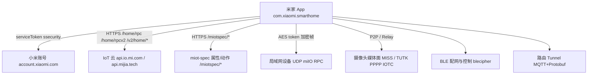
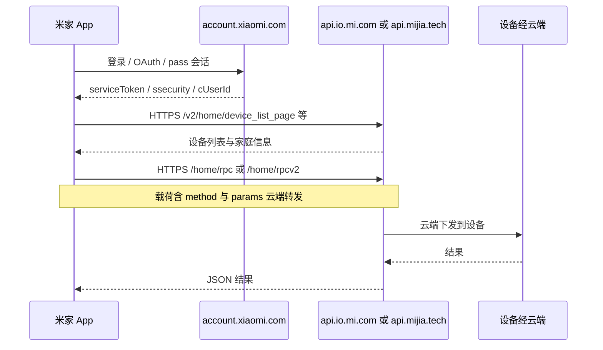
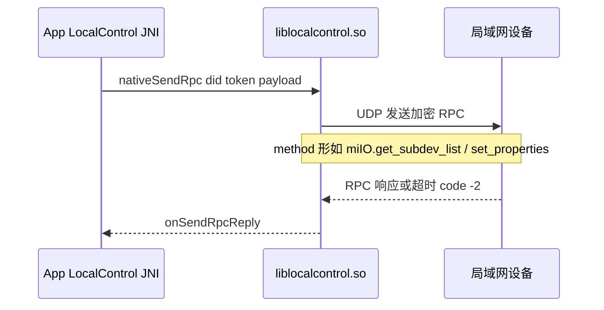
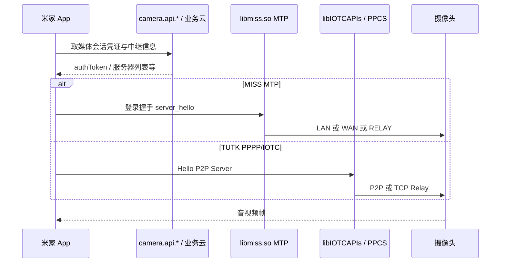

# 米家 App（com.xiaomi.smarthome）通信协议逆向分析技术方案

## 0、变更记录

| 版本 | 作者 | 日期 | 变更内容 |
| --- | --- | --- | --- |
| v0.1 | REA 静态逆向 | 2026-10-29 | 基于 Downloads 内 APK 静态证据初稿：云端 API / 局域网 miIO / Spec / 摄像头 P2P / 账号鉴权 |

> 说明：本文为**已发布 APK 静态逆向**产出，非 LUCP Flow 需求方案。未配置 JADX/apktool，**无 Java/Kotlin 反编译与完整 Manifest 明文**；结论区分观察 / 推断 / 未知。

## 1、需求概况

### 1.1 分析对象

| 项 | 值 |
| --- | --- |
| 本地路径 | `/Users/wuwei/Downloads/com.xiaomi.smarthome.apk` |
| 包名（Manifest 字符串池） | `com.xiaomi.smarthome` |
| 文件大小 | 239,364,085 bytes（约 228 MiB） |
| SHA-256 | `60faf083a7f1874423b77d034d2fbd11ff7f97aafeb656f35333dbd5e498ac28` |
| 版本线索 | Manifest 字符串池可见 `versionName` / `versionCode`，同池出现 `11.8.707` 等候选；**未用 aapt/apktool 解析属性绑定，正式 versionName 待确认** |
| 签名 | v1+v2+v3；声明证书指纹见下；**未做密码学校验** |
| DEX | 11 个 `classes*.dex`，合计约 95 MB |
| 原生库 | `lib/arm64-v8a` 约 132 个 `.so` |
| 容器清单 | 约 12,297 个 ZIP 条目 / 11,925 个内容节点（REA inventory） |

**签名声明（Evidence `ev_912f96184e82b36ddea52e52c97b2758bfd08d946a63f35e3c76f472d21ac0f0`）**

| Scheme | 证书 SHA-256（声明） |
| --- | --- |
| v1 / v2 | `b031fe98a4dbb0d4d82661787f25de643182b378e9ef632d8adea75aab58f2d8` |
| v3 | `237ada9aca86c5d0b0a411af5d3a899545969705f3b9e36f8d8508f4dfbd444d` |

`signer_change_declared_by_rotation=true`：存在密钥轮换 lineage 声明；`self_consistent=true` 仅表示内容摘要与当前字节一致，**不等于验签通过**。

### 1.2 分析目标与上下游

- **目标**：梳理米家 App 与云端 / 局域网设备 / 摄像头媒体面的通信协议分层、主要宿主、RPC 形态、鉴权材料与 native 落点，形成可继续加深的技术方案。
- **上游**：用户安装包；小米账号（Passport）。
- **下游**：设备固件（miIO/Spec）、摄像头 P2P/Relay、插件 RN SDK、商城/支付等周边域（本文弱覆盖）。

### 1.3 证据边界

| 类型 | 覆盖 |
| --- | --- |
| 已做 | APK 打开与 inventory、签名结构、DEX/SO 字符串挖掘、关键 so 符号/JNI 名 |
| 未做 | JADX 反编译、apktool 资源解码、运行时抓包、动态 Frida、完整 Spec 实例字段 |
| 工具缺口 | `REA_JADX_MCP_JAR`、`REA_APKTOOL_COMMAND` 未配置 |

## 2、技术方案

### 2.1 架构图（观察 + 推断）



### 2.2 核心时序图（强制）

#### 2.2.1 云端设备控制（推断主路径）



#### 2.2.2 局域网 miIO RPC（native 字符串直接观察）



观察样例（`liblocalcontrol.so`）：

```json
{"id":123,"method":"miIO.get_subdev_list","params":{"type":"…","online":true,"offset":0}}
{"from":"4","id":1,"method":"set_properties","params":[{"did":"473445998","piid":1,"siid":2,"value":false}]}
{"id":1,"result":"error","code":-2,"description":"send rpc timeout"}
```

#### 2.2.3 摄像头媒体通道（MISS / TUTK）



### 2.3 协议分层总览

| 层 | 宿主 / 载体 | 形态 | 主要证据 |
| --- | --- | --- | --- |
| 账号 | `account.xiaomi.com`、`api.account.xiaomi.com` | HTTPS OAuth / pass | DEX URL、`serviceToken`/`ssecurity`/`cUserId` |
| IoT 业务云 | `api.io.mi.com`、`api.mijia.tech`、`shopapi.io.mi.com` | HTTPS REST + RPC | `/home/rpc`、`/home/rpcv2`、`/v2/home/*` |
| Spec | `miot-spec.org`、路径 `/miotspec/*` | 属性/动作/事件 | `miot-spec-v2`、`get_properties`/`set_properties` |
| 局域网 | `liblocalcontrol.so` + `libmiio.so` | UDP + AES(token) | JNI `encrypt/decrypt`、`nativeSendRpc` |
| 摄像头 | `libmiss.so`、TUTK `IOTC`/`PPCS`/`AVAPIs` | P2P/Relay | `server_hello`、LAN/WAN/RELAY |
| BLE | `libblecipher.so`、`libmiio.so` BLE JNI | 近场加密 | `BLECipher.nativeEncrypt`、`bledecrypt` |
| 路由隧道 | `libtunnelandroidjni.so` | MQTT + Protobuf | `xiaomi::mqtt`、`TunnelSession` |
| 插件 UI | `assets/plugin_rn_sdk` | RN 插件资源 | 包内 assets |

## 3、详细设计

### 3.1 云端 API（C 端宿主与路径）

#### 3.1.1 宿主（DEX 字符串观察）

| 宿主 | 用途推断 |
| --- | --- |
| `api.io.mi.com` | 国内/经典 IoT API |
| `api.mijia.tech` | 米家技术域 API（含 `pv.`/`at.` 预发/海外线索） |
| `shopapi.io.mi.com` | 商城相关 |
| `camera.api.io.mi.com` / `camera.api.mijia.tech` | 摄像头业务；存在 `.*camera.api.*` 改写模板 |
| `stream.api.mijia.tech` | 流媒体相关 |
| `app.business.smartcamera.api.mijia.tech` | 智能摄像头业务 |
| `home.mi.com` / `g.home.mi.com` / `static.home.mi.com` | H5/文档/静态资源 |
| `account.xiaomi.com` | 账号登录与 OAuth |

环境相关字符串：`getServerEnv`、`appConfigEnv`、`preview`/`staging`/`pv.`/`st.` 前缀宿主。

#### 3.1.2 业务路径（DEX 出现）

| 路径 | 次数线索 | 说明 |
| --- | --- | --- |
| `/v2/home/device_list_page` | 高 | 分页设备列表 |
| `/v2/home/home_device_list` | 中 | 家庭设备列表 |
| `/v2/home/local_device_list` | 中 | 本地发现设备同步 |
| `/v2/home/camera_device_list` | 低 | 摄像头列表 |
| `/v2/home/get_device_cert` | 低 | 设备证书 |
| `/v2/home/bind_with_bindkey` / `report_new_bind` | 低 | 绑定 |
| `/home/rpc/` | 中 | 云端 RPC 转发 |
| `/home/rpcv2/` | 低 | RPC v2 |
| `/home/device_list` / `/home/device_list_page` | 低 | 旧版列表 |
| `/miotspec/prop/get` | 高 | Spec 读属性 |
| `/miotspec/prop/set` | 高 | Spec 写属性 |
| `/miotspec/action` | 高 | Spec 执行动作 |
| `/miotspec/event/get` | 中 | Spec 事件 |
| `/app/oauth/callback` | 低 | OAuth 回调 |

> `/app/…` 大量命中 AndroidX 类路径噪声，上表仅保留 IoT 相关。

#### 3.1.3 鉴权材料（字符串观察，实现细节未知）

| 材料 | 出现位置 | 推断角色 |
| --- | --- | --- |
| `serviceToken` / `servicetoken` | DEX 大量 | 账号会话令牌，请求头/Cookie 携带 |
| `ssecurity` | DEX | 与签名/加密相关密钥材料 |
| `cUserId` | DEX | 用户 ID |
| `_sign` / `INVALID_SIGN` / `sha256_sign` / `get_rpc_msg_sign` | DEX | 请求签名校验 |
| `package_sign` / `KEY_APK_SIGN` | DEX | 客户端完整性/签名校验相关 |

**未知**：具体 Header 名、签名字段拼装顺序、是否仍使用早期公开的 `nonce+ssecurity` 算法——需 JADX 或抓包确认。

### 3.2 局域网 miIO / Spec

#### 3.2.1 Native 与 JNI

| 库 | 角色 |
| --- | --- |
| `libmiio.so` | `com.xiaomi.miio.JNIBridge`：`encrypt`/`decrypt`/`hencrypt`/`hdecrypt`/`smencrypt`/`bledecrypt`；消息类型 `JNIBridge$MiioMsg`；依赖 `token` |
| `liblocalcontrol.so` | UDP socket、`lan_dm_send_rpc` / `lan_dm_send_object_rpc`、超时错误 |
| `liblocal_control_interface.so` | `LocalControl.nativeSendRpc`、`onSendRpcReply` |

推断：局域网帧使用 **设备 token** 派生的 AES（CBC 等符号存在于 `libmiio.so`）保护 JSON-RPC；端口经典公开资料常为 **UDP 54321**，**本包字符串未稳定打出 54321**，端口属推断/待抓包。

#### 3.2.2 miIO method 清单（字符串）

`miIO.info`、`miIO.handshake`、`miIO.get_subdev_list`、`miIO.config_router`、`miIO.config_router_safe`、`miIO.get_powermode`、`miIO.set_powermode`、`miIO.wifi_assoc_state`、`miIO.ota_install`、`miIO.ir_learn`/`ir_learn_stop`/`ir_read`、`miIO.zb_start_provision`/`zb_end_provision`、`miIO.get_central_link_passcode`、`miIO.event`、`miIO.xset`/`xdel` 等。

#### 3.2.3 Spec v2

- 标识：`miot-spec-v2`
- 控制面方法名：`get_properties` / `set_properties`（与 siid/piid/did 同现）
- HTTP 面：`/miotspec/prop/get|set`、`/miotspec/action`、`/miotspec/event/get`

### 3.3 摄像头与实时通道

| 组件 | 证据 | 作用 |
| --- | --- | --- |
| `libmiss.so` | `server_hello`、LAN/WAN/RELAY、`authToken`、MTP transaction | 小米自研媒体传输（MISS/MTP） |
| `libIOTCAPIs.so` / `libPPCS_API.so` / `libAVAPIs.so` / `libTUTKGlobalAPIs.so` | PPPP Hello、P2P Server、TCP Relay | TUTK 生态 P2P |
| `libmiio_PPPP_API.so` | 命名 | miIO 与 PPPP 桥接 |
| FFmpeg / ijkplayer 系列 | 大量编解码 so | 本地播放/转封装 |

MISS 侧可见诊断 JSON 形如：`internet/host/hello/nat/lan/wan`；以及 `p2p_info/connect/authorized/bandwidth/delay`。

### 3.4 BLE / 近场

- `libblecipher.so`：`BLECipher.nativeEncrypt` / `nativeMixA` / `nativeMixB`
- `libmiio.so`：`JNIBridge.bledecrypt`
- H5：`home.mi.com/views/bleMatch.html`

用于配网与 BLE 设备指令保护；算法细节未反编译。

### 3.5 路由 Tunnel

`libtunnelandroidjni.so` 含 `miwifi::tunnel`、`xiaomi::mqtt::ErrorType`、Protobuf `TunnelMessage` / `RelayClientMessage`、握手与 Ping。面向路由器文件/会话隧道，与家居 Spec 控制面分离。

### 3.6 前端模块 / 插件

- `assets/plugin_rn_sdk`：设备插件 RN 资源与 `miotsdk_*` 图集
- Hermes / fbjni / folly：RN 运行时存在

插件仍通过宿主 Native/云端通道发指令，不单独发明第二套设备协议（推断）。

### 3.7 应用改造总览

本节不适用（纯逆向梳理，无本仓库改造项）。

### 3.8 API 兼容与多端

观察存在 `api.io.mi.com` 与 `api.mijia.tech` 双宿主、以及 `pv.`/`st.`/`at.`/`staging` 环境前缀；海外 FDS（`awsusor`/`awsde0`/`awssgp`/`awsind`）用于资源包。具体国家路由规则未知。

## 4、稳定性与安全观察

| 项 | 观察 / 推断 |
| --- | --- |
| 传输 | 云端 HTTPS；局域网依赖 token+AES，同网攻击面需结合固件评估 |
| 账号 | Passport token 失效路径字符串丰富（`invalidateServiceToken`） |
| 签名轮换 | APK v3 证书与 v1/v2 不同，声明了 rotation |
| 摄像头 | 多通路（LAN/P2P/Relay）降级；含第三方 TUTK |
| 逆向风险 | 包体大、多 DEX、混淆类名（`OooO00o`）并存；核心加密在 so |

## 5、上线方案

本节不适用。

## 6、后续加深清单

1. 配置 `REA_JADX_MCP_JAR` + JDK，反编译请求签名与 `NetRequest` 组装类。  
2. 配置 `REA_APKTOOL_COMMAND`，解码 Manifest 权限全集与 `versionName` 绑定。  
3. 对 `libmiio.so` / `liblocalcontrol.so` 用 Hopper 打开，还原加密封包格式。  
4. 真实设备抓包：云端 RPC、局域网 UDP、摄像头建链各一条对照。  
5. 按 `miot-spec` 选一款设备拉 instance，补齐 siid/piid 语义表。

## 7、Evidence 索引

| Evidence ID | 操作 | 用途 |
| --- | --- | --- |
| `ev_912f9618…ac0f0` | `inspect_apk_signature` | 签名方案与证书指纹 |
| `ev_27203657…3592` | `inspect_artifact` | APK inventory 父证据 |
| `ev_c4e0761f…7568` | summary view | 条目规模摘要 |
| `ev_7993b888…b02` | inventory page | DEX/关键 so 条目 |

工件：`sha256:60faf083a7f1874423b77d034d2fbd11ff7f97aafeb656f35333dbd5e498ac28`。

## 8、结论（观察 / 推断 / 未知）

**观察**

- 包为正式签名 APK，多 DEX + 大量 arm64 native。  
- 云端以 `api.io.mi.com` / `api.mijia.tech` 为主，路径含 `/home/rpc(v2)`、`/v2/home/*`、`/miotspec/*`。  
- 账号面依赖 `serviceToken` / `ssecurity`。  
- 局域网控制由 `liblocalcontrol` + `libmiio` 完成，JSON-RPC + AES(token)。  
- 摄像头并行 MISS 与 TUTK PPPP/IOTC。

**推断**

- `/home/rpc*` 为云端设备方法转发；Spec HTTP 与局域网 `get/set_properties` 语义对齐。  
- `api.mijia.tech` 与 `api.io.mi.com` 为同能力不同域名/环境路由。  
- 局域网默认 UDP 加密端口沿用公开 miIO 习惯（待实证）。

**未知**

- 精确 `versionName`/`versionCode` 属性绑定。  
- 请求签名算法与 Header 全集。  
- miIO 二进制帧布局与 nonce 规则。  
- MISS 与 TUTK 的产品选型条件与失败切换策略。  
- 运行时是否还有未入字符串池的动态下发域名。
