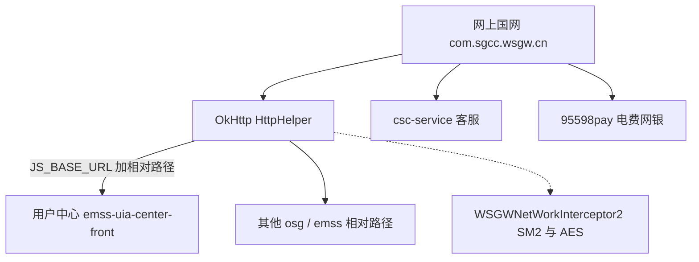
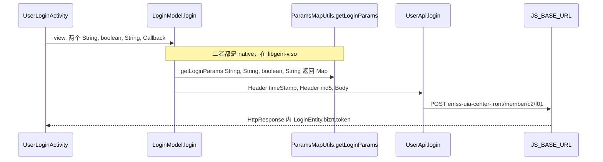
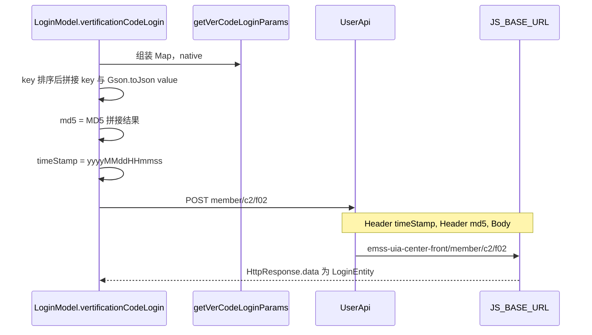

# 网上国网 App（com.sgcc.wsgw.cn）通信协议逆向分析技术方案

## 0、变更记录

| 版本 | 作者 | 日期 | 变更内容 |
| --- | --- | --- | --- |
| v0.1 | REA 静态逆向 | 2026-11-12 | 本地 `wsgw_android.apk`：签名、包清单、壳与业务 DEX、登录 Retrofit 注解、验证码/一键登录签名字节码 |
| v0.2 | REA 静态逆向 | 2026-11-12 | 补电费信息查询：首页余额/电量/优惠/费控预警、欠费与缴费记录、交费 SDK 户号查询 |

本文是已安装包的静态逆向，不是抓包结果。结论分成观察、推断、未知。未执行 APK，未做签名密码学校验。

## 1、需求概况

### 1.1 分析对象

| 项 | 值 |
| --- | --- |
| 本地路径 | `/Users/wuwei/Downloads/wsgw_android.apk` |
| 包名 | `com.sgcc.wsgw.cn`（`apkanalyzer manifest print`） |
| 文件大小 | 133,242,750 bytes |
| SHA-256 | `5bde9d4337cbfaede8717428de869e1211994f8c1ce504f2b603da451dc5e7bf` |
| 版本 | `versionName=3.2.3`，`versionCode=113` |
| ABI | 仅 `lib/arm64-v8a` |
| 构建 | `androidGradlePluginVersion=7.3.1` |
| mPaaS 声明 | `assets/mpaas.properties`：`AppId=ONEX5B6416C081602`，`WorkspaceId=default`，`Platform=ANDROID`；`assets/mpaas_baseline.config`：`baseline=v10.2.3.54` |
| 容器清单 | 7526 个条目 / 6930 个节点（REA inventory，coverage complete） |

**签名声明（Evidence `ev_738d00e453f9e2e9342aa0685fb5637451b134a49d9d92740f89cafce68ee569`，摘要视图 `ev_bc124c3c6f04595dadb3a9086ca2c6e6dfa161287045758c1ba0e1fd3b9ba057`）**

| Scheme | 证书 SHA-256（声明） |
| --- | --- |
| v1 / v2 | `b9537e857a2341eb747c0de008d4e834d897f20764d9c3f5500ffd94a51e0db4` |

无 v3 / v3.1，无 source stamp。`schemes_agree_on_signer=true`。`self_consistent=true` 只表示声明摘要等于当前字节，未做密码学校验。签名块文件名为 `META-INF/OSGSERVI.RSA`。

### 1.2 分析目标

- 梳理网上国网与云端的 HTTP 分层、宿主和登录入口。
- 登录接口写到路径、请求头、签名算法和响应字段能被 DEX 证明的程度。
- 电费信息查询写到路径、调用方和请求/响应字段能被 DEX 证明的程度。
- 支付下单、地图、推送、客服 WebSocket 只记录宿主，不展开。

### 1.3 证据边界

| 类型 | 覆盖 |
| --- | --- |
| 已做 | APK 签名、ZIP inventory、Manifest、壳 DEX 字符串、壳内 9 段明文 `dex\n035\x00` 的类/方法/注解、`libgeiri-v.so` 明文字符串 |
| 未做 | JADX（`REA_JADX_MCP_JAR` 未配置）、运行时抓包、Frida、native 函数反编译 |
| 壳 | `classes.dex` 的类型字符串是 Geiri 壳：`Lcom/px/GeiriShell;`、`libgeiri.so`、`assets/cert0_enc`、`geiridata/xXxX.enc`。壳头只声明 485 条字符串、41 个类。其后文件内还有 9 段头校验通过的 DEX（字符串规模约 3 万到 8 万）。业务类来自这 9 段，不是壳类型表 |

`assets/widget/js/login.js` 和 `assets/widget/assets/mvvm/login.js` 是 AppCan 示例：`SERVER_ROOT + "login"`，默认账号 `admin`/`admin`。这不是网上国网生产登录。

## 2、技术方案

### 2.1 架构（观察 + 推断）

业务登录不走 mPaaS `mgw.htm`。`UserApi` 是 Retrofit 接口，`HttpHelper.getService(UserApi.class, RequestConstants.JS_BASE_URL)` 取客户端。`JS_BASE_URL` 在 DEX 里静态值为 null，由 native `RequestConstants.setBaseUrl(Context, Location)` 赋值。`Location` 枚举是 `BEIJING`、`SHANGHAI`、`XIAN`。哪个枚举对应哪台主机，本次没有反编译 native，未知。

同库明文字符串里出现的国网主机（观察，未绑定到 `JS_BASE_URL`）：

| 字符串 | 出现位置 |
| --- | --- |
| `https://osg-service.sgcc.com.cn:18600` | `libgeiri-v.so`；DEX 另有 `https://osg-service.sgcc.com.cn:18600/osg-scp0010/recog/idcardAndUpload` |
| `https://osg-base.sgcc.com.cn:28660` | `libgeiri-v.so` |
| `osg-service.sgcc.com.cn`、`osg-static.sgcc.com.cn` | `libgeiri-v.so` |
| `https://osg-service-simu.sgcc.com.cn:28600`、`https://osg-base-simu.sgcc.com.cn:28660` | `libgeiri-v.so`，名称含 simu |
| `https://csc-service.sgcc.com.cn`、`https://csc-base.sgcc.com.cn:28002` | 客服 |
| `wss://csc-chat.sgcc.com.cn:20445/online-client/websocket` | 在线客服 |
| `https://payctl.95598pay.com`、`https://powerpcpay.95598pay.com` | 电费支付 |

相对路径直接拼在 `JS_BASE_URL` 后面。例如登录注解值是 `emss-uia-center-front/member/c2/f01`，前面没有单独的 `/osg-open`。

### 2.2 公共请求头（观察）

`HeaderCommonInterceptor.intercept` 的 `const-string`：

| Header | 值 |
| --- | --- |
| `t` | 与 `"0"`、`"99"`、`"98"` 出现在同一方法，具体赋值分支未逐条还原 |
| `UserId` | 运行时用户 |
| `AppGuid` / `AppGuidNew` | 运行时 |
| `security` | 字面量 `android` |
| `appcode` | 字面量 `WSGW-SG1001-APP` |
| `datacenter` | 运行时 |
| `AccessMethod` | 字面量 `App` |
| `deviceTokenTX` / `deviceTokenTXTime` | 运行时 |
| `province` | 运行时 |

登录接口另外带两个 Retrofit `@Header`，见 2.3。它们和上面的 `t` 不是同一个头。

### 2.3 登录接口

入口类：`com.sgcc.wsgw.userbundle.activity.login.UserLoginActivity`。调用 `LoginModel`，再调 `UserApi`。响应外层是 `HttpResponse`：`code`、`message`、`data`。登录业务体类型 `LoginEntity`，字段 `bizrt`。`LoginEntity$BizrtBean` 的访问器是 `token`、`expirationDate`、`userInfo`、`appuserlist`、`errors`。

`UserApi` 与登录相关的 `@POST`（注解 `value`，观察）：

| 方法 | 路径 | 参数 |
| --- | --- | --- |
| `login` | `emss-uia-center-front/member/c2/f01` | Header `timeStamp`，Header `md5`，`@Body` |
| `vertificationCodeLogin` | `emss-uia-center-front/member/c2/f02` | 同上 |
| `verCodeRegisterLogin` | `emss-uia-center-front/member/c2/f03` | 同上 |
| `oneKeyLogin` | `emss-uia-center-front/member/c2/f04` | 同上 |
| `netIDVerify` | `emss-uia-center-front/member/c2/f06` | 仅 `@Body` |
| `sendmessage` | `emss-uia-center-front/member/c1/f01` | 仅 `@Body`，发码 |
| `checkmessage` | `emss-uia-center-front/member/c1/f02` | 仅 `@Body`，验码 |
| `register` | `emss-uia-center-front/member/c9/f02` | Header `timeStamp`，Header `md5`，`@Body` |
| `loginOff` | `emss-uia-center-front/member/c3/f01` | 仅 `@Body`，注销 |
| `queryuserinfo` | `emss-uia-center-front/member/c9/f03` | 仅 `@Body` |
| `queryaccout` | `emss-uia-center-front/member/c9/f01` | 仅 `@Body` |
| `updatepassword` | `/emss-uia-center-front/member/c10/f01` | 注解值带前导 `/` |
| `updatepasswordbycode` | `emss-uia-center-front/member/c10/f03` | `@Body` |
| `authloginquery` | `emss-uia-center-front/member/c6/f01` | 三方登录查询 |
| `authloginbind` | `emss-uia-center-front/member/c6/f02` | 三方绑定 |
| `otherLoginQuery` | `emss-uia-center-front/member/c6/f04` | 三方查询 |
| `otherLoginBind` | `emss-uia-center-front/member/c6/f05` | 三方绑定 |
| `otherLoginOpenid` | `emss-uia-center-front/member/c11/f01` | openId |

#### 2.3.1 密码登录

观察：

- `LoginModel.login(IUserView, String, String, boolean, String, Callback)` 是 `PUBLIC NATIVE`。
- `ParamsMapUtils.getLoginParams(String, String, boolean, String)` 返回 `Map`，同样是 `PUBLIC NATIVE`。JNI 符号在 `libgeiri-v.so`。
- 接口注解已经固定路径和两个头的名字。Body 是 `RequestBody`。

推断：两个 `String` 与页面上的账号、密码对应，`boolean` 是登录选项。Map 里的 JSON 字段名在 native 里，这次没有还原。同模块非 native 代码里反复出现的信封字段是 `quInfo`、`uscInfo`、`token`、`target`、`source`（字面量 `app`）、`serviceCode`、`data`。`LoginParamsTool.getCommonParams` 里还有 `loginAccount`、`devciceId`、`devciceIp`（源码拼写就是少一个 v）、`tenantCode`=`state_grid`。这些字段是否出现在密码登录 Body 里，未知。

#### 2.3.2 timeStamp 与 md5（验证码登录、一键登录的字节码）

`vertificationCodeLogin`、`verCodeRegisterLogin`、`oneKeyLogin` 有 Java 字节码，三个方法结构相同。以 `oneKeyLogin` 为准：

1. `ParamsMapUtils.getOneKeyLoginParams(...)` 得到 `Map`。这一步本身是 native。
2. 取出 key，`Collections.sort`。
3. 从空串开始，按排序后的 key 拼接 `key + Gson.toJson(value)`。字符串值会被 Gson 加上引号。
4. `MD5.ToMD5` 对拼接结果取摘要，放进 Header `md5`。`ToMD5` 的十六进制大小写这次没单独反编译。
5. `DateUtil.getCurrentTimehms()` 的格式串是 `yyyyMMddHHmmss`，放进 Header `timeStamp`。时间戳不进入 MD5 原文。
6. `ParamsMapUtils.createRequestBody(Map)` 做 Body。该方法也是 native。
7. 客户端来自 `HttpHelper.getService(UserApi.class, RequestConstants.JS_BASE_URL)`。

密码登录的 Java 方法体不存在，不能把上述 MD5 步骤写成密码登录的已观察事实。它的 Retrofit 形参同样是 `timeStamp`、`md5`、`Body`，因此推断 native 侧沿用同一套头。

#### 2.3.3 其他登录方式（观察到的类，不展开协议）

| 方式 | 类或接口 |
| --- | --- |
| 短信验证码 | `UserSendVerCodeActivity`，`sendmessage` / `checkmessage`，字段名 `verCode`、`verCodeKey` |
| 一键登录 | `LoginJiGuangOneKeyManager`、`LoginOneKeyManager`，电信 `cn.com.chinatelecom.account.sdk.CtAuth`，移动 `com.cmic.gen.sdk.view.GenLoginAuthActivity` |
| 支付宝 / 微信 / QQ / 微博 | `AlipayLoginUtils`、友盟 `UMShareAPI`，`authloginquery` / `authloginbind` |
| 指纹、手势、面容 | `UserLoginOtherModeActivity`，`touchauth` / `touchbind` |
| 登录态失效 | `LoginTokenInterceptor` 的字符串含 `code`、`t`、`osg-uc0012/member/c7/f03`、`osg-uc0003/member/c7/f03` |

### 2.4 传输加密（观察名称，未还原密钥）

`libgeiri-v.so` 与下列类名相邻：

- `com.sgcc.wsgw.publiclibrary.http.WSGWNetWorkInterceptor2`
- `com.sgcc.wsgw.publiclibrary.http.WebAppAESUtil2`，字段名 `AES_ENCRYP_KEY`
- `com.sgitg.sgcc.sm.SM2Utils`，`publicKeySM2`，`privateKeySM2`
- 表单字段名 `skey`、`wsgwAESData`
- 字符串前缀 `AES_KEY=`、`SM2_PUBLIC_KEY=`、`SM2_PRIVATE_KEY=`
- `RSA/ECB/OAEPWithSHA256AndMGF1Padding`（`RSAEncrypt` / `RSAUtils2`）

这些名字说明链路上有 SM2 包 AES 密钥、密文放在 `wsgwAESData` 的实现。`HttpHelper.init` 没有 `const-string`，本次没有证明登录 POST 一定经过 `WSGWNetWorkInterceptor2`。密钥字节不写入本文。

### 2.5 登录时序（验证码登录，字节码已还原的部分）

### 2.6 电费信息查询

这些接口仍是 Retrofit `@POST`，相对路径拼在 `JS_BASE_URL` 上。方法参数只有 `@Body`，没有登录那两个 Header `timeStamp`、`md5`。公共头是否一定经过 `HeaderCommonInterceptor`，本次没有把拦截器安装点绑到 `IndexApi`，按同一 `HttpHelper` 客户端推断。

#### 2.6.1 首页：余额、电量、优惠、费控预警

接口类 `com.sgcc.wsgw.mainbundle.net.api.IndexApi`。调用方是 `HouseTabModel`。

| 方法 | 路径 | 调用链 | Body |
| --- | --- | --- | --- |
| `electricityQuery` | `emss-bia-balance-front/member/c16/f01` | `queryElectricity` → native `IndexParamUtils.getQueryElectricityParams` | `RequestBody`，JSON 字段在 native |
| `electricityBalanceQuery` | `osg-ev0004/balance/charge` | `queryElectricityBalance`；同一方法里还有 native `IndexParamUtils.getQueryElectricityParamsNew` | `RequestBody`，JSON 字段在 native |
| `discountMoney` | `emss-bia-bill-front/member/c32/f01` | `queryDisCountMoney` → native `IndexParamUtils.getQueryDisCountMontyParams`（方法名就是 Monty） | `RequestBody`，JSON 字段在 native |
| `electrombileQuery` | `emss-bia-bill-front/member/c1/f03` | 只看到接口声明，没有定位到 Java 调用方 | `RequestBody`，字段未知 |
| `queryFeeWarningValue` | `emss-sba-subscription-front/member/c7/f22` | `HouseTabModel.queryFeeWarningValue` | 形参类型 `FeeWarnginValueBody`（类名少一个 n） |

`FeeWarnginValueBody` 的实例字段（观察）：

| 字段 | 类型 |
| --- | --- |
| `mobile` | String |
| `list` | `ListBean`：`consNo`、`target` |

同一方法里还有字面量 `11102`、`51101`。没有证明它们被写入 Body。

响应模型是类上的实例字段。除下面点名的类以外，调用方法里没有对应的 `Class` 字面量，接口和模型的对应按类名、调用链标注为推断。外层普遍是 `code`、`message`、`data`。

| 模型 | 关系 | `data` 里可见字段 |
| --- | --- | --- |
| `HouseQueryEntity.ListEntity` | 推断，对应首页用电卡片 | `accountBalance`、`sumMoney`、`totalPq`、`totalDstAmt`、`penalty`、`penaltyEndDate`、`dayNum`、`amtTime`、`date`、`consNo`、`consType`、`proCode`、`isMent`、`isOverdue`、`overdueNumber`、`warningValue`、`sceneType`、`uuid` |
| `ECarBalanceChargeBean` | 推断，`electricityBalanceQuery` 的合并结果 | `wsgwBalanceResult.data.list` 与上一行同名字段；`wsgwElectChargeResult.data` 为 `ECarQueryEntity` |
| `ECarQueryEntity` | 推断，电量明细 | `rtnCode`、`rtnMsg`、`list[].list[]`：`amt`、`ym`、`consNo`、`consNo_dst`、`porCode` |
| `DisCountMoneyEntity` | 推断，`discountMoney` | `list[]`：`consNo`、`proCode`、`totalDstAmt`、`uuid` |
| `FeeWarningValueEntity` | 推断，`queryFeeWarningValue` | `rtnCode`、`rtnMsg`、`lists[]`：`consNo`、`proCode`、`itemCode`、`minWarningValue`、`maxWarningValue`、`validFlag` |

`EVBalanceBody` 同时带 `wsgwBalanceQueryVo` 和 `wsgwElectChargeQueryVo`。两边都是 `serviceCode`、`source`、`target`、`data`。`data` 里有 `acctId`、`channelCode`、`funcCode`、`serialNo`、`srvCode`、`userName`、`userAccountId`、`promotType`、`promotCode`、`list`。余额条目是 `consNo`、`consNoSrc`、`orgNo`、`proCode`、`sceneType`。电量条目是 `consNo`、`consNoOrig`、`porCode`，外加 `provinceCode`、`ym`。这个类没有出现在 `queryElectricityBalance` 的 `const-class` 里，是否就是该接口的 Body，未知。

#### 2.6.2 欠费与缴费记录

接口类 `com.sgcc.wsgw.mainbundle.net.IHomeRequestApi`。`PaymentRecordModel` 的字节码里直接出现下列键和字面量。

| 方法 | 路径 | `serviceCode` 字面量 |
| --- | --- | --- |
| `loadArrearageInfo` | `emss-bia-bill-front/member/c20/f01` | `0101294` |
| `loadPaymentRecordApi` | `emss-bia-bill-front/member/c12/f01` | `0101051` |

两边共有的键：`serviceCode`、`source`（字面量 `SGAAP`）、`target`、`data`，以及 `data` 内的 `srvCode`、`serialNo`、`channelCode`、`proCode`、`funcCode`（字面量 `A10000000`）、`acctId`、`userName`、`promotType`、`promotCode`、`consNo`、`consNoSrc`、`orgNo`。

缴费记录多出来的键：`page`、`number`（字面量 `20`）、`bgnPayDate`、`endPayDate`。日期格式串是 `yyyy-MM-dd`。

响应模型（类字段；`ShArrearageInfo` 在 DEX 里有 `const-class`，`PaymentRecordBean` 没有，对应关系按类名推断）：

| 模型 | 字段 |
| --- | --- |
| `ShArrearageInfo.data` | `rtnCode`、`rtnMsg`、`settleFlag`、`totalAmt`、`amtList` |
| `amtList[]` | `amt`、`consNo`、`psNo`、`releaseDate`、`amtListChildList` |
| `amtListChildList[]` | `amt`、`date`、`tip` |
| `PaymentRecordBean.data` | `rtnCode`、`rtnMsg`、`count`、`pageNo`、`recordNum`、`payList` |
| `payList[]` | `consNo`、`consName`、`elecAddr`、`payDate`、`payMode`、`payModeName`、`rcvAmt`、`meterAmt`、`penalty`、`typeCode`、`typeName`、`remark`、`totalDedAmt`、`totalRepAmt`、`repAmtList`、`repDedList` |

`loadPaymentRecordMenuIdApi` 的路径是 `emss-pfa-pro-front/app_api/new/selectServiceWithExhibition`，键是 `exhibitionCode`、`cityId`。这是缴费页菜单，不是账单。

#### 2.6.3 交费 SDK 里的户号电费查询

类 `com.htjc.pay.lite.moudle.IService`。下单、支付通道、支付密码不在本节。

| 方法 | 路径 | 请求里可见的键 |
| --- | --- | --- |
| `queryEleListInfo` | `emss-eaa-payelec-front/member/p1/f01` | `AddElecCounterActivity.queryEleInfo` 调用本方法，`const-string` 为 `TYPE`、`PROVINCE_CODE`、`POWER_USER_ID`、`ELEC_TYPE`、`SENSITIVE_POWER_USER_ID`、`ADD_TYPE` |
| `queryEleListInfoSingle` | `emss-eaa-payelec-front/member/p1/f03` | 未在 Java 方法里还原 |
| `queryEleInfoSingle` | `emss-eaa-payelec-front/member/p1/f04` | 未在 Java 方法里还原 |
| `queryPowerinfo` | `emss-eaa-withhold-front/member/c1/f11` | `MultiEleDetailZJActivity.queryPowerinfoForH5`：`POWER_USER_ID`、`AREA_CODE`、`SENSITIVE_POWER_USER_ID` |

户号电费响应模型是 `QueryEleInfoModel`（约 76 个字段）。和金额、电量直接相关的有：`POWER_USER_ID`、`POWER_USER_NAME`、`POWER_USER_ADDR`、`PROVINCE_CODE`、`BALANCE`、`AVALIABLE_BALANCE`、`OWE_AMT`、`BEFORE_ARREARAGE`、`THIS_ARREARAGE`、`PENALTY_AMT`、`TOTAL_PAY_BREACH`、`ADVICE_CHARGE_AMT`、`WARN_AMOUNT`、`LAST_CHARGE_DATE`、`QUERY_STATUS`、`ARREA_REC`。`ArreaRecModel` 的字段是 `ARREARAGE_AMOUNT`、`ARREARAGE_MONTH`、`ELECTRICITY`。

`getInfoAboutEleListPage`（`emss-eaa-payelec-front/member/p3/f03`）对应 `InfoAboutEleListPageModel`，是列表页按钮和积分抵扣配置，不是账单明细。

#### 2.6.4 电厂当月账单路径

`RequestConstants` 的静态初始化，以及 `libgeiri-v.so`，各有一条当月账单路径。它们不是 Retrofit 方法注解，Body 未知。

| 位置 | 路径 |
| --- | --- |
| `RequestConstants.<clinit>` | `osg-lc0003/powerPlant/qurCurrMonthBillByNoGdt` |
| `libgeiri-v.so` | `emss-pva-signandquery-front/member/powerPlant/qurCurrMonthBillByNoGdt` |

## 3、未知

- `JS_BASE_URL` 在北京 / 上海 / 西安三个枚举上的具体 URL。
- 密码登录 Body 的 JSON 字段。`getLoginParams` 在 `libgeiri-v.so`，未做 native 反编译。
- 密码登录是否使用 2.3.2 的 MD5 规则。
- `createRequestBody` 的 `Content-Type`。DEX 里另有 `application/json` 字面量，没有绑到这个方法。
- `MD5.ToMD5` 输出是大写还是小写。
- `WSGWNetWorkInterceptor2` 是否包住 `UserApi.login`。
- `LoginTokenInterceptor` 在什么 `code` 下调用 `osg-uc0012/member/c7/f03` 与 `osg-uc0003/member/c7/f03`。
- `IndexParamUtils.getQueryElectricityParams`、`getQueryElectricityParamsNew`、`getQueryDisCountMontyParams` 的 JSON 字段。三者都是 native。
- `electrombileQuery` 的调用方和 Body。
- `EVBalanceBody` 是否就是 `electricityBalanceQuery` 的 Body。
- `queryEleListInfoSingle`、`queryEleInfoSingle` 的请求字段。
- 电厂 `qurCurrMonthBillByNoGdt` 的请求体，以及两条路径分别在什么场景使用。
- 未抓包，所以上述路径没有线上请求样本。
