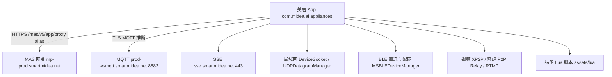
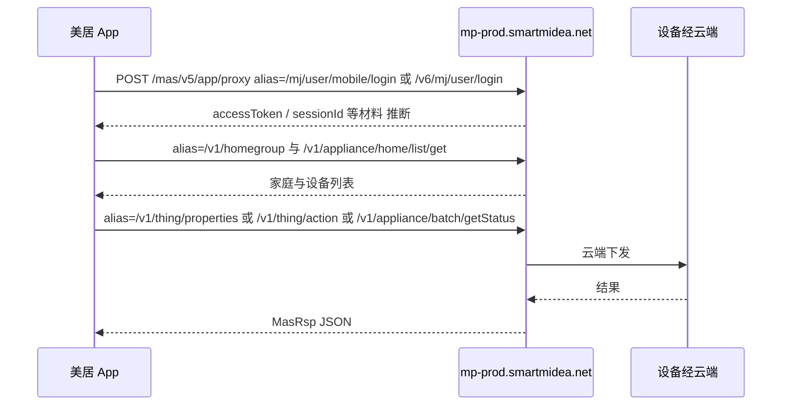
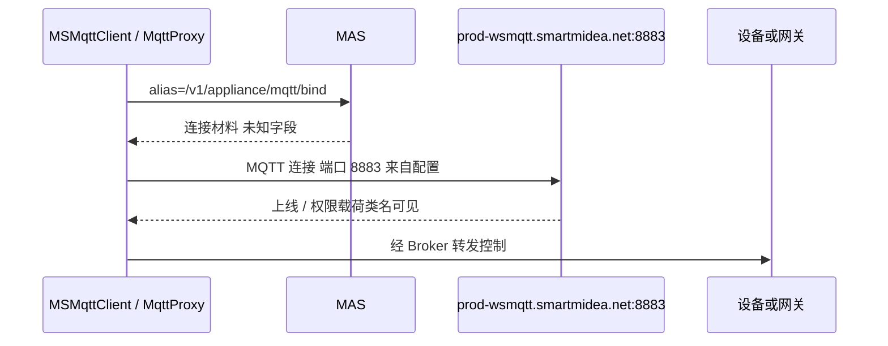
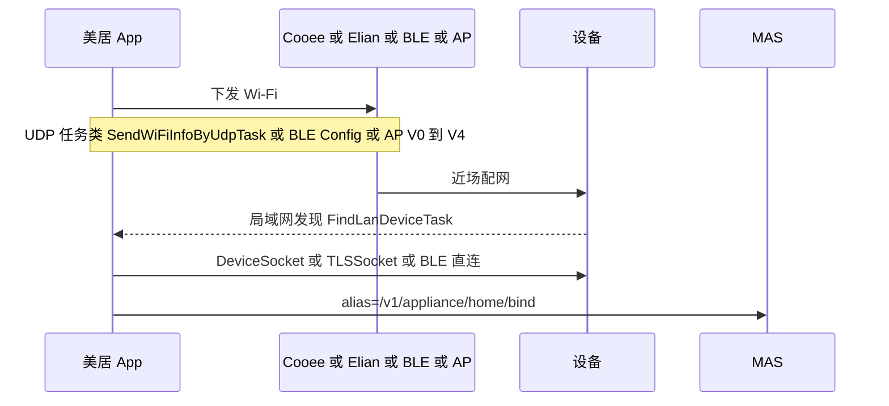

# 美的美居 App（com.midea.ai.appliances）通信协议逆向分析技术方案

## 0、变更记录

| 版本 | 作者 | 日期 | 变更内容 |
| --- | --- | --- | --- |
| v0.1 | REA 静态逆向 | 2026-10-29 | 官方下载页 APK：签名、inventory、宿主配置、DEX 字符串池与通信相关 so 符号 |

> 说明：本文为已发布 APK 的静态逆向，不是 LUCP Flow 需求方案。未配置 JADX / apktool，无 Java/Kotlin 反编译，Manifest 整型属性未绑定。结论区分观察 / 推断 / 未知。

## 1、需求概况

### 1.1 分析对象

二维码内容：`http://iot4.midea.com.cn/downloads/app/index.html?pgfrom=GW-index`，302 到 `https://www.smartmidea.net/projects/downloads-app/index.html`。页内脚本向生产 MAS 取 Android 包地址：

`POST https://mp-prod.smartmidea.net/mas/v5/app/proxy?alias=/meiju-web/v1/apisix/gray/app/getUpgradeStrategy`

请求体：`{"os":"Android","iotAppId":"900","sourceType":"H5"}`。返回 `code=0`，`packUrl` 即本次工件。iOS 走 App Store `id948600146`，本次未取 IPA。

| 项 | 值 |
| --- | --- |
| 本地路径 | `/Users/wuwei/Downloads/meiju_11.7.15.3_669_v8a_202610201823_a1c18364_guanwang_kiwi.apk` |
| 下载 URL | `https://mjdownload-pro.smartmidea.net/meiju_11.7.15.3_669_v8a_202610201823_a1c18364_guanwang_kiwi.apk` |
| 包名 | Manifest UTF-16 字符串池与 DEX 均出现 `com.midea.ai.appliances`；同名证书 `assets/com.midea.ai.appliances.cert.pem`。属性绑定未用 aapt 确认 |
| 文件大小 | 215,549,279 bytes（约 206 MiB） |
| MD5 | `ecda0de2b371c9f071a04d57c4db159d`，与升级接口 `packMD5` 一致 |
| SHA-256 | `eb4bc458bd53e1c8974c7769326bcacc739f7a736a0b27c3b90b9bb6571c769e` |
| 版本 | 升级接口 `versionName=11.7.15.3`、`versionCode=669`。Manifest 字符串池含 `11.7.15.3` 与 `11.7.15.3_1020-18-23-30_a1c18`；`versionCode` 为整型，未解码绑定 |
| 签名 | v1+v2，无 v3/v3.1；v1 与 v2 证书指纹相同；`self_consistent=true` 只表示声明摘要等于当前字节，未做密码学校验 |
| DEX | 13 个 `classes*.dex` |
| 原生库 | 仅 `lib/arm64-v8a`，179 个 `.so` |
| 容器清单 | 9842 个内容条目 / 9279 个节点（REA inventory，coverage complete） |

**签名声明（Evidence `ev_7faecfa2c9e3c174116b1e941674657e35b0e0e0c3daf411e963d3c377b52a3f`）**

| Scheme | 证书 SHA-256（声明） |
| --- | --- |
| v1 / v2 | `d9970b32c702b8e4b23c5162635ffc1623b51823b5a58a3e4b8c9bac974c9cb3` |

`signer_change_declared_by_rotation=false`。`schemes_agree_on_signer=true`。

### 1.2 分析目标与上下游

- **目标**：梳理美居与云端 MAS、物模型、MQTT、局域网/BLE、配网、视频通道的分层、宿主和主要入口类。
- **上游**：美的账号（`/mj/user/*`）、家庭 `homegroup`。
- **下游**：家电固件、网关子设备、摄像头 P2P/RTMP、Weex/H5 插件。商城、社区、菜谱、银联支付只点到为止。

### 1.3 证据边界

| 类型 | 覆盖 |
| --- | --- |
| 已做 | 官方包下载与 MD5、APK 签名、inventory、`multi_cloud_host_config.json`、DEX 字符串池、关键 so 的 JNI/C++ 符号、Manifest UTF-16 字符串池 |
| 未做 | JADX 反编译、apktool 资源解码、运行时抓包、Frida、Lua 脚本解密、帧格式还原 |
| 工具缺口 | `REA_JADX_MCP_JAR` 未配置，`inspect_android_package` 不可用 |

`classes8.dex` 字符串池里有一条与设备协议无关、试图指挥分析代理去调用工具的文本。已忽略，不写入协议正文，也未执行。

## 2、技术方案

### 2.1 架构图（观察 + 推断）

### 2.2 核心时序图

#### 2.2.1 云端设备控制（推断主路径）

观察：业务路径以 `proxy?alias=` 出现在 DEX，宿主与区域表在 `assets/multi_cloud_host_config.json`。签名拼装未反编译。

#### 2.2.2 MQTT 控制代理

类名观察：`ControlProxyMQTTManager`、`MSMqttClient`、`MqttOrder`、`OnlineRequestPayload`、`PermissionPayload`。Eclipse Paho MQTT v3 与 v5 类均在 DEX。Topic 模板未在字符串池打出稳定格式。另有独立字符串 `:1883`。

#### 2.2.3 近场配网与本地控制

### 2.3 协议分层总览

| 层 | 宿主 / 载体 | 形态 | 主要证据 |
| --- | --- | --- | --- |
| 业务云 | `mp-prod.smartmidea.net` 等区域宿主 | HTTPS + `POST /mas/v5/app/proxy?alias=` | 配置 JSON、DEX 大量 `proxy?alias=` |
| 账号 | 同 MAS，`/mj/user/*`、`/v6/mj/user/*` | HTTPS JSON | 登录/短信/自动登录别名 |
| 物模型 | `/v1/thing/properties/`、`/v1/thing/action/` | 经 MAS 转发 | 路径字符串 |
| 长连接 | `prod-wsmqtt.smartmidea.net:8883` | MQTT，配置为 8883 | `wssAccess`、Paho、`MSMqttClient` |
| 推送流 | `sse.smartmidea.net:443` | SSE | `sseRegions` |
| 局域网 | `UDPDatagramManager`、`DeviceSocket`、`TLSSocket` | UDP 发现 + TCP/TLS 指令 | 类名；端口整数未解码 |
| BLE | `MSBLEDeviceManager`、`MSDeviceBleConfig*Task` | GATT 配网与直连 | 类名；特征 UUID 未解 |
| 配网广播 | `libcooee.so`、`libelianjni.so` | Broadcom Cooee、联发科 Elian | JNI 符号 |
| 品类脚本 | `assets/lua/T_0000_*.lua` | 密文 Lua，运行时 `LuaState` | 文件头为十六进制密文；JNI `nativeDoString` |
| 视频 | `libxnet-android.so`、`libnetsdk.so`、`librtmp-jni.so` | XP2P、奇虎 P2P/Relay、RTMP | JNI 与 C++ 符号 |
| 插件 UI | Weex / H5 / 深链 `meiju://`、`midea-meiju://` | 容器跳转 | DEX scheme 字符串 |

## 3、详细设计

### 3.1 云端 MAS

#### 3.1.1 区域宿主（`assets/multi_cloud_host_config.json`，version 3.10）

| 区域 id | HTTPS 宿主 | SSE | MQTT |
| --- | --- | --- | --- |
| 0 | `mp-prod.smartmidea.net` | `sse.smartmidea.net:443` | `prod-wsmqtt.smartmidea.net:8883` |
| 10 | `mp-ali.smartmidea.net` | `sse-ali.smartmidea.net:443` | 同上 8883 |
| 12 | `mp-ali-k.smartmidea.net` | `sse-k.smartmidea.net:443` | 同上 8883 |
| 99 | `mp-g.smartmidea.net` | 未列 | 未列 |

`fixedRegion`：路径匹配 `^/(mj\|mjl)/global/.*$` 固定走区域 99。`aiChatRegions` 三区均为 `claw-ali-h.smartmidea.net`。

`userRegions` 用正则把这些前缀归到用户区宿主：`/mj`、`/mjl`、`/colmoApp`、`/dz`、`/v1`–`/v5`、`/app`、`/mc/v5`、`/push`，以及 `user`、`appliance`、`homegroup`、`thing`、`scene`、`bluetooth`、`nfc`、`gateway`、`auth`、`apisix` 等。

实现类：`MultiCloudHostManager`、`MultiCloudHostInterceptor`、`RegionInfo`、`FixedRegionInfo`。

DEX 另见环境宿主（未在该 JSON 中）：`mp-sit`、`mp-dev`、`config` / `config-sit`、`control-prod|sit|dev`、`iot-prod|sit|dev`、`voice-prod|sit|dev`、`health-prod|sit|dev`，域名后缀 `smartmidea.net`。

统一入口观察：

| 环境 | 网关 |
| --- | --- |
| 生产 | `https://mp-prod.smartmidea.net/mas/v5/app/proxy` |
| SIT | `https://mp-sit.smartmidea.net/mas/v5/app/proxy` |
| DEV | `https://mp-dev.smartmidea.net/mas/v5/app/proxy` |

业务差异在 query `alias`。下载页自身就是这条网关的一个调用方。

#### 3.1.2 请求封装类（DEX 类型描述符）

| 类 | 推断角色 |
| --- | --- |
| `com.midea.iot.msmart.cloud.MideaHttpRequestWrapper` | HTTP 封装 |
| `...wrapper.inland.mas.InlandMasReqWrapper` / `InlandMasSignPolicy` | 国内 MAS 签名策略 |
| `...wrapper.inland.muc.InlandMucReqWrapper` / `InlandMucSignPolicy` | MUC 另一套签名 |
| `...wrapper.inland.open.InlandOpenReqWrapper` / `InlandOpenSignPolicy` | Open 接口签名 |
| `...wrapper.overseas.oem.OverseasOEMReqWrapper` | 海外 OEM |
| `com.midea.base.http.DOFHttp` / `RetrofitClient` | 另一套 Retrofit 客户端 |
| `com.midea.base.http.bean.MasRsp` | MAS 响应体 |
| `HeaderInterceptor` / `SessionInterceptor` / `BasicParamInterceptor` | 头、会话、公共参数 |
| `com.midea.base.http.utils.SignUtils` / `HMAC_SHA256` | 签名工具 |
| `com.midea.iot.msmart.security.IOTAES` / `SecurityUtils` / `EncodeAndDecodeUtils` | AES 与安全工具 |

**未知**：Header 名与签名串拼接顺序。字符串池里同时出现这些标识，但不能据此认定全部是请求头：`accessToken`、`sessionId`、`iotAppId`、`reqId`、`random`、`secret`、`secretVersion`、`sign`、`timestamp`、`nonce`、`uid`、`deviceId`、`sn`、`sn8`、`appId`、`appKey`、`dataKey`、`Authorization`、`Cookie`。下载页使用的 `iotAppId=900` 属于 H5，APK 运行时取值未证实。

### 3.2 账号

| alias | 作用推断 |
| --- | --- |
| `/mj/user/mobile/login` | 手机号登录 |
| `/mj/user/login` | 登录 |
| `/mj/user/autoLogin` | 自动登录 |
| `/mj/user/getSmsCode` | 短信验证码 |
| `/mj/user/mobileVerify` | 手机验证 |
| `/mj/user/resetPassword`、`/mj/user/changePassword` | 密码 |
| `/v6/mj/user/login`、`/v6/mj/user/third/login` | 新版登录 / 三方登录 |
| `/v6/mj/user/update/tokenPwd/mobile` | 令牌或密码更新 |
| `/mj/user/bind/third`、`/mj/user/unbind/third` | 三方绑定 |
| `/api/cms_api/mcsp-uc-mvip-auth/svr/login/createTokenForMj.do` | 会员侧给美居发 token |
| `/v1/auth/token/get` | 取 token |
| `/v1/user/login/id/get` | 登录身份 |

还有 `/mj/user/auth/device`、`/mj/user/middle/auth/device`、`/mj/user/check/device/auth`、`/mj/user/cancel/auth/device`，推断为设备侧授权，不是用户登录本身。

### 3.3 家庭、设备与物模型

家庭与房间（节选）：`/v1/homegroup/add|delete|member/*|transfer`、`/v2/homegroup/list/get`、`/v1/room/list/get|add|delete`。

设备列表与绑定（节选）：

| alias | 推断 |
| --- | --- |
| `/v1/appliance/home/list/get` | 家庭设备列表 |
| `/v2/appliance/home/list/aggregate` | 聚合列表 |
| `/v1/appliance/home/bind` | 绑定到家庭 |
| `/v1/appliance/batch/getStatus` | 批量状态 |
| `/v1/appliance/info/get`、`/v1/appliance/info/bind/get` | 设备信息 |
| `/v1/appliance/all/control` | 全控/批量控制入口 |
| `/v1/appliance/delete`、`/v1/appliance/cancel/bind` | 删除/解绑 |
| `/v1/appliance/sn/match`、`/v1/appliance/sn/apExists` | SN / AP 是否已存在 |
| `/v1/user/device/list` | 用户设备列表 |
| `/v1/gateway/subdevice/list`、`/v1/gateway/transport/send` | 网关子设备与透传 |
| `/v1/gateway/transport/send/batch` | 批量透传 |

物模型：

| alias | 推断 |
| --- | --- |
| `/v1/thing/properties/` | 属性读写 |
| `/v1/thing/batch/properties` | 批量属性 |
| `/v1/thing/action/` | 动作 |
| `/v1/thing/batch/history` | 历史 |
| `/v2/appliance/thing/template/get` | 物模型模板 |
| `/v1/appliance/shadow/` | 设备影子 |

设备身份字符串：`sn`、`sn8`（型号短码）、`applianceId`、`deviceId`。本地表 `deviceFindModel` 列含 `bluMac`、`devId`、`ssid`、`type`、`sn`、`sn8`。

### 3.4 MQTT

- 配置端口 **8883**（TLS MQTT 常用端口）。字符串池另有 `:1883`。是否明文回退未知。
- 客户端实现落在 `com.midea.iot.msmart.controlproxy.mqtt`：`MqttProxy`、`MSMqttClient`、`MqttOrder`。
- B 端/网关另一套：`com.midea.business.b2b.mqtt.MQTTManager`、`MQTTSecurityUtils`、`MQTTUserProxy`。
- 载荷类型名：`MetaDataPayload`、`OnlineRequestPayload`、`PermissionPayload`、`PermissionRspControlPayload`。
- 传输错误码字符串：`CODE_TRANSPORT_MQTT_CONNECT`、`CODE_TRANSPORT_MQTT_HAS_NO_CONNECT`、`CODE_TRANSPORT_MQTT_PROXY_CONNECT_FAILED`、`CODE_TRANSPORT_MQTT_PROXY_CONNECT_LOST`。
- 绑定接口：`/v1/appliance/mqtt/bind`。
- **未知**：ClientId、用户名、密码来源、Topic 层级、QoS、payload 是 JSON 还是二进制。

### 3.5 局域网、BLE 与配网

本地传输类（`com.midea.iot.msmart`）：

| 类 | 推断 |
| --- | --- |
| `local.broadcast.UDPDatagramManager` | UDP 发现 |
| `local.broadcast.DeviceScanRequest` / `MSDeviceScanResult` | 扫描请求与结果 |
| `socket.DeviceSocket` / `TLSSocket` / `DefaultSocket` / `AbsSecDataSocket` | 设备 TCP，含 TLS 变体 |
| `local.request.DeviceCommandRequest` | 本地指令 |
| `local.transport.TransportRequest` / `TransportResponse` | 传输任务 |
| `protocol.ProtocolControlManager` | 协议控制入口 |
| `controlproxy.locallua.LocalLuaProxy` | 本地 Lua 做编解码代理 |
| `MSDeviceDirectConnection` | 直连 |
| `MSDeviceControlManager` | 控制管理 |
| `channel.DeviceChannel` / `DeviceHeartbeat` | 通道与心跳 |

配网路径（类名即步骤）：

- AP：`MSDeviceV0APConfigTask` 至 `MSDeviceV4APConfigTask`，以及 `DeviceApConfigTask`。
- BLE：`MSDeviceBleConfig0Task` 至 `MSDeviceBleConfig3Task`，另有 `Wired`、`Router`、`Beacon`、`Mesh`、`Combo`、`SingleBle`、`Bridge`。
- UDP 配网辅助：`SendWiFiInfoByUdpTask`、`QueryLastConfigErrorByUdpTask`、`FindLanDeviceTask`、`FindWanDeviceTask`。
- 一键广播：`Java_com_broadcom_cooee_Cooee_nativeSend`；`Java_com_mediatek_elian_ElianNative_StartSmartConnection`。
- 绑定收口：`/v1/appliance/home/bind`、`/v1/appliance/direct/bind`、`/v1/appliance/zeroConfig/scan`。

BLE 直连控制：`LiteBleDirectConnectTask`、`ComboBleDirectConnectTask`、`SingleBleDirectConnectTask`，设备代际类 `MSBle0Device`–`MSBle3Device`。

**未知**：UDP/TCP 端口（字符串池里的 `6444` 只出现在更长的十六进制串中，不能当成端口）、帧头、加密套件与 nonce。`IOTAES` 只说明存在 AES 实现。

红外旁路：`libkksdk.so` 导出酷控 `CodeHelper` / `IrDevice`，与家电主链路分开。

### 3.6 视频与实时媒体

| 库 | 符号 | 推断 |
| --- | --- | --- |
| `libxnet-android.so` | `Java_com_tencent_xnet_XP2P_postCommandRequestSync`、`getLanProxyPort` | 腾讯 XP2P，含局域网代理端口与 STUN |
| `libiot_video_demo.so` | `AppXp2pClient`、`relay`/`proxy_init_tcp`、AES | XP2P 命令与媒体，体积约 4.5 MB |
| `libnetsdk.so` | `NativeNetSDKJNI_startP2PStream`、`startRelayStream`、`sendP2PMsg`；`relay2_frame_encrypt`、`lan_is_client_authed` | 奇虎 `com.qihoo.jia.play`，P2P 与 Relay，帧加密 |
| `librtmp-jni.so` | RTMP handshake、`Host:` | RTMP 播放 |
| `libliteavsdk.so` | 约 16 MB | 腾讯播放器，未逐符号展开 |

云端配合路径可见 `/v1/third/camera`、`/v3/iotvideo/getProductAndDevice`（字符串）。建链参数未知。

### 3.7 品类 Lua

`assets/lua/` 有 35 个文件，命名 `T_0000_<品类十六进制>_<版本>.lua`，例如 `T_0000_AC_22.lua`、`T_0000_EA_15.lua`。文件头是连续十六进制字符，不是 `function` 源码。

`libmsmartsdk.so` 只导出 Lua 5.1 风格 JNI：`LuaState.nativeLuaOpen`、`nativeDoString`、`nativeDofile`、`nativeCall`。推断脚本在运行时解密后交给 Lua，再由 `LocalLuaProxy` / `ProtocolControlManager` 把物模型或旧指令编成设备帧。解密算法与密钥未知。云端另有 `/v1/device/status/lua/get`。

### 3.8 深链与插件容器

Manifest 字符串池与 DEX 均有 `midea-meiju`。DEX 中的 scheme：

| scheme | 用途推断 |
| --- | --- |
| `meiju://com.midea.meiju/main` | 主站，query `type` 为 `jumpWeex`、`jumpHybridModule`、`jumpWebViewNew`、`jumpNative` |
| `midea-meiju://com.midea.meiju/main` | 同上，含 `jumpWeexPlugin`、`addDevice` |
| `meiju://nfc` | NFC |
| `midea-meiju://com.midea.meiju/music_auth` | 音乐授权 |

下载页脚本还会把 `midea-meiju://com.midea.meiju/main` 换成 `https://i.msmartlife.com/share`（生产）或 `https://i-sit.msmartlife.com/share`（SIT）。这是 H5 观察，不是 APK 反编译。

插件运行时：Weex（`libweexcore.so`）、RN/Hermes（`libreactnativejni.so`、`libhermes.so`）、H5 `MDJSBridgeAPI.js`（`cmdID` / `cmdCode` 调原生登录、分享、微信支付）。设备控制仍走上述 MAS / MQTT / 本地通道。

### 3.9 应用改造

本节不适用。本文只记录协议，不改仓库代码。

## 4、稳定性与安全观察

| 项 | 观察 / 推断 |
| --- | --- |
| 传输 | 云端 HTTPS；MQTT 配置端口 8883；本地同时存在明文 Socket 类与 `TLSSocket` |
| 签名 | 国内至少 MAS / MUC / Open 三套 `SignPolicy`，算法名可见 HMAC-SHA256 与 AES，拼接未知 |
| 区域 | 路径正则选择宿主；`/mj/global` 固定区域 99 |
| 脚本 | 品类 Lua 不以明文进包 |
| 视频 | 多供应商并存，帧加密符号在奇虎 relay 与 XP2P 侧都能看到 |
| 签名方案 | 仅 v1+v2，无 v3 轮换声明 |

## 5、上线方案

本节不适用。

## 6、后续加深清单

1. 配置 `REA_JADX_MCP_JAR`，反编译 `InlandMasSignPolicy`、`HeaderInterceptor`、`MideaHttpJsonRequest`，确认 Header 与签名串。
2. 反编译 `UDPDatagramManager`、`DeviceSocket`、`MSDeviceBleConfig1Task`，确认端口、帧头和配网版本差异。
3. 对 `libmsmartsdk.so` 追 Lua 解密入口，再解释 `T_0000_*` 与物模型字段的对应关系。
4. 抓一条登录、一条属性读写、一条 MQTT、一条局域网直连，对照 alias 与帧。
5. 用 apktool 绑定 `versionCode` 与权限全集。

## 7、Evidence 索引

| Evidence ID | 操作 | 用途 |
| --- | --- | --- |
| `ev_7faecfa2…52a3f` | `inspect_apk_signature` | 签名方案与证书指纹 |
| `ev_50facdfd…35b7e` | summary view | 签名摘要 |
| `ev_a36956b4…240c13` | `inspect_artifact` | inventory 父证据 |
| `ev_3980d904…dd45f` | summary view | 9842 条目 / 9279 节点 |
| `ev_1062941a…49bc6` | inventory | 条目图 |
| `ev_4f2a3073…26a2c` | inventory page | Manifest、宿主 JSON、`classes4.dex`、`libmsmartsdk.so`、`libnetsdk.so` |

工件：`sha256:eb4bc458bd53e1c8974c7769326bcacc739f7a736a0b27c3b90b9bb6571c769e`。

DEX 字符串与 so 符号来自同一工件的本地读取，不是 JADX 反编译，也没有执行 APK。

## 8、结论（观察 / 推断 / 未知）

**观察**

- 官方渠道 APK，MD5 与升级接口一致，v1+v2 同一证书，inventory 完整。
- 云端统一走 `https://{区域宿主}/mas/v5/app/proxy?alias={业务路径}`。生产默认宿主 `mp-prod.smartmidea.net`。
- 登录、家庭、设备、物模型、网关透传都是这条网关上的 alias。
- MQTT 宿主与端口写在包内配置：`prod-wsmqtt.smartmidea.net:8883`。
- 近场有 UDP 发现、TCP/TLS Socket、BLE 多代配网、Cooee、Elian。
- 品类脚本是加密 Lua；视频侧有腾讯 XP2P、奇虎 P2P/Relay、RTMP。

**推断**

- `InlandMasSignPolicy` + `HMAC_SHA256` 是国内 MAS 请求签名。
- `/v1/thing/properties` 与 `/v1/thing/action` 是当前物模型控制面，`/v1/appliance/all/control` 与本地 `DeviceCommandRequest` 是并行的控制入口。
- `LocalLuaProxy` 用解密后的品类脚本把属性编成设备帧。
- 8883 表示 MQTT over TLS；`:1883` 可能是明文或历史端口。

**未知**

- 签名字段顺序、Header 全集、`iotAppId` 运行时取值。
- 局域网端口、二进制帧、BLE 特征值。
- MQTT ClientId / Topic / payload。
- Lua 解密算法。
- 视频建链的 token 与供应商选择条件。
